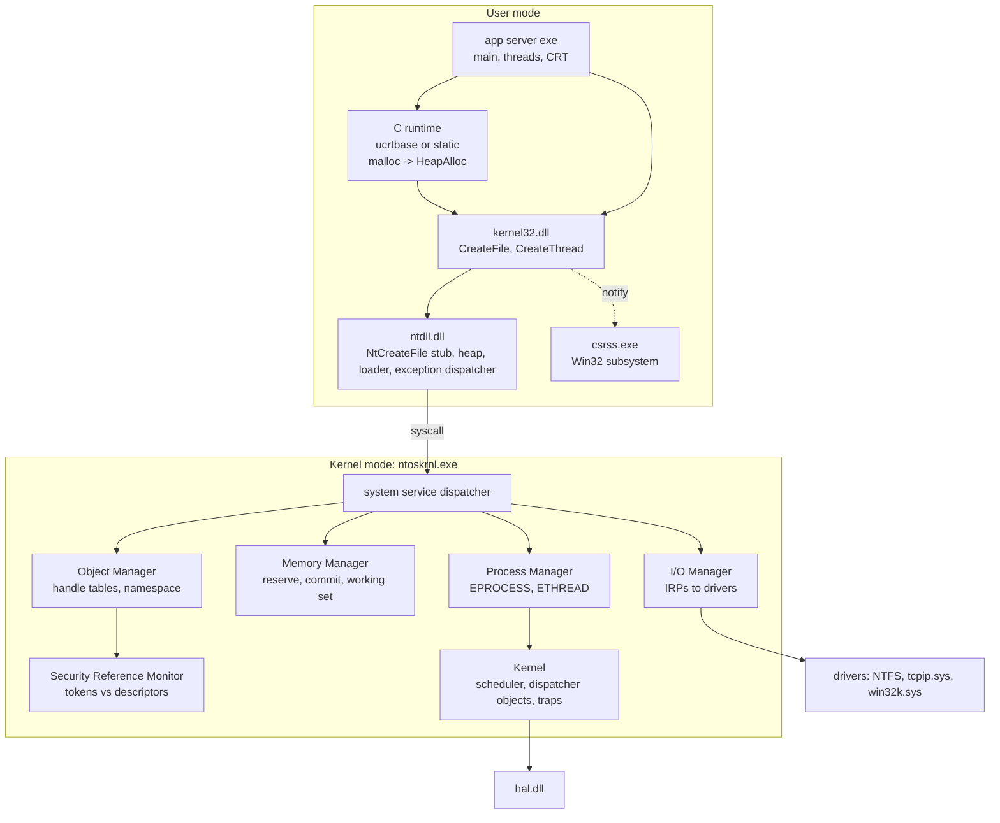

# Module 3.13: Windows internals and the Win32 API

**Estimated hours:** 4

**What you will learn**

1. How Windows is built (user-mode subsystems, `ntdll`, the Executive, the kernel, the HAL) and how "everything is an object with a handle" replaces Linux's "everything is a file".
2. The Win32 calls that map to what you already know: `CreateProcess` instead of `fork`, `CreateThread` and `_beginthreadex`, `CreateFile`/`ReadFile`/`WriteFile`, `GetLastError`, `VirtualAlloc`, and structured exception handling.
3. What the MSVC runtime is, why `/MT` and `/MD` and Debug and Release must not be mixed, and what a WinDbg dump of a Win32 process shows you.

**Prerequisites:** [Module 3.12: io_uring and Windows IOCP](module-12-io-uring-and-iocp.md). You need processes (3.01), threads (3.02), virtual memory (3.04), fds (3.08) and the Visual Studio 2022 setup from module 0.06.

---

## 1. One-line intuition

Windows is the same idea as Linux, a kernel that owns the hardware and hands out numbered tickets to user programs, but the tickets are called handles, every kernel thing is an object, and the names and rules differ in ways that bite if you assume they are the same.

## 2. Real-life analogy

Return to the office building from module 0.02. On Linux, the manager's filing system has one kind of ticket: a small numbered slip (a file descriptor) that works for documents, phone lines, pneumatic tubes and even the intercom. On Windows, the manager runs a **cloakroom**. Everything you ask for, a document, a phone line, a meeting room (a thread), a "someone has arrived" bell (an event), a key that only one tenant may hold at a time (a mutex), is checked into the cloakroom as an **object**, and you get a cloakroom **ticket**, a `HANDLE`. The ticket number tells you nothing about what it is for; only the cloakroom knows. When you are done you hand the ticket back (`CloseHandle`). The object is thrown away only when every ticket for it has been returned.

The manager's office has a strict front desk. Tenants never talk to the manager directly; they talk to a receptionist called `ntdll.dll`, who knows the secret door (the `syscall` instruction) and the current numbering of forms, which changes with every renovation. Tenants who try to use the secret door themselves break every time the building is renovated. That is why Windows programs call `kernel32.dll` and `ntdll.dll` instead of making system calls directly, and why Linux programs may make system calls directly: on Linux the form numbers never change.

## 3. Why it exists: the problem it solves

Windows NT was designed in 1989 to 1993 by a team led by Dave Cutler, who had built VMS at Digital. The goals were different from Unix: run several personalities (Win32, OS/2, POSIX) on one kernel, support many CPU architectures through a hardware abstraction layer, and secure every object with the same access-control mechanism. The result is a kernel where processes, threads, files, events, mutexes, shared memory sections, registry keys and timers are all **objects** managed by one Object Manager, each with a reference count, a security descriptor and a name in one namespace. That uniformity is why one function, `WaitForSingleObject`, can wait for a thread to exit, a mutex to become free, an event to be signalled, a process to end or a timer to fire.

For you the problem being solved is practical. The production application server of claim H4 was a Win32 process. The crash dumps of claim H5 were Windows dumps opened in WinDbg. Every line of that resume on Windows assumes you know: what a handle is and why leaking one matters, why `CreateProcess` replaces `fork` and `exec` in one call, why mixing C runtimes across DLLs corrupts the heap, and how an access violation becomes exception code `0xC0000005` in a dump. Without that, the Linux knowledge from modules 3.01 to 3.12 transfers only halfway.

## 4. Three layers of depth

### Layer 1 (beginner): the map of Windows and the vocabulary

**The layers, top to bottom.**

| Layer | What is in it | Linux rough equivalent |
|---|---|---|
| Your program | `app.exe`, linked against `kernel32.dll`, `user32.dll`, the C runtime | Your binary linked against `libc.so` |
| Subsystem DLLs | `kernel32.dll` (processes, files, memory), `user32.dll` and `gdi32.dll` (windows, drawing), `advapi32.dll` (security, registry), `ws2_32.dll` (sockets) | `libc`, `libpthread`, `libX11` |
| `ntdll.dll` | The real gateway: `NtCreateFile`, `NtReadFile`, `NtAllocateVirtualMemory`, each ending in a `syscall` instruction; also the user-mode loader, heap manager and exception dispatcher | The `syscall` wrappers inside `libc`, plus `ld.so` |
| Executive (kernel mode, in `ntoskrnl.exe`) | Object Manager, Memory Manager, I/O Manager, Process Manager, Security Reference Monitor, Cache Manager, Configuration Manager (the registry) | The kernel's VFS, mm, scheduler and security subsystems |
| Kernel (also in `ntoskrnl.exe`) | Thread scheduling, interrupt and exception dispatch, the low-level synchronisation primitives (dispatcher objects) | The scheduler and arch code |
| HAL (`hal.dll`) | Hides the differences between motherboards and interrupt controllers | `arch/` in the kernel source |
| Drivers | `.sys` files, including `win32k.sys` for the GUI and NTFS | Kernel modules |

**Important user-mode processes.** `smss.exe` (session manager, started first), `csrss.exe` (the Win32 subsystem process), `wininit.exe`, `services.exe` (starts services, the equivalent of systemd starting daemons), `lsass.exe` (logon and security), `svchost.exe` (hosts many services, which is why you see dozens of them). The `System` process with PID 4 is the kernel's own threads.

**Objects and handles.** Every kernel resource is an object: process, thread, file, event, mutex, semaphore, section (shared memory), timer, I/O completion port, registry key, token. Your program never sees the object; it gets a `HANDLE`, which is an opaque `void*` holding an index into the process's **handle table**. Handle values are small multiples of 4 (`0x4`, `0x8`, `0xA8`), which is why a handle printed as `000000000000A8` is normal. Two processes can have handles to the same object (via inheritance, `DuplicateHandle`, or opening the same name). The object lives until the last handle closes and the kernel's own references drop.

**`HANDLE` versus file descriptor.**

| | Linux fd | Windows `HANDLE` |
|---|---|---|
| Type | `int`, lowest free number | `void*`, opaque, multiple of 4 |
| Close | `close()` for everything | `CloseHandle()` for kernel objects; but `FindClose`, `RegCloseKey`, `FreeLibrary`, `UnmapViewOfFile`, `closesocket` for their own kinds |
| Error value | `-1` | `INVALID_HANDLE_VALUE` (which is `-1`) from `CreateFile`; `NULL` from `CreateThread`, `CreateEvent`, `CreateMutex`, `OpenProcess`. You must know which per function. |
| Inheritance by a child | All fds inherited unless `O_CLOEXEC` | Only if the handle was created with `SECURITY_ATTRIBUTES.bInheritHandle = TRUE` **and** `CreateProcess` was called with `bInheritHandles = TRUE` |
| Duplicate | `dup`, `dup2` | `DuplicateHandle`, which also works across processes |
| Standard streams | 0, 1, 2 | `GetStdHandle(STD_INPUT_HANDLE)` and friends |
| Waiting | `poll` on the fd | `WaitForSingleObject` / `WaitForMultipleObjects` on the handle, if it is a waitable type |
| Pseudo-handles | none | `GetCurrentProcess()` returns `-1`, `GetCurrentThread()` returns `-2`; do not close them |

**Processes: no `fork`.** `CreateProcessW(application, commandline, process_attrs, thread_attrs, inherit, flags, env, cwd, &startup_info, &process_info)` creates a new process running a new program in one call. There is no "copy of myself" step. The command line is one string that the child parses itself. You get back two handles, `hProcess` and `hThread`, and **you must `CloseHandle` both** even if you do not use them, or the process object lingers after the child exits. Wait for the child with `WaitForSingleObject(pi.hProcess, INFINITE)` and read its exit code with `GetExitCodeProcess`.

**Threads.** `CreateThread(attrs, stack_size, start_routine, argument, flags, &thread_id)` returns a handle. The start routine has signature `DWORD WINAPI f(LPVOID)`. Wait with `WaitForSingleObject`; read the return value with `GetExitCodeThread`. Default stack is 1 MB reserved (set in the executable header by the linker, `/STACK`), not 8 MB as on Linux.

**`CreateThread` versus `_beginthreadex`.** `_beginthreadex` is the C runtime's wrapper. It calls `CreateThread` after setting up the runtime's per-thread data (the storage behind `errno`, `strtok`, locale, and the C++ exception state). Microsoft's documentation says: if your thread uses the C runtime, create it with `_beginthreadex`. In practice the modern Universal CRT initialises its per-thread data lazily, so `CreateThread` usually works, but with a static runtime (`/MT`) it can leak that data at thread exit. Rule: C and C++ code uses `_beginthreadex`; `std::thread` (Phase 4) does the right thing for you.

**Files.** `CreateFileA("loan.dat", GENERIC_READ | GENERIC_WRITE, FILE_SHARE_READ, NULL, OPEN_ALWAYS, FILE_ATTRIBUTE_NORMAL, NULL)` opens or creates. Despite the name it also opens devices, pipes and the console. The fifth argument (`CREATE_NEW`, `CREATE_ALWAYS`, `OPEN_EXISTING`, `OPEN_ALWAYS`, `TRUNCATE_EXISTING`) is the equivalent of `O_CREAT`, `O_TRUNC`, `O_EXCL` combinations. The third argument, the **share mode**, has no Linux equivalent: it says what *other* opens are allowed while yours is active. `0` means exclusive, which is why "the file is in use by another process" is a Windows-only error. `ReadFile(h, buf, n, &got, NULL)` and `WriteFile(h, buf, n, &done, NULL)` are `read` and `write`. The `A` suffix means narrow (ANSI) strings; the `W` suffix means UTF-16 `wchar_t` strings, which is what the kernel actually uses. New code should use `W` and `wchar_t`; the course uses `A` where it keeps examples short.

**Errors.** Win32 functions return `FALSE`, `NULL` or `INVALID_HANDLE_VALUE` on failure and store a code per thread that you read with `GetLastError()`. It is the `errno` idea with different numbers: `ERROR_FILE_NOT_FOUND` = 2, `ERROR_PATH_NOT_FOUND` = 3, `ERROR_ACCESS_DENIED` = 5, `ERROR_SHARING_VIOLATION` = 32, `ERROR_IO_PENDING` = 997. `FormatMessage` turns a code into text. Read the code **immediately** after the failing call; any other Win32 call may overwrite it.

### Layer 2 (working engineer): memory, the C runtime, and exceptions

**The memory manager.** On x64 Windows a process's user address space is 128 TB (`0x0000'0000'0000'0000` to `0x0000'7FFF'FFFF'FFFF`); the kernel lives above `0xFFFF'8000'0000'0000`. Pages are 4 KB. Windows separates two steps that Linux's `mmap` blends:

| Step | Call | What it costs |
|---|---|---|
| **Reserve** | `VirtualAlloc(NULL, size, MEM_RESERVE, PAGE_NOACCESS)` | Address space only; no RAM, no page file. Granularity is 64 KB. |
| **Commit** | `VirtualAlloc(addr, size, MEM_COMMIT, PAGE_READWRITE)` | Charged against the **commit limit** (RAM plus page file). The system promises it can back these pages. Fails with `ERROR_COMMITMENT_LIMIT` if the promise cannot be kept. |
| Touch | first write | A page fault assigns a physical page; it joins the **working set** |
| Release | `VirtualFree(addr, 0, MEM_RELEASE)` | Both undone |

Linux overcommits by default and kills with the OOM killer later; Windows refuses at commit time. That is why a Windows server that allocates aggressively can fail an allocation that would have succeeded on Linux, and why the **Commit** column in Task Manager is the one to watch for leaks. The **working set** is the pages currently in RAM for the process; the page file (`C:\pagefile.sys`) is where committed-but-not-recently-used pages go. A thread's stack is a reserved region (1 MB default) with a guard page that commits more as the stack grows.

Above `VirtualAlloc` sits the **heap manager** in `ntdll` (`HeapCreate`, `HeapAlloc`, `HeapFree`), with a default process heap (`GetProcessHeap()`) and the Low Fragmentation Heap enabled by default. `malloc` in the modern Universal CRT calls `HeapAlloc` on the process heap. This is the Windows counterpart to the glibc arenas of module 3.05.

**The MSVC runtime (CRT).** When you compile with `cl`, your program links against a C runtime that provides `printf`, `malloc`, `strlen`, the C++ standard library, exception support and the startup code that calls `main`. Four flavours exist and the `/M` switch chooses:

| Switch | Linking | Files at run time | Use |
|---|---|---|---|
| `/MT` | Static, release | None (CRT code is inside your `.exe`) | Default for `cl` on the command line; single self-contained executables |
| `/MD` | Dynamic, release | `vcruntime140.dll`, `msvcp140.dll`, `ucrtbase.dll` (through `api-ms-win-crt-*.dll` forwarders) | Default in Visual Studio projects; required when several DLLs share one CRT |
| `/MTd` | Static, debug | None | Debug builds of standalone tools |
| `/MDd` | Dynamic, debug | `vcruntime140d.dll`, `msvcp140d.dll`, `ucrtbased.dll` | Debug builds of DLL-based products |

The debug CRT fills new heap memory with `0xCD`, freed memory with `0xDD`, and guard bytes with `0xFD`, adds a header to every block, and enables iterator checking in the C++ library (`_ITERATOR_DEBUG_LEVEL` = 2).

**Why mixing breaks `free`.** Each static CRT copy and each Debug/Release flavour has its own state: its own `FILE` table, `errno`, locale, and, in the debug flavours, its own heap block header. Suppose `a.dll` built with `/MTd` returns a pointer from `malloc` and your `/MD` executable calls `free` on it. The release `free` hands the pointer to `HeapFree`, but the debug `malloc` had placed a header before it, so the pointer is in the middle of a heap block. Result: heap corruption, often reported later as `STATUS_HEAP_CORRUPTION` (`0xC0000374`) somewhere unrelated. C++ objects are worse: a `std::string` from a Debug library has a different layout from a Release one, so passing it across the boundary corrupts memory even without `free`. The linker catches some of this: mismatched `_ITERATOR_DEBUG_LEVEL` or `RuntimeLibrary` across object files gives error `LNK2038`. Across DLL boundaries nothing checks. Rules: one CRT flavour for every DLL and executable in the process (`/MD` for all, or `/MDd` for all); free memory in the module that allocated it; never pass C++ standard library objects across a DLL boundary unless both sides were built identically.

**Structured exception handling (SEH).** Windows turns hardware faults into exceptions that user code can catch:

```cpp
__try {
    *p = 1;                              // p is null
}
__except (EXCEPTION_EXECUTE_HANDLER) {   // filter: 1 = handle, 0 = keep searching, -1 = resume
    DWORD code = GetExceptionCode();     // 0xC0000005
}
```

Common codes: `EXCEPTION_ACCESS_VIOLATION` `0xC0000005`, `EXCEPTION_INT_DIVIDE_BY_ZERO` `0xC0000094`, `EXCEPTION_STACK_OVERFLOW` `0xC00000FD`, `STATUS_STACK_BUFFER_OVERRUN` `0xC0000409` (also raised by `/GS` cookie checks and by the CRT on `abort`), `STATUS_HEAP_CORRUPTION` `0xC0000374`, `EXCEPTION_BREAKPOINT` `0x80000003`. The high bits encode severity: `0xC...` is an error, `0x8...` a warning. These are the numbers you read first in a WinDbg dump (module 8.03).

Two rules. First, `__try` cannot appear in a function that has C++ objects with destructors (compiler error C2712), so put SEH in a small plain function. Second, with `/EHsc` (the course's flag) C++ `catch (...)` does **not** catch an access violation; only `__except` does, or `/EHa` plus `_set_se_translator`. In a server you generally do not want to catch access violations at all: let the process die and write a dump, because the heap may already be corrupt.

**Looking at handles.** Task Manager's **Details** tab shows a handle count per process. **Process Explorer** (Sysinternals, free) shows every handle by type and name: View, Lower Pane View, Handles. **System Informer** (formerly Process Hacker) does the same. A server whose handle count rises steadily is leaking handles, which on Windows means objects (threads, events, files, sockets) that are never freed.

### Layer 3 (internals): a system call, a handle lookup, and an access violation

**A Win32 call from top to bottom.** `CreateFileA` in `kernel32.dll` converts the narrow string to UTF-16, prefixes the path to make `\??\C:\loans\loan.dat`, fills an `OBJECT_ATTRIBUTES` structure and calls `NtCreateFile` in `ntdll.dll`. `NtCreateFile` is a stub of a few instructions: load the system call number into `eax`, execute `syscall`. The number is assigned per Windows build, which is why nobody calls `syscall` directly on Windows. In the kernel, the system service dispatcher looks the number up in a table and calls the Executive's `NtCreateFile`. The Object Manager parses `\??\C:`, which is a symbolic link to `\Device\HarddiskVolume3`, finds the device object, and hands the rest of the path to the I/O Manager, which builds an I/O request packet (IRP) and sends it down the driver stack to NTFS. NTFS looks the name up in the Master File Table, the Security Reference Monitor compares the file's security descriptor against the caller's token, and on success the I/O Manager creates a **file object**, the Object Manager inserts a pointer to it in the process's handle table, and the handle index comes back up through `ntdll` to `kernel32` to you.

**A handle lookup.** On every `ReadFile`, the kernel takes the handle value, divides by 4, indexes the handle table (a one- to three-level table, like a page table), finds the object pointer and the access mask granted at open time, and checks that the requested operation (`FILE_READ_DATA`) is in the mask. A handle opened with `GENERIC_READ` cannot be used to write, no matter who you are: access is decided at open, not at use, exactly as with Linux `O_RDONLY`. Each kernel object starts with an `OBJECT_HEADER` holding a pointer count (kernel references) and a handle count; `CloseHandle` decrements the handle count and the object is destroyed when both reach zero.

**What `CreateProcess` does that `fork` plus `exec` does not.** It opens the executable, creates a section object for it, creates the process object (`EPROCESS`) with an empty address space, maps `ntdll.dll` and the image into it, creates the initial thread (`ETHREAD`) suspended, notifies `csrss.exe` so the Win32 subsystem knows about the new process, and resumes the thread, which starts in `ntdll`'s `LdrInitializeThunk` to load `kernel32.dll` and the other imports before reaching `main`. There is no moment where the child is a copy of the parent, which is why the Win32 way to pass state to a child is handles with inheritance, the command line, environment variables, or a named pipe, never "it will have a copy of my variables".

**From null pointer to `0xC0000005`.** The thread writes to address 0. The CPU takes a page fault (interrupt 14). The kernel's trap handler sees that the address is in user space and not mapped, so this is not a demand-paging fault to satisfy but an error. It builds an `EXCEPTION_RECORD` with code `STATUS_ACCESS_VIOLATION` and the faulting address, and calls `KiDispatchException`. If a debugger is attached it gets a **first-chance** notification (this is what WinDbg prints as "Access violation - code c0000005 (first chance)"). Otherwise the kernel pushes the record and a `CONTEXT` (all registers) onto the user stack and redirects the thread to `KiUserExceptionDispatcher` in `ntdll`. That routine calls `RtlDispatchException`, which walks the stack using the unwind tables that the compiler emitted (`.pdata` and `.xdata` sections; x64 SEH is table-based, with no runtime cost until an exception happens), calling each frame's `__except` filter in turn. If a filter returns `EXCEPTION_EXECUTE_HANDLER`, the stack is unwound to that frame and the handler runs. If no frame handles it, the debugger gets a **second-chance** notification, then `UnhandledExceptionFilter` runs, Windows Error Reporting may write a minidump (`.dmp`) according to the `LocalDumps` registry keys, and the process is terminated with the exception code as its exit code. That `.dmp` is what capstone C6 opens.

**What a dump contains.** A minidump (`procdump -ma` or WER with full dumps) holds every thread's registers and stack, the module list with versions, the handle table (`!handle` in WinDbg), the heap (`!heap`), and the exception record. Because handles, threads and the CRT heap are all kernel or runtime structures with known layouts, WinDbg can show you, for a crashed app server, how many threads were waiting on which critical section, which sockets were open, and whether the heap block under the faulting pointer had been freed. Module 8.03 walks that path.

## 5. Architecture diagram



The only way across the line is `ntdll.dll` executing `syscall`. Every object reached below the line is found through the process's handle table in the Object Manager.

## 6. Code

One Win32 program that touches each idea: a thread and its handle, waiting on it, a file written with `CreateFile` and `WriteFile`, the text of a failed open, reserving and committing memory, and an access violation caught as an SEH exception code. Save it as `win32_basics.cpp` and build from the Developer Command Prompt.

```cpp
// win32_basics.cpp: handles, a thread, a file, error text, memory, SEH.
// Build: cl /W4 /EHsc /Zi win32_basics.cpp
// Run  : win32_basics.exe
#include <windows.h>
#include <cstdio>
#include <string>

// Turn a GetLastError() code into text, the way strerror does for errno.
static std::string error_text(DWORD code) {
    char* msg = nullptr;
    DWORD len = FormatMessageA(
        FORMAT_MESSAGE_ALLOCATE_BUFFER | FORMAT_MESSAGE_FROM_SYSTEM | FORMAT_MESSAGE_IGNORE_INSERTS,
        nullptr, code, 0, reinterpret_cast<LPSTR>(&msg), 0, nullptr);
    std::string text = (len != 0 && msg != nullptr) ? std::string(msg, len) : "unknown error";
    if (msg != nullptr) LocalFree(msg);                 // FormatMessage allocated it
    while (!text.empty() && (text.back() == '\r' || text.back() == '\n' || text.back() == ' '))
        text.pop_back();
    return text;
}

struct WorkerArgs {
    int       loan_id;
    long long total;
};

// A thread entry point must have exactly this signature.
static DWORD WINAPI worker(LPVOID param) {
    WorkerArgs* args = static_cast<WorkerArgs*>(param);
    for (int i = 1; i <= 1000; ++i) args->total += i;
    std::printf("worker : thread id %lu, loan %d, sum 1..1000 = %lld\n",
                GetCurrentThreadId(), args->loan_id, args->total);
    return 7;                                            // the thread's exit code
}

// SEH lives in its own small function: a function containing __try may not
// also contain C++ objects that need destructors (error C2712).
static DWORD touch_null_pointer() {
    DWORD code = 0;
    __try {
        volatile int* p = nullptr;
        *p = 1;                                          // access violation
    }
    __except (EXCEPTION_EXECUTE_HANDLER) {
        code = GetExceptionCode();
    }
    return code;
}

int main() {
    // ---- 1. A thread, the handle that refers to it, and waiting on it ----
    WorkerArgs args = { 1001, 0 };
    DWORD tid = 0;
    HANDLE thread = CreateThread(nullptr, 0, worker, &args, 0, &tid);
    if (thread == nullptr) {                             // NULL on failure, not INVALID_HANDLE_VALUE
        std::printf("CreateThread failed: %s\n", error_text(GetLastError()).c_str());
        return 1;
    }
    std::printf("main   : created thread id %lu, handle %p\n", tid, thread);
    WaitForSingleObject(thread, INFINITE);               // a thread handle is a wait object
    DWORD exit_code = 0;
    GetExitCodeThread(thread, &exit_code);
    std::printf("main   : thread finished, exit code %lu, total %lld\n", exit_code, args.total);
    CloseHandle(thread);                                 // handle count drops; object can be freed

    // ---- 2. A file: CreateFile, WriteFile, CloseHandle ----
    HANDLE file = CreateFileA("loan_note.txt", GENERIC_WRITE, 0, nullptr,
                              CREATE_ALWAYS, FILE_ATTRIBUTE_NORMAL, nullptr);
    if (file == INVALID_HANDLE_VALUE) {                  // -1 on failure for CreateFile
        std::printf("CreateFile failed: %s\n", error_text(GetLastError()).c_str());
        return 1;
    }
    const char text[] = "loan 1001: balance 2500, rate 8.5\r\n";
    DWORD written = 0;
    if (!WriteFile(file, text, static_cast<DWORD>(sizeof text - 1), &written, nullptr)) {
        std::printf("WriteFile failed: %s\n", error_text(GetLastError()).c_str());
        return 1;
    }
    std::printf("main   : wrote %lu bytes to loan_note.txt via handle %p\n", written, file);
    CloseHandle(file);

    // ---- 3. Two failed opens and their error text ----
    HANDLE missing = CreateFileA("no_such_file.dat", GENERIC_READ, FILE_SHARE_READ, nullptr,
                                 OPEN_EXISTING, FILE_ATTRIBUTE_NORMAL, nullptr);
    if (missing == INVALID_HANDLE_VALUE) {
        DWORD err = GetLastError();                      // read it immediately
        std::printf("main   : open no_such_file.dat failed: error %lu (%s)\n",
                    err, error_text(err).c_str());
    } else {
        CloseHandle(missing);
    }
    HANDLE kernel = CreateFileA("C:\\Windows\\System32\\ntoskrnl.exe", GENERIC_WRITE, 0, nullptr,
                                OPEN_EXISTING, FILE_ATTRIBUTE_NORMAL, nullptr);
    if (kernel == INVALID_HANDLE_VALUE) {
        DWORD err = GetLastError();
        std::printf("main   : open ntoskrnl.exe for writing failed: error %lu (%s)\n",
                    err, error_text(err).c_str());
    } else {
        CloseHandle(kernel);
    }

    // ---- 4. Memory: reserve address space, commit one page, touch it ----
    const SIZE_T one_gb = static_cast<SIZE_T>(1) << 30;
    void* region = VirtualAlloc(nullptr, one_gb, MEM_RESERVE, PAGE_NOACCESS);
    if (region == nullptr) {
        std::printf("VirtualAlloc reserve failed: %s\n", error_text(GetLastError()).c_str());
        return 1;
    }
    void* page = VirtualAlloc(region, 4096, MEM_COMMIT, PAGE_READWRITE);
    if (page == nullptr) {
        std::printf("VirtualAlloc commit failed: %s\n", error_text(GetLastError()).c_str());
        return 1;
    }
    static_cast<char*>(page)[0] = 'A';                   // first touch: page fault, page joins working set
    std::printf("main   : reserved 1 GB at %p, committed one page, wrote 'A' to it\n", region);
    VirtualFree(region, 0, MEM_RELEASE);

    // ---- 5. SEH: an access violation becomes an exception code ----
    DWORD code = touch_null_pointer();
    std::printf("main   : caught exception code 0x%08lX (%s)\n", code,
                code == EXCEPTION_ACCESS_VIOLATION ? "EXCEPTION_ACCESS_VIOLATION" : "other");
    return 0;
}
```

Build and run from the Developer Command Prompt for VS 2022:

```bat
cl /W4 /EHsc /Zi win32_basics.cpp
win32_basics.exe
type loan_note.txt
```

Expected output (thread ids, handle values and the reserved address vary; the `worker` line may appear before or after the `created thread` line because both threads run at once):

```text
main   : created thread id 18244, handle 00000000000000A8
worker : thread id 18244, loan 1001, sum 1..1000 = 500500
main   : thread finished, exit code 7, total 500500
main   : wrote 35 bytes to loan_note.txt via handle 00000000000000A8
main   : open no_such_file.dat failed: error 2 (The system cannot find the file specified.)
main   : open ntoskrnl.exe for writing failed: error 5 (Access is denied.)
main   : reserved 1 GB at 000001C7A2F40000, committed one page, wrote 'A' to it
main   : caught exception code 0xC0000005 (EXCEPTION_ACCESS_VIOLATION)
loan 1001: balance 2500, rate 8.5
```

Three things to notice. The file handle may reuse the value the thread handle had (`A8` twice), because `CloseHandle` freed that slot; handles are table indexes, like fds. Error 2 on Windows happens to be the same number as `ENOENT` on Linux, but error 5 is not `EACCES` (13); never assume the numbers match. And the 1 GB reservation cost nothing: Task Manager's commit column moves by 4 KB, not 1 GB.

## 7. Use case: core-banking loan-origination platform

The production application server from claim H4 ran as a Win32 service: one process, a pool of worker threads, a listening socket, a handful of database connections, and a log file. Three Windows-specific facts drove three decisions.

**Decision 1: one CRT flavour across every module, enforced by the build.** The server loaded a vendor DLL for the host-interface protocol and the team's own DLLs for the master-table cache and the synchronisation layer. An early crash with `STATUS_HEAP_CORRUPTION` (`0xC0000374`) in `free` was traced to the vendor DLL built with `/MT` while the server used `/MD`: memory allocated inside the DLL was freed by the server's CRT. The fix was to route every allocation across that boundary through functions exported by the module that owned the memory, and to make the build reject any object file not compiled with the agreed `/MD` or `/MDd` flag. This is also why the course's C2 Win32 variant builds everything with one runtime switch from one CMake configuration.

**Decision 2: handle ownership with RAII wrappers, measured by handle count.** Every `CreateThread`, `CreateEvent`, `CreateFile` and socket produced a handle. A leak of one event handle per request would have reached the process handle limit (about 16 million) only after weeks, but it would have shown up in Process Explorer within hours as a rising handle count. The team wrapped every handle in a C++ type whose destructor called `CloseHandle` (the same idea as tcpkv's fd wrappers, claim I) and added the handle count to the server's health metrics. A flat line in that metric became one of the first checks in incident triage.

**Decision 3: never catch access violations; let the dump be written.** It was tempting to wrap request handlers in `__try` so that a bad request could not take the service down. The team decided against it: after an access violation the heap may already be corrupt, and catching it would have turned a clean crash with a dump into silent data corruption in a lending system. Instead, Windows Error Reporting was configured through the `LocalDumps` registry keys to write full dumps to a known folder, the service manager restarted the process, and the dump went to the on-call engineer. Claim H5's RCA documents were written from those dumps: `!analyze -v` for the exception code and faulting address, `~*k` for every thread's stack, `!handle` for what was open, `!heap -p -a` for the block under the bad pointer.

## 8. Lab

### Part A: build, run, and watch the handles (30 minutes)

1. Build and run the program from section 6. Confirm error 2, error 5 and `0xC0000005`.
2. Download Process Explorer from the Sysinternals site and run it. Add a `Sleep(60000);` call just before `return 0;` in `main`, rebuild, run, and find `win32_basics.exe` in Process Explorer. Select it, press `Ctrl+H` for the handle view. Find the handle of type `File` for `loan_note.txt`? It is not there, because you closed it. Comment out `CloseHandle(file);`, rebuild, run again: now the `File` handle is visible. This is what a handle leak looks like in a live process. Restore the line.
3. In Task Manager, Details tab, add the **Handles**, **Threads** and **Commit size** columns and compare with Process Explorer's numbers.

Expected: with the file handle leaked, Process Explorer shows a `File` entry whose name ends in `\loan_note.txt`. The handle count in Task Manager is one higher than with the close in place.

### Part B: the C runtime, four ways (30 minutes)

1. Build the same source four times and look at what each executable depends on:

```bat
cl /W4 /EHsc /Zi /MT  /Fe:basics_mt.exe  win32_basics.cpp
cl /W4 /EHsc /Zi /MD  /Fe:basics_md.exe  win32_basics.cpp
cl /W4 /EHsc /Zi /MDd /Fe:basics_mdd.exe win32_basics.cpp
cl /W4 /EHsc /Zi /MTd /Fe:basics_mtd.exe win32_basics.cpp
dumpbin /dependents basics_mt.exe
dumpbin /dependents basics_md.exe
dumpbin /dependents basics_mdd.exe
dir basics_*.exe
```

Expected: `basics_mt.exe` depends only on `KERNEL32.dll`; `basics_md.exe` adds `VCRUNTIME140.dll`, `MSVCP140.dll` and several `api-ms-win-crt-*.dll`; `basics_mdd.exe` lists `VCRUNTIME140D.dll`, `MSVCP140D.dll` and `ucrtbased.dll`. The `/MT` executables are noticeably larger because the runtime is inside them.

2. Add this to the top of `main` and rebuild with `/MDd` and `/MD`:

```cpp
    int* leak = static_cast<int*>(malloc(16));
    std::printf("main   : fresh malloc bytes: %02X %02X %02X %02X\n",
                static_cast<unsigned char>(reinterpret_cast<char*>(leak)[0]),
                static_cast<unsigned char>(reinterpret_cast<char*>(leak)[1]),
                static_cast<unsigned char>(reinterpret_cast<char*>(leak)[2]),
                static_cast<unsigned char>(reinterpret_cast<char*>(leak)[3]));
    free(leak);
```

Add `#include <cstdlib>`. Expected: the debug build prints `CD CD CD CD` (the debug CRT's "fresh memory" fill); the release build prints whatever was there, often zeros or leftovers. This fill pattern is how you recognise an uninitialised read in a debug dump.

### Part C: CreateProcess instead of fork (30 minutes)

Save as `spawn.cpp`, build with `cl /W4 /EHsc /Zi spawn.cpp`, run `spawn.exe`:

```cpp
// spawn.cpp: run a child program, wait for it, read its exit code.
#include <windows.h>
#include <cstdio>

int main() {
    char cmdline[] = "cmd.exe /c echo hello from the child & exit 42";  // must be writable
    STARTUPINFOA si = {};
    si.cb = sizeof si;
    PROCESS_INFORMATION pi = {};
    if (!CreateProcessA(nullptr, cmdline, nullptr, nullptr, FALSE, 0, nullptr, nullptr, &si, &pi)) {
        std::printf("CreateProcess failed, error %lu\n", GetLastError());
        return 1;
    }
    std::printf("parent : child pid %lu, process handle %p, thread handle %p\n",
                pi.dwProcessId, pi.hProcess, pi.hThread);
    WaitForSingleObject(pi.hProcess, INFINITE);
    DWORD code = 0;
    GetExitCodeProcess(pi.hProcess, &code);
    std::printf("parent : child exited with %lu\n", code);
    CloseHandle(pi.hThread);     // both must be closed, even if unused
    CloseHandle(pi.hProcess);
    return 0;
}
```

Expected:

```text
parent : child pid 20412, process handle 00000000000000A0, thread handle 00000000000000A4
hello from the child
parent : child exited with 42
```

Then: remove the two `CloseHandle` lines, add `Sleep(60000);` before `return`, run, and look at the process in Process Explorer. Expected: a `Process` handle to a `cmd.exe` that has already exited. On Windows a finished process whose handles are still open is the equivalent of a Linux zombie (module 3.01).

### Part D: first look at a crash in WinDbg (30 minutes)

1. In `win32_basics.cpp`, change `touch_null_pointer` so the `__try` and `__except` lines are removed, leaving the bare write through the null pointer. Rebuild with `/Zi` (you already have it; it produces `win32_basics.pdb`).
2. Open WinDbg (the Microsoft Store version or the SDK version), **File, Launch executable**, choose `win32_basics.exe`, and press `g` (go) in the command window. The earlier lines print, then WinDbg stops with:

```text
(4a2c.1b40): Access violation - code c0000005 (first chance)
```

3. Type `k` to see the call stack; `touch_null_pointer` is at the top, `main` below it. Type `r` to see registers; `rip` is the faulting instruction. Type `!handle 0 f` to list every handle the process holds with its type. Type `~` to list threads. Type `.exr -1` to print the exception record: code `c0000005`, and the address being written, `0000000000000000`.
4. Type `q` to quit. Restore the `__try` block.

Expected: the exception code matches the one your program caught in section 6; the handle list shows `File` handles for the console and `Event`, `Directory` and `Key` handles the runtime opened. Module 8.03 teaches the full method; today you only need to see that the dump contains exactly the things this module described.

### Journal

Copy [journal/TEMPLATE.md](../journal/TEMPLATE.md) to `journal/YYYY-MM-DD-windows-internals-win32.md`. Record: the error codes and texts from Part A, the handle leak as it appeared in Process Explorer, the dependency lists for `/MT`, `/MD` and `/MDd` from Part B and the `CD CD CD CD` fill, the zombie-like process handle from Part C, and the `k`, `.exr -1` and `!handle` output from Part D.

## 9. Common mistakes and misconceptions

| Mistake | Why it is wrong | Bug it causes later |
|---|---|---|
| Checking `CreateThread` against `INVALID_HANDLE_VALUE` | It returns `NULL` on failure; `CreateFile` returns `INVALID_HANDLE_VALUE` | A failure that is never detected, then a wait on a bogus handle |
| Not closing `pi.hProcess` and `pi.hThread` after `CreateProcess` | The process and thread objects stay alive after the child exits | Handle leak; exited children lingering like zombies |
| Calling `GetLastError` after another Win32 call | Any call may overwrite the per-thread error code | Error text that describes the wrong failure |
| Mixing `/MT` and `/MD`, or Debug and Release, across DLLs | Separate CRT state and different heap block layouts | `0xC0000374` heap corruption far from the real bug |
| Freeing memory in a different module from the one that allocated it | Same cause: the other module's CRT or heap may differ | Heap corruption that appears only with a particular DLL version |
| Expecting `fork` semantics from `CreateProcess` | The child starts fresh from its own `main` | Designs that expect copied variables or open fds in the child |
| Catching access violations with `__except` in a server | The heap may already be corrupt; the dump is lost | Silent data corruption instead of a clean crash with evidence |
| Treating a 1 MB thread stack as 8 MB | Windows reserves 1 MB per thread by default | Stack overflow (`0xC00000FD`) in deep recursion that works on Linux |
| Assuming Windows error numbers match `errno` | Only a few coincide (2 for not found); 5 is access denied, not 13 | Wrong branch in cross-platform error handling |
| Writing `%ld` for a `long` expecting 8 bytes | `long` is 4 bytes on Windows x64, 8 on Linux x64 | Truncated sizes and offsets in cross-platform code |

## 10. Resume link

- **Claim G, "Windows (Win32, MSVC, Visual Studio, MSBuild)".** The depth test is "what is a handle?" Answer: "An opaque index into the process's handle table, pointing at a kernel object with a reference count and an access mask fixed at open time; `CloseHandle` drops the count; the object dies when the last handle and kernel reference go." Follow-up: "Difference from a file descriptor?" Use the table in Layer 1: opaque not sequential, inheritance opt-in, several close functions, two different failure values.
- **Claim H4, "multithreaded application server ... Win32".** Say: "The production server was a Win32 service; threads were created through `_beginthreadex` because the handlers used the CRT; every handle lived in an RAII wrapper and the handle count was a health metric." Follow-up: "Why not catch access violations to keep the service up?" Section 7, decision 3.
- **Claim H5 and claim F, "crash dump analysis (WinDbg)".** You can now say what a Windows dump is and how it came to exist: page fault, `KiDispatchException`, first and second chance, `UnhandledExceptionFilter`, WER `LocalDumps`. Then name the first four commands: `!analyze -v`, `~*k`, `!handle`, `!heap -p -a`. Module 8.03 makes you fluent; this module makes you credible.
- **Claim B, "memory and ownership design".** The CRT-mixing rule (free in the module that allocated) is an ownership contract across a DLL boundary. It is the same discipline as the arena ownership contracts of claim H1, applied to Windows modules.
- **Claim C, "Win32 synchronisation (critical sections, wait objects)".** `WaitForSingleObject` on a thread handle in section 6 is your first wait object. Module 4.12 adds events, mutexes, semaphores and `WaitForMultipleObjects`, all of which are kernel objects from this module.

## 11. Interview questions

**Q1 (easy). What is a `HANDLE` and how does it differ from a Linux file descriptor?**

<details>
<summary>Model answer</summary>

A handle is an opaque value, a multiple of 4, that indexes the process's handle table; the table entry points to a kernel object (file, thread, event, mutex, section, process, key) and records the access granted at open time. A file descriptor is a small sequential integer into a table of open file descriptions. Differences: handles cover every object type, not only file-like ones; most are closed with `CloseHandle` but some types have their own close function; failure is `NULL` for some creators and `INVALID_HANDLE_VALUE` for `CreateFile`; inheritance by child processes is opt-in rather than default; and `WaitForSingleObject` can wait on any waitable handle directly.

</details>

**Q2 (easy). How do you create a child process on Windows, and what must you remember to do afterwards?**

<details>
<summary>Model answer</summary>

`CreateProcess` with the application path or a writable command-line string, a `STARTUPINFO` and a `PROCESS_INFORMATION`. It creates a fresh process running a new program in one step; there is no `fork`. Afterwards you must `CloseHandle` both `hProcess` and `hThread` even if you never use them, otherwise the process object outlives the child, like a zombie on Linux. To wait, call `WaitForSingleObject(hProcess, ...)` and `GetExitCodeProcess`. To pass state, use the command line, environment, inheritable handles with `bInheritHandles = TRUE`, or a named pipe.

</details>

**Q3 (medium). What are `/MT` and `/MD`, and why does mixing them across DLLs corrupt the heap?**

<details>
<summary>Model answer</summary>

`/MT` links the C runtime statically into the module; `/MD` links it dynamically so all modules share `ucrtbase.dll` and `vcruntime140.dll`. Debug variants `/MTd` and `/MDd` use a debug runtime with filled memory, block headers and checked iterators. Each static or debug copy has its own state: `FILE` tables, `errno`, locale, and in debug, its own heap block layout. If one module allocates and another frees with a different runtime, `free` operates on a pointer that does not match the allocator's bookkeeping, corrupting the heap, typically reported later as `0xC0000374`. C++ library objects also differ in layout between Debug and Release, so passing them across the boundary corrupts memory even without `free`. The rules: one runtime flavour for the whole process, free memory in the module that allocated it, and let the linker's `LNK2038` mismatch check catch what it can.

</details>

**Q4 (medium). Explain reserve versus commit in `VirtualAlloc`, and how Windows differs from Linux on overcommit.**

<details>
<summary>Model answer</summary>

Reserving claims a range of virtual addresses with 64 KB granularity but no backing; it costs nothing except address space, and pages are inaccessible. Committing promises backing for the pages and charges them against the system commit limit, which is RAM plus the page file; it fails if the limit would be exceeded. Physical pages are assigned on first touch and join the working set. Linux `mmap` with default overcommit hands out pages optimistically and the OOM killer resolves shortage later; Windows refuses at commit time, so an allocation can fail on Windows that would succeed on Linux, and the number to watch for leaks in Task Manager is commit size, not working set. Thread stacks use the same mechanism: 1 MB reserved, committed page by page through a guard page.

</details>

**Q5 (hard). Walk through what happens when a thread in a Win32 server writes through a null pointer, from the CPU to the `.dmp` file, and name what you would look at first in WinDbg.**

<details>
<summary>Model answer</summary>

The store to address 0 raises a page fault; the kernel trap handler finds no valid mapping and builds an exception record with `STATUS_ACCESS_VIOLATION`, `0xC0000005`, and the faulting address. `KiDispatchException` gives an attached debugger a first-chance look, then pushes the record and a full register `CONTEXT` onto the thread's user stack and transfers to `KiUserExceptionDispatcher` in `ntdll`. `RtlDispatchException` walks the stack using the compiler's unwind tables, calling each frame's `__except` filter; on x64 this costs nothing until an exception occurs. If no filter accepts, the debugger gets a second chance, then `UnhandledExceptionFilter` runs; with WER's `LocalDumps` configured, a minidump is written containing all threads' registers and stacks, the module list, the handle table and the heap, and the process is terminated with the exception code as its exit code. In WinDbg I open the dump and run `!analyze -v` for the exception code, faulting address and the stack of the faulting thread; `.exr -1` to confirm whether it was a read or write and the address (zero or near zero means a null struct pointer; a large garbage value means a dangling or corrupted pointer); `~*k` for every thread, to see what the others were doing, for example all waiting on one critical section; `!handle` to see what was open; and `!heap -p -a <address>` to see whether the memory under a suspicious pointer had been freed, which distinguishes use-after-free from overflow. The RCA then names the bug class, the evidence, the fix, and the check that proves it.

</details>

## 12. Revision

- Windows: program to `kernel32` to `ntdll` to `syscall` to the Executive (Object, Memory, I/O, Process managers, security monitor), kernel and HAL; nobody calls `syscall` directly because the numbers change per build.
- Everything is an object with a handle: opaque index, reference-counted, access fixed at open, `CloseHandle` to release, inheritance opt-in, `NULL` or `INVALID_HANDLE_VALUE` on failure depending on the function; `CreateProcess` replaces `fork`+`exec`; `_beginthreadex` for threads that use the CRT; `GetLastError` read immediately and `FormatMessage` for text.
- `VirtualAlloc` reserves then commits against RAM plus page file, no overcommit; one CRT flavour (`/MD` or `/MDd`) per process and free where you allocate; an access violation is `0xC0000005`, dispatched through `ntdll` to `__except` filters or to WER, which writes the dump you analyse in WinDbg.

---

Previous: [Module 3.12: io_uring and Windows IOCP](module-12-io-uring-and-iocp.md) | Next: [Module 4.01: Threads in C++](../phase-04-concurrency-deep-dive/module-01-threads-in-cpp.md)
