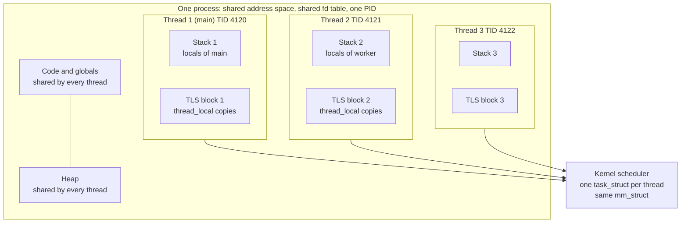

# Module 4.01: Threads in C++

**Estimated hours:** 3

**What you will learn**

1. How `std::thread` starts a thread the moment it is constructed, and why you must `join` or `detach` it before it is destroyed or the whole process dies.
2. How to pass work and data into a thread safely: by value, by `std::ref`, by moving a `unique_ptr`, and the lambda-capture mistake that creates a dangling reference.
3. What a thread is underneath: `pthread_create`, `clone3`, a separate stack and a `thread_local` block, and how to see all of it in `gdb` and `strace`.

**Prerequisites:** [Module 3.13: Windows internals and the Win32 API](../phase-03-os-internals/module-13-windows-internals-and-win32.md). You should also be comfortable with lambdas, `std::unique_ptr` and RAII from Phase 2, and with the process and thread model from Phase 3.

---

## 1. One-line intuition

A thread is a second clerk hired into the same office: it shares every pigeonhole with the first clerk, has its own desk and its own to-do list, and if you fire it before asking it to finish, the whole office shuts down.

## 2. Real-life analogy

In module 0.02 a process was a tenant company on its own floor. One clerk worked there. Now the company hires more clerks.

- **A thread** is one clerk. Every clerk in the company shares the same floor: the same memory, the same open files, the same PID.
- **Each clerk has a private desk**: its own registers and its own **stack** (the pile of papers for the function it is currently running). One clerk's local variables are on that clerk's desk, not on the shared wall.
- **Hiring** is `std::thread t(work);`. The new clerk starts immediately. You do not get to say "start later".
- **`join`** is waiting at the door until that clerk has finished and left. **`detach`** is saying "finish on your own, I will not wait" and losing the ability to ever ask about them again.
- **Firing a clerk who is still working** (destroying a `std::thread` that is still joinable) is treated as a programming error so serious that the C++ runtime closes the whole company: `std::terminate`.
- **A `thread_local` variable** is a locker with the clerk's name on it. Same variable name, one locker per clerk, and nobody else's hands go in it.

## 3. Why it exists: the problem it solves

A single thread can only do one thing at a time. Three problems push you to more than one:

1. **Parallelism.** Your laptop has 4 to 16 cores (module 0.01). One thread uses one core. A loan-origination server with 200 branch users on one thread would leave 7 cores idle while the queue grows.
2. **Blocking.** A thread that calls `read` on a socket sleeps until bytes arrive (module 3.09). If the only thread is asleep, nobody serves the other 199 users. A second thread can keep working.
3. **Responsiveness.** A thread that does a slow database write should not freeze the thread that accepts new connections.

Before C++11 there was no thread in the C++ language at all. You used `pthread_create` on Linux and `CreateThread` on Windows, with different signatures, and you wrote the wrapper yourself. `std::thread` (C++11) gives one portable interface. Underneath it still calls those two functions, and this module shows you both ends.

What breaks without a disciplined thread model: threads that are never joined (`std::terminate` at the worst moment), lambdas that capture locals by reference and read freed stack memory, exceptions that escape a thread and kill the process silently in production. Every one of those is a real incident category in capstone C6.

## 4. Three layers of depth

### Layer 1 (beginner): start, join, pass arguments

**Starting a thread.** `std::thread` takes a callable (a function, a lambda, a functor) and the arguments to call it with. The thread starts running before the constructor returns.

```cpp
#include <thread>
void work(int n);
std::thread t(work, 5);   // a new thread is now running work(5)
```

**Finishing a thread.** You must do exactly one of two things before `t` is destroyed:

| Call | Meaning | When to use |
|---|---|---|
| `t.join()` | Block the calling thread until `t` finishes | Almost always. You want the result or you want to know it is done. |
| `t.detach()` | Let `t` run on its own; you can never join it again | Rarely. Fire-and-forget background tasks that outlive nothing. |

If you do neither and `t` goes out of scope, the destructor calls `std::terminate()` and the process aborts. This is deliberate: the standard committee decided a forgotten thread is a bug, not a thing to silently detach.

**`joinable()`** tells you whether `join` or `detach` is still required. A default-constructed thread, a moved-from thread, and a thread already joined or detached are all not joinable.

**Passing arguments.** The arguments are copied (or moved) into storage that belongs to the new thread, and the function is called with those copies. Three consequences:

| You write | What the thread receives | Note |
|---|---|---|
| `std::thread t(f, x);` | A copy of `x` | Safe. Changes inside `f` do not affect `x`. |
| `std::thread t(f, std::ref(x));` | A reference to `x` | `x` must outlive the thread. `f(int&)` needs this; passing plain `x` to an `int&` parameter does not compile. |
| `std::thread t(f, std::move(p));` | Ownership of `p` (a `unique_ptr`) | After this line, `p` is null in the parent. |

**Lambdas as thread bodies.** `std::thread t([&]{ ... });` is common and dangerous. `[&]` captures locals by reference. If the function that created the thread returns before the thread uses the capture, the thread reads a dead stack frame: undefined behaviour. Prefer `[=]` or explicit captures, or `std::ref` when you mean it.

**Identity and count.** `std::this_thread::get_id()` returns a `std::thread::id` you can print and compare. `std::thread::hardware_concurrency()` returns the number of hardware threads (logical CPUs) or 0 if it cannot tell. It is a hint for sizing a thread pool, nothing more.

**`thread_local`.** A variable declared `thread_local` exists once per thread. Each thread sees its own copy, initialised when that thread first touches it (or at thread start for trivial types). The main thread's copy and a worker's copy are unrelated.

### Layer 2 (working engineer): ownership, exceptions, RAII and the Windows side

**A thread is a resource.** It is created, it must be released (joined), and forgetting is fatal. That is exactly the shape RAII was built for (module 2.03). The fix is a wrapper whose destructor joins:

```cpp
class JoiningThread {
public:
    explicit JoiningThread(std::thread t) : t_(std::move(t)) {}
    ~JoiningThread() { if (t_.joinable()) t_.join(); }
    JoiningThread(JoiningThread&&) noexcept = default;
    JoiningThread(const JoiningThread&) = delete;
    JoiningThread& operator=(const JoiningThread&) = delete;
private:
    std::thread t_;
};
```

Now an early `return` or an exception in the creating function still joins. C++20 added exactly this as **`std::jthread`**: it joins in its destructor and also carries a `std::stop_token` for cooperative cancellation. GCC 13 supports it with `-std=c++20`. In this course we stay on C++17 to match the resume, so you write the wrapper once and reuse it.

**Exceptions do not cross threads.** If the thread function throws and nothing inside that thread catches it, `std::terminate` is called and the process aborts, printing `terminate called after throwing an instance of ...`. The creating thread never sees the exception. In a server every worker body therefore starts with `try { ... } catch (...) { log; }`. To move an exception to another thread on purpose, use `std::exception_ptr` with `std::current_exception()` and `std::rethrow_exception()`, or use `std::async`/`std::promise`, which do it for you.

**Moving threads.** `std::thread` is move-only. You can return one from a function and store them in `std::vector<std::thread>`. `emplace_back(fn, args...)` constructs the thread in place and starts it.

**Thread-local storage, uses and costs.** Typical uses: a per-thread scratch buffer so workers never share one, a per-thread random-number generator, a per-thread error code (`errno` is `thread_local` in glibc), a per-thread cached database connection in the app server. Costs: every `thread_local` object is constructed once per thread that touches it and destroyed at that thread's exit, and memory is used per thread. Access cost is small for trivial types (one segment-relative load) and slightly higher for types with constructors, which need a one-time initialisation check on each access. Layer 3 shows the assembly.

**Stack size.** Each thread gets its own stack. On Linux glibc takes the default thread stack size from the process stack limit, typically 8 MiB (`ulimit -s`). On Windows the default is 1 MiB. That difference is a classic porting bug: a deep recursion that works on Linux overflows on Windows. The memory is reserved, not committed, so 100 threads do not eat 800 MiB of RAM; they eat 800 MiB of address space.

**Detach is almost always wrong in a server.** A detached thread that touches any object owned by someone else is a use-after-free waiting to happen at shutdown. The one accepted pattern is a thread that owns everything it touches and is allowed to die with the process.

**Mapping to Win32.** The resume lists Win32 threading. Module 4.12 goes deep; here is the dictionary so you can read either API today.

| Concept | Linux (pthreads, what libstdc++ uses) | Windows (Win32, what MSVC's `std::thread` uses) |
|---|---|---|
| Create | `pthread_create(&tid, attr, fn, arg)` | `_beginthreadex(NULL, 0, fn, arg, 0, &id)` (preferred; sets up the C runtime per thread) or `CreateThread` |
| Wait for finish | `pthread_join(tid, &ret)` | `WaitForSingleObject(handle, INFINITE)` then `CloseHandle(handle)` |
| Detach | `pthread_detach(tid)` | `CloseHandle(handle)` straight away; the thread keeps running |
| Current thread id | `pthread_self()`, `gettid()` | `GetCurrentThreadId()` |
| Exit from inside | `pthread_exit(ret)` | `_endthreadex(code)` |
| Per-thread variable | `thread_local`, `pthread_key_create` | `thread_local`, `__declspec(thread)`, `TlsAlloc`/`TlsGetValue` |
| Name a thread | `pthread_setname_np` (15 chars max) | `SetThreadDescription` |
| Default stack | typically 8 MiB | 1 MiB |
| CPU count | `sysconf(_SC_NPROCESSORS_ONLN)` | `GetSystemInfo` then `dwNumberOfProcessors` |

### Layer 3 (internals): what `std::thread t(f, x)` actually does

**In libstdc++ (GCC 13).** The constructor builds a small heap object holding a copy of the callable and the decayed copies of the arguments. It then calls `pthread_create` with a fixed start routine, `execute_native_thread_routine`, and passes a pointer to that object. The start routine runs on the new thread, invokes your callable, and deletes the object. `join` calls `pthread_join`; `detach` calls `pthread_detach`; the destructor checks `joinable()` and calls `std::terminate` if true. There is no magic: `sizeof(std::thread)` is 8 bytes, just the `pthread_t`.

**In glibc 2.39 (`pthread_create`).**

1. Allocate a stack with `mmap` (size from `ulimit -s`, typically 8 MiB) plus a **guard page** below it with no permissions, so a stack overflow faults instead of corrupting the neighbour. glibc keeps a cache of freed stacks so creating threads repeatedly is cheaper.
2. Place the thread descriptor and the **TLS block** (storage for every `thread_local` and for glibc's own `errno`) at the top of that stack.
3. Call the `clone3` system call with flags `CLONE_VM | CLONE_FS | CLONE_FILES | CLONE_SIGHAND | CLONE_THREAD | CLONE_SYSVSEM | CLONE_SETTLS | CLONE_PARENT_SETTID | CLONE_CHILD_CLEARTID`. Read those as: share memory, share the working directory, share the file descriptor table, share signal handlers, be a thread of the same process, set the TLS register, and clear a word in memory when the thread exits.

**In the kernel.** `clone3` makes a new `task_struct`, the same structure a process has (module 3.02). Because of `CLONE_VM` it points at the same `mm_struct` (address space). The scheduler sees one more runnable task. It gets its own **TID** (`gettid()`); for the first thread TID equals PID. `ls /proc/PID/task` lists every thread's TID. Linux really does treat threads as "processes that share memory", which is why `ps -L` and `top -H` can show them per line.

**Thread-local access.** On x86-64 Linux the TLS block is addressed through the `fs` segment register, set by `CLONE_SETTLS`. A `thread_local int counter` in the main executable compiles to one instruction: `mov eax, DWORD PTR fs:counter@tpoff`. A plain global is `mov eax, DWORD PTR counter[rip]`. Same cost class. For a `thread_local std::string`, GCC emits a tiny wrapper function (its mangled name starts with `_ZTW`) that checks a per-thread guard byte and runs the constructor on first use; every access goes through that check. In a shared library the address may instead be found by a call to `__tls_get_addr`, which is a few more instructions. None of this is slow, but it is why hot loops copy a `thread_local` into a local variable first.

**Join.** `pthread_join` waits on the `tid` field of the thread descriptor using the `futex` system call. When the thread exits, the kernel writes 0 to that field (the `CLONE_CHILD_CLEARTID` flag) and wakes the futex. Module 4.03 is entirely about futex; you will have seen it in `strace` by then.

**Exceptions.** `execute_native_thread_routine` does not wrap your callable in a `try`. An escaping exception unwinds to the top of the thread's stack, finds no handler, and the runtime calls `std::terminate`, which calls `abort`, which raises `SIGABRT`, which kills every thread in the process and (if enabled) writes a core dump.

## 5. Architecture diagram



Everything inside the outer box is one address space. The only private things a thread has are its stack, its TLS block and its registers. That is both the power (cheap sharing) and the danger (module 4.02).

## 6. Code

One program that exercises every rule from Layer 1 and Layer 2. The `print_mutex` is only there to stop two threads writing half-lines over each other; module 4.03 explains what it is.

```cpp
// threads_basics.cpp
// Shows: start/join, passing by value, by std::ref, by moving a unique_ptr,
// thread ids, hardware_concurrency, thread_local, and a joining RAII wrapper.
#include <functional>   // std::ref
#include <iostream>
#include <memory>       // std::unique_ptr
#include <mutex>
#include <sstream>
#include <string>
#include <thread>
#include <vector>

std::mutex print_mutex;   // keeps each output line whole (see module 4.03)

static std::string tid() {
    std::ostringstream os;
    os << std::this_thread::get_id();
    return os.str();
}

static void log(const std::string& line) {
    std::lock_guard<std::mutex> guard(print_mutex);
    std::cout << line << '\n';
}

// 1. Argument passed by value: the thread gets its own copy.
static void by_value(int n) {
    log("by_value got " + std::to_string(n));
}

// 2. Argument passed by reference: needs std::ref at the call site.
static void by_reference(int& n) {
    n += 100;
}

// 3. Argument that owns a resource: moved in, the parent no longer owns it.
static void takes_ownership(std::unique_ptr<std::string> p) {
    log("takes_ownership owns: " + *p);
}   // p is destroyed here, on the worker thread

// 4. One copy of this variable per thread.
thread_local int per_thread_counter = 0;

static void bump(int times) {
    for (int i = 0; i < times; ++i) {
        ++per_thread_counter;          // no race: each thread has its own
    }
    log("worker " + tid() + " counter = " + std::to_string(per_thread_counter));
}

// 5. RAII wrapper: destructor joins, so an early return cannot leak a thread.
class JoiningThread {
public:
    explicit JoiningThread(std::thread t) : t_(std::move(t)) {}
    ~JoiningThread() {
        if (t_.joinable()) {
            t_.join();
        }
    }
    JoiningThread(JoiningThread&&) noexcept = default;
    JoiningThread(const JoiningThread&) = delete;
    JoiningThread& operator=(const JoiningThread&) = delete;
private:
    std::thread t_;
};

int main() {
    std::cout << "hardware_concurrency = " << std::thread::hardware_concurrency() << '\n';
    std::cout << "main thread id       = " << tid() << '\n';

    int value = 5;
    std::thread t1(by_value, value);                  // copy of 5
    std::thread t2(by_reference, std::ref(value));    // reference to value
    auto owned = std::make_unique<std::string>("loan-1001");
    std::thread t3(takes_ownership, std::move(owned)); // ownership moves

    t1.join();
    t2.join();
    t3.join();
    std::cout << "value after by_reference = " << value << '\n';
    std::cout << "owned after move: " << (owned ? "still owned" : "null (moved into the thread)") << '\n';

    // thread_local: three workers, three separate counters, main's stays 0.
    std::vector<std::thread> workers;
    for (int i = 1; i <= 3; ++i) {
        workers.emplace_back(bump, i * 10);
    }
    for (auto& w : workers) {
        w.join();
    }
    std::cout << "main counter = " << per_thread_counter << '\n';

    {
        JoiningThread jt(std::thread([] { log("JoiningThread body ran on " + tid()); }));
    }   // jt's destructor joins here, before "done" prints
    std::cout << "done\n";
    return 0;
}
```

Compile and run:

```bash
g++ -std=c++17 -Wall -Wextra -Werror -g -pthread -o threads_basics threads_basics.cpp
./threads_basics
```

Expected output. Thread ids are different on every run; the three `worker` lines can appear in any order; everything else is fixed:

```text
hardware_concurrency = 8
main thread id       = 140245110728512
by_value got 5
value after by_reference = 105
owned after move: null (moved into the thread)
worker 140245110724160 counter = 10
worker 140245102331456 counter = 20
worker 140245093938752 counter = 30
main counter = 0
JoiningThread body ran on 140245093938752
done
```

Things to notice. `value` became 105 only because of `std::ref`; without it the code does not compile, because a copy cannot bind to `int&`. `owned` is null after the move: the string now belongs to the worker and is freed on the worker's thread. `main counter = 0` proves `thread_local` is per thread. The ids libstdc++ prints are the `pthread_t` values, which are addresses of the thread descriptors.

Now the two ways to kill the process. Save this as `terminate_demo.cpp`:

```cpp
// terminate_demo.cpp
// Build with -DFORGET_JOIN to see the destructor terminate,
// or with -DTHROW to see an escaping exception terminate.
#include <iostream>
#include <stdexcept>
#include <thread>

int main() {
#ifdef FORGET_JOIN
    std::thread t([] { std::cout << "worker running\n"; });
    // no join, no detach: t's destructor calls std::terminate
#endif
#ifdef THROW
    std::thread t([] { throw std::runtime_error("boom in worker"); });
    t.join();
#endif
    std::cout << "end of main\n";
    return 0;
}
```

```bash
g++ -std=c++17 -Wall -Wextra -Werror -g -pthread -DFORGET_JOIN -o forget_join terminate_demo.cpp
./forget_join; echo "exit code $?"
g++ -std=c++17 -Wall -Wextra -Werror -g -pthread -DTHROW -o throw_in_thread terminate_demo.cpp
./throw_in_thread; echo "exit code $?"
```

Expected (the order of `worker running` and `end of main` can vary in the first run):

```text
worker running
end of main
terminate called without an active exception
Aborted (core dumped)
exit code 134
terminate called after throwing an instance of 'std::runtime_error'
  what():  boom in worker
Aborted (core dumped)
exit code 134
```

Exit code 134 is 128 + 6, and 6 is `SIGABRT`. You will see that number in production logs; now you know two of the causes.

## 7. Use case: core-banking loan-origination platform

The application server from claim H4 served loan-origination requests over RPC on TCP. The first design decision was **how threads are created and owned**, and it was taken before any synchronisation code was written.

The rejected option was thread-per-request: `std::thread(handle, request).detach()` for every incoming RPC. It is three lines and it is wrong for a bank server. Creation costs an `mmap`, a `clone3` and a scheduler entry per request; under a burst of 2,000 logins at 9 a.m. the server would spawn 2,000 threads, each reserving 8 MiB of address space, and nothing could ever join them for a clean shutdown.

The decision: a **fixed pool of worker threads created at startup, sized from `hardware_concurrency()` and a config override, each stored in a joining RAII wrapper, joined on shutdown**. Requests go into a queue (module 4.04) and workers pull from it. Thread count never changes while the server runs, so memory and scheduling behaviour are predictable, and shutdown is "close the queue, join everything".

Two further decisions came from `thread_local`:

- Each worker kept a **`thread_local` decode buffer** for the RPC frame it was parsing, so workers never contended for one shared buffer and never allocated per request.
- Each worker kept a **`thread_local` database connection handle**. One thread, one connection, no lock around the connection. This is why the pool size and the database connection pool size were the same number in the config file.

An interviewer will ask "why not spawn a thread per request?" The answer is the cost list above plus the shutdown argument, and you will have measured thread creation cost in the lab.

The same decision is in tcpkv (claim I): "fixed thread pool" is the first phrase of the project description. Module 4.10 builds it on the queue from module 4.04.

## 8. Lab

### Part A: build, run, and read the interleaving (20 minutes)

1. Compile `threads_basics.cpp` with the command from section 6 and run it five times in a row: `for i in 1 2 3 4 5; do ./threads_basics | grep worker; echo ---; done`.
2. Record whether the three `worker` lines come out in the same order every time. Typically they do not. The scheduler, not your code, decides.
3. Remove `std::ref` so the line reads `std::thread t2(by_reference, value);` and compile. Copy the first line of the error into your journal, then put `std::ref` back.
4. Change `[]` in the `JoiningThread` lambda to `[&]` and add a local `int x = 7;` just before it that the lambda prints. It works, because `jt` is joined before `x` dies. Now imagine the lambda were started by a function that returned the thread: that is Part B.

### Part B: the three ways to crash (25 minutes)

1. Build and run `terminate_demo.cpp` both ways as shown in section 6. Confirm exit code 134 both times.
2. Fix the exception case: wrap the lambda body in `try { ... } catch (const std::exception& e) { std::cerr << "worker caught: " << e.what() << '\n'; }`. Rebuild and run. Expected: `worker caught: boom in worker`, then `end of main`, exit code 0.
3. Write `dangling.cpp`:

```cpp
#include <chrono>
#include <iostream>
#include <thread>

std::thread start_worker() {
    int local = 42;
    return std::thread([&local] {            // captures a reference to a local
        std::this_thread::sleep_for(std::chrono::milliseconds(50));
        std::cout << "local = " << local << '\n';   // local is gone by now: UB
    });
}

int main() {
    std::thread t = start_worker();
    t.join();
    return 0;
}
```

Build with the standard command and run it three times. Expected: it may print 42, it may print garbage, it may print 42 today and garbage after you add a function call in `main`. That is what undefined behaviour looks like: no error, no crash, just a program you cannot trust. Fix it by capturing `[local]` by value, and record both behaviours.

### Part C: see the threads from outside (25 minutes)

Write `sleepers.cpp`, which starts three workers that each sleep 60 seconds, then joins them:

```cpp
#include <chrono>
#include <thread>
#include <vector>

void worker(int seconds) {
    std::this_thread::sleep_for(std::chrono::seconds(seconds));
}

int main() {
    std::vector<std::thread> pool;
    for (int i = 0; i < 3; ++i) {
        pool.emplace_back(worker, 60);
    }
    for (auto& t : pool) {
        t.join();
    }
    return 0;
}
```

1. Build it, then run `./sleepers &` and note the PID printed by the shell.
2. `ls /proc/<PID>/task` should list four TIDs: the main thread (equal to the PID) and three workers. `ps -L -p <PID>` shows the same four with an `LWP` column. `LWP` means light-weight process, the kernel's name for a thread.
3. `ldd ./sleepers`. Expected: `libstdc++.so.6`, `libm.so.6`, `libgcc_s.so.1`, `libc.so.6`, and no separate `libpthread`. Since glibc 2.34 the thread functions live inside `libc.so.6`; `-pthread` is still the correct flag and is harmless.
4. `strace -f -e trace=clone3,clone ./sleepers` in a second run. Expected: three `clone3({flags=CLONE_VM|CLONE_FS|CLONE_FILES|CLONE_SIGHAND|CLONE_THREAD|CLONE_SYSVSEM|CLONE_SETTLS|CLONE_PARENT_SETTID|CLONE_CHILD_CLEARTID, ...}, 88) = <TID>` lines, one per worker. Those flags are Layer 3 made visible.
5. Now the debugger. Run `gdb ./sleepers`, type `run`, wait two seconds, press `Ctrl+C`, then type `info threads` and `thread apply all bt`. Expected shape:

```text
(gdb) info threads
  Id   Target Id                                   Frame
* 1    Thread 0x7f3c2a4b6740 (LWP 23817) "sleepers" 0x00007f3c2a0e9d61 in __futex_abstimed_wait_common ...
  2    Thread 0x7f3c2a0b56c0 (LWP 23820) "sleepers" 0x00007f3c2a11a7f8 in clock_nanosleep ...
  3    Thread 0x7f3c298b46c0 (LWP 23821) "sleepers" 0x00007f3c2a11a7f8 in clock_nanosleep ...
  4    Thread 0x7f3c290b36c0 (LWP 23822) "sleepers" 0x00007f3c2a11a7f8 in clock_nanosleep ...
```

`thread apply all bt` prints one backtrace per thread. Thread 1 (main) is inside `pthread_join`, waiting on a futex. Threads 2 to 4 are inside `clock_nanosleep`, called from `std::this_thread::sleep_for`, called from `worker`. Type `thread 3` then `bt` to look at one. This exact pair of commands is how you read a hung server's core dump in capstone C6.

6. Type `quit`, answer `y`, then `kill %1` to stop the background copy from step 1.

### Part D: thread_local in the assembly, and the cost of a thread (20 minutes)

1. Open <https://godbolt.org/>, x86-64 gcc 13, flags `-O2 -std=c++17`, and paste:

```cpp
#include <string>
int plain = 0;
thread_local int per_thread = 0;
thread_local std::string name;
int read_plain() { return plain; }
int read_tl() { return per_thread; }
std::size_t read_name() { return name.size(); }
```

Expected: `read_plain` is one `mov eax, DWORD PTR plain[rip]`. `read_tl` is one `mov eax, DWORD PTR fs:per_thread@tpoff`. `read_name` calls a wrapper function whose name starts with `_ZTW` that checks a guard byte and constructs the string on first use before reading the size. Note the three shapes in your journal.

2. Measure thread creation on your laptop. Write `spawn_cost.cpp`: in a loop of 10,000 iterations, construct `std::thread t([]{});` and `t.join()`, timing the whole loop with `std::chrono::steady_clock` and printing the average per iteration in microseconds. Build with `-O2` added to the standard command. Record your number. On typical laptops it is in the tens of microseconds per create-plus-join, that is, thousands of times the cost of a function call and comparable to a small network round trip inside a data centre. This number is your evidence for the fixed-pool decision in section 7.

### Journal

Copy [journal/TEMPLATE.md](../journal/TEMPLATE.md) to `journal/YYYY-MM-DD-threads-in-cpp.md`. Record: the compile error without `std::ref`; the two terminate messages and exit codes; what `dangling.cpp` printed before and after the fix; the four LWPs from `/proc`; the `clone3` flags; the three assembly shapes from Part D; and your measured create-plus-join cost in microseconds.

## 9. Common mistakes and misconceptions

| Mistake | Why it is wrong | Bug it causes later |
|---|---|---|
| "The thread starts when I call `join`" | It starts in the constructor; `join` only waits | Reasoning about ordering that is already wrong before `join` |
| Letting a joinable `std::thread` go out of scope | Its destructor calls `std::terminate` | Server aborts on the first early `return` or exception in the creating function |
| `detach` as the default "I don't care" | A detached thread can outlive every object it uses | Use-after-free at shutdown, found only in a crash dump |
| Passing `x` where the function takes `int&` | Arguments are copied; you need `std::ref(x)` | Compile error, or, with `const int&`, silently working on a copy |
| `[&]` capture in a thread started by a function that returns | The locals die when the function returns | Garbage reads, random crashes, impossible to reproduce under a debugger |
| Letting an exception escape the thread body | There is no handler above it; the process aborts | One bad request takes down the whole app server |
| `hardware_concurrency()` is "the right pool size" | It is a hint; it can return 0; I/O-bound work often wants more, CPU-bound wants about that many | Pools of size 0, or 64 threads fighting for 4 cores |
| `thread_local` is free | Per-thread construction, per-thread memory, a guard check for non-trivial types | Surprising memory with hundreds of threads; slow hot loops |
| Threads are "lighter than processes" on Linux in the kernel | Each thread is a full `task_struct`; only the address space is shared | Spawning thousands of threads per second and wondering why the scheduler is busy |

## 10. Resume link

- **Claim C, "threads".** The interviewer's first probe is usually "what happens if a `std::thread` is destroyed without `join`?" Say: "`std::terminate`, because the destructor refuses to guess between join and detach; so every thread in my code lived in a joining RAII wrapper, which is what `std::jthread` later standardised." Then add the cost you measured in Part D to show you know why pools exist.
- **Claim I, tcpkv "fixed thread pool".** The pool is a `std::vector` of workers created once, joined on shutdown. Say the number you chose and why (`hardware_concurrency()` with an override), and that shutdown is "close the queue, join all" rather than `detach`.
- **Claim H4, "pooled request model".** The section 7 decisions: fixed pool, `thread_local` decode buffer, one database connection per worker. Say: "The pool size and the connection pool size were the same config value because each worker owned exactly one connection in thread-local storage."
- **Claim F, "GDB".** You can now say "`info threads` and `thread apply all bt` are the first two commands I run on a hang" and describe what a thread blocked in `pthread_join` or `clock_nanosleep` looks like.

Likely follow-up: "How is a thread different from a process on Linux?" Answer from Layer 3: same `task_struct`, same `clone3` system call, the difference is the `CLONE_VM | CLONE_THREAD` flags that share the address space and the thread group.

## 11. Interview questions

**Q1 (easy). What must you do with a `std::thread` before it is destroyed, and what happens if you do not?**

<details>
<summary>Model answer</summary>

Call either `join()` or `detach()`. If the `std::thread` is still joinable when its destructor runs, the destructor calls `std::terminate()`, which aborts the entire process with `SIGABRT`. The standard chose this because silently detaching would hide a bug and silently joining could deadlock. The practical rule is to own every thread in an RAII wrapper that joins in its destructor, which is what C++20's `std::jthread` does.

</details>

**Q2 (easy). How are arguments passed to the thread function, and why does passing a variable to a function taking `int&` fail?**

<details>
<summary>Model answer</summary>

The constructor copies or moves each argument into storage owned by the new thread and then calls the function with those copies as rvalues. A non-const lvalue reference cannot bind to that rvalue copy, so `std::thread t(f, x)` with `void f(int&)` does not compile. `std::ref(x)` wraps a reference in a copyable `reference_wrapper`, so the thread receives a reference to the original `x`, which must then outlive the thread. Move-only objects such as `std::unique_ptr` are passed with `std::move` and ownership transfers to the thread.

</details>

**Q3 (medium). What is `thread_local`, how is it implemented on x86-64 Linux, and what does it cost?**

<details>
<summary>Model answer</summary>

A `thread_local` variable has one instance per thread, created when the thread first uses it (or at thread start for constant-initialised trivial types) and destroyed when the thread exits. Each thread has a TLS block set up by `pthread_create` and addressed through the `fs` segment register, which the kernel sets at `clone3` with `CLONE_SETTLS`. Accessing a trivial `thread_local` in the executable is one instruction, a `fs`-relative load. A type with a constructor is accessed through a compiler-generated wrapper that tests a per-thread guard and constructs on first use, so each access costs a compare and branch. In shared libraries access may go through `__tls_get_addr`. Memory cost is one instance per thread that touches it, which matters with hundreds of threads. I used it in the app server for per-worker decode buffers and per-worker database connections so no lock was needed around them.

</details>

**Q4 (medium). What happens when an exception escapes a thread function, and how do you get an exception from a worker back to the thread that started it?**

<details>
<summary>Model answer</summary>

Nothing above the thread's start routine can catch it, so stack unwinding reaches the top of that thread's stack and the runtime calls `std::terminate`, aborting the whole process; the parent thread never sees it. Every worker body in a server therefore catches at its top level and logs. To transport an exception deliberately, capture it with `std::current_exception()` into a `std::exception_ptr`, hand that to the other thread (for example through a `std::promise` or a result struct), and call `std::rethrow_exception` there. `std::async` and `std::packaged_task` do exactly this: the exception is stored in the shared state and rethrown by `future::get()`.

</details>

**Q5 (hard). Walk through what the kernel and glibc do when `std::thread t(f)` runs, and explain why a fixed thread pool is preferred over thread-per-request in a server.**

<details>
<summary>Model answer</summary>

libstdc++ heap-allocates a state object holding the callable and arguments and calls `pthread_create`. glibc allocates a stack with `mmap`, by default the size of `ulimit -s`, typically 8 MiB, with a guard page, possibly reusing a cached stack; it lays out the thread descriptor and TLS block at the top of that stack; then it calls `clone3` with `CLONE_VM | CLONE_FS | CLONE_FILES | CLONE_SIGHAND | CLONE_THREAD | CLONE_SYSVSEM | CLONE_SETTLS | CLONE_PARENT_SETTID | CLONE_CHILD_CLEARTID`. The kernel creates a new `task_struct` sharing the parent's `mm_struct`, file table and signal handlers, assigns a TID in the same thread group, sets the `fs` base for TLS, and makes the task runnable; on exit it zeroes the `tid` word and wakes the futex that `pthread_join` sleeps on. Measured on a laptop, create-plus-join costs tens of microseconds, thousands of times a function call. Thread-per-request pays that on every request, lets thread count grow without bound under a burst (each with 8 MiB of reserved address space and a scheduler entry), and leaves nothing to join at shutdown, so detached threads can touch destroyed objects. A fixed pool pays creation once, bounds concurrency so a burst queues instead of oversubscribing the cores, gives each worker stable thread-local resources such as a database connection, and shuts down deterministically by closing the queue and joining every worker.

</details>

## 12. Revision

- `std::thread` starts the thread in its constructor; you must `join` or `detach` before it is destroyed or `std::terminate` aborts the process; wrap every thread in a joining RAII type.
- Arguments are copied into the thread; use `std::ref` for references, `std::move` for `unique_ptr`, and never capture a local by reference in a thread that can outlive the function.
- Underneath: `pthread_create` maps a stack plus TLS block and calls `clone3` with `CLONE_VM | CLONE_THREAD`; each thread is a `task_struct` sharing one address space; `info threads` and `thread apply all bt` show them in `gdb`.

---

Previous: [Module 3.13: Windows internals and the Win32 API](../phase-03-os-internals/module-13-windows-internals-and-win32.md) | Next: [Module 4.02: Data races and why they are undefined behaviour](module-02-data-races.md)
