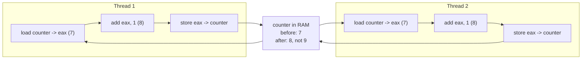

# Module 4.02: Data races and why they are undefined behaviour

**Estimated hours:** 3

**What you will learn**

1. The exact definition of a data race (two threads, same memory, at least one write, not ordered by synchronisation, not atomic) and why the C++ standard makes it undefined behaviour rather than "a random result".
2. The three ways a race goes wrong in practice: lost updates because `++count` is three instructions, torn reads of multi-word data, and compiler hoisting that turns `while (!flag)` into an infinite loop.
3. How to compile with ThreadSanitizer (`-fsanitize=thread`), read its report line by line, and trace a crash in one place back to a race in another.

**Prerequisites:** [Module 4.01: Threads in C++](module-01-threads-in-cpp.md). You should be able to start and join threads and read a few lines of x86-64 assembly (module 0.01, Phase 1).

---

## 1. One-line intuition

A data race is two clerks reaching into the same pigeonhole at the same time with at least one of them writing, and the rulebook says that if this ever happens, nothing the office does afterwards is guaranteed.

## 2. Real-life analogy

Two clerks each have the job "add one to the number in pigeonhole 40". Each clerk works in three steps: read the number onto a scratch card, add one on the card, write the card back.

Clerk A reads 7. Before A writes back, clerk B also reads 7. A writes 8. B writes 8. Two increments happened; the pigeonhole says 8, not 9. One update is lost, and nobody knows.

Worse: imagine the pigeonhole holds a two-part value, say a loan id and its balance, written on two cards side by side. Clerk A is halfway through replacing both cards when clerk B reads them. B sees the new id with the old balance. That pair never existed. That is a **torn read**.

Worst: clerk B has been told "keep checking pigeonhole 12 until it says GO". B is clever and lazy. B reads it once, sees STOP, and reasons: "nobody told me anyone else writes to this pigeonhole, so it will say STOP forever." B stops looking and loops on the scratch card. Clerk A writes GO. B never sees it. That is the **compiler hoisting a load out of a loop**, and it is legal precisely because the rulebook says the program promised there would be no race.

## 3. Why it exists: the problem it solves

Module 4.01 gave threads one shared address space. That sharing is the point, and it is the danger. In a single-threaded program, "I wrote 5 to `x`, so reading `x` gives 5" is always true. With two threads it is only true if something orders the write before the read. Without that ordering you get the three failures above.

The C++11 standard had to decide what a program with an unordered conflicting access means. It chose **undefined behaviour (UB)**: the program has no meaning at all, just like reading past the end of an array (module 1.11). Not "the value is unspecified", not "one of the two writes wins", but "anything may happen, including the compiler removing your loop".

Why so harsh? Because any weaker promise would forbid optimisations that every single-threaded program relies on. Keeping a variable in a register across a loop, reading it once instead of ten times, writing it back at the end instead of every iteration, merging two byte stores into one word store: all of these are correct for one thread and all of them break under a race. If the standard said "races give a random value", the compiler could not do any of them without first proving no other thread exists. So the standard says: tell me where the sharing is (atomics, mutexes), and everywhere else I assume there is none.

What breaks without the rule: nothing is faster, and nothing is safe either. With the rule, you have a crisp contract: **every shared, mutable location is either atomic or protected by synchronisation, or the program is wrong.** ThreadSanitizer checks exactly that contract.

## 4. Three layers of depth

### Layer 1 (beginner): the definition and the simplest race

The C++17 standard, in the section called `[intro.races]`, says a **data race** happens when all four of these are true:

1. Two actions in **different threads** touch the **same memory location** (a scalar object, or a sequence of adjacent bit-fields).
2. **At least one is a write.** Two reads never race.
3. **Neither is atomic.** If both are `std::atomic` operations on the same object, it is not a race by definition.
4. **Neither happens-before the other.** Nothing (a mutex handoff, a thread `join`, an atomic with the right memory order) orders one before the other. Happens-before gets its own module later in this phase.

If all four hold, the behaviour of the whole program is undefined.

**The simplest race.** Four threads each do `++counter` a million times. The expected total is 4,000,000. You get less, and a different number every run. At `-O0`, GCC compiles `++counter` (a global `int`) into three instructions:

```asm
mov     eax, DWORD PTR counter[rip]   ; load
add     eax, 1                        ; add in a register
mov     DWORD PTR counter[rip], eax   ; store
```

Two threads can both load the same value, both add one, both store. One increment is lost. Even if the compiler used a single `add DWORD PTR counter[rip], 1`, the CPU still performs it as a load, an add and a store, and another core can slip in between unless the instruction carries the `lock` prefix. That prefix is what `std::atomic<int>::fetch_add` generates; you will see it later in this phase.

**The three fixes you will learn.** Protect the counter with a `std::mutex` (module 4.03), make it a `std::atomic<int>` (later in this phase), or give each thread its own counter and add them at the end (no sharing at all, often the fastest).

### Layer 2 (working engineer): tearing, hoisting, "benign" races and TSan

**Torn reads and writes.** A `struct { uint64_t id; uint64_t balance; }` is 16 bytes. A writer updates both fields; a reader copies both. There is no instruction that moves both words at once under a guarantee, so the reader can observe the new `id` with the old `balance`. The pair never existed. The same can happen within one value: a 64-bit `long long` on a 32-bit CPU is two stores; an unaligned 64-bit value crossing a cache line boundary on x86-64 is not guaranteed atomic either. "It is only one variable" is no defence. Only `std::atomic<T>` and `is_lock_free()` tell you that a load or store cannot tear.

**Compiler hoisting.** This is the one that surprises people:

```cpp
bool ready = false;                 // not atomic
void waiter() {
    while (!ready) { }              // spin until main sets it
    std::cout << "saw ready\n";
}
```

At `-O0` this works by luck. At `-O2`, GCC sees a loop that reads `ready`, never writes it, and calls nothing that could write it. Under the no-race contract, the value cannot change. So it loads once and spins forever:

```asm
waiter():
        cmp     BYTE PTR ready[rip], 0
        jne     .L2                 ; already true: skip the loop
.L3:
        jmp     .L3                 ; otherwise loop forever, never reading again
.L2:
        ...                         ; print
```

The program hangs on every optimised build. The fix is `std::atomic<bool> ready{false};`. Now each `ready.load()` is a real memory read the compiler may not hoist, and the write in the other thread becomes visible. Note what `volatile` does and does not do: it forces the reads to happen, which stops this hoist, but it gives no atomicity and no ordering with other data, and the standard still calls it a data race. Do not use `volatile` for threads.

**"Benign" races are still UB.** Three examples you will meet in code review:

| The excuse | Why it is still wrong |
|---|---|
| "It is just a statistics counter; we don't mind if it is off by a few" | The compiler may hoist, merge or drop the updates entirely; you can end up off by millions, or with a loop that never terminates |
| "It is an aligned `int`; x86 stores are atomic" | The hardware store may be atomic; the C++ program is still UB and the compiler may cache the value in a register forever |
| "Only one thread writes; the others only read" | Still one write and a read that are not ordered. That is the definition. The `while (!ready)` hang is exactly this case |

The rule: if it is shared and mutable, it is atomic or it is under a lock. There is no third category.

**ThreadSanitizer (TSan).** GCC's `-fsanitize=thread` instruments every non-atomic memory access and every synchronisation call (pthread mutexes, condition variables, `std::thread` start and join, atomics). At run time it checks whether each access is ordered after every earlier conflicting access by some synchronisation. If not, it prints a report. Build with:

```bash
g++ -std=c++17 -Wall -Wextra -Werror -g -O1 -fsanitize=thread -pthread -o prog_tsan prog.cpp
```

`-g` gives line numbers. `-O1` or `-O2` keeps the instrumented program fast enough; `-O0` works but is very slow. Expect the program to run roughly 5 to 15 times slower and use several times more memory. You cannot combine TSan with AddressSanitizer in one binary; build two.

**Reading a TSan report.** Every report has the same skeleton:

```text
==================
WARNING: ThreadSanitizer: data race (pid=24510)
  Write of size 4 at 0x5651c3b1a0f0 by thread T2:
    #0 worker() race_counter.cpp:12 (race_counter_tsan+0x1a3b)
    ...
  Previous write of size 4 at 0x5651c3b1a0f0 by thread T1:
    #0 worker() race_counter.cpp:12 (race_counter_tsan+0x1a3b)
    ...
  Location is global 'counter' of size 4 at 0x5651c3b1a0f0 (race_counter_tsan+0x50f0)
  Thread T2 (tid=24513, running) created by main thread at:
    #0 pthread_create ... (libtsan.so.2+0x...)
    #1 std::thread::_M_start_thread(...) (libstdc++.so.6+0x...)
    #2 main race_counter.cpp:20 (race_counter_tsan+0x1c5a)
  Thread T1 (tid=24512, running) created by main thread at:
    ...
SUMMARY: ThreadSanitizer: data race race_counter.cpp:12 in worker()
==================
```

Read it in this order:

1. **The two accesses.** The first block is the access that triggered the report (`Write of size 4` or `Read of size 4`), with a stack. The second block, labelled `Previous write` or `Previous read`, is the earlier conflicting access. At least one of the two is a write, by definition.
2. **Which thread.** `T1`, `T2`, or `main thread`. The `created by` blocks at the bottom tell you where each thread was started, which is how you find out which pool or which request it belonged to.
3. **The location.** `Location is global 'counter'` or `heap block of size N allocated at ...` with the allocation stack, or `stack of thread T1`. This names the object.
4. **Mutexes held.** If a thread held locks during the access, the line reads `by thread T1 (mutexes: write M0)`, and a block `Mutex M0 (0x...) created at:` shows where that mutex lives. A report where one side holds `M0` and the other side holds nothing is the classic "someone forgot the lock on the read path".
5. **SUMMARY** is the one-line version for grep.

TSan reports a race if the two accesses were **not ordered**, even if on this run they did not actually collide. That is why it finds races that never corrupt data in testing. It cannot report a race in code that did not execute, so run your real load generator under it, which is what the tcpkv claim "TSan clean under a concurrent load generator" means.

If TSan dies at start with `FATAL: ThreadSanitizer: unexpected memory mapping`, the kernel's address randomisation is wider than libtsan expects; run `sudo sysctl vm.mmap_rnd_bits=28` and try again. This is common on Ubuntu 24.04 kernels and usually not needed under WSL2.

### Layer 3 (internals): why the hardware and the compiler both conspire

**What the compiler assumes.** The optimiser works on one thread's code in isolation. Its licence is the **as-if rule**: it may do anything that gives the same observable result for a program with no UB. For a loop that only reads `ready`, caching `ready` in a register is as-if correct in a race-free program. Register promotion, common subexpression elimination, loop-invariant code motion, store merging and dead-store elimination all rest on this. A data race invalidates the premise, so every one of those transformations can now produce a different result than the naive reading of the source. That is what "undefined" buys the compiler and costs you.

**What the CPU does.** Even with no compiler involved, each core has a **store buffer**: writes sit there before reaching the cache, and other cores cannot see them yet. So "I stored, then you loaded" can still give you the old value on another core. Cache coherence (later in this phase) eventually makes every write visible, but "eventually" is not an ordering. Multi-word data is moved in pieces; an aligned 8-byte store on x86-64 is single-copy atomic, an unaligned one or a 16-byte struct is not. Atomics and locks add the instructions (`lock`-prefixed read-modify-writes, fences) that make the ordering real.

**How TSan knows.** TSan keeps **shadow memory**: for every 8 bytes of your program's memory, a few shadow cells record the most recent accesses (which thread, whether read or write, and a timestamp). Each thread carries a **vector clock**, one counter per thread, that advances on every access and is merged whenever synchronisation happens: unlocking a mutex publishes the unlocker's clock, locking it acquires that clock; `join` acquires the finished thread's clock; atomics with acquire/release do the same. On each instrumented access TSan compares the new access against the shadow cells: if a previous conflicting access from another thread is not covered by the current thread's clock, nothing ordered them, and it reports. That comparison is why it is exact about "not ordered" and never guesses from timing. The cost is the shadow lookups on every memory access and the clock merges on every lock, which is the 5 to 15 times slowdown.

**A race that crashes far from the cause (capstone C6 preview).** Two threads push onto a singly linked list without a lock:

```cpp
void push(int v) {
    Node* n = new Node{v, head};   // read head
    head = n;                      // write head
}
```

Both read the same `head`, both link their node to it, both write `head`; the loser's node is lost (a leak). Add a concurrent `pop` that deletes nodes and a reader can follow `next` into a node another thread has just freed: a use-after-free. The crash shows up as `free(): double free detected` or `malloc(): corrupted top size` inside `malloc` internals, in a thread and a function that have nothing to do with the list. In the C6 lab you will capture that core dump; the only route back to the cause is TSan or ASan, which is why both are in the resume.

## 5. Architecture diagram



Both threads read 7. Both write 8. The interleaving in the middle is decided by the scheduler and the cache, not by your code.

## 6. Code

Program one: the lost-update race.

```cpp
// race_counter.cpp
// Four threads each increment a shared counter one million times.
// Expected total 4000000. The actual total is wrong and changes every run.
#include <iostream>
#include <thread>
#include <vector>

int counter = 0;                       // shared, mutable, not atomic, no lock: a race
const int kIterations = 1000000;

void worker() {
    for (int i = 0; i < kIterations; ++i) {
        ++counter;                     // load, add, store: three steps, not one
    }
}

int main() {
    std::vector<std::thread> threads;
    for (int t = 0; t < 4; ++t) {
        threads.emplace_back(worker);
    }
    for (auto& t : threads) {
        t.join();
    }
    std::cout << "total = " << counter << " (expected " << 4 * kIterations << ")\n";
    return 0;
}
```

```bash
g++ -std=c++17 -Wall -Wextra -Werror -g -O0 -pthread -o race_counter race_counter.cpp
./race_counter; ./race_counter; ./race_counter
```

Expected shape (your numbers will differ on every run; that is the point):

```text
total = 2317842 (expected 4000000)
total = 1988105 (expected 4000000)
total = 2604391 (expected 4000000)
```

Now with `-O2` instead of `-O0`. GCC turns the whole loop into one `add DWORD PTR counter[rip], 1000000`, so each thread does a single load-add-store of a million. You will typically see 4000000, or 1000000, 2000000 or 3000000 when two of those big adds collide. The race did not go away; the window shrank. A race that "goes away" in a release build is one of the most common ways it reaches production.

Program two: the hoisted flag.

```cpp
// hoisted_flag.cpp
// A non-atomic flag polled in a loop. Works at -O0, hangs forever at -O2.
// Change 'bool ready' to 'std::atomic<bool> ready' to fix it.
#include <atomic>
#include <chrono>
#include <iostream>
#include <thread>

bool ready = false;                     // the bug: not atomic

void waiter() {
    while (!ready) {                    // the compiler may load 'ready' once
    }
    std::cout << "waiter saw ready\n";
}

int main() {
    std::thread t(waiter);
    std::this_thread::sleep_for(std::chrono::milliseconds(100));
    ready = true;
    t.join();
    std::cout << "main done\n";
    return 0;
}
```

```bash
g++ -std=c++17 -Wall -Wextra -Werror -g -O0 -pthread -o flag_O0 hoisted_flag.cpp
./flag_O0
g++ -std=c++17 -Wall -Wextra -Werror -g -O2 -pthread -o flag_O2 hoisted_flag.cpp
./flag_O2
```

Expected: `flag_O0` prints `waiter saw ready` then `main done`. `flag_O2` prints nothing and never exits; one core sits at 100%. Press `Ctrl+C`. Then change the declaration to `std::atomic<bool> ready{false};` (the `#include <atomic>` is already there), rebuild both, and both print and exit.

Program three: TSan on the counter.

```bash
g++ -std=c++17 -Wall -Wextra -Werror -g -O1 -fsanitize=thread -pthread -o race_counter_tsan race_counter.cpp
./race_counter_tsan; echo "exit code $?"
```

Expected: a report in the exact shape shown in Layer 2, pointing at `race_counter.cpp:12` (the `++counter` line) for both the `Write` and the `Previous write`, `Location is global 'counter'`, then the program's own `total = ...` line, then `ThreadSanitizer: reported 1 warnings`, and exit code 66. TSan's default exit code on a report is 66 so CI pipelines can tell "race found" from "test failed".

## 7. Use case: core-banking loan-origination platform

The app server from claim H4 kept an **in-memory master-table cache**: branch codes, product codes, interest schemes, loaded at startup and refreshed when operations pushed a change. Workers read it on every request. A refresh thread wrote it.

That is one writer and many readers on shared, mutable data: the "benign" race from Layer 2, except that the cached rows were multi-field structs, so readers could also tear. The symptom in a pre-production run was a loan request validated against the new product code with the old interest scheme, a pair of values that never existed together in the database. It was not reproducible on demand and did not show up in single-threaded tests.

The decision it drove: **every shared mutable structure in the server got a written access rule, and the rule was enforced by TSan, not by code review alone.** Concretely:

- Each shared object's header comment names what guards it (`// guarded by cache_mutex_`). Any access outside that guard is a bug by definition, whether or not it "seemed to work".
- The master-table cache became a read-mostly structure under a `std::shared_mutex` (module 4.05), later a snapshot swapped under lock so readers never see a half-updated row.
- The integration test suite runs under `-fsanitize=thread` against the load generator, and a TSan report fails the build. The same rule is the tcpkv claim "TSan clean under a concurrent load generator" and the capstone C1 CI gate.

The interviewer's follow-up, "but x86 stores are atomic, why did you care?", is answered by Layer 2: the struct tore across fields, and the compiler is free to hoist reads of a non-atomic flag, so "the hardware is atomic" is not a correctness argument in C++.

## 8. Lab

### Part A: watch the increment get lost (20 minutes)

1. Build `race_counter.cpp` at `-O0` and run it ten times: `for i in $(seq 10); do ./race_counter; done`. Record the smallest and largest total.
2. Build at `-O2` and run ten times. Record the totals. Typically most runs show 4000000 and a few show 1000000, 2000000 or 3000000.
3. Open <https://godbolt.org/>, x86-64 gcc 13, paste only the `counter` and `worker` definitions. With `-O0` find the three-instruction load, add, store inside the loop. With `-O2` find the single `add DWORD PTR counter[rip], 1000000`. Paste both into your journal.
4. Change `worker` to use a local `int mine = 0`, increment that, and after the loop do `counter += mine;`. Rebuild at `-O0` and run. Is it still wrong? Yes, by at most 3 million, because the four final adds still race. Now you understand why "reduce the window" is not a fix.

### Part B: the hang that only happens in release (20 minutes)

1. Build `hoisted_flag.cpp` at `-O0` and `-O2` as in section 6. Confirm the `-O2` binary hangs. While it hangs, in another terminal run `top` and note one core at 100%.
2. Attach the debugger to the hung process: `gdb -p $(pgrep flag_O2)`, then `info threads`, `thread 2`, `bt`, and `x/3i $pc`. Expected: thread 2 is in `waiter()` and the three instructions at `$pc` include a `jmp` to its own address. That is the infinite loop in the flesh. Type `detach` then `quit`, then `kill %1` or `Ctrl+C` in the first terminal.
3. On godbolt, paste `waiter` with `bool ready` at `-O2` and find the `jmp .L3` to itself. Change to `std::atomic<bool>` and look again: the loop now contains a real `movzx eax, BYTE PTR ready[rip]` on every iteration.
4. Fix the program with `std::atomic<bool>`, rebuild both, confirm both finish.

### Part C: read a TSan report and fix the race (25 minutes)

1. Build `race_counter.cpp` with TSan as in section 6. Run it. Identify, from the report: the two line numbers, which thread did the triggering write and which did the previous write, and the `Location is global` line. Write those three facts in your journal in your own words.
2. Run again with `TSAN_OPTIONS=halt_on_error=1 ./race_counter_tsan`. Expected: the program stops at the first report instead of continuing. This is the setting you want in CI.
3. Fix with a mutex: add `#include <mutex>`, a global `std::mutex m;`, and change the loop body to `std::lock_guard<std::mutex> g(m); ++counter;`. Rebuild with TSan and run. Expected: no report, `total = 4000000`, exit code 0. Notice how much slower it is; module 4.03 explains and measures that cost.
4. Create the "benign" variant: a global `int requests_served` incremented without a lock by four threads, printed at the end "for statistics only". Build with TSan. It reports. Build at `-O2` without TSan and look at the total. Record your observation and write one sentence on why "statistics only" is not a defence.
5. A report with mutexes: make the writer thread take the lock but have `main` print `counter` while the workers are still running (move the `std::cout` line above the `join` loop). Build with TSan. Expected: the report shows `Read of size 4 ... by main thread` against `Previous write of size 4 ... by thread T1 (mutexes: write M0)`, with a `Mutex M0 ... created at` block. One side holds the lock, the other does not. This is the shape of most real-world reports.

### Part D: a race that crashes somewhere else (30 minutes, C6 preview)

Write `list_race.cpp`:

```cpp
#include <iostream>
#include <thread>
#include <vector>

struct Node {
    int value;
    Node* next;
};

Node* head = nullptr;                  // shared, no lock: a race

void push(int v) {
    Node* n = new Node{v, head};
    head = n;
}

Node* pop() {
    Node* n = head;
    if (n != nullptr) {
        head = n->next;
    }
    return n;
}

void pusher() {
    for (int i = 0; i < 200000; ++i) {
        push(i);
    }
}

void popper() {
    for (int i = 0; i < 200000; ++i) {
        Node* n = pop();
        delete n;                      // may delete a node another thread still uses
    }
}

int main() {
    std::vector<std::thread> ts;
    ts.emplace_back(pusher);
    ts.emplace_back(pusher);
    ts.emplace_back(popper);
    ts.emplace_back(popper);
    for (auto& t : ts) {
        t.join();
    }
    int left = 0;
    for (Node* n = head; n != nullptr; n = n->next) {
        ++left;
    }
    std::cout << "nodes left = " << left << '\n';
    return 0;
}
```

1. Build with the standard command at `-O0` and run five times. Expected: a mix of outcomes: `nodes left = N`, or `free(): double free detected in tcache 2`, or `Segmentation fault (core dumped)`, or a hang in the final loop because a cycle formed. Record each outcome. Notice the crash message comes from `free`, not from `push` or `pop`.
2. Build with `-fsanitize=address` instead of TSan and run. Expected: `heap-use-after-free` or `attempting double-free` with two stacks: where it was freed (`popper`) and where it was used. Record the two function names.
3. Build with `-fsanitize=thread` and run. Expected: reports on `head` in `push` and `pop`, naming the lines. This is the root cause; the ASan report in step 2 was the symptom.
4. Write a five-line mini RCA in your journal: symptom (the `free()` message), where it crashed (inside `malloc` internals, called from `popper`), root cause (unordered access to `head`, line numbers from TSan), why it crashed far from the cause (the lost or doubly-linked node is only touched later), fix (a mutex around `push` and `pop`, module 4.03). Capstone C6 uses this exact shape with a formal template.

### Journal

Copy [journal/TEMPLATE.md](../journal/TEMPLATE.md) to `journal/YYYY-MM-DD-data-races.md`. Record: the min and max totals at `-O0` and `-O2`; the two assembly shapes of `++counter`; the `jmp`-to-self you saw in `gdb` and on godbolt; the three facts you read from the first TSan report; the `(mutexes: write M0)` report from Part C step 5; the outcomes of `list_race` plain, under ASan and under TSan; and the mini RCA.

## 9. Common mistakes and misconceptions

| Mistake | Why it is wrong | Bug it causes later |
|---|---|---|
| "A race just gives a random value" | It is undefined behaviour; the compiler may hoist, cache or delete the access | `while (!flag)` compiled into an infinite loop in release builds |
| "`++counter` is one operation" | It is load, add, store; even a single `add [mem]` is not atomic without `lock` | Lost updates; counters and balances drift under load |
| "x86 stores are atomic, so an `int` flag is safe" | The hardware store may be; the C++ program is still UB and the compiler assumes no race | Works in debug, hangs or miscounts in release |
| "`volatile` makes it thread-safe" | `volatile` forces the access to happen; it gives no atomicity and no ordering with other data | Torn reads of multi-word data; stale data next to a "fresh" flag |
| "Only one writer, so readers are fine" | One write plus one unordered read is the definition of a race | Torn struct reads: new product code with old interest scheme |
| "The test passed, so there is no race" | Races depend on timing; TSan finds unordered accesses even when they did not collide | A bug that appears only on the 16-core production box |
| "TSan found nothing, so the program is race-free" | TSan only sees code that ran; it cannot combine with ASan; uninstrumented libraries are blind spots | False confidence; run the real load generator under TSan |
| Reducing the race window instead of removing the race | A smaller window is still a race, and the optimiser can widen it again | Rare corruption that nobody can reproduce |

## 10. Resume link

- **Claim B, "undefined-behaviour-aware coding".** Data races are the UB that most often reaches production because they pass single-threaded tests. Say: "I treat any unsynchronised access to shared mutable data as UB, not as 'probably fine', because the compiler is allowed to hoist the read out of the loop, and I have watched GCC do it at `-O2`."
- **Claim F, "ASan/TSan, memory corruption investigation".** You can now read a TSan report: the two stacks, which is the write, the location, the mutexes held. Say: "The `(mutexes: write M0)` annotation on one side and nothing on the other is how I find the path that forgot the lock." Your `list_race` lab is the story: crash in `free`, cause in `push`.
- **Claim I, tcpkv "TSan clean under a concurrent load generator".** The phrase means the load generator ran against a `-fsanitize=thread` build and produced zero reports, with `halt_on_error=1` in CI so a report fails the build. Give the exit code: 66.
- **Claim H4, "in-memory master-table cache".** The torn-read story from section 7 is why the cache has a documented guard and why readers never see a half-written row.

Likely follow-up: "Give me the four conditions of a data race." Say them in order: two threads, same location, at least one write, not ordered by synchronisation, and neither atomic. Then: "and the result is undefined behaviour, not an unspecified value."

## 11. Interview questions

**Q1 (easy). Define a data race precisely.**

<details>
<summary>Model answer</summary>

Two memory accesses from different threads to the same memory location, where at least one is a write, at least one is not atomic, and neither happens-before the other, meaning no synchronisation such as a mutex handoff, a thread join, or an acquire-release atomic pair orders them. Per the C++ standard, a program containing a data race has undefined behaviour. Two reads never race; two atomic operations on the same object never race.

</details>

**Q2 (easy). Why does `++counter` from several threads lose updates?**

<details>
<summary>Model answer</summary>

Because the increment is not one indivisible step. The compiler emits a load into a register, an add, and a store back; even a single memory-operand `add` instruction is executed by the CPU as a read, a modify and a write unless it has the `lock` prefix. Two threads can both read the same old value, both add one, and both write the same new value, so one increment disappears. The fix is `std::atomic<int>::fetch_add`, which emits `lock xadd` or `lock add`, a mutex around the increment, or giving each thread its own counter and summing at the end.

</details>

**Q3 (medium). The standard could have said "a data race gives an unspecified value". Why did it choose undefined behaviour instead?**

<details>
<summary>Model answer</summary>

Because every important single-threaded optimisation assumes memory does not change behind the compiler's back: keeping a value in a register across a loop, reading a variable once instead of ten times, delaying a store to the end of a loop, merging adjacent stores. If a race merely produced an unspecified value, each of those transformations would have to be proven safe against possible concurrent writers, which in general is impossible, and the compiler would have to pessimise all code. Making the race undefined keeps the contract clean: the programmer marks every shared mutable location as atomic or protects it with synchronisation, and the compiler may treat everything else as thread-private. The visible consequence is that `while (!flag)` on a non-atomic flag can legally become an infinite loop, which is exactly what GCC does at `-O2`.

</details>

**Q4 (medium). How does ThreadSanitizer detect a race, and what are its limitations?**

<details>
<summary>Model answer</summary>

The compiler instruments every non-atomic load and store and every synchronisation operation. At run time TSan keeps shadow memory recording recent accesses to each 8-byte region (thread, read or write, timestamp) and a vector clock per thread. Synchronisation operations transfer clocks: unlocking a mutex publishes the thread's clock, locking it acquires that clock; join, atomics with acquire-release semantics and thread creation do the same. On each access TSan checks whether every earlier conflicting access by another thread is covered by the current thread's clock; if one is not, the two are unordered and it reports both stacks, the location, and the mutexes each side held. Because the check is about happens-before and not timing, it reports races even when the accesses did not collide on this run. Limitations: it only sees code that executed, so coverage depends on the workload; it cannot be combined with ASan in one binary; uninstrumented libraries and inline assembly are invisible to it; it costs roughly 5 to 15 times in CPU and several times in memory; and custom synchronisation it does not understand needs annotations or it produces false positives.

</details>

**Q5 (hard). A server hangs in production with one core at 100% after a config reload. The reload thread sets a plain `bool reloaded = true` that a worker polls. Explain the mechanism, how you would confirm it from a live process or core dump, and the correct fix including what memory order you would use and why.**

<details>
<summary>Model answer</summary>

The worker's loop reads a non-atomic `bool` and contains no synchronisation, so under the no-data-race assumption the optimiser hoists the load out of the loop: the loop becomes a compare before the loop and an unconditional jump to itself. The store from the reload thread is never read again, so the worker spins forever on one core. To confirm: attach `gdb` to the process or open the core dump, run `info threads` and find the thread burning CPU, `thread N`, `bt` to see it inside the polling function, and `x/3i $pc` to see a `jmp` to its own address with no load in the loop; compare with the source and the `-O2` assembly on Compiler Explorer. The fix is to make the flag `std::atomic<bool>`. For the flag alone, `memory_order_relaxed` is enough to guarantee the load is performed each iteration and the store eventually becomes visible. But if the worker then reads the reloaded configuration object, the store must be `memory_order_release` and the load `memory_order_acquire` so that every write to the configuration that happened before the flag store is visible after the flag load; the default `seq_cst` also gives that and is the safe choice unless measured otherwise. A `volatile bool` would also stop the hoist but provides neither the ordering of the configuration data nor freedom from UB, so it is not a correct fix. Finally, a polling loop is itself a design smell; a condition variable, module 4.04, lets the worker sleep until notified.

</details>

## 12. Revision

- A data race is two threads touching the same location, at least one writing, with no happens-before order and no atomics; the standard makes it undefined behaviour so the optimiser may treat unmarked memory as thread-private.
- Three practical failures: `++counter` is load-add-store and loses updates; multi-word data tears; `while (!flag)` on a non-atomic flag is hoisted into an infinite loop at `-O2`, fixed by `std::atomic<bool>`.
- `-fsanitize=thread -g -O1` finds unordered accesses by happens-before, not timing; read the report as two stacks, which is the write, the location, and the mutexes each side held; exit code 66 fails CI.

---

Previous: [Module 4.01: Threads in C++](module-01-threads-in-cpp.md) | Next: [Module 4.03: Mutex internals: futex](module-03-mutex-internals-futex.md)
