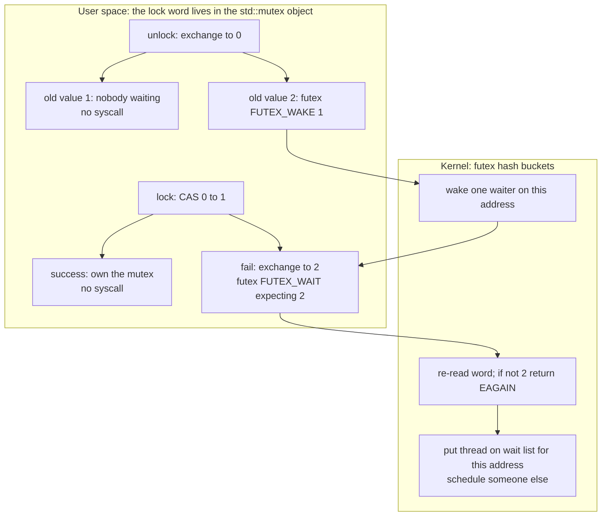

# Module 4.03: Mutex internals: futex

**Estimated hours:** 4

**What you will learn**

1. How to use `std::mutex` correctly with `lock_guard`, `unique_lock` and `scoped_lock`, and the rule that a mutex protects data, not code.
2. What glibc actually does inside `lock()`: a single compare-and-swap in user space when nobody else holds it, and a `futex` system call that puts the thread to sleep only when there is contention.
3. How to measure contention on your own laptop, see the `futex` calls appear in `strace`, and reason about lock granularity, recursive mutexes and priority inversion.

**Prerequisites:** [Module 4.02: Data races and why they are undefined behaviour](module-02-data-races.md). You should be able to read a TSan report and know why `++counter` from two threads is a race.

---

## 1. One-line intuition

A mutex is a key hanging on a hook: taking it costs almost nothing when nobody else wants it, and when somebody else already has it you go to sleep in the kernel's waiting room until the key is put back.

## 2. Real-life analogy

The office has one ledger (the shared data) and one key on a hook by the door (the mutex).

- **Rule:** nobody opens the ledger without holding the key. The key does not protect the door, the desk or the act of walking in; it protects the ledger. If a clerk reads the ledger without the key, the key has protected nothing.
- **Fast path:** the clerk glances at the hook, sees the key, takes it. Nobody else was involved. That glance-and-grab is one atomic instruction, and it is all a mutex costs when there is no competition.
- **Slow path:** the hook is empty. The clerk could stand there staring at the hook (spinning, burning the CPU), or go to the waiting room and ask the receptionist to call them when the key returns. The receptionist is the kernel, the waiting room is the `futex` wait queue, and sleeping there costs a trip to the front desk (a system call) each way.
- **Returning the key:** the clerk hangs it back up. If the waiting room has anyone in it, the clerk tells the receptionist "wake one". If it is empty, no trip to the front desk is needed. That "only if someone is waiting" is the whole trick of the futex design.
- **Recursive key:** a key the same clerk can "take" twice and must hang back twice. It usually means the clerk lost track of whether they already had it.

## 3. Why it exists: the problem it solves

Module 4.02 ended with the rule: shared mutable data is atomic or it is under a lock. A mutex (**mut**ual **ex**clusion) is the lock: at most one thread holds it at a time, and the holder may touch the data the mutex guards.

The design question is what to do when the mutex is already held. Two bad answers:

1. **Spin.** Loop on the lock word until it is free. Wastes a whole core while waiting, and if the holder has been descheduled, the spinner burns its time slice waiting for a thread that cannot run. Spinlocks have a place (later in this phase), but not as the general mutex.
2. **Always ask the kernel.** Make every `lock` and `unlock` a system call so the kernel can manage a queue. Correct, simple, and roughly 100 to 300 ns per call (module 0.02) even when nobody is contending. Old Unix and the Windows kernel `Mutex` object work this way, which is why they are slow.

The 2002 Linux answer, the **futex** ("fast user-space mutex"), splits the two cases. The lock word lives in ordinary user memory. The uncontended case is one atomic instruction and never enters the kernel. Only when a thread must actually wait does it call `futex(FUTEX_WAIT)`, and only when a waiter might exist does the unlocker call `futex(FUTEX_WAKE)`. glibc's `pthread_mutex_t`, and therefore `std::mutex` on Linux, is built on it. Windows reached the same design with `CRITICAL_SECTION` and later `SRWLOCK` (module 4.12).

What breaks without a mutex is module 4.02. What breaks with a badly used mutex is this module: locks held too long, one lock for everything, locks taken in a recursion nobody understands, and a high-priority thread stuck behind a low-priority one.

## 4. Three layers of depth

### Layer 1 (beginner): the types and how to hold them

**`std::mutex`.** Two operations: `lock()` and `unlock()`, plus `try_lock()` which returns `false` instead of waiting. It is not copyable, not movable, and must not be destroyed while locked. Locking it twice from the same thread is undefined behaviour; with glibc it simply deadlocks (the thread waits for itself forever).

Never call `lock()` and `unlock()` by hand in normal code. Use an RAII holder so that an early `return` or an exception cannot leave the mutex locked:

| Holder | What it does | When to use |
|---|---|---|
| `std::lock_guard<std::mutex> g(m);` | Locks in the constructor, unlocks in the destructor. Nothing else. | The default. Ninety percent of locks. |
| `std::unique_lock<std::mutex> u(m);` | Same, plus `unlock()` and `lock()` again, `std::defer_lock`, `std::try_to_lock`, timed waits, and it is movable. | When you must release early, lock later, or pass the lock to a condition variable (module 4.04). |
| `std::scoped_lock both(m1, m2);` (C++17) | Locks several mutexes at once in a deadlock-free order. | Any time you need two locks together, such as transferring between two accounts. |

**What a mutex protects.** A mutex protects **data**, never a region of code. The question to ask is "which variables may only be touched while holding `m`?" and the answer belongs in a comment next to the data:

```cpp
std::mutex balance_mutex;   // guards: balance, last_updated
long balance = 0;           // guarded by balance_mutex
```

If some code path reads `balance` without `balance_mutex`, the mutex is doing nothing for that path and TSan will say so.

**The simple fix for the counter race:**

```cpp
std::mutex counter_mutex;
int counter = 0;            // guarded by counter_mutex

void worker() {
    for (int i = 0; i < 1000000; ++i) {
        std::lock_guard<std::mutex> guard(counter_mutex);
        ++counter;           // only one thread at a time is in here
    }
}
```

The total is now exactly 4,000,000 every run. The price is the subject of Layer 2.

### Layer 2 (working engineer): cost, granularity, and the other mutex types

**Uncontended cost.** When no other thread holds the mutex, `lock()` is one `lock cmpxchg` instruction and `unlock()` is one atomic exchange. Typical cost on a modern laptop: tens of nanoseconds for the pair. That is cheap enough that you should never avoid a mutex "for performance" without a measurement.

**Contended cost.** When another thread holds it, the waiter makes a `futex` system call, is put to sleep, and later woken by another system call from the unlocker. That is two kernel entries plus a context switch, typically a few microseconds, so about a hundred times the uncontended cost. Worse, the holder now pays for the wake-up on its own `unlock()`. In the lab you measure four threads incrementing under one mutex and typically find it **slower in total than one thread doing all the work alone**: the threads spend their time handing the key back and forth. This is the single most important number in this module. Write yours down.

**Hold time is what matters.** Contention is roughly (how often threads lock) × (how long they hold). You reduce it by holding for less time: compute outside the lock, copy what you need, lock only to publish. Never do I/O, never call into unknown code, never allocate large things while holding a hot lock.

**Lock granularity.** One big lock is simple and correct but serialises everything. Finer locks (one per table, one per hash bucket, one per connection) let unrelated work proceed in parallel at the cost of more locks to reason about and the possibility of needing two at once (deadlock, later in this phase). The in-memory store of tcpkv is exactly this choice: one `shared_mutex` around one `unordered_map` is the first, correct design; sharding into N buckets each with its own lock is the measured upgrade. Part D of the lab lets you measure the difference on a counter.

**`std::recursive_mutex`.** The same thread may lock it again while already holding it; it keeps a count and releases on the matching unlock. It exists because some codebases have a public method that takes the lock and calls another public method that also takes it. That is usually a sign the class has no clear internal boundary. The usual fix: public methods take the lock and call private `_unlocked` helpers that assume it is held. A recursive mutex also cannot be used with `std::condition_variable` and costs an owner check on every lock. Treat it as a flag for refactoring, not as a tool.

**`std::timed_mutex` and `std::recursive_timed_mutex`.** Add `try_lock_for(duration)` and `try_lock_until(time_point)`. Useful for "give up and report an error rather than hang forever", for example a health check that must answer within 50 ms. Underneath it is the same futex wait with a timeout.

**`std::shared_mutex`** (readers-writer lock) is module 4.05.

**Priority inversion.** A low-priority thread holds a mutex. A high-priority thread wants it and sleeps. A medium-priority thread with nothing to do with the mutex runs for a long time, so the low-priority holder never gets the CPU to finish and unlock. The high-priority thread is now effectively the lowest priority in the system. This is the 1997 Mars Pathfinder bug. Linux offers priority-inheritance futexes (`FUTEX_LOCK_PI`, enabled with `pthread_mutexattr_setprotocol(PTHREAD_PRIO_INHERIT)`), where the holder temporarily inherits the waiter's priority. `std::mutex` does not expose this; real-time systems use pthreads directly. For a bank server running normal priorities it is a thing to know, not a thing you tune.

**Windows mapping.** Module 4.12 goes deep; this is the dictionary.

| Concept | Linux (glibc, under `std::mutex`) | Windows (Win32) |
|---|---|---|
| Plain mutex, user-space fast path | `pthread_mutex_t` on a futex word; 40 bytes | `CRITICAL_SECTION`: interlocked fast path, optional spin count, kernel wait on contention; **recursive by design** |
| Non-recursive slim lock | same `pthread_mutex_t` | `SRWLOCK`: pointer-sized, not recursive, exclusive or shared; recent MSVC STL builds `std::mutex` on it |
| Kernel-object mutex (always a syscall) | none needed | `CreateMutex`, `WaitForSingleObject`, `ReleaseMutex`; works across processes |
| Sleep on contention | `futex(FUTEX_WAIT)` | kernel wait on an event or keyed event owned by the critical section |
| Wake on unlock | `futex(FUTEX_WAKE, 1)` | `SetEvent` / keyed-event release |
| Timed try | `pthread_mutex_timedlock` | `TryEnterCriticalSection` (no timeout); `WaitForSingleObject(h, ms)` on a kernel mutex |
| Priority inheritance | `PTHREAD_PRIO_INHERIT` | not for critical sections; the scheduler applies priority boosts |

### Layer 3 (internals): the lock word, the three states, and the kernel's part

**The layout.** On x86-64 Linux `sizeof(std::mutex)` is 40 bytes because it is exactly a `pthread_mutex_t`. The first 4 bytes are the `__lock` word, the futex. The rest hold the owner TID, the kind (normal, recursive, error-checking), the recursion count and padding. The futex address you will see in `strace` is the address of the `std::mutex` object itself, because `__lock` is at offset 0.

**Three states of the lock word.** glibc's low-level lock uses the scheme from Ulrich Drepper's paper "Futexes Are Tricky":

| Value | Meaning |
|---|---|
| 0 | unlocked |
| 1 | locked, no waiters known |
| 2 | locked, there may be waiters sleeping in the kernel |

**`lock()`, the fast path.** One atomic compare-and-swap: "if the word is 0, set it to 1". On x86-64 that is `lock cmpxchg`. If it succeeds, the thread owns the mutex and the kernel never heard about it.

**`lock()`, the slow path.** If the CAS fails, the thread atomically exchanges the word to 2 (announcing "someone may be waiting") and reads the old value. If the old value was 0 the lock was free after all and it now owns it. Otherwise it calls `futex(&word, FUTEX_WAIT_PRIVATE, 2, NULL)` and loops: on each wake it exchanges to 2 again and checks. The exchange to 2, not 1, is important: the thread cannot know whether other waiters exist, so it must leave the "maybe waiters" mark for the eventual unlocker.

**`unlock()`.** Atomically exchange the word to 0 and look at the old value. If it was 1, nobody was waiting; done, no system call. If it was 2, call `futex(&word, FUTEX_WAKE_PRIVATE, 1)` to wake one waiter. This is why an uncontended program shows no `futex` calls in `strace` and a contended one shows thousands.

**What the kernel does in `FUTEX_WAIT`.** It takes the user address, finds the hash bucket for (this address space, this address) and locks that bucket. It then reads the word **again** and compares it with the expected value (2). If the word is no longer 2, the lock state changed between the user-space check and the system call, so it returns `EAGAIN` immediately rather than sleeping; the caller loops and retries. If it still matches, the thread is put on the bucket's wait list and the scheduler runs something else. This compare-inside-the-kernel is the whole reason the design is correct: an unlock that happens between the user-space check and the sleep cannot be lost, because the unlock changed the word and the kernel notices.

**What the kernel does in `FUTEX_WAKE`.** Locks the same bucket, walks its list, wakes up to N waiters whose key matches the address, and returns how many it woke. With `_PRIVATE` flags the key is (mm, address), which is cheaper than the shared-memory form that must handle the same page mapped in two processes.

**Why the default glibc mutex does not spin.** `PTHREAD_MUTEX_NORMAL`, which `std::mutex` uses, goes straight to `FUTEX_WAIT` on the first failed CAS. glibc's `PTHREAD_MUTEX_ADAPTIVE_NP` spins briefly first, on the theory that the holder is probably about to finish; Windows' `CRITICAL_SECTION` spin count is the same idea. For very short critical sections a brief spin avoids the microsecond-scale sleep and wake; for long ones it wastes CPU. The spinlock module later in this phase measures both.

**Memory ordering.** The CAS in `lock()` is an acquire and the exchange in `unlock()` is a release. Everything the holder wrote before `unlock()` is visible to the next thread after its `lock()` succeeds. That is the happens-before edge that makes data under a mutex race-free, and it is what TSan tracks when it records the mutex in its vector clocks. The atomics modules later in this phase make these words precise.

## 5. Architecture diagram



The dashed boundary between the two boxes is the system-call boundary from module 0.02. The fast paths (`OK`, `U1`) never cross it.

## 6. Code

Program one: every lock type in one file.

```cpp
// lock_kinds.cpp
// Shows lock_guard, unique_lock (deferred, try, explicit unlock),
// timed_mutex, scoped_lock on two mutexes, and recursive_mutex.
#include <chrono>
#include <functional>
#include <iostream>
#include <mutex>
#include <thread>

struct Account {
    std::mutex m;        // guards: balance
    long balance;        // guarded by m
};

// Lock both accounts in a deadlock-free order, then move money.
void transfer(Account& from, Account& to, long amount) {
    std::scoped_lock both(from.m, to.m);
    from.balance -= amount;
    to.balance += amount;
}

int main() {
    using namespace std::chrono_literals;
    std::cout << std::boolalpha;

    // 1. lock_guard: lock in constructor, unlock in destructor, nothing else.
    std::mutex m;
    {
        std::lock_guard<std::mutex> guard(m);
        std::cout << "1. lock_guard holds m inside this block\n";
    }   // unlocked here

    // 2. unique_lock: can be created unlocked, locked later, unlocked early.
    std::unique_lock<std::mutex> ul(m, std::defer_lock);
    std::cout << "2. unique_lock owns_lock before lock = " << ul.owns_lock() << '\n';
    ul.lock();
    std::cout << "   owns_lock after lock = " << ul.owns_lock() << '\n';
    ul.unlock();

    // 3. try_to_lock from another thread while this thread holds m.
    ul.lock();
    std::thread other([&m] {
        std::unique_lock<std::mutex> attempt(m, std::try_to_lock);
        std::cout << "3. other thread try_to_lock succeeded = " << attempt.owns_lock() << '\n';
    });
    other.join();
    ul.unlock();

    // 4. timed_mutex: wait at most 100 ms, then give up.
    std::timed_mutex tm;
    tm.lock();
    std::thread waiter([&tm] {
        auto start = std::chrono::steady_clock::now();
        bool got = tm.try_lock_for(100ms);
        auto waited = std::chrono::duration_cast<std::chrono::milliseconds>(
            std::chrono::steady_clock::now() - start);
        std::cout << "4. try_lock_for(100ms) got = " << got
                  << " after about " << waited.count() << " ms\n";
    });
    waiter.join();
    tm.unlock();

    // 5. scoped_lock: two accounts, two threads transferring in opposite directions.
    Account a{{}, 1000};
    Account b{{}, 500};
    std::thread t1(transfer, std::ref(a), std::ref(b), 300);
    std::thread t2(transfer, std::ref(b), std::ref(a), 100);
    t1.join();
    t2.join();
    std::cout << "5. a = " << a.balance << ", b = " << b.balance
              << ", total = " << a.balance + b.balance << '\n';

    // 6. recursive_mutex: the same thread may lock twice. With std::mutex
    //    the second lock() would be undefined behaviour (a hang with glibc).
    std::recursive_mutex rm;
    rm.lock();
    rm.lock();
    std::cout << "6. recursive_mutex locked twice by the same thread\n";
    rm.unlock();
    rm.unlock();
    return 0;
}
```

```bash
g++ -std=c++17 -Wall -Wextra -Werror -g -pthread -o lock_kinds lock_kinds.cpp
./lock_kinds
```

Expected output (the millisecond count in line 4 is typically 100 or 101):

```text
1. lock_guard holds m inside this block
2. unique_lock owns_lock before lock = false
   owns_lock after lock = true
3. other thread try_to_lock succeeded = false
4. try_lock_for(100ms) got = false after about 100 ms
5. a = 800, b = 700, total = 1500
6. recursive_mutex locked twice by the same thread
```

Program two: the contention benchmark you will run in the lab.

```cpp
// mutex_contention.cpp
// usage: ./mutex_contention <threads> <iterations_per_thread>
// Each thread increments one shared counter under one mutex.
// Prints the total, elapsed time and nanoseconds per increment.
#include <chrono>
#include <cstdlib>
#include <iostream>
#include <mutex>
#include <thread>
#include <vector>

std::mutex counter_mutex;    // guards: counter
long counter = 0;            // guarded by counter_mutex

void worker(long iterations) {
    for (long i = 0; i < iterations; ++i) {
        std::lock_guard<std::mutex> guard(counter_mutex);
        ++counter;
    }
}

int main(int argc, char** argv) {
    int threads = argc > 1 ? std::atoi(argv[1]) : 1;
    long iterations = argc > 2 ? std::atol(argv[2]) : 1000000;

    std::cout << "mutex at " << static_cast<void*>(&counter_mutex)
              << " sizeof = " << sizeof(counter_mutex) << '\n';

    auto start = std::chrono::steady_clock::now();
    std::vector<std::thread> pool;
    for (int t = 0; t < threads; ++t) {
        pool.emplace_back(worker, iterations);
    }
    for (auto& t : pool) {
        t.join();
    }
    auto elapsed = std::chrono::steady_clock::now() - start;
    auto ns = std::chrono::duration_cast<std::chrono::nanoseconds>(elapsed).count();
    long total_ops = static_cast<long>(threads) * iterations;

    std::cout << "threads = " << threads
              << " counter = " << counter
              << " expected = " << total_ops
              << " elapsed_ms = " << ns / 1000000
              << " ns_per_increment = " << ns / total_ops << '\n';
    return 0;
}
```

```bash
g++ -std=c++17 -Wall -Wextra -Werror -g -O2 -pthread -o mutex_contention mutex_contention.cpp
./mutex_contention 1 1000000
./mutex_contention 4 1000000
```

Expected shape (the address and timings are yours; the counter must equal expected every time):

```text
mutex at 0x5581d2c0a100 sizeof = 40
threads = 1 counter = 1000000 expected = 1000000 elapsed_ms = 18 ns_per_increment = 18
mutex at 0x5581d2c0a100 sizeof = 40
threads = 4 counter = 4000000 expected = 4000000 elapsed_ms = 310 ns_per_increment = 77
```

Those numbers are only the shape. Typically the single-threaded run is tens of nanoseconds per increment and the four-thread run is several times slower per increment and slower in total, even though four cores were available. Record what your machine does.

The `futex` calls, uncontended versus contended:

```bash
strace -f -c -e trace=futex ./mutex_contention 1 1000000
strace -f -c -e trace=futex ./mutex_contention 4 1000000
```

Expected shape:

```text
# one thread: the only futex is main's pthread_join waiting for the worker
% time     seconds  usecs/call     calls    errors syscall
------ ----------- ----------- --------- --------- ----------------
100.00    0.000021          21         1           futex

# four threads: thousands of waits and wakes, some waits returning EAGAIN
% time     seconds  usecs/call     calls    errors syscall
------ ----------- ----------- --------- --------- ----------------
100.00    0.412730          19     21344      1189 futex
```

Drop the `-c` to see individual lines. You will see pairs like `futex(0x5581d2c0a100, FUTEX_WAIT_PRIVATE, 2, NULL) = 0` and `futex(0x5581d2c0a100, FUTEX_WAKE_PRIVATE, 1) = 1`. The address is the one the program printed for `&counter_mutex`, and the `2` is the "locked, maybe waiters" state from Layer 3. Note that `strace` itself slows every system call, so the counts under `strace` are higher than in a free run; use it to see the shape, and the program's own timing to measure.

## 7. Use case: core-banking loan-origination platform

The app server from claim H4 had a **thread synchronisation layer**: the mutexes, critical sections and wait objects that every worker went through. The first version had one mutex for the whole master-table cache. It was correct, it passed TSan, and it was the bottleneck.

The symptom: during the hourly refresh of master tables, every worker that needed any lookup, even of a table that was not being refreshed, queued on that one lock. Request latency spiked for the duration of the refresh. `strace -c` on the process during a refresh showed the same pattern as the four-thread benchmark above: thousands of `futex` calls per second where the quiet hours showed almost none.

The decision it drove: **lock granularity moved from one global lock to one lock per master table**, with the refresh taking only the lock for the table it was rewriting. Two supporting rules came with it:

- **Hold time rule.** A worker copies the row it needs out from under the lock and releases before doing anything else. No database call, no logging, no allocation of request objects while holding a cache lock. Hold times stayed in the nanoseconds, so even the per-table locks rarely entered the slow path.
- **No recursive mutexes.** An early version used a recursive mutex because `lookup()` called `ensure_loaded()` which called `lookup()`. It was replaced with `lookup_unlocked()` private helpers, and the recursive mutex was removed. That removal found two paths that had been taking the lock twice by accident.

The Windows build of the same layer used `CRITICAL_SECTION` with a spin count for the per-table locks, which capstone C2's Win32 variant reproduces. The follow-up an interviewer will ask is "how did you know it was lock contention and not the database?" Answer: the futex counts and the fact that latency spiked only during refresh, with database round-trip times unchanged.

## 8. Lab

### Part A: lock types and the self-deadlock (20 minutes)

1. Build and run `lock_kinds.cpp`. Confirm all six lines.
2. In section 6 of the program, change `std::recursive_mutex rm;` to `std::mutex rm;`. Build and run. Expected: the program prints lines 1 to 5 and then hangs. One thread waiting for itself, forever.
3. While it hangs, in a second terminal: `gdb -p $(pgrep lock_kinds)`, then `bt`. Expected: frames `__futex_abstimed_wait_common` or `futex_wait`, then `__lll_lock_wait`, then `pthread_mutex_lock`, then `std::mutex::lock`, then `main`. That stack, a thread sleeping in `__lll_lock_wait` under `main`, is what every mutex deadlock looks like in a core dump. `detach`, `quit`, then kill the hung program. Change it back.
4. Build `lock_kinds.cpp` with `-fsanitize=thread -O1` added and run. Expected: no reports. All six patterns are race-free.

### Part B: measure contention on your laptop (30 minutes)

1. Build `mutex_contention.cpp` at `-O2`. Run `./mutex_contention T 1000000` for T = 1, 2, 4, 8. Run each three times and keep the middle value. Record `elapsed_ms` and `ns_per_increment` for each T in a table.
2. Expected shape: T = 1 is the fastest in both columns. T = 2 is usually much slower per increment than T = 1 and often slower in total. T = 4 and T = 8 are slower still or flat. The counter is always exactly `expected`.
3. Make a copy called `mutex_contention_nolock.cpp` with the `lock_guard` line removed. Build and run T = 1 only (T > 1 is the race from module 4.02). Record `ns_per_increment`. The difference between this and the locked T = 1 is the uncontended cost of a lock-unlock pair on your machine. Typically tens of nanoseconds.
4. Make a copy called `mutex_contention_local.cpp` where each thread increments a local `long mine` and takes the lock once at the end to do `counter += mine`. Run T = 4. Expected: close to the no-lock single-thread time divided by four, and the counter still correct. This is "reduce how often you lock", and it is the fastest design of the three.

### Part C: watch the futex calls (20 minutes)

1. `strace -f -c -e trace=futex ./mutex_contention 1 1000000`. Record the `calls` count. Expected: one or two (the `pthread_join`).
2. `strace -f -c -e trace=futex ./mutex_contention 4 1000000`. Record `calls` and `errors`. Expected: thousands of calls; the errors are `EAGAIN`, returned when the kernel found the word was no longer 2, exactly the re-check from Layer 3.
3. `strace -f -e trace=futex ./mutex_contention 4 100000 2>&1 | head -20`. Find a `FUTEX_WAIT_PRIVATE` line and a `FUTEX_WAKE_PRIVATE` line. Confirm the address matches the `mutex at` line the program printed. Record one of each line.
4. If `perf` is installed (`sudo apt install linux-tools-generic` if not): `perf stat -e context-switches ./mutex_contention 1 1000000` and the same with 4 threads. Record both counts. Every futex sleep is a context switch, and the ratio between the two runs is your contention measured a second way.

### Part D: lock granularity, the tcpkv design choice (30 minutes)

Write `sharded_counter.cpp`: an array of 16 `struct alignas(64) Shard { std::mutex m; long count = 0; };`, where thread `t` with iteration `i` locks shard `(t + i) % 16` and increments that shard's `count`; after joining, sum the shards. Take the same two arguments as `mutex_contention.cpp` and print the same line.

1. Build at `-O2` and run T = 1, 4, 8 with 1,000,000 iterations. Record `ns_per_increment` next to the single-lock numbers from Part B.
2. Expected shape: at T = 1 about the same as the single lock (one uncontended lock is one uncontended lock). At T = 4 and 8 noticeably faster than the single lock, because threads rarely want the same shard at the same time.
3. Change `alignas(64)` to nothing and run T = 8 again. Often slower. That is false sharing: two shards in one cache line. The cache-coherence module later in this phase explains it; for now record the numbers.
4. Write three sentences for your journal: when you would use one lock (simple, rarely contended, needs atomic view of everything) and when you would shard (hot, independent keys, no cross-key operations), and which one you will start tcpkv's store with. The honest answer is one `shared_mutex` first, with the benchmark from this part as the evidence to justify sharding later if the load generator shows contention.

### Journal

Copy [journal/TEMPLATE.md](../journal/TEMPLATE.md) to `journal/YYYY-MM-DD-mutex-futex.md`. Record: the self-deadlock backtrace; the contention table for T = 1, 2, 4, 8; the uncontended lock cost (locked minus unlocked at T = 1); the futex `calls` and `errors` counts; one `FUTEX_WAIT_PRIVATE` line with its address; the sharded numbers with and without `alignas(64)`; and your three sentences on granularity.

## 9. Common mistakes and misconceptions

| Mistake | Why it is wrong | Bug it causes later |
|---|---|---|
| "The mutex protects this function" | A mutex protects data; any path that touches the data without the lock is unprotected | A read path that forgot the lock, found as a TSan report with `(mutexes: write M0)` on one side only |
| Calling `lock()` and `unlock()` by hand | An exception or early `return` between them leaves the mutex locked forever | Every later caller hangs in `__lll_lock_wait`; the server stops serving |
| Locking a `std::mutex` twice in one thread | Undefined behaviour; with glibc the thread waits for itself | A hang whose stack shows `pthread_mutex_lock` under your own function |
| "Mutexes are slow, I will avoid them" | Uncontended lock-unlock is tens of nanoseconds; only contention is expensive | A data race instead of a lock, or a hand-rolled spinlock that is worse |
| More threads under one lock means more throughput | Contended threads sleep and wake through the kernel; four threads can be slower than one | A thread pool that gets slower as it grows |
| Doing I/O or database calls while holding a lock | Hold time becomes milliseconds; every other thread queues | Latency spikes that track the slowest I/O |
| `recursive_mutex` as the fix for "it deadlocked on itself" | It hides a design where methods do not know whether the lock is held | Lock held much longer than intended; cannot be used with a condition variable |
| Sharding a lock before measuring | More locks, more complexity, possibility of needing two at once | Deadlocks and no measured gain |
| "`volatile` plus a mutex" or "a mutex but the flag is read outside it" | The mutex only orders accesses that happen under it | Stale reads of the flag; a race that TSan reports |

## 10. Resume link

- **Claim C, "mutexes".** Interviewers test whether you know the fast path from the slow path. Say: "On Linux `std::mutex` is a glibc `pthread_mutex_t` on a futex word. Uncontended `lock` is one `lock cmpxchg` with no system call; on contention the waiter exchanges the word to 2 and sleeps in `futex(FUTEX_WAIT)`, and `unlock` only calls `FUTEX_WAKE` when it sees a 2. I measured it: tens of nanoseconds uncontended and several times slower per operation with four threads fighting for one lock." Use your Part B numbers.
- **Claim H4, "thread synchronisation layer (mutexes, critical sections, wait objects)".** The section 7 story: one global lock, latency spikes during refresh, futex counts as the diagnosis, per-table locks and a hold-time rule as the fix, recursive mutex removed. Say the Windows side too: "`CRITICAL_SECTION` is the same shape, a user-space interlocked fast path and a kernel wait on contention."
- **Claim I, tcpkv "in-memory store guarded by shared_mutex".** You can now justify the first design (one lock) and show the sharded benchmark as the data for a later change. Say: "I started with one lock because the load generator did not show contention; the sharded version was a measured option, not a default."
- **Claim F, "GDB, deadlocks".** A thread stuck in `__lll_lock_wait` under `pthread_mutex_lock` is the signature. You have seen it on your own self-deadlock.

Likely follow-up: "Why does `unlock` need an atomic exchange rather than a plain store of 0?" Answer: because it must learn whether the old value was 2 to decide whether to call `FUTEX_WAKE`; a plain store would throw that information away and a waiter could sleep forever.

## 11. Interview questions

**Q1 (easy). What does a mutex protect, and what is the difference between `lock_guard` and `unique_lock`?**

<details>
<summary>Model answer</summary>

A mutex protects data: a set of variables that may only be read or written while the mutex is held. It does not protect a function or a block of code; a path that touches the data without the lock is a race. `std::lock_guard` locks in its constructor and unlocks in its destructor and does nothing else, which makes it the default. `std::unique_lock` does the same but can be constructed unlocked (`defer_lock`), can `try_to_lock`, can be unlocked and relocked, supports timed locking on a `timed_mutex`, is movable, and is required by `std::condition_variable::wait`. `std::scoped_lock` locks several mutexes together in a deadlock-free order.

</details>

**Q2 (easy). What happens inside `std::mutex::lock()` on Linux when the mutex is free, and when it is held by another thread?**

<details>
<summary>Model answer</summary>

`std::mutex` wraps a glibc `pthread_mutex_t` whose first word is a futex. When free, `lock()` does one atomic compare-and-swap from 0 to 1 in user space and returns; no system call, typically tens of nanoseconds. When held, the CAS fails, the thread atomically exchanges the word to 2 to mark "there may be waiters", and calls `futex(FUTEX_WAIT_PRIVATE, 2)`. The kernel re-checks that the word is still 2, puts the thread on the wait list hashed by the address, and schedules another thread. `unlock()` exchanges the word to 0; if the old value was 2 it calls `futex(FUTEX_WAKE_PRIVATE, 1)` to wake one waiter, otherwise it makes no system call.

</details>

**Q3 (medium). Why does `FUTEX_WAIT` take an expected value, and what goes wrong without it?**

<details>
<summary>Model answer</summary>

Between the user-space check that sees the lock held and the system call that goes to sleep, the holder may unlock. If the kernel simply slept the thread, that unlock's wake-up, issued before anyone was on the wait list, would wake nobody, and the thread would sleep forever: a lost wake-up. By passing the value it observed (2), the caller asks the kernel to compare the word again under the futex bucket lock and to return immediately with `EAGAIN` if it differs. The compare and the enqueue are atomic with respect to any wake on that address, so no unlock can slip into the gap. The same compare-and-block idea is what makes condition variables correct in module 4.04.

</details>

**Q4 (medium). When is `std::recursive_mutex` appropriate, and what is priority inversion?**

<details>
<summary>Model answer</summary>

A recursive mutex lets the owning thread lock again and keeps a count. It is appropriate almost never; it usually signals that a class's public methods call each other without knowing whether the lock is already held. The cleaner design is public methods that lock and call private `_unlocked` helpers, which also makes hold times visible. Recursive mutexes also cost an owner check per lock and cannot be used with `std::condition_variable`. Priority inversion is when a high-priority thread waits for a mutex held by a low-priority thread, and a medium-priority thread keeps the low one from running, so the high-priority thread is effectively starved; the Mars Pathfinder reset in 1997 was this. Linux addresses it with priority-inheritance futexes (`PTHREAD_PRIO_INHERIT`), where the holder temporarily runs at the waiter's priority; `std::mutex` does not expose that, so real-time code uses pthreads directly.

</details>

**Q5 (hard). You are designing the in-memory store for a multithreaded key-value server. Compare one mutex around the whole map against per-bucket locks: costs, correctness consequences, how you would measure, and what you would ship first.**

<details>
<summary>Model answer</summary>

One mutex is simple, obviously correct, and gives an atomic view of the whole map, which makes operations spanning keys (size, iteration, multi-key transactions) trivial. Its cost is that every operation serialises; under a load generator with N workers, once the lock is hot, each operation pays the futex slow path, typically microseconds, and total throughput can fall below a single thread's, as my contention benchmark showed. Per-bucket locks (say 16 or 64 shards, each its own map and mutex, key hashed to a shard) let unrelated keys proceed in parallel; uncontended cost is identical, contended cost drops roughly with the shard count, and each shard structure should be padded to a cache line to avoid false sharing. The correctness consequences: operations touching several keys now need several locks, which must be taken in a fixed order or with `std::scoped_lock` to avoid deadlock; whole-map operations become either approximate or require locking every shard; and iteration order and size are no longer instantaneous. I would measure with the real load generator: throughput and p99 latency against thread count, `strace -c` futex counts and `perf stat` context switches as the contention signal, and TSan on both designs. I would ship the single `shared_mutex` first, because the first load tests did not show contention and the code is smaller, and keep the sharded benchmark as the documented evidence for when to switch.

</details>

## 12. Revision

- Use `lock_guard` by default, `unique_lock` when you must unlock early or wait on a condition variable, `scoped_lock` for two mutexes; a mutex guards data, and the data's comment says which mutex.
- glibc's mutex is a futex word with states 0, 1, 2: `lock` is one CAS with no syscall when free; on contention the waiter sets 2 and sleeps in `FUTEX_WAIT`, which re-checks the word in the kernel; `unlock` exchanges to 0 and calls `FUTEX_WAKE` only if it saw 2.
- Uncontended cost is tens of nanoseconds; contended cost is microseconds and context switches, so four threads under one lock can be slower than one; reduce hold time and lock frequency first, shard only after measuring.

---

Previous: [Module 4.02: Data races and why they are undefined behaviour](module-02-data-races.md) | Next: [Module 4.04: Condition variables](module-04-condition-variables.md)
