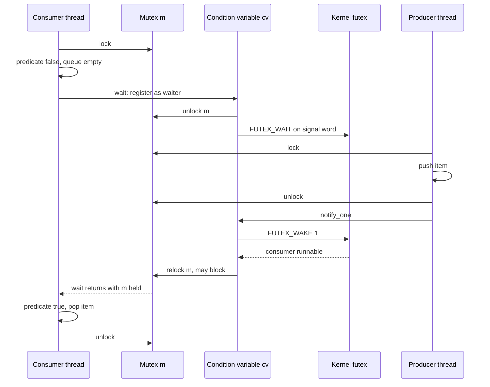

# Module 4.04: Condition variables

**Estimated hours:** 4

**What you will learn**

1. What a condition variable is for: letting a thread sleep until some shared state changes, without spinning, and why it only works together with a mutex and a predicate loop.
2. The two classic bugs, spurious wakeups and lost wakeups, why both are allowed to happen, and the one pattern (`cv.wait(lock, predicate)` with state changed under the mutex) that defeats both.
3. How `pthread_cond_wait` releases the mutex and sleeps on a futex in one atomic step, and how to build a bounded blocking queue that becomes the task queue of the tcpkv thread pool and the request queue of the app server.

**Prerequisites:** [Module 4.03: Mutex internals: futex](module-03-mutex-internals-futex.md). You should know what `std::unique_lock` is, what a futex wait does, and why `FUTEX_WAIT` takes an expected value.

---

## 1. One-line intuition

A condition variable is a bell by the ledger: a clerk who finds nothing to do hands back the key, sits down, and is rung when someone changes the ledger, then takes the key again and checks whether there really is work.

## 2. Real-life analogy

The office has an in-tray (a queue of requests), the key from module 4.03 (a mutex guarding the in-tray) and a bell (the condition variable).

- **A consumer clerk** takes the key, looks in the tray, finds it empty. Standing there holding the key and re-checking the tray every second would block everyone (spinning while holding the lock). Instead the clerk does three things as one motion: hangs the key back, sits down, and marks itself as "wake me when the bell rings". That one motion is `cv.wait(lock)`.
- **A producer clerk** takes the key, puts a request in the tray, hangs the key back, rings the bell. That is "change state under the mutex, unlock, `notify_one()`".
- **The bell is dumb.** It remembers nothing. If the producer rings it while nobody is sitting down, the ring is gone. A consumer who sits down a second later waits for the next ring, even though the tray already has work in it. That is a **lost wakeup**, and it is why the consumer must **look in the tray before sitting down**: the predicate.
- **The bell is also noisy.** Sometimes a clerk wakes up without any ring: a door slams. That is a **spurious wakeup**, and it is why the consumer must **look in the tray again after waking**, in a loop, instead of assuming the ring meant work.
- **`notify_one`** rings once and wakes one sitting clerk. **`notify_all`** wakes every sitting clerk; they then queue for the key one by one.

Put the two rules together and you get the only correct shape: take the key; while the tray is empty, sit down; take an item; hang the key.

## 3. Why it exists: the problem it solves

Module 4.03 gave you mutual exclusion: at most one thread in the ledger. It did not give you a way to **wait for something to become true**. A worker in a thread pool must wait for "the queue has an item". A shutdown routine must wait for "every worker has finished". A bounded buffer's producer must wait for "there is space".

Without a condition variable, the options are bad:

1. **Spin with the lock.** `while (true) { lock; if (!q.empty()) break; unlock; }`. Burns a core, and the producer cannot get the lock half the time.
2. **Spin with a sleep.** Add `sleep_for(1ms)` to the loop. Now every request waits up to a millisecond for no reason, and a thousand idle workers still wake a thousand times a second. A bank server at 2 a.m. with no traffic should use zero CPU.
3. **A semaphore or event per condition.** Workable, and that is what older Windows code did with `Event` objects, but easy to get wrong when several conditions share one mutex and when the waiter must re-check state after waking.

The condition variable (from Hoare and Hansen's monitors in the 1970s, standardised in POSIX and then C++11) fixes this by tying the wait to the mutex: the waiter atomically releases the mutex and goes to sleep, so there is no window in which the producer can change the state and ring the bell while the waiter is between "checked" and "asleep". When woken, the waiter reacquires the mutex before returning, so it can re-check state under the lock.

What breaks without the discipline: a consumer that waits without a predicate hangs forever on the first lost wakeup, usually on the production box at the worst time; a consumer that trusts a single wake pops from an empty queue and crashes; a shutdown that forgets to notify leaves workers asleep and `join` never returns.

## 4. Three layers of depth

### Layer 1 (beginner): wait, notify, and the only correct pattern

**The parts.** You need three things that go together:

```cpp
std::mutex m;                   // guards: q, stop
std::condition_variable cv;     // signalled when q or stop changes
std::deque<Request> q;          // guarded by m
bool stop = false;              // guarded by m
```

**Waiting.** Always with a `std::unique_lock` (not `lock_guard`, because `wait` has to unlock and relock it) and always with a predicate:

```cpp
std::unique_lock<std::mutex> lock(m);
cv.wait(lock, [&] { return !q.empty() || stop; });
// here: lock is held AND the predicate is true
```

The predicate overload is exactly:

```cpp
while (!pred()) {
    cv.wait(lock);
}
```

That loop is what defeats both spurious wakeups (woke, predicate still false, sleep again) and lost wakeups (predicate already true, never sleep at all).

**Notifying.** Change the state under the mutex, release the mutex, then notify:

```cpp
{
    std::lock_guard<std::mutex> lock(m);
    q.push_back(std::move(req));
}
cv.notify_one();
```

Notifying while still holding the lock is allowed and correct; notifying after unlocking just avoids waking a thread that would immediately block on the mutex you still hold.

**`notify_one` versus `notify_all`.**

| Call | Wakes | Use when |
|---|---|---|
| `notify_one()` | At most one waiting thread | One item was added and one consumer can handle it |
| `notify_all()` | Every waiting thread | The condition may satisfy several waiters, or waiters wait on different predicates on the same variable, or you are shutting down |

**Timed waits.** `cv.wait_for(lock, 500ms, pred)` returns `pred()` as a `bool` when it returns, whether by notify or by timeout; `cv.wait_until(lock, time_point, pred)` is the same with an absolute deadline. Without a predicate they return `std::cv_status::timeout` or `no_timeout`. Use `steady_clock` for deadlines so a wall-clock change cannot shorten or lengthen a wait.

**Rules you never break.**

1. The state the predicate reads is only ever changed while holding the same mutex.
2. Wait only with a predicate.
3. `notify` after every change that could make some predicate true, including shutdown.

### Layer 2 (working engineer): spurious wakeups, lost wakeups, thundering herds and a real queue

**Spurious wakeups are allowed on purpose.** The C++ standard and POSIX both say `wait` may return without a matching notify. Reasons: a signal delivered to the thread interrupts the futex wait; glibc's implementation of broadcasts and its internal group switching can wake a thread that has no signal for it; and forbidding spurious wakeups on every platform would make every `wait` slower. Since you must loop on the predicate anyway for lost wakeups, spurious wakeups cost you nothing extra. Code that assumes "I woke, so the condition is true" is wrong on every platform, not just unlucky on some.

**Lost wakeups are the bug you will actually ship.** The sequence:

1. Producer, without the mutex, sets `ready = true` and calls `notify_one()`. Nobody is waiting yet. The notify is a no-op.
2. Consumer locks, calls `cv.wait(lock)` with no predicate, sleeps.
3. Nobody notifies again. The consumer sleeps forever.

Both halves matter. The predicate alone fixes case 2 as long as the write to `ready` is visible, and writing `ready` under the mutex fixes the subtler version where the consumer checks the predicate (false), and between that check and the atomic unlock-and-sleep inside `wait`, a lock-free producer sets the flag and notifies into the void. Because the consumer holds the mutex from the predicate check until `wait` has registered it as a waiter, a producer that takes the mutex cannot slip into that gap. Section 6 shows the hang and the fix.

**Stolen wakeups.** With `notify_all` and three consumers, one item in the queue wakes all three. The first to reacquire the mutex takes the item. The other two wake, reacquire, and find the queue empty. Without the predicate loop they would call `front()` on an empty deque. With it they go back to sleep. This is a third reason for the loop, and it happens with `notify_one` too when a consumer that was not waiting happens to lock first and take the item.

**Thundering herd.** `notify_all` with a hundred idle workers and one item wakes a hundred threads, each of which does a futex wake-up, a context switch, a mutex acquire and a predicate check, and ninety-nine go back to sleep. Use `notify_one` per item for a work queue. Use `notify_all` for state changes every waiter cares about: `close()`, a configuration reload, "all results are in".

**`condition_variable` versus `condition_variable_any`.** `std::condition_variable` works only with `std::unique_lock<std::mutex>` and maps directly to `pthread_cond_t`. `std::condition_variable_any` works with any lockable, such as a `std::shared_lock` or your own lock type, at the cost of an extra internal mutex and allocation. Use the plain one unless you need the other.

**A bounded blocking queue.** The standard building block is a queue with a capacity, where `push` blocks while full, `pop` blocks while empty, and `close()` wakes everyone so the program can shut down. It needs two condition variables on one mutex: `not_empty_` for consumers and `not_full_` for producers. One variable with `notify_all` would also work but wakes producers when only consumers can proceed. The full code is in section 6. The capacity is **backpressure**: if producers are faster than consumers, they slow down instead of the queue eating all memory. Phase 5 returns to backpressure at the network level.

**Shutdown protocol.** `close()` sets `closed_ = true` under the mutex and calls `notify_all` on both variables. After that, `push` returns `false`, `pop` returns the remaining items and then `std::nullopt`. A worker loop is then simply `while (auto item = q.pop()) { handle(*item); }`, and a clean shutdown is "close the queue, join the workers": the pattern promised in module 4.01.

**Windows mapping.** Module 4.12 covers the Win32 sync layer in depth; this is the dictionary.

| Concept | Linux (glibc, under `std::condition_variable`) | Windows (Win32) |
|---|---|---|
| Variable | `pthread_cond_t`, 48 bytes | `CONDITION_VARIABLE`, pointer-sized, `InitializeConditionVariable` |
| Wait with a critical section | `pthread_cond_wait(&cv, &mutex)` | `SleepConditionVariableCS(&cv, &cs, INFINITE)` |
| Wait with a slim lock | same, with the mutex | `SleepConditionVariableSRW(&cv, &srw, INFINITE, flags)` |
| Timed wait | `pthread_cond_timedwait` / `pthread_cond_clockwait` | same calls with a millisecond timeout; returns `FALSE` with `ERROR_TIMEOUT` |
| Wake one | `pthread_cond_signal` | `WakeConditionVariable` |
| Wake all | `pthread_cond_broadcast` | `WakeAllConditionVariable` |
| Spurious wakeups | allowed, documented | allowed, documented; the predicate loop is required there too |
| Older alternative | none needed | `Event` objects with `SetEvent` and `WaitForSingleObject`; auto-reset events are easy to lose and manual-reset events wake everyone, which is why the app server's Win32 layer moved to condition variables |

### Layer 3 (internals): how `pthread_cond_wait` releases and sleeps in one step

**The object.** `sizeof(std::condition_variable)` is 48 bytes on x86-64 Linux: a `pthread_cond_t`. Inside (glibc 2.25 and later, including 2.39) are a 64-bit waiter sequence number, a pointer-sized record of which "group" of waiters is current, two futex words called the signal counters (one per group), reference counts, and the clock id used for timed waits. The mutex is not stored inside; it is passed in on every wait.

**Why groups.** glibc's algorithm keeps two groups of waiters, G1 and G2. New waiters join G2. Signals are delivered to G1; when G1 is empty, G2 becomes the new G1 and a fresh G2 opens. The purpose is to guarantee that a signal wakes a thread that was already waiting when the signal was issued, never one that arrived afterwards, which POSIX requires. The cost of this bookkeeping is one source of spurious wakeups: during a group switch a waiter can be woken without a signal and will loop in your predicate.

**`wait(lock)` step by step.**

1. Read the waiter sequence number and increment it atomically: this thread is now registered as a waiter in the current G2. Record which group and which value of that group's signal word it saw.
2. Unlock the user's mutex with the ordinary `pthread_mutex_unlock` from module 4.03.
3. Call `futex(&signals[g], FUTEX_WAIT_PRIVATE, value_seen)`. Just as in the mutex, the kernel re-checks the word: if a signal arrived between step 1 and step 3, the signal word changed, the kernel returns at once, and the thread does not sleep. The registration in step 1 is what makes a `notify` issued after step 1 count for this thread even though step 3 has not happened yet. That is the atomic "release and sleep".
4. On return from the futex (signal, timeout, interrupt, or group switch), try to consume one signal from the group's word with a compare-and-swap. If this thread did not get a signal, that is a spurious return to the caller.
5. Reacquire the user's mutex with `pthread_mutex_lock`. This can block: if `notify_all` woke ten waiters they now queue on the mutex one at a time.
6. Return. The caller's predicate loop then checks state under the mutex.

**`notify_one()`.** Lock the condition variable's internal state, find whether G1 has unsignalled waiters (switching G2 into G1 if needed), add one signal to G1's signal word, and call `futex(&signals[g1], FUTEX_WAKE_PRIVATE, 1)`. If there are no waiters at all, nothing is written and no system call is made; the notify is free, and also forgotten, which is the lost-wakeup rule at the implementation level.

**`notify_all()`.** Signals every waiter in G1 and G2 and calls `FUTEX_WAKE` with `INT_MAX` on each group's word. All woken threads then contend for the mutex in step 5.

**Timed waits.** `wait_for` and `wait_until` end in `pthread_cond_clockwait` with `CLOCK_MONOTONIC` (libstdc++ uses it when glibc provides it, which 2.39 does), which becomes `FUTEX_WAIT_BITSET` with an absolute timeout. On timeout the thread still reacquires the mutex before returning, so the predicate check after a timeout is as safe as any other.

**Memory ordering.** The mutex unlock in step 2 and relock in step 5 carry the happens-before edges. Everything the producer wrote under the mutex before notifying is visible to the consumer after `wait` returns, because the consumer holds the same mutex. The condition variable itself adds no visibility guarantee; this is why state must be written under the mutex and why a predicate on a non-atomic variable written outside the mutex is a data race, which TSan reports.

## 5. Architecture diagram



The three steps "register, unlock, futex wait" happen so that a notify after "register" is never lost, and "relock" happens before `wait` returns so the predicate runs under the mutex.

## 6. Code

File one: the queue, as a header so the thread pool in module 4.10 and capstone C1 can reuse it.

```cpp
// bounded_queue.hpp
// A bounded blocking queue. push blocks while full, pop blocks while empty,
// close() wakes everyone: push then returns false, pop drains then returns nullopt.
#pragma once
#include <condition_variable>
#include <cstddef>
#include <deque>
#include <mutex>
#include <optional>
#include <utility>

template <typename T>
class BoundedQueue {
public:
    explicit BoundedQueue(std::size_t capacity) : capacity_(capacity) {}

    // Returns false if the queue was closed (item is dropped).
    bool push(T item) {
        std::unique_lock<std::mutex> lock(m_);
        not_full_.wait(lock, [&] { return items_.size() < capacity_ || closed_; });
        if (closed_) {
            return false;
        }
        items_.push_back(std::move(item));
        lock.unlock();                 // release before notifying
        not_empty_.notify_one();       // exactly one consumer can use this item
        return true;
    }

    // Returns nullopt only when the queue is closed and empty.
    std::optional<T> pop() {
        std::unique_lock<std::mutex> lock(m_);
        not_empty_.wait(lock, [&] { return !items_.empty() || closed_; });
        if (items_.empty()) {
            return std::nullopt;       // closed and drained
        }
        T item = std::move(items_.front());
        items_.pop_front();
        lock.unlock();
        not_full_.notify_one();        // exactly one producer can use this slot
        return item;
    }

    void close() {
        {
            std::lock_guard<std::mutex> lock(m_);
            closed_ = true;
        }
        not_empty_.notify_all();       // every consumer must re-check
        not_full_.notify_all();        // every producer must re-check
    }

    std::size_t size() const {
        std::lock_guard<std::mutex> lock(m_);
        return items_.size();
    }

private:
    mutable std::mutex m_;                 // guards: items_, closed_
    std::condition_variable not_empty_;    // notified when items_ grows or on close
    std::condition_variable not_full_;     // notified when items_ shrinks or on close
    std::deque<T> items_;                  // guarded by m_
    std::size_t capacity_;
    bool closed_ = false;                  // guarded by m_
};
```

File two: a producer-consumer test that checks nothing is lost or duplicated.

```cpp
// producer_consumer.cpp
// usage: ./producer_consumer <capacity> <items_per_producer>
// 2 producers push 1..N each, 3 consumers pop and sum. The total must match.
#include "bounded_queue.hpp"
#include <chrono>
#include <cstdlib>
#include <iostream>
#include <thread>
#include <vector>

int main(int argc, char** argv) {
    std::size_t capacity = argc > 1 ? static_cast<std::size_t>(std::atol(argv[1])) : 8;
    long per_producer = argc > 2 ? std::atol(argv[2]) : 100000;
    const int producers = 2;
    const int consumers = 3;

    BoundedQueue<long> queue(capacity);
    std::vector<long> sums(consumers, 0);       // one slot per consumer, no sharing
    std::vector<long> counts(consumers, 0);

    auto start = std::chrono::steady_clock::now();

    std::vector<std::thread> threads;
    for (int p = 0; p < producers; ++p) {
        threads.emplace_back([&queue, per_producer] {
            for (long i = 1; i <= per_producer; ++i) {
                queue.push(i);
            }
        });
    }
    for (int c = 0; c < consumers; ++c) {
        threads.emplace_back([&queue, &sums, &counts, c] {
            while (auto item = queue.pop()) {    // nullopt ends the loop
                sums[static_cast<std::size_t>(c)] += *item;
                ++counts[static_cast<std::size_t>(c)];
            }
        });
    }

    // Wait for the producers (the first two threads), then close the queue.
    threads[0].join();
    threads[1].join();
    queue.close();
    for (std::size_t i = 2; i < threads.size(); ++i) {
        threads[i].join();
    }

    auto ms = std::chrono::duration_cast<std::chrono::milliseconds>(
        std::chrono::steady_clock::now() - start).count();

    long total = 0;
    long consumed = 0;
    for (int c = 0; c < consumers; ++c) {
        total += sums[static_cast<std::size_t>(c)];
        consumed += counts[static_cast<std::size_t>(c)];
        std::cout << "consumer " << c << " handled " << counts[static_cast<std::size_t>(c)] << '\n';
    }
    long expected = producers * (per_producer * (per_producer + 1) / 2);
    std::cout << "capacity = " << capacity
              << " produced = " << producers * per_producer
              << " consumed = " << consumed
              << " sum = " << total
              << " expected = " << expected
              << (total == expected ? " OK" : " MISMATCH")
              << " elapsed_ms = " << ms << '\n';
    return total == expected ? 0 : 1;
}
```

```bash
g++ -std=c++17 -Wall -Wextra -Werror -g -O2 -pthread -o producer_consumer producer_consumer.cpp
./producer_consumer 8 100000
```

Expected (the per-consumer counts and the time are yours; `consumed`, `sum` and `OK` are fixed):

```text
consumer 0 handled 71233
consumer 1 handled 64102
consumer 2 handled 64665
capacity = 8 produced = 200000 consumed = 200000 sum = 10000100000 expected = 10000100000 OK elapsed_ms = 95
```

The sums vector is written by consumer `c` only in slot `c`, and read by `main` only after `join`, so there is no race; TSan agrees, which Part A asks you to confirm.

File three: the lost wakeup, hang and fix.

```cpp
// lost_wakeup.cpp
// Build with -DBUGGY: the notify fires before the waiter waits, and with no
// predicate the waiter sleeps forever. Without -DBUGGY the predicate fixes it.
#include <chrono>
#include <condition_variable>
#include <iostream>
#include <mutex>
#include <thread>

std::mutex m;                    // guards: ready
std::condition_variable cv;      // notified when ready changes
bool ready = false;              // guarded by m

int main() {
    std::cout << std::boolalpha;
    std::thread waiter([] {
        std::this_thread::sleep_for(std::chrono::milliseconds(200));   // arrives late
        std::unique_lock<std::mutex> lock(m);
#ifdef BUGGY
        cv.wait(lock);                               // no predicate: sleeps although ready is true
#else
        cv.wait(lock, [] { return ready; });         // ready is already true: returns at once
#endif
        std::cout << "waiter woke, ready = " << ready << '\n';
    });

    {
        std::lock_guard<std::mutex> lock(m);
        ready = true;                                // state changed under the mutex
    }
    cv.notify_one();                                 // nobody is waiting yet
    std::cout << "main notified\n";
    waiter.join();
    std::cout << "main done\n";
    return 0;
}
```

```bash
g++ -std=c++17 -Wall -Wextra -Werror -g -pthread -DBUGGY -o lost_wakeup_buggy lost_wakeup.cpp
./lost_wakeup_buggy
```

Expected: `main notified`, then nothing, forever. Press `Ctrl+C`. Now without `-DBUGGY`:

```bash
g++ -std=c++17 -Wall -Wextra -Werror -g -pthread -o lost_wakeup_fixed lost_wakeup.cpp
./lost_wakeup_fixed
```

```text
main notified
waiter woke, ready = true
main done
```

## 7. Use case: core-banking loan-origination platform

The app server from claim H4 used a **pooled request model**: a small number of acceptor threads read RPC frames off TCP connections and handed each request to a fixed pool of workers (module 4.01) through a queue. That queue is the `BoundedQueue` above, with `T` being a request object that owns its decoded frame and the connection handle to reply on.

The first version used an unbounded queue with a single `notify_all`. Two things went wrong in load testing, and each drove a decision:

- **Memory under a burst.** The 9 a.m. login storm produced requests faster than workers could validate them against the database. The unbounded queue grew without limit and the process's resident memory grew with it. The decision: **a bounded queue whose `push` blocks the acceptor** when the queue is full. The acceptor then stops reading from its sockets, TCP's own flow control slows the clients (Phase 5), and the server's memory stays flat. Capacity was set to a small multiple of the pool size; the exact number was tuned from the load generator, not guessed.
- **CPU with an idle pool.** With `notify_all` on every push, each request woke every idle worker. `strace -c` showed futex calls out of proportion to the request rate, and `perf stat` showed context switches in the tens of thousands per second at modest load. The decision: **`notify_one` per item and `notify_all` only on `close()`**, exactly the split in section 6.

Shutdown became deterministic as a result: on `SIGTERM`, the acceptors stop accepting, `close()` is called on the queue, each worker drains what is left and leaves its loop when `pop` returns `nullopt`, and `main` joins the pool. No request in the queue is dropped, and no worker is killed mid-transaction. The Win32 build of the same layer used a `CRITICAL_SECTION` with `CONDITION_VARIABLE` and `SleepConditionVariableCS`, replacing an older design built on `Event` objects that had suffered exactly the lost-wakeup bug from Layer 2 (an auto-reset event signalled before anyone waited on it). Capstone C2 builds both variants.

tcpkv (claim I) uses the same queue: the acceptor pushes connections or parsed commands, the fixed pool pops them, and "graceful shutdown on signals" is `close()` followed by joins. Module 4.10 builds that thread pool on top of this header.

## 8. Lab

### Part A: the queue under load and under the sanitizers (25 minutes)

1. Save `bounded_queue.hpp` and `producer_consumer.cpp`, build at `-O2`, and run `./producer_consumer 8 100000`. Confirm `OK` and exit code 0 (`echo $?`).
2. Run with capacities 1, 8, 64 and 4096, 200,000 items per producer, three runs each, and record `elapsed_ms`. Expected shape: capacity 1 is clearly the slowest, because every item is a handoff with a sleep and a wake; 8 and 64 are much faster; 4096 is little better than 64. This is the data behind "bounded, small multiple of the pool size".
3. Build with `-fsanitize=thread -O1` and run `./producer_consumer 8 50000`. Expected: no reports, `OK`. Build with `-fsanitize=address` and run. Expected: clean.
4. `strace -f -c -e trace=futex ./producer_consumer 1 50000` and the same with capacity 64. Record the `calls` counts. Expected: capacity 1 produces far more futex calls, roughly one wait and one wake per item.

### Part B: the lost wakeup, in the debugger (25 minutes)

1. Build and run `lost_wakeup_buggy` as in section 6. Confirm the hang.
2. In a second terminal: `gdb -p $(pgrep lost_wakeup_bug)`, then `info threads`, `thread 2`, `bt`. Expected frames from the top: `__futex_abstimed_wait_common`, `pthread_cond_wait` (or `___pthread_cond_wait`), `std::condition_variable::wait`, your lambda, then `std::thread` internals. Note that `main` (thread 1) is in `pthread_join`. A thread parked in `pthread_cond_wait` while the state it wants is already true is the signature of a lost wakeup; in a core dump you then print the state: `thread 2`, `frame 3` (the lambda's frame), `print ready`. Expected: `true`. Record that pair: asleep in `cond_wait`, `ready = true`.
3. `detach`, `quit`, `Ctrl+C` the program.
4. Build and run the fixed version. Confirm the three lines.
5. Make the bug subtle: keep the predicate but move `ready = true;` outside the `lock_guard` block so it is written without the mutex. Build with `-fsanitize=thread -O1 -DBUGGY` off (that is, with the predicate). Expected: TSan reports a data race on `ready` between `main` and the waiter, with the waiter side showing `(mutexes: write M0)` and the main side showing none. The program may still work by luck; TSan does not care about luck. Put it back.

### Part C: stolen wakeups and the predicate loop (25 minutes)

1. Copy `bounded_queue.hpp` to `bad_queue.hpp` and in `pop` replace the predicate wait with a single `if (items_.empty() && !closed_) { not_empty_.wait(lock); }` followed by the same code. Change `push` to call `not_empty_.notify_all()`. Change the include in a copy of `producer_consumer.cpp`.
2. Build at `-O0` with `-D_GLIBCXX_ASSERTIONS` added (this makes `front()` on an empty deque abort with a clear message instead of silently reading garbage). Run `./bad_pc 8 100000` a few times. Expected: usually an assertion failure such as `__glibcxx_assert_fail: ... front ...` or a `MISMATCH`, because a consumer woke by `notify_all`, lost the race for the mutex, and popped an empty deque. Record the message.
3. Restore the predicate loop but keep `notify_all` in `push`. Build and run. Expected: correct every time, but slower; record `elapsed_ms` against the `notify_one` version from Part A. If `perf` is installed, `perf stat -e context-switches` on both; record the ratio. That is the thundering herd measured.
4. Write two sentences: why the predicate loop is required even with `notify_one` (hint: a consumer that was not waiting can take the item first), and why `notify_all` is still right in `close()`.

### Part D: timed waits and shutdown latency (20 minutes)

1. In a copy of `producer_consumer.cpp`, make the consumers use a timed wait so they can log idleness: replace `queue.pop()` with a new method `pop_for(std::chrono::milliseconds)` that you add to the queue, which uses `not_empty_.wait_for(lock, timeout, pred)` and returns `std::nullopt` on timeout with a way to tell "timed out" from "closed" (for example return a small struct or use a separate `bool closed() const`). Have the consumer print `idle` on a timeout and continue. Run with the producers sleeping 50 ms between pushes and a 10 ms timeout. Expected: `idle` lines between items, and still `OK` at the end.
2. Measure shutdown latency: in `main`, record `steady_clock::now()` just before `queue.close()` and just after the last consumer `join`, and print the difference in microseconds. Run with three consumers asleep on an empty queue. Expected: well under a millisecond typically, because `notify_all` wakes all three with one futex call each and they exit immediately. Then replace `close()`'s two `notify_all` calls with `notify_one` and run again. Expected: the program hangs with two consumers still asleep. Record it, then restore `notify_all`.
3. Use `wait_until` with a deadline of `steady_clock::now() + 2s` in a tiny separate program with no notifier, and print how long the wait took. Expected: about 2000 ms and `cv_status::timeout`. Then change the clock to `system_clock` and, while it waits, in another terminal run `sudo date -s "+1 hour"` (and set it back with `sudo date -s "-1 hour"` afterwards, or let WSL2 resync). On glibc 2.39 with libstdc++ 13 the `steady_clock` version is unaffected; record what you observe for `system_clock`.

### Journal

Copy [journal/TEMPLATE.md](../journal/TEMPLATE.md) to `journal/YYYY-MM-DD-condition-variables.md`. Record: the `elapsed_ms` table for capacities 1, 8, 64, 4096; the futex `calls` for capacity 1 versus 64; the `gdb` backtrace of the lost wakeup with `ready = true`; the TSan report from the unlocked write; the assertion message from the stolen wakeup; the `notify_one` versus `notify_all` timing and context-switch ratio; and the shutdown latency with `notify_all` and the hang with `notify_one`.

## 9. Common mistakes and misconceptions

| Mistake | Why it is wrong | Bug it causes later |
|---|---|---|
| `cv.wait(lock)` with no predicate | Spurious and stolen wakeups return with the condition false; a notify before the wait is lost | A worker that hangs forever or pops an empty queue |
| Checking the condition with `if` instead of a loop | One wake does not mean the condition is still true by the time you hold the mutex | `front()` on an empty deque; a crash in a consumer with a clean-looking stack |
| Writing the state without the mutex | The waiter can check, then the writer sets and notifies, then the waiter sleeps; also a data race | Rare hangs that TSan reports as a race on the flag |
| Using `lock_guard` with `wait` | `wait` must unlock and relock; `lock_guard` cannot | Does not compile, or, with a hand-rolled wrapper, deadlock |
| `notify_all` for every item | Wakes every idle worker per item; each does a wake, a context switch and a mutex acquire | CPU spent on wakeups, latency spikes with a large pool |
| `notify_one` on shutdown | Only one waiter wakes; the rest sleep forever | `join` never returns; the server will not exit |
| Forgetting to notify after a state change | The bell is dumb; nobody checks unless rung | Workers idle while the queue has work, until the next unrelated notify |
| An unbounded queue "so pushers never block" | Memory grows without limit under a burst | Out-of-memory kill at the busiest moment of the day |
| Using `system_clock` for `wait_until` deadlines | A wall-clock adjustment moves the deadline | Waits that return early or late by hours after an NTP step |
| Believing the condition variable carries data | It carries nothing; only the mutex-protected state does | Code that relies on "I was notified so X happened" without reading X |

## 10. Resume link

- **Claim C, "condition variables".** The interviewer's probe is "why do you need the predicate loop?" Say: "Three reasons: spurious wakeups are allowed by the standard and by glibc's group-switching implementation; a notify before the wait is lost because the variable has no memory; and with several consumers a woken thread can find the item already taken. The loop handles all three. The state must be written under the same mutex so the check-then-sleep cannot be split." Then give the numbers from Part C: the stolen-wakeup assertion and the `notify_all` context-switch ratio.
- **Claim H4, "pooled request model".** The request queue is this bounded queue. Say: "Bounded capacity gave backpressure: a full queue blocked the acceptor so TCP flow control slowed clients instead of the server growing without limit. `notify_one` per request, `notify_all` only on close. Shutdown was close-and-drain, then join." Mention the Win32 variant with `SleepConditionVariableCS` and the older `Event` design it replaced.
- **Claim H4, "wait objects".** On Windows the words are `CONDITION_VARIABLE`, `Event`, `Semaphore` and `WaitForSingleObject`. You can now say which one has lost-wakeup problems (auto-reset events signalled before anyone waits) and why the condition variable plus predicate is the safe shape on both platforms.
- **Claim I, tcpkv "fixed thread pool" and "graceful shutdown on signals".** The pool's task queue is `BoundedQueue`; graceful shutdown is `close()` plus joins. Module 4.10 builds it, and the measured capacity table from Part A is your tuning evidence.
- **Claim F, "GDB, incident triage".** A thread parked in `pthread_cond_wait` with its predicate already true is a lost wakeup; you have seen it and printed the flag from the frame.

Likely follow-up: "Why `notify` after unlocking rather than before?" Answer: both are correct if the state was changed under the mutex; notifying after unlock avoids waking a thread that immediately blocks on the mutex you still hold. The one case to notify under the lock is when the waiter may destroy the condition variable as soon as it wakes.

## 11. Interview questions

**Q1 (easy). What is a condition variable for, and why must it be used with a mutex?**

<details>
<summary>Model answer</summary>

A condition variable lets a thread sleep until some shared state changes, instead of polling. The state itself, for example "the queue is not empty", lives in ordinary variables protected by a mutex. `wait` takes the locked mutex, atomically releases it and sleeps, and reacquires it before returning, so the waiter can check the state under the lock before sleeping and again after waking. Without the mutex there would be a window between checking the state and going to sleep in which another thread could change the state and notify, and the notify would be lost. The condition variable carries no data and remembers no notifications; only the mutex-protected state means anything.

</details>

**Q2 (easy). What is a spurious wakeup and how do you handle it?**

<details>
<summary>Model answer</summary>

A return from `wait` with no corresponding `notify`. The C++ standard and POSIX allow it: a signal interrupting the futex wait, glibc's internal group switching during broadcasts, and the cost of forbidding it on every platform all make it part of the contract. The handling is to loop: `while (!pred()) cv.wait(lock);`, which is exactly what the predicate overload `cv.wait(lock, pred)` expands to. Because the same loop is also needed for lost and stolen wakeups, spurious wakeups cost nothing extra in correct code.

</details>

**Q3 (medium). Explain the lost-wakeup bug precisely, including the version that happens even with a predicate, and the rule that prevents it.**

<details>
<summary>Model answer</summary>

Simple version: the producer sets the flag and notifies before the consumer has called `wait`; the notify wakes nobody and is forgotten; the consumer then waits without checking the flag and sleeps forever. The predicate fixes that by checking the flag before sleeping. Subtle version: the consumer holds the mutex, evaluates the predicate as false, and is about to call `wait`. If the producer writes the flag and notifies without taking the mutex, it can do so in that gap; the notify finds no waiter, and the consumer then registers and sleeps. The rule that prevents both: the state read by the predicate is written only while holding the same mutex the waiter holds. Then the producer cannot run its write-and-notify between the consumer's check and the consumer's registration, because `wait` registers the waiter before it releases the mutex, and the futex compare inside the kernel ensures a notify after registration is not lost even if the thread has not physically slept yet. Writing the flag outside the mutex is also a data race, so TSan reports it.

</details>

**Q4 (medium). How does `pthread_cond_wait` release the mutex and sleep atomically, and what happens on `notify_all` with ten waiters?**

<details>
<summary>Model answer</summary>

Inside glibc, `wait` first increments the condition variable's waiter sequence number, registering the thread in the current waiter group and recording the value of that group's signal word. Only then does it unlock the user's mutex, and then it calls `futex(FUTEX_WAIT)` on the signal word with the value it recorded. A `signal` that arrives after registration increments the signal word and wakes the futex; if it arrives between the unlock and the futex call, the kernel's compare sees the changed word and returns immediately, so the thread never sleeps through it. On return the thread tries to consume a signal with a compare-and-swap, which is how it tells a real wake from a spurious one, and then reacquires the user's mutex with an ordinary `pthread_mutex_lock`. On `notify_all` with ten waiters, the signal words of both groups are bumped and `FUTEX_WAKE` is issued with an unlimited count; all ten become runnable and then serialise on the mutex, so they return from `wait` one at a time, each running the predicate under the lock. With one item in the queue, one takes it and nine loop back to sleep; that is the thundering herd, and it is why a work queue uses `notify_one` per item and `notify_all` only for close or state changes every waiter needs to see.

</details>

**Q5 (hard). Design a bounded blocking queue with shutdown for a thread pool. Justify two condition variables versus one, where you notify, how `close()` works, how you verify it, and what you would measure to size the capacity.**

<details>
<summary>Model answer</summary>

One mutex guards a deque, a capacity and a `closed` flag. Two condition variables, `not_empty` for consumers and `not_full` for producers, on the same mutex. `push` waits on `not_full` with predicate `size < capacity || closed`, returns false if closed, otherwise appends, unlocks, and does `not_empty.notify_one()` because exactly one consumer can use the new item. `pop` waits on `not_empty` with predicate `!empty || closed`, returns `nullopt` if empty (meaning closed and drained), otherwise takes the front, unlocks, and does `not_full.notify_one()`. `close()` sets `closed` under the mutex, unlocks, and calls `notify_all` on both variables so every sleeping producer and consumer re-checks and leaves; producers get `false`, consumers drain the remaining items and then get `nullopt`, which makes the worker loop `while (auto t = q.pop()) run(*t);` and shutdown "close then join". One condition variable would work with `notify_all` everywhere but wakes producers when only a consumer can proceed and vice versa, which doubles the thundering herd; two variables with `notify_one` wake exactly the thread that can make progress. Notifying after unlock avoids waking a thread into a mutex I still hold. Verification: a producer-consumer test that checks the sum and count of items match, run under TSan and ASan with `halt_on_error`, a test that `close()` with sleeping consumers returns within milliseconds, and a test that a producer blocked on a full queue is released by `close()`. Sizing: measure throughput and p99 latency against capacity with the real load generator; expect capacity 1 to be slowest (a handoff per item), a small multiple of the pool size to capture most of the gain, and larger values to add memory and queueing delay with little throughput; and treat the bound as backpressure, so when the queue is full the acceptor blocks and TCP flow control slows the clients instead of the server growing without limit.

</details>

## 12. Revision

- A condition variable lets a thread sleep until mutex-protected state changes; `wait` atomically releases the mutex and sleeps on a futex, and reacquires it before returning.
- Always `cv.wait(lock, pred)` and always change the state under the same mutex: this defeats spurious wakeups (allowed by the standard and by glibc), lost wakeups (the variable has no memory), and stolen wakeups (another consumer took the item).
- `notify_one` per item, `notify_all` on `close()`; a bounded queue with two condition variables gives backpressure and a clean shutdown, and it is the task queue of the tcpkv pool and the request queue of the app server.

---

Previous: [Module 4.03: Mutex internals: futex](module-03-mutex-internals-futex.md) | Next: [Module 4.05: shared_mutex and reader-writer locks](module-05-shared-mutex.md)
