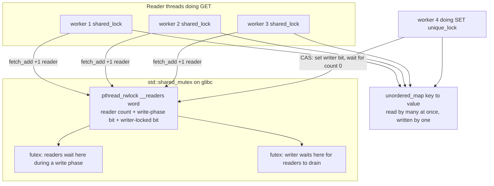

# Module 4.05: shared_mutex and reader-writer locks

**Estimated hours:** 3

**What you will learn**

1. What a reader-writer lock is: many threads may read at once, but a writer gets the data to itself.
2. How to use `std::shared_mutex` with `std::shared_lock` for readers and `std::unique_lock` for writers, and the rules that make it undefined behaviour if you break them.
3. The honest truth about cost: a `shared_mutex` is more expensive per operation than a plain `std::mutex`, so it only wins when reads are long or heavily dominant. You will measure this with the exact workload tcpkv faces.

**Prerequisites:** [Module 4.04: Condition variables](module-04-condition-variables.md). You must be comfortable with `std::mutex`, `std::lock_guard`, data races and ThreadSanitizer from modules 4.01 to 4.04.

---

## 1. One-line intuition

A reader-writer lock lets any number of readers look at the data at the same time, but when one writer wants to change it, everyone else must step out.

## 2. Real-life analogy

Think of the notice board in a bank branch that lists today's interest rates.

- Dozens of customers can **read** the board at the same time. They do not get in each other's way. These are **readers**, and they hold a **shared lock**.
- When the branch manager needs to **change** a rate, she asks everyone to step back, takes the board down, writes the new rate, and puts it back. While she is writing, nobody may read, because they could see a half-written number. She holds an **exclusive lock**, also called a **unique lock** or a **write lock**.
- A plain `std::mutex` is a different rule: only **one** person may stand at the board at a time, even to read. That is safe but silly when 95% of the visitors only want to look.

Two things in this analogy predict real problems:

- If customers keep arriving and there is never a moment when nobody is reading, the manager waits forever. That is **writer starvation**.
- If the manager has to wait for the current readers to finish before she may write, and new readers are held back while she waits, a queue of readers builds up behind her. When she finishes, they all rush in together. That is a **reader convoy**.

## 3. Why it exists: the problem it solves

The tcpkv server from resume claim I is a key-value store. Clients send `GET key` far more often than `SET key value`. If every `GET` takes a plain mutex, then eight worker threads doing lookups wait in a line for each other even though none of them is changing anything. The CPU has eight cores and only one of them is useful.

A reader-writer lock exists so that read-only work can proceed in parallel. The application server from claim H4 has the same shape: the in-memory master-table cache (branches, product codes, interest schemes) is read on every request and rewritten only when the master data is reloaded.

What breaks without it: either you serialise reads (wasted cores under a read-heavy load), or you let readers run with no lock at all while a writer changes the map, which is a data race and undefined behaviour (module 4.02). With `std::unordered_map`, a reader that walks a bucket chain while a writer rehashes it can follow a dangling pointer and crash the server.

What also breaks if you use it blindly: a `shared_mutex` is not free. Every reader must still take and release the lock, which is at least two atomic operations on one shared memory word. For a critical section that lasts 50 nanoseconds, that overhead can cost more than it saves. This module ends with a measurement so that you know, not guess.

## 4. Three layers of depth

### Layer 1 (beginner): the API and the rules

`std::shared_mutex` lives in the header `<shared_mutex>` and arrived in C++17. It has two kinds of lock:

| Operation | `std::mutex` | `std::shared_mutex` |
|---|---|---|
| Header | `<mutex>` | `<shared_mutex>` |
| Exclusive lock (writer) | `lock()`, `try_lock()`, `unlock()` | `lock()`, `try_lock()`, `unlock()` |
| Shared lock (reader) | none | `lock_shared()`, `try_lock_shared()`, `unlock_shared()` |
| RAII wrapper for exclusive | `std::lock_guard`, `std::unique_lock`, `std::scoped_lock` | same three |
| RAII wrapper for shared | none | `std::shared_lock` (C++14, in `<shared_mutex>`) |
| Timed variant | `std::timed_mutex` | `std::shared_timed_mutex` (C++14) adds `try_lock_for`, `try_lock_shared_for` and the `_until` versions |

You almost never call `lock_shared()` by hand. You write the RAII form, so the lock is released even if an exception is thrown:

```cpp
#include <shared_mutex>

class RateTable {
public:
    double rate(const std::string& product) const {
        std::shared_lock<std::shared_mutex> guard(mutex_);   // reader: shared
        auto it = rates_.find(product);
        return it == rates_.end() ? 0.0 : it->second;
    }
    void set_rate(const std::string& product, double r) {
        std::unique_lock<std::shared_mutex> guard(mutex_);   // writer: exclusive
        rates_[product] = r;
    }
private:
    mutable std::shared_mutex mutex_;    // mutable: rate() is const but must lock
    std::unordered_map<std::string, double> rates_;
};
```

Who may enter, depending on who is already inside:

| Already held by other threads | New `shared_lock` (reader) | New `unique_lock` (writer) |
|---|---|---|
| Nobody | enters at once | enters at once |
| One or more readers | enters (unless the implementation is holding readers back for a waiting writer, see Layer 2) | waits until every reader leaves |
| One writer | waits | waits |

Three rules from the C++ standard. Breaking any of them is undefined behaviour, not an error you can catch:

1. A thread that already holds the mutex in **any** mode must not lock it again, not even in shared mode. There is no recursive `shared_mutex`.
2. There is no **upgrade**. A reader that discovers it needs to write must release its shared lock, take a unique lock, and then **re-check** the data, because another writer may have changed it in between.
3. A `unique_lock` or `shared_lock` must be unlocked by the thread that locked it.

### Layer 2 (working engineer): behaviour, cost and when it actually wins

**The cost model.** Taking and releasing a `std::mutex` that nobody else holds is two atomic read-modify-write instructions on one word (module 4.03). Taking and releasing a shared lock on a `shared_mutex` is also at least two atomic read-modify-write instructions on one word, plus extra checks for the writer flags. So for a reader, the lock itself costs the same or more than a plain mutex. What you gain is that the **critical section** (the code between lock and unlock) can run on many cores at once. That gain is only worth something when:

- the critical section is long compared with the lock overhead (think microseconds, not tens of nanoseconds), or
- there are enough reader threads and cores that serialising them would really hurt, and
- writers are rare, so readers are not constantly being pushed out.

**The hidden scalability limit.** Every reader does an atomic increment and decrement on the same reader-count word. On a multi-core machine that word lives in a cache line that bounces between cores on every lock and unlock (module 4.08 explains why). So even with zero writers, readers do not scale perfectly; the lock word itself becomes the bottleneck at high core counts. This is the single most surprising fact about reader-writer locks for most engineers.

**Writer preference.** An implementation must decide what to do when readers are inside and a writer arrives:

| Policy | New readers while a writer waits | Effect |
|---|---|---|
| Reader-preferring | May enter | Writer can **starve** under a constant stream of readers. Readers never wait for a waiting writer. |
| Writer-preferring | Must wait | Writer gets in soon. Readers pile up behind it (a **convoy**), and a thread that takes a shared lock twice can deadlock against a waiting writer. |

`std::shared_mutex` gives you no knob to choose. On Linux with glibc, libstdc++ builds it on `pthread_rwlock_t` with default attributes, and the glibc default is **reader-preferring** (`PTHREAD_RWLOCK_PREFER_READER_NP`). So under a heavy enough read load, a writer can wait a very long time. You will watch this happen in the lab. If you need writer preference on Linux you either call `pthread_rwlock_init` yourself with `PTHREAD_RWLOCK_PREFER_WRITER_NONRECURSIVE_NP`, or you pick a different design.

**Three alternatives you must be able to defend.**

1. **Plain `std::mutex`.** Simplest and cheapest per operation. Right answer when the critical section is tiny and the thread count is small.
2. **Lock striping.** Split the map into N independent pieces (stripes), each with its own mutex and its own map. A key always goes to `hash(key) % N`. Two threads touching different stripes never wait for each other, readers or writers. Cost: an operation that needs the whole table (count all keys, iterate, resize everything) must lock all N stripes in a fixed order. tcpkv's store can be striped; so can the master-table cache.
3. **Copy-on-write snapshot.** Keep the table behind a `std::shared_ptr<const Table>`. Readers copy the pointer (nanoseconds) and then read the table with no lock at all. A writer builds a complete new table and swaps the pointer. Perfect for data that changes rarely and is read constantly, such as master tables reloaded a few times a day. Wrong for a key-value store with 5% writes, because each write copies the whole table.

```cpp
// Copy-on-write snapshot: readers never block, writers copy the whole table.
class SnapshotTable {
public:
    std::shared_ptr<const Map> snapshot() const {
        std::lock_guard<std::mutex> g(ptr_mutex_);   // held for nanoseconds: one pointer copy
        return current_;
    }
    void replace(std::shared_ptr<const Map> fresh) {
        std::lock_guard<std::mutex> g(ptr_mutex_);
        current_ = std::move(fresh);                  // old table freed when the last reader drops it
    }
private:
    mutable std::mutex ptr_mutex_;
    std::shared_ptr<const Map> current_ = std::make_shared<const Map>();
};
```

A reader calls `auto t = table.snapshot();` and then uses `*t` for as long as it likes. The old table is destroyed automatically when the last reader releases its `shared_ptr` (the control block from Phase 2 does the counting). C++20 adds `std::atomic<std::shared_ptr<T>>` so the tiny mutex is not even needed.

**The decision rule.** Measure first. The rest of this module is that measurement. The qualitative result you should expect from the lab, for a workload of short hash-map operations with 95% reads:

- 1 thread: plain mutex is fastest. `shared_mutex` is slower because its lock and unlock do more work.
- 4 and 8 threads: striping is fastest. `shared_mutex` and plain mutex are close; which one wins depends on the machine, because the critical section is so short that the lock word, not the lookup, is the bottleneck.
- Make the read operation ten times longer (Part B of the lab), and `shared_mutex` pulls clearly ahead of the plain mutex, because now parallel readers have real work to do in parallel.

### Layer 3 (internals): what libstdc++ and glibc actually do

Open `/usr/include/c++/13/shared_mutex` on your Ubuntu machine. You will find two implementations, chosen at compile time:

**When glibc is present (`_GLIBCXX_USE_PTHREAD_RWLOCK_T` is defined, which is your case):** `std::shared_mutex` is a thin wrapper, `__shared_mutex_pthread`, around a `pthread_rwlock_t` initialised with `PTHREAD_RWLOCK_INITIALIZER`. `lock_shared()` calls `pthread_rwlock_rdlock`, `lock()` calls `pthread_rwlock_wrlock`, and the unlocks call `pthread_rwlock_unlock`. If `rdlock` returns `EAGAIN` (the reader count overflowed, which takes millions of readers) the wrapper simply retries.

Inside glibc (file `nptl/pthread_rwlock_common.c`), the lock is a small struct. The important field is one 32-bit word, `__readers`, which packs:

- a **write-phase** bit: set while a writer owns the lock,
- a **writer-locked** bit: a writer has claimed the next turn,
- a reader-waiting bit, and
- the **reader count** in the remaining high bits.

A reader does one atomic `fetch_add` on this word to add itself. If the write-phase bit is clear, it is in; that is the fast path, about the same cost as locking a free mutex. If the bit is set, it waits on a futex (the kernel wait queue from module 4.03) until the writer finishes. A writer uses a compare-and-swap to set the writer-locked bit, then waits on another futex until the reader count drains to zero, then flips the write-phase bit. Unlocking does the reverse and wakes waiters with `futex_wake`. Preference is stored in a `__flags` field; with the default (reader-preferring) a new reader does not check whether a writer is waiting, which is exactly how starvation happens.

Because every reader does `fetch_add` and later a subtracting `fetch_add` on the same `__readers` word, that word's cache line is written by every core that reads the data. Module 4.08 shows what that costs.

**When there is no pthread rwlock (other platforms):** libstdc++ uses `__shared_mutex_cv`: one `std::mutex`, two condition variables (`_M_gate1`, `_M_gate2`) and a state word whose top bit means "a writer has entered" and whose other bits count readers. A writer sets the top bit first, which blocks new readers at gate 1, then waits at gate 2 for existing readers to drain. That design is **writer-preferring**. So the same C++ source has different fairness on different platforms. An interviewer who knows this will respect you for knowing it.

**Windows.** The Win32 equivalent is `SRWLOCK` with `AcquireSRWLockShared` and `AcquireSRWLockExclusive`, which MSVC's `std::shared_mutex` uses. It is covered with critical sections and wait objects later in this phase.

## 5. Architecture diagram



Every arrow into the `__readers` word is an atomic write to the same cache line. Readers run the map lookup in parallel, but they queue up at the word.

## 6. Code

This program is the measurement the whole module is about. It builds the same key-value store three ways, runs a 95% GET / 5% SET workload for two seconds per configuration, and prints operations per second for 1, 4 and 8 threads.

```cpp
// rw_bench.cpp
// Same key-value store, three locking strategies, 95% GET / 5% SET.
// (a) one std::mutex   (b) one std::shared_mutex   (c) 16 striped std::mutex
#include <array>
#include <atomic>
#include <chrono>
#include <cstdint>
#include <cstdio>
#include <cstdlib>
#include <functional>
#include <mutex>
#include <shared_mutex>
#include <string>
#include <thread>
#include <unordered_map>
#include <vector>

using Map = std::unordered_map<std::string, std::string>;

// (a) One mutex: every GET and every SET is exclusive.
class MutexStore {
public:
    bool get(const std::string& key, std::string& out) const {
        std::lock_guard<std::mutex> g(m_);
        auto it = map_.find(key);
        if (it == map_.end()) return false;
        out = it->second;
        return true;
    }
    void set(const std::string& key, const std::string& value) {
        std::lock_guard<std::mutex> g(m_);
        map_[key] = value;
    }
private:
    mutable std::mutex m_;
    Map map_;
};

// (b) One shared_mutex: GETs share the lock, SETs take it exclusively.
class SharedMutexStore {
public:
    bool get(const std::string& key, std::string& out) const {
        std::shared_lock<std::shared_mutex> g(m_);     // reader
        auto it = map_.find(key);
        if (it == map_.end()) return false;
        out = it->second;
        return true;
    }
    void set(const std::string& key, const std::string& value) {
        std::unique_lock<std::shared_mutex> g(m_);     // writer
        map_[key] = value;
    }
private:
    mutable std::shared_mutex m_;
    Map map_;
};

// (c) 16 stripes. A key always lands in the same stripe, so two threads on
// different stripes never wait for each other, whether reading or writing.
class StripedStore {
public:
    bool get(const std::string& key, std::string& out) const {
        const Stripe& s = pick(key);
        std::lock_guard<std::mutex> g(s.m);
        auto it = s.map.find(key);
        if (it == s.map.end()) return false;
        out = it->second;
        return true;
    }
    void set(const std::string& key, const std::string& value) {
        Stripe& s = pick(key);
        std::lock_guard<std::mutex> g(s.m);
        s.map[key] = value;
    }
private:
    static constexpr std::size_t kStripes = 16;
    struct alignas(64) Stripe {     // alignas(64): each stripe on its own cache line (module 4.08)
        mutable std::mutex m;
        Map map;
    };
    const Stripe& pick(const std::string& key) const {
        return stripes_[std::hash<std::string>{}(key) % kStripes];
    }
    Stripe& pick(const std::string& key) {
        return stripes_[std::hash<std::string>{}(key) % kStripes];
    }
    std::array<Stripe, kStripes> stripes_;
};

// A tiny, fast random number generator (xorshift). Good enough to pick keys.
struct Rng {
    uint64_t s;
    explicit Rng(uint64_t seed) : s(seed * 2654435761u + 1) {}
    uint64_t next() { s ^= s << 13; s ^= s >> 7; s ^= s << 17; return s; }
};

constexpr int      kKeys        = 10000;
constexpr uint64_t kReadPercent = 95;
constexpr auto     kDuration    = std::chrono::seconds(2);

template <typename Store>
void run(const char* name, int threads) {
    Store store;
    std::vector<std::string> keys;
    keys.reserve(kKeys);
    for (int i = 0; i < kKeys; ++i) {
        keys.push_back("account:" + std::to_string(i));
        store.set(keys.back(), "balance=" + std::to_string(i * 100));
    }

    std::atomic<bool> stop{false};
    std::vector<uint64_t> counts(threads, 0);     // ops done by each thread
    std::vector<std::thread> pool;
    for (int t = 0; t < threads; ++t) {
        pool.emplace_back([&, t] {
            Rng rng(static_cast<uint64_t>(t) + 1);
            std::string value;
            uint64_t n = 0;
            while (!stop.load(std::memory_order_relaxed)) {
                const std::string& key = keys[rng.next() % kKeys];
                if (rng.next() % 100 < kReadPercent) {
                    store.get(key, value);                              // 95%: GET
                } else {
                    store.set(key, "balance=" + std::to_string(n));     // 5%: SET
                }
                ++n;
            }
            counts[t] = n;
        });
    }
    std::this_thread::sleep_for(kDuration);
    stop.store(true);
    for (auto& th : pool) th.join();

    uint64_t total = 0;
    for (uint64_t c : counts) total += c;
    double seconds = std::chrono::duration<double>(kDuration).count();
    std::printf("%-14s threads=%d  ops/sec=%12.0f\n", name, threads,
                static_cast<double>(total) / seconds);
}

int main(int argc, char** argv) {
    std::vector<int> thread_counts = {1, 4, 8};
    if (argc > 1) thread_counts = {std::atoi(argv[1])};   // optional: one thread count
    std::printf("hardware threads: %u\n", std::thread::hardware_concurrency());
    for (int n : thread_counts) {
        run<MutexStore>("mutex", n);
        run<SharedMutexStore>("shared_mutex", n);
        run<StripedStore>("striped16", n);
    }
    return 0;
}
```

Compile and run:

```bash
g++ -std=c++17 -O2 -Wall -Wextra -Werror -g -pthread -o rw_bench rw_bench.cpp
./rw_bench
```

Expected output shape (the numbers are yours, not mine; they depend on the CPU, the number of cores WSL2 was given, and what else is running). The run takes about 20 seconds:

```text
hardware threads: 8
mutex          threads=1  ops/sec=    <number>
shared_mutex   threads=1  ops/sec=    <smaller number than mutex>
striped16      threads=1  ops/sec=    <about the same as mutex>
mutex          threads=4  ops/sec=    <number>
shared_mutex   threads=4  ops/sec=    <close to mutex; may be above or below>
striped16      threads=4  ops/sec=    <clearly the largest>
mutex          threads=8  ops/sec=    <number>
shared_mutex   threads=8  ops/sec=    <close to mutex; may be above or below>
striped16      threads=8  ops/sec=    <clearly the largest>
```

What to look for:

- At 1 thread, `shared_mutex` is slower than `mutex`. There is nothing to share, and the shared lock costs more.
- At 4 and 8 threads, the plain mutex does not get faster with more threads; it is serialised. `shared_mutex` lets readers overlap but all of them hammer the same lock word, so the gain is small for a lookup this short. Striping scales because the 16 lock words are independent.
- If `hardware threads` is less than 8, the 8-thread rows are oversubscribed and all three strategies drop; note it in your journal.

Any run where the ordering differs from this is not wrong. Record what you see and explain it with the cost model from Layer 2. That is the engineering skill being trained.

## 7. Use case: core-banking loan-origination platform

**tcpkv (claim I, capstone C1): "in-memory store guarded by shared_mutex".** The decision was: one `std::shared_mutex` around a `std::unordered_map<std::string, std::string>`, `shared_lock` for `GET`, `unique_lock` for `SET` and `DEL`. The reason it is defensible is not "reads are parallel", which an interviewer will push back on. It is this: the store is read-dominant, a `GET` copies the value out while holding the lock so the critical section is longer than a bare probe, the thread pool is small (typically 4 to 8 workers), and the measurement from this module showed `shared_mutex` at or above a plain mutex at the pool size used, with far simpler code than striping. The follow-up question "what would you do if `SET` traffic rose to 30%?" has the answer from Layer 2: move to 16 or 64 stripes, because a reader-writer lock degrades towards a plain mutex as writes grow, while stripes keep scaling.

**Application server (claim H4, capstone C2): the master-table cache.** Branch lists, product codes and interest schemes are read on every loan request and rewritten only when operations reloads master data, a few times a day. That is the copy-on-write case. The decision was: do **not** use a `shared_mutex` here, because a reload rebuilds every table and would hold the exclusive lock for a long time, stalling every request thread behind it. Instead the cache is a `std::shared_ptr<const MasterTables>`; the reload builds a fresh object in the background and swaps the pointer under a tiny mutex. Request threads never block on a reload, and a request that started with the old snapshot finishes with the old snapshot, which is also the correct business behaviour (one request should not see half-old, half-new master data).

Two different data sets, two different answers, both decided by the same three questions: how long is the read, how often are writes, how many threads.

## 8. Lab

### Part A: run the benchmark and fill the table (30 minutes)

1. Save `rw_bench.cpp`, compile and run it exactly as in section 6. First run `nproc` and write down how many cores WSL2 gives you.
2. Copy this table into your journal and fill it in with your ops/sec:

| Threads | `mutex` | `shared_mutex` | `striped16` |
|---|---|---|---|
| 1 | | | |
| 4 | | | |
| 8 | | | |

3. Run `./rw_bench 8` two more times. How much do the numbers move between runs? Anything within that spread is noise, not a result.

Expected: the ordering described in section 6. If `shared_mutex` beat `mutex` at 8 threads, say by how much. If it lost, say by how much. Both happen on real machines.

### Part B: make the read long, and watch shared_mutex win (20 minutes)

In all three stores, replace the body of `get` so that it does more read work while holding the lock. For example, look the key up and then also look up the ten keys `account:(i+1)` to `account:(i+10)`:

```cpp
// inside get(), after the first find(), still holding the lock:
for (int k = 1; k <= 10; ++k) {
    auto it2 = map_.find("account:" + std::to_string(k));   // extra read work
    if (it2 != map_.end()) out.size();                        // use the result so it is not optimised away
}
```

(For `StripedStore` use `s.map` instead of `map_`; the extra keys may live in other stripes, which is fine: we only want more read work under the lock.)

Recompile and rerun. Fill in a second table.

Expected: with a longer read, `shared_mutex` now clearly beats the plain mutex at 4 and 8 threads, because parallel readers finally have enough work to make the parallelism pay. This is the honest rule: `shared_mutex` wins when reads are long, not merely when reads are many.

### Part C: watch writer starvation (20 minutes)

```cpp
// writer_wait.cpp: 8 readers take a shared lock in a tight loop.
// One writer measures how long it waits for the exclusive lock.
#include <atomic>
#include <chrono>
#include <cstdio>
#include <shared_mutex>
#include <thread>
#include <vector>

int main(int argc, char** argv) {
    int reader_count = argc > 1 ? std::atoi(argv[1]) : 8;
    std::shared_mutex m;
    std::atomic<bool> stop{false};
    std::vector<std::thread> readers;
    for (int i = 0; i < reader_count; ++i) {
        readers.emplace_back([&] {
            while (!stop.load()) {
                std::shared_lock<std::shared_mutex> g(m);
                auto until = std::chrono::steady_clock::now() + std::chrono::microseconds(1);
                while (std::chrono::steady_clock::now() < until) {}   // "read" for about 1 us
            }
        });
    }
    using clk = std::chrono::steady_clock;
    const int rounds = 200;
    double worst_us = 0, total_us = 0;
    for (int i = 0; i < rounds; ++i) {
        auto t0 = clk::now();
        { std::unique_lock<std::shared_mutex> g(m); }     // take and release the write lock
        auto t1 = clk::now();
        double us = std::chrono::duration<double, std::micro>(t1 - t0).count();
        total_us += us;
        if (us > worst_us) worst_us = us;
        std::this_thread::sleep_for(std::chrono::milliseconds(1));
    }
    stop.store(true);
    for (auto& t : readers) t.join();
    std::printf("readers=%d  writer average wait %.1f us  worst wait %.1f us  (each reader holds ~1 us)\n",
                reader_count, total_us / rounds, worst_us);
    return 0;
}
```

```bash
g++ -std=c++17 -O2 -Wall -Wextra -Werror -g -pthread -o writer_wait writer_wait.cpp
./writer_wait 1
./writer_wait 4
./writer_wait 8
```

Expected: the writer's average and worst waits grow with the number of readers, and the worst wait is many times longer than the 1 microsecond any single reader holds the lock. That is glibc's reader-preferring policy: the writer only gets in when the reader count happens to hit zero. Record the three lines.

### Part D: prove the locking with ThreadSanitizer, then break it (15 minutes)

1. Build the benchmark with TSan and run a short, 4-thread pass:

```bash
g++ -std=c++17 -O1 -g -fsanitize=thread -pthread -o rw_bench_tsan rw_bench.cpp
./rw_bench_tsan 4
```

Expected: no `WARNING: ThreadSanitizer` output. All three stores are correctly locked.

2. Now introduce the classic bug. In `SharedMutexStore::set`, change `std::unique_lock` to `std::shared_lock`. Rebuild with TSan and run again.

Expected: `WARNING: ThreadSanitizer: data race` naming `set` and `get` (or `set` and `set`) on the map. Two writers now hold the lock in shared mode at the same time and modify the map together. Read the two stack traces; this is what the bug looks like when it reaches you from production. Change it back.

### Journal

Copy [journal/TEMPLATE.md](../journal/TEMPLATE.md) to `journal/YYYY-MM-DD-shared-mutex.md`. Record: your `nproc`; both benchmark tables (short read and long read) with the run-to-run spread from Part A step 3; the three writer-wait lines from Part C; the TSan report from Part D with the two function names it blamed; and one paragraph stating which strategy you would choose for tcpkv and why, using your own numbers.

## 9. Common mistakes and misconceptions

| Mistake | Why it is wrong | Bug it causes later |
|---|---|---|
| "shared_mutex is always faster for read-heavy data" | Each shared lock costs at least as much as a plain mutex lock; the win only appears when the critical section is long enough to overlap | A "performance improvement" that makes the server slower, discovered only under load |
| Taking a `shared_lock` in a function that calls another function which also takes a `shared_lock` on the same mutex | Recursive locking in any mode is undefined behaviour; with a writer-preferring implementation it deadlocks | Intermittent hang that appears only when a writer happens to be waiting |
| Upgrading by calling `unlock_shared()` then `lock()` and assuming the data is unchanged | Another writer can slip in between the two calls | Lost updates, double inserts, stale decisions |
| Using `std::lock_guard<std::shared_mutex>` for a reader | `lock_guard` always takes the exclusive lock | Reads serialised; the shared_mutex silently acts as a plain mutex |
| Holding a shared lock while doing slow work (network, disk, logging) | The writer waits for the slowest reader; readers behind that writer pile up | Latency spikes on writes that look like database slowness |
| Expecting fair ordering | glibc's default is reader-preferring; the writer may wait a long time | A config update "never takes effect" under load |
| Returning a reference or iterator into the map after the lock is released | The lock protected the lookup, not the lifetime of the result | Use-after-free after the next rehash or erase |

## 10. Resume link

- **Claim C, "shared_mutex".** Do not just say you used it. Say when it wins: "A `shared_mutex` lock is more expensive per operation than a plain mutex, so I measured. For tcpkv's 95/5 GET/SET mix with a copy-out of the value under the lock, it was at or above a plain mutex at the pool size I used, with much simpler code than striping. I also know it starves writers on glibc because the default rwlock is reader-preferring, and I measured the writer wait."
- **Claim I, "in-memory store guarded by shared_mutex".** Have your Part A and Part B tables ready. The follow-up will be "what would you change under write-heavy load?", and the answer is striping, with the "lock all stripes in order for whole-table operations" cost named.
- **Claim H4, "in-memory master-table cache that removes joins from the hot path".** The cache is the copy-on-write case: "readers take a `shared_ptr` snapshot, a reload builds a fresh table and swaps the pointer, so request threads never block on a reload and never see a half-updated table." The decision was driven by the reload holding an exclusive lock for too long.

Likely interviewer follow-ups and the one-line answers:

- "Can a thread upgrade a shared lock to exclusive?" No; release, re-lock exclusively, re-check.
- "What happens if a reader takes the lock twice?" Undefined behaviour; deadlock risk with writer preference.
- "Why not always stripe?" Whole-table operations get expensive and the code gets harder; stripe when measurement says so.

## 11. Interview questions

**Q1 (easy). What does a `std::shared_mutex` allow that a `std::mutex` does not?**

<details>
<summary>Model answer</summary>

It has two lock modes. Any number of threads may hold it in shared mode at the same time, which is meant for readers. Exclusive mode, for writers, excludes everyone, both other writers and all readers. A `std::mutex` has only the exclusive mode, so readers serialise behind each other. The shared mode is taken with `std::shared_lock`, the exclusive mode with `std::unique_lock` or `std::lock_guard`.

</details>

**Q2 (easy). What is the difference between `std::shared_lock`, `std::unique_lock` and `std::lock_guard` when used with a `shared_mutex`?**

<details>
<summary>Model answer</summary>

`shared_lock` calls `lock_shared()` on construction and `unlock_shared()` on destruction: the reader side. `unique_lock` and `lock_guard` both call `lock()` and `unlock()`: the exclusive side. `lock_guard` is the minimal RAII guard with no extra operations; `unique_lock` can be deferred, unlocked early, moved, and used with a condition variable. Using `lock_guard` on a `shared_mutex` for a read path is a common bug: it compiles and works but serialises every reader.

</details>

**Q3 (medium). When is a `shared_mutex` slower than a plain mutex, and why?**

<details>
<summary>Model answer</summary>

When the critical section is short relative to the lock overhead, or when the thread count is low. Taking a shared lock is at least one atomic read-modify-write on the reader-count word plus checks of the writer flags, and releasing is another, so a single reader pays more than it would for a plain mutex. In addition, every reader on every core writes the same cache line holding that count, so readers contend with each other on the lock word even with no writers. The parallel execution of the critical section only pays back that cost when the section is long, for example a lookup that copies a large value or runs several lookups, or a scan. On my benchmark with a 10,000-key `unordered_map` and 95% reads, a single thread was clearly slower with `shared_mutex`, and at 8 threads it was close to the plain mutex until I made the read ten times longer, at which point `shared_mutex` won clearly.

</details>

**Q4 (medium). What is writer starvation, and what does `std::shared_mutex` do about it on Linux?**

<details>
<summary>Model answer</summary>

Writer starvation is when a writer waits indefinitely because readers keep arriving and the reader count never drops to zero. It happens with a reader-preferring policy, where a new reader may enter even though a writer is waiting. The alternative, writer-preferring, blocks new readers as soon as a writer is waiting, which guarantees the writer progress but builds a reader convoy and can deadlock a thread that takes the shared lock recursively. `std::shared_mutex` exposes no policy. On Linux, libstdc++ wraps `pthread_rwlock_t` with default attributes, and glibc's default is reader-preferring, so writers can starve. I measured it: with eight readers each holding the lock for about a microsecond, the writer's worst wait was many times longer. If writer latency matters, I would use `pthread_rwlock_init` with the writer-nonrecursive preference, or redesign with striping or a copy-on-write snapshot. libstdc++'s fallback implementation without pthread rwlock is writer-preferring, so the fairness differs by platform.

</details>

**Q5 (hard). You own the tcpkv store: an `unordered_map<string,string>` with 95% GET and 5% SET from an 8-thread pool. Defend a locking design, say what you would measure, and explain what you would do if a GET discovers it must also write.**

<details>
<summary>Model answer</summary>

I would start with one `std::shared_mutex`: `shared_lock` for GET, `unique_lock` for SET and DEL. I would defend it with a measurement, not a slogan: a benchmark of the real mix at 1, 4 and 8 threads against a plain mutex and against 16 striped mutexes, reporting ops per second and the run-to-run spread. The expected shape is that at 1 thread the plain mutex wins, at 8 threads `shared_mutex` is at or above the plain mutex when the GET copies the value out under the lock, and striping wins outright. I would choose `shared_mutex` if it meets the throughput target, because it is one lock with simple invariants, and I would keep the striped version in the repository as the documented next step if SET traffic grows, since a reader-writer lock degrades towards a plain mutex as writes increase while stripes keep scaling. I would also check writer latency, because glibc's rwlock is reader-preferring and SETs could stall under a GET storm. For a GET that must write, for example "get or insert a default", there is no upgrade: I would release the shared lock, take the unique lock, and re-run the lookup before inserting, because another thread may have inserted in between. If that pattern is common, I would make it a single exclusive operation from the start, or use `try_emplace` under the unique lock, because a release-and-reacquire on every miss doubles the lock traffic.

</details>

## 12. Revision

- `std::shared_mutex`: many `shared_lock` readers or one `unique_lock` writer; no recursion, no upgrade; on glibc it is a `pthread_rwlock_t` that is reader-preferring, so writers can starve.
- It costs more per operation than a plain mutex and all readers write the same lock word, so it only wins when reads are long or heavily dominant; measure with the real mix at 1, 4, 8 threads.
- Alternatives: plain mutex for tiny sections, striped mutexes for scalable mixed traffic, copy-on-write `shared_ptr<const Table>` snapshots for rarely-changing master data.

---

Previous: [Module 4.04: Condition variables](module-04-condition-variables.md) | Next: [Module 4.06: Spinlocks and atomics](module-06-spinlocks-and-atomics.md)
