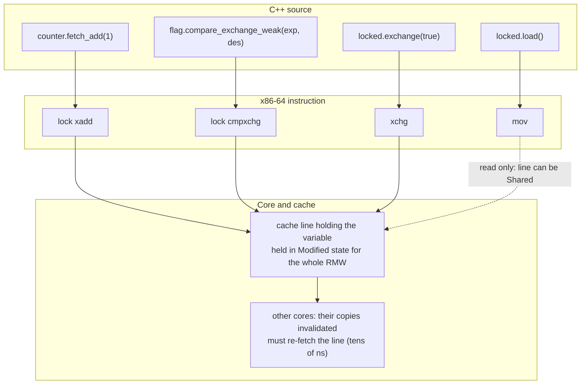

# Module 4.06: Spinlocks and atomics

**Estimated hours:** 4

**What you will learn**

1. What `std::atomic<T>` is, which operations it gives you (`load`, `store`, `exchange`, `compare_exchange`, `fetch_add`), and what single CPU instruction each one becomes on x86-64.
2. How to build a spinlock from one atomic flag, why the "test, then test-and-set" version is better, and what `pause` is for.
3. When spinning is the wrong tool (a holder that is not running, more threads than cores) and how real mutexes combine a short spin with a kernel wait.

**Prerequisites:** [Module 4.05: shared_mutex and reader-writer locks](module-05-shared-mutex.md). You need `std::mutex`, the futex idea from module 4.03, and ThreadSanitizer.

---

## 1. One-line intuition

An atomic operation is a read-modify-write that no other core can squeeze into the middle of; a spinlock is a lock that waits by asking "is it free yet?" in a tight loop instead of going to sleep.

## 2. Real-life analogy

Picture a shared tally counter at the entrance of a bank branch. Every teller who serves a customer walks over and adds one.

- **The race.** A teller reads "41", walks back to the desk, adds one in her head, walks back and writes "42". Meanwhile another teller read "41" too and also writes "42". Two customers were served; the counter says one. That is the lost update from module 4.02.
- **The atomic.** Replace the counter with a mechanical clicker. One press, one increment, and two people pressing at the same instant still produce two clicks. The hardware makes "read, add, write" a single unbreakable act. That is `fetch_add`.
- **Compare-and-swap.** A sticky note on a door says "Meeting room booked by: nobody". You may only write your name if it still says "nobody" at the instant you write. If someone else got there first, you see their name and try again later. That is `compare_exchange`: "change it from A to B, but only if it is still A".
- **The spinlock.** A locked washroom with no queue. You stand at the door, pulling the handle every second until it opens. If the occupant will be out in five seconds, standing there is the fastest plan. If the occupant has fainted (the holding thread has been taken off the CPU), you will stand there forever while the only person who could help is you, because you are occupying the corridor.

## 3. Why it exists: the problem it solves

A mutex (module 4.03) costs about 20 to 50 nanoseconds when nobody else holds it, and a trip into the kernel (microseconds) when someone does. For many jobs that is fine. But some jobs are too small for a mutex to make sense:

- A counter of requests served. The "critical section" is one addition. Wrapping it in a lock multiplies the cost by ten and makes eight threads wait for each other to add one.
- A flag that says "shut down now", written by a signal handler. A signal handler cannot take a mutex at all: if the signal interrupts the thread that holds the mutex, the handler deadlocks against its own thread.
- Building a mutex itself. Something has to be the lowest level, and that something is an atomic instruction.

Atomics exist because the CPU offers a few instructions that do a read-modify-write as one indivisible step, and because without them none of the higher tools (mutex, condition variable, `shared_mutex`, thread pool) could be built.

Spinlocks exist because, when the lock is held for a very short time by a thread that is actually running on another core, waiting in a loop for a few dozen nanoseconds is cheaper than asking the kernel to put you to sleep and wake you up (microseconds). What breaks without the right choice: a spinlock in the wrong place burns a whole core, or a whole machine, doing nothing.

## 4. Three layers of depth

### Layer 1 (beginner): `std::atomic<T>` and what it promises

`std::atomic<T>` (header `<atomic>`) is a wrapper around a value of type `T` that makes every operation on it **atomic**: no other thread can observe it half-done, and two threads touching it at once is not a data race. `T` must be trivially copyable: integers, pointers, `bool`, enums, small plain structs.

| Operation | Meaning | Returns |
|---|---|---|
| `x.load()` | Read the current value | the value |
| `x.store(v)` | Write `v` | nothing |
| `x.exchange(v)` | Write `v`, give me the old value | old value |
| `x.fetch_add(n)`, `fetch_sub`, `fetch_and`, `fetch_or`, `fetch_xor` | Read-modify-write arithmetic | old value |
| `x++`, `x += n` | Same as `fetch_add` with the result adjusted | new value |
| `x.compare_exchange_strong(expected, desired)` | If `x == expected`, set `x = desired` and return true; otherwise copy the real value into `expected` and return false | bool |
| `x.compare_exchange_weak(expected, desired)` | Same, but may return false even when `x == expected` ("spurious failure") on some CPUs; use it in a loop | bool |
| `x.is_lock_free()` | Does this atomic use real atomic instructions, or a hidden lock? | bool |
| `std::atomic<T>::is_always_lock_free` | Same, decided at compile time (C++17) | `constexpr bool` |

Two beginner-level warnings that matter in interviews:

- `std::atomic<int> n; n = n + 1;` is **not** atomic as a whole. It is an atomic load, then a plain addition, then an atomic store. Another thread can run between them. Use `n++`, `n += 1`, or `n.fetch_add(1)`.
- An atomic protects one variable. It does not protect the relationship between two variables. "`balance` and `last_updated` are both atomic" does not mean a reader sees a matching pair. For that you need a lock, or the memory-model rules from module 4.07.

Each atomic operation takes an optional **memory order** argument. The default, `std::memory_order_seq_cst`, is the strongest and safest. This module uses the default everywhere except one place, plain counters, where `std::memory_order_relaxed` is introduced. Module 4.07 is entirely about the other orders.

**Why `relaxed` is enough for a counter.** `relaxed` means: the operation is still atomic (no lost updates), but it carries no promise about the order in which other threads see it relative to other memory. For a statistics counter that nobody uses to synchronise anything, that is all you need: the final total will be exactly right, and nobody is waiting on it to decide when other data is safe to read. On x86-64 the generated instruction is the same `lock add` either way; the difference is what the compiler is allowed to reorder around it, and for a lone counter there is nothing to protect.

### Layer 2 (working engineer): CAS loops, spinlocks, and when not to spin

**The CAS loop idiom.** Compare-and-swap (CAS) is how you do "any arbitrary atomic update" on a single word. The pattern is always the same: read the current value, compute the new one, try to swap, and if someone else changed it in between, recompute and try again. Here is "atomic max", which tcpkv and the app server use to record the worst latency seen:

```cpp
std::atomic<uint64_t> worst_us{0};

void record(uint64_t us) {
    uint64_t cur = worst_us.load(std::memory_order_relaxed);
    while (cur < us &&
           !worst_us.compare_exchange_weak(cur, us, std::memory_order_relaxed)) {
        // Failed: another thread wrote a new value, and compare_exchange_weak
        // has copied it into 'cur'. If it is still smaller than ours, try again.
    }
}
```

Note what `compare_exchange_weak` does on failure: it **updates `expected`** with the value it found, so the loop does not need a separate reload. `weak` may fail spuriously on CPUs that implement CAS as load-linked/store-conditional (ARM, RISC-V), so it must be in a loop; `strong` never fails spuriously and is for a single attempt. On x86-64 both compile to the same `lock cmpxchg`.

**`is_lock_free` and the hidden lock.** The CPU can do an atomic read-modify-write on 1, 2, 4 or 8 bytes in one instruction. `std::atomic<int>`, `std::atomic<long>`, `std::atomic<bool>` and `std::atomic<T*>` are therefore lock-free on x86-64. A `std::atomic<SomeStruct>` of 24 bytes is still allowed, but there is no instruction for it, so the library implements it with a hidden mutex (in `libatomic`, from a small pool of locks selected by address). It still works, but it is not lock-free, it is not safe in a signal handler, and it must be linked with `-latomic`. Check `is_lock_free()`, and prefer designs where the shared state fits in 8 bytes. A 16-byte struct is a special case: x86-64 has `cmpxchg16b`, GCC does not report it as always lock-free, and `libatomic` may use it at run time; treat 16-byte atomics as "check it, do not assume".

**A spinlock.** One `std::atomic<bool>`, false when free, true when held:

```cpp
class Spinlock {
public:
    void lock() {
        for (;;) {
            if (!locked_.exchange(true)) return;   // it was false: now it is ours
            while (locked_.load()) pause();        // wait until it looks free, then retry
        }
    }
    void unlock() { locked_.store(false); }
private:
    std::atomic<bool> locked_{false};
};
```

Two versions exist and the difference matters:

| Version | Waiting loop | What the cache does |
|---|---|---|
| Test-and-set (TAS) | `while (locked_.exchange(true)) {}` | Every attempt is a write; every waiting core steals the cache line from the others and from the holder, slowing the unlock |
| Test, then test-and-set (TTAS) | spin on `load()` until false, then `exchange(true)` | Waiting cores read a shared copy of the line and only write when there is a real chance; the holder's unlock is fast |

The code above is TTAS. The `pause()` call is `_mm_pause()` from `<immintrin.h>` (or `__builtin_ia32_pause()`), which becomes the x86 `pause` instruction. It tells the core "this is a spin loop": it lowers power, lets a sibling hyperthread use the core, and avoids a pipeline-flush penalty when the loop finally exits. Its delay is typically tens of cycles, and about 140 on some recent Intel cores, so it also naturally throttles the polling rate.

`std::atomic_flag` is the standard's guaranteed-lock-free type for exactly this job: `test_and_set()` and `clear()`, plus `test()` since C++20. Before C++20 you could not read it without setting it, which is why the TTAS loop is usually written with `atomic<bool>`.

**When spinning is wrong.** A spinner is only useful when the holder is **running on another core right now** and will release soon. Three situations break that:

1. **One core, or more runnable threads than cores.** The holder gets descheduled while holding the lock. The spinner then burns its entire timeslice (typically a few milliseconds on Linux) asking a question nobody can answer, because the only thread that could release the lock is waiting for a core, and the spinner is sitting on one. With a plain mutex the waiter sleeps and the holder gets the core at once.
2. **Long critical sections.** If the holder does a hash lookup, a string copy and a log write (a microsecond or more), the spinner wastes that whole time on every contention.
3. **Priority differences.** A high-priority spinner can prevent a low-priority holder from ever running (priority inversion); with real-time priorities this hangs the machine.

**What real mutexes do: hybrid.** Glibc's standard `pthread_mutex_t` (the one under `std::mutex`) does one CAS and, if that fails, goes straight to a futex wait; it does not spin. Its `PTHREAD_MUTEX_ADAPTIVE_NP` kind spins a bounded number of times first, then sleeps. Windows `CRITICAL_SECTION` with `InitializeCriticalSectionAndSpinCount`, Java's monitors, Go's `sync.Mutex` and Abseil's `Mutex` all do the same: spin a little, because most short locks are released within a few hundred nanoseconds, then fall back to the kernel, because you cannot know if the holder is still running. In user space you cannot ask the kernel "is the holder scheduled?" cheaply, so the bounded spin is the compromise.

**Rule of thumb.** Use `std::mutex`. Use a spinlock only when you have measured a critical section of tens of nanoseconds, you control the thread count so it never exceeds the core count, and the lock is in a hot path that profiling blames. In a server with a thread pool plus an accept thread plus a logger thread, that first condition already fails, which is why neither tcpkv nor the app server uses a spinlock for the store.

### Layer 3 (internals): what the CPU does

Every `std::atomic` operation becomes a specific x86-64 instruction. Look at them on <https://godbolt.org/> with `x86-64 gcc 13` and `-O2`:

```cpp
#include <atomic>
std::atomic<int> c;

void inc()                    { c.fetch_add(1); }                 // result unused
int  fetch()                  { return c.fetch_add(1); }          // result used
bool cas(int exp, int des)    { return c.compare_exchange_strong(exp, des); }
int  swap(int v)              { return c.exchange(v); }
int  get()                    { return c.load(); }
void put(int v)               { c.store(v); }
```

You should see, give or take register names:

```asm
inc:    lock add  DWORD PTR c[rip], 1
        ret
fetch:  mov       eax, 1
        lock xadd DWORD PTR c[rip], eax          ; exchange-and-add: eax gets the old value
        ret
cas:    mov       eax, edi                       ; expected into eax (cmpxchg's implicit operand)
        lock cmpxchg DWORD PTR c[rip], esi       ; if c == eax then c = esi, else eax = c
        sete      al                             ; ZF says whether it succeeded
        ret
swap:   mov       eax, edi
        xchg      eax, DWORD PTR c[rip]          ; xchg with memory is always locked
        ret
get:    mov       eax, DWORD PTR c[rip]          ; a plain load is already atomic for aligned 4 bytes
        ret
put:    mov       eax, edi
        xchg      eax, DWORD PTR c[rip]          ; seq_cst store: xchg acts as a full barrier
        ret
```

**The `lock` prefix.** On a modern x86 core, `lock` makes the instruction hold the cache line in the Modified state for the duration of the read-modify-write (the cache coherence protocol from module 4.08), so no other core can read or write that line in between. On very old CPUs it literally locked the memory bus. A locked instruction also acts as a full memory barrier, which is why on x86 all atomic read-modify-writes have the same cost whatever memory order you ask for. Typical cost: about 20 cycles when the line is already in this core's cache, and a cross-core transfer (tens of nanoseconds) when another core wrote it last. That cross-core cost is why eight threads doing `fetch_add` on one counter is slower than one thread doing all of it.

**Why a plain load is atomic.** An aligned 4-byte or 8-byte load or store is a single memory transaction on x86-64; it cannot tear. `std::atomic` still matters for two reasons: it forbids the compiler from caching the value in a register or splitting the access, and it carries the memory-order promise. A plain `int` read in a loop can be hoisted out of the loop by the optimiser, turning `while (!done) {}` into an infinite loop; module 4.07 shows this.

**What `cmpxchg` cannot do.** It compares one word. If you need "swap this pointer only if the version counter also matches", you need either to pack both into 8 bytes, or `cmpxchg16b` for 16 bytes. Module 4.09 (the ABA problem) is where that need arises.

## 5. Architecture diagram



A locked instruction is cheap when the line is already local and expensive when it must be pulled from another core. A spinning `load()` keeps the line Shared, which is why TTAS beats TAS.

## 6. Code

Two programs. The first shows the race, the atomic fix, the mutex fix, the CAS-max idiom and `is_lock_free`. The second races a spinlock against `std::mutex`.

```cpp
// atomics_basics.cpp
// Four threads each add 1,000,000 to a counter, four ways.
#include <atomic>
#include <chrono>
#include <cstdint>
#include <cstdio>
#include <mutex>
#include <thread>
#include <vector>

constexpr int kThreads   = 4;
constexpr int kPerThread = 1'000'000;

// (a) A data race. 'volatile' only stops the compiler from folding the loop
// into one addition so that you can SEE the lost updates. volatile is NOT a
// fix for data races; this program is still undefined behaviour.
volatile int     plain_counter = 0;
// (b) Atomic read-modify-write.
std::atomic<int> atomic_counter{0};
// (c) Plain int under a mutex.
int              mutex_counter = 0;
std::mutex       counter_mutex;
// (d) Atomic max via a CAS loop.
std::atomic<uint64_t> worst_latency_us{0};

void record_latency(uint64_t us) {
    uint64_t cur = worst_latency_us.load(std::memory_order_relaxed);
    while (cur < us &&
           !worst_latency_us.compare_exchange_weak(cur, us, std::memory_order_relaxed)) {
        // 'cur' was refreshed by the failed CAS; loop re-checks cur < us
    }
}

template <typename F>
void timed(const char* label, F work) {
    auto t0 = std::chrono::steady_clock::now();
    std::vector<std::thread> pool;
    for (int t = 0; t < kThreads; ++t) pool.emplace_back(work, t);
    for (auto& th : pool) th.join();
    double ms = std::chrono::duration<double, std::milli>(
                    std::chrono::steady_clock::now() - t0).count();
    std::printf("%-26s %8.1f ms\n", label, ms);
}

struct Big { uint64_t a, b, c; };   // 24 bytes: no single x86-64 instruction can update this

int main() {
    std::printf("atomic<int>   always lock free: %d\n", (int)std::atomic<int>::is_always_lock_free);
    std::printf("atomic<long>  always lock free: %d\n", (int)std::atomic<long>::is_always_lock_free);
    std::printf("atomic<void*> always lock free: %d\n", (int)std::atomic<void*>::is_always_lock_free);
    std::atomic<Big> big{};
    std::printf("atomic<Big 24 bytes> lock free: %d   (uses a hidden lock in libatomic)\n",
                (int)big.is_lock_free());

    timed("(a) plain int, data race", [](int) {
        for (int i = 0; i < kPerThread; ++i) plain_counter = plain_counter + 1;
    });
    timed("(b) atomic fetch_add", [](int) {
        for (int i = 0; i < kPerThread; ++i)
            atomic_counter.fetch_add(1, std::memory_order_relaxed);
    });
    timed("(c) mutex", [](int) {
        for (int i = 0; i < kPerThread; ++i) {
            std::lock_guard<std::mutex> g(counter_mutex);
            ++mutex_counter;
        }
    });
    timed("(d) CAS max", [](int t) {
        for (int i = 0; i < kPerThread; ++i)
            record_latency(static_cast<uint64_t>(t * 1000 + (i % 1000)));
    });

    std::printf("expected total  = %d\n", kThreads * kPerThread);
    std::printf("(a) plain       = %d\n", plain_counter);
    std::printf("(b) atomic      = %d\n", atomic_counter.load());
    std::printf("(c) mutex       = %d\n", mutex_counter);
    std::printf("(d) worst       = %llu  (expected %d)\n",
                (unsigned long long)worst_latency_us.load(), (kThreads - 1) * 1000 + 999);
    return 0;
}
```

Compile and run. The `-latomic` is needed because the 24-byte atomic calls into the `libatomic` library; without it the link fails with `undefined reference to __atomic_is_lock_free`:

```bash
g++ -std=c++17 -O2 -Wall -Wextra -Werror -g -pthread -o atomics_basics atomics_basics.cpp -latomic
./atomics_basics
```

Expected output shape (timings vary by machine; the counts are the point):

```text
atomic<int>   always lock free: 1
atomic<long>  always lock free: 1
atomic<void*> always lock free: 1
atomic<Big 24 bytes> lock free: 0   (uses a hidden lock in libatomic)
(a) plain int, data race        <some> ms
(b) atomic fetch_add            <some> ms
(c) mutex                       <larger> ms
(d) CAS max                     <some> ms
expected total  = 4000000
(a) plain       = <a number smaller than 4000000, different every run>
(b) atomic      = 4000000
(c) mutex       = 4000000
(d) worst       = 3999  (expected 3999)
```

Line (a) is the lost update, live. Line (b) shows that four threads fighting over one atomic are much slower than you might expect for four million additions: every `lock add` has to pull the cache line from whichever core wrote it last. Line (c) is slower again, because a contended mutex sleeps and wakes threads through the kernel. Module 4.08 fixes (b) with per-thread counters.

```cpp
// spin_vs_mutex.cpp
// A TTAS spinlock against std::mutex, with a tiny critical section.
// Usage: ./spin_vs_mutex <threads>
#include <atomic>
#include <chrono>
#include <cstdio>
#include <cstdlib>
#include <immintrin.h>     // _mm_pause
#include <mutex>
#include <thread>
#include <vector>

class Spinlock {
public:
    void lock() {
        for (;;) {
            if (!locked_.exchange(true)) return;      // test-and-set: got it
            while (locked_.load()) _mm_pause();       // test: wait while it looks held
        }
    }
    void unlock() { locked_.store(false); }
private:
    std::atomic<bool> locked_{false};
};

template <typename Lock>
void run(const char* name, int threads, int iters) {
    Lock lock;
    long counter = 0;
    auto t0 = std::chrono::steady_clock::now();
    std::vector<std::thread> pool;
    for (int t = 0; t < threads; ++t) {
        pool.emplace_back([&] {
            for (int i = 0; i < iters; ++i) {
                std::lock_guard<Lock> g(lock);     // works for any type with lock()/unlock()
                ++counter;                         // the whole critical section
            }
        });
    }
    for (auto& th : pool) th.join();
    double ms = std::chrono::duration<double, std::milli>(
                    std::chrono::steady_clock::now() - t0).count();
    std::printf("%-9s threads=%2d  %9.1f ms  counter=%ld\n", name, threads, ms, counter);
}

int main(int argc, char** argv) {
    int threads = argc > 1 ? std::atoi(argv[1]) : 4;
    const int iters = 200'000;
    std::printf("hardware threads: %u\n", std::thread::hardware_concurrency());
    run<Spinlock>("spinlock", threads, iters);
    run<std::mutex>("mutex", threads, iters);
    return 0;
}
```

```bash
g++ -std=c++17 -O2 -Wall -Wextra -Werror -g -pthread -o spin_vs_mutex spin_vs_mutex.cpp
./spin_vs_mutex 4
```

Expected output shape:

```text
hardware threads: 8
spinlock  threads= 4      <some> ms  counter=800000
mutex     threads= 4      <usually larger> ms  counter=800000
```

With four threads on four or more cores and a one-instruction critical section, the spinlock typically wins, because the lock is always released within nanoseconds and the mutex pays kernel round trips when it contends. The lab shows you the other side of that coin.

## 7. Use case: core-banking loan-origination platform

**tcpkv (claim I): statistics counters.** The server reports `requests_served`, `bytes_in`, `bytes_out` and `connections_open` on a `STATS` command. The decision was: these are `std::atomic<uint64_t>` incremented with `fetch_add(1, std::memory_order_relaxed)` by every worker thread, never under the store's `shared_mutex`. Reason: taking the store lock to bump a counter would make every request contend on the lock twice, and the counters synchronise nothing, so `relaxed` is correct and the compiler and CPU are free to keep them cheap. Follow-up an interviewer will ask: "Is `relaxed` safe?" Yes, because no thread reads the counter to decide whether other data is ready; the count is only ever printed. Module 4.08 then explains why even these were later made per-thread.

**Application server (claim H4): worst-latency tracking and the no-spinlock decision.** The server records the worst request latency per request type with the CAS-max loop from Layer 2, so a dashboard can show it without locks. The bigger decision was negative: the synchronisation layer deliberately contains no spinlock. The server ran more threads than cores (a request pool, an accept thread, a database-reconnect thread, a logger), so the holder of any spinlock could be descheduled while holding it, and a spinner would burn a core for a whole timeslice. The Win32 variant uses `CRITICAL_SECTION` with a spin count, which is exactly the bounded-spin-then-wait hybrid described in Layer 2, and that is what you will build later in this phase.

## 8. Lab

### Part A: counters and the race (20 minutes)

1. Build and run `atomics_basics` as in section 6. Run it three times and record the three values of line (a). They should differ from each other and from 4,000,000.
2. Build it with ThreadSanitizer and run it once:

```bash
g++ -std=c++17 -O1 -g -fsanitize=thread -pthread -o atomics_basics_tsan atomics_basics.cpp -latomic
./atomics_basics_tsan 2>&1 | head -40
```

Expected: a `WARNING: ThreadSanitizer: data race` on `plain_counter`, and **no** warning on the atomic, the mutex or the CAS-max counter. TSan understands that atomics are not races.

3. Remove `volatile` from `plain_counter`, rebuild the normal `-O2` binary, run again. Expected: line (a) now often prints exactly 4,000,000 and takes about 0 ms. The compiler folded the million additions into one `add` per thread, and the four single additions rarely collide. The bug has not gone away; the optimiser hid it. This is what "undefined behaviour" means in practice: the program's behaviour depends on the optimisation level.

### Part B: see the instructions (15 minutes)

1. Open <https://godbolt.org/>, choose `x86-64 gcc 13.x`, options `-O2`, and paste the six-function snippet from Layer 3.
2. Confirm `lock add`, `lock xadd`, `lock cmpxchg`, `xchg` and `mov`. Note that `put` (a default `store`) is an `xchg`, not a `mov`. Module 4.07 explains why.
3. Change `c.fetch_add(1)` to `c.fetch_add(1, std::memory_order_relaxed)`. Expected: the instruction does not change. On x86-64 every locked read-modify-write is a full barrier whatever you ask for.
4. Change the compiler to `ARM64 gcc 13.x`. Expected: `fetch_add` becomes a loop of `ldaxr` / `stlxr` (load-exclusive, store-exclusive) or a single `ldaddal` if the compiler targets LSE atomics. This is the load-linked/store-conditional shape that makes `compare_exchange_weak` able to fail spuriously.

### Part C: when spinning is wrong (30 minutes)

1. Run `./spin_vs_mutex` with 1, 4 and 8 threads. Record the six timings.
2. Oversubscribe: run with 32 threads. Expected: the spinlock's time jumps far more than the mutex's, because spinners now steal the CPU from holders.
3. Pin everything to one core:

```bash
taskset -c 0 ./spin_vs_mutex 4
```

Expected: the mutex line is similar to before or faster (no cross-core traffic). The spinlock line is dramatically slower, possibly by a factor of ten or more, and varies wildly between runs. Every time the holder is descheduled, the spinner wastes a full timeslice. If it takes more than a minute, press `Ctrl+C`, lower `iters` to `20'000`, and try again. Write down the ratio you observed.

4. Replace the TTAS loop with the naive TAS version, `while (locked_.exchange(true)) {}`, with no inner `load()` loop and no `pause`. Rebuild and rerun with 8 threads. Expected: equal or slower than TTAS. On a machine with only a few cores the difference may be small; on a large server it is large. Note what you saw.

### Part D: the CAS loop by hand (15 minutes)

Write `atomic_min` (keep the smallest value seen) following `record_latency`, and a function `bool try_reserve(std::atomic<int>& stock, int n)` that subtracts `n` from `stock` only if `stock >= n`, returning whether it succeeded. Test `try_reserve` with 8 threads each trying to reserve 1 unit from a stock of 1000, 1000 times each; the total of successful reservations must be exactly 1000 and `stock` must end at 0.

<details>
<summary>Reference solution for try_reserve</summary>

```cpp
bool try_reserve(std::atomic<int>& stock, int n) {
    int cur = stock.load();
    while (cur >= n) {
        if (stock.compare_exchange_weak(cur, cur - n)) return true;
        // cur refreshed; loop checks it again
    }
    return false;
}
```

The important detail: the check `cur >= n` and the subtraction are tied together by the CAS. A `load`, an `if`, then a `fetch_sub` would be a check-then-act race and could drive `stock` negative.

</details>

### Journal

Copy [journal/TEMPLATE.md](../journal/TEMPLATE.md) to `journal/YYYY-MM-DD-spinlocks-and-atomics.md`. Record: the three lost-update totals from Part A; what happened when `volatile` was removed; the x86 instruction for each operation from Part B; the spinlock-versus-mutex ratio pinned to one core from Part C; and your `try_reserve` with its test result.

## 9. Common mistakes and misconceptions

| Mistake | Why it is wrong | Bug it causes later |
|---|---|---|
| `n = n + 1` on an `atomic<int>` | Atomic load, plain add, atomic store: three steps | Lost updates, exactly as with a plain `int` |
| `volatile` as a thread-safety tool | It stops the compiler caching the value; it does nothing about atomicity or ordering | Code that "works" on x86 in a debug build and corrupts data in release or on ARM |
| Two atomics mean the pair is consistent | Each variable is atomic on its own; a reader can see the new one and the old other | A balance and its timestamp that do not match; a size that does not match the buffer |
| Check-then-act: `if (x.load() > 0) x.fetch_sub(1)` | Another thread can act between the check and the act | Negative stock, double-spent credit limits |
| `compare_exchange_weak` without a loop | It may fail even when the value matched | Rare, unreproducible "operation did nothing" on ARM |
| Spinlock in a general-purpose server | Threads outnumber cores; the holder gets descheduled | 100% CPU with no throughput; latency spikes of whole timeslices |
| `std::atomic<BigStruct>` assumed lock-free | Over 8 bytes it uses a hidden lock in libatomic | Not signal-safe; surprising slowness; link error without `-latomic` |
| Spinning without `pause` | Wastes power, hurts a hyperthread sibling, pays a pipeline penalty on exit | Spinlocks that are slower than they should be |

## 10. Resume link

- **Claim C, "atomics".** The sentence to say: "I use `std::atomic` for single-word state such as counters and shutdown flags, I know `fetch_add` is `lock xadd` and `compare_exchange` is `lock cmpxchg` on x86-64, and I use the CAS loop for anything more complex than an add, for example an atomic max for worst latency." Then give your lab numbers for the lost update and for the pinned-core spinlock.
- **Claim I, tcpkv.** Statistics counters are relaxed atomics, not under the store lock; the shutdown flag set from the signal handler is an atomic because a handler cannot take a mutex. Be ready for "why relaxed?" with the answer from Layer 1.
- **Claim H4, "thread synchronisation layer (mutexes, critical sections, wait objects)".** The spinlock-free decision and the reason: more threads than cores. Mention that Windows `CRITICAL_SECTION` spins a bounded count before waiting, which is the hybrid every production mutex uses.

Likely follow-ups: "What is the difference between `compare_exchange_weak` and `strong`?" (spurious failure; use weak in loops). "When would you choose a spinlock?" (measured tens-of-nanoseconds section, threads never exceed cores, profiler says so). "Is `std::atomic<T>` always lock-free?" (no: check `is_lock_free`; over 8 bytes it is a hidden lock).

## 11. Interview questions

**Q1 (easy). What does `std::atomic<int>` guarantee, and does `x = x + 1` on it work correctly from several threads?**

<details>
<summary>Model answer</summary>

Every individual operation on the atomic is indivisible and free of data races: a load reads a whole value, a store writes a whole value, and `fetch_add`, `exchange` and `compare_exchange` read, modify and write as one step that no other thread can interleave with. `x = x + 1` is not one operation: it is `x.load()`, a plain addition, and `x.store()`. Two threads can both load the same value and both store the same result, losing one increment. The correct forms are `x++`, `x += 1` or `x.fetch_add(1)`, each of which becomes a single `lock add` or `lock xadd` instruction on x86-64.

</details>

**Q2 (easy). What is compare-and-swap and why is it the building block for everything else?**

<details>
<summary>Model answer</summary>

Compare-and-swap takes an expected value and a desired value. Atomically, if the variable currently equals the expected value it is set to the desired value and the call reports success; otherwise nothing changes and the caller is told the actual value. In C++ it is `compare_exchange_weak` or `compare_exchange_strong`, and on failure the actual value is written into the `expected` argument. It is universal because any update of a single word can be expressed as "read it, compute what I want, and swap it in only if nobody changed it meanwhile, else retry". Mutex acquisition, lock-free stacks, atomic max and reference counting all reduce to this loop. On x86-64 it is `lock cmpxchg`.

</details>

**Q3 (medium). Write a spinlock. Explain the difference between test-and-set and test-then-test-and-set, and what `pause` does.**

<details>
<summary>Model answer</summary>

A spinlock is an `atomic<bool>` that is true while held. `lock()` loops: do `exchange(true)`; if the old value was false we own the lock; otherwise spin on `load()` until it reads false, then try `exchange` again. `unlock()` stores false. The pure test-and-set version spins on `exchange(true)` itself. Each `exchange` is a write, so every waiting core repeatedly pulls the cache line into its own cache in Modified state, invalidating the others, including the holder's copy, which slows the holder's eventual unlock. The test-then-test-and-set version spins on a plain load, so all waiters share a read-only copy of the line and generate no coherence traffic until the holder writes false; only then do they attempt the write. `pause` is an x86 hint inside the spin loop: it reduces power, yields execution resources to a sibling hyperthread, and avoids a pipeline flush penalty when the loop exits because the loop's speculative loads would otherwise be mis-ordered against the store that frees the lock. Module 4.07 adds the memory orders: the `exchange` needs acquire and the `store(false)` needs release.

</details>

**Q4 (medium). When is a spinlock the wrong choice, and what do production mutexes do instead?**

<details>
<summary>Model answer</summary>

Spinning only helps when the holder is executing on another core right now and will release within a few hundred nanoseconds. It is wrong when the holder can be descheduled: on a single core, or whenever runnable threads outnumber cores, as in a server with a thread pool plus accept, logger and housekeeping threads. Then the spinner wastes its whole timeslice, typically milliseconds, and may even delay the holder from getting a core. It is also wrong for long critical sections, and dangerous with real-time priorities because of priority inversion. Production mutexes are hybrids: spin a bounded number of iterations, since most short locks free up quickly, then fall back to a kernel wait such as a futex on Linux or a keyed event on Windows. Glibc's default `pthread_mutex_t` does not spin at all, going straight to a futex after one failed CAS, while its adaptive kind and Windows `CRITICAL_SECTION` with a spin count do the bounded spin. I measured this: pinned to one core with four threads, a spinlock was many times slower than `std::mutex` and highly variable, while on four free cores it was faster.

</details>

**Q5 (hard). Is `std::atomic<T>` always lock-free? What determines it, what happens when it is not, and how would you design a shared record that must be updated atomically but is larger than 8 bytes?**

<details>
<summary>Model answer</summary>

No. Lock-freedom depends on whether the target CPU has an instruction that can read-modify-write an object of that size and alignment. On x86-64 that is 1, 2, 4 and 8 bytes, so `atomic<int>`, `atomic<long>`, `atomic<bool>` and `atomic<T*>` are always lock-free, which `std::atomic<T>::is_always_lock_free` reports at compile time. A 16-byte object can use `cmpxchg16b` and GCC's `libatomic` may do so at run time, but the compiler does not promise it, so you check `is_lock_free()`. Anything larger is implemented in `libatomic` with a hidden lock chosen from a pool by address; it is correct but it blocks, it is not safe in a signal handler, and it needs `-latomic` to link. For a large record that must change atomically, the usual designs are: keep the record immutable and publish a pointer to a new copy, so the atomic is the 8-byte pointer and readers never see a torn record, reclaiming the old copy with `shared_ptr` or a reclamation scheme from module 4.09; or pack the few fields that must change together into one 64-bit word, for example a 32-bit index plus a 32-bit version; or accept a plain mutex, which for a rarely-updated record is often the honest answer. I would not reach for a 24-byte `std::atomic<struct>`, because its hidden lock gives the cost of a mutex without the clarity of one.

</details>

## 12. Revision

- `std::atomic<T>`: `load`, `store`, `exchange`, `fetch_add`, `compare_exchange_weak/strong`; one word at a time; `n = n + 1` is not atomic; over 8 bytes it hides a lock (`is_lock_free`, `-latomic`).
- x86-64: `fetch_add` is `lock xadd`, CAS is `lock cmpxchg`, `exchange` and a default store are `xchg`, a load is `mov`; locked instructions are full barriers and cost most when the line is on another core.
- Spinlock = TTAS loop with `pause`; use only when the holder is surely running (threads never exceed cores) and the section is tens of nanoseconds; otherwise `std::mutex`, which real implementations make hybrid (short spin, then futex).

---

Previous: [Module 4.05: shared_mutex and reader-writer locks](module-05-shared-mutex.md) | Next: [Module 4.07: The memory model and memory orders](module-07-memory-model-and-memory-orders.md)
