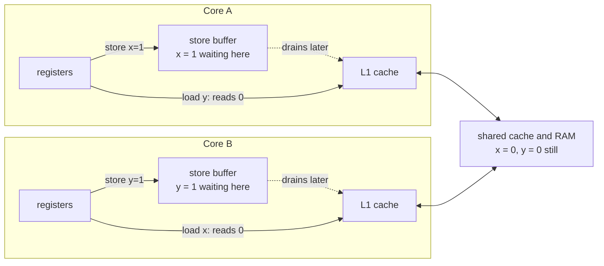

# Module 4.07: The memory model and memory orders

**Estimated hours:** 6

**What you will learn**

1. Why two threads can each see the other's write "not yet happened": compilers and CPUs reorder memory operations, and you will observe it on your own machine with the store-buffer (Dekker) test.
2. The vocabulary that makes multithreaded code provably correct: happens-before, synchronizes-with, release/acquire pairing, and the six `std::memory_order` values with what each permits.
3. The working rules: a mutex already gives you release on unlock and acquire on lock; use `seq_cst` by default; use weaker orders only with a measured reason and a written argument.

**Prerequisites:** [Module 4.06: Spinlocks and atomics](module-06-spinlocks-and-atomics.md). You must be fluent with `std::atomic`, `fetch_add`, `compare_exchange`, and ThreadSanitizer.

---

## 1. One-line intuition

Memory is not a single shared notebook that everyone reads instantly; each core has its own scribbles that reach the others later, and memory orders are the rules for when a write becomes visible to whom.

## 2. Real-life analogy

Two loan officers, Asha and Bilal, sit in separate rooms. Each has a personal **outbox** on the desk. When they write a note for the shared filing cabinet, it goes into the outbox first, and a runner carries it to the cabinet a little later.

- Asha writes "I am handling file 1001" and puts it in her outbox. Then she walks to the cabinet to check whether Bilal has claimed file 1001. Her note is still in her outbox; the cabinet shows nothing from Bilal either.
- At the same moment, Bilal writes "I am handling file 1001" into his outbox and walks to the cabinet. He sees nothing from Asha.
- Both conclude "nobody else has it" and both start working on 1001.

Each officer did "write, then read" in the right order from their own point of view. The outbox (a CPU's **store buffer**) made the write invisible to the other for a moment. This is the **store-buffer reordering** that even x86, the most orderly common CPU, allows.

Memory orders are the instructions you give the runner:

- **Relaxed:** "Deliver it whenever." The note arrives eventually, intact.
- **Release:** "Before you deliver this note, deliver everything already in my outbox." Anyone who reads this note and then looks in the cabinet is guaranteed to see all my earlier notes too.
- **Acquire:** "After I read this note, I will not pretend I had read any later files earlier." I do not look ahead before reading the signal.
- **Sequentially consistent:** "Wait at the cabinet until my note is filed before I look at anything." Everyone sees one single, agreed order of all such notes. Slower, because I stand and wait.

## 3. Why it exists: the problem it solves

Before C++11, the language had no idea threads existed. Whether a program like the loan-officer story was correct depended on the compiler and the CPU, and the answer differed between x86, ARM and POWER. Code that worked for ten years on x86 broke when moved to ARM servers.

C++11 defined a **memory model**: a precise contract between your source code and the machine. It says which outcomes a multithreaded program may produce, and it says that if your program has a **data race** (two threads touch the same non-atomic variable, at least one writes, and nothing orders them), the behaviour is **undefined**: the compiler may assume it never happens, and produce anything at all.

Two things reorder your memory operations, and both are legal unless you forbid them:

1. **The compiler.** It may keep a variable in a register, move a load out of a loop, or swap two independent stores, as long as a single-threaded program could not tell. `while (!done) {}` with a plain `bool done` compiles at `-O2` into "load `done` once; if false, loop forever", because no single-threaded code could change `done` inside that loop.
2. **The CPU.** It executes out of order and keeps stores in a per-core store buffer that drains to the cache later. x86-64 guarantees a lot (loads are not reordered with other loads, stores not with other stores, and stores from one core are seen in order), but it allows a store to be delayed past a later load to a different address. ARM and POWER allow nearly every reordering.

Memory orders exist so you can say exactly how much ordering you need. Say too little and you get a race that appears one time in a million. Say too much and you pay for barriers you did not need. What breaks without the model: there is no way to write a correct mutex, lock-free queue, or even a correct "shutdown flag" without it.

## 4. Three layers of depth

### Layer 1 (beginner): the words, and the one pattern you must know

**Sequenced-before.** Within one thread, statements happen in program order. `a = 1; b = 2;` means `a = 1` is sequenced before `b = 2`. This is the only ordering you get for free, and it only binds what that one thread observes.

**Data race.** Two accesses to the same memory location from two threads, at least one a write, at least one non-atomic, and neither happens-before the other. Undefined behaviour. ThreadSanitizer reports exactly this.

**Happens-before.** The relation that makes a write visible to a read in another thread. If write W happens-before read R, then R sees W (or something later). It is built from two pieces: sequenced-before inside a thread, and **synchronizes-with** between threads.

**Synchronizes-with.** A **release** operation in thread A (a store, an unlock, a thread creation) synchronizes with an **acquire** operation in thread B (a load that reads the value the release wrote, a lock, a join). Once that pair exists, everything A did before its release happens-before everything B does after its acquire.

**The message-passing pattern.** This is 90% of what you will ever write by hand:

```cpp
LoanDecision decision;              // plain data, not atomic
std::atomic<bool> ready{false};

// Thread A (producer)
decision.loan_id = 1001;            // (1) write the data
decision.rate    = 8.5;
ready.store(true, std::memory_order_release);     // (2) publish the flag

// Thread B (consumer)
while (!ready.load(std::memory_order_acquire)) {} // (3) wait for the flag
use(decision);                                    // (4) read the data: guaranteed to see (1)
```

The release store at (2) synchronizes with the acquire load at (3) that reads `true`. So (1) happens-before (4). Without those two orders, the compiler or CPU may move (1) after (2), or (4) before (3), and B reads garbage. On x86 it would still work by luck most of the time, which is exactly how such bugs survive until the ARM port.

**A mutex is the same pattern.** `unlock()` is a release; `lock()` is an acquire. Everything you did inside the critical section happens-before everything the next locker does after it takes the lock. That is why plain code under a mutex never needs memory orders.

**The six orders at a glance.**

| `std::memory_order_` | Used on | Promise |
|---|---|---|
| `relaxed` | any | Atomic, nothing else. No ordering with other memory. |
| `consume` | loads | A weak acquire for data reached through the loaded pointer. Compilers treat it as `acquire`. Do not use. |
| `acquire` | loads, RMW | Nothing after this in my thread moves before it. Pairs with a release. |
| `release` | stores, RMW | Nothing before this in my thread moves after it. Pairs with an acquire. |
| `acq_rel` | RMW | Both at once: for an operation that reads someone's release and publishes to someone's acquire. |
| `seq_cst` | any (default) | Acquire and release, plus one single global order of all `seq_cst` operations that every thread agrees on. |

### Layer 2 (working engineer): what each order does and does not promise

**`relaxed`: counters and nothing else.** A relaxed `fetch_add` on a counter never loses an increment, and the final value is exact. What relaxed does not do: tell another thread that anything else is ready. A reader that sees `count == 10` knows nothing about any other variable. There is one more guarantee: each atomic variable has a single **modification order** that all threads agree on; you will never see a counter go 5, 7, 6. Use relaxed for statistics, progress counters, and the "test" load inside a spinlock's waiting loop.

**`release` / `acquire`: message passing.** The precise contract:

- A release store orders every memory operation *before it* in the same thread (plain or atomic, any address) so that they are visible to a thread whose acquire load reads this store's value.
- An acquire load orders every memory operation *after it* in the same thread so that it cannot be performed before the load.

What release/acquire **does not** promise, and interviewers probe each of these:

1. **No ordering after a release or before an acquire.** A release is a one-way fence: later operations may move up before it. An acquire is one-way the other way: earlier operations may move down after it. So `x.store(1, release); r = y.load(acquire);` may execute the load before the store. The Dekker test fails with release/acquire exactly as with relaxed.
2. **No timing.** Release does not make the write visible "immediately". It only says *when* the other thread does see it, it also sees what came before. A waiting thread may spin for a while.
3. **No global order across different variables.** Two threads may see two independent release stores (to `x` and to `y`) in different orders (the "IRIW" test). Only `seq_cst` gives all threads one agreed order.
4. **Only pairs that actually connect.** An acquire that reads a value *not* written by a release (the initial value, say) synchronizes with nothing.

**`acq_rel`: for read-modify-writes in the middle of a chain.** When a `fetch_add` or `compare_exchange` must both see what an earlier thread published (acquire) and publish for a later thread (release), use `acq_rel`. The reference count in `shared_ptr` is the classic case: the decrement that drops the count to zero must acquire everything other owners did before their own decrements, because it is about to run the destructor.

**`seq_cst`: the default, and the only one that makes Dekker work.** All `seq_cst` operations appear in one total order consistent with every thread's program order. It is the only order under which "store x then load y" in one thread and "store y then load x" in another cannot both read zero. Use it for any algorithm where two threads each write their own flag and then check the other's: Dekker's and Peterson's mutual exclusion, "I am done" / "are you done" handshakes, and anything you have not proven with release/acquire reasoning.

**What it costs on x86-64 versus ARM.** x86-64 is **TSO** (total store order): the hardware already gives you acquire on every load and release on every store for free. The only reordering it allows is the store buffer (a store followed by a later load). So:

| Operation | x86-64 instruction | ARM64 instruction |
|---|---|---|
| load `relaxed` | `mov` | `ldr` |
| load `acquire` | `mov` | `ldar` (or `ldapr` on newer cores) |
| load `seq_cst` | `mov` | `ldar` |
| store `relaxed` | `mov` | `str` |
| store `release` | `mov` | `stlr` |
| store `seq_cst` | `xchg` (or `mov` + `mfence`) | `stlr` |
| RMW, any order | `lock`-prefixed, full barrier | `ldaxr`/`stlxr` loop or LSE instruction, barrier strength by order |

On x86 the **only** thing a memory order changes in the generated code is the `seq_cst` store, which becomes an `xchg` that drains the store buffer, typically costing on the order of 20 to 40 cycles instead of about 1. Everything else is the same `mov`; the order only restrains the **compiler**. On ARM, every step up in strength costs instructions and stalls, which is why "it was fine on my laptop" does not transfer.

**Fences.** `std::atomic_thread_fence(order)` is a barrier not attached to any variable. A release fence followed by a relaxed store acts as a release store; a relaxed load followed by an acquire fence acts as an acquire load. A `seq_cst` fence is a full barrier (`mfence` on x86). Fences are useful when one barrier can cover several relaxed operations, and in the lab you will use a `seq_cst` fence to fix the Dekker test. `std::atomic_signal_fence` restrains only the compiler and is for talking to a signal handler on the same thread.

**The correct spinlock from module 4.06.** With orders:

```cpp
void lock() {
    for (;;) {
        if (!locked_.exchange(true, std::memory_order_acquire)) return;
        while (locked_.load(std::memory_order_relaxed)) _mm_pause();   // relaxed: just polling
    }
}
void unlock() { locked_.store(false, std::memory_order_release); }
```

Acquire on the successful `exchange` means the critical section cannot start before we own the lock. Release on the store means the critical section's writes are visible to whoever acquires next. The polling load can be relaxed because the `exchange` re-checks with acquire.

**The rules you actually follow.**

1. Protect shared data with a mutex. It gives acquire and release; you never write an order.
2. For a flag or a pointer handed between threads, use the default `seq_cst`. It is correct and on x86 it costs one `xchg` per store.
3. Drop to `release`/`acquire` only where profiling shows a hot `seq_cst` store, and write the pairing down in a comment: "release here pairs with acquire in `consumer()`".
4. Use `relaxed` only for counters whose value nobody uses to synchronise.
5. Run everything under ThreadSanitizer. TSan understands memory orders and reports a race when a relaxed flag is used to publish data.

### Layer 3 (internals): the store buffer, and the litmus test you will run

**Why x86 lets Dekker fail.** Each core has a **store buffer**, a small queue of pending writes between the core and its L1 cache. A store goes into the buffer and the core moves on at once, without waiting for the cache line to be owned (module 4.08 explains that ownership takes tens of nanoseconds). Loads check the store buffer first (so a thread always sees its own writes) and then read the cache. So this sequence on core A:

```text
A:  store x = 1      ; goes into A's store buffer
A:  load  y          ; reads the cache: y is still 0, B's store is in B's buffer
```

and the mirror on core B both read 0. Each core, individually, did its store before its load. Globally, both loads happened before either store reached the cache. This is the **store-buffer litmus test**, the only reordering x86 allows, and it is enough to break Dekker's mutual exclusion algorithm, Peterson's algorithm, and any handshake of the form "set my flag, then check yours".

**How `seq_cst` fixes it.** A `seq_cst` store on x86 compiles to `xchg`, which, like every locked instruction, waits for the store buffer to drain before completing. So when core A's load runs, its store is already in the cache where B can see it. An `mfence` after a plain store does the same. ARM's `stlr`/`ldar` pair achieves the same guarantee by a different mechanism.

**What the compiler does with each order.** The order is a promise to the compiler too. For `seq_cst` and `acquire` loads, GCC will not hoist later memory accesses above the load; for `release` stores it will not sink earlier accesses below it. For `relaxed` it may move plain accesses across the atomic in either direction. That is why `while (!flag.load(relaxed)) {}` followed by reading `data` is a real bug even on x86: the compiler is allowed to load `data` *before* the loop, and sometimes does when it decides the value is loop-invariant.

**Release sequences.** One subtlety you will meet in `shared_ptr` and lock-free code: if a release store is followed by read-modify-writes (any order) on the same variable, an acquire load that reads any of those later RMW values still synchronizes with the original release. That is why a chain of `fetch_sub(1, acq_rel)` on a reference count works: each decrement extends the chain from the last owner's release.

**ThreadSanitizer's model.** TSan tracks happens-before using vector clocks. Every release operation (unlock, release store, thread start) publishes the thread's clock; every acquire that reads it merges the clock. A plain access that is not ordered by this bookkeeping against a conflicting access in another thread is reported. So TSan is a memory-model checker, not just a "lock was not held" checker. It is the tool that makes weaker orders safe to use at all.

## 5. Architecture diagram



A `seq_cst` store (`xchg`) or a full fence (`mfence`) forces the dotted "drains later" to happen before the next load. Release/acquire do not, because a store followed by a load to a different address is exactly the one reordering they allow.

## 6. Code

Two programs. The first observes the store-buffer reordering with your own eyes, and shows it disappear under `seq_cst` or a fence. The second is the message-passing pattern, correct with release/acquire and racy with relaxed, which TSan will tell you.

```cpp
// store_buffer.cpp
// The store-buffer (Dekker) litmus test.
//   Thread A: x = 1; r1 = y        Thread B: y = 1; r2 = x
// Can r1 and r2 BOTH be 0? With relaxed atomics on x86-64: yes, you will see it.
// With seq_cst (or a seq_cst fence between the store and the load): never.
// Usage: ./store_buffer [relaxed|seq_cst|fence]
#include <atomic>
#include <cstdio>
#include <cstring>
#include <functional>
#include <thread>

std::atomic<int> x{0}, y{0};
int r1 = 0, r2 = 0;

// Harness: main sets x = y = 0, then raises round_no; both threads run once and
// bump 'done'; main waits for done == 2 and inspects r1 and r2.
std::atomic<int> round_no{0};
std::atomic<int> done{0};
constexpr int kIters = 1'000'000;

enum class Mode { relaxed, seq_cst, fence };
Mode mode = Mode::relaxed;

void store_then_load(std::atomic<int>& mine, std::atomic<int>& other, int& result) {
    switch (mode) {
    case Mode::relaxed:
        mine.store(1, std::memory_order_relaxed);
        result = other.load(std::memory_order_relaxed);
        break;
    case Mode::seq_cst:
        mine.store(1, std::memory_order_seq_cst);        // compiles to xchg on x86-64
        result = other.load(std::memory_order_seq_cst);
        break;
    case Mode::fence:
        mine.store(1, std::memory_order_relaxed);
        std::atomic_thread_fence(std::memory_order_seq_cst);   // mfence on x86-64
        result = other.load(std::memory_order_relaxed);
        break;
    }
}

void worker(std::atomic<int>& mine, std::atomic<int>& other, int& result) {
    for (int i = 1; i <= kIters; ++i) {
        while (round_no.load(std::memory_order_acquire) != i) {}   // starting gun
        store_then_load(mine, other, result);
        done.fetch_add(1, std::memory_order_release);
    }
}

int main(int argc, char** argv) {
    if (argc > 1 && std::strcmp(argv[1], "seq_cst") == 0) mode = Mode::seq_cst;
    else if (argc > 1 && std::strcmp(argv[1], "fence") == 0) mode = Mode::fence;
    const char* names[] = {"relaxed", "seq_cst", "fence"};

    std::thread a(worker, std::ref(x), std::ref(y), std::ref(r1));
    std::thread b(worker, std::ref(y), std::ref(x), std::ref(r2));

    int both_zero = 0;
    for (int i = 1; i <= kIters; ++i) {
        x.store(0, std::memory_order_relaxed);
        y.store(0, std::memory_order_relaxed);
        done.store(0, std::memory_order_relaxed);
        round_no.store(i, std::memory_order_release);          // fire: both threads see x=y=0
        while (done.load(std::memory_order_acquire) != 2) {}   // wait for both to finish
        if (r1 == 0 && r2 == 0) ++both_zero;
    }
    a.join();
    b.join();
    std::printf("mode=%-8s iterations=%d  both-zero outcomes=%d\n",
                names[static_cast<int>(mode)], kIters, both_zero);
    return 0;
}
```

```bash
g++ -std=c++17 -O2 -Wall -Wextra -Werror -g -pthread -o store_buffer store_buffer.cpp
./store_buffer relaxed
./store_buffer seq_cst
./store_buffer fence
```

Expected output shape (this needs at least 3 cores so that both workers and main run truly in parallel; check `nproc`):

```text
mode=relaxed  iterations=1000000  both-zero outcomes=<a nonzero number, often hundreds or thousands>
mode=seq_cst  iterations=1000000  both-zero outcomes=0
mode=fence    iterations=1000000  both-zero outcomes=0
```

The first line is the store buffer, caught in the act. Each thread did its store before its load, and still both loads returned 0. The exact count varies from run to run and machine to machine; if you get 0 with `relaxed`, run it again or check that WSL2 has more than two cores, because on a single core the threads never overlap. The `seq_cst` and `fence` lines must be exactly 0 every time; anything else would be a hardware bug.

```cpp
// publish.cpp
// Message passing: thread P fills a record, then raises a flag.
// Thread C waits for the flag, then reads the record.
// Build normally for release/acquire; build with -DUSE_RELAXED to make it a data race.
#include <atomic>
#include <cstdio>
#include <cstring>
#include <thread>

#ifdef USE_RELAXED
constexpr auto kStoreOrder = std::memory_order_relaxed;
constexpr auto kLoadOrder  = std::memory_order_relaxed;
#else
constexpr auto kStoreOrder = std::memory_order_release;
constexpr auto kLoadOrder  = std::memory_order_acquire;
#endif

struct LoanDecision {
    long   loan_id;
    double rate;
    char   outcome[16];
};

LoanDecision      decision{};          // plain data, written by P, read by C
std::atomic<bool> ready{false};        // the flag

void producer() {
    decision.loan_id = 1001;
    decision.rate    = 8.5;
    std::strcpy(decision.outcome, "APPROVED");
    ready.store(true, kStoreOrder);    // release: everything above is published with the flag
}

void consumer() {
    while (!ready.load(kLoadOrder)) {} // acquire: nothing below may be read before the flag is seen
    std::printf("loan %ld rate %.1f outcome %s\n",
                decision.loan_id, decision.rate, decision.outcome);
}

int main() {
    std::thread c(consumer);
    std::thread p(producer);
    p.join();
    c.join();
    return 0;
}
```

```bash
# correct version
g++ -std=c++17 -O2 -Wall -Wextra -Werror -g -pthread -o publish publish.cpp
./publish
# racy version under ThreadSanitizer
g++ -std=c++17 -O1 -g -fsanitize=thread -pthread -DUSE_RELAXED -o publish_relaxed_tsan publish.cpp
./publish_relaxed_tsan
# correct version under ThreadSanitizer
g++ -std=c++17 -O1 -g -fsanitize=thread -pthread -o publish_tsan publish.cpp
./publish_tsan
```

Expected:

```text
loan 1001 rate 8.5 outcome APPROVED
```

from the first and third builds, with no sanitizer output. The second build prints the same line (on x86 the hardware happens to keep the order) **and** a `WARNING: ThreadSanitizer: data race` naming `decision` with a write in `producer` and a read in `consumer`. TSan is telling you the truth that the hardware hid: with relaxed orders, there is no happens-before between the write and the read, so the program is undefined, and an ARM machine or a different optimisation decision could print garbage.

## 7. Use case: core-banking loan-origination platform

**tcpkv (claim I): "graceful shutdown on signals".** A `SIGINT` or `SIGTERM` handler cannot take a mutex or call almost anything; it may only touch a lock-free `std::atomic` or a `volatile sig_atomic_t`. The decision was: one `std::atomic<bool> g_stop`, stored with the default `seq_cst` in the handler, loaded with the default `seq_cst` in the accept loop and by each worker between requests. The cost is one `xchg` per shutdown, which happens once in the process's life, and the benefit is that nobody ever has to argue about whether a weaker order would have been enough. The same flag is also checked by the thread pool's idle wait through the condition-variable predicate from module 4.04, where the mutex supplies the ordering.

**Application server (claim H4): a coding rule instead of clever orders.** The synchronisation layer was reviewed with one explicit rule: cross-thread publication of any data goes through a mutex, a condition variable or a default `seq_cst` atomic; `memory_order_relaxed` is permitted only on statistics counters and must carry a comment saying so; no `acquire`/`release` pair may be introduced without a benchmark showing the `seq_cst` version was a measured bottleneck. The decision this drove: the master-table cache swap from module 4.05 publishes a `shared_ptr` under a mutex rather than with a hand-written release/acquire on a raw pointer. It cost nothing measurable, because a swap happens a few times a day, and it meant a crash-dump investigation (claim H5) could rule out memory-ordering bugs in a minute instead of a week. Interviewers who ask about "lock-free" designs respect an engineer who can explain why they chose not to need one.

## 8. Lab

### Part A: catch the store buffer (20 minutes)

1. Build and run `store_buffer` in all three modes as in section 6. Run `relaxed` five times and record the five counts. They will vary.
2. Change `kIters` to `10'000'000` and run `relaxed` once more. Expected: roughly ten times more both-zero outcomes; the rate per million is what to record.
3. Pin the program to one core: `taskset -c 0 ./store_buffer relaxed`. Expected: 0, or very close to it, and a much slower run. With one core the two threads never run at the same instant, so their store buffers never overlap. Explain in one sentence why this proves the reordering is a hardware effect, not a compiler one.

### Part B: see what each order compiles to (20 minutes)

Open <https://godbolt.org/>, `x86-64 gcc 13.x`, `-O2`, and paste:

```cpp
#include <atomic>
std::atomic<int> f;
void relaxed_store() { f.store(1, std::memory_order_relaxed); }
void release_store() { f.store(1, std::memory_order_release); }
void seqcst_store()  { f.store(1); }
int  relaxed_load()  { return f.load(std::memory_order_relaxed); }
int  acquire_load()  { return f.load(std::memory_order_acquire); }
int  seqcst_load()   { return f.load(); }
```

1. Confirm: all three loads are a single `mov`; `relaxed_store` and `release_store` are a single `mov`; `seqcst_store` is `mov eax, 1` then `xchg eax, DWORD PTR f[rip]`.
2. Switch the compiler to `ARM64 gcc 13.x`. Confirm: `relaxed_load` uses `ldr`, `acquire_load` and `seqcst_load` use `ldar`, `relaxed_store` uses `str`, `release_store` and `seqcst_store` use `stlr`. Write the two tables side by side in your journal. This is the "cost on ARM versus x86" answer.
3. Now paste this and look at `-O2` output:

```cpp
bool done = false;                // plain, not atomic
void wait_plain() { while (!done) {} }
```

Expected: GCC loads `done` once, and if it is false emits an unconditional infinite loop (`.L2: jmp .L2`). The compiler has legally assumed no other thread exists. Change `bool` to `std::atomic<bool>` and watch the load move back inside the loop.

### Part C: TSan as a memory-model checker (20 minutes)

1. Build the three `publish` variants from section 6 and run them. Record the TSan report from the relaxed build: the two stack frames and the two memory orders it mentions.
2. Make a third variant by hand: keep the store as `release` but change the load to `relaxed`. Build with TSan. Expected: a race is still reported, because an acquire is needed on the reading side for the pair to synchronize.
3. Replace the atomic flag entirely with a `std::mutex` and a `bool` protected by it (lock, set, unlock in the producer; lock, read, unlock in a loop in the consumer). Build with TSan. Expected: clean. The mutex's unlock/lock pair supplies release/acquire. This is rule 1 from Layer 2 in action.

### Part D: the spinlock, properly ordered (30 minutes)

1. Take `spin_vs_mutex.cpp` from module 4.06 and change the `Spinlock` to the ordered version from Layer 2 (acquire on `exchange`, relaxed on the polling load, release on `store(false)`).
2. Build with TSan and run with 4 threads. Expected: clean; the counter is exactly `threads * iters`.
3. Now make both the `exchange` and the `store` `memory_order_relaxed`. Build with TSan and run. Expected: TSan reports a data race on `counter`. The lock still excludes threads from the flag (RMWs are atomic), but it no longer orders the data inside the critical section: the increment of `counter` has no happens-before edge between one holder and the next. This is the live answer to interview question 4.
4. Rebuild the broken version without TSan at `-O2` and run it. Expected: the counter is still correct on x86, because the hardware is TSO. Write down why that does not make it correct.

### Journal

Copy [journal/TEMPLATE.md](../journal/TEMPLATE.md) to `journal/YYYY-MM-DD-memory-model.md`. Record: the five relaxed both-zero counts and the pinned-core result from Part A; the x86 and ARM instruction tables from Part B and the infinite-loop asm for the plain `bool`; the three TSan outcomes from Part C; and the TSan report from the relaxed spinlock in Part D together with your one-paragraph explanation of why "it worked on x86" is not a defence.

## 9. Common mistakes and misconceptions

| Mistake | Why it is wrong | Bug it causes later |
|---|---|---|
| "x86 is strongly ordered, so I do not need memory orders" | x86 still has the store buffer, and the compiler reorders regardless of CPU | Dekker-style handshakes that fail one time in ten thousand; code that breaks on ARM |
| Using a relaxed flag to publish data | Relaxed gives atomicity, not visibility of other memory | Consumer reads a half-built record; crashes that only appear in release builds |
| `volatile` for thread communication | Stops register caching only; no atomicity, no ordering, and the compiler may still reorder plain accesses around it | Works on x86 in tests, corrupts data under load or on another architecture |
| Release/acquire for "set my flag, check yours" | Release and acquire are one-way; a store followed by a load may reorder | Two threads both believe they won; mutual exclusion silently broken |
| "`seq_cst` is slow, avoid it" | On x86 only the store pays (one `xchg`); loads are free | Weakened orders with no measurement, and a subtle bug for no gain |
| Assuming a release makes the write visible immediately | It only orders; the reader may spin for a while | Timeouts tuned on a wrong mental model; "lost" wakeups blamed on the wrong thing |
| `memory_order_consume` for pointer publication | No compiler implements it as anything but acquire; its spec is being reworked | Code that reads as if it is cheaper than it is |
| Trusting a green run instead of TSan | Hardware hides the race on x86 | The race ships; the ARM build or a new compiler finds it in production |

## 10. Resume link

- **Claim C, "atomics and the memory model".** The sentence to say: "I reason in terms of happens-before. A mutex unlock is a release and a lock is an acquire, so ordinary code under a mutex is ordered for free. For hand-written flags I default to `seq_cst`, which on x86 only costs an `xchg` on the store, and I drop to release/acquire only with a measured reason and a comment naming the pairing. I know release/acquire does not make Dekker-style handshakes work, because a store followed by a load can still reorder through the store buffer, and I have observed that reordering on my own machine." Then give your Part A count.
- **Claim I, "graceful shutdown on signals".** The stop flag is a `seq_cst` atomic because a signal handler cannot take a mutex. Be ready for "why not relaxed?" with the answer that the shutdown path also relies on seeing state set before the flag, and a once-per-process `xchg` is not worth arguing about.
- **Claim F, "TSan".** Say that TSan tracks happens-before, not lock ownership, so it catches a wrong memory order; and that you have seen it flag a relaxed flag that nonetheless "worked" on x86.

Likely follow-ups: "What is a data race in C++?" (two conflicting accesses, at least one non-atomic, not ordered by happens-before; undefined behaviour). "What does `seq_cst` compile to on x86?" (`mov` for loads, `xchg` for stores). "Why can `compare_exchange_weak` fail spuriously?" (load-linked/store-conditional on ARM, from module 4.06).

## 11. Interview questions

**Q1 (easy). What is a data race in the C++ memory model, and why is it undefined behaviour rather than just "a wrong value"?**

<details>
<summary>Model answer</summary>

A data race is two accesses to the same memory location from different threads, where at least one is a write, at least one is not atomic, and neither happens-before the other. It is undefined behaviour because the compiler is allowed to assume races do not exist when it optimises. It may keep the variable in a register, read it once instead of in a loop, split or merge accesses, or reorder them with other memory operations. So the outcome is not merely "a stale value"; it can be an infinite loop, a torn 64-bit value, or a read of a half-initialised structure. ThreadSanitizer detects exactly this relation: conflicting accesses with no happens-before edge.

</details>

**Q2 (easy). What does `memory_order_relaxed` guarantee, and when is it enough?**

<details>
<summary>Model answer</summary>

It guarantees that the operation itself is atomic, so no torn reads or lost updates, and that each atomic variable has a single modification order that every thread sees consistently. It guarantees nothing about ordering relative to any other memory location: a thread that reads a relaxed value learns nothing about whether other data is ready. It is enough for counters and statistics whose value is only ever reported, for example requests served or bytes transferred in tcpkv, and for the polling load inside a spin loop that is followed by a stronger operation. It is never enough to publish data or to implement a lock.

</details>

**Q3 (medium). What does a release/acquire pair guarantee, and what does it not guarantee?**

<details>
<summary>Model answer</summary>

If an acquire load reads the value written by a release store, the release synchronizes with the acquire, and then everything the releasing thread did before the store, plain or atomic, to any address, happens-before everything the acquiring thread does after the load. That is the message-passing guarantee: set up the data, release the flag; see the flag with acquire, read the data safely. It does not guarantee: ordering of operations after the release or before the acquire, because each is a one-way barrier, so a release store followed by a load can still reorder and Dekker's handshake still fails; any timing, the reader may wait as long as it likes before it sees the store; a global order between different variables, so two readers can see two independent release stores in opposite orders; or anything at all if the acquire reads a value that no release wrote. On x86-64 both compile to plain `mov` and only restrain the compiler; on ARM they become `stlr` and `ldar`.

</details>

**Q4 (medium). Can a mutex be implemented with only `memory_order_relaxed` atomics?**

<details>
<summary>Model answer</summary>

No, not a correct one. A relaxed `exchange` or `compare_exchange` would still give mutual exclusion on the flag itself, because read-modify-writes are atomic and only one thread can see the transition from free to held. But the purpose of a mutex is to order the data inside the critical section, and relaxed operations do not create happens-before edges. The unlock must be a release so that the holder's writes are ordered before the flag becomes free, and the lock must be an acquire so that the next holder's reads cannot be performed before it owns the flag. With relaxed, the compiler may move the protected writes after the unlock or the protected reads before the lock, and on ARM the hardware may too, so two threads can race on the "protected" data even though they never hold the lock simultaneously. ThreadSanitizer demonstrates this: a spinlock with relaxed operations passes the mutual-exclusion test on x86 but TSan reports a data race on the counter it guards. The minimum correct orders are acquire on the successful acquisition RMW and release on the releasing store; the polling load can be relaxed.

</details>

**Q5 (hard). Two threads run `x = 1; r1 = y` and `y = 1; r2 = x` with x and y initially 0. Explain for relaxed, release/acquire and seq_cst whether `r1 == r2 == 0` is possible on x86-64, what the hardware mechanism is, and what instruction makes the difference.**

<details>
<summary>Model answer</summary>

With relaxed it is possible, and I have observed it: in a million trials on my machine I counted hundreds to thousands of both-zero outcomes. The mechanism is the store buffer. Each core places its store into a private buffer and continues; its subsequent load reads the cache, where the other core's store has not yet arrived. Each thread executed store-then-load in program order, yet globally both loads preceded both stores. This store-then-load reordering is the one reordering x86's TSO model permits. With release on the stores and acquire on the loads it is still possible: a release only prevents earlier operations from moving after the store, and an acquire only prevents later operations from moving before the load; neither stops a store from being delayed past a later load, and on x86 both still compile to plain `mov`. With `seq_cst` it is impossible: all `seq_cst` operations lie in one total order consistent with program order, so at least one thread's load comes after the other thread's store in that order and reads 1. On x86 the compiler implements this by emitting the `seq_cst` store as `xchg`, a locked instruction that drains the store buffer before completing, so the following load sees the store in the cache. A `std::atomic_thread_fence(seq_cst)` between the relaxed store and load, which becomes `mfence`, has the same effect, and I verified both give exactly zero both-zero outcomes. On ARM the same guarantee comes from `stlr` followed by `ldar`, which the architecture orders. This is why any algorithm where two threads each publish a flag and then inspect the other's, such as Dekker's or Peterson's mutual exclusion, needs `seq_cst`, and why "release/acquire is enough" is only true for one-directional message passing.

</details>

## 12. Revision

- Compilers and CPUs reorder; x86 allows exactly one reordering, a store delayed past a later load (the store buffer), and you observed it; the C++ model makes any unordered conflicting access undefined behaviour.
- Release store pairs with the acquire load that reads it to create happens-before; a mutex unlock/lock is that pair; `relaxed` is atomicity only; `seq_cst` adds one global order and is the only order that makes "set my flag, check yours" work; on x86 only the `seq_cst` store (`xchg`) costs extra.
- Rules: mutex by default, `seq_cst` for hand-written flags, release/acquire only with a measurement and a comment, `relaxed` only for counters, and ThreadSanitizer on everything because it checks happens-before, not luck.

---

Previous: [Module 4.06: Spinlocks and atomics](module-06-spinlocks-and-atomics.md) | Next: [Module 4.08: Cache coherence and false sharing](module-08-cache-coherence-and-false-sharing.md)
