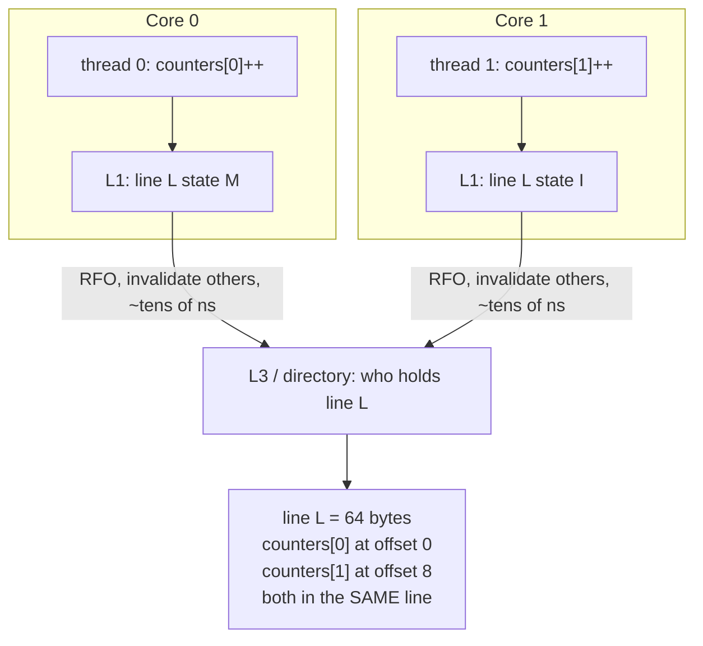

# Module 4.08: Cache coherence and false sharing

**Estimated hours:** 4

**What you will learn**

1. What a cache line is (64 bytes on x86-64) and how the MESI protocol keeps every core's copy of it consistent, including the invalidation traffic every write causes.
2. What false sharing is: two threads writing different variables that happen to share a cache line, slowing each other down as if they shared one variable. You will measure it.
3. How to lay out data so it does not happen: `alignas(64)`, `std::hardware_destructive_interference_size`, per-thread counters aggregated on read, hot/cold field separation, and how to spot it in a profile.

**Prerequisites:** [Module 4.07: The memory model and memory orders](module-07-memory-model-and-memory-orders.md). You need `std::atomic`, `fetch_add` with `memory_order_relaxed`, and the latency table from module 0.01.

---

## 1. One-line intuition

Cores do not share bytes, they share 64-byte lines; whenever one core writes a line, every other core's copy of that whole line is thrown away, even if they only cared about a different byte in it.

## 2. Real-life analogy

A bank keeps customer records in binders of 64 pages each. Several clerks (cores) work at separate desks, and each has a photocopy of the binders they are using (their caches).

- **Reading** is cheap: any number of clerks may hold a photocopy of the same binder.
- **Writing** has a rule: before a clerk may change a page, every other clerk's photocopy of that **whole binder** must be shredded, because it is now out of date. The writer then owns the only valid copy. If another clerk wants to read any page from that binder, even a page that did not change, she must walk to the writer's desk and get a fresh photocopy.

Now imagine clerk A updates page 3 of binder 17 all day, and clerk B updates page 4 of the same binder all day. They never touch each other's page. Yet every change by A shreds B's copy, and every change by B shreds A's copy. Both spend all day walking to each other's desk for fresh photocopies. The binder "ping-pongs". That is **false sharing**: no logical sharing at all, but all the cost of it.

The fix is obvious once you see it: give A's page and B's page separate binders.

## 3. Why it exists: the problem it solves

**Caches** exist because RAM is about 100 ns away and a core executes an instruction every 0.3 ns (module 0.01). A core keeps recently used memory in its private L1 and L2. But with many cores, each holding private copies, a write by one core would leave stale copies everywhere. **Cache coherence** is the hardware protocol that prevents that: it guarantees every core eventually sees one consistent value for every address, by tracking who holds each line and invalidating copies when someone writes.

Coherence works on whole lines, not bytes, because tracking 64 bytes at a time is cheap and tracking every byte is not. The price is that the protocol cannot tell the difference between true sharing (two threads really updating the same counter) and false sharing (two threads updating neighbours). Both cause the same invalidation storm.

What breaks without understanding it: a program that uses eight threads to speed up a loop and ends up slower than one thread. The code is correct, the sanitizers are clean, the profiler shows all the time in a trivial `++`, and nobody can see why. In module 4.06 you already saw it: four threads doing `fetch_add` on one counter were far slower than four million additions should be. This module explains that number and makes it go away.

## 4. Three layers of depth

### Layer 1 (beginner): lines, states and what a write costs

**The cache line.** Memory moves between RAM and caches in fixed blocks. On every mainstream x86-64 CPU the block is **64 bytes**. (Apple's M-series ARM chips use 128.) Address `0x1000` to `0x103F` is one line; `0x1040` starts the next. A variable's line is its address with the low 6 bits cleared. Two variables share a line if their addresses differ by less than 64 and do not cross a 64-byte boundary.

```bash
getconf LEVEL1_DCACHE_LINESIZE     # prints 64 on x86-64
```

**MESI.** Each core's cache tags every line it holds with one of four states:

| State | Meaning | Who else can hold it |
|---|---|---|
| **M**odified | This core changed the line; its copy is the only correct one; RAM is stale | nobody |
| **E**xclusive | This core holds the only copy, unchanged | nobody |
| **S**hared | This core holds a read-only copy, unchanged | any number of cores, all in S |
| **I**nvalid | This core's copy is garbage; must re-fetch | not applicable |

The rules that matter for performance:

- A **read** of a line in S or E or M in your own cache is a hit: about 1 ns.
- A **read** of a line that another core holds in M forces that core to hand it over (and usually write it back). Typical cost on one socket: tens of nanoseconds.
- A **write** requires your copy to be in M or E. If it is in S, or you do not hold it, your core sends a **request for ownership** (RFO): every other holder sets its copy to I, then you may write and go to M. Again tens of nanoseconds when other cores are involved.
- So a line that two cores keep writing bounces between them in state M, and each bounce costs tens of nanoseconds. Each core's increment, which should take 1 ns, now takes 50.

Intel's real protocol is **MESIF** (adds Forward, a chosen S-holder that answers requests) and AMD's is **MOESI** (adds Owned, a dirty-but-shared state), but the picture above is what you need.

**False sharing.** Two threads, two different variables, one line. Each thread's write invalidates the other thread's copy. The line ping-pongs exactly as if both threads wrote one variable. Nothing in the source code shows it; only the addresses do.

**True sharing.** Two threads, the same variable, one line. Same ping-pong, but at least it is visible in the code. The shared atomic counter from module 4.06 is true sharing, and the fix is the same as for false sharing: stop writing the same line from several cores.

### Layer 2 (working engineer): the fixes and where they apply

**Fix 1: padding and alignment.** Put each thread's hot variable on its own line:

```cpp
struct alignas(64) PaddedCounter {       // alignas(64): starts on a line boundary and is
    std::atomic<uint64_t> value{0};      // padded to 64 bytes, so the next one is a new line
};
PaddedCounter counters[8];               // 8 lines, one per thread
```

`alignas(64)` does two things: the object's address is a multiple of 64, and its size is rounded up to a multiple of 64, so consecutive array elements never share a line. The cost is memory: 8 bytes of data use 64. For a handful of counters that is nothing; for a million small objects it is not the right tool.

**The standard constant.** C++17 added `std::hardware_destructive_interference_size` in `<new>`: the minimum distance two objects need to avoid false sharing. GCC 12 and later define it (64 on x86-64) but warn when you use it, because its value could change with `-mtune` flags and so it can silently alter a struct layout across builds; with `-Werror` you must add `-Wno-interference-size`. Many codebases simply write `alignas(64)` with a comment. Its sibling `hardware_constructive_interference_size` is the largest size that is guaranteed to fit in one line, for data you *want* together.

**Fix 2: per-thread counters, aggregated on read.** The statistics counters from module 4.06 are the textbook case. Each thread increments its own padded slot with `memory_order_relaxed`; a reader sums all slots. Writes never contend. The reader's sum is slightly stale, which is fine for statistics.

```cpp
class ThreadCounters {
public:
    void add(int thread_index, uint64_t n) {
        slots_[thread_index].value.fetch_add(n, std::memory_order_relaxed);
    }
    uint64_t total() const {                       // reads 16 lines; called rarely
        uint64_t sum = 0;
        for (const auto& s : slots_) sum += s.value.load(std::memory_order_relaxed);
        return sum;
    }
private:
    struct alignas(64) Slot { std::atomic<uint64_t> value{0}; };
    Slot slots_[16];                               // one per worker thread
};
```

Each thread needs an index. A thread pool hands each worker its index at start; for arbitrary threads you can use a `thread_local` index assigned on first use.

**Fix 3: hot/cold separation in structs.** A struct used by many threads should group fields by *who writes them and how often*:

| Field group | Example in a connection object | Written by | Layout rule |
|---|---|---|---|
| Hot, written by the owning thread | `bytes_sent`, `requests_handled` | the worker serving it | together, on their own line |
| Read by everyone, written rarely | `peer_address`, `connected_at`, `config` | the acceptor, once | together, away from hot writes |
| Written by other threads | `shutdown_requested` flag | the signal/admin path | its own line |

The mistake is a struct with `std::mutex m; int hot_counter; std::string name;` all in a row: every `hot_counter++` by thread A invalidates the line holding the mutex that thread B is trying to lock.

**Fix 4: striped stores laid out on separate lines.** In module 4.05 the striped store's `Stripe` was declared `alignas(64)`. Without it, a stripe is a 40-byte `std::mutex` plus a 56-byte `std::unordered_map` header, 96 bytes, so pairs of stripes overlap on lines: locking stripe 3 invalidates the line that stripe 2's map header lives on. The whole point of striping is independence, so each stripe's mutex and map header must sit on lines nobody else writes.

**How to spot false sharing.** Symptoms first: a parallel program whose per-thread throughput *drops* as you add threads; a profile where a trivial increment or a `lock add` dominates; a structure in which "unrelated" fields are written by different threads. Then tools:

- `perf stat -e cache-misses,cache-references ./program`: misses rise with thread count while the work does not.
- `perf c2c record ./program` then `perf c2c report`: the cache-to-cache tool, which lists lines with **HITM** events (a load that hit a line in another core's Modified state) and shows the offsets within the line and the threads touching them. That report is false sharing in black and white.
- **WSL2 caveat.** Hardware performance counters are usually not exposed to a WSL2 virtual machine, so `perf stat` may print `<not supported>` for cache events and `perf c2c` cannot record. The timing difference is still visible, and on a native Linux box or a cloud VM with PMU access, the counters work. Say this honestly in interviews: "I measured the slowdown directly; on bare metal I would confirm it with `perf c2c`."

### Layer 3 (internals): one write, step by step

Suppose core 0 and core 1 both hold line L in state S, and core 0 executes `lock add [L+0], 1` while core 1 is about to execute `lock add [L+8], 1`:

1. Core 0 needs L in M. It sends an RFO for L over the interconnect (ring or mesh on Intel, Infinity Fabric on AMD).
2. The L3 cache or the directory, which tracks which cores hold L, forwards an invalidation to core 1. Core 1 sets its copy to I and acknowledges.
3. Core 0 receives ownership, goes to M, performs the add. Elapsed: typically tens of nanoseconds, during which the `lock add` cannot complete and the core's pipeline waits on it.
4. Core 1 now wants L in M. It sends an RFO. Core 0 must write back or forward its modified line, downgrade to I, and core 1 goes to M. Another tens of nanoseconds.
5. Repeat for every increment. Two threads that should each do 1 ns increments now each do 50 ns increments, and they take turns, so the total rate is worse than one thread alone.

With padding, step 2 never happens: core 0's line and core 1's line are different lines, each stays in M in its own cache, and each increment is a local hit.

**Why `lock` instructions hurt more than plain stores.** A plain store goes into the store buffer (module 4.07) and the core moves on while the RFO is in flight. A locked read-modify-write must wait for ownership before it can complete and acts as a full barrier, so the core stalls for the whole round trip. That is why the module 4.06 counter demo was so slow with four threads, and why relaxed atomics on a shared line are not cheap just because they are "lock-free".

**Prefetchers.** Modern cores fetch adjacent lines ahead of use (the "adjacent line prefetcher" pairs lines into 128-byte chunks). So two hot variables 64 bytes apart can still interfere a little; some engineers pad to 128 bytes for the very hottest data. Measure before doing so.

**Where the numbers come from.** Cross-core latency depends on topology: two hyperthreads of one core share L1 (nearly free), two cores on one die go through L3 (tens of nanoseconds), two sockets go through the inter-socket link (around 100 ns or more). The `lscpu` output in the lab shows your topology.

## 5. Architecture diagram



Thread 0 and thread 1 never touch each other's counter, but each increment forces line L to change owner. With `alignas(64)`, `counters[1]` moves to its own line and the two cores stop talking to each other.

## 6. Code

The program runs the same per-thread increments twice: once with the counters packed into one line, once with each counter padded to its own line.

```cpp
// false_sharing.cpp
// N threads each increment their own counter 20,000,000 times.
// Layout 1 (packed): all counters in one 64-byte line. Layout 2 (padded): one line each.
// Usage: ./false_sharing <threads>   (1 to 8)
#include <atomic>
#include <chrono>
#include <cstdint>
#include <cstdio>
#include <cstdlib>
#include <new>
#include <thread>
#include <vector>

constexpr int  kMaxThreads = 8;
constexpr long kIters      = 20'000'000;

// Layout 1: 8 x 8 bytes = 64 bytes. alignas(64) makes it exactly one cache line.
struct alignas(64) Packed {
    std::atomic<uint64_t> slots[kMaxThreads];
    std::atomic<uint64_t>& at(int i) { return slots[i]; }
};

// Layout 2: each slot is padded to 64 bytes, so each is its own cache line.
struct alignas(64) PaddedSlot {
    std::atomic<uint64_t> value;
};
struct Padded {
    PaddedSlot slots[kMaxThreads];
    std::atomic<uint64_t>& at(int i) { return slots[i].value; }
};

template <typename Layout>
void run(const char* name, int threads) {
    Layout layout;
    for (int i = 0; i < kMaxThreads; ++i) layout.at(i).store(0);

    auto t0 = std::chrono::steady_clock::now();
    std::vector<std::thread> pool;
    for (int t = 0; t < threads; ++t) {
        pool.emplace_back([&layout, t] {
            std::atomic<uint64_t>& mine = layout.at(t);     // my own counter, nobody else's
            for (long i = 0; i < kIters; ++i) {
                mine.fetch_add(1, std::memory_order_relaxed);
            }
        });
    }
    for (auto& th : pool) th.join();
    double ms = std::chrono::duration<double, std::milli>(
                    std::chrono::steady_clock::now() - t0).count();

    uint64_t total = 0;
    for (int i = 0; i < threads; ++i) total += layout.at(i).load();
    std::printf("%-7s threads=%d  %8.1f ms  total=%llu\n",
                name, threads, ms, static_cast<unsigned long long>(total));
}

int main(int argc, char** argv) {
    int threads = argc > 1 ? std::atoi(argv[1]) : 4;
    if (threads < 1) threads = 1;
    if (threads > kMaxThreads) threads = kMaxThreads;

    std::printf("hardware threads: %u\n", std::thread::hardware_concurrency());
    std::printf("hardware_destructive_interference_size = %zu bytes\n",
                static_cast<std::size_t>(std::hardware_destructive_interference_size));
    std::printf("sizeof(Packed) = %zu   sizeof(Padded) = %zu\n", sizeof(Packed), sizeof(Padded));

    run<Packed>("packed", threads);
    run<Padded>("padded", threads);
    return 0;
}
```

Compile and run. `-Wno-interference-size` silences GCC's warning about using the standard constant, which `-Werror` would otherwise turn into an error:

```bash
g++ -std=c++17 -O2 -Wall -Wextra -Werror -Wno-interference-size -g -pthread -o false_sharing false_sharing.cpp
./false_sharing 1
./false_sharing 4
```

Expected output shape:

```text
hardware threads: 8
hardware_destructive_interference_size = 64 bytes
sizeof(Packed) = 64   sizeof(Padded) = 512
packed  threads=1    <some> ms  total=20000000
padded  threads=1    <about the same> ms  total=20000000
```

```text
hardware threads: 8
hardware_destructive_interference_size = 64 bytes
sizeof(Packed) = 64   sizeof(Padded) = 512
packed  threads=4    <much larger> ms  total=80000000
padded  threads=4    <close to the 1-thread time> ms  total=80000000
```

With one thread the two layouts are the same: there is nobody to share with. With four threads, the padded version should take about as long as one thread (each thread works alone on its own line) while the packed version slows down by a large factor, because the single line bounces between four cores. The exact ratio depends on your CPU and on how many real cores WSL2 has; record it, do not quote mine.

Both totals are exactly `threads * 20,000,000`. False sharing is purely a performance bug; the results are always correct, which is why it hides so well.

## 7. Use case: core-banking loan-origination platform

**Application server (claim H4, capstone C2): the master-table cache hit counter.** The cache object held, in this order, the pointer to the current snapshot, a `hits` counter and a `misses` counter. Every request thread read the pointer (a read of that line) and then incremented `hits` (a write to the same line). Each hit by one thread invalidated the line every other thread needed just to find the table. The decision it drove: the counters became per-thread padded slots summed on read, and the snapshot pointer was placed on its own line, declared `alignas(64)` with a comment explaining why. The rule written into the design document was: a field written on the hot path by many threads never shares a line with a field read on the hot path by many threads.

**tcpkv (claim I, capstone C1): statistics and stripe layout.** The `requests_served` and `bytes_*` counters from module 4.06 are per-worker padded slots, and the `STATS` command sums them. The striped-store option keeps each stripe `alignas(64)` so that one worker locking stripe 5 does not invalidate the line holding stripe 4's mutex. When an interviewer asks "how did you know the padding was needed?", the answer is this module's lab: "I measured eight threads incrementing adjacent counters versus padded ones; the packed version was several times slower on my machine; I could not get `perf c2c` under WSL2, so I confirmed by the timing difference and by `sizeof` checks that the layout was what I intended."

## 8. Lab

### Part A: measure false sharing (25 minutes)

1. Run `getconf LEVEL1_DCACHE_LINESIZE` and `lscpu | grep -E 'Model name|^CPU\(s\)|Core|Socket|L1d|L2|L3'`. Record the line size, the core count, and the cache sizes.
2. Build and run `false_sharing` with 1, 2, 4 and 8 threads. Fill this table with milliseconds:

| Threads | packed | padded | ratio packed/padded |
|---|---|---|---|
| 1 | | | |
| 2 | | | |
| 4 | | | |
| 8 | | | |

Expected: the ratio is about 1 at one thread and grows with threads, as long as the threads land on distinct physical cores. If WSL2 has fewer cores than threads, the 8-thread row is confounded by scheduling; say so.

3. Change `PaddedSlot` to `alignas(16)`. Rebuild and run with 4 threads. Expected: four slots now fit in one line again and the padded time jumps back up. Change it back.

### Part B: counters with perf, if available (15 minutes)

```bash
sudo apt install -y linux-tools-generic linux-tools-$(uname -r) 2>/dev/null || sudo apt install -y linux-tools-generic
perf stat -e cache-misses,cache-references,instructions ./false_sharing 4
```

Expected on a machine with hardware counters: `cache-misses` far higher for the packed run than the padded one (you will need to run each layout separately to compare; temporarily comment out one `run<>` call). Expected in WSL2: `<not supported>` next to the cache events. Either way, record what you got; "the counters were not exposed in my VM" is a legitimate thing to say in an interview if you can also say what you would have looked for.

### Part C: find the layout bug in a struct (20 minutes)

```cpp
// connection_stats.cpp: a connection record shared between an I/O thread and a stats thread.
#include <atomic>
#include <cstddef>     // offsetof
#include <cstdint>
#include <cstdio>
#include <mutex>
#include <string>

struct Connection {
    std::mutex            send_mutex;      // 40 bytes, locked by the worker on every send
    std::atomic<uint64_t> bytes_sent;      // written by the worker on every send
    std::atomic<uint64_t> bytes_received;  // written by the worker on every receive
    std::atomic<bool>     close_requested; // written rarely by the admin thread, read by the worker
    std::string           peer_address;    // written once, read by the stats thread every second
    uint64_t              connected_at;    // written once, read by the stats thread every second
};

int main() {
    std::printf("sizeof(Connection)      = %zu\n", sizeof(Connection));
    std::printf("offset send_mutex       = %zu\n", offsetof(Connection, send_mutex));
    std::printf("offset bytes_sent       = %zu\n", offsetof(Connection, bytes_sent));
    std::printf("offset bytes_received   = %zu\n", offsetof(Connection, bytes_received));
    std::printf("offset close_requested  = %zu\n", offsetof(Connection, close_requested));
    std::printf("offset peer_address     = %zu\n", offsetof(Connection, peer_address));
    std::printf("offset connected_at     = %zu\n", offsetof(Connection, connected_at));
    return 0;
}
```

```bash
g++ -std=c++17 -O2 -Wall -Wextra -Werror -Wno-invalid-offsetof -g -o connection_stats connection_stats.cpp
./connection_stats
```

1. Run it. Expected offsets: `send_mutex` at 0, `bytes_sent` at 40, `bytes_received` at 48, `close_requested` at 56, `peer_address` at 64, `connected_at` at 96, total size 104. (`-Wno-invalid-offsetof` is needed because `offsetof` on a non-trivial type is technically conditionally supported; GCC computes it fine.)
2. Work out which fields share a line, assuming the object starts on a 64-byte boundary. Then decide: which pairs are false sharing between the worker and the stats thread? Which are harmless?
3. Rewrite the struct with hot/cold separation so that the worker-written fields are in one `alignas(64)` group and the stats-thread-read fields are in another. Print the new offsets and size.

<details>
<summary>Answer</summary>

Line 0 (offsets 0-63) holds the mutex, both byte counters and the close flag; line 1 (64-127) holds `peer_address` and `connected_at`. The worker writes line 0 constantly; the stats thread only reads line 1, so the stats thread does **not** false-share with the worker in this layout; the once-per-second reads of line 1 are cheap. The mutex and the counters being together is fine as long as only the worker touches them. The real risk appears when `Connection` objects are stored contiguously in an array: connection *i*'s `connected_at` and `peer_address` tail end up in the same line as connection *i+1*'s mutex and counters, so the stats thread reading connection *i* contends with the worker writing connection *i+1*, and two workers on adjacent connections contend with each other. The fix is `struct alignas(64) Connection`, or splitting into a hot struct (mutex, counters, flag) padded to 64 bytes and a cold struct (address, timestamp) kept elsewhere. A good layout prints `sizeof` as a multiple of 64 and puts every multi-thread-written field at the start of its own line.

</details>

### Part D: per-thread counters in the module 4.06 benchmark (20 minutes)

Take `atomics_basics.cpp` from module 4.06. Replace the single `atomic_counter` in case (b) with a `ThreadCounters` object from Layer 2 (each thread increments `slots_[t]`), and sum at the end. Rebuild and compare the time of case (b) before and after.

Expected: the per-thread version runs several times faster with 4 threads and produces the same total of 4,000,000. This is the change tcpkv's statistics went through.

### Journal

Copy [journal/TEMPLATE.md](../journal/TEMPLATE.md) to `journal/YYYY-MM-DD-false-sharing.md`. Record: the line size and `lscpu` summary; the full table from Part A with ratios; what `perf stat` printed in Part B; your rewritten `Connection` with its offsets from Part C; and the before/after time of case (b) from Part D. Then write three sentences you would say in an interview about how you found and fixed false sharing in your own code.

## 9. Common mistakes and misconceptions

| Mistake | Why it is wrong | Bug it causes later |
|---|---|---|
| "Each thread has its own variable, so there is no contention" | Contention is per line, not per variable | A parallel loop slower than the serial one; a profile blaming a `++` |
| "Atomics are lock-free, so they are cheap" | A locked RMW on a line another core holds costs a full cross-core round trip and stalls the pipeline | A shared "lock-free" counter that caps throughput of the whole server |
| Padding with a plain `char pad[56]` after the field but no `alignas` | The struct can still start mid-line, so neighbours overlap lines | Padding that works in one build and not the next |
| `alignas(64)` on a struct allocated with pre-C++17 `new` | Only C++17 guarantees over-aligned `new`; older code paths or custom allocators may ignore it | Objects not where you think; "fixed" false sharing that returns |
| Using `hardware_destructive_interference_size` in a public ABI | Its value may differ between builds or tuning flags, changing struct layout | Binary incompatibility between modules; GCC warns for this reason |
| Padding everything | Memory and cache capacity are finite; padded arrays of millions of items thrash the cache | Fixing one bottleneck by creating a bigger one |
| Reading `total()` from per-thread counters on the hot path | The read touches every slot's line, pulling each from its writer | The aggregation becomes the new ping-pong |
| Trusting correctness tests to find it | Results are always correct; only timing changes | The bug reaches production and is blamed on "load" |

## 10. Resume link

- **Claim B, "performance optimisation" and "memory and ownership design".** The sentence: "I think in cache lines. Fields written by different threads go on different lines; I measured false sharing on adjacent counters at several times slower and fixed it with `alignas(64)` and per-thread slots." Have the Part A ratio ready.
- **Claim H4, "in-memory master-table cache".** The cache pointer on its own line, counters per thread, and the design-document rule from section 7. If asked how you verified it, give the `sizeof`/`offsetof` check and the timing, and name `perf c2c` as the tool you would use on bare metal.
- **Claim I, tcpkv.** Statistics as per-worker padded slots summed by `STATS`; striped store with `alignas(64)` stripes.
- **Claim F, profiling.** "A trivial increment dominating a profile with throughput falling as threads rise is false or true sharing until proven otherwise."

Likely follow-ups: "What is MESI?" (four states; a write needs M; invalidations are the cost). "What size is a cache line?" (64 bytes on x86-64; 128 on Apple ARM). "How do you detect false sharing?" (scaling curve, `perf c2c` HITM, layout inspection).

## 11. Interview questions

**Q1 (easy). What is a cache line and why does its size matter to a programmer?**

<details>
<summary>Model answer</summary>

A cache line is the unit in which memory moves between RAM and the CPU caches, and the unit the coherence protocol tracks: 64 bytes on x86-64. It matters because touching one byte brings in all 64, so data laid out contiguously is fast to scan (one fetch serves many elements), and because two variables in the same line are, to the hardware, one object: if two cores write them, the line bounces between the cores even though the variables are unrelated. That second effect is false sharing. You find a variable's line by clearing the low six bits of its address, and you control placement with `alignas(64)`.

</details>

**Q2 (easy). Explain the MESI states and what happens when a core writes to a line that other cores also hold.**

<details>
<summary>Model answer</summary>

Each cached line is Modified (this core changed it, only valid copy), Exclusive (only copy, clean), Shared (clean, possibly many copies) or Invalid. Reads are satisfied from S, E or M locally. A write requires E or M; if the line is S or absent, the core issues a request for ownership, every other holder invalidates its copy, and the writer moves to M. If another core later reads or writes the line, the M holder must supply it and downgrade to S or I. Each ownership transfer is a cross-core round trip of typically tens of nanoseconds, which is the whole cost of both true and false sharing. Intel adds a Forward state and AMD an Owned state, but the invalidate-on-write rule is the same.

</details>

**Q3 (medium). What is false sharing, how would you detect it, and how would you fix it?**

<details>
<summary>Model answer</summary>

False sharing is when threads on different cores write to different variables that occupy the same cache line, so each write invalidates the other cores' copies and the line ping-pongs as though they shared one variable. The program stays correct but slows down, often below single-thread speed. Detection: a scaling curve where adding threads makes each thread slower; a profile with time concentrated on a trivial store or `lock add`; on bare metal, `perf c2c` reporting HITM loads on a line with several offsets touched by several threads; and simply inspecting the struct layout with `offsetof`. Fixes: place each thread's hot data on its own line with `alignas(64)` or `std::hardware_destructive_interference_size`; convert shared counters to per-thread slots aggregated on read; separate hot, multi-writer fields from cold, read-mostly fields; and in arrays of per-thread objects, align each element. I measured adjacent atomic counters against padded ones on my machine and saw a large slowdown for the packed layout with four threads and none with one.

</details>

**Q4 (medium). A single `std::atomic<uint64_t>` request counter is incremented by every worker in a server. It is lock-free. Why is it still a bottleneck, and what is the alternative?**

<details>
<summary>Model answer</summary>

Lock-free describes progress, not cost. Every `fetch_add` is a locked read-modify-write that must own the line in Modified state before it completes, and it is a full barrier, so the core stalls until ownership arrives. With eight workers the line is always on some other core, so each increment pays a cross-core transfer of tens of nanoseconds and the increments are serialised through the line. The counter becomes a point through which every request passes, which caps throughput regardless of how parallel the rest is. The alternative is per-thread counters: each worker increments its own slot, padded to a cache line, with `memory_order_relaxed`, so increments are local L1 hits; a reader sums the slots on demand. The total is momentarily stale, which is acceptable for statistics, and the aggregation touches one line per thread only when someone asks. In tcpkv I moved the statistics counters to this design, and the module 4.06 benchmark case went from the slowest to close to the single-thread time.

</details>

**Q5 (hard). You are designing a striped hash map and a per-connection record for a server with 16 worker threads. Walk through the memory layout decisions you would make, their costs, and how you would validate them.**

<details>
<summary>Model answer</summary>

For the striped map I would make each stripe a struct holding its mutex and its map header, declared `alignas(64)`, because a `std::mutex` is 40 bytes and an `unordered_map` header is 56, so unpadded stripes straddle lines and locking one stripe would invalidate the line a neighbour's header lives on, defeating the independence striping is for. The cost is 128 bytes per stripe instead of 96, negligible. I would choose a stripe count comfortably above the thread count, such as 64, so that collisions are rare, and I would hash keys to stripes with the same hash the map uses to avoid a second hash. For the per-connection record I would split it into a hot part, written by the owning worker on every operation (send mutex, byte counters, state), and a cold part, written once and read occasionally by other threads (peer address, connect time, config), and I would pad the hot part to a 64-byte multiple so adjacent connections in an array never share a line. Flags written by other threads, such as a close request, get their own line or live with other rarely-written data, never next to the hot counters. Global statistics would be per-worker padded slots summed on read. Validation: `static_assert` on `sizeof` and `alignof`, `offsetof` prints in a unit test so a future field insertion cannot silently break the layout, a microbenchmark of adjacent-versus-padded writes to show the effect on this hardware, and on a bare-metal host `perf c2c` to confirm no HITM lines remain on the hot path. I would also note the trade-off: padding costs memory and cache capacity, so I apply it to the handful of structures the profile shows are hot, not to every struct.

</details>

## 12. Revision

- Coherence is per 64-byte line; MESI lets any number of cores read a line but a write must invalidate every other copy, costing a cross-core round trip of tens of nanoseconds per ownership change.
- False sharing: different variables, same line, different writer threads; always correct, often several times slower; detected by a bad scaling curve, a profile on a trivial store, or `perf c2c` HITM.
- Fixes: `alignas(64)` (or `hardware_destructive_interference_size` with `-Wno-interference-size`), per-thread padded counters summed on read, hot/cold field separation, and stripes on their own lines.

---

Previous: [Module 4.07: The memory model and memory orders](module-07-memory-model-and-memory-orders.md) | Next: [Module 4.09: Lock-free basics](module-09-lock-free-basics.md)
