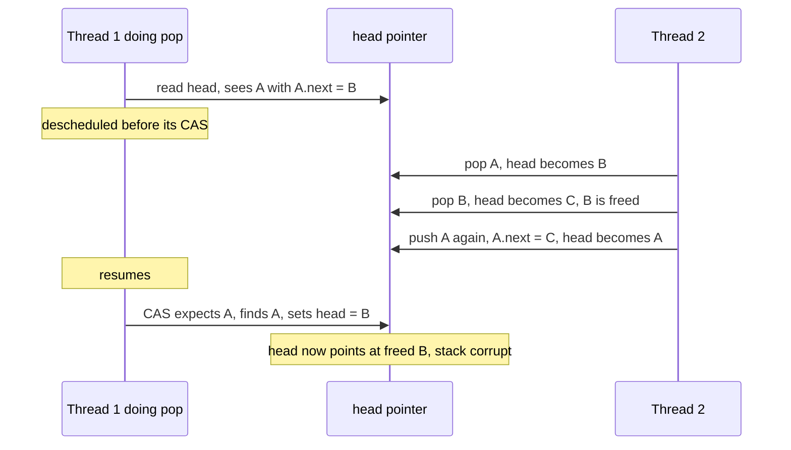

# Module 4.09: Lock-free basics

**Estimated hours:** 6

**What you will learn**

1. What "lock-free" and "wait-free" actually mean (they are progress guarantees, not speed claims), and the ABA problem that breaks the naive compare-and-swap stack.
2. How to build the one lock-free structure that is genuinely practical, a single-producer single-consumer ring buffer with acquire/release, and test it under ThreadSanitizer.
3. How a multi-producer multi-consumer bounded queue (Vyukov's design) works at the level of being able to explain it, what memory reclamation schemes exist (tagged pointers, hazard pointers, epochs), and when the honest engineering answer is "keep the mutex".

**Prerequisites:** [Module 4.08: Cache coherence and false sharing](module-08-cache-coherence-and-false-sharing.md). You need `compare_exchange_weak`, the CAS loop idiom from module 4.06, release/acquire from module 4.07, and the `BoundedQueue` you built with a mutex and condition variables in module 4.04.

---

## 1. One-line intuition

Lock-free code replaces "lock, change, unlock" with "read, compute, try to swap in, retry if someone beat me", so that no thread can ever be stuck waiting for a thread that is not running.

## 2. Real-life analogy

Think of the "next customer" token dispenser at a bank counter, with no staff controlling it.

- **With a lock:** one guard hands out tokens. If the guard steps away for lunch (the holding thread is descheduled), the whole queue stops, even though the machine works fine.
- **Lock-free:** customers serve themselves from the dispenser. Each looks at the number showing, tears off the ticket, and if someone else tore it off first in the same instant, simply looks again and takes the next one. Nobody can block anybody. One slow customer does not stop the others; at any moment *someone* makes progress.
- **Wait-free:** a stricter promise. Every customer gets a ticket within a fixed number of tries, no matter what the others do. Harder to build, rarely needed.

Now the trap, which is the heart of this module. You look at the dispenser and see ticket **A** on top, with ticket **B** behind it. You reach out to take A. In the fraction of a second before your hand arrives, someone takes A, someone takes B, and a clerk **puts A back** on the dispenser (reusing it). You look again: "A is still on top, nothing has changed." You take A and assume B is now on top. But B is gone, in someone's pocket, and whatever you do next with "B" is wrong. The top looked the same, but the world under it had changed. That is the **ABA problem**.

## 3. Why it exists: the problem it solves

A mutex has one structural weakness: whoever holds it can be interrupted. If a thread holding the lock is descheduled, takes a page fault, or is killed, every other thread that needs the lock waits. For most servers that is acceptable, because the critical section is short and the OS reschedules the holder within milliseconds.

Lock-free algorithms exist for the cases where it is not acceptable:

- **Latency-critical paths** where a millisecond stall is a violation: audio, market data, kernel internals.
- **Signal handlers and interrupt contexts** that cannot block at all.
- **Very hot shared structures**, such as the queue between a network thread and worker threads, where measurement shows the mutex itself is the bottleneck.
- **Robustness**: a lock-free structure survives a thread dying mid-operation; a mutex-protected one is left locked forever.

What breaks if you reach for lock-free without need: correctness becomes very hard to reason about (ABA, memory reclamation, memory orders), the code is longer, bugs are rarer and therefore harder to find, and it is frequently **slower** than a well-used mutex, because contended CAS loops bounce cache lines just as hard as a lock does (module 4.08). The engineering position this module teaches is: know how it works, build the simple one, and use a mutex until a profile says otherwise.

## 4. Three layers of depth

### Layer 1 (beginner): the words and the simplest lock-free structure

**Progress guarantees.**

| Term | Promise | Example |
|---|---|---|
| Blocking | A thread may have to wait for another thread to do something | mutex, condition variable, `BoundedQueue` from 4.04 |
| Obstruction-free | A thread running alone (others paused) finishes in bounded steps | rarely used in practice |
| Lock-free | At any moment at least one thread makes progress in bounded steps; no thread can block all others | CAS-loop stack, Treiber stack |
| Wait-free | Every thread finishes every operation in a bounded number of its own steps | `fetch_add` on a counter; the SPSC ring buffer below |

"Lock-free" does **not** mean "no waiting": a CAS loop can retry many times under contention. It means that a retry only happens because *another thread succeeded*, so the system as a whole always moves.

**The Treiber stack.** A singly linked list where the only shared variable is `head`, an atomic pointer.

```cpp
struct Node { int value; Node* next; };
std::atomic<Node*> head{nullptr};

void push(Node* n) {
    n->next = head.load();
    while (!head.compare_exchange_weak(n->next, n)) {}   // on failure n->next is refreshed to the new head
}

Node* pop() {
    Node* old = head.load();
    while (old != nullptr && !head.compare_exchange_weak(old, old->next)) {}
    return old;                                          // nullptr if the stack was empty
}
```

`push` is sound: it only writes to its own node and swaps `head` if `head` is still what it read. `pop` *looks* sound by the same logic, and in a program where nodes are never freed or reused it is. The trouble starts the moment a popped node can come back.

**ABA, step by step.** Stack holds A, B, C (head = A, A.next = B, B.next = C). Thread 1 begins `pop`: reads `old = A`, reads `old->next = B`, and is about to CAS(head: A -> B). It is descheduled. Thread 2 pops A, pops B, frees B, and pushes A again (a freed-and-reallocated A, or the very same node reused): head = A, A.next = C. Thread 1 wakes, its CAS compares head to A, finds A, succeeds, and sets head = **B**. B has been freed. The next pop reads freed memory; the next push writes into it. The stack is corrupt and the crash will happen somewhere far away, later.

Two separate problems are hiding here, and you must name both in an interview:

1. **Memory reclamation.** Thread 1 read `old->next` while `old` could already have been freed by thread 2. That is a use-after-free even without ABA. Lock-free code cannot `delete` a node the moment it is unlinked, because another thread may still be looking at it.
2. **ABA itself.** The CAS succeeded because the pointer *value* matched, though the *state* behind it had changed.

### Layer 2 (working engineer): mitigations, the practical structure, and the honest position

**Mitigating ABA and reclamation.**

| Technique | Idea | Cost | Where used |
|---|---|---|---|
| Never free, never reuse | Nodes come from a pool that is only released when the structure is destroyed | Memory grows; fine for fixed-size pools | Bootstrapping, tests, embedded |
| Indices plus a version counter | `head` is a 64-bit word packing a 32-bit node index and a 32-bit counter incremented on every CAS; a reused node gets a new counter, so the stale CAS fails | Needs a node array; counter can wrap in theory | Free lists in allocators, Vyukov-style queues |
| Tagged pointers / double-width CAS | Pack pointer plus counter into 16 bytes and use `cmpxchg16b` (`std::atomic` of a 16-byte struct, check `is_lock_free()`, link `-latomic`) | Not guaranteed lock-free by the compiler; non-portable | Older lock-free libraries |
| Hazard pointers | Before dereferencing a node, a thread publishes its address in a per-thread slot; a thread that wants to free a node first scans all slots and defers freeing while anyone has it hazard-marked | A store and a fence per access; a scan per batch of frees | Folly, `libcds`; `std::hazard_pointer` in C++26 |
| Epoch-based reclamation (EBR / RCU) | Threads announce "I am in epoch N" on entry; freed nodes are retired to a list for epoch N and reclaimed only when every thread has moved past N | Very cheap reads; a slow or stalled thread blocks reclamation for everyone | Linux kernel RCU, crossbeam; `std::rcu_domain` in C++26 |
| `std::atomic<std::shared_ptr<T>>` (C++20) | Reference counting solves both problems | Implemented with a lock in libstdc++; slow | Prototypes, low-traffic cases |

**The one structure worth building: the SPSC ring buffer.** Single producer, single consumer, fixed capacity. Because exactly one thread writes `tail` and exactly one writes `head`, there is no CAS at all: each side does a plain store to its own index and an acquire load of the other's. It is wait-free, about 60 lines, and it is what sits between a network thread and a processing thread in trading systems, audio engines and loggers. The full code is in section 6. Its correctness argument is a single release/acquire pair in each direction:

- Producer writes the slot, then publishes `tail` with release. Consumer loads `tail` with acquire, then reads the slot. So the slot's contents happen-before the consumer's read.
- Consumer reads the slot, then publishes `head` with release. Producer loads `head` with acquire before overwriting the slot. So the consumer's read happens-before the producer's overwrite.

**Outline of an MPMC bounded queue (Vyukov).** Multiple producers and consumers need to agree on which slot each claims without a lock. Dmitry Vyukov's widely used design gives every slot its own **sequence number**:

```text
cells[N], each: { atomic<size_t> seq; T data; }    initially cells[i].seq = i
atomic<size_t> enqueue_pos = 0, dequeue_pos = 0     (on separate cache lines)

enqueue(x):
    loop:
        pos  = enqueue_pos.load(relaxed)
        cell = cells[pos % N]
        seq  = cell.seq.load(acquire)
        diff = seq - pos
        if diff == 0:                                   slot is free for exactly this pos
            if enqueue_pos.compare_exchange_weak(pos, pos + 1, relaxed): break   claimed it
        else if diff < 0:  return FULL                  slot still holds an item not yet dequeued
        else:              continue                      another producer claimed it; reload pos
    cell.data = x
    cell.seq.store(pos + 1, release)                     tell consumers: item is ready

dequeue(out):
    loop:
        pos  = dequeue_pos.load(relaxed)
        cell = cells[pos % N]
        seq  = cell.seq.load(acquire)
        diff = seq - (pos + 1)
        if diff == 0:                                   item is ready for exactly this pos
            if dequeue_pos.compare_exchange_weak(pos, pos + 1, relaxed): break
        else if diff < 0:  return EMPTY
        else:              continue
    out = cell.data
    cell.seq.store(pos + N, release)                     tell producers: slot is free for the next lap
```

Why it works: the sequence number encodes *which lap* the slot is on, so a stale CAS on `enqueue_pos` cannot claim a slot that has moved on (the version-counter idea from the ABA table, built in). Why it is not strictly lock-free: a producer that claims a slot and is then descheduled before storing `seq` leaves consumers unable to pass that slot; they spin or return "empty" until it resumes. Vyukov himself describes it as "not lock-free in the formal sense". It is still excellent in practice, because the window is a few instructions wide. Know this nuance; interviewers who have read the design will ask.

**Where lock-free queues meet reality: idle consumers.** A lock-free queue tells a consumer "empty" instantly; it does not put the consumer to sleep. A worker that spins on an empty queue burns a core. So real systems add a blocking layer on top (a futex or condition variable to park idle consumers, as in module 4.04), which means the "lock-free" queue is usually inside a hybrid anyway.

**The honest engineering position for tcpkv and the app server.** The task queue between the acceptor and the worker pool is the module 4.04 `BoundedQueue`: mutex plus two condition variables. A push or pop costs on the order of 100 ns uncontended; a request costs tens of microseconds of socket I/O, parsing and store work. The queue is under 1% of the time. A lock-free queue would save a fraction of that 1% while adding ABA, reclamation and memory-order risk to a system whose selling point is "clean under TSan". The decision rule written in both design documents: **replace the queue with a lock-free one only after a profile shows the workers spending measurable time in the queue's mutex**, and then prefer a proven library (`moodycamel::ConcurrentQueue`, `folly::MPMCQueue`, `boost::lockfree`) over a hand-written one.

### Layer 3 (internals): why the orders in the SPSC ring are exactly what they are

Walk through one item moving through the ring in section 6 with capacity N.

1. The producer loads `tail_` relaxed. Only the producer ever writes `tail_`, so it is reading its own last write; no ordering is needed.
2. The producer loads `head_` with **acquire**. The consumer wrote `head_` with release after reading slot `h`. The acquire guarantees that the consumer's read of the slot happens-before anything the producer does next, so overwriting the slot cannot race with that read.
3. The producer writes `buf_[t & (N-1)]`. This is a plain, non-atomic write to a slot that the consumer, by step 2, is no longer reading.
4. The producer stores `tail_ = t + 1` with **release**. Everything before it, including step 3, is published with it.
5. The consumer loads `tail_` with **acquire** and sees `t + 1`. Now step 3 happens-before its next line.
6. The consumer reads the slot. Plain read; safe by step 5.
7. The consumer stores `head_ = h + 1` with **release**, publishing step 6 for the producer's next acquire in step 2.

Two further details separate a textbook ring from a fast one:

- **Indices never wrap by hand.** `head_` and `tail_` count up forever; the slot is `index & (N - 1)` with N a power of two, and "full" is `tail - head == N`. Unsigned arithmetic makes the subtraction correct even after the counters wrap around at 2^64 (which takes centuries).
- **Separate cache lines.** `head_`, `tail_` and the buffer are each `alignas(64)`, otherwise every producer store to `tail_` invalidates the line the consumer reads `head_` from: false sharing (module 4.08) inside the very structure meant to avoid contention. Production rings go further and keep a *cached copy* of the other side's index so that the acquire load happens only when the cached value says the ring looks full or empty.

**What the CAS loop costs under contention.** In the Treiber stack, every push and pop is a `lock cmpxchg` on the same `head` line. With eight threads, that line ping-pongs exactly like the shared counter in module 4.08, and a failed CAS means the whole read-compute-swap is repeated. A lock-free stack under heavy contention can be slower than a mutex-protected one, because the mutex at least serialises threads into a queue instead of letting them collide and retry. "Lock-free" is a liveness property; throughput must be measured.

**Why the compiler and CPU cannot break the SPSC ring.** Because the only cross-thread edges are release/acquire pairs on `head_` and `tail_`, and the data accesses are ordered by them, there is no data race under the C++ model, so TSan is clean and the code is correct on ARM as well as x86. This is the payoff of module 4.07: the reasoning is the same on every architecture; only the generated barriers differ.

## 5. Architecture diagram



The pointer value A came back, but B behind it did not. A version counter alongside the pointer would have changed, and the CAS would have failed as it should.

## 6. Code

Two programs. The first is the Treiber stack in its one safe setting (nodes never reused) with a multi-thread test. The second is the SPSC ring buffer, the structure you should actually be able to write from memory.

```cpp
// treiber_stack.cpp
// A lock-free stack. Nodes are preallocated, pushed once and popped once, never
// freed or reused while the stack lives, so neither ABA nor use-after-free can occur.
// Add 'delete' or node reuse and you need a reclamation scheme (see module text).
#include <atomic>
#include <cstdio>
#include <thread>
#include <vector>

struct Node {
    long  value;
    Node* next;
};

class TreiberStack {
public:
    void push(Node* n) {
        n->next = head_.load(std::memory_order_relaxed);
        // Release: the node's contents are published to whoever pops it.
        while (!head_.compare_exchange_weak(n->next, n,
                                            std::memory_order_release,
                                            std::memory_order_relaxed)) {}
    }
    Node* pop() {
        // Acquire: see the contents of the node the pusher published.
        Node* old = head_.load(std::memory_order_acquire);
        while (old != nullptr &&
               !head_.compare_exchange_weak(old, old->next,
                                            std::memory_order_acquire,
                                            std::memory_order_acquire)) {}
        return old;    // nullptr when empty
    }
private:
    std::atomic<Node*> head_{nullptr};
};

constexpr int  kProducers  = 4;
constexpr int  kConsumers  = 4;
constexpr long kPerProducer = 250'000;
constexpr long kTotal       = kProducers * kPerProducer;

int main() {
    std::vector<Node> nodes(kTotal);               // preallocated; never freed during the run
    for (long i = 0; i < kTotal; ++i) nodes[i].value = i;

    TreiberStack stack;
    std::atomic<bool> producers_done{false};
    std::vector<long> popped(kConsumers, 0);
    std::vector<long> sums(kConsumers, 0);

    std::vector<std::thread> producers;
    for (int p = 0; p < kProducers; ++p) {
        producers.emplace_back([&, p] {
            for (long i = 0; i < kPerProducer; ++i) stack.push(&nodes[p * kPerProducer + i]);
        });
    }
    std::vector<std::thread> consumers;
    for (int c = 0; c < kConsumers; ++c) {
        consumers.emplace_back([&, c] {
            for (;;) {
                Node* n = stack.pop();
                if (n == nullptr) {
                    if (!producers_done.load(std::memory_order_acquire)) continue;   // more may come
                    n = stack.pop();                                                  // final drain
                    if (n == nullptr) return;
                }
                ++popped[c];
                sums[c] += n->value;
            }
        });
    }
    for (auto& t : producers) t.join();
    producers_done.store(true, std::memory_order_release);
    for (auto& t : consumers) t.join();

    long total_popped = 0, total_sum = 0;
    for (int c = 0; c < kConsumers; ++c) { total_popped += popped[c]; total_sum += sums[c]; }
    long expected_sum = kTotal * (kTotal - 1) / 2;
    std::printf("popped=%ld (expected %ld)  sum=%ld (expected %ld)  %s\n",
                total_popped, kTotal, total_sum, expected_sum,
                (total_popped == kTotal && total_sum == expected_sum) ? "OK" : "MISMATCH");
    return 0;
}
```

```bash
g++ -std=c++17 -O2 -Wall -Wextra -Werror -g -pthread -o treiber_stack treiber_stack.cpp
./treiber_stack
g++ -std=c++17 -O1 -g -fsanitize=thread -pthread -o treiber_stack_tsan treiber_stack.cpp
./treiber_stack_tsan
```

Expected output, from both builds, with no sanitizer warnings:

```text
popped=1000000 (expected 1000000)  sum=499999500000 (expected 499999500000)  OK
```

```cpp
// spsc_ring.cpp
// Single-producer single-consumer ring buffer. Wait-free, no CAS, two release/acquire pairs.
// Usage: ./spsc_ring [items]     default 20,000,000 (use 2,000,000 under TSan)
#include <atomic>
#include <chrono>
#include <cstddef>
#include <cstdint>
#include <cstdio>
#include <cstdlib>
#include <immintrin.h>
#include <thread>

template <typename T, std::size_t N>
class SpscRing {
    static_assert((N & (N - 1)) == 0, "capacity must be a power of two");
public:
    // Producer only.
    bool push(const T& item) {
        const std::size_t t = tail_.load(std::memory_order_relaxed);   // my own index
        const std::size_t h = head_.load(std::memory_order_acquire);   // consumer's progress
        if (t - h == N) return false;                                  // full
        buf_[t & (N - 1)] = item;                                      // write the slot
        tail_.store(t + 1, std::memory_order_release);                 // publish it
        return true;
    }
    // Consumer only.
    bool pop(T& out) {
        const std::size_t h = head_.load(std::memory_order_relaxed);   // my own index
        const std::size_t t = tail_.load(std::memory_order_acquire);   // producer's progress
        if (t == h) return false;                                      // empty
        out = buf_[h & (N - 1)];                                       // read the slot
        head_.store(h + 1, std::memory_order_release);                 // free it
        return true;
    }
private:
    alignas(64) std::atomic<std::size_t> head_{0};   // consumer writes, producer reads
    alignas(64) std::atomic<std::size_t> tail_{0};   // producer writes, consumer reads
    alignas(64) T buf_[N];
};

int main(int argc, char** argv) {
    const long items = argc > 1 ? std::atol(argv[1]) : 20'000'000;
    SpscRing<long, 1024> ring;

    auto t0 = std::chrono::steady_clock::now();
    std::thread producer([&] {
        for (long i = 0; i < items; ++i) {
            while (!ring.push(i)) _mm_pause();      // full: wait for the consumer
        }
    });
    long received = 0, bad_order = 0;
    std::thread consumer([&] {
        long expected = 0, v = 0;
        while (received < items) {
            if (!ring.pop(v)) { _mm_pause(); continue; }   // empty: wait for the producer
            if (v != expected) ++bad_order;
            ++expected;
            ++received;
        }
    });
    producer.join();
    consumer.join();
    double s = std::chrono::duration<double>(std::chrono::steady_clock::now() - t0).count();
    std::printf("items=%ld  out-of-order=%ld  %.1f million items/sec  %s\n",
                received, bad_order, static_cast<double>(items) / s / 1e6,
                bad_order == 0 ? "OK" : "BROKEN");
    return 0;
}
```

```bash
g++ -std=c++17 -O2 -Wall -Wextra -Werror -g -pthread -o spsc_ring spsc_ring.cpp
./spsc_ring
g++ -std=c++17 -O1 -g -fsanitize=thread -pthread -o spsc_ring_tsan spsc_ring.cpp
./spsc_ring_tsan 2000000
```

Expected output shape:

```text
items=20000000  out-of-order=0  <some tens of> million items/sec  OK
```

and from the TSan build the same line for 2,000,000 items with no warnings. The throughput is typically tens of millions of items per second on a laptop; record yours. For comparison, push the same items through your module 4.04 `BoundedQueue` with one producer and one consumer: the mutex version is typically several times slower per item, which is real, and also irrelevant when each item represents tens of microseconds of work.

## 7. Use case: core-banking loan-origination platform

**Application server (claim H4): the request queue stays mutex-based.** The pooled request model hands incoming RPC requests from the network thread to worker threads through a bounded queue. During design review the lock-free option was raised and rejected with numbers: a profile of the server under its load generator showed the queue's mutex at well under 1% of CPU time, while database round trips dominated. The decision it drove: keep the `BoundedQueue` (mutex plus condition variables), because it is provably correct, parks idle workers for free, and shows clean under TSan; record in the design document that an SPSC ring is the first thing to try **if** the profile ever shows the queue as hot, and that an MPMC queue would come from a library rather than being written in-house. Interviewers like a candidate who can explain the lock-free design and then say why they did not ship it.

**tcpkv (claim I): where an SPSC ring would fit.** tcpkv's accept thread hands connections to a fixed pool. A lock-free ring per worker (one producer, the acceptor; one consumer, the worker) is a defensible future design for a logging path: each worker pushes log lines into its own SPSC ring and a single logger thread drains all rings, so logging never takes a lock on the request path. That is the pattern used by high-performance loggers, and it is exactly the structure you built in section 6. The current tcpkv does not need it, and the resume does not claim it; the claim is "lock-free basics", which this module makes true.

## 8. Lab

### Part A: the stack, and then break it (30 minutes)

1. Build and run `treiber_stack` normally and under TSan as in section 6. Record the output and confirm TSan is silent.
2. Introduce reuse. After the consumers finish, the test could push the nodes again; instead, simulate ABA pressure directly: change each consumer so that after popping a node it immediately pushes it back with probability 1 in 2 (for example `if (n->value & 1) stack.push(n);`) and stops counting when it has popped `kTotal / kConsumers` nodes in total. Nodes are now reused while other threads may hold a stale `old` pointer. Build with TSan and run several times. Expected: TSan reports a data race on `Node::next` (a push writing `n->next` while a pop reads `old->next`), and the normal build may print MISMATCH or hang on some runs. This is ABA and the reclamation problem, live. Undo the change.
3. Write in your journal, in your own words, why the CAS succeeded when it should not have.

### Part B: SPSC ring measurements (30 minutes)

1. Build and run `spsc_ring` with the default item count three times. Record the throughput and its spread.
2. Remove the three `alignas(64)` attributes from the ring's members, rebuild, and rerun three times. Expected: lower throughput, because `head_` and `tail_` now share a line and every producer store invalidates the consumer's copy. Record the ratio. Put the attributes back.
3. Change the `release` on `tail_.store` to `relaxed`, build with TSan, run with 2,000,000 items. Expected: TSan reports a data race on `buf_` between `push` and `pop`. On x86 the normal build will still print OK, which is exactly the "works by luck" situation from module 4.07. Restore `release`.
4. Compare against your module 4.04 `BoundedQueue` with one producer and one consumer moving 20,000,000 `long`s. Record both throughputs and the ratio.

### Part C: explain the MPMC queue (30 minutes, no code)

Using the pseudocode in Layer 2, write out by hand (on paper or in your journal) the state of a 4-slot queue (`seq` of each cell, `enqueue_pos`, `dequeue_pos`) after this sequence: enqueue A, enqueue B, dequeue, enqueue C, enqueue D, enqueue E, dequeue, dequeue. For each step state which cell is used and what `diff` was computed. Then answer: what does a consumer see if a producer has done its CAS on `enqueue_pos` but not yet stored `seq`? Why does that make the design not formally lock-free?

<details>
<summary>Answer sketch</summary>

Initially seq = {0,1,2,3}, enq = 0, deq = 0. Enqueue A: cell 0, diff 0, claim, seq[0] = 1, enq = 1. Enqueue B: cell 1, seq[1] = 2, enq = 2. Dequeue: cell 0, seq 1, diff = 1 - (0+1) = 0, claim, returns A, seq[0] = 0 + 4 = 4, deq = 1. Enqueue C: cell 2, seq[2] = 3, enq = 3. Enqueue D: cell 3, seq[3] = 4, enq = 4. Enqueue E: pos 4, cell 0, seq[0] = 4, diff = 4 - 4 = 0, claim, seq[0] = 5, enq = 5. Dequeue: pos 1, cell 1, seq 2, diff 0, returns B, seq[1] = 5, deq = 2. Dequeue: pos 2, cell 2, seq 3, diff 0, returns C, seq[2] = 6, deq = 3. A consumer arriving at a cell whose producer has claimed it but not stored `seq` computes `diff < 0` and reports empty (or spins), even though later cells may hold items; its progress depends on that stalled producer, so no bound on steps can be given, which is the definition of not lock-free.

</details>

### Part D: say it on a resume (15 minutes)

Write the three-sentence version you will use in interviews, covering: what ABA is and how you reproduced it; that you built and TSan-verified an SPSC ring and measured it against a mutex queue; and why your server keeps the mutex queue. Keep the numbers from Parts A and B in it.

### Journal

Copy [journal/TEMPLATE.md](../journal/TEMPLATE.md) to `journal/YYYY-MM-DD-lock-free-basics.md`. Record: the Treiber outputs and the TSan report from Part A step 2; the three SPSC throughput figures, the no-padding ratio, the TSan report from the relaxed `tail_`, and the ratio against `BoundedQueue` from Part B; your worked MPMC trace from Part C; and the three sentences from Part D.

## 9. Common mistakes and misconceptions

| Mistake | Why it is wrong | Bug it causes later |
|---|---|---|
| "Lock-free means faster" | It is a progress guarantee; contended CAS loops bounce cache lines like a lock does, and retries waste work | A rewrite that is slower and harder to debug than the mutex it replaced |
| Deleting a node right after unlinking it with CAS | Another thread may have loaded the pointer and be about to read `->next` | Use-after-free that appears once a week under load |
| Believing a successful CAS means nothing changed | Only the compared word is checked; the structure behind it may have changed and come back (ABA) | Corrupt stack or free list; crashes far from the cause |
| Using the SPSC ring with two producers "just this once" | Two writers of `tail_` race; the design assumes exactly one of each | Lost or duplicated items |
| Forgetting that an empty lock-free queue still needs to park consumers | `pop` returns false instantly; a worker that loops burns a core | 100% CPU at idle |
| Treating Vyukov's MPMC queue as formally lock-free | A producer stalled between claiming a slot and publishing it blocks consumers | A wrong answer to a well-informed interviewer |
| Padding omitted between `head_` and `tail_` | False sharing inside the structure built to avoid contention | A "lock-free" ring that is slower than a mutex |
| Using `std::atomic<std::shared_ptr>` and calling it lock-free | libstdc++ implements it with an internal lock | Misleading claim; slow hot path |

## 10. Resume link

- **Claim C, "lock-free basics".** This is the exact phrase on the resume, and this module defines what it truthfully means: "I know what lock-free and wait-free guarantee and that they are not speed claims. I can explain and reproduce the ABA problem and the memory reclamation problem on a CAS-based stack, and name the mitigations: version counters, hazard pointers, epoch-based reclamation. I have built an SPSC ring buffer with release/acquire, verified it under TSan, measured it against a mutex queue, and can explain Vyukov's sequence-numbered MPMC queue including why it is not formally lock-free." Do not claim to have shipped a lock-free MPMC queue; claim to understand one.
- **Claim H4, "pooled request model".** The decision to keep the mutex queue with a profile-based justification, and the documented path to an SPSC ring if the profile changes. This is the strongest possible answer to "why didn't you use lock-free?"
- **Claim I, tcpkv.** The per-worker SPSC logging ring as the design you would add if logging ever appeared in the profile.
- **Claim F, TSan.** TSan proved the ring's orders and caught the relaxed `tail_` immediately; mention it.

Likely follow-ups: "What is ABA?" (pointer value returns, state behind it changed; version counter fixes it). "How do hazard pointers work?" (publish before dereference; scan before free). "Why is your SPSC ring wait-free but a Treiber stack only lock-free?" (no CAS, each side owns its index; the stack retries on contention).

## 11. Interview questions

**Q1 (easy). Define blocking, lock-free and wait-free, and give one example of each.**

<details>
<summary>Model answer</summary>

Blocking: a thread may have to wait for some other thread to act before it can proceed; a mutex-protected queue is blocking because a descheduled holder stalls everyone. Lock-free: at any moment, at least one of the threads operating on the structure completes its operation in a bounded number of steps, so the system as a whole always progresses and no thread's suspension can stall the rest; a Treiber stack with a CAS loop is lock-free, since a thread only retries because another succeeded. Wait-free: every thread completes every operation in a bounded number of its own steps regardless of others; a `fetch_add` counter is wait-free, and so is a single-producer single-consumer ring buffer, because neither side ever retries. Lock-free is about progress, not speed; under contention it can be slower than a mutex.

</details>

**Q2 (easy). What is the ABA problem? Give a concrete sequence.**

<details>
<summary>Model answer</summary>

ABA is when a compare-and-swap succeeds because the compared value is the same as before, although the state it stands for has changed in between. On a lock-free stack with head A, A.next B: thread 1 reads head = A and next = B, then is paused. Thread 2 pops A, pops B, frees B, and pushes A back, so head = A with A.next = C. Thread 1 resumes, its CAS compares head to A, matches, and sets head to B, which is freed memory. The pointer came back but the world behind it changed. Fixes attach a version to the pointer so a reused node carries a new version and the stale CAS fails: a packed index-plus-counter word, a double-width CAS with `cmpxchg16b`, or a design such as Vyukov's queue where each slot carries a sequence number. Separately, thread 1 also read `A->next` after A might have been freed, which is the memory reclamation problem that hazard pointers or epochs solve.

</details>

**Q3 (medium). Why can a lock-free `pop` not simply `delete` the node it removed, and what are the options?**

<details>
<summary>Model answer</summary>

Because unlinking a node with CAS does not stop other threads that already loaded a pointer to it: a concurrent `pop` may have read `old = head` and be about to read `old->next`. If we delete the node, that read is a use-after-free; and if the allocator hands the same address out again, the ABA problem follows. Options, from simplest to most general: never free nodes during the structure's life and use a fixed pool or indices, which is fine for bounded structures; hazard pointers, where each thread publishes the pointer it is about to dereference in a per-thread slot, and a thread that wants to free a node checks all slots first and defers freeing while the node is hazard-marked, standardised as `std::hazard_pointer` in C++26; epoch-based reclamation, where threads announce the epoch they are in on entry, retired nodes are tagged with the current epoch, and they are freed only when every thread has moved past that epoch, which is cheap for readers but lets one stalled thread delay all reclamation, and is the RCU idea with `std::rcu_domain` also in C++26; and reference counting through `std::atomic<std::shared_ptr<T>>`, correct but implemented with a lock in libstdc++ and slow. In practice I would reach for a library that implements one of these rather than write it.

</details>

**Q4 (medium). Explain the SPSC ring buffer: why it needs no CAS, which memory orders it uses, and why.**

<details>
<summary>Model answer</summary>

With exactly one producer and one consumer, each index has a single writer: the producer owns `tail`, the consumer owns `head`. A single writer never needs CAS; it loads its own index relaxed, because it is reading its own last store, and publishes updates with a plain store. The cross-thread coordination is two release/acquire pairs. The producer writes the slot and then stores `tail` with release; the consumer loads `tail` with acquire, so the slot write happens-before the consumer's read. The consumer reads the slot and then stores `head` with release; the producer loads `head` with acquire before overwriting a slot, so the consumer's read happens-before the overwrite. Full is `tail - head == capacity`, empty is `tail == head`, with monotonically increasing indices and a power-of-two mask for the slot, which is correct under unsigned wrap-around. The two indices and the buffer sit on separate cache lines so that publishing one does not invalidate the other's line. It is wait-free, since neither side ever retries, and ThreadSanitizer confirms there is no data race; changing the `tail` store to relaxed makes TSan report a race on the buffer even though x86 still happens to produce correct output. I measured it at tens of millions of items per second against a mutex queue that was several times slower per item.

</details>

**Q5 (hard). Outline a multi-producer multi-consumer bounded queue without locks, state precisely what progress guarantee it has, and argue when you would and would not deploy it in a request-processing server.**

<details>
<summary>Model answer</summary>

Vyukov's bounded MPMC queue gives each of N slots a sequence number, initially the slot's index, plus two counters, `enqueue_pos` and `dequeue_pos`, on separate cache lines. A producer reads `enqueue_pos`, looks at the slot `pos mod N`, and loads its sequence with acquire. If the sequence equals `pos`, the slot is free for this lap, and the producer tries to claim it by CAS on `enqueue_pos` to `pos + 1`; on success it writes the data and stores the slot's sequence as `pos + 1` with release. If the sequence is less than `pos`, the queue is full; if greater, another producer claimed it and the producer reloads. A consumer mirrors this: it expects the sequence to be `pos + 1`, claims by CAS on `dequeue_pos`, reads the data, and stores the sequence as `pos + N` with release, marking the slot free for the next lap. The sequence number is a per-slot version, so the ABA problem on the position counters cannot cause a slot to be used on the wrong lap, and no node is ever allocated or freed, so there is no reclamation problem. The guarantee is weaker than lock-free in the formal sense: a producer that wins the CAS and is then descheduled before publishing the sequence leaves consumers at that slot unable to proceed until it resumes, so progress of others depends on it; it is in practice excellent because that window is a handful of instructions. I would deploy it in a server only after a profile showed worker threads spending measurable time in the queue's mutex, and even then I would take it from a reviewed library, add a parking mechanism for idle consumers because a lock-free queue does not sleep anyone, and keep the mutex-based `BoundedQueue` as the reference implementation for differential testing. In the loan-origination server the queue was far below 1% of time next to database round trips, so the correct engineering decision was to keep the mutex queue and document the lock-free path as the next step if the measurement ever changed.

</details>

## 12. Revision

- Lock-free means at least one thread always progresses; wait-free means every thread does; neither means fast. A CAS loop retries only because someone else succeeded.
- ABA: a pointer value returns while the state behind it changed, so a CAS wrongly succeeds; the Treiber stack also cannot free nodes safely. Fixes: version counters, hazard pointers, epochs, or never reusing nodes.
- The SPSC ring (one writer per index, two release/acquire pairs, padded lines) is the practical lock-free structure; Vyukov's MPMC queue uses per-slot sequence numbers and is not formally lock-free; in tcpkv and the app server the mutex `BoundedQueue` stays until a profile says otherwise.

---

Previous: [Module 4.08: Cache coherence and false sharing](module-08-cache-coherence-and-false-sharing.md) | Next: [Module 4.10: Thread pool design](module-10-thread-pool-design.md)
