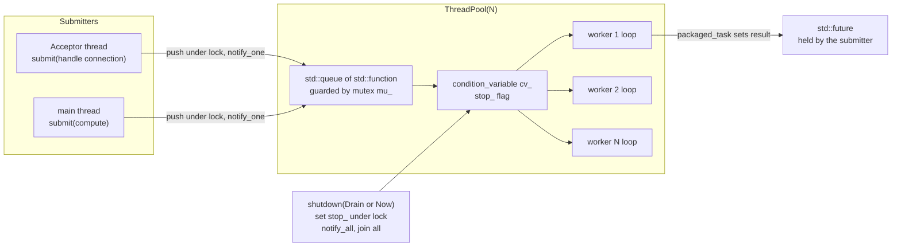

# Module 4.10: Thread pool design

**Estimated hours:** 5

**What you will learn**

1. Why a server keeps a fixed set of worker threads and hands them tasks, instead of starting a thread per request.
2. The design space of a thread pool: queue shape, task type, bounded or unbounded, and the exact shutdown protocol that never loses a task or hangs.
3. How to build the `ThreadPool` class that goes into tcpkv: `submit()` returning a `std::future`, two shutdown policies, GoogleTest coverage, and a clean ThreadSanitizer run.

**Prerequisites:** [Module 4.09: Lock-free basics](module-09-lock-free-basics.md). You also need the `BoundedQueue` and condition-variable rules from module 4.04 and `std::future` from module 4.01.

---

## 1. One-line intuition

A thread pool is a small team of workers that never go home; you drop jobs in a tray, the next free worker picks one up, and when you close the shop you tell them whether to finish the tray first or stop at once.

## 2. Real-life analogy

Think of the counter at a busy bank branch.

- The branch does not hire a new cashier every time a customer walks in and fire them when the customer leaves. Hiring takes minutes; the transaction takes seconds. Instead it has **N cashiers** on shift. That is the **fixed pool of worker threads**.
- Customers take a token and sit down. The token queue is the **task queue**. A customer is a **task**: a unit of work with everything needed to do it.
- Each cashier runs the same loop: "look at the queue; if empty, wait; otherwise take the next token, serve, repeat". That is the **worker loop**.
- The customer holds a receipt number and comes back for the result. That is the **future**: a handle to a result that will exist later.
- At closing time the manager has two choices. "Serve everyone already holding a token, then go home" is **drain then stop**. "Stop now, send the rest away" is **stop now**. Either way, nobody takes a new token after the shutters come down. That is the **shutdown protocol**.
- If too many customers arrive, the token machine refuses tokens. That is **backpressure** from a **bounded queue**. Without it the waiting room overflows into the street.

## 3. Why it exists: the problem it solves

In module 4.01 you started a `std::thread` per piece of work. For a server that means one thread per client request. Three things break:

1. **Creation cost.** Creating a thread is a system call, a new stack (typically 8 MB of reserved address space on Linux), and kernel bookkeeping. On one laptop this is tens of microseconds. A request that takes 50 µs of real work spends more time being born than working.
2. **Unbounded threads.** 10,000 requests arrive in a burst; 10,000 threads exist. The scheduler (module 3.03) spends its time switching, caches are thrashed, memory is exhausted, and the machine falls over exactly when it is needed most. There is no knob to say "no more".
3. **No shutdown story.** With threads scattered everywhere, "stop the server cleanly on SIGTERM" (module 3.09) means chasing every thread. With a pool there is one place to stop.

A pool fixes all three: workers are created once, their number is a configuration value, and the queue gives you a single point for backpressure and shutdown. This is why resume claim I says "fixed thread pool" and why the application server in claim H4 handled every RPC request through one.

What breaks without it: the classic "thread-per-connection server dies under load" incident. Phase 5 compares the architectures; this module builds the pool they all rest on.

## 4. Three layers of depth

### Layer 1 (beginner): the four parts of a pool

Every thread pool has the same four parts.

| Part | What it is | In our code |
|---|---|---|
| Workers | N threads that run the same loop forever | `std::vector<std::thread> workers_` |
| Queue | Where tasks wait | `std::queue<std::function<void()>> tasks_` |
| Lock + signal | Protects the queue and wakes a sleeping worker | `std::mutex mu_` and `std::condition_variable cv_` |
| Stop flag | Tells workers the shop is closing | `bool stop_` (read and written only under `mu_`) |

The worker loop, in words:

```text
forever:
    lock the mutex
    wait until (stop is set) or (queue is not empty)
    if stop is set and (queue is empty or policy is "stop now"): unlock and exit the thread
    take the front task out of the queue
    unlock the mutex
    run the task            <- outside the lock, so other workers can take tasks
```

`submit()` in words:

```text
lock the mutex
if stop is set: refuse (throw)
push the task
unlock the mutex
notify one waiting worker
```

That is the whole machine. Everything else in this module is about making it correct, fast and safe to shut down.

**Future.** When you submit a task that returns a value, you want the value back later. `std::packaged_task<R()>` wraps a callable; calling it runs the callable and stores the result (or the exception) in a shared state. `get_future()` gives you a `std::future<R>` whose `get()` blocks until the result exists. If the callable threw, `get()` rethrows the same exception in the caller's thread. That last point is how exceptions cross from a worker to the thread that cares.

### Layer 2 (working engineer): the design space

Each choice below is a question an interviewer will ask. Know the trade-off and which side tcpkv is on.

**Fixed size vs dynamic size.**
A fixed pool creates N threads at start and never changes. A dynamic pool grows under load and shrinks when idle (Java's `ThreadPoolExecutor`, .NET's pool). Dynamic pools sound nicer but add a second hard problem: when to grow, when to shrink, and how to avoid oscillating. For a server whose load is CPU-bound or DB-bound, the right N is a property of the machine and the database, not of the moment. tcpkv and the app server use **fixed** pools sized by configuration.

**One shared queue vs one queue per worker (work stealing).**
One shared queue under one mutex is simple and fair: the first free worker gets the oldest task. Its cost is that every push and pop touches the same mutex and the same cache line (module 4.08). With 4 to 16 workers and tasks that take microseconds or more, that cost is noise. With 64 workers and tasks that take 100 ns, the queue lock becomes the bottleneck.

Work stealing gives each worker its own double-ended queue (deque). A worker pushes and pops at the bottom of its own deque with no contention. When its deque is empty it **steals** from the top of another worker's deque. The famous implementation is the Chase-Lev deque, used by Intel TBB, Go's scheduler and Rust's Tokio. It needs the lock-free skills from module 4.09 and careful memory orders. For tcpkv it is over-engineering; for a 100-core data-processing engine it is essential. Section 4 Layer 3 shows the shape; you do not build it here.

**Task type: `std::function<void()>` vs a template parameter.**
`std::function<void()>` can hold any callable, so the queue is one concrete type and the pool can live in a header. Its costs: a heap allocation when the callable is larger than the small-buffer (typically 16 bytes in libstdc++), and the callable must be **copyable**. A `std::packaged_task` is move-only, so it cannot go straight into a `std::function`. The standard trick is to put the `packaged_task` in a `std::shared_ptr` and capture the pointer in a small copyable lambda. That is one allocation per task on top of the `packaged_task`'s shared state. For tcpkv this is fine: a request costs a network round trip, which is thousands of times larger. If you ever need zero-allocation submission, you write a small move-only function wrapper (`std::move_only_function` exists in C++23).

**Bounded vs unbounded queue.**
An unbounded `std::queue` never says no. Under overload it grows until memory runs out, and latency grows with it: a task queued behind 100,000 others waits a long time. A bounded queue (module 4.04's `BoundedQueue`) makes `submit()` block or fail when full. Blocking gives backpressure to the caller; failing lets the caller reply "busy" to the client. For tcpkv the acceptor thread is the only submitter, so an unbounded queue plus a cap on accepted connections is enough. For the app server the request pool from module 4.13 is the bound: no free request object, no new task.

**Shutdown policies.**

| Policy | What happens to queued tasks | When to use |
|---|---|---|
| Drain then stop | Workers finish every queued task, then exit | Normal shutdown on SIGTERM: in-flight requests complete |
| Stop now | Workers exit after the task they are running; queued tasks are discarded | Fatal error, or the operator says "now" |

Either way, a task that is **running** always completes. A pool never kills a thread mid-task; there is no safe way to do that in C++ (the thread may hold a lock or own memory).

**What a discarded task looks like to its caller.** The `packaged_task` is destroyed without being run. The C++ standard says its shared state then holds a `std::future_error` with code `std::future_errc::broken_promise`. The caller's `future.get()` throws that. The test in section 6 checks exactly this.

**Sizing rule.**
- CPU-bound tasks (parsing, hashing, in-memory lookups): N = number of hardware threads (`std::thread::hardware_concurrency()`). More threads only add context switches.
- Tasks that wait (a database call that takes 2 ms, a disk read): a thread doing a DB call is asleep in a futex or a socket read and uses no CPU. N can be larger, typically several times the core count, so that the CPU does useful work while others wait. The right number is **measured**: raise N until throughput stops rising or the database starts queueing. In the app server the pool was sized to the database connection pool (module 6.12); a worker without a connection would only wait.
- Never size to "number of clients". That is the thread-per-connection design wearing a hat.

**Exceptions inside a worker.**
If a task throws and nothing catches it, the exception leaves the worker's thread function and `std::terminate` is called: the whole server dies. With `packaged_task`, the exception is caught and stored for the future, so this cannot happen for tasks submitted through `submit()`. We still wrap the call in `try/catch` inside the worker as a last line of defence, because a future refactor may add a raw `post()` path.

### Layer 3 (internals): what the OS and the library do

**Where the worker sleeps.** `cv_.wait(lock, pred)` is the condition-variable protocol from module 4.04: check the predicate; if false, atomically release the mutex and sleep in a `futex` wait (module 4.03); on wake, re-acquire the mutex and check again. An idle pool costs nothing: N threads parked in the kernel, no CPU. `notify_one()` is a `futex` wake for one sleeper. If no one is sleeping it is a cheap atomic check.

**Why `notify_one`, not `notify_all`, in `submit()`.** One task needs one worker. `notify_all` would wake every idle worker; all but one would find the queue empty and go back to sleep. That is the **thundering herd**: N wakeups, N context switches, one unit of work. `shutdown()` uses `notify_all` because every worker must see the stop flag.

**Why `stop_` is a plain `bool` under the mutex, not an atomic.** The worker reads `stop_` only while holding `mu_`, inside the predicate. `shutdown()` writes it while holding `mu_`. That is a happens-before edge (module 4.07) through the mutex, so no data race and no atomic is needed. If you read `stop_` outside the lock anywhere, it must become `std::atomic<bool>`, and you must still set it under the lock before notifying, or you get the lost-wakeup bug from module 4.04: the worker checks the flag (false), is about to sleep, the flag is set and `notify_all` runs, then the worker sleeps forever.

**The shutdown protocol, exactly.**

1. Lock `mu_`. Set `stop_ = true` and record the policy. Unlock.
2. `cv_.notify_all()`.
3. `join()` every worker.
4. If the policy was "stop now", clear the queue (destroying the `packaged_task`s, which breaks their promises).

Step 1 under the lock is what makes step 2 reliable. Step 3 is what makes the destructor safe: after `join()` returns, no worker can touch `this`. A destructor that forgot to join would let a worker run after the pool's memory is gone, a use-after-free that TSan and ASan both catch, if you are lucky.

**What `std::packaged_task` allocates.** `packaged_task<R()>` holds the callable and a `shared_ptr`-like pointer to a shared state (result storage, a ready flag, a condition for waiters). `get_future()` returns a `std::future<R>` pointing to the same state. `future::get()` waits on that state (a futex underneath, on libstdc++ through `std::__atomic_futex_unsigned`). This is why a future's `get()` is not a spin: a blocked caller sleeps.

**Work stealing in one picture.** Each worker owns a deque. `push_bottom` and `pop_bottom` are done by the owner only and are nearly free. `steal_top` is done by other workers with a CAS (module 4.06). The owner and a thief can race on the last element; Chase-Lev resolves it with one CAS on the `top` index. Memory orders: the owner's `pop` needs a sequentially-consistent fence between reading `bottom` and `top`; the thief's steal is acquire on `top`, acquire on `bottom`. If you ever build one, test it with TSan and a stress loop for hours, not minutes.

## 5. Architecture diagram



The queue and the flag are the only shared state. Workers run tasks with the mutex released, so N tasks execute in parallel while the lock is held only for the microsecond it takes to push or pop.

## 6. Code

You will build this in three files inside a scratch folder, then copy `thread_pool.hpp` into `capstones/tcpkv/src/` when it passes. The **interface is fixed** because tcpkv's server code (Phase 5) and the app server (capstone C2) call it exactly this way:

```cpp
explicit ThreadPool(std::size_t n);
template <class F> auto submit(F&& f) -> std::future<std::invoke_result_t<F>>;
void shutdown();            // drain then stop
~ThreadPool();              // calls shutdown() if you did not
```

Start from the skeleton. Fill every `TODO`. Only then open the reference solution underneath it.

### Skeleton: `thread_pool.hpp`

```cpp
// thread_pool.hpp -- fixed-size thread pool for tcpkv (C++17).
// Interface is stable; do not rename public members.
#pragma once
#include <condition_variable>
#include <cstddef>
#include <functional>
#include <future>
#include <memory>
#include <mutex>
#include <queue>
#include <stdexcept>
#include <thread>
#include <type_traits>
#include <utility>
#include <vector>

namespace tcpkv {

class ThreadPool {
public:
    enum class StopPolicy { Drain, Now };

    explicit ThreadPool(std::size_t n);
    ~ThreadPool();

    ThreadPool(const ThreadPool&) = delete;              // owns threads: not copyable
    ThreadPool& operator=(const ThreadPool&) = delete;

    // Queue a callable with no arguments. Returns a future for its result.
    // Throws std::runtime_error if the pool is already stopping.
    template <class F>
    auto submit(F&& f) -> std::future<std::invoke_result_t<F>>;

    void shutdown(StopPolicy policy = StopPolicy::Drain);
    std::size_t size() const noexcept { return workers_.size(); }

private:
    void worker_loop();

    std::vector<std::thread> workers_;
    std::queue<std::function<void()>> tasks_;
    std::mutex mu_;
    std::condition_variable cv_;
    bool stop_ = false;                 // guarded by mu_
    StopPolicy policy_ = StopPolicy::Drain;  // guarded by mu_
};

inline ThreadPool::ThreadPool(std::size_t n) {
    if (n == 0) throw std::invalid_argument("ThreadPool: n must be >= 1");
    // TODO: reserve and start n threads, each running worker_loop().
}

inline ThreadPool::~ThreadPool() {
    // TODO: shutdown(StopPolicy::Drain). Must be safe if shutdown() already ran.
}

template <class F>
auto ThreadPool::submit(F&& f) -> std::future<std::invoke_result_t<F>> {
    using R = std::invoke_result_t<F>;
    // TODO 1: wrap f in a std::packaged_task<R()> held by a shared_ptr
    //         (packaged_task is move-only; std::function needs copyable).
    // TODO 2: take its future.
    // TODO 3: under mu_: if stop_ throw std::runtime_error; else push a lambda
    //         that calls (*task)().
    // TODO 4: cv_.notify_one() after unlocking. Return the future.
    (void)f;
    return std::future<R>{};
}

inline void ThreadPool::shutdown(StopPolicy policy) {
    // TODO 1: under mu_: if already stopping, return; set stop_ and policy_.
    // TODO 2: cv_.notify_all().
    // TODO 3: join every joinable worker.
    // TODO 4: if policy == Now, clear tasks_ (breaks their promises).
    (void)policy;
}

inline void ThreadPool::worker_loop() {
    // TODO: the loop from Layer 1. Run the task with the lock released,
    //       inside try/catch so a stray exception cannot terminate the server.
}

}  // namespace tcpkv
```

<details>
<summary>Reference solution: full <code>thread_pool.hpp</code> (attempt the TODOs first)</summary>

```cpp
// thread_pool.hpp -- fixed-size thread pool for tcpkv (C++17).
#pragma once
#include <condition_variable>
#include <cstddef>
#include <exception>
#include <functional>
#include <future>
#include <memory>
#include <mutex>
#include <queue>
#include <stdexcept>
#include <thread>
#include <type_traits>
#include <utility>
#include <vector>

namespace tcpkv {

class ThreadPool {
public:
    enum class StopPolicy { Drain, Now };

    explicit ThreadPool(std::size_t n);
    ~ThreadPool();

    ThreadPool(const ThreadPool&) = delete;
    ThreadPool& operator=(const ThreadPool&) = delete;

    template <class F>
    auto submit(F&& f) -> std::future<std::invoke_result_t<F>>;

    void shutdown(StopPolicy policy = StopPolicy::Drain);
    std::size_t size() const noexcept { return workers_.size(); }

private:
    void worker_loop();

    std::vector<std::thread> workers_;
    std::queue<std::function<void()>> tasks_;
    std::mutex mu_;
    std::condition_variable cv_;
    bool stop_ = false;                      // guarded by mu_
    StopPolicy policy_ = StopPolicy::Drain;  // guarded by mu_
};

inline ThreadPool::ThreadPool(std::size_t n) {
    if (n == 0) throw std::invalid_argument("ThreadPool: n must be >= 1");
    workers_.reserve(n);
    for (std::size_t i = 0; i < n; ++i) {
        workers_.emplace_back([this] { worker_loop(); });
    }
}

inline ThreadPool::~ThreadPool() {
    shutdown(StopPolicy::Drain);   // idempotent: returns at once if already stopped
}

template <class F>
auto ThreadPool::submit(F&& f) -> std::future<std::invoke_result_t<F>> {
    using R = std::invoke_result_t<F>;
    // packaged_task is move-only. std::function requires a copyable callable,
    // so we hold the task through a shared_ptr and capture that by value.
    auto task = std::make_shared<std::packaged_task<R()>>(std::forward<F>(f));
    std::future<R> result = task->get_future();
    {
        std::lock_guard<std::mutex> lock(mu_);
        if (stop_) {
            throw std::runtime_error("ThreadPool: submit after shutdown");
        }
        tasks_.emplace([task] { (*task)(); });
    }
    cv_.notify_one();   // one task, one worker; notify outside the lock
    return result;
}

inline void ThreadPool::shutdown(StopPolicy policy) {
    {
        std::lock_guard<std::mutex> lock(mu_);
        if (stop_) return;          // second call (e.g. destructor after shutdown)
        stop_ = true;
        policy_ = policy;
    }
    cv_.notify_all();               // every worker must observe stop_
    for (std::thread& t : workers_) {
        if (t.joinable()) t.join();
    }
    if (policy == StopPolicy::Now) {
        // Workers have exited, so no lock is needed, but keep it for clarity.
        std::lock_guard<std::mutex> lock(mu_);
        std::queue<std::function<void()>> empty;
        tasks_.swap(empty);         // destroys packaged_tasks -> broken_promise
    }
}

inline void ThreadPool::worker_loop() {
    for (;;) {
        std::function<void()> job;
        {
            std::unique_lock<std::mutex> lock(mu_);
            cv_.wait(lock, [this] { return stop_ || !tasks_.empty(); });
            if (stop_ && (tasks_.empty() || policy_ == StopPolicy::Now)) {
                return;             // Drain: leave only when the queue is empty
            }
            job = std::move(tasks_.front());
            tasks_.pop();
        }
        try {
            job();                  // run with the lock released
        } catch (...) {
            // packaged_task already captured exceptions into the future.
            // Anything reaching here came from a non-packaged path; swallow
            // rather than std::terminate the whole server.
        }
    }
}

}  // namespace tcpkv
```

</details>

### Demo: `pool_demo.cpp`

```cpp
// pool_demo.cpp -- submit work, collect futures, show both shutdown policies.
#include "thread_pool.hpp"
#include <chrono>
#include <iostream>
#include <stdexcept>
#include <vector>

using namespace std::chrono_literals;

int main() {
    const std::size_t n = 4;
    std::cout << "hardware threads: " << std::thread::hardware_concurrency() << "\n";

    // 1. Sum of squares, 100 tasks, results through futures.
    {
        tcpkv::ThreadPool pool(n);
        std::vector<std::future<long>> results;
        for (long i = 1; i <= 100; ++i) {
            results.push_back(pool.submit([i] { return i * i; }));
        }
        long total = 0;
        for (auto& f : results) total += f.get();
        std::cout << "sum of squares 1..100 = " << total << "\n";
    }   // destructor: drain then stop

    // 2. Exception travels through the future.
    {
        tcpkv::ThreadPool pool(n);
        auto f = pool.submit([]() -> int { throw std::runtime_error("bad loan id"); });
        try {
            f.get();
        } catch (const std::runtime_error& e) {
            std::cout << "caught in main: " << e.what() << "\n";
        }
    }

    // 3. Stop now: queued tasks are dropped, their futures report broken_promise.
    {
        tcpkv::ThreadPool pool(1);
        auto slow = pool.submit([] { std::this_thread::sleep_for(200ms); return 1; });
        auto queued = pool.submit([] { return 2; });   // waits behind 'slow'
        std::this_thread::sleep_for(20ms);             // let 'slow' start
        pool.shutdown(tcpkv::ThreadPool::StopPolicy::Now);
        std::cout << "running task finished with " << slow.get() << "\n";
        try {
            queued.get();
        } catch (const std::future_error& e) {
            std::cout << "queued task: " << e.code().message() << "\n";
        }
        try {
            pool.submit([] { return 3; });
        } catch (const std::runtime_error& e) {
            std::cout << "submit after stop: " << e.what() << "\n";
        }
    }
    return 0;
}
```

Compile and run on Linux:

```bash
g++ -std=c++17 -O2 -Wall -Wextra -Werror -g -pthread -o pool_demo pool_demo.cpp
./pool_demo
```

Expected output (the hardware thread count is your machine's; the rest is exact):

```text
hardware threads: 8
sum of squares 1..100 = 338350
caught in main: bad loan id
running task finished with 1
queued task: Broken promise
submit after stop: ThreadPool: submit after shutdown
```

Now the same binary under ThreadSanitizer. This must print nothing but the program output:

```bash
g++ -std=c++17 -O1 -g -fsanitize=thread -pthread -o pool_demo_tsan pool_demo.cpp
./pool_demo_tsan
```

If TSan prints `WARNING: ThreadSanitizer: data race`, you have read or written `stop_`, `policy_` or the queue outside the mutex. Fix it; do not suppress it.

### Tests: `thread_pool_test.cpp` and `CMakeLists.txt`

```cpp
// thread_pool_test.cpp -- GoogleTest suite for ThreadPool.
#include "thread_pool.hpp"
#include <gtest/gtest.h>
#include <atomic>
#include <chrono>
#include <stdexcept>
#include <vector>

using tcpkv::ThreadPool;
using namespace std::chrono_literals;

TEST(ThreadPool, SubmitsAndSumsResults) {
    ThreadPool pool(4);
    std::vector<std::future<int>> fs;
    for (int i = 1; i <= 1000; ++i) fs.push_back(pool.submit([i] { return i; }));
    long sum = 0;
    for (auto& f : fs) sum += f.get();
    EXPECT_EQ(sum, 500500);
}

TEST(ThreadPool, DrainRunsEveryQueuedTask) {
    std::atomic<int> ran{0};
    {
        ThreadPool pool(2);
        for (int i = 0; i < 200; ++i) {
            pool.submit([&ran] { std::this_thread::sleep_for(1ms); ++ran; });
        }
        pool.shutdown();            // Drain
    }
    EXPECT_EQ(ran.load(), 200);
}

TEST(ThreadPool, ExceptionPropagatesThroughFuture) {
    ThreadPool pool(2);
    auto f = pool.submit([]() -> int { throw std::invalid_argument("x"); });
    EXPECT_THROW(f.get(), std::invalid_argument);
}

TEST(ThreadPool, NoTaskRunsAfterStopNow) {
    std::atomic<int> ran{0};
    ThreadPool pool(1);
    auto first = pool.submit([&ran] { std::this_thread::sleep_for(100ms); ++ran; });
    auto second = pool.submit([&ran] { ++ran; });
    std::this_thread::sleep_for(10ms);                 // first is running
    pool.shutdown(ThreadPool::StopPolicy::Now);
    first.get();
    EXPECT_EQ(ran.load(), 1);                          // second never ran
    EXPECT_THROW(second.get(), std::future_error);     // broken_promise
    EXPECT_THROW(pool.submit([] {}), std::runtime_error);
}

TEST(ThreadPool, DestructorJoinsWithoutExplicitShutdown) {
    std::atomic<int> ran{0};
    {
        ThreadPool pool(3);
        for (int i = 0; i < 50; ++i) pool.submit([&ran] { ++ran; });
    }                                                  // destructor drains
    EXPECT_EQ(ran.load(), 50);
}

TEST(ThreadPool, ZeroWorkersIsRejected) {
    EXPECT_THROW(ThreadPool pool(0), std::invalid_argument);
}
```

```cmake
# CMakeLists.txt
cmake_minimum_required(VERSION 3.22)
project(thread_pool_lab CXX)
set(CMAKE_CXX_STANDARD 17)
set(CMAKE_CXX_STANDARD_REQUIRED ON)
add_compile_options(-Wall -Wextra -Werror)

find_package(Threads REQUIRED)
find_package(GTest REQUIRED)

add_executable(pool_demo pool_demo.cpp)
target_link_libraries(pool_demo PRIVATE Threads::Threads)

add_executable(thread_pool_test thread_pool_test.cpp)
target_link_libraries(thread_pool_test PRIVATE GTest::gtest_main Threads::Threads)

enable_testing()
include(GoogleTest)
gtest_discover_tests(thread_pool_test)
```

Build and run the tests (Ubuntu 24.04 ships `libgtest-dev` with the CMake config files; you installed it in module 0.05):

```bash
cmake -S . -B build -DCMAKE_BUILD_TYPE=Debug
cmake --build build
cd build && ctest --output-on-failure
```

Expected output shape:

```text
Test project /home/shakir/course/pool-lab/build
    Start 1: ThreadPool.SubmitsAndSumsResults
1/6 Test #1: ThreadPool.SubmitsAndSumsResults ..............   Passed    0.01 sec
    Start 2: ThreadPool.DrainRunsEveryQueuedTask
2/6 Test #2: ThreadPool.DrainRunsEveryQueuedTask ...........   Passed    0.12 sec
    Start 3: ThreadPool.ExceptionPropagatesThroughFuture
3/6 Test #3: ThreadPool.ExceptionPropagatesThroughFuture ...   Passed    0.00 sec
    Start 4: ThreadPool.NoTaskRunsAfterStopNow
4/6 Test #4: ThreadPool.NoTaskRunsAfterStopNow .............   Passed    0.11 sec
    Start 5: ThreadPool.DestructorJoinsWithoutExplicitShutdown
5/6 Test #5: ThreadPool.DestructorJoinsWithoutExplicitShutdown   Passed    0.00 sec
    Start 6: ThreadPool.ZeroWorkersIsRejected
6/6 Test #6: ThreadPool.ZeroWorkersIsRejected ..............   Passed    0.00 sec

100% tests passed, 0 tests failed out of 6
```

Timings vary; the pass count must not. For a TSan build of the tests: `cmake -S . -B build-tsan -DCMAKE_CXX_FLAGS="-fsanitize=thread -O1 -g" -DCMAKE_EXE_LINKER_FLAGS="-fsanitize=thread"`, build, run `ctest` again, and expect no `WARNING: ThreadSanitizer` lines.

## 7. Use case: core-banking loan-origination platform

The application server from claim H4 accepted RPC requests over TCP from branch clients: "create application", "fetch customer", "compute eligibility". Each request needed one or more calls to the distributed SQL database, each typically 1 to 5 ms.

**The decision it drove: a fixed pool sized to the database connection pool, with drain-then-stop as the only shutdown policy in production.**

Why fixed, why that size: a request thread spends most of its life waiting for the database, so the CPU-bound rule (N = cores) would starve the machine of parallel DB calls. But a worker without a DB connection just waits for one, so N above the connection count adds nothing. The pool and the connection pool were set to the same number, found by raising both until the database's own queueing showed up in its latency (module 6.12 has the measurement).

Why drain-then-stop: a loan application that is halfway through "insert application, insert applicants, insert documents" must finish or roll back. Dropping the task mid-way with "stop now" would leave a half-written application for the night batch to find. So SIGTERM set the stop flag, the acceptor stopped taking connections, the workers drained, and the process exited within the service manager's 30-second grace window. "Stop now" existed only behind an operator flag for the case where a worker was stuck and the operator had already decided to lose that request.

The same pool class, with a different task type, became tcpkv's pool: the acceptor submits "serve this connection" tasks; workers run the read-parse-execute-reply loop from Phase 5.

## 8. Lab

Work in a folder `~/course/pool-lab` containing the three source files and the CMake file from section 6.

### Part A: finish the skeleton and make the demo pass (60 minutes)

1. Copy the skeleton into `thread_pool.hpp`. Fill every `TODO` without reading the reference. Use the worker loop from Layer 1 and the shutdown protocol from Layer 3.
2. Build `pool_demo` with the exact `g++` command. Fix every warning; `-Werror` means a warning is a failure.
3. Run it. Compare line by line with the expected output. The `sum of squares` and `Broken promise` lines must match exactly.
4. Only now open the reference. Note every difference and decide whether yours is also correct. Common difference: notifying inside the lock (correct but slightly slower) versus outside.

Expected: the six output lines from section 6.

### Part B: tests and TSan (40 minutes)

1. Build with CMake and run `ctest`. All six tests pass.
2. Build the TSan configuration and run `ctest` again. Zero `WARNING: ThreadSanitizer` lines.
3. Introduce a bug on purpose: in `shutdown()`, move `stop_ = true;` outside the `lock_guard` block (set it after the block, before `notify_all`). Rebuild the TSan build and run the tests several times:

```bash
for i in 1 2 3 4 5; do ./build-tsan/thread_pool_test --gtest_filter=*Drain* 2>&1 | grep -c "data race"; done
```

Expected: TSan reports a data race on `stop_` between `shutdown()` and the worker's predicate (the count is 1 or more on most runs). This is the lost-wakeup bug from module 4.04 in its natural habitat. Put the line back.

### Part C: size the pool and measure (40 minutes)

Write `sizing.cpp`: submit 2,000 tasks to a pool of N threads and time the whole batch with `std::chrono::steady_clock`. Run it twice, with two task bodies:

- CPU-bound: a loop that computes a checksum over a 1 MB buffer.
- Wait-bound: `std::this_thread::sleep_for(1ms)` (a stand-in for a database call).

Try N = 1, 2, 4, 8, 16, 32. Record the batch time for each.

Expected shape: the CPU-bound batch gets faster up to roughly your core count and then flattens or gets slightly worse. The wait-bound batch keeps getting faster well past the core count (32 sleeping threads use no CPU), until the sleeps themselves set the floor at about 2000 ms divided by N. Write both curves into your journal; this is the measurement behind the sizing rule.

### Part D: thundering herd (20 minutes)

Change `submit()` to call `cv_.notify_all()` instead of `notify_one()`. Run the wait-bound sizing test with N = 32 under `perf stat -e context-switches` (or `/usr/bin/time -v` and read "Voluntary context switches"):

```bash
perf stat -e context-switches ./sizing 32 wait
```

Expected: context switches rise noticeably compared with `notify_one`, typically several times, with no throughput gain. Change it back. That number is your evidence for "notify one worker per task".

### Journal

Copy [journal/TEMPLATE.md](../journal/TEMPLATE.md) to `journal/YYYY-MM-DD-thread-pool-design.md`. Record: the differences between your skeleton solution and the reference; the TSan report text from Part B; the two sizing curves from Part C with your core count; the context-switch counts from Part D. Then copy the passing `thread_pool.hpp` to `capstones/tcpkv/src/thread_pool.hpp` and the test to `capstones/tcpkv/tests/`.

## 9. Common mistakes and misconceptions

| Mistake | Why it is wrong | Bug it causes later |
|---|---|---|
| Running the task while holding the queue mutex | Only one task can run at a time; the pool is a slow single thread | A "4-thread" server with 1-thread throughput |
| Setting `stop_` outside the mutex | The worker can check the flag, then sleep, after the notify | Lost wakeup: shutdown hangs forever in `join()` |
| Forgetting to `join()` in the destructor | Workers keep running after the object is gone | Use-after-free; `std::terminate` from a joinable `std::thread` destructor |
| Putting a `packaged_task` straight into `std::function` | `packaged_task` is move-only; `std::function` needs copyable | Compile error, or an ugly hack that leaks |
| `notify_all` in `submit()` | Wakes every idle worker for one task | Thundering herd: context switches, no gain |
| Sizing to "number of clients" | That is thread-per-connection with extra steps | Collapse under load |
| Unbounded queue in a public-facing server | Memory grows without limit; latency grows with queue length | Out-of-memory under a burst; tail latency of seconds |
| Letting a task's exception escape the worker | Uncaught exception in a thread calls `std::terminate` | The whole server dies because one request was bad |
| Expecting "stop now" to interrupt a running task | C++ cannot safely kill a thread mid-task | A hung task blocks shutdown; needs a timeout at the task level |

## 10. Resume link

- **Claim I, "fixed thread pool" in tcpkv.** You wrote it, tested it and ran it under TSan. Say: "Fixed N workers, one shared queue under a mutex and condition variable, `submit` returns a future through a `packaged_task`, shutdown sets a flag under the lock, notifies all and joins; drain or stop-now policy. Six GoogleTests including broken-promise on stop-now, and a TSan-clean build in CI."
- **Claim C, "thread pools".** The design-space table in Layer 2 is your answer to "how would you design a thread pool?" Walk the four choices and say where you landed and why.
- **Claim H4, "multithreaded application server".** The sizing story in section 7: "sized to the DB connection pool, measured by raising both until database queueing appeared; drain-then-stop so half-written applications never happened".

Likely follow-ups and how to answer:
- "Why not a thread per connection?" Creation cost and no bound. Give the Part C curve.
- "What happens to a task queued when you stop?" Depends on policy; with stop-now its future throws `broken_promise`, and you have a test for it.
- "How do exceptions get out of a worker?" Through `packaged_task` into the future; the worker also has a catch-all so a stray throw cannot terminate the process.
- "When would you use work stealing?" Many cores, very short tasks, where one queue lock is the bottleneck. Not for a server whose tasks each cost a network round trip.

## 11. Interview questions

**Q1 (easy). What is a thread pool and why do servers use one?**

<details>
<summary>Model answer</summary>

A thread pool is a fixed set of worker threads that take tasks from a shared queue and run them. Servers use one because creating a thread per request is expensive (a system call and a new stack, tens of microseconds) and unbounded: a burst of requests creates a burst of threads and the machine collapses. A pool creates threads once, bounds their number to what the hardware and the database can serve, and gives one place to stop everything cleanly.

</details>

**Q2 (easy). How does the submitter get a result back from a task?**

<details>
<summary>Model answer</summary>

Through a `std::future`. `submit` wraps the callable in a `std::packaged_task<R()>`, takes its future, and queues a small lambda that invokes the task. When a worker runs it, the result, or the exception the callable threw, is stored in the shared state and the future becomes ready. The caller's `future.get()` blocks until then and returns the value or rethrows the exception. Because `packaged_task` is move-only and `std::function` needs a copyable callable, the task is held through a `shared_ptr` captured by the lambda.

</details>

**Q3 (medium). Describe a correct shutdown protocol and the bug you get if you set the stop flag outside the mutex.**

<details>
<summary>Model answer</summary>

Lock the mutex, set `stop = true` and record the policy, unlock, `notify_all`, then join every worker. Workers wait on the condition variable with the predicate `stop || !queue.empty()`; on wake, if `stop` is set and either the queue is empty (drain) or the policy is stop-now, they exit. If the flag is set outside the mutex, a worker can evaluate the predicate as false, be about to block, and then the flag is set and `notify_all` runs before the worker actually sleeps; the notification is lost and the worker sleeps forever, so `join` never returns. Setting the flag under the same mutex the waiter holds while checking makes that interleaving impossible. TSan also flags the unlocked write as a data race.

</details>

**Q4 (medium). How many threads should a pool have?**

<details>
<summary>Model answer</summary>

It depends on what the tasks do. For CPU-bound tasks, about the number of hardware threads; more only adds context switches and cache pollution. For tasks that block, for example on a database call of a few milliseconds, the thread uses no CPU while waiting, so the pool can be larger, often several times the core count, but the right number is measured: raise it until throughput stops improving or the downstream system starts queueing. In the app server the pool matched the database connection pool, because a worker without a connection would only wait for one. Never size to the number of clients.

</details>

**Q5 (hard). Compare one shared queue with per-worker queues and work stealing. When does each win, and what is hard about the second?**

<details>
<summary>Model answer</summary>

One shared queue under a mutex is simple, fair and FIFO. Every push and pop contends on one mutex and one cache line, which is negligible when tasks cost microseconds or more and there are a handful of workers, which is the server case. Work stealing gives each worker a deque; the owner pushes and pops at the bottom with no contention, and idle workers steal from the top of others' deques. It wins when there are many cores and tasks are very short, such as fork-join parallel algorithms, where the shared lock would dominate. What is hard: the owner and a thief can race on the last element, which Chase-Lev resolves with a CAS on the top index and a sequentially consistent fence in the owner's pop; the memory orders must be exactly right, tasks lose global FIFO ordering, and a bounded deque needs a resize strategy. It is lock-free code from module 4.09 and must be validated with TSan and long stress runs, so I would only reach for it with a measured queue-lock bottleneck.

</details>

## 12. Revision

- A pool is N workers, one queue, one mutex, one condition variable and a stop flag; tasks run with the lock released; `submit` returns a future through a `packaged_task` held by a `shared_ptr`.
- Shutdown: set the flag under the lock, `notify_all`, join; drain finishes queued tasks, stop-now discards them and their futures throw `broken_promise`; a running task always completes.
- Size CPU-bound pools to the core count and waiting pools by measurement; one shared queue is right for a server, work stealing is for many cores and tiny tasks.

---

Previous: [Module 4.09: Lock-free basics](module-09-lock-free-basics.md) | Next: [Module 4.11: Deadlocks, livelocks and lock ordering](module-11-deadlocks-and-lock-ordering.md)
