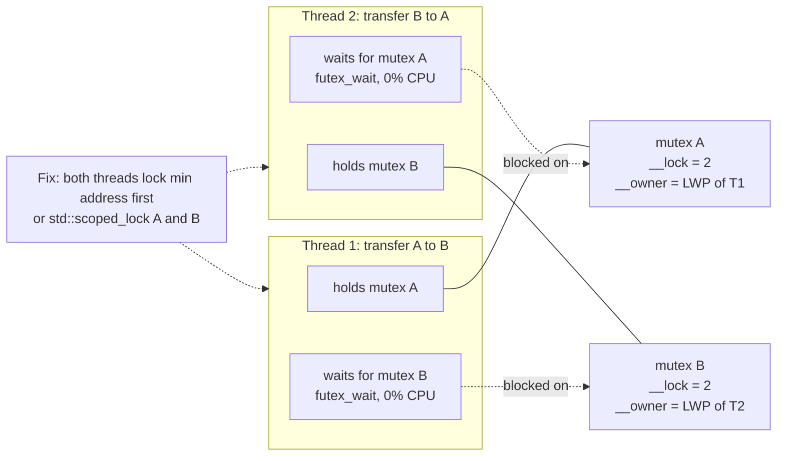

# Module 4.11: Deadlocks, livelocks and lock ordering

**Estimated hours:** 4

**What you will learn**

1. The four conditions that must all hold for a deadlock, and how every fix removes exactly one of them.
2. How to make a server hang on purpose with two mutexes, then diagnose it live with `gdb -p` and in advance with ThreadSanitizer's lock-order report.
3. The fixes a working engineer uses: a lock hierarchy, `std::scoped_lock`, `try_lock` with back-off, smaller lock scope, and the rule "never call out or do I/O while holding a lock".

**Prerequisites:** [Module 4.10: Thread pool design](module-10-thread-pool-design.md). You need `std::mutex` and `lock_guard` from module 4.03, condition variables from 4.04, and GDB's `info threads` from module 3.02.

---

## 1. One-line intuition

A deadlock is two people each holding one key and waiting for the other's key; nobody moves, nobody crashes, the program just sits there forever.

## 2. Real-life analogy

Two clerks at a bank need two ledgers to post a transfer: the ledger for account A and the ledger for account B. Each ledger is in a locked drawer with one key.

- Clerk 1 is transferring A to B. She takes key A, walks over for key B.
- Clerk 2 is transferring B to A. He takes key B, walks over for key A.
- Clerk 1 waits for key B. Clerk 2 waits for key A. Both wait politely forever. Customers pile up at the counter. The branch manager sees two idle clerks and a full queue, and nothing on any screen says "error".

That is a **deadlock**. Notice the four facts that made it possible: each key can be held by only one clerk (**mutual exclusion**); a clerk keeps the key she has while asking for another (**hold and wait**); nobody can snatch a key from a clerk (**no preemption**); clerk 1 waits for clerk 2 who waits for clerk 1 (**circular wait**). Break any one and the deadlock cannot happen.

The simplest branch rule: "always take the key for the lower account number first". Now both clerks reach for key A first; one gets it, the other waits for A and never holds B while doing so. That is **lock ordering**, and it is the fix used in every serious system.

Two more failures look similar but are different:

- **Livelock.** Both clerks are extra polite: "you first", "no, you first", stepping back and trying again in lock-step, forever. Everyone is busy, nothing finishes.
- **Starvation.** A clerk keeps losing the race for key A to faster colleagues. The system makes progress, but one request never does.

## 3. Why it exists: the problem it solves

Deadlock is not a tool; it is the price of using more than one lock. Module 4.03 gave you one mutex and it was safe: one lock cannot deadlock with itself (unless you lock it twice in the same thread, which is undefined behaviour for `std::mutex` and in practice hangs). The moment a program has two locks that can be taken by two threads in different orders, deadlock is possible, and with enough runs it is certain.

Real systems need many locks: one per account, one per cache, one per connection, one inside the logger, one inside the memory allocator. Fine-grained locking is how you get parallelism (module 4.05). So the question is never "how do I avoid having two locks" but "how do I guarantee they are always taken in a compatible order".

What breaks without discipline: the worst class of production incident. A crash gives you a dump and a stack. A deadlock gives you a process that is alive, answers health checks, consumes no CPU, and serves nobody. Alerts fire on latency, not on errors. The on-call engineer restarts it, it works for a day, and it happens again. Capstone C6 includes exactly this incident so that you can diagnose it from a dump instead of restarting and hoping.

## 4. Three layers of depth

### Layer 1 (beginner): the four conditions and the minimal deadlock

**Coffman's conditions** (Edward Coffman, 1971). A deadlock requires all four at once:

| Condition | Meaning | How a fix removes it |
|---|---|---|
| Mutual exclusion | A resource can be held by one thread at a time | Use lock-free or read-shared structures (not usually practical) |
| Hold and wait | A thread holds one lock while waiting for another | Take all locks at once (`std::scoped_lock(a, b)`), or never hold a lock while waiting |
| No preemption | A lock cannot be taken away from its holder | `try_lock` with back-off: the thread gives up its lock itself |
| Circular wait | T1 waits for T2 which waits for T1 (a cycle) | Lock ordering: a global order makes cycles impossible |

The practical fixes attack the last three. Mutual exclusion is the point of a mutex, so you rarely remove it.

**The minimal deadlock in C++:**

```cpp
std::mutex a, b;
// thread 1                          // thread 2
std::lock_guard<std::mutex> la(a);   std::lock_guard<std::mutex> lb(b);
std::lock_guard<std::mutex> lb(b);   std::lock_guard<std::mutex> la(a);
```

Thread 1 holds `a`, waits for `b`. Thread 2 holds `b`, waits for `a`. It does not happen on every run: if thread 1 takes both locks before thread 2 starts, all is well. That is what makes it dangerous. It passes tests and fails at 3 a.m. under load, when the interleaving finally lines up.

**What it looks like from outside.** The process is alive. CPU is near 0%. `top` shows it sleeping. Requests time out. In the debugger, two threads are blocked inside `pthread_mutex_lock`, each on a mutex the other owns.

### Layer 2 (working engineer): the fixes and the rules

**Fix 1: a lock hierarchy (lock ordering).** Assign every lock a level. A thread may only acquire a lock with a level higher than every lock it currently holds. If all threads obey, a circular wait cannot form: a cycle would need some thread to go from a higher level to a lower one.

Two common ways to pick the order:

- **By level.** Document it: level 10 = request pool, level 20 = account locks, level 30 = cache, level 40 = logger. Code at level 30 may call into level 40 but never level 20. A debug build can check this with a `thread_local` "highest level held" and assert on violations.
- **By address.** For many locks of the same kind (one per account), order by the mutex's address: lock the one with the lower address first. `transfer(from, to)` then becomes:

```cpp
std::mutex* first  = &from.m < &to.m ? &from.m : &to.m;
std::mutex* second = &from.m < &to.m ? &to.m   : &from.m;
std::lock_guard<std::mutex> l1(*first);
std::lock_guard<std::mutex> l2(*second);
```

Both threads now reach for the same mutex first. One wins, the other waits without holding anything that the winner needs.

**Fix 2: `std::scoped_lock(a, b)` or `std::lock(a, b)`.** C++17's `std::scoped_lock` with several mutexes calls `std::lock`, which acquires all of them using a deadlock-avoidance algorithm: lock the first, `try_lock` the rest; if any `try_lock` fails, release everything and start again, beginning with the one that failed. Because no thread ever **waits** while holding one of the group, hold-and-wait is removed for that group. It is the simplest correct fix when all the locks you need are known at one point:

```cpp
std::scoped_lock both(from.m, to.m);   // any order of arguments is safe
```

It does not help when lock 2 is acquired deep inside a function called while holding lock 1. For that, you need the hierarchy.

**Fix 3: `try_lock` with back-off.** Take lock 1; `try_lock` lock 2; if that fails, release lock 1, sleep a little (ideally a random amount), and retry. This removes "no preemption": the thread preempts itself. Used when locks live in different components and the ordering cannot be enforced centrally. The sleep must be randomised, or two threads back off in lock-step and you have built a livelock.

**Fix 4: timeouts.** `std::timed_mutex::try_lock_for(100ms)` turns an infinite hang into an error you can log and return. It does not fix the bug; it turns a silent outage into a loud one with a stack trace. Databases do exactly this: PostgreSQL's `deadlock_timeout` (default 1 s) triggers a cycle check and aborts one transaction (module 6.07).

**Fix 5: shrink the lock scope.** Most real deadlocks come from a lock held for far too long: across a function call that takes another lock, across a callback whose author did not know a lock was held, across a network or database call. Rules the app server enforced:

| Rule | Why |
|---|---|
| Never call a user-supplied callback while holding a lock | The callback may take any lock, including yours (recursion) or one lower in the hierarchy |
| Never do I/O (socket, disk, database) while holding a lock | A 5 ms DB call under a cache lock blocks every reader for 5 ms; a stuck DB call blocks everyone forever |
| Copy out what you need, unlock, then work | Hold the lock for the lookup only, not the processing |
| One lock-ordering document per service, reviewed on every change | The order is a contract; code review enforces it |

**Deadlocks that are not two mutexes.** These show up just as often:

- **Condition variable with a missing notify.** A thread waits on `cv.wait(lock, pred)`; the thread that would make `pred` true forgets `notify_one()`, or notifies before the waiter checks (lost wakeup, module 4.04). The waiter sleeps forever. In the debugger it is blocked in `pthread_cond_wait`, not `pthread_mutex_lock`.
- **`join()` on yourself.** A thread calls `t.join()` on its own `std::thread`. libstdc++ detects this and throws `std::system_error` with `resource_deadlock_would_occur` ("Resource deadlock avoided"). Joining from a pool task on the pool's own worker thread is the realistic version: the task waits for a thread that is busy running the task.
- **Locking a `std::mutex` twice in one thread.** Undefined behaviour. On glibc the default mutex is not error-checking, so the second `lock()` waits forever for itself. If you really need re-entry, that is `std::recursive_mutex`, and it is usually a design smell.
- **Waiting on a future from the pool inside a pool task.** With a pool of N threads, N tasks each submit a sub-task and wait for it; no worker is free to run the sub-tasks. Everyone waits. The fix is to never block a worker on work that needs a worker.
- **Lock held across I/O.** Not strictly a deadlock, but the same symptom in a server: one slow or stuck database call under a cache lock, and every request waiting for the cache is stuck with it. This was the classic latency incident on the app server.

**Livelock** is fixed with randomised back-off or by replacing the polite retry with an ordering. **Starvation** is fixed by fairness: a ticket lock, a fair queue, or a reader-writer lock that stops admitting new readers once a writer is waiting (module 4.05).

### Layer 3 (internals): what a blocked thread looks like to the kernel and the debugger

**Where the thread sleeps.** From module 4.03: `std::mutex::lock` calls `pthread_mutex_lock`. The fast path is one atomic compare-and-swap on the mutex's `__lock` word: 0 means free, 1 means locked, 2 means locked with waiters. If the CAS fails, glibc sets the word to 2 and calls the `futex` system call with `FUTEX_WAIT`. The kernel puts the thread to sleep on a wait queue keyed by the mutex's address. It uses no CPU and will not wake until someone calls `FUTEX_WAKE` on that address, which only `unlock` does. In a deadlock no one ever will.

**The mutex remembers its owner.** glibc's `pthread_mutex_t` has a `__data.__owner` field holding the kernel thread id (the LWP number you see in `info threads`) of the thread that currently holds it. libstdc++'s `std::mutex` is a thin wrapper: its member `_M_mutex` is the `pthread_mutex_t`. So in GDB:

```text
(gdb) print m_a
$1 = {<std::__mutex_base> = {_M_mutex = {__data = {__lock = 2, __count = 0, __owner = 18342, ...
```

`__lock = 2` means "locked and someone is waiting". `__owner = 18342` is the LWP of the holder. `info threads` maps LWPs to GDB thread numbers. That one field turns "the process is hung" into "thread 3 holds `m_a` and waits for `m_b`; thread 2 holds `m_b` and waits for `m_a`". It works the same on a live process and on a core dump, because the mutex is ordinary memory.

**What the stacks look like.** A thread blocked in a mutex on Ubuntu 24.04 (glibc 2.39, GCC 13) typically shows frames like these (exact names and line numbers vary with the glibc build, and without `libc6-dbg` the top frames show no source lines):

```text
#0  futex_wait (private=0, expected=2, futex_word=0x5555555580c0) at ../sysdeps/nptl/futex-internal.h:146
#1  __GI___lll_lock_wait (futex=0x5555555580c0, private=0) at ./nptl/lowlevellock.c:49
#2  lll_mutex_lock_optimized (mutex=0x5555555580c0) at ./nptl/pthread_mutex_lock.c:48
#3  ___pthread_mutex_lock (mutex=0x5555555580c0) at ./nptl/pthread_mutex_lock.c:93
#4  __gthread_mutex_lock (__mutex=0x5555555580c0) at .../bits/gthr-default.h:749
#5  std::mutex::lock (this=0x5555555580c0) at .../bits/std_mutex.h:113
#6  std::lock_guard<std::mutex>::lock_guard (__m=..., this=...) at .../bits/std_mutex.h:229
#7  transfer_a_then_b () at deadlock.cpp:27
```

Read it bottom-up: our code at `deadlock.cpp:27` constructed a `lock_guard`, which called `pthread_mutex_lock`, which lost the fast path (`__lll_lock_wait` = "low-level lock wait") and went to sleep in `futex_wait`. The argument `0x5555555580c0` is the mutex's address: the thing being waited for. A thread blocked on a condition variable instead shows `___pthread_cond_wait` and `futex_wait` with a different address.

**How TSan sees it before it happens.** ThreadSanitizer records, for each thread, which mutexes it holds when it acquires another, and builds a lock-order graph: an edge `M0 -> M1` means "M1 was acquired while holding M0". If it ever sees `M1 -> M0` too, there is a cycle, and it prints `lock-order-inversion (potential deadlock)` with both stacks. The key word is *potential*: it reports the inversion even on a run that happened not to hang. That is what makes it a test-time tool rather than a 3 a.m. tool. Deadlock detection is enabled by default in GCC 13's libtsan; if you ever see nothing, run with `TSAN_OPTIONS=detect_deadlocks=1`.

**What the OS does about a deadlock.** Nothing. The kernel sees two sleeping threads, which is normal. There is no timeout on a `futex` wait unless you asked for one. The process stays alive until a human or a watchdog kills it. This is why a server needs a liveness check that actually exercises the locked path, not just "is the port open".

## 5. Architecture diagram



The dotted arrows form the cycle: T1 to B to T2 to A to T1. Every fix in Layer 2 either removes one of those arrows or makes the cycle impossible to form.

## 6. Code

One program, four modes. `race` hangs (the bug). `serial` runs the same two orderings one after the other so TSan can show the inversion without a hang. `ordered` fixes it by address ordering. `scoped` fixes it with `std::scoped_lock`.

```cpp
// deadlock.cpp -- two accounts, two mutexes, AB/BA ordering.
// Modes: race (hangs), serial (no hang, TSan reports), ordered, scoped.
#include <chrono>
#include <cstring>
#include <iostream>
#include <mutex>
#include <string>
#include <thread>

struct Account {
    std::mutex m;
    long balance = 10'000;   // paise
};

Account acct_a, acct_b;

// BUG: locks in the order (from, to). Two threads with opposite directions
// take the two mutexes in opposite orders.
void transfer_buggy(Account& from, Account& to, long amount) {
    std::lock_guard<std::mutex> l1(from.m);
    std::this_thread::sleep_for(std::chrono::microseconds(10)); // widen the window
    std::lock_guard<std::mutex> l2(to.m);
    from.balance -= amount;
    to.balance += amount;
}

// FIX 1: lock hierarchy by address. Both directions lock the same mutex first.
void transfer_ordered(Account& from, Account& to, long amount) {
    Account* first  = (&from < &to) ? &from : &to;
    Account* second = (&from < &to) ? &to   : &from;
    std::lock_guard<std::mutex> l1(first->m);
    std::lock_guard<std::mutex> l2(second->m);
    from.balance -= amount;
    to.balance += amount;
}

// FIX 2: scoped_lock takes both with the std::lock avoidance algorithm.
void transfer_scoped(Account& from, Account& to, long amount) {
    std::scoped_lock both(from.m, to.m);   // argument order does not matter
    from.balance -= amount;
    to.balance += amount;
}

using TransferFn = void (*)(Account&, Account&, long);

void worker(TransferFn fn, Account& from, Account& to, int rounds) {
    for (int i = 0; i < rounds; ++i) fn(from, to, 1);
}

int main(int argc, char** argv) {
    std::string mode = argc > 1 ? argv[1] : "race";
    TransferFn fn = transfer_buggy;
    if (mode == "ordered") fn = transfer_ordered;
    if (mode == "scoped")  fn = transfer_scoped;

    const int rounds = 20'000;
    std::cout << "mode " << mode << ": starting (pid " << getpid() << ")\n";

    if (mode == "serial") {
        // Same two orderings, but never at the same time: cannot hang.
        // TSan still sees A->B and B->A and reports the inversion.
        std::thread t1(worker, fn, std::ref(acct_a), std::ref(acct_b), 100);
        t1.join();
        std::thread t2(worker, fn, std::ref(acct_b), std::ref(acct_a), 100);
        t2.join();
    } else {
        std::thread t1(worker, fn, std::ref(acct_a), std::ref(acct_b), rounds);
        std::thread t2(worker, fn, std::ref(acct_b), std::ref(acct_a), rounds);
        t1.join();
        t2.join();
    }
    std::cout << "done: a=" << acct_a.balance << " b=" << acct_b.balance
              << " total=" << acct_a.balance + acct_b.balance << "\n";
    return 0;
}
```

Add `#include <unistd.h>` at the top for `getpid` (Linux). Compile and run the healthy modes first:

```bash
g++ -std=c++17 -O2 -Wall -Wextra -Werror -g -pthread -o deadlock deadlock.cpp
./deadlock ordered
./deadlock scoped
```

Expected output (PID varies):

```text
mode ordered: starting (pid 18340)
done: a=10000 b=10000 total=20000
mode scoped: starting (pid 18351)
done: a=10000 b=10000 total=20000
```

Now the bug:

```bash
./deadlock race
```

Expected: the first line prints, then nothing. The program is hung. `top` in another terminal shows it at 0% CPU in state `S` (sleeping). Press `Ctrl+C` to kill it. On one laptop it hangs within the first few hundred rounds on nearly every run; the `sleep_for` makes the window wide enough to be reliable.

TSan on the serial mode (no hang, but the inversion is reported):

```bash
g++ -std=c++17 -O1 -g -fsanitize=thread -pthread -o deadlock_tsan deadlock.cpp
./deadlock_tsan serial
```

Expected output shape (addresses, thread ids and frame details vary):

```text
mode serial: starting (pid 18402)
==================
WARNING: ThreadSanitizer: lock-order-inversion (potential deadlock) (pid=18402)
  Cycle in lock order graph: M0 (0x5581c2d2c0c0) => M1 (0x5581c2d2c100) => M0

  Mutex M1 acquired here while holding mutex M0 in thread T2:
    #0 pthread_mutex_lock ../../../../src/libsanitizer/sanitizer_common/sanitizer_common_interceptors.inc:4780
    #1 __gthread_mutex_lock /usr/include/x86_64-linux-gnu/c++/13/bits/gthr-default.h:749
    #2 std::mutex::lock() /usr/include/c++/13/bits/std_mutex.h:113
    #3 std::lock_guard<std::mutex>::lock_guard(std::mutex&) /usr/include/c++/13/bits/std_mutex.h:229
    #4 transfer_buggy(Account&, Account&, long) deadlock.cpp:22
    ...
  Mutex M0 previously acquired by the same thread here:
    ...
    #4 transfer_buggy(Account&, Account&, long) deadlock.cpp:20

  Mutex M0 acquired here while holding mutex M1 in thread T1:
    ...
    #4 transfer_buggy(Account&, Account&, long) deadlock.cpp:22
  Mutex M1 previously acquired by the same thread here:
    ...
    #4 transfer_buggy(Account&, Account&, long) deadlock.cpp:20

SUMMARY: ThreadSanitizer: lock-order-inversion (potential deadlock) deadlock.cpp:22 in transfer_buggy(Account&, Account&, long)
==================
done: a=10000 b=10000 total=20000
ThreadSanitizer: reported 1 warnings
```

The report names both lines: line 20 took the first lock, line 22 took the second, and it was seen in both orders. Run `./deadlock_tsan ordered` and `./deadlock_tsan scoped`: no warning.

## 7. Use case: core-banking loan-origination platform

The application server from claim H4 had, among others, these locks: the request pool's free-list mutex, the master-table cache's `shared_mutex` (module 4.13), per-session state mutexes, and the logger's mutex. Early in its life it hung twice in a week. Both times the process was alive, CPU was idle, and every RPC timed out.

The diagnosis from a dump (the method in Lab Part D): all worker threads were in `futex_wait`. One was inside the cache refresh, holding the cache lock in exclusive mode while waiting on a database socket; the database had stalled. Every other worker was waiting for the cache lock. Not a two-mutex cycle, but the same shape: a lock held across I/O.

**The decision it drove: a written lock-ordering document for the server, with two hard rules enforced in code review: "no database or socket call while holding any cache or pool lock", and "locks are taken in the documented level order: pool (10) before session (20) before cache (30) before logger (40), never upward".** The cache refresh was rewritten to build the new table off-lock and swap it in under a lock held for microseconds (you build that in module 4.13). A debug-build lock-level checker asserted on any out-of-order acquisition during the test suite.

The second rule mattered more than the first in practice. Most deadlocks were not two mutexes in opposite orders; they were one lock held while doing something slow. The document made "what are you holding right now?" a question every reviewer asked.

## 8. Lab

Work in `~/course/deadlock-lab` with `deadlock.cpp` from section 6.

### Part A: hang it and look inside with GDB (40 minutes)

1. Build with `-g` as shown. Run `./deadlock race` in terminal 1. It prints the PID and hangs.
2. In terminal 2, confirm it is asleep: `top -p <pid>` shows `%CPU` near 0 and state `S`.
3. Attach GDB. Ubuntu restricts attaching to non-child processes, so use `sudo`:

```bash
sudo gdb -p <pid>
(gdb) info threads
(gdb) thread apply all bt
```

Expected: three threads. Thread 1 (main) is in `pthread_join` / `futex_wait`. Threads 2 and 3 both show `__lll_lock_wait` / `futex_wait` under `std::mutex::lock` under `transfer_buggy` at `deadlock.cpp:22`. Note the mutex address argument in each thread's frame 0 or 1: they are different, one is `acct_a.m`, the other `acct_b.m`.

4. Find the owners:

```text
(gdb) print acct_a.m
(gdb) print acct_b.m
(gdb) print acct_a.m._M_mutex.__data.__owner
(gdb) print acct_b.m._M_mutex.__data.__owner
```

Expected: both show `__lock = 2`. The two `__owner` values are the LWP numbers of threads 2 and 3 from `info threads`, crossed: the thread waiting on `acct_b.m` is the owner of `acct_a.m` and vice versa. Write down the cycle in one sentence. Then `detach`, `quit`, and `Ctrl+C` the program.

### Part B: catch it before it hangs with TSan (20 minutes)

1. Build the TSan binary and run `./deadlock_tsan serial`. Read the report: find the two source lines it names and the two thread ids.
2. Run `./deadlock_tsan race`. On most runs TSan prints the same report before the hang, because the inversion is detected when the second order is first seen. Kill it with `Ctrl+C`.
3. Run `ordered` and `scoped` under TSan. Expected: no warning, `total=20000`.

### Part C: the other deadlocks (40 minutes)

Write `other_deadlocks.cpp` with three small functions, each selected by an argument:

1. **Missing notify.** A bounded queue from 4.04 where the producer's `push` forgets `cv_.notify_one()`. Consumer waits forever. Attach GDB and confirm the consumer's stack shows `___pthread_cond_wait`, not `pthread_mutex_lock`. That difference is how you tell "waiting for a lock" from "waiting for an event that never came".
2. **Join on self.** Start a thread that, once signalled, calls `join()` on its own `std::thread` object (signal it with a condition variable so the object is fully assigned first). Catch `std::system_error` and print `e.code().message()`.

   Expected output: `join on self: Resource deadlock avoided`.
3. **Pool waits on pool.** Using `tcpkv::ThreadPool` from module 4.10 with N = 2, submit two tasks that each submit a sub-task to the same pool and call `get()` on it. Expected: the program hangs. Attach GDB: both workers are in `futex_wait` under `std::future::get` (`std::__atomic_futex_unsigned`), and the queue holds two tasks no one can run. Kill it. Then make N = 3 and watch it finish: the hang depended on the pool size, which is why it passed on the developer's 8-thread laptop and failed on the 2-thread container.

### Part D: diagnose from a dump, no live process (30 minutes) — the C6 method

1. Run `./deadlock race` again. From terminal 2, take a core dump of the live process without killing it:

```bash
sudo gcore -o hung <pid>
```

Expected: `Saved corefile hung.<pid>`. Kill the program.

2. Open the dump:

```bash
gdb ./deadlock hung.<pid>
(gdb) thread apply all bt
(gdb) print acct_a.m._M_mutex.__data.__owner
(gdb) print acct_b.m._M_mutex.__data.__owner
(gdb) info threads
```

3. Write the diagnosis in the RCA shape you will use in capstone C6: **symptom** (process alive, 0% CPU, requests time out); **evidence** (two threads in `futex_wait` under `transfer_buggy:22`; `acct_a.m.__owner` = LWP X, `acct_b.m.__owner` = LWP Y; X waits on `acct_b.m`, Y on `acct_a.m`); **root cause** (opposite lock order in `transfer_buggy`); **fix** (address ordering or `scoped_lock`); **prevention** (TSan in CI on the `serial` test; lock-order document).

In a real server you may not have a global like `acct_a`. Then take the mutex address from the `futex_wait` argument in each stack and print it as a mutex: `print *(pthread_mutex_t*)0x5555555580c0`. The `__owner` field is there either way.

### Journal

Copy [journal/TEMPLATE.md](../journal/TEMPLATE.md) to `journal/YYYY-MM-DD-deadlocks.md`. Record: the two stacks and the two `__owner` values from Part A with the cycle written as a sentence; the TSan summary line from Part B; which stack frame distinguished the condvar hang from the mutex hang in Part C; and the five-part diagnosis from Part D. This entry is the first draft of your C6 deadlock RCA.

## 9. Common mistakes and misconceptions

| Mistake | Why it is wrong | Bug it causes later |
|---|---|---|
| "It never deadlocked in testing, so it is fine" | Deadlock needs an interleaving; tests rarely hit it | 3 a.m. hang under production load |
| "A deadlock will crash or time out" | The kernel just sees sleeping threads; `futex_wait` has no timeout | A hung server that passes port health checks |
| Fixing it with `std::recursive_mutex` | Recursion is a different problem (same thread, same lock); it does nothing for two threads and two locks | Still hangs, now with a slower mutex |
| Holding a lock while calling a callback | The callback may take any lock, in any order | Deadlock that only appears when a new listener is added |
| Holding a lock across a database or socket call | Every waiter stalls for the duration; forever if the call hangs | The app server's cache-lock latency incident |
| `try_lock` retry with a fixed sleep | Both threads back off and retry in step | Livelock: 100% busy, no progress |
| Waiting on pool work from inside a pool task | Workers are the only things that can run the sub-task | Hang that depends on pool size |
| Treating `scoped_lock` as a universal fix | It only helps when all locks are taken at one point | Nested acquisition deep in a call still inverts the order |
| Fixing the symptom with a restart script | The cycle is still in the code | Weekly outage with no RCA |

## 10. Resume link

- **Claim C, "threads, mutexes ... deadlocks".** Say: "Every multi-lock path in the server followed a documented order: pool, session, cache, logger. Transfers between two account locks used address ordering. Where all locks were known at one point we used `std::scoped_lock`. TSan's lock-order detector ran in CI on the test suite."
- **Claim F, "incident triage, GDB, core dump analysis".** The Part D method is the answer to "how do you debug a hung process?": attach or `gcore`, `thread apply all bt`, find the threads in `futex_wait`, read the mutex's `__owner`, draw the cycle. You have done it on your own machine; say so and name the fields.
- **Claim H4 / H5.** The section 7 story: a lock held across a stalled database call, diagnosed from a dump, fixed by building the new cache off-lock and swapping under a microsecond lock, prevented by two rules in a lock-ordering document.

Likely follow-ups: "What are the four conditions?" (name them, then say which one each fix removes). "How does `std::lock` avoid deadlock?" (try-and-back-off: it never waits while holding one of the set). "How would you find the owner of a mutex in a dump?" (`print *(pthread_mutex_t*)addr`, `__data.__owner` is the LWP).

## 11. Interview questions

**Q1 (easy). What is a deadlock? Give the simplest example.**

<details>
<summary>Model answer</summary>

A deadlock is a set of threads each waiting for a resource held by another thread in the set, so none can proceed. The simplest example: thread 1 locks mutex A then tries to lock B; thread 2 locks B then tries to lock A. Each holds what the other needs. The process stays alive, uses no CPU, and never makes progress; nothing crashes, which is what makes it hard to notice.

</details>

**Q2 (easy). What are Coffman's four conditions?**

<details>
<summary>Model answer</summary>

Mutual exclusion (a resource is held by one thread at a time), hold and wait (a thread holds a resource while waiting for another), no preemption (a resource cannot be taken from its holder), and circular wait (a cycle of threads each waiting on the next). All four must hold for a deadlock. Lock ordering removes circular wait; `std::scoped_lock` and `std::lock` remove hold-and-wait for a group of locks; `try_lock` with back-off removes no-preemption by having the thread release what it holds.

</details>

**Q3 (medium). How does `std::scoped_lock(m1, m2)` avoid deadlock, and when does it not help?**

<details>
<summary>Model answer</summary>

With several mutexes it calls `std::lock`, which locks the first, then `try_lock`s the rest; if any `try_lock` fails it releases everything, yields, and retries starting from the mutex that failed. A thread never blocks while holding one of the group, so hold-and-wait is eliminated for those locks, regardless of argument order in different call sites. It does not help when the second lock is acquired later, inside a function called while the first is held, because the two acquisitions are not at one point. For that, a lock hierarchy (ordering by level or by address) is the fix.

</details>

**Q4 (medium). A production server is hung: alive, 0% CPU, every request times out. Walk me through finding the cause.**

<details>
<summary>Model answer</summary>

First confirm it is a wait, not a spin: `top` shows near-zero CPU and the threads in state S. Then capture evidence without destroying it: `gcore` the process, or attach with `gdb -p`. Run `thread apply all bt` and group the threads by what they are blocked in. Threads in `__lll_lock_wait` / `futex_wait` under `pthread_mutex_lock` are waiting for a mutex; the mutex address is in the frame. For each such mutex, `print *(pthread_mutex_t*)addr`; `__data.__owner` is the LWP of the holder, which `info threads` maps to a thread. Follow the chain: thread X waits on a mutex owned by Y, Y waits on one owned by X, and that is the cycle. If instead the owner is blocked in a `recv` or a database driver, it is a lock held across I/O, not a cycle, and the fix is to move the I/O outside the lock. Threads in `pthread_cond_wait` point to a missing notification instead. Write up symptom, evidence, root cause, fix and prevention.

</details>

**Q5 (hard). Design the locking rules for a multithreaded application server with a request pool, per-session state, a shared cache and a logger, so that deadlock is impossible, and explain how you would enforce them.**

<details>
<summary>Model answer</summary>

Assign levels: pool 10, session 20, cache 30, logger 40, and the rule that a thread may only acquire a lock with a strictly higher level than any it holds; a cycle would require a descent in level, which the rule forbids, so circular wait cannot form. Locks of the same level (two sessions, two accounts) are ordered by address and taken with `std::scoped_lock`. Add scope rules: no I/O, no database call and no user callback under any lock; copy the needed fields out and release. The cache's refresh builds the new table off-lock and swaps it in under an exclusive lock held for microseconds. Enforcement: a lock-ordering document reviewed on every change; a debug-build wrapper around the mutexes that keeps a `thread_local` "highest level held" and asserts on violation; TSan with its lock-order-inversion detector run over the test suite in CI; and a liveness probe that actually exercises a locked path so a hang is detected in minutes. Finally, an RCA template and the `gcore` plus `__owner` method so that if it still happens, the next one is diagnosed from the dump rather than restarted.

</details>

## 12. Revision

- Deadlock needs mutual exclusion, hold-and-wait, no preemption and circular wait; lock ordering kills the cycle, `std::scoped_lock`/`std::lock` kill hold-and-wait, `try_lock` with randomised back-off kills no-preemption.
- Diagnose live or from a `gcore` dump: `thread apply all bt`, threads in `futex_wait` under `pthread_mutex_lock`, then `print *(pthread_mutex_t*)addr` and read `__data.__owner` to draw the cycle; TSan reports a `lock-order-inversion` before it ever hangs.
- Most real "deadlocks" are one lock held across I/O or a callback; the server rules are a documented lock order and no DB or socket call under any cache or pool lock.

---

Previous: [Module 4.10: Thread pool design](module-10-thread-pool-design.md) | Next: [Module 4.12: Win32 synchronisation](module-12-win32-synchronisation.md)
