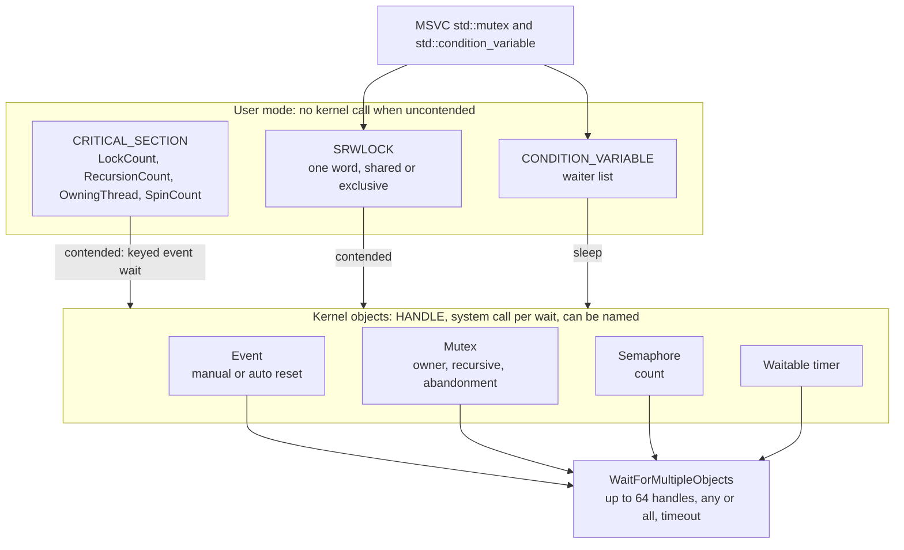

# Module 4.12: Win32 synchronisation

**Estimated hours:** 5

**What you will learn**

1. The Windows synchronisation primitives, split into the two families that matter: user-mode locks (`CRITICAL_SECTION`, `SRWLOCK`, `CONDITION_VARIABLE`) and kernel objects (Event, Mutex, Semaphore, waitable timer).
2. How `WaitForSingleObject` and `WaitForMultipleObjects` work, and why "wait on {stop event, work semaphore} in one call" is the Windows way to run and stop a worker pool.
3. How to write one sync layer that compiles to `std::mutex` and condition variables on Linux and to critical sections and condition variables on Windows, so the application server's code above it is identical.

**Prerequisites:** [Module 4.11: Deadlocks, livelocks and lock ordering](module-11-deadlocks-and-lock-ordering.md). You also need the Windows handle model from module 3.13 and the Developer Command Prompt set up in module 0.06.

---

## 1. One-line intuition

Windows gives you the same ideas as Linux (a lock, a reader-writer lock, a condition variable, a signal you can wait for) under different names, plus one thing Linux does not have in the box: a single call that waits on several different kinds of object at once.

## 2. Real-life analogy

Go back to the bank branch.

- A **critical section** is the "engaged" sign on the vault door. Any clerk who sees it free flips it and walks in; no need to ask the manager. If it is engaged, the clerk waits outside. Only the clerk who flipped it can flip it back. It works inside this branch only, and a clerk who is already inside can go in again (it is **recursive**): the sign counts how many times she entered and clears only when she has left that many times.
- An **SRW lock** (slim reader/writer) is the reading-room rule: many clerks may read the ledger at once, or one clerk may write, never both. It is lighter than the vault sign but does **not** let the same clerk enter twice.
- A **condition variable** is the bell by the counter: "wake me when there is work". The clerk puts the vault sign back to free, sits down, and rings only when something changes.
- A **kernel Event** is the manager's light on the wall: red means "stay", green means "go". The manager flips it (`SetEvent`) and everyone who is watching sees it. A **manual-reset** light stays green until the manager turns it off. An **auto-reset** light flashes green for exactly one clerk and goes red again.
- A **kernel Mutex** is a key kept at the manager's desk. Any clerk from **any branch in the building** (any process) can ask for it, because it has a name on the manager's board. Getting it means a trip to the manager's desk (a kernel transition), which is slower than flipping the sign.
- A **Semaphore** is a rack of five visitor badges. Up to five people may be inside; the sixth waits until a badge comes back.
- **`WaitForMultipleObjects`** is a clerk watching several things at once: "wake me when there is a badge on the rack **or** the closing light goes on, whichever comes first". That one sentence is the whole worker-pool shutdown design on Windows.

## 3. Why it exists: the problem it solves

The application server from resume claim H4 ran on Windows as well as Linux. The C++ standard library gives you `std::mutex`, `std::shared_mutex` and `std::condition_variable` on both, and on Windows the Visual Studio 2022 standard library builds those on `SRWLOCK` and `CONDITION_VARIABLE`. So why learn the Win32 API at all?

1. **Some things the standard library does not have.** There is no standard way to wait for "a task is available **or** we are shutting down **or** the DB connection died" in one blocking call. Windows has `WaitForMultipleObjects`. There is no standard cross-process lock; Windows has named kernel Mutexes. A service that must be the only instance on the machine, or that shares a lock with a helper process, needs these.
2. **You will read them in other people's code and in dumps.** Decades of Windows server code use `CRITICAL_SECTION`. WinDbg's `!locks` command (module 8.03) understands critical sections. Capstone C6's Windows deadlock lab shows you one.
3. **The resume says so.** Claim C: "Win32 synchronisation (critical sections, wait objects)". Claim H4: "a thread synchronisation layer (mutexes, critical sections, wait objects, pooled request model)". An interviewer will ask what a critical section is, how it differs from a Mutex, and why you chose it.

What breaks without it: a Windows service that cannot shut down cleanly because its workers are blocked in a wait that only "work arrived" can end; or a server that takes a kernel Mutex on every request and spends a microsecond in the kernel each time for a lock that is almost never contended.

## 4. Three layers of depth

### Layer 1 (beginner): the primitives and their names

Windows splits synchronisation into two families.

**Family 1: user-mode primitives.** Plain structs in your process's memory. Uncontended operations never enter the kernel. In-process only. Not handles; you do not `CloseHandle` them.

| Primitive | Initialise | Lock / wait | Unlock / signal | Recursive? | Linux / C++ equivalent |
|---|---|---|---|---|---|
| `CRITICAL_SECTION` | `InitializeCriticalSectionAndSpinCount(&cs, 4000)`; `DeleteCriticalSection` when done | `EnterCriticalSection`, `TryEnterCriticalSection` | `LeaveCriticalSection` | Yes | `std::recursive_mutex` in behaviour; used like `std::mutex` |
| `SRWLOCK` | `SRWLOCK lock = SRWLOCK_INIT;` or `InitializeSRWLock`; nothing to delete | `AcquireSRWLockExclusive`, `AcquireSRWLockShared`, `TryAcquireSRWLock...` | `ReleaseSRWLockExclusive`, `ReleaseSRWLockShared` | No (re-entry deadlocks) | `std::shared_mutex`; MSVC's `std::mutex` is built on it |
| `CONDITION_VARIABLE` | `CONDITION_VARIABLE cv = CONDITION_VARIABLE_INIT;` or `InitializeConditionVariable`; nothing to delete | `SleepConditionVariableCS(&cv, &cs, ms)` or `SleepConditionVariableSRW(&cv, &lock, ms, flags)` | `WakeConditionVariable`, `WakeAllConditionVariable` | n/a | `std::condition_variable` |

`SleepConditionVariableCS` does exactly what `cv.wait(lock)` does in module 4.04: atomically release the critical section and sleep; re-acquire before returning. It can wake spuriously, so it is always called in a `while (!predicate)` loop. On timeout it returns `FALSE` and `GetLastError()` is `ERROR_TIMEOUT`.

**Family 2: kernel objects.** Created with `Create...`, referenced by a `HANDLE`, live in the kernel, closed with `CloseHandle`. Every wait is a system call. They can be **named** and shared across processes. All of them are waited on with the same two functions.

| Object | Create | Signal | Behaviour | Typical use |
|---|---|---|---|---|
| Event (manual-reset) | `CreateEventW(nullptr, TRUE, FALSE, name)` | `SetEvent` (stays signalled), `ResetEvent` | Releases **all** waiters, now and later, until reset | "Shutting down", "initialised" |
| Event (auto-reset) | `CreateEventW(nullptr, FALSE, FALSE, name)` | `SetEvent` | Releases **one** waiter and resets itself | "One item ready" (a semaphore of 1) |
| Mutex | `CreateMutexW(nullptr, FALSE, name)` | `ReleaseMutex` | Owned by a thread; recursive; **abandoned** if the owner exits without releasing | Cross-process exclusion, single-instance check |
| Semaphore | `CreateSemaphoreW(nullptr, initial, max, name)` | `ReleaseSemaphore(h, n, &prev)` | Count; wait decrements, release increments; no owner | "N items available", resource limits |
| Waitable timer | `CreateWaitableTimerW(nullptr, manual, name)` | `SetWaitableTimer(h, &due, period, ...)` | Signalled at a time or on a period | Periodic cache refresh, timeouts in a multi-wait |
| Thread, process | `CreateThread`, `CreateProcess` | Exits | Signalled when it has ended | `WaitForSingleObject(hThread, INFINITE)` is "join" |

**The wait functions.**

```cpp
DWORD WaitForSingleObject(HANDLE h, DWORD timeout_ms);
DWORD WaitForMultipleObjects(DWORD count, const HANDLE* handles, BOOL wait_all, DWORD timeout_ms);
```

Return values you must know:

| Value | Meaning |
|---|---|
| `WAIT_OBJECT_0` (0) | The object is signalled (single); or, for multiple with `wait_all = FALSE`, `WAIT_OBJECT_0 + i` where `i` is the index of the signalled handle |
| `WAIT_ABANDONED` (0x80), `WAIT_ABANDONED_0 + i` | A Mutex whose owner died; you now own it, and the data it protected may be inconsistent |
| `WAIT_TIMEOUT` (0x102) | The timeout elapsed |
| `WAIT_FAILED` (0xFFFFFFFF) | Bad handle or argument; call `GetLastError()` |

Rules: at most `MAXIMUM_WAIT_OBJECTS` (64) handles per call; with `wait_all = FALSE` and several signalled, you get the **lowest** index; waiting on an auto-reset event, a semaphore or a mutex **consumes** it (resets, decrements, takes ownership), waiting on a manual-reset event does not. `INFINITE` (0xFFFFFFFF) means no timeout.

### Layer 2 (working engineer): choosing, costs and traps

**The comparison that interviews are about.**

| | `CRITICAL_SECTION` | `SRWLOCK` | Kernel Mutex | Event / Semaphore |
|---|---|---|---|---|
| Uncontended cost | One interlocked instruction, no kernel (typical: tens of ns) | Same | A system call every time (typical: about a microsecond) | A system call every time |
| Contended cost | Spin, then kernel wait | Kernel wait | Kernel wait | Kernel wait |
| Recursive | Yes | No | Yes | n/a |
| Owner tracked | Yes (`OwningThread`) | No | Yes (abandonment detection) | No |
| Cross-process | No | No | Yes (named) | Yes (named) |
| Reader/writer | No | Yes | No | No |
| Timeout on lock | No (`TryEnter` only) | No (`TryAcquire` only) | Yes | Yes |
| Can be in `WaitForMultipleObjects` | No | No | Yes | Yes |
| Size | 40 bytes (x64) | 8 bytes | A handle | A handle |

**When to use which.**

- Protecting in-process data: `CRITICAL_SECTION` or `SRWLOCK`. Prefer `SRWLOCK` for new code (smaller, no init/delete, reader mode) unless you need recursion. Recursion is usually a design smell, as in module 4.11, but legacy code paths that lock-then-call-a-helper-that-locks rely on it, and `CRITICAL_SECTION` tolerates that.
- Waiting for a condition about in-process data: `CONDITION_VARIABLE` with either lock.
- Signalling "stop" to many threads: a manual-reset Event. Set once, everyone sees it forever.
- Counting work items that several threads consume: a Semaphore (or an auto-reset Event if the count is only ever 0 or 1).
- Exclusion across processes, or "only one copy of this service may run": a named Mutex. `CreateMutexW` with `GetLastError() == ERROR_ALREADY_EXISTS` is the standard single-instance check.
- Anything you need to wait on together with other things: it must be a kernel object. This is the real reason Events and Semaphores appear in server code even though a condition variable could do the job alone.

**Spin count.** `InitializeCriticalSectionAndSpinCount(&cs, 4000)` says: on a multi-core machine, if the lock is held, spin up to 4000 iterations checking it before going to the kernel. A lock held for 100 ns is usually free again before the spin ends, saving the kernel round trip. On a single-core machine the spin count is ignored (spinning would only delay the owner). Microsoft's documentation notes its heap manager uses a spin count of about 4000, which is why that number shows up everywhere.

**Abandoned mutex.** If a thread holding a kernel Mutex exits (crash, `ExitThread`, process killed), the next waiter gets `WAIT_ABANDONED`. That tells you two things: you now own the mutex, and whatever it protected was left mid-update. A correct server logs it loudly and re-validates or discards the shared state. Critical sections have no such signal: a thread that dies holding one leaves it locked forever, which is one reason cross-process shared memory uses a kernel Mutex.

**`std::mutex` on MSVC.** In the standard library shipped with Visual Studio 2022, `std::mutex`, `std::recursive_mutex`, `std::shared_mutex` and `std::condition_variable` are implemented on `SRWLOCK` and `CONDITION_VARIABLE`. So portable C++ already gets the fast user-mode path on Windows. You reach for Win32 directly when you need recursion with owner tracking, a kernel object to put in a multi-wait, or cross-process sharing.

**Traps.**

| Trap | What happens |
|---|---|
| `AcquireSRWLockExclusive` twice on one thread | Deadlock; SRW locks are not recursive and do not detect it |
| Forgetting `LeaveCriticalSection` on an early return or exception | Lock held forever; use an RAII guard (section 6) |
| `DeleteCriticalSection` while a thread is inside | Undefined behaviour, usually a crash in the next `Enter` |
| `PulseEvent` | Unreliable (a waiter can miss it); documented as not to be used |
| Checking a predicate once after `SleepConditionVariableCS` | Spurious and stolen wakeups; always loop |
| More than 64 handles in `WaitForMultipleObjects` | `WAIT_FAILED`, `ERROR_INVALID_PARAMETER`; use a pool of waiter threads or a completion port (module 3.12) |
| Putting `stopEvent` at the wrong index | Index order decides whether queued work drains or is dropped (section 6) |
| Waiting on a kernel object while holding a `CRITICAL_SECTION` | The 4.11 rule: a lock held across a wait stalls everyone |

### Layer 3 (internals): what is inside

**`CRITICAL_SECTION`** is a struct (`RTL_CRITICAL_SECTION`) with these fields: `LockCount` (packed bits: locked flag, waiter count), `RecursionCount`, `OwningThread` (the thread id), `LockSemaphore` (historically a handle; on modern Windows the wait uses a **keyed event**, created lazily, but the field keeps its name), and `SpinCount`. `EnterCriticalSection` does an interlocked compare-and-swap on `LockCount`. If it wins, it records `OwningThread` and sets `RecursionCount` to 1 and returns: no kernel involvement. If the same thread enters again, it sees `OwningThread == GetCurrentThreadId()` and just increments `RecursionCount`. If another thread owns it, it spins up to `SpinCount` times re-checking, then calls into the kernel (`NtWaitForKeyedEvent`) to sleep. `LeaveCriticalSection` decrements `RecursionCount`; on zero it releases `LockCount` and, if the waiter bits say someone is sleeping, wakes one with `NtReleaseKeyedEvent`. The pattern is the same as the futex fast path and slow path you traced in module 4.03; only the names differ. WinDbg's `!locks` and `!cs` read exactly these fields, which is how you find the owner of a critical section in a dump (module 8.03).

**`SRWLOCK`** is one pointer-sized word. The low bits are flags (locked, shared-count, waiters present); when there are waiters, the rest of the word points to a linked list of wait blocks living on the waiting threads' stacks. Acquire is an interlocked operation on the word; contended waits use keyed events too. Being one word with no owner field is what makes it 8 bytes and non-recursive: there is nowhere to record who holds it.

**`CONDITION_VARIABLE`** is also one word, pointing to a list of wait blocks. `SleepConditionVariableCS` links the caller into the list, leaves the critical section, and waits on its block; `WakeConditionVariable` unlinks one block and releases it. The "release the lock and sleep" step is made atomic with respect to `Wake` by the list manipulation, which is why no wakeup is lost if you set the state under the lock before waking, exactly the rule from 4.04.

**Kernel objects** are `DISPATCHER_HEADER` structures inside the kernel. Each has a signal state and a list of waiting threads. `WaitForSingleObject` traps into the kernel (`NtWaitForSingleObject`), which checks the signal state; if not signalled, it puts the thread into a wait state linked to that object's wait list and reschedules. Signalling (`SetEvent`, `ReleaseMutex`, `ReleaseSemaphore`) flips the state and satisfies waiters according to the object type: all of them for a manual-reset event, one for an auto-reset event or a mutex, up to the count for a semaphore. `WaitForMultipleObjects` registers one wait block per handle on each object's list (that is the 64 limit: wait blocks are a fixed array in the thread), and `wait_all` means the thread is only released when every block is satisfied at once. A handle is an index into the process's handle table pointing at the kernel object, which is why handles work across processes when the object has a name: two processes get two handles to one kernel structure.

The cost difference in one line: a `CRITICAL_SECTION` uncontended is a CAS in user mode; a kernel Mutex is always a ring 3 to ring 0 transition and back (module 0.02), typically hundreds of nanoseconds to a microsecond, before any queueing.

## 5. Architecture diagram



Left family: fast, in-process, never in a multi-wait. Right family: slower per operation, cross-process, and the only things `WaitForMultipleObjects` can wait on.

## 6. Code

All Windows programs are built from the **Developer Command Prompt for VS 2022** with:

```bat
cl /W4 /EHsc /Zi /std:c++17 <file>.cpp
```

`kernel32.lib` is linked by default. Each program defines `WIN32_LEAN_AND_MEAN` and `NOMINMAX` before `<windows.h>` so that `std::min` and friends are not broken by the Windows macros.

### Program 1: a bounded queue with `CRITICAL_SECTION` + `CONDITION_VARIABLE`

This is module 4.04's `BoundedQueue` with the Windows primitives, plus an RAII guard so a `Leave` can never be forgotten.

```cpp
// cs_bounded_queue.cpp -- bounded producer/consumer queue on Win32 primitives.
#define WIN32_LEAN_AND_MEAN
#define NOMINMAX
#include <windows.h>
#include <cstdio>
#include <deque>
#include <thread>
#include <vector>

// RAII: Enter in the constructor, Leave in the destructor, even on exceptions.
class CsGuard {
public:
    explicit CsGuard(CRITICAL_SECTION& cs) : cs_(cs) { EnterCriticalSection(&cs_); }
    ~CsGuard() { LeaveCriticalSection(&cs_); }
    CsGuard(const CsGuard&) = delete;
    CsGuard& operator=(const CsGuard&) = delete;
private:
    CRITICAL_SECTION& cs_;
};

class BoundedQueue {
public:
    explicit BoundedQueue(std::size_t capacity) : cap_(capacity) {
        InitializeCriticalSectionAndSpinCount(&cs_, 4000);
        InitializeConditionVariable(&not_full_);
        InitializeConditionVariable(&not_empty_);
    }
    ~BoundedQueue() { DeleteCriticalSection(&cs_); }
    BoundedQueue(const BoundedQueue&) = delete;
    BoundedQueue& operator=(const BoundedQueue&) = delete;

    void push(int value) {
        {
            CsGuard g(cs_);
            while (items_.size() >= cap_) {          // loop: spurious wakeups
                SleepConditionVariableCS(&not_full_, &cs_, INFINITE);
            }
            items_.push_back(value);
            if (items_.size() > high_water_) high_water_ = items_.size();
        }                                            // Leave before waking
        WakeConditionVariable(&not_empty_);
    }

    // Returns false only when closed and empty.
    bool pop(int& out) {
        {
            CsGuard g(cs_);
            while (items_.empty() && !closed_) {
                SleepConditionVariableCS(&not_empty_, &cs_, INFINITE);
            }
            if (items_.empty()) return false;        // closed and drained
            out = items_.front();
            items_.pop_front();
        }
        WakeConditionVariable(&not_full_);
        return true;
    }

    void close() {
        { CsGuard g(cs_); closed_ = true; }           // state under the lock...
        WakeAllConditionVariable(&not_empty_);       // ...then wake everyone
    }

    std::size_t high_water() const { return high_water_; }

private:
    CRITICAL_SECTION cs_;
    CONDITION_VARIABLE not_full_;
    CONDITION_VARIABLE not_empty_;
    std::deque<int> items_;
    std::size_t cap_;
    std::size_t high_water_ = 0;
    bool closed_ = false;
};

int main() {
    const int producers = 2, consumers = 2, per_producer = 1000;
    BoundedQueue q(8);
    LONG64 total = 0;                                // summed with Interlocked ops

    std::vector<std::thread> threads;
    for (int p = 0; p < producers; ++p) {
        threads.emplace_back([&q] {
            for (int i = 0; i < per_producer; ++i) q.push(i);
        });
    }
    for (int c = 0; c < consumers; ++c) {
        threads.emplace_back([&q, &total] {
            int v;
            while (q.pop(v)) InterlockedAdd64(&total, v);
        });
    }
    for (int p = 0; p < producers; ++p) threads[p].join();
    q.close();                                       // consumers drain then exit
    for (int c = 0; c < consumers; ++c) threads[producers + c].join();

    std::printf("items consumed sum = %lld (expected %d)\n",
                (long long)total, producers * (per_producer - 1) * per_producer / 2);
    std::printf("queue high-water mark = %zu (capacity 8)\n", q.high_water());
    return 0;
}
```

Build and run:

```bat
cl /W4 /EHsc /Zi /std:c++17 cs_bounded_queue.cpp
cs_bounded_queue.exe
```

Expected output:

```text
items consumed sum = 999000 (expected 999000)
queue high-water mark = 8 (capacity 8)
```

The sum is exact on every run; that is the correctness check. The high-water mark shows the bound held: producers blocked in `SleepConditionVariableCS(&not_full_, ...)` rather than overfilling.

### Program 2: a worker pool stopped by an Event, fed by a Semaphore

This is the Win32 shape of module 4.10's pool. Instead of a condition variable with a `stop_` flag, workers wait on two kernel objects at once. The **order of the handles** chooses the shutdown policy.

```cpp
// win_pool.cpp -- worker pool using WaitForMultipleObjects on {stop event, work semaphore}.
#define WIN32_LEAN_AND_MEAN
#define NOMINMAX
#include <windows.h>
#include <climits>      // LONG_MAX
#include <cstdio>
#include <deque>
#include <functional>
#include <thread>
#include <vector>

class CsGuard {
public:
    explicit CsGuard(CRITICAL_SECTION& cs) : cs_(cs) { EnterCriticalSection(&cs_); }
    ~CsGuard() { LeaveCriticalSection(&cs_); }
    CsGuard(const CsGuard&) = delete;
    CsGuard& operator=(const CsGuard&) = delete;
private:
    CRITICAL_SECTION& cs_;
};

class WinPool {
public:
    enum class StopPolicy { Drain, Now };

    WinPool(DWORD workers, StopPolicy policy) : policy_(policy) {
        InitializeCriticalSectionAndSpinCount(&cs_, 4000);
        stop_ = CreateEventW(nullptr, TRUE /*manual reset*/, FALSE /*not signalled*/, nullptr);
        work_ = CreateSemaphoreW(nullptr, 0 /*initial*/, LONG_MAX /*max*/, nullptr);
        for (DWORD i = 0; i < workers; ++i) threads_.emplace_back([this] { loop(); });
    }
    ~WinPool() {
        shutdown();
        CloseHandle(work_);
        CloseHandle(stop_);
        DeleteCriticalSection(&cs_);
    }
    WinPool(const WinPool&) = delete;
    WinPool& operator=(const WinPool&) = delete;

    void submit(std::function<void()> task) {
        { CsGuard g(cs_); tasks_.push_back(std::move(task)); }
        ReleaseSemaphore(work_, 1, nullptr);         // count = number of tasks
    }

    void shutdown() {
        SetEvent(stop_);                             // manual reset: all workers see it
        for (auto& t : threads_) if (t.joinable()) t.join();
    }

private:
    void loop() {
        // Lowest signalled index wins. Drain: work first, so queued tasks run
        // before the stop is noticed. Now: stop first, so it wins immediately.
        HANDLE drain_order[2] = { work_, stop_ };
        HANDLE now_order[2]   = { stop_, work_ };
        HANDLE* handles = (policy_ == StopPolicy::Drain) ? drain_order : now_order;

        for (;;) {
            DWORD r = WaitForMultipleObjects(2, handles, FALSE, INFINITE);
            if (r == WAIT_FAILED) {
                std::printf("wait failed: %lu\n", GetLastError());
                return;
            }
            HANDLE fired = handles[r - WAIT_OBJECT_0];
            if (fired == stop_) return;              // stop wins
            // Otherwise the semaphore was consumed: exactly one task is ours.
            std::function<void()> task;
            {
                CsGuard g(cs_);
                task = std::move(tasks_.front());
                tasks_.pop_front();
            }
            task();
        }
    }

    CRITICAL_SECTION cs_;
    HANDLE stop_;
    HANDLE work_;
    std::deque<std::function<void()>> tasks_;
    std::vector<std::thread> threads_;
    StopPolicy policy_;
};

static void run(WinPool::StopPolicy policy, const char* label) {
    LONG ran = 0;
    {
        WinPool pool(2, policy);
        for (int i = 0; i < 10; ++i) {
            pool.submit([&ran] { Sleep(50); InterlockedIncrement(&ran); });
        }
        Sleep(20);                                   // let two tasks start
        pool.shutdown();
    }
    std::printf("%-6s: tasks run = %ld of 10\n", label, ran);
}

int main() {
    run(WinPool::StopPolicy::Drain, "drain");
    run(WinPool::StopPolicy::Now, "now");
    return 0;
}
```

Build and run:

```bat
cl /W4 /EHsc /Zi /std:c++17 win_pool.cpp
win_pool.exe
```

Expected output (the `now` count is typically 2, the two tasks already running; it may be slightly higher on a busy machine):

```text
drain : tasks run = 10 of 10
now   : tasks run = 2 of 10
```

Read the `loop()` carefully. With `{work_, stop_}` and both signalled, index 0 (the semaphore) wins, so queued tasks keep draining; only when the semaphore count is 0 does the stop event at index 1 get reported. With `{stop_, work_}`, the stop event at index 0 wins the moment it is set. One array order, two policies, no flag and no condition variable. The semaphore's count is exactly the number of queued tasks, so a worker that consumes one count always finds one task in the deque.

### Program 3: the portable sync layer

The application server's code above the sync layer must be the same on both platforms. `sync.hpp` gives it a `Mutex` and a `CondVar` that are a critical section and a Win32 condition variable on Windows, and `std::mutex` plus `std::condition_variable_any` on Linux. `Mutex` satisfies the C++ *BasicLockable* requirements (`lock()`, `unlock()`), so `std::lock_guard<sync::Mutex>` works on both.

```cpp
// sync.hpp -- portable Mutex and CondVar for the app server's sync layer.
#pragma once

#ifdef _WIN32
#define WIN32_LEAN_AND_MEAN
#define NOMINMAX
#include <windows.h>

namespace sync {

class Mutex {
public:
    Mutex() { InitializeCriticalSectionAndSpinCount(&cs_, 4000); }
    ~Mutex() { DeleteCriticalSection(&cs_); }
    Mutex(const Mutex&) = delete;
    Mutex& operator=(const Mutex&) = delete;
    void lock() { EnterCriticalSection(&cs_); }
    void unlock() { LeaveCriticalSection(&cs_); }
    bool try_lock() { return TryEnterCriticalSection(&cs_) != 0; }
    CRITICAL_SECTION* native() { return &cs_; }
private:
    CRITICAL_SECTION cs_;
};

class CondVar {
public:
    CondVar() { InitializeConditionVariable(&cv_); }
    CondVar(const CondVar&) = delete;
    CondVar& operator=(const CondVar&) = delete;
    void wait(Mutex& m) { SleepConditionVariableCS(&cv_, m.native(), INFINITE); }
    template <class Pred> void wait(Mutex& m, Pred pred) { while (!pred()) wait(m); }
    void notify_one() { WakeConditionVariable(&cv_); }
    void notify_all() { WakeAllConditionVariable(&cv_); }
private:
    CONDITION_VARIABLE cv_;
};

}  // namespace sync

#else  // Linux and other POSIX

#include <condition_variable>
#include <mutex>

namespace sync {

class Mutex {
public:
    void lock() { m_.lock(); }
    void unlock() { m_.unlock(); }
    bool try_lock() { return m_.try_lock(); }
private:
    std::mutex m_;
};

class CondVar {
public:
    void wait(Mutex& m) { cv_.wait(m); }          // condition_variable_any takes any BasicLockable
    template <class Pred> void wait(Mutex& m, Pred pred) { cv_.wait(m, pred); }
    void notify_one() { cv_.notify_one(); }
    void notify_all() { cv_.notify_all(); }
private:
    std::condition_variable_any cv_;
};

}  // namespace sync

#endif
```

A test that must compile and pass on both sides:

```cpp
// sync_test.cpp -- same source on Linux and Windows.
#include "sync.hpp"
#include <cstdio>
#include <mutex>
#include <thread>
#include <vector>

int main() {
    sync::Mutex mu;
    sync::CondVar cv;
    long counter = 0;
    bool go = false;

    std::vector<std::thread> threads;
    for (int t = 0; t < 4; ++t) {
        threads.emplace_back([&] {
            {
                std::lock_guard<sync::Mutex> g(mu);
                cv.wait(mu, [&] { return go; });        // all four start together
            }
            for (int i = 0; i < 100000; ++i) {
                std::lock_guard<sync::Mutex> g(mu);
                ++counter;
            }
        });
    }
    { std::lock_guard<sync::Mutex> g(mu); go = true; }
    cv.notify_all();
    for (auto& t : threads) t.join();
    std::printf("counter = %ld (expected 400000)\n", counter);
    return counter == 400000 ? 0 : 1;
}
```

Linux:

```bash
g++ -std=c++17 -O2 -Wall -Wextra -Werror -g -pthread -o sync_test sync_test.cpp
./sync_test
```

Windows:

```bat
cl /W4 /EHsc /Zi /std:c++17 sync_test.cpp
sync_test.exe
```

Expected output on both:

```text
counter = 400000 (expected 400000)
```

One source, two implementations, same result. On Windows the lock is a critical section; on Linux it is a futex-backed `std::mutex`.

## 7. Use case: core-banking loan-origination platform

The application server ran on Windows at some sites and Linux at others. Its synchronisation layer (claim H4) sat under the request pool, the session table and the master-table cache. Two decisions were made in that layer, and both are things interviewers ask about.

**Decision 1: critical sections, not kernel Mutexes, for every in-process lock.** The request pool's free list was locked and unlocked on every request, twice, and it was almost never contended. A kernel Mutex would have paid a system call (typically about a microsecond) each time for nothing; a critical section paid one interlocked instruction. Over tens of thousands of requests a second that is the difference between a lock that is invisible in the profile and one that is near the top. The recursion of critical sections also kept some older code paths, where a helper locked a section its caller already held, from deadlocking while they were being cleaned up. The reader-heavy master-table cache used `SRWLOCK` in shared mode (on Linux, `std::shared_mutex`), which is module 4.13.

**Decision 2: a manual-reset stop Event plus a work Semaphore per worker group, waited on together.** Workers blocked in `WaitForMultipleObjects({workSem, stopEvent})`. One wait covered both "a request is queued" and "the service is stopping"; no polling, no flag checked between tasks, and the handle order gave drain-then-stop for free. When the Windows Service Control Manager sent SERVICE_CONTROL_STOP, the handler called `SetEvent(stopEvent)` once and every worker exited after its current request, within the SCM's shutdown window. The same Event was also handed to the DB-connection health thread, so one signal stopped everything.

The Linux build used the `sync.hpp` layer with `std::mutex` and condition variables, and the thread pool from module 4.10; the request and cache code above it did not change. That is the whole point of a sync layer.

## 8. Lab

Work on the Windows side in `D:\System Engineer\labs\win32-sync\` from the Developer Command Prompt; copy `sync.hpp` and `sync_test.cpp` to the Linux side too.

### Part A: the bounded queue (30 minutes)

1. Build and run `cs_bounded_queue.cpp`. Confirm `999000` and high-water 8.
2. Change the capacity to 1000. Run again. Expected: the sum is unchanged; the high-water mark is now below 1000 and varies run to run, because consumers keep up. The bound only bites when producers are faster.
3. Delete the `while` around the consumer's `SleepConditionVariableCS` and replace it with `if`. Run ten times:

```bat
for /L %i in (1,1,10) do @cs_bounded_queue.exe
```

Expected: usually still correct, occasionally a crash or a wrong sum when a spurious or stolen wakeup lets `pop` run on an empty deque. Put the `while` back. The Windows documentation says explicitly that condition variables are subject to spurious wakeups; you have now seen why the loop is not optional.

### Part B: the pool and handle order (30 minutes)

1. Build and run `win_pool.cpp`. Confirm `10 of 10` and about `2 of 10`.
2. Change the `Sleep(20)` in `run` to `Sleep(0)` and run `now` again. Expected: `0 of 10` or `1 of 10` on most runs; the stop event is set before most workers have consumed a semaphore count.
3. Change `CreateEventW(nullptr, TRUE, ...)` to auto-reset (`FALSE`). Run. Expected: with two workers, `drain` still finishes (the event is consumed by one worker, the other keeps waiting; the program hangs in `join`). You have found why "stop" must be a **manual-reset** event: it has to release every waiter, not one. Change it back and confirm the hang is gone.
4. Add a third handle: a waitable timer that fires every 500 ms, and print `tick` when it wins. `CreateWaitableTimerW(nullptr, FALSE, nullptr)`, then `LARGE_INTEGER due; due.QuadPart = -5000000LL; SetWaitableTimer(h, &due, 500, nullptr, nullptr, FALSE);` (negative due time means relative, in 100 ns units). Expected: with ten 50 ms tasks on two workers the run takes about 250 ms, so you see zero or one `tick` in drain mode. This is how a worker can do periodic housekeeping (a cache refresh, a heartbeat) without a separate thread.

### Part C: kernel Mutex across processes (30 minutes)

Write `named_mutex.cpp`: create `CreateMutexW(nullptr, FALSE, L"Local\\LoanAppSingleInstance")`, check `GetLastError() == ERROR_ALREADY_EXISTS`, print `first instance` or `already running`, then wait on the mutex with `WaitForSingleObject(h, 2000)`, print the return code, hold it for 10 seconds (`Sleep(10000)`), release, and exit.

1. Run it in two Command Prompt windows within 10 seconds of each other. Expected: the first prints `first instance` and `wait = 0` (`WAIT_OBJECT_0`). The second prints `already running` and, after two seconds, `wait = 258` (`WAIT_TIMEOUT`, 0x102): the lock is held by another **process**. A critical section cannot do this.
2. Run the first instance, and while it holds the mutex kill it from Task Manager (**End task**). Start the second instance. Expected: `wait = 128` (`WAIT_ABANDONED`, 0x80): the owner died, you own it now, and the protected state is suspect.

### Part D: the portable layer on both sides (30 minutes)

1. Build `sync_test.cpp` on Windows and on Linux. Both print `400000`.
2. On Linux, build with TSan (`-fsanitize=thread -O1 -g`) and run. Expected: no warnings; `std::condition_variable_any` and `std::mutex` are instrumented. (On WSL2, if TSan aborts with `unexpected memory mapping`, run it as `setarch x86_64 -R ./sync_test_tsan`; that disables address randomisation for the process and is a known kernel/sanitizer clash, not your bug.)
3. Replace the `BoundedQueue` from module 4.04 in your `~/course` folder with one written against `sync::Mutex` and `sync::CondVar`. Build it on both platforms. Expected: identical output on both; this is the file the app server's request pool will use in capstone C2.
4. Write down, in two sentences each, why the server used a critical section and not a kernel Mutex, and when it used an Event. Say it aloud; this is a guaranteed interview question.

### Journal

Copy [journal/TEMPLATE.md](../journal/TEMPLATE.md) to `journal/YYYY-MM-DD-win32-sync.md`. Record: the spurious-wakeup failure from Part A step 3 (how many of ten runs); the `now` counts with `Sleep(20)` and `Sleep(0)`; what happened with the auto-reset stop event; the three wait return codes from Part C (0, 258, 128) and what each meant; and your two-sentence answers from Part D step 4.

## 9. Common mistakes and misconceptions

| Mistake | Why it is wrong | Bug it causes later |
|---|---|---|
| "A Mutex and a critical section are the same thing" | A critical section is a user-mode struct, in-process, recursive, no kernel call uncontended; a Mutex is a kernel object, cross-process, with a system call per wait | A kernel Mutex on the hot path; or trying to share a critical section between processes |
| Using an auto-reset Event for "stop" | It releases one waiter and resets | All workers but one keep running; shutdown hangs |
| Not looping around `SleepConditionVariableCS` | Spurious and stolen wakeups are documented behaviour | Pop from an empty queue; rare crash |
| Acquiring an `SRWLOCK` recursively | Not recursive; no detection | Self-deadlock that WinDbg shows as a thread waiting on a lock no one owns |
| Returning early without `LeaveCriticalSection` | Lock held forever by that thread | Every later `Enter` hangs; `!locks` shows the owner is a thread doing something else |
| Treating `WAIT_ABANDONED` as success | The previous owner died mid-update | Corrupted shared state propagates |
| 65 handles in one `WaitForMultipleObjects` | Limit is 64 | `WAIT_FAILED`, no wait happens, a busy loop |
| Putting `stopEvent` first and expecting a drain | Lowest index wins | Queued requests silently dropped on shutdown |
| "`std::mutex` on Windows is slow because it is a kernel Mutex" | MSVC's `std::mutex` is an `SRWLOCK` | Rewriting working portable code in Win32 for no gain |
| Holding a critical section while calling `WaitForSingleObject` | Lock held across a wait; module 4.11's rule | Every other thread stalls for the wait's duration |

## 10. Resume link

- **Claim C, "Win32 synchronisation (critical sections, wait objects)".** Say: "Critical sections for in-process locks because the uncontended path is one interlocked instruction with no kernel transition, and they are recursive; `SRWLOCK` in shared mode for the read-heavy cache; kernel Events and Semaphores where I needed `WaitForMultipleObjects` to combine 'work available' and 'shutting down' in one wait, with the handle order giving drain-then-stop." Every phrase in that sentence is something you built and measured in this module.
- **Claim H4, "thread synchronisation layer (mutexes, critical sections, wait objects ...)".** Section 7 is the story; `sync.hpp` is the code. "The layer exposed `Mutex` and `CondVar`; Linux built them on `std::mutex` and `condition_variable_any`, Windows on `CRITICAL_SECTION` and `CONDITION_VARIABLE`; the pool, the session table and the cache were the same source on both."
- **Claim F, "WinDbg".** You know the fields WinDbg's `!locks` reads (`OwningThread`, `RecursionCount`, `LockCount`). Module 8.03 uses them on a dump.

Likely follow-ups: "Why not a kernel Mutex everywhere?" (cost and no recursion needed across processes). "Why an Event for stop rather than a flag?" (one call waits on work and stop together; no polling; manual-reset releases all workers). "What is an abandoned mutex?" (owner died; you own it; state is suspect). "What is the 64 limit and what do you do above it?" (`MAXIMUM_WAIT_OBJECTS`; waiter threads or an I/O completion port).

## 11. Interview questions

**Q1 (easy). What is a `CRITICAL_SECTION` and how is it different from a Win32 Mutex?**

<details>
<summary>Model answer</summary>

A critical section is a user-mode lock structure in the process's own memory. Entering it when free is one interlocked compare-and-swap with no system call; only when contended does the thread spin briefly and then wait in the kernel. It is recursive (the owning thread can enter again and must leave the same number of times), tracks its owner, and works only inside one process. A Mutex is a kernel object referenced by a handle: every wait is a system call, it can be named and shared across processes, it reports abandonment if its owner dies, and it can be combined with other handles in `WaitForMultipleObjects`. For an in-process lock on a hot path the critical section is far cheaper; the Mutex is for cross-process exclusion or when a kernel object is needed.

</details>

**Q2 (easy). What is the difference between a manual-reset and an auto-reset Event?**

<details>
<summary>Model answer</summary>

A manual-reset event, once `SetEvent` is called, stays signalled and releases every thread that waits on it, now or later, until someone calls `ResetEvent`. It models a state such as "shutting down" or "initialised". An auto-reset event releases exactly one waiting thread and returns to non-signalled automatically, so it models a single-shot notification, like a semaphore with a maximum count of one. Using an auto-reset event for a stop signal is a classic bug: only one worker exits.

</details>

**Q3 (medium). How does `WaitForMultipleObjects` behave when several handles are signalled, and how did you use that?**

<details>
<summary>Model answer</summary>

With `bWaitAll = FALSE` it returns `WAIT_OBJECT_0 + i` for the lowest index `i` among the signalled handles, and for objects with consumable state (auto-reset events, semaphores, mutexes) it consumes only that one. With `bWaitAll = TRUE` it returns only when all are signalled at once and consumes them all together. At most 64 handles are allowed. In the worker pool each worker waited on `{workSemaphore, stopEvent}`. Because the lowest index wins, putting the semaphore first meant queued work drained before the stop was noticed; putting the stop event first made stop immediate. One wait covered both signals with no polling, and the handle order encoded the shutdown policy.

</details>

**Q4 (medium). What happens internally when a thread calls `EnterCriticalSection` on a section held by another thread?**

<details>
<summary>Model answer</summary>

The interlocked attempt on `LockCount` fails. If the section was initialised with a spin count and the machine has more than one processor, the thread spins up to that many iterations re-checking the lock, because short critical sections are usually released within that window and the kernel round trip is avoided. If the lock is still held, the thread registers itself as a waiter in `LockCount` and calls into the kernel (`NtWaitForKeyedEvent` on modern Windows) to sleep, consuming no CPU. When the owner's `LeaveCriticalSection` drops `RecursionCount` to zero it releases the lock and, seeing a waiter, wakes one with the matching keyed-event release. The waiter then retries the interlocked acquire. It is the same fast-path and slow-path structure as a futex-based `pthread_mutex` on Linux.

</details>

**Q5 (hard). Design the synchronisation layer for a request-processing server that must build on both Windows and Linux, including clean shutdown, and justify each primitive.**

<details>
<summary>Model answer</summary>

Expose a small portable interface: `Mutex` (lock, unlock, try_lock), `RwLock` (shared and exclusive), `CondVar` (wait with predicate, notify one/all), and a `Pool` with submit and a drain-or-now shutdown. On Linux build them on `std::mutex`, `std::shared_mutex`, `std::condition_variable_any` and a condition-variable-based worker loop with a stop flag set under the lock. On Windows build `Mutex` on `CRITICAL_SECTION` with a spin count for the hot, rarely contended free-list lock, `RwLock` on `SRWLOCK` for the read-heavy cache, `CondVar` on `CONDITION_VARIABLE`, and the pool's worker wait on `WaitForMultipleObjects({workSemaphore, stopEvent})` with a manual-reset stop event so one `SetEvent` releases every worker and the handle order chooses drain versus stop-now. Keep the rules from the lock-ordering document: no I/O or waits under any lock, locks taken in level order. Everything above this layer (request pool, session table, cache, protocol handling) is one source file set on both platforms. Justification in one line each: critical section because uncontended cost is one interlocked op and it is recursive; `SRWLOCK` because readers dominate; kernel Event and Semaphore because they are the only things a multi-object wait can combine, which is what gives polling-free shutdown.

</details>

## 12. Revision

- User-mode family: `CRITICAL_SECTION` (recursive, owner-tracked, spin then kernel wait), `SRWLOCK` (one word, shared or exclusive, not recursive; MSVC's `std::mutex` is built on it), `CONDITION_VARIABLE` (always loop on the predicate).
- Kernel family: Event (manual-reset releases all, auto-reset releases one), Mutex (named, cross-process, recursive, abandonment), Semaphore (count), waitable timer; all waited on with `WaitForSingleObject`/`WaitForMultipleObjects`, 64-handle limit, lowest index wins, `WAIT_OBJECT_0 + i`, `WAIT_TIMEOUT`, `WAIT_ABANDONED`.
- The server used critical sections for in-process locks (no kernel transition, recursion), a manual-reset stop Event plus a work Semaphore in one multi-wait for polling-free shutdown, and a `sync.hpp` layer so the same code ran on Linux over `std::mutex`.

---

Previous: [Module 4.11: Deadlocks, livelocks and lock ordering](module-11-deadlocks-and-lock-ordering.md) | Next: [Module 4.13: Pooled request model and a concurrent master-table cache](module-13-pooled-request-model-and-concurrent-cache.md)
