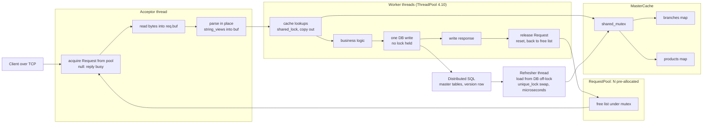

# Module 4.13: Pooled request model and a concurrent master-table cache

**Estimated hours:** 4

**What you will learn**

1. The pooled request model: a fixed set of pre-allocated `Request` objects handed out from a free list, so a server never allocates per request and its memory is bounded by design.
2. How to build a master-table cache that many threads read at once under `std::shared_mutex`, refreshed by swapping in a new table under a lock held for microseconds, or by publishing an immutable snapshot through a `shared_ptr`.
3. The hot-path rules (no allocation, no database call, no lock across I/O, copy out only what you need) and a measurement that shows why a cache hit beats a per-request join by orders of magnitude.

**Prerequisites:** [Module 4.12: Win32 synchronisation](module-12-win32-synchronisation.md). You also need `std::shared_mutex` from module 4.05, the object pool from module 2.12, the thread pool from 4.10 and the lock rules from 4.11.

---

## 1. One-line intuition

Keep a fixed rack of empty forms so no request has to wait for paper, and keep a copy of the reference tables on every clerk's desk so no request has to walk to the archive.

## 2. Real-life analogy

A loan desk at a branch.

- Every customer request is written on a **form**. Printing a fresh form per customer would be slow and, on a busy day, the printer runs out. So the desk keeps a **rack of 200 blank forms**. A clerk takes one, fills it, processes it, wipes it, and puts it back. If the rack is empty the customer is told "please wait" at the door, not halfway through. That is the **pooled request model**: 200 forms is the memory bound, "rack empty" is backpressure, and the wipe is `reset()`.
- Processing a loan needs reference data: which branch is this, what products exist, what is the interest rate for product PR117. The authoritative copy is in the **archive** (the database), a walk down the corridor and back, about a millisecond. Every request needs several of these lookups. So each desk keeps a **printed copy** of the reference tables. Looking something up is a glance. That is the **master-table cache**.
- Many clerks read the printed copy at once; no one needs to wait. Once an hour the back office prints a **new copy**, walks over, and swaps the binder on the desk in one motion. Clerks mid-glance finish their glance; the next glance sees the new binder. That is the **refresh under a short exclusive lock**. Nobody prints the new copy while holding the desk hostage; it is prepared **off to the side** first.
- The printed copy can be **stale** for up to an hour. For branch names and product rates that is fine. For an account balance it would not be. Knowing which tables may be cached is the design.

## 3. Why it exists: the problem it solves

A loan-origination request ("is this customer eligible for product X at branch Y?") needs the request's own data plus ten or twenty rows of **master data**: branches, products, schemes, document types, regions. Master data changes rarely (a new product once a month) and is read on every request.

Two things go wrong in a naive server:

1. **Per-request allocation.** Each request allocates a buffer, a parsed-fields object, some strings; each response frees them. At thousands of requests per second the allocator (module 3.05) becomes a contended, fragmenting hot spot, and memory use is unbounded: a burst of 50,000 requests allocates 50,000 of everything. Under overload the server does not degrade, it falls over, and the out-of-memory killer picks it.
2. **Per-request joins.** The query `SELECT ... FROM applications a JOIN branches b ON ... JOIN products p ON ...` fetches master rows from the database on every request. Each round trip to a distributed SQL cluster is typically 0.5 to 2 ms (module 0.01's latency table; module 7 for why distributed SQL adds hops). Twenty lookups is 10 to 40 ms of pure waiting. The CPU is idle, the threads are all blocked, throughput is capped by the database's round-trip time, not by the work.

The pooled request model fixes the first: allocate N request objects once, hand them out, bound memory to N, and reject at the door when none are free. The master-table cache fixes the second: keep the master rows in the server's memory, look them up in under a microsecond, and refresh them in the background. This module is the whole of the last bullet of resume claim H4 and the core of capstone C2. What breaks without it is the login-latency incident in claim H7 wearing a different hat: the hot path waiting on the database for data that has not changed since last Tuesday.

## 4. Three layers of depth

### Layer 1 (beginner): the two pieces

**The request object.** One struct holds everything about one in-flight request:

```cpp
struct Request {
    std::array<char, 4096> buf;   // raw bytes read from the socket
    std::size_t len;              // how many are valid
    std::uint32_t session_id;     // parsed fields
    std::string_view op, branch_code, product_code;   // point INTO buf
    std::chrono::steady_clock::time_point t_acquired, t_done;   // timing
    void reset();                 // wipe for reuse
};
```

The `string_view`s are the trick from module 2.12: parsing does not copy; it records where in `buf` each field starts and ends. No `std::string` is created on the hot path.

**The request pool.** A `std::vector<Request>` of N objects allocated once at start, plus a free list (`std::vector<Request*>`) under a mutex. `acquire()` pops a pointer or returns `nullptr` when the pool is empty; `release()` resets and pushes it back. An RAII `RequestLease` releases on scope exit so a request can never leak, exactly like the fd wrappers in tcpkv.

**The lifecycle:** acquire a request from the pool, read bytes from the socket into its buffer, parse fields in place, dispatch to a worker thread (module 4.10), the worker looks up master data in the cache and does the business logic, writes the response, releases the request. Section 5 draws it.

**The master-table cache.** A class holding one `std::unordered_map` per master table, guarded by one `std::shared_mutex`:

```cpp
class MasterCache {
    mutable std::shared_mutex mu_;
    std::unordered_map<std::string, BranchRow>  branches_;
    std::unordered_map<std::string, ProductRow> products_;
public:
    std::optional<BranchRow> branch(const std::string& code) const;   // shared_lock, copy out
    void publish(BranchMap fresh_b, ProductMap fresh_p, std::uint64_t version);  // unique_lock, swap
};
```

Readers take a `shared_lock` (module 4.05): any number at once. The refresher builds the new maps from the database **without holding the lock**, then takes a `unique_lock` only to `swap` the maps, which is a pointer exchange. Readers are blocked for microseconds per refresh, not for the milliseconds the database takes.

### Layer 2 (working engineer): the decisions

**Pool size and what "rack empty" means.** N requests in the pool means at most N requests in flight. That is a feature. Pick N from memory (N times `sizeof(Request)`, about 4 KB each here, so 1,000 requests is 4 MB) and from what the downstream can serve (the DB connection pool from module 6.12). When `acquire()` returns `nullptr`, the acceptor replies "busy, retry" immediately. The client gets a fast, honest answer instead of a slow timeout; the server never grows. This is the same backpressure idea as the bounded queue in 4.04 and the bounded pool in 4.10, applied at the front door.

**One free list under one mutex vs per-thread caches.** The free-list mutex is taken twice per request for a few nanoseconds; with a handful of acceptor threads it is uncontended and invisible. If a profile ever shows it (module 8.07), the next step is a per-thread cache of a few requests in front of the shared list, the same shape as glibc's tcache (module 3.05). Do not build that until measured.

**Two ways to refresh the cache.**

| | Variant A: swap under `shared_mutex` | Variant B: immutable snapshot via `shared_ptr` |
|---|---|---|
| Read path | `shared_lock`, find, copy out, unlock | `atomic_load` the `shared_ptr`, use the snapshot, drop it |
| Refresh | Build new maps off-lock; `unique_lock`; `swap`; unlock; destroy old maps off-lock | Build new `Snapshot`; `atomic_store` the pointer; old snapshot freed when the last reader drops it |
| Reader cost | Shared-lock acquire/release (an atomic RMW on the lock word each way) | One atomic `shared_ptr` copy (an atomic increment and decrement on the control block) |
| Consistency | Each lookup sees one table version; two lookups in one request may straddle a refresh | A request holds one snapshot: every lookup in it sees the same version |
| Writer blocking | Readers blocked for the swap, microseconds | Never blocked |
| Memory | Old maps freed right after the swap | Old snapshot lives until the slowest reader lets go |

Both are correct. Variant A is simpler to explain and is the resume's wording ("guarded by shared_mutex"). Variant B gives cross-lookup consistency within a request, which matters when a product's rate and its tenure limit must be from the same version. The app server used Variant A for most tables and Variant B for the few that had to be read together. Section 6 builds both.

**Invalidation: how does the cache learn the database changed?**

| Strategy | How | Staleness bound | Cost |
|---|---|---|---|
| TTL refresh | A background thread reloads every T seconds | T | One full load per T, even if nothing changed |
| Version counter | Each master table has a `version` row (or `max(updated_at)`); the thread polls it every few seconds and reloads only when it moved | Poll interval | One tiny query per poll; a full load only on change |
| Explicit refresh RPC | The admin tool that edits master data calls `RefreshMasters` on every server after commit | Near zero | Needs every server reachable; still keep a TTL as a safety net |
| Database notification | PostgreSQL `LISTEN/NOTIFY` (module 6.14), or a message queue (module 10.04) | Near zero | Infrastructure; connection must be kept alive |

The app server used version counters polled every 5 seconds with a 10-minute TTL as a backstop, and the master-data editing screen sent an explicit refresh. Staleness was therefore bounded at about 5 seconds and documented as such; the business owners agreed that a new product appearing 5 seconds late at a branch was acceptable. **That agreement is the answer to "how stale can the cache be"**: it is a business decision, written down, with the mechanism that enforces it.

**What may be cached.** Rows that change rarely and whose staleness is harmless: branches, products, schemes, codes, regions, document types, holidays. Never: balances, limits that are decremented, anything a transaction updates. The rule in the design document was "master tables only; if a row is written by a customer transaction, it is not master data".

**Hot-path rules.** These are the rules the request handler was reviewed against:

1. **No allocation.** The request buffer is pre-allocated; parsed fields are `string_view`s into it; cache lookups copy out small fixed-size rows (or hold a snapshot). If you need a `std::string`, it is a bug or a rare path.
2. **No database call.** Master data comes from the cache. The one unavoidable DB call (writing the application itself) happens after validation, once.
3. **No lock held across I/O.** From module 4.11. Read from the cache, release, then talk to the socket or the DB.
4. **Copy out only the fields you need.** A `BranchRow` copy of 50 bytes is nothing; holding the shared lock while formatting a response is not. The lock scope is the `find` and the copy.
5. **Measure.** Every one of these rules has a number behind it; section 8 produces yours.

### Layer 3 (internals): what happens underneath

**Why pooling beats `new`.** `new Request` for a 4 KB object goes to `malloc`, which takes an arena lock (or a tcache hit), finds a chunk, possibly splits it, returns it; `delete` does the reverse and may coalesce. Across threads, requests freed by a different thread than allocated them bounce chunks between arenas and fragment the heap (module 3.05). The pool's free list is a vector push and pop under a mutex that is held for about ten instructions. The memory stays in one contiguous block allocated at start, hot in the same pages and cache lines, never returned, never fragmented. The bound is explicit: N objects, no more.

**Why `shared_lock` is cheap but not free.** `std::shared_mutex` on Linux is `pthread_rwlock_t`. A shared acquire is an atomic read-modify-write on the lock word (increment the reader count, check no writer), and the release is another. On a lookup that costs 100 ns, two atomic RMWs on a cache line that every reader thread also touches can cost as much as the lookup itself when many cores hit it (module 4.08: the lock word's cache line bounces between cores). That is why the snapshot variant exists: its atomic operations are on the control block's reference count, which is also shared, but it is one pair per request rather than one pair per lookup. At the app server's load it did not matter; at 100,000 lookups per second per core it would. The benchmark in section 8 lets you see the shared-lock cost by comparing lookups-per-second with 1 thread and with all cores.

**Why swap, not rebuild in place.** Rebuilding the map under the unique lock would hold every reader for the whole database load, milliseconds or seconds. `std::unordered_map::swap` exchanges a few pointers and sizes: constant time, no allocation, cannot throw. The old map is destroyed **after** the unique lock is released, so freeing thousands of nodes does not happen under the lock either. The pattern "prepare off-lock, publish under a tiny lock, clean up off-lock" is the same one databases use to switch a page or a plan cache entry.

**What `std::atomic_load(&shared_ptr)` does.** In C++17 the free functions `std::atomic_load` and `std::atomic_store` on a `std::shared_ptr` make the pointer-plus-control-block pair readable and replaceable atomically. libstdc++ implements them with a small internal lock table keyed by address (not a lock-free operation, but short and uncontended). Readers then hold a `shared_ptr<const Snapshot>`: the snapshot cannot be destroyed under them because their reference keeps it alive. When the refresher stores a new pointer, the old snapshot's count drops to the readers still holding it, and it is freed by the last one, on their thread. C++20 adds `std::atomic<std::shared_ptr<T>>` as the typed form of the same thing.

**Where the time goes in the DB path.** A master-row lookup by primary key on a distributed SQL cluster is: serialise the query, write to the socket, kernel, network, the tablet leader's RocksDB lookup, network back, parse the result. The work is microseconds; the waiting is the round trip. A cache hit replaces all of it with a hash of the key, one or two cache-line reads in the bucket array and the node, and a copy. That is the ratio the benchmark shows: not 2 or 10 times, but hundreds to thousands.

## 5. Architecture diagram



Follow one request left to right: acquire, read, parse, dispatch, look up, logic, one write, respond, release. The only arrows to the database are the refresher's loads and the single application write.

## 6. Code

Three files in `~/course/cache-lab`: `request_pool.hpp`, `master_cache.hpp`, `cache_bench.cpp`. The headers go into `capstones/rpc-app-server/src/` when they pass.

### `request_pool.hpp`

```cpp
// request_pool.hpp -- pre-allocated Request objects handed out from a free list.
#pragma once
#include <array>
#include <chrono>
#include <cstddef>
#include <cstdint>
#include <mutex>
#include <string_view>
#include <vector>

namespace appsrv {

struct Request {
    std::array<char, 4096> buf{};              // raw bytes from the socket
    std::size_t len = 0;
    std::uint32_t session_id = 0;              // parsed fields...
    std::string_view op;                       // ...pointing into buf, no copies
    std::string_view branch_code;
    std::string_view product_code;
    std::chrono::steady_clock::time_point t_acquired{};
    std::chrono::steady_clock::time_point t_done{};

    void reset() {
        len = 0; session_id = 0;
        op = {}; branch_code = {}; product_code = {};
    }
};

class RequestPool {
public:
    explicit RequestPool(std::size_t n) : slots_(n) {   // one allocation, at start
        free_.reserve(n);
        for (Request& r : slots_) free_.push_back(&r);
    }
    RequestPool(const RequestPool&) = delete;
    RequestPool& operator=(const RequestPool&) = delete;

    // nullptr means "pool exhausted": the caller replies busy. No blocking.
    Request* acquire() {
        std::lock_guard<std::mutex> g(mu_);
        if (free_.empty()) { ++rejected_; return nullptr; }
        Request* r = free_.back();
        free_.pop_back();
        r->t_acquired = std::chrono::steady_clock::now();
        return r;
    }
    void release(Request* r) {
        r->reset();                                     // wipe outside the lock
        std::lock_guard<std::mutex> g(mu_);
        free_.push_back(r);
    }
    std::size_t capacity() const { return slots_.size(); }
    std::size_t rejected() const { std::lock_guard<std::mutex> g(mu_); return rejected_; }

private:
    std::vector<Request> slots_;                        // contiguous, never resized
    std::vector<Request*> free_;
    mutable std::mutex mu_;
    std::size_t rejected_ = 0;
};

// RAII lease: release on scope exit. Move-only, like tcpkv's fd wrapper.
class RequestLease {
public:
    RequestLease(RequestPool& pool, Request* r) : pool_(&pool), r_(r) {}
    ~RequestLease() { if (r_) pool_->release(r_); }
    RequestLease(RequestLease&& o) noexcept : pool_(o.pool_), r_(o.r_) { o.r_ = nullptr; }
    RequestLease& operator=(RequestLease&& o) noexcept {
        if (this != &o) {
            if (r_) pool_->release(r_);
            pool_ = o.pool_; r_ = o.r_; o.r_ = nullptr;
        }
        return *this;
    }
    RequestLease(const RequestLease&) = delete;
    RequestLease& operator=(const RequestLease&) = delete;

    explicit operator bool() const { return r_ != nullptr; }
    Request* operator->() { return r_; }
    Request& operator*() { return *r_; }

private:
    RequestPool* pool_;
    Request* r_;
};

}  // namespace appsrv
```

### `master_cache.hpp`

```cpp
// master_cache.hpp -- master-table cache, two variants.
#pragma once
#include <cstdint>
#include <memory>
#include <mutex>          // std::unique_lock
#include <optional>
#include <shared_mutex>
#include <string>
#include <unordered_map>
#include <utility>

namespace appsrv {

struct BranchRow  { std::string code; std::string name; int region = 0; };
struct ProductRow { std::string code; std::string name; double annual_rate = 0.0; int max_tenure_months = 0; };

using BranchMap  = std::unordered_map<std::string, BranchRow>;
using ProductMap = std::unordered_map<std::string, ProductRow>;

// Variant A: one shared_mutex; readers copy out; refresh swaps maps.
class MasterCache {
public:
    std::optional<BranchRow> branch(const std::string& code) const {
        std::shared_lock<std::shared_mutex> lk(mu_);
        auto it = branches_.find(code);
        if (it == branches_.end()) return std::nullopt;
        return it->second;                          // copy out; lock released on return
    }
    std::optional<ProductRow> product(const std::string& code) const {
        std::shared_lock<std::shared_mutex> lk(mu_);
        auto it = products_.find(code);
        if (it == products_.end()) return std::nullopt;
        return it->second;
    }
    std::uint64_t version() const {
        std::shared_lock<std::shared_mutex> lk(mu_);
        return version_;
    }

    // Refresher calls this with maps it built OFF-lock. The exclusive section
    // is three pointer swaps and an integer store.
    void publish(BranchMap fresh_branches, ProductMap fresh_products, std::uint64_t version) {
        {
            std::unique_lock<std::shared_mutex> lk(mu_);
            branches_.swap(fresh_branches);         // O(1)
            products_.swap(fresh_products);
            version_ = version;
        }
        // fresh_* now hold the OLD maps; destroyed here, after the lock is gone.
    }

private:
    mutable std::shared_mutex mu_;
    BranchMap branches_;
    ProductMap products_;
    std::uint64_t version_ = 0;
};

// Variant B: immutable snapshot published through an atomic shared_ptr.
// A request holds one snapshot for all its lookups: one consistent version.
struct Snapshot {
    BranchMap branches;
    ProductMap products;
    std::uint64_t version = 0;
};

class SnapshotCache {
public:
    SnapshotCache() : snap_(std::make_shared<Snapshot>()) {}
    std::shared_ptr<const Snapshot> get() const { return std::atomic_load(&snap_); }
    void publish(std::shared_ptr<const Snapshot> s) { std::atomic_store(&snap_, std::move(s)); }
private:
    std::shared_ptr<const Snapshot> snap_;
};

}  // namespace appsrv
```

### `cache_bench.cpp`

```cpp
// cache_bench.cpp -- per-request DB lookups vs cache hits, with a live refresher.
// usage: ./cache_bench <db|cache|snapshot> <threads> <requests-per-thread> [pool-size]
#include "master_cache.hpp"
#include "request_pool.hpp"
#include <atomic>
#include <chrono>
#include <cstdio>
#include <cstdlib>
#include <cstring>
#include <string>
#include <thread>
#include <vector>

using namespace appsrv;
using Clock = std::chrono::steady_clock;
using namespace std::chrono_literals;

// Stand-in for the database: every query costs a 1 ms round trip.
struct FakeDb {
    BranchMap branches;
    ProductMap products;

    FakeDb() {
        for (int i = 0; i < 500; ++i) {
            std::string c = "BR" + std::to_string(1000 + i);
            branches[c] = BranchRow{c, "Branch " + std::to_string(i), i % 7};
        }
        for (int i = 0; i < 50; ++i) {
            std::string c = "PR" + std::to_string(100 + i);
            products[c] = ProductRow{c, "Product " + std::to_string(i), 8.0 + i * 0.1, 12 * (i % 5 + 1)};
        }
    }
    std::optional<BranchRow> select_branch(const std::string& code) const {
        std::this_thread::sleep_for(1ms);
        auto it = branches.find(code);
        if (it == branches.end()) return std::nullopt;
        return it->second;
    }
    std::optional<ProductRow> select_product(const std::string& code) const {
        std::this_thread::sleep_for(1ms);
        auto it = products.find(code);
        if (it == products.end()) return std::nullopt;
        return it->second;
    }
    BranchMap  load_branches() const { std::this_thread::sleep_for(1ms); return branches; }
    ProductMap load_products() const { std::this_thread::sleep_for(1ms); return products; }
};

enum class Mode { Db, Cache, Snapshot };

// Parse "ELIG <session> <branch> <product>\n" in place: views into req.buf.
static void parse(Request& r) {
    std::string_view line(r.buf.data(), r.len);
    auto next = [&line]() {
        std::size_t sp = line.find(' ');
        std::string_view tok = line.substr(0, sp);
        line.remove_prefix(sp == std::string_view::npos ? line.size() : sp + 1);
        return tok;
    };
    r.op = next();
    std::uint32_t id = 0;                              // no std::string, no atoi
    for (char c : next()) id = id * 10 + static_cast<std::uint32_t>(c - '0');
    r.session_id = id;
    r.branch_code = next();
    std::string_view p = next();
    if (!p.empty() && p.back() == '\n') p.remove_suffix(1);
    r.product_code = p;
}

// One request: two master lookups, then a trivial "eligibility" computation.
static double handle(Request& r, Mode mode, const FakeDb& db,
                     const MasterCache& cache, const SnapshotCache& snaps) {
    std::string bcode(r.branch_code), pcode(r.product_code);   // keys for find (rare-path allocation; see Lab D)
    std::optional<BranchRow> b;
    std::optional<ProductRow> p;
    if (mode == Mode::Db) {
        b = db.select_branch(bcode);
        p = db.select_product(pcode);
    } else if (mode == Mode::Cache) {
        b = cache.branch(bcode);
        p = cache.product(pcode);
    } else {
        auto s = snaps.get();                      // one version for both lookups
        auto bi = s->branches.find(bcode);
        auto pi = s->products.find(pcode);
        if (bi != s->branches.end()) b = bi->second;
        if (pi != s->products.end()) p = pi->second;
    }
    if (!b || !p) return -1.0;
    return p->annual_rate + b->region * 0.01;       // stand-in for real logic
}

int main(int argc, char** argv) {
    if (argc < 4) { std::fprintf(stderr, "usage: %s db|cache|snapshot threads reqs [pool]\n", argv[0]); return 2; }
    Mode mode = std::strcmp(argv[1], "db") == 0 ? Mode::Db
              : std::strcmp(argv[1], "cache") == 0 ? Mode::Cache : Mode::Snapshot;
    const int threads = std::atoi(argv[2]);
    const int reqs = std::atoi(argv[3]);
    const std::size_t pool_size = argc > 4 ? std::strtoul(argv[4], nullptr, 10) : static_cast<std::size_t>(threads);

    FakeDb db;
    MasterCache cache;
    SnapshotCache snaps;
    RequestPool pool(pool_size);
    std::uint64_t version = 1;
    cache.publish(db.load_branches(), db.load_products(), version);
    {
        auto s = std::make_shared<Snapshot>();
        s->branches = db.branches; s->products = db.products; s->version = version;
        snaps.publish(std::move(s));
    }

    // Background refresher: rebuild off-lock, publish, every 50 ms.
    std::atomic<bool> stop{false};
    std::atomic<int> refreshes{0};
    std::thread refresher([&] {
        while (!stop.load()) {
            if (mode != Mode::Db) {
                ++version;
                cache.publish(db.load_branches(), db.load_products(), version);
                auto s = std::make_shared<Snapshot>();
                s->branches = db.branches; s->products = db.products; s->version = version;
                snaps.publish(std::move(s));
                ++refreshes;
            }
            std::this_thread::sleep_for(50ms);
        }
    });

    const char* line = "ELIG 42 BR1234 PR117\n";
    std::atomic<long long> total_ns{0};
    std::atomic<long long> handled{0};
    std::atomic<long long> rejected{0};
    std::vector<double> sinks(static_cast<std::size_t>(threads));   // one slot per thread: no race

    auto t0 = Clock::now();
    std::vector<std::thread> workers;
    for (int t = 0; t < threads; ++t) {
        workers.emplace_back([&, t] {
            long long ns = 0, n = 0, rej = 0;
            double local = 0;
            for (int i = 0; i < reqs; ++i) {
                RequestLease lease(pool, pool.acquire());
                if (!lease) { ++rej; continue; }     // busy: reply and move on
                std::memcpy(lease->buf.data(), line, std::strlen(line));
                lease->len = std::strlen(line);
                parse(*lease);
                local += handle(*lease, mode, db, cache, snaps);
                lease->t_done = Clock::now();
                ns += std::chrono::duration_cast<std::chrono::nanoseconds>(lease->t_done - lease->t_acquired).count();
                ++n;
            }                                        // lease released here
            total_ns += ns; handled += n; rejected += rej;
            sinks[static_cast<std::size_t>(t)] = local;   // keeps -O2 from deleting the work
        });
    }
    for (auto& w : workers) w.join();
    auto wall = std::chrono::duration_cast<std::chrono::microseconds>(Clock::now() - t0).count();
    stop = true;
    refresher.join();
    double sink = 0;
    for (double s : sinks) sink += s;

    const long long h = handled.load();
    std::printf("mode=%s threads=%d requests=%lld pool=%zu\n", argv[1], threads, h, pool_size);
    std::printf("wall %.1f ms, %.0f req/s, avg latency %.2f us, rejected %lld, refreshes %d, cache version %llu\n",
                wall / 1000.0, h * 1e6 / static_cast<double>(wall), (h ? total_ns.load() / 1000.0 / h : 0.0),
                rejected.load(), refreshes.load(), static_cast<unsigned long long>(cache.version()));
    return sink < -1e300 ? 1 : 0;
}
```

Compile and run three ways:

```bash
g++ -std=c++17 -O2 -Wall -Wextra -Werror -g -pthread -o cache_bench cache_bench.cpp
./cache_bench db 8 500
./cache_bench cache 8 200000
./cache_bench snapshot 8 200000
```

Expected output shape (numbers are from one laptop with 8 hardware threads and will differ on yours; the ratios are what matter):

```text
mode=db threads=8 requests=4000 pool=8
wall 1090.0 ms, 3670 req/s, avg latency 2170.00 us, rejected 0, refreshes 0, cache version 1
mode=cache threads=8 requests=1600000 pool=8
wall 430.0 ms, 3720000 req/s, avg latency 2.10 us, rejected 0, refreshes 9, cache version 10
mode=snapshot threads=8 requests=1600000 pool=8
wall 340.0 ms, 4700000 req/s, avg latency 1.60 us, rejected 0, refreshes 7, cache version 8
```

Read it: in `db` mode each request pays two simulated 1 ms round trips (a 1 ms `sleep_for` typically takes slightly more than 1 ms), so latency is a little over 2 ms and throughput is bounded by threads divided by 2 ms. In `cache` mode the same request takes a couple of microseconds, three orders of magnitude less, **while the refresher replaced the whole table several times during the run** and no request waited for it. `snapshot` is a little faster still because it takes one atomic pair per request instead of one per lookup, and every request saw one consistent version. Note that the `cache` run still has one allocation per request (the `std::string` keys in `handle`); Lab Part D removes it.

The `sink` return-value trick keeps `-O2` from optimising the work away; `sink < -1e300` is always false, so the exit code is 0.

## 7. Use case: core-banking loan-origination platform

The application server's "compute eligibility" RPC was the hottest call: every screen in the branch client invoked it. Its first version joined `applications` to `branches`, `products`, `schemes` and `regions` on each call. On the multi-node cluster, that was four to six network round trips, 5 to 12 ms per call, and the worker threads spent almost all their time blocked on the DB socket. Adding threads did not help; it added DB load.

**The decision it drove: master tables moved into an in-memory cache guarded by a `shared_mutex`, refreshed by a version-counter poll every 5 seconds with a TTL backstop, and the request objects were pooled with a fixed count equal to the DB connection pool.**

The cache removed the joins from the hot path: eligibility went from several milliseconds to the cost of the single `applications` read, and the DB cluster's load dropped because the master tables were no longer the most-read tables on it. The pooled requests removed per-request allocation from the profile and, more importantly, made overload behaviour predictable: when the pool was empty the server answered "busy" in microseconds and the client retried with back-off, instead of queueing until timeouts cascaded.

The decision had a cost that was written down: master data could be up to 5 seconds stale, a new product might not be offerable at a branch for 5 seconds after the back office created it, and the business signed off on that. The alternative, cache the application row too, was rejected because applications are written by the very requests being served; stale application state would produce wrong eligibility answers. "Master tables only" became the rule.

## 8. Lab

Work in `~/course/cache-lab` with the three files from section 6.

### Part A: the pool and backpressure (30 minutes)

1. Build and run `./cache_bench cache 8 100000 8`. Note `rejected 0`.
2. Run `./cache_bench cache 8 100000 4`: eight threads, four request objects. Expected: `rejected` is large (often a majority of attempts); the pool is doing its job of saying no instead of growing. Throughput of **handled** requests is similar, because the four slots are always busy.
3. Run `./cache_bench cache 8 100000 1000`. Expected: `rejected 0`, and memory use (watch `ps -o rss= -p $(pidof cache_bench)` in another terminal, or just reason: 1000 times about 4.2 KB) is about 4 MB more than with 8. That is the bound you can quote.
4. Write the pool size rule in your own words: in-flight bound, memory bound, matched to the DB connection pool.

### Part B: the measurement (30 minutes)

1. Run `db` with 1, 2, 4, 8 and 16 threads at 300 requests each. Record wall time and req/s. Expected: req/s scales almost linearly with threads, because every thread is asleep in the simulated round trip; the latency stays about 2 ms. This is the "add threads to hide DB latency" curve from module 4.10, and its ceiling is the real DB's capacity, which the fake does not model.
2. Run `cache` with 1, 2, 4, 8 and 16 threads at 200,000 each. Expected: req/s rises with threads but not linearly, and per-request latency rises a little as more cores hit the `shared_mutex`'s cache line. Note the point where it flattens.
3. Run `snapshot` with the same thread counts. Expected: slightly higher throughput than `cache` at high thread counts, because each request does one atomic pair instead of two shared-lock pairs.
4. Compute the ratio of `db` latency to `cache` latency at 8 threads. On one laptop it is roughly a thousand. Yours is the number you will say in the interview.

### Part C: watch a refresh not block readers (20 minutes)

1. In `cache_bench.cpp`, change the refresher's sleep from `50ms` to `1ms` so it refreshes as fast as the fake DB allows (about every 3 ms). Run `cache 8 200000`. Expected: `refreshes` is over a hundred for a run of a few hundred milliseconds, `cache version` equals `refreshes + 1`, and throughput drops only slightly. Readers were blocked only for the swap.
2. Now break it on purpose: in `MasterCache::publish`, move the two `load_*` calls **inside** the `unique_lock` by changing the refresher to call a new `publish_slow` that takes the lock and then calls `db.load_branches()` and `db.load_products()` while holding it. Run again. Expected: throughput collapses, because every refresh holds all readers for 2 ms. This is the 4.11 incident (a lock held across I/O) in miniature. Revert.
3. Under TSan: `g++ -std=c++17 -O1 -g -fsanitize=thread -pthread -o cache_bench_tsan cache_bench.cpp && ./cache_bench_tsan snapshot 4 20000`. Expected: no warnings. (If TSan aborts at startup with `unexpected memory mapping` on WSL2, run the binary as `setarch x86_64 -R ./cache_bench_tsan ...`, which turns off address randomisation for that process; it is a known clash between the sanitizer's shadow layout and newer kernels' ASLR, not a bug in your code.) `std::atomic_load` on the `shared_ptr` and the `shared_mutex` are both instrumented; if you had published the snapshot with a plain assignment, TSan would report a race on `snap_`. Try that too (change `atomic_store` to `snap_ = std::move(s)` and `atomic_load` to `return snap_`), see the report, and put it back.

### Part D: remove the last allocation from the hot path (30 minutes)

`handle` builds two `std::string` keys because `std::unordered_map<std::string, ...>::find` takes a `std::string`. That is one or two heap allocations per request (short keys may fit the small-string buffer; measure, do not guess).

1. Change the maps to use a fixed-size key: `std::array<char, 8>` padded with zeros, with a small hash functor, or store keys as `std::uint64_t` built from the 6 to 7 code characters. Update `FakeDb`, `MasterCache`, `Snapshot` and `handle` so that lookups take a `std::string_view` and never construct a `std::string`.
2. Verify with Valgrind's allocation counter: `valgrind --tool=memcheck ./cache_bench cache 2 20000` before and after, and compare `total heap usage: N allocs`. Expected: before, about two allocations per request on top of a fixed baseline (or close to zero if the small-string optimisation absorbed them; record what you see); after, the count no longer grows with the request count.
3. Re-run Part B step 2 and note any throughput change. On a laptop the change is often small; the point is that the hot path now has **zero** allocations, which is a sentence you can defend with the Valgrind count.

### Journal

Copy [journal/TEMPLATE.md](../journal/TEMPLATE.md) to `journal/YYYY-MM-DD-pooled-requests-and-master-cache.md`. Record: the rejected count with a pool of 4; the five-point `db`, `cache` and `snapshot` curves and the db-to-cache latency ratio at 8 threads; the throughput with the refresher at 1 ms and with the deliberately slow `publish`; the TSan report from the plain-assignment snapshot; and the Valgrind allocation counts before and after Part D. Copy the passing headers into `capstones/rpc-app-server/src/`. This entry is the core of your H4 interview story.

## 9. Common mistakes and misconceptions

| Mistake | Why it is wrong | Bug it causes later |
|---|---|---|
| Caching rows that transactions write (balances, limits) | Stale reads become wrong business decisions | Eligibility approved on an old balance |
| Rebuilding the map under the `unique_lock` | Readers blocked for the whole DB load | Latency spikes every refresh; the 4.11 incident |
| Returning a reference or iterator into the cached map | It dangles after the next swap | Use-after-free that appears only during a refresh |
| Holding the `shared_lock` while formatting the response or writing the socket | Readers do not block each other, but the writer waits for every one of them | Refresh takes seconds under load; or deadlock if the write path takes another lock |
| Unbounded request allocation "because it is simpler" | Overload grows memory until the OOM killer | The server dies exactly when the branch is busiest |
| Pool exhausted means "block until free" | Blocking at the acceptor stalls every new connection | Cascade: clients time out, retry, and make it worse; reject fast instead |
| Forgetting `reset()` on release | Stale `string_view`s point at old bytes | A request sees the previous request's branch code |
| `std::string` keys on the hot path | Allocation per lookup | Allocator contention at high load (Part D) |
| "The cache is always right" | It is at most T seconds stale by design | No documented staleness bound; surprised business users |
| Plain assignment of the `shared_ptr` snapshot | Data race on the pointer | Torn pointer, crash under TSan or in production |

## 10. Resume link

- **Claim H4, "... pooled request model ... in-memory master-table cache that removes joins from the hot path".** Say: "Requests were pre-allocated objects from a fixed pool, acquired at accept and released by RAII, so there was no per-request allocation and in-flight requests were bounded; exhaustion returned busy at the door. Master tables lived in an in-memory cache behind a `shared_mutex`: readers took a shared lock and copied out, the refresher built new maps off-lock and swapped them under an exclusive lock held for microseconds, driven by a version counter polled every 5 seconds with a TTL backstop. I measured per-request latency going from about 2 ms with per-request lookups to about a microsecond with cache hits."
- **Claim C, "shared_mutex".** The reader/writer pattern and its cost under many cores (Layer 3), and the snapshot alternative when consistency across lookups matters.
- **Claim B, "memory and ownership design, performance optimisation".** Zero allocations on the hot path, proven with a Valgrind allocation count; `string_view` fields into a pre-allocated buffer; the RAII lease.
- **Claim H7** (login latency): the same cache removed master-table reads from login's hot path before the index work finished the job on the remaining query.

The interviewer's follow-ups, with the answers you now own:

- **"How stale can the cache be?"** Bounded by the poll interval (5 s) plus the TTL backstop; agreed with the business for master data; never used for transactional rows. Variant B gives a consistent version within one request.
- **"What if a master row is updated mid-request?"** With the swap variant, each lookup sees one version but two lookups may straddle a refresh; where that mattered (rate and tenure of one product) we read them from one snapshot (`shared_ptr<const Snapshot>`), so a request sees one version end to end. The row's own update is in the DB transaction; the cache only lags.
- **"What is the memory bound of the cache?"** Sum of the master tables, a few thousand rows of under 100 bytes each, so single-digit megabytes, plus one extra copy during a refresh (old and new coexist for microseconds, or until the slowest reader drops the snapshot). The request pool is N times about 4 KB. Both are fixed at startup and quoted in the capacity document.
- **"Why not Redis?"** A network hop to Redis is still a network hop, tens of microseconds at best; in-process memory is under a microsecond and has no failure mode. Redis is the right answer when many server processes must share one cache or the data does not fit (module 6.14).

## 11. Interview questions

**Q1 (easy). What is a pooled request model and why use one?**

<details>
<summary>Model answer</summary>

A fixed number of request objects, each with its buffer and parsed-field slots, are allocated once at startup and kept on a free list. Accepting a request takes one from the list; finishing it resets and returns it. No allocation happens per request, so the allocator is off the hot path and the heap does not fragment, and the number in flight is bounded by the pool size, so memory is bounded by design. When the pool is empty the server answers "busy" immediately instead of growing without limit, which is how it degrades gracefully under overload.

</details>

**Q2 (easy). How do readers and the refresher share the master-table cache without blocking each other?**

<details>
<summary>Model answer</summary>

The cache is guarded by a `std::shared_mutex`. Readers take a shared lock, which any number of threads can hold at once, find the row, copy it out, and release. The refresher builds the new maps from the database with no lock held, then takes the exclusive lock only to swap the old and new maps, which is a constant-time pointer exchange, and releases; the old maps are destroyed after the lock is released. Readers are therefore blocked for microseconds per refresh, never for the duration of a database load.

</details>

**Q3 (medium). What must never be cached this way, and how do you bound staleness for what is?**

<details>
<summary>Model answer</summary>

Anything written by the transactions being served: balances, limits, application state. A stale read there changes a business outcome. Master data, meaning reference tables that change rarely through an administrative path, is safe. Staleness is bounded by the refresh mechanism: a version counter on each master table polled every few seconds triggers a reload only when it changes, a TTL forces a reload as a backstop, and an explicit refresh RPC from the admin tool makes most changes visible almost immediately. The bound (for us, about 5 seconds) is written down and agreed with the business owners, so "how stale" has a number, not a shrug.

</details>

**Q4 (medium). Compare the swap-under-`shared_mutex` design with publishing an immutable snapshot through a `shared_ptr`.**

<details>
<summary>Model answer</summary>

Swap: readers pay a shared-lock acquire and release per lookup, which is two atomic read-modify-writes on a lock word shared by all cores; the writer blocks readers for the swap only; old data is freed immediately; each lookup sees one version but two lookups in one request can straddle a refresh. Snapshot: readers do one atomic `shared_ptr` load per request and then read with no lock at all; the writer never blocks anyone; every lookup within the request sees the same version; the old snapshot lives until the slowest reader releases it, so memory briefly holds two copies. Snapshot wins when lookups per request are many, cores are many, or cross-lookup consistency matters; swap is simpler and fine at moderate load. I used swap for most tables and a snapshot where rate and tenure limit of one product had to be read together.

</details>

**Q5 (hard). Design the hot path of an RPC handler so that it does no allocation, no database reads and holds no lock across I/O, and explain how you would prove each property.**

<details>
<summary>Model answer</summary>

Accept into a pre-allocated `Request` from the pool with a fixed buffer; parse in place into `string_view`s; dispatch to a fixed worker pool. The worker looks up master rows in the in-process cache, either copying out small fixed-size rows under a shared lock or holding one immutable snapshot for the request, then runs the logic, performs the single database write the request exists for, formats the response into the request's buffer, and releases the lease. Keys are fixed-size or integer so lookups need no `std::string`. Proof of no allocation: run the server under Valgrind or with a counting allocator hook and show the allocation count does not grow with requests; proof of no database reads on the path: the only DB client call sites are the refresher and the write, enforced by code review and a grep in CI; proof of no lock across I/O: the lock-ordering document and a debug-build assertion in the socket and DB layers that no sync-layer lock is held when they are entered, plus TSan clean runs. And the measurement: per-request latency about a microsecond on the cache path versus milliseconds on the join path, from my benchmark.

</details>

## 12. Revision

- Pooled requests: N pre-allocated `Request` objects on a free list under a mutex, RAII lease, `reset()` on release, `nullptr` means reply busy; memory and in-flight count are bounded by design.
- Master-table cache: `shared_mutex`, readers shared-lock and copy out, the refresher builds off-lock and swaps under a microsecond exclusive lock; or publish an immutable snapshot via `std::atomic_load`/`atomic_store` on a `shared_ptr` for one consistent version per request; invalidate by version-counter poll plus TTL plus explicit refresh; master tables only.
- Hot-path rules: no allocation, no DB call, no lock across I/O, copy out only what you need; measured on one laptop at roughly a thousand to one between a per-request lookup and a cache hit.

---

Previous: [Module 4.12: Win32 synchronisation](module-12-win32-synchronisation.md) | Next: [Module 5.01: How the internet works](../phase-05-networking-and-servers/module-01-how-the-internet-works.md)
