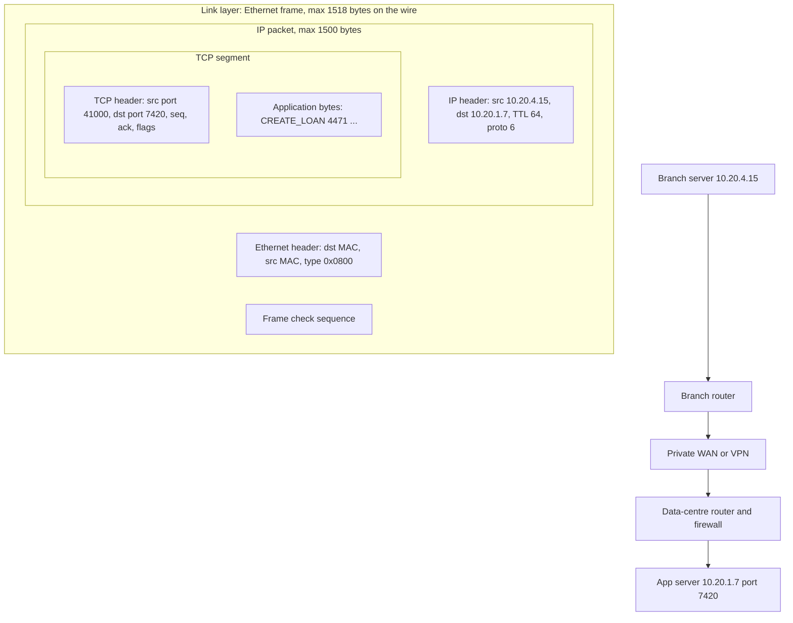

# Module 5.01: How the internet works

**Estimated hours:** 3

**What you will learn**

1. The layered model (link, IP, transport, application) and how one packet is a set of nested envelopes.
2. What an IP address, a port, a route, a DNS name and a NAT box each do, and the Linux commands that show them.
3. How a branch server reaches a central application server, and why a server behind NAT cannot be reached from outside without port forwarding.

**Prerequisites:** [Module 4.13: Pooled request model and a concurrent master-table cache](../phase-04-concurrency-deep-dive/module-13-pooled-request-model-and-concurrent-cache.md). You should also remember file descriptors from module 0.02 and endianness from module 1.02.

---

## 1. One-line intuition

The internet is a postal system for small envelopes: every envelope carries a destination address, every post office only knows which neighbour to hand it to next, and nobody promises the envelope will arrive.

## 2. Real-life analogy

Think of sending a letter from a bank branch in Chennai to head office in Mumbai.

- **The letter** is the **application data**: "create loan application 4471".
- You put it in an **inner envelope** marked "for the loans desk, room 7420". The room number is the **port**. The inner envelope is the **transport layer** (TCP or UDP).
- You put that inside an **outer envelope** with the street address of head office. The street address is the **IP address**. The outer envelope is the **IP layer**.
- The postman puts the outer envelope in a **mail bag** addressed to the next sorting office only. The bag is the **link layer** (Ethernet or Wi-Fi frame). The bag is emptied and repacked at every sorting office; the outer envelope is not.
- Each **sorting office** is a **router**. It reads only the outer envelope, looks up "Mumbai" in its table, and hands the letter to the next office in that direction. It never opens the inner envelope.
- The **phone book** that turns "Head Office, Mumbai" into a street address is **DNS**.
- The **mail room** at head office that gives every employee one shared public address, and keeps a notebook of who is expecting which reply, is **NAT**.
- The postal service may lose a letter, deliver two copies, or deliver them out of order. That is **IP**: best effort. Getting a reliable, in-order conversation out of that unreliable service is **TCP**'s job, which is module 5.02.

## 3. Why it exists: the problem it solves

In the 1960s each network was built by one vendor and only talked to itself. Connecting two of them meant building a custom bridge for every pair. The internet's design (Cerf and Kahn, 1974, then TCP/IP in the 1980s) solved this with two ideas:

1. **One common envelope format, IP.** Any network that can carry an IP packet can join. The network underneath can be copper, fibre, Wi-Fi, 4G or a satellite link. Nobody at the edges needs to know.
2. **Dumb middle, smart edges.** Routers only forward. They keep no record of conversations. All the hard work (reliability, ordering, retries) is done by the two endpoints. This is why a router can be cheap and fast and why the network survives when any router dies: the others just route around it.

What breaks without layering: every application would have to know about every kind of cable. Every router would have to understand every application. Nothing would scale. With layering, your loan-origination server speaks only to "a reliable byte stream to 10.20.4.15 port 7420" and the rest is somebody else's problem.

## 4. Three layers of depth

### Layer 1 (beginner): the four layers and the words you need

| Layer | What it moves | Address used | Examples | Who looks at it |
|---|---|---|---|---|
| Application | Messages that mean something to a program | Hostnames, URLs, your own protocol | HTTP, DNS, tcpkv's text protocol | Your program |
| Transport | A conversation between two programs | Port number | TCP, UDP | The two endpoints' kernels |
| Internet (IP) | A packet between two machines anywhere | IP address | IPv4, IPv6, ICMP | Every router on the path |
| Link | A frame between two machines on the same cable or Wi-Fi | MAC address (48-bit hardware id) | Ethernet, Wi-Fi | The next hop only |

Each layer wraps the one above it. This is called **encapsulation**. On the wire a single packet looks like this:

```text
| Ethernet header 14 B | IP header 20 B | TCP header 20 B | your bytes ... | Ethernet trailer 4 B |
                       |<-------------------- IP packet, max 1500 B ------------------>|
                                       |<---------- TCP segment ---------->|
```

**IP address.** A number that identifies one network interface. **IPv4** addresses are 32 bits, written as four decimal numbers 0 to 255: `10.20.4.15`. There are only about 4 billion of them, which ran out around 2011. **IPv6** addresses are 128 bits, written in hex groups: `2001:db8::1`. IPv6 is live on most phone networks and big websites, but inside banks and most companies IPv4 with private ranges is still what you meet every day. This course uses IPv4 unless it says otherwise.

**Special addresses you must recognise.**

| Address | Meaning |
|---|---|
| `127.0.0.1` (any `127.x.x.x`) | **Loopback**: this machine talking to itself. Never leaves the computer. IPv6: `::1`. The name `localhost` maps to it. |
| `0.0.0.0` | For a server: "listen on every interface this machine has". Not a real destination. |
| `10.0.0.0/8`, `172.16.0.0/12`, `192.168.0.0/16` | **Private** ranges. Used inside homes, offices and banks. Not routable on the public internet. |
| `8.8.8.8`, `1.1.1.1` | Public DNS servers run by Google and Cloudflare. Handy for testing connectivity. |

**CIDR notation.** `10.20.4.0/24` means "the first 24 bits are the network part, the rest is the host part". A `/24` holds 256 addresses (`10.20.4.0` to `10.20.4.255`). A `/16` holds 65,536. A `/32` is exactly one address. The slash number is the **prefix length**, and the equivalent **subnet mask** for `/24` is `255.255.255.0`.

**Port.** A 16-bit number, 0 to 65535, that says *which program* on a machine a segment is for. One machine has one IP address (per interface) but hundreds of programs. Ports below 1024 are "well-known" (22 SSH, 53 DNS, 80 HTTP, 443 HTTPS, 5432 PostgreSQL) and on Linux need root to listen on. A server picks a fixed port. A client is given a temporary **ephemeral** port by the kernel; on Linux the range is typically 32768 to 60999 (`sysctl net.ipv4.ip_local_port_range`).

**The 5-tuple.** A TCP or UDP connection is identified by exactly five values: protocol, source IP, source port, destination IP, destination port. Two connections from the same laptop to the same server differ only in source port. Every firewall rule, every NAT table entry and every `ss` line is really a 5-tuple.

**DNS.** The **Domain Name System** turns names like `example.com` into addresses. Humans use names; packets carry addresses. The program that asks is a **stub resolver** (the `getaddrinfo` function in your program). It asks a **recursive resolver** (listed in `/etc/resolv.conf`), which chases the answer across the internet and caches it for a **TTL** (time to live, in seconds).

**NAT.** **Network Address Translation**. A box (your home router, the bank's internet gateway, and Windows in front of WSL2) that lets many private addresses share one public address by rewriting the source address and port of outgoing packets and remembering the mapping to rewrite the replies back.

### Layer 2 (working engineer): routing, MTU, DNS records and NAT in practice

**How a packet finds its way: the routing table.** Every machine, not only routers, has one. Run `ip route` in WSL2 and you typically see something like:

```text
default via 172.20.0.1 dev eth0 proto kernel
172.20.0.0/20 dev eth0 proto kernel scope link src 172.20.5.123
```

Read it as two rules. Rule 2: "anything in `172.20.0.0/20` is on my own cable (`scope link`), send it directly via `eth0`". Rule 1: "everything else (`default`), hand it to `172.20.0.1`, the **default gateway**". The kernel picks the rule with the **longest matching prefix**. A `/20` beats `/0`. A router is just a machine with several interfaces and a longer table. The big routers at an internet exchange hold close to a million prefixes.

**TTL and traceroute.** The IP header has an 8-bit **TTL** (time to live) field, really a hop count. Every router subtracts 1 and drops the packet when it reaches 0, sending back an ICMP "time exceeded" message. This stops a routing loop from circulating a packet forever. `traceroute` abuses this on purpose: it sends a packet with TTL 1, then 2, then 3, and records who sends the "time exceeded" each time. That list is the path.

**MTU.** The **maximum transmission unit** is the largest IP packet a link will carry. Ethernet's is 1500 bytes. Loopback's is 65536. Subtract 20 bytes of IP header and 20 of TCP header and you get the **MSS** (maximum segment size) of 1460 bytes: the most application data one Ethernet-sized TCP segment can carry. A packet bigger than the MTU is either fragmented (IPv4, slow and fragile) or dropped with an ICMP "fragmentation needed" (if the "don't fragment" bit is set, which TCP does). A misconfigured VPN that silently drops those ICMP messages produces the classic symptom "small requests work, large responses hang". You will see this in section 7.

**DNS record types you will meet.**

| Type | Maps | Example |
|---|---|---|
| A | name to IPv4 address | `example.com. 300 IN A 93.184.215.14` |
| AAAA | name to IPv6 address | `example.com. 300 IN AAAA 2606:2800:...` |
| CNAME | name to another name (an alias) | `www.bank.example. IN CNAME web-lb.bank.example.` |
| NS | which servers are authoritative for a zone | `example.com. IN NS a.iana-servers.net.` |
| MX | mail servers | not used in this course |

The number (300 above) is the TTL in seconds. A resolver may answer from cache until it expires. This is why changing a server's address "takes time to propagate": caches around the world are waiting for TTLs to run out. Before DNS is even asked, the C library consults `/etc/hosts` (a plain text file of name-address pairs) because `/etc/nsswitch.conf` says `hosts: files dns`. That is where `localhost` comes from.

**Where the resolver lives.** On a normal Ubuntu 24.04 desktop `/etc/resolv.conf` points at `127.0.0.53`, a local caching service called `systemd-resolved`. Inside WSL2 the file is generated by WSL and points at an address on the Windows side (typically `10.255.255.254` or the `172.x.x.1` gateway); Windows forwards your queries to whatever DNS your Wi-Fi gave it.

**NAT in detail.** Say your WSL2 machine `172.20.5.123` sends a packet from port 41000 to `1.1.1.1` port 53. The NAT box (Windows, then your home router) rewrites the source to its own public address and a port it chooses, say `203.0.113.7:20017`, and writes a row in its **connection tracking table**: `172.20.5.123:41000 <-> 203.0.113.7:20017 <-> 1.1.1.1:53`. When the reply comes back to `203.0.113.7:20017`, the row tells the box where to deliver it. An unsolicited packet arriving at `203.0.113.7:7420` matches no row, so it is dropped. That is why a server behind NAT is unreachable from outside. **Port forwarding** is a hand-written permanent row: "anything arriving on public port 7420 goes to `172.20.5.123:7420`". On Linux the conntrack table is what `conntrack -L` prints; the rows expire after a timeout, and a table that fills up (`nf_conntrack: table full, dropping packet` in the kernel log) is a real production outage.

**The commands you will use for the rest of the course.**

| Command | Shows |
|---|---|
| `ip addr` | Your interfaces and their addresses |
| `ip route` | The routing table |
| `ip link show eth0` | Link state and MTU |
| `ss -tulpn` | Listening TCP (`t`) and UDP (`u`) sockets, numeric (`n`), with the owning process (`p`) |
| `ss -tan` | All TCP connections and their states |
| `ping -c 3 host` | Is the IP layer reachable; round-trip time |
| `traceroute -n host` | The hop-by-hop path |
| `dig name` | Ask DNS and show the raw answer |
| `cat /etc/resolv.conf` | Which resolver you are using |
| `sudo tcpdump -i lo -n port 5555` | Watch packets on an interface |

### Layer 3 (internals): what the kernel does with one outgoing packet

Take `send(fd, "PING\n", 5, 0)` on a connected TCP socket. From module 0.02 you know this becomes a system call. Inside the kernel:

1. **Transport.** The TCP code copies the 5 bytes into the socket's **send buffer** (module 5.04) and, if allowed by the window rules in module 5.02, builds a TCP segment: a 20-byte header with source port, destination port, sequence number, acknowledgement number, flags, window, checksum, then the data.
2. **Network.** The IP code looks up the destination address in the routing table (the FIB, forwarding information base, a trie keyed by prefix). The result is an output interface and a next hop. It prepends a 20-byte IPv4 header: version 4, header length, total length, an identification number, flags including "don't fragment", TTL (Linux default 64), protocol 6 for TCP, header checksum, source address, destination address.
3. **Neighbour lookup.** The next hop is an IP address, but the cable understands only MAC addresses. The kernel checks its **ARP cache** (`ip neigh`). If the next hop is missing it broadcasts "who has 172.20.0.1?" and waits for the answer. That is why the first packet to a new neighbour is sometimes a millisecond slower.
4. **Link.** The Ethernet header is prepended: destination MAC, source MAC, type `0x0800` (IPv4). The frame is placed in the network card's **transmit ring**, a circular buffer of descriptors in RAM. The card is told "new work" by writing to one of its registers, it fetches the frame by DMA (direct memory access, without the CPU copying) and puts it on the wire.
5. **Receive side.** The card at the other end DMAs the frame into a receive ring and raises an interrupt. The kernel's NAPI poll loop pulls frames off the ring, strips the Ethernet header, checks the IP checksum and destination, then hands the segment to TCP, which finds the matching socket by hashing the 5-tuple, appends the data to that socket's **receive buffer**, and wakes up any thread blocked in `recv`. On loopback steps 4 and 5 happen in software with no card at all, which is why `127.0.0.1` is so fast (typically tens of microseconds round trip).

Every router between the two cards does steps 2 to 4 again for its own next hop, decrementing the TTL and recomputing the IP header checksum. It never reads the TCP header. It never reads your bytes. A NAT box is the one exception: it rewrites addresses and ports, so it must read and fix up the transport header and both checksums.

## 5. Architecture diagram



The top box is one packet drawn as nested envelopes. Only the outermost (Ethernet) envelope changes at each hop. The IP header changes only its TTL and checksum. The TCP header and your bytes arrive exactly as sent.

## 6. Code

Install the tools this phase needs first:

```bash
sudo apt update
sudo apt install -y netcat-openbsd tcpdump iproute2 dnsutils traceroute
```

The program below does what every client does before connecting: it turns a name and a port into a list of addresses using `getaddrinfo`, the standard POSIX resolver call. It works for IPv4 and IPv6, reads `/etc/hosts` and DNS, and is the first function in every socket program you write from now on.

```c
/* resolve.c
 * Turn a host name and port into socket addresses with getaddrinfo,
 * and print each one in human-readable form.
 */
#include <arpa/inet.h>     /* inet_ntop: binary address -> text */
#include <netdb.h>         /* getaddrinfo, gai_strerror */
#include <stdio.h>
#include <string.h>
#include <sys/socket.h>

int main(int argc, char **argv) {
    if (argc < 2) {
        fprintf(stderr, "usage: %s hostname [port]\n", argv[0]);
        return 2;
    }
    const char *host = argv[1];
    const char *port = (argc > 2) ? argv[2] : "80";

    /* hints tell the resolver what kind of answers we want. */
    struct addrinfo hints;
    memset(&hints, 0, sizeof hints);
    hints.ai_family   = AF_UNSPEC;    /* IPv4 or IPv6, whichever exists */
    hints.ai_socktype = SOCK_STREAM;  /* TCP; without this each address is listed 3 times */

    struct addrinfo *res = NULL;
    int rc = getaddrinfo(host, port, &hints, &res);
    if (rc != 0) {
        /* getaddrinfo does NOT use errno; it has its own error strings. */
        fprintf(stderr, "getaddrinfo(%s): %s\n", host, gai_strerror(rc));
        return 1;
    }

    int count = 0;
    for (struct addrinfo *p = res; p != NULL; p = p->ai_next) {
        char text[INET6_ADDRSTRLEN];   /* big enough for the longest IPv6 text */
        if (p->ai_family == AF_INET) {
            struct sockaddr_in *a = (struct sockaddr_in *)p->ai_addr;
            inet_ntop(AF_INET, &a->sin_addr, text, sizeof text);
            printf("IPv4  %-40s port %u\n", text, ntohs(a->sin_port));
        } else if (p->ai_family == AF_INET6) {
            struct sockaddr_in6 *a = (struct sockaddr_in6 *)p->ai_addr;
            inet_ntop(AF_INET6, &a->sin6_addr, text, sizeof text);
            printf("IPv6  %-40s port %u\n", text, ntohs(a->sin6_port));
        }
        ++count;
    }
    printf("%d address(es) for %s\n", count, host);

    freeaddrinfo(res);   /* the list was malloc'ed by the library; give it back */
    return 0;
}
```

Compile and run:

```bash
gcc -std=gnu17 -Wall -Wextra -Werror -g -o resolve resolve.c
./resolve localhost 5555
./resolve nosuchhost.invalid
./resolve example.com 443
```

Expected output for the first two (the order of the two `localhost` lines may be swapped on your machine):

```text
IPv6  ::1                                      port 5555
IPv4  127.0.0.1                                port 5555
2 address(es) for localhost
getaddrinfo(nosuchhost.invalid): Name or service not known
```

For `example.com` you will see one or more `IPv6` lines and one or more `IPv4` lines. The exact addresses change from time to time, so compare them with `dig example.com A` and `dig example.com AAAA` instead of with this page. Two things to notice: `localhost` came from `/etc/hosts` with no network traffic at all, and `sin_port` had to be converted with `ntohs` because the kernel keeps ports in **network byte order** (big-endian, module 1.02) while your CPU is little-endian. Module 5.03 makes this a habit.

## 7. Use case: core-banking loan-origination platform

The application server from claim H4 sits in the bank's data centre at a fixed private address, say `10.20.1.7`, listening on a fixed port, say `7420`. Around 400 branch servers on `10.20.x.0/24` subnets reach it over a private WAN (leased lines) with an IPsec VPN as backup. Nothing is on the public internet. Three decisions came straight from this module:

- **A fixed IP and port, published in branch configuration, instead of DNS names.** The branch sites had unreliable DNS (a resolver at head office over the same WAN that might be down). A hard-coded address with a documented change procedure removed one dependency from the login path. Trade-off: moving the server meant touching 400 config files, which is why the later design put a DNS name with a 60-second TTL in front and kept the IP as a fallback.
- **Firewall rules written as 5-tuples.** The data-centre firewall allowed `TCP from 10.20.0.0/16 any-port to 10.20.1.7 port 7420` and nothing else inbound to that host. When a new branch subnet was added and "could not connect", the first check was the 5-tuple against the rule, not the application. Nine times out of ten that was the bug.
- **Nobody could reach a branch server from the data centre.** Each branch was behind its own NAT router. The server therefore never called branches; branches always connected in and kept the connection open (which is why keepalive, module 5.04, mattered). An attempt to add "push notifications from head office to branch" died on exactly this point until port forwarding was configured at every site, and the design was changed to long-lived branch-initiated connections instead.

One incident worth telling an interviewer: after a VPN upgrade, logins worked but any loan search returning more than a screen of rows hung. Small packets fit under the VPN's reduced MTU (about 1400 bytes); full 1500-byte segments were dropped, and the "fragmentation needed" ICMP messages were blocked by a firewall rule. The fix was clamping the MSS on the VPN gateway. The diagnosis started with `ping -M do -s 1472` failing where `-s 1300` succeeded.

## 8. Lab

Install the tools from section 6 first. Keep two WSL2 terminals open.

### Part A: your own addresses and routes (20 minutes)

1. Run `ip addr`. Find `lo` with `127.0.0.1/8` and `::1/128`, and `eth0` with a `172.x.x.x/20` or similar address. Write down the `eth0` address and prefix length. That `/20` means your WSL2 "LAN" has 4096 addresses.
2. Run `ip route`. Identify the default gateway. Confirm its address falls inside the prefix from step 1 (it must, or you could not reach it).
3. Run `ip link show eth0` and `ip link show lo`. Write down both MTUs. Expected: 1500 and 65536.
4. Run `ping -c 3 127.0.0.1` and `ping -c 3 1.1.1.1`. Note the `time=` on each. Expected: loopback well under 0.1 ms; the internet address typically 5 to 50 ms depending on your connection. That gap is the latency table from module 0.01 made visible.
5. Run `ip neigh`. You should see your gateway with a MAC address and state `REACHABLE` or `STALE`. That is the ARP cache from Layer 3.

### Part B: MTU and the path (20 minutes)

1. Run `ping -M do -s 1472 -c 2 1.1.1.1`. `-M do` sets the don't-fragment bit; 1472 bytes of data plus 8 bytes ICMP header plus 20 bytes IP header is exactly 1500.
2. Run `ping -M do -s 1473 -c 2 1.1.1.1`. Expected: `ping: local error: message too long, mtu=1500` or similar. The kernel refused to send a 1501-byte packet. This is the exact test from the VPN incident in section 7.
3. Run `traceroute -n 1.1.1.1`. Expected: the first hop is your WSL2 gateway (`172.x.x.1`), later hops are your home router and your ISP. If every line shows `* * *` after the first hop, the WSL2 NAT is hiding the ICMP replies; try `sudo traceroute -I -n 1.1.1.1` (ICMP probes), and if that is also blank run `tracert 1.1.1.1` in Windows PowerShell instead and note the difference between the two views.
4. Count the hops. Typical home connections reach `1.1.1.1` in 6 to 15 hops.

### Part C: DNS (20 minutes)

1. Run `cat /etc/resolv.conf`. Write down the `nameserver` line. In WSL2 it is a Windows-side address, not `127.0.0.53`.
2. Run `dig example.com`. Find the `ANSWER SECTION`. Write down the record type (`A`), the TTL (the number before `IN`), and the address. Run it again immediately: the TTL should be smaller or equal, because the resolver is now serving from cache and counting down.
3. Run `dig example.com AAAA` and `dig www.github.com CNAME`. Expected: an AAAA record for the first; for the second, `www.github.com` is a CNAME pointing at `github.com.` (confirm what your resolver returns; the target can change).
4. Run `dig +trace example.com | tail -20`. This bypasses your resolver and walks from the root servers down. Count the stages: root, then `.com`, then the authoritative servers for `example.com`. That is the recursion the resolver normally hides.
5. Run `grep hosts /etc/nsswitch.conf` and `cat /etc/hosts`. Confirm `files` comes before `dns` and that `localhost` is defined in the file. Then add a line `127.0.0.1 loanapp.local` with `sudo nano /etc/hosts`, run `./resolve loanapp.local 7420`, and remove the line again. You just overrode DNS for one machine, which is a standard trick for testing a server before its real name exists.

### Part D: ports, sockets and the NAT in front of you (30 minutes)

1. In terminal 1 run `nc -l 5555` (listen on port 5555). In terminal 2 run `ss -tulpn | grep 5555`. Expected: a line with `LISTEN`, local address `0.0.0.0:5555`, and `users:(("nc",pid=...,fd=3))`. The listening socket is file descriptor 3 of the `nc` process, exactly the fd table from module 0.02.
2. In terminal 2 run `nc localhost 5555`, type `hello` and press Enter. It appears in terminal 1. Type `back` in terminal 1; it appears in terminal 2. You have a two-way TCP conversation. Open a third terminal and run `ss -tan | grep 5555`. Expected: two `ESTAB` lines (one per end of the same connection) plus the `LISTEN` line. Write down the client's ephemeral port; confirm it is between 32768 and 60999.
3. Keep `nc -l 5555` running. In Windows PowerShell run `Test-NetConnection -ComputerName localhost -Port 5555`. Expected: `TcpTestSucceeded : True`. WSL2 forwards `localhost` from Windows into the VM.
4. Now find your Windows machine's Wi-Fi address with `ipconfig` in PowerShell (the `IPv4 Address` under your Wi-Fi adapter, typically `192.168.x.x`). From WSL2 run `nc -vz <that address> 5555`. Expected: `Connection refused` or a timeout. Windows runs a NAT between its own network and WSL2, and nothing forwards port 5555 on the Wi-Fi address into the VM. This is the NAT problem from section 7 happening on your own desk. (`netsh interface portproxy` on Windows is the port-forwarding fix; you do not need it for this course.)
5. Stop both `nc` processes with `Ctrl+C`. Run `ss -tan | grep 5555` again. Expected: either nothing or one line in state `TIME-WAIT`. Module 5.02 explains that state.

### Journal

Copy [journal/TEMPLATE.md](../journal/TEMPLATE.md) to `journal/YYYY-MM-DD-how-the-internet-works.md`. Record: your `eth0` address and prefix, your default gateway, both MTUs, the loopback and internet ping times, the hop count to `1.1.1.1`, the TTL and address `dig` returned for `example.com`, the ephemeral port from Part D, and one sentence on why the Wi-Fi address test in Part D failed.

## 9. Common mistakes and misconceptions

| Mistake | Why it is wrong | Bug it causes later |
|---|---|---|
| "The server is on 192.168.1.20, so I can reach it from the internet" | Private ranges are not routed on the internet; the NAT box drops unsolicited packets | Branch push designs that can never work without port forwarding |
| Listening on `127.0.0.1` when other machines must connect | Loopback never leaves the machine | "Works on my laptop, refused from the next desk" |
| Listening on `0.0.0.0` on a machine that faces the internet | Every interface, including the public one, now accepts connections | A test database exposed to the whole internet |
| A port identifies a connection | The 5-tuple does; one server port serves thousands of connections | Thinking a server can only talk to one client per port |
| DNS changes are instant | Resolvers cache until the TTL expires | A cutover where half the clients still hit the old server for an hour |
| `ping` works, so the application should work | ICMP tests the IP layer only; TCP port, firewall and MTU are separate | Chasing the application when the firewall rule is wrong |
| Large packets are always better | Anything over the path MTU is fragmented or silently dropped | The "small requests work, large responses hang" VPN incident |
| Routers understand my protocol | They read only the IP header; the TCP header and data are opaque to them | Expecting the network to retry or reorder for you; that is TCP's job |

## 10. Resume link

- **Claim E, "TCP/IP, client-server architecture".** The minimum an interviewer expects is that you can draw the four layers and say which address each uses. Say: "A connection is a 5-tuple. Routers forward on the IP header only and keep no state; reliability lives at the endpoints in TCP." Then give the numbers from Part A: loopback under 0.1 ms, internet tens of ms, MTU 1500.
- **Claim H4, "application server handling loan-origination requests over RPC-over-TCP".** Be ready for "how did branches reach it?" Answer with section 7: fixed private address and port over a WAN/VPN, 5-tuple firewall rules, branches always initiating because they sat behind NAT.
- **Claim F, "incident triage".** The MTU story is a real class of incident. Say: "Small requests worked, large responses hung after a VPN change; `ping -M do -s 1472` failed, which pointed at path MTU, and MSS clamping fixed it." You reproduced the test in Part B.

Likely follow-up: "What happens when you type a hostname into a client?" Answer in order: `/etc/hosts`, then the stub resolver asks the recursive resolver over UDP port 53, the resolver walks root, TLD and authoritative servers or answers from cache, your program gets a list of addresses from `getaddrinfo`, then connects to the first that works.

## 11. Interview questions

**Q1 (easy). What is the difference between an IP address and a port?**

<details>
<summary>Model answer</summary>

An IP address identifies a machine's network interface so routers can deliver a packet to it. A port is a 16-bit number inside the transport header that identifies which program on that machine should receive the data. The combination of protocol, source and destination addresses and ports, the 5-tuple, identifies one connection. One server listening on one port can hold many connections because the client side of each 5-tuple differs.

</details>

**Q2 (easy). What does `127.0.0.1` mean and why does a server listening on it refuse connections from other machines?**

<details>
<summary>Model answer</summary>

`127.0.0.1` is the loopback address: packets to it are delivered inside the same kernel and never reach a network card. A socket bound to `127.0.0.1` only accepts connections that arrive on the loopback interface, so a packet from another machine, which arrives on `eth0` addressed to that interface's address, does not match and is refused. To accept from anywhere you bind to `0.0.0.0` (all interfaces) or to the specific interface address.

</details>

**Q3 (medium). Explain what a NAT does to a packet and why a server behind NAT is not reachable from outside.**

<details>
<summary>Model answer</summary>

When a private host sends a packet out, the NAT rewrites the source IP and usually the source port to its own public address and a port it chooses, and records the mapping in a connection-tracking table. Replies to that public address and port are matched against the table and rewritten back to the private address. A packet arriving from outside that matches no table row has no private destination, so it is dropped. A server behind NAT therefore needs an explicit static mapping, port forwarding, from a public port to its private address and port. The alternative, used in the branch system I worked on, is to have the inside host initiate the connection and keep it open so all traffic rides an existing mapping.

</details>

**Q4 (medium). A client reports "small requests work but large responses hang" after a network change. What is your hypothesis and how do you test it?**

<details>
<summary>Model answer</summary>

Path MTU. A tunnel or VPN added headers and reduced the usable packet size below 1500, full-size TCP segments carry the don't-fragment bit, and the ICMP "fragmentation needed" messages that would tell the sender to shrink are being filtered, so large segments vanish silently while small ones pass. Test with `ping -M do -s 1472 <host>`: if that fails but a smaller size succeeds, the path MTU is below 1500. Confirm with `tracepath` or by watching retransmissions in `tcpdump`. Fix by clamping the MSS on the gateway or lowering the interface MTU, and by allowing the ICMP type through the firewall.

</details>

**Q5 (hard). Walk through what happens, layer by layer, when a process calls `send` on a connected TCP socket to a machine on another network.**

<details>
<summary>Model answer</summary>

The system call copies the bytes into the socket's send buffer. TCP decides, based on the receive window and congestion window, whether it may transmit now; if so it builds a segment with a 20-byte header carrying ports, sequence and acknowledgement numbers, flags and a checksum. IP looks up the destination in the routing table using longest-prefix match; the destination is off-link, so the result is the default route: interface `eth0`, next hop the gateway. IP prepends its header with TTL 64, protocol 6 and the addresses. The kernel resolves the gateway's MAC through the ARP cache, broadcasting an ARP request if needed, and prepends an Ethernet header. The frame is placed in the NIC's transmit ring and DMA'd onto the wire. Each router strips the Ethernet frame, decrements TTL, recomputes the IP checksum, looks up the next hop and re-frames. A NAT box on the way additionally rewrites addresses and ports and fixes both checksums. At the destination the NIC DMAs the frame in, raises an interrupt, the kernel validates the headers, hashes the 5-tuple to find the socket, appends the data to its receive buffer, sends an acknowledgement, and wakes the thread blocked in `recv`.

</details>

## 12. Revision

- Four layers: link (MAC, next hop only), IP (address, every router, best effort, TTL), transport (port, endpoints only), application (your protocol); one packet is nested envelopes and only the link envelope changes per hop.
- A connection is a 5-tuple; servers bind a fixed port, clients get an ephemeral one; `ip addr`, `ip route`, `ss -tulpn`, `dig`, `ping -M do` and `traceroute` show addresses, routes, sockets, names and paths.
- DNS is cached per TTL; NAT rewrites addresses and keeps a table, so inside hosts can reach out but outside hosts cannot reach in without port forwarding; MTU 1500 and MSS 1460 bound every Ethernet segment.

---

Previous: [Module 4.13: Pooled request model and a concurrent master-table cache](../phase-04-concurrency-deep-dive/module-13-pooled-request-model-and-concurrent-cache.md) | Next: [Module 5.02: TCP](module-02-tcp.md)
