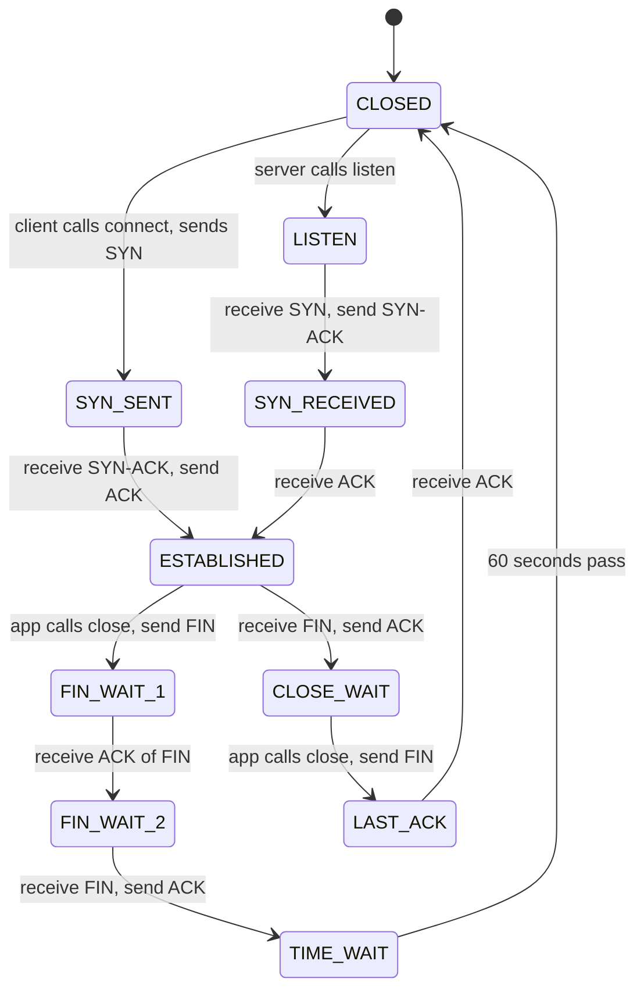
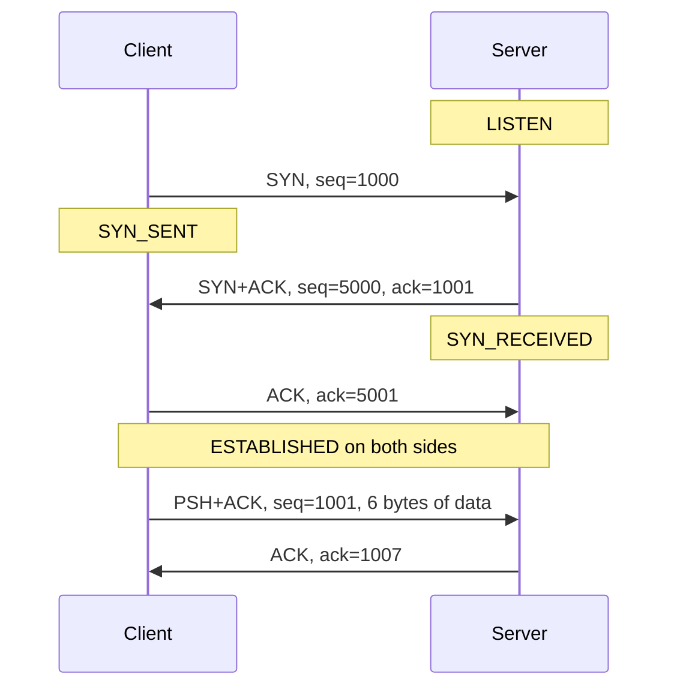
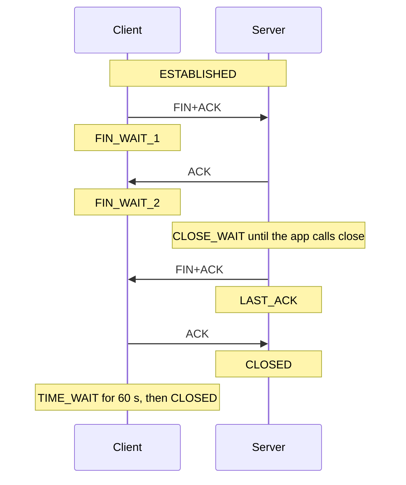

# Module 5.02: TCP

**Estimated hours:** 4

**What you will learn**

1. How TCP opens a connection with three packets, closes it with four, and what the states in between are called.
2. How sequence numbers, acknowledgements, windows and retransmission turn a lossy network into a reliable, in-order byte stream.
3. The one fact every network program depends on: TCP delivers bytes, not messages, so your code must find the message boundaries itself.

**Prerequisites:** [Module 5.01: How the internet works](module-01-how-the-internet-works.md). You need `netcat-openbsd` and `tcpdump` installed (commands in that module).

---

## 1. One-line intuition

TCP is a phone call built on top of a postal service: it numbers every byte, asks for confirmation, resends what is lost, and gives you one continuous stream with no envelopes in it.

## 2. Real-life analogy

Two clerks, one in a branch and one at head office, must exchange a long document through a postal service that loses, delays and reorders letters.

- They agree a protocol. The branch clerk writes "Shall we start? My first page will be number 1000" (**SYN**). Head office replies "Yes, and my first page will be number 5000; I confirm your 1000" (**SYN-ACK**). The branch says "Confirmed your 5000" (**ACK**). Three letters, and both know the other is really there. That is the **three-way handshake**.
- Every page carries a page number (the **sequence number**). The receiver files pages in order and replies "I have everything up to page 1057, send 1058 next" (the **acknowledgement number**). If page 1040 never arrives, the acknowledgements keep saying "send 1040" and the sender resends it (**retransmission**).
- The receiver has a tray of limited size and writes on every reply "I have room for 20 more pages" (the **window**). The sender never has more than 20 unconfirmed pages in the post. That is **flow control**.
- Crucially, the pages are not the document's chapters. The sender tore the document into pages wherever the page ran out. The receiver may get chapter 3 split across two pages, or two short chapters on one page. If the receiver wants chapters, it must look for the chapter headings itself. That is the **byte stream**: TCP preserves the order of the bytes and nothing else.
- To end, the branch writes "I have nothing more to send" (**FIN**). Head office confirms (**ACK**), finishes its own last pages, then sends its own "nothing more" (**FIN**), which the branch confirms (**ACK**). Four letters. The branch then waits a while before reusing the file number, in case a late letter from the old conversation turns up (**TIME_WAIT**).

## 3. Why it exists: the problem it solves

IP (module 5.01) delivers packets with no promises: they may be lost, duplicated, reordered or corrupted. A loan-origination request that arrives with its middle missing is worse than no request at all. Applications need a conversation they can trust.

TCP (Transmission Control Protocol, 1981, RFC 793, now RFC 9293) puts the trust at the two endpoints, so routers can stay simple:

1. **Reliable.** Every byte is numbered and acknowledged; missing bytes are resent until they arrive.
2. **In order.** The receiver holds out-of-order data until the gap is filled, then hands the application a continuous stream.
3. **Flow controlled.** A fast sender cannot flood a slow receiver.
4. **Congestion controlled.** A sender backs off when the network itself is overloaded, so the internet does not collapse (it nearly did in 1986, which is where congestion control came from).

What breaks without it: every program would reimplement numbering, acknowledgement and retry, badly, and the ones that did not would corrupt data silently. UDP exists for the few cases (DNS lookups, voice, games) where a lost packet is cheaper than a wait.

## 4. Three layers of depth

### Layer 1 (beginner): open, talk, close

**Opening: the three-way handshake.** The server is waiting (`LISTEN`). The client sends a segment with the **SYN** flag and its starting sequence number. The server replies with **SYN** and **ACK** set, its own starting number, and an acknowledgement of the client's. The client replies with **ACK**. Now both sides are `ESTABLISHED` and may send data. One round trip has passed before the first byte of data can go. On loopback that is microseconds; across India it is tens of milliseconds; this is why connection reuse matters (module 5.04).

**Talking.** Each side calls `send` with some bytes and `recv` to get bytes. The kernel decides how to cut the bytes into segments. Each data segment is acknowledged by the other side, usually piggybacked on its own data or on a delayed ACK.

**Closing: four steps.** Whoever finishes first sends **FIN**. The other side ACKs it, may keep sending, then sends its own FIN, which gets ACKed. Either side may close first. The side that closes first ends in `TIME_WAIT` for a fixed time (60 seconds on Linux) before the 5-tuple can be reused.

**The states you will see in `ss -tan`.**

| State | Meaning | Who is in it |
|---|---|---|
| `LISTEN` | Waiting for SYNs | Server's listening socket |
| `SYN-SENT` | Sent SYN, waiting for SYN-ACK | Client during connect |
| `SYN-RECV` | Got SYN, sent SYN-ACK, waiting for ACK | Server, briefly |
| `ESTAB` | Handshake done, data may flow | Both |
| `FIN-WAIT-1` | I sent FIN, waiting for its ACK | The side that closed first |
| `FIN-WAIT-2` | My FIN is ACKed, waiting for the other FIN | The side that closed first |
| `CLOSE-WAIT` | Got a FIN; the application has not called `close` yet | The side that did not close first |
| `LAST-ACK` | Sent my FIN after theirs, waiting for the final ACK | The side that closed second |
| `TIME-WAIT` | Fully closed, waiting 60 s before forgetting the 5-tuple | The side that closed first |

**The byte stream.** This is the fact the rest of the phase rests on. `send(fd, "PING\n", 5)` followed by `send(fd, "PONG\n", 5)` does **not** guarantee that the other side's `recv` returns `"PING\n"` and then `"PONG\n"`. It may return `"PING\nPONG\n"` in one call, or `"PI"` and then `"NG\nPONG\n"`. TCP promises only that the bytes come out in the same order they went in. Where one message ends and the next begins is your protocol's job (module 5.06). tcpkv uses newline-terminated lines for exactly this reason.

**UDP, the contrast.** The User Datagram Protocol sends one packet per `sendto` and delivers it as one `recvfrom`, or not at all. No handshake, no ordering, no retransmission, no congestion control, 8-byte header instead of 20. DNS uses it because a query is one small packet and the client can simply ask again. Nothing in this course's capstones uses UDP, but you must be able to say when you would.

### Layer 2 (working engineer): numbers, windows, retransmission, congestion

**Sequence and acknowledgement numbers.** Each direction has its own 32-bit sequence space. The number in a segment is the position of its first data byte in the stream; the initial value is random (for security). The SYN and the FIN each consume one sequence number even though they carry no data, which is why the handshake acknowledges "your SYN plus one". The acknowledgement number is **cumulative**: "I have received every byte before this number". With the SACK option (on by default on Linux) a receiver can also say "and I have these later ranges", so the sender resends only the hole.

**The window and flow control.** Every segment carries the sender's current **receive window**: how many more bytes it can buffer. The other side must not have more than that many unacknowledged bytes in flight. If the application stops calling `recv`, the buffer fills, the window shrinks to 0, and the sender stops. This is **backpressure**, and module 5.10 is built on it. The 16-bit window field is scaled by a factor negotiated in the handshake (`wscale`), so windows of megabytes are possible.

**Retransmission and RTO.** For every segment sent, a timer runs. If no ACK arrives before the **retransmission timeout (RTO)**, the segment is resent and the RTO doubles (exponential backoff). The RTO is computed from measured round-trip times: a smoothed RTT plus four times its variance, with a floor of 200 ms on Linux and an initial value of 1 s before any RTT is known. This is why a lost SYN costs a full second and a lost SYN retry costs three. Faster than the timer: if three duplicate ACKs arrive for the same number, the sender assumes that segment was lost and resends it immediately (**fast retransmit**).

**Congestion control, in one paragraph.** Separately from the receiver's window, the sender keeps a **congestion window (cwnd)** estimating how much the network can carry. It starts small (10 segments on Linux) and doubles every round trip (**slow start**) until loss is detected, then grows carefully (**congestion avoidance**) and shrinks on each loss. The algorithm deciding how it grows and shrinks is pluggable: Linux defaults to **CUBIC**; **BBR**, which models bandwidth and delay instead of reacting to loss, is available (`sysctl net.ipv4.tcp_congestion_control`). The bytes in flight are limited by the smaller of cwnd and the receiver's window. For the rest of this course you only need to know that cwnd exists, that `ss -tani` shows it, and that a new connection cannot use the full link speed for the first several round trips.

**Options in the handshake.** `mss` (the largest segment each side will accept, 1460 on Ethernet, 65495 on loopback), `sackOK`, `TS` (timestamps, used for better RTT estimates and for protection against old wrapped sequence numbers), `wscale`. You will see all four in the lab capture.

**Reading a tcpdump line.** Here is the shape you will meet for the rest of your career:

```text
IP 127.0.0.1.41234 > 127.0.0.1.5555: Flags [P.], seq 1:7, ack 1, win 512, length 6
```

Source address and port, destination address and port, flags (`S` SYN, `.` ACK, `P` PSH, `F` FIN, `R` RST), the sequence range of the data (`1:7` means bytes 1 to 6, relative to the start of the connection because tcpdump subtracts the initial numbers for you), the acknowledgement number, the window, and the data length. `PSH` means "the sender had nothing more buffered; hand this up to the application now". `RST` means "there is no such connection", and is what you get when you connect to a port nobody is listening on (`Connection refused`).

### Layer 3 (internals): the state machine and what the kernel keeps per connection

**The full state machine.** The diagram below is the one in RFC 9293, simplified to the transitions you will actually see. Every TCP socket in the kernel is in exactly one of these states; `ss` just prints it.



Two states deserve a second look because they are where server bugs show up:

- `CLOSE_WAIT` is **the kernel waiting for your program**. The peer has said FIN. Until your code calls `close`, the socket sits here holding its file descriptor and buffers. A server that forgets to close has hundreds of `CLOSE-WAIT` lines in `ss`. Module 5.04 makes you create and find this bug.
- `TIME_WAIT` exists so that (a) if the final ACK is lost, the peer's retransmitted FIN still finds a socket to answer it, and (b) any delayed segment from this connection dies in the network before the same 5-tuple is reused for a new one. The wait is 2 × MSL (maximum segment lifetime); Linux hard-codes 60 seconds. It costs the closing side a 5-tuple for a minute, which is why load generators that open and close thousands of connections run out of ephemeral ports (module 5.04).

**What the kernel keeps per connection.** A `struct tcp_sock` of a few hundred bytes plus two buffers: the send buffer (bytes the application has handed over but the peer has not yet acknowledged; retransmission comes from here) and the receive buffer (bytes that have arrived in order but the application has not yet `recv`ed, plus out-of-order segments waiting for a gap to fill). Per-connection state includes: both sequence numbers, the peer's advertised window, cwnd and ssthresh, smoothed RTT and variance, the RTO timer, the delayed-ACK timer, the keepalive timer and the SACK scoreboard. A machine with 100,000 idle connections spends a few hundred megabytes on this, mostly buffers. `ss -tani` prints most of it.

**Where a segment goes on arrival.** The NIC hands the packet to IP, which hands it to TCP. TCP hashes the 5-tuple into the established-connections hash table; if nothing matches, it checks the listening sockets by port; if nothing matches there either, it answers with RST. For an established socket it validates the sequence number against the window, updates the acknowledgement and window state, possibly cancels the retransmit timer, appends in-order data to the receive buffer or parks out-of-order data in the out-of-order queue, and wakes any waiter. This happens in softirq context, not in your thread; your thread only copies out of the receive buffer when it calls `recv`.

## 5. Architecture diagram

The handshake and the close, as sequence diagrams.





## 6. Code

Two small programs make the byte-stream fact impossible to forget. The server accepts one client, **sleeps for one second** so that everything the client sends piles up in the kernel's receive buffer, then reads with a tiny buffer and prints the size of every `recv`. The client sends four messages with four `send` calls as fast as it can. The socket calls (`socket`, `bind`, `listen`, `accept`, `connect`) are explained line by line in module 5.03; today, just read the comments and run it.

```c
/* byte_stream_server.c
 * Accept one client, wait 1 second, then print the size and content of
 * every recv() until the client closes. Shows that TCP has no message
 * boundaries: several sends can arrive in one recv, and one send can be
 * split across several recvs.
 */
#include <arpa/inet.h>
#include <netinet/in.h>
#include <stdio.h>
#include <stdlib.h>
#include <string.h>
#include <sys/socket.h>
#include <unistd.h>

/* Print a buffer with '\n' shown as the two characters \ and n. */
static void print_escaped(const char *buf, size_t len) {
    putchar('"');
    for (size_t i = 0; i < len; ++i) {
        if (buf[i] == '\n') { putchar('\\'); putchar('n'); }
        else                { putchar(buf[i]); }
    }
    putchar('"');
}

int main(int argc, char **argv) {
    size_t bufsize = (argc > 1) ? (size_t)atoi(argv[1]) : 8;   /* recv size */
    char *buf = malloc(bufsize);
    if (buf == NULL) { perror("malloc"); return 1; }

    int lfd = socket(AF_INET, SOCK_STREAM, 0);          /* a TCP socket */
    int one = 1;
    setsockopt(lfd, SOL_SOCKET, SO_REUSEADDR, &one, sizeof one);

    struct sockaddr_in addr;                             /* 127.0.0.1:5555 */
    memset(&addr, 0, sizeof addr);
    addr.sin_family = AF_INET;
    addr.sin_port = htons(5555);
    addr.sin_addr.s_addr = htonl(INADDR_LOOPBACK);
    if (bind(lfd, (struct sockaddr *)&addr, sizeof addr) < 0) { perror("bind"); return 1; }
    if (listen(lfd, 16) < 0) { perror("listen"); return 1; }
    printf("server: listening on 127.0.0.1:5555 with recv size %zu\n", bufsize);

    int cfd = accept(lfd, NULL, NULL);                   /* wait for a client */
    if (cfd < 0) { perror("accept"); return 1; }
    printf("server: client connected, sleeping 1 s so its sends pile up\n");
    sleep(1);

    for (int i = 1; ; ++i) {
        ssize_t n = recv(cfd, buf, bufsize, 0);
        if (n < 0) { perror("recv"); break; }
        if (n == 0) { printf("recv #%d: 0 bytes (client closed)\n", i); break; }
        printf("recv #%d: %zd bytes: ", i, n);
        print_escaped(buf, (size_t)n);
        putchar('\n');
    }
    close(cfd);
    close(lfd);
    free(buf);
    return 0;
}
```

```c
/* byte_stream_client.c
 * Connect to 127.0.0.1:5555 and send four messages with four send() calls
 * as fast as possible, then close.
 */
#include <arpa/inet.h>
#include <netinet/in.h>
#include <stdio.h>
#include <string.h>
#include <sys/socket.h>
#include <unistd.h>

int main(void) {
    int fd = socket(AF_INET, SOCK_STREAM, 0);
    struct sockaddr_in addr;
    memset(&addr, 0, sizeof addr);
    addr.sin_family = AF_INET;
    addr.sin_port = htons(5555);
    addr.sin_addr.s_addr = htonl(INADDR_LOOPBACK);
    if (connect(fd, (struct sockaddr *)&addr, sizeof addr) < 0) { perror("connect"); return 1; }

    const char *msgs[] = { "one\n", "two\n", "three\n", "a longer fourth message here\n" };
    for (int i = 0; i < 4; ++i) {
        size_t len = strlen(msgs[i]);
        if (send(fd, msgs[i], len, 0) != (ssize_t)len) { perror("send"); return 1; }
        printf("client: sent %zu bytes\n", len);
    }
    close(fd);          /* sends FIN; the server's recv will return 0 */
    return 0;
}
```

Compile both, then run the server in terminal 1 and the client in terminal 2:

```bash
gcc -std=gnu17 -Wall -Wextra -Werror -g -o byte_stream_server byte_stream_server.c
gcc -std=gnu17 -Wall -Wextra -Werror -g -o byte_stream_client byte_stream_client.c
./byte_stream_server        # terminal 1
./byte_stream_client        # terminal 2
```

Expected client output:

```text
client: sent 4 bytes
client: sent 4 bytes
client: sent 6 bytes
client: sent 29 bytes
```

Expected server output (deterministic, because the 1-second sleep guarantees all 43 bytes are already in the receive buffer):

```text
server: listening on 127.0.0.1:5555 with recv size 8
server: client connected, sleeping 1 s so its sends pile up
recv #1: 8 bytes: "one\ntwo\n"
recv #2: 8 bytes: "three\na "
recv #3: 8 bytes: "longer f"
recv #4: 8 bytes: "ourth me"
recv #5: 8 bytes: "ssage he"
recv #6: 3 bytes: "re\n"
recv #7: 0 bytes (client closed)
```

Look at `recv #1`: two `send` calls arrived in one `recv`. Look at `recv #2` to `#6`: one `send` arrived in five `recv`s. Now run `./byte_stream_server 1024` and the client again: one `recv` of 43 bytes containing all four messages. The kernel never knew there were four messages. Only the bytes and their order are preserved. Every protocol in this phase, and the `recv_line` loop in module 5.03, exists to put the boundaries back.

## 7. Use case: core-banking loan-origination platform

The application server (claim H4) speaks RPC over TCP to branches. Three decisions in its design came directly from this module:

- **Length-prefixed framing, because of the byte stream.** Early in the project a request handler assumed "one `recv` is one request". It worked on loopback in testing. Under WAN latency, requests started arriving in halves, and the parser read garbage. The decision was a 4-byte length prefix on every RPC message (module 5.06) with a read loop that does not hand anything to the parser until all the bytes are present. This bug class is so common that the interviewer will probably ask about it; you reproduced it in section 6.
- **Long-lived connections.** A handshake costs a round trip, and the branch WAN had 30 to 80 ms round trips. Opening a connection per request would have added that to every loan query. Branches connected once at login and kept the connection open for the session. That decision created the next problem, dead connections, solved with keepalive in module 5.04.
- **A `CLOSE-WAIT` alarm.** Because branches always closed first, a healthy server shows almost no `CLOSE-WAIT` sockets. Operations added a check: more than 50 sockets in `CLOSE-WAIT` for more than five minutes means a worker thread is stuck or a code path forgot to close, page someone. That alarm found two leaks before they exhausted the descriptor table.

## 8. Lab

Keep three terminals open. Parts B and C need `sudo` for `tcpdump`.

### Part A: the byte stream (20 minutes)

1. Build and run the programs from section 6 with the default recv size of 8. Confirm your server output matches the expected output exactly.
2. Run the server with `./byte_stream_server 1024`. Expected: one `recv` of 43 bytes, then the 0-byte close.
3. Delete the `sleep(1);` line, rebuild, and run server and client five times with recv size 1024. Record how many `recv` calls you saw on each run. Expected: it varies between runs (often 1, sometimes 2 to 4), because now it depends on whether the server's `recv` runs before or after each client `send`. That variability is why the bug in section 7 did not show in testing.
4. Put the sleep back.

### Part B: capture a handshake and a close (30 minutes)

1. Terminal 1: `sudo tcpdump -i lo -n port 5555`. It prints `listening on lo` and waits.
2. Terminal 2: `nc -l 5555`.
3. Terminal 3: `nc localhost 5555`. Watch terminal 1. Expected: three lines, the handshake (ports, sequence numbers, timestamps and windows will differ; the flags and the `ack` arithmetic will not):

```text
IP 127.0.0.1.41234 > 127.0.0.1.5555: Flags [S], seq 2882340012, win 65495, options [mss 65495,sackOK,TS val 1111 ecr 0,nop,wscale 7], length 0
IP 127.0.0.1.5555 > 127.0.0.1.41234: Flags [S.], seq 1500210533, ack 2882340013, win 65483, options [mss 65495,sackOK,TS val 1111 ecr 1111,nop,wscale 7], length 0
IP 127.0.0.1.41234 > 127.0.0.1.5555: Flags [.], ack 1, win 512, options [nop,nop,TS val 1111 ecr 1111], length 0
```

Annotate it in your journal: line 1 is SYN with the client's random initial sequence number; line 2 is SYN-ACK (`S.`) with the server's own number and `ack` = client number + 1 (the SYN consumed one number); line 3 is the ACK, and from here tcpdump prints relative numbers, so `ack 1` means "I acknowledge your SYN". `mss 65495` is the loopback segment size, `wscale 7` means multiply the window by 128, so `win 512` is really 65536 bytes.

4. In terminal 3 type `hello` and Enter. Expected: two lines, a `[P.]` segment with `seq 1:7` and `length 6` (five letters plus newline) and a `[.]` with `ack 7` coming back. The PSH flag is there because `nc` had nothing more to send.
5. Press `Ctrl+C` in terminal 3 (the client). Expected: the four-step close, `[F.]` from the client, `[.]` ack from the server, `[F.]` from the server, `[.]` ack from the client. Note which side sent FIN first.
6. Immediately run `ss -tan | grep 5555` in terminal 3. Expected: one line in `TIME-WAIT` whose local address is the **client's** port (the side that closed first). Run it again after 60 seconds: gone.

### Part C: a lost connection and a refused one (20 minutes)

1. With tcpdump still running, run `nc -v localhost 5556` (nobody listens there). Expected in tcpdump: a `[S]` and then a `[R.]` (RST) back. Expected from nc: `Connection refused`. That refusal is the RST, and it is instant.
2. Now simulate a server that is unreachable rather than refusing. Run `nc -v -w 5 10.255.255.1 5555` (an address that nothing answers on; if your network does answer it, pick another unused private address). Expected: nc waits 5 seconds and reports a timeout. In a second terminal, `ss -tan | grep 5555` during the wait shows `SYN-SENT`. Without `-w`, the kernel would retry the SYN with doubling timeouts (1 s, 2 s, 4 s ...) for about two minutes before giving up (`sysctl net.ipv4.tcp_syn_retries` is 6 by default). This is the difference between "refused" (fast, RST) and "unreachable" (slow, silence) that you must be able to read from a log.
3. Run `sysctl net.ipv4.tcp_congestion_control` and `sysctl net.ipv4.tcp_available_congestion_control`. Expected: `cubic` is in use; `reno` and `cubic` are listed, and `bbr` may or may not be, depending on the kernel modules built for WSL2.

### Part D: states under a microscope (20 minutes)

1. Terminal 1: `nc -l 5555`. Terminal 2: `nc localhost 5555`. Terminal 3: `ss -tan | grep 5555`. Expected: `LISTEN`, and two `ESTAB` lines (each end of the one connection).
2. Press `Ctrl+C` on the **server** `nc` (terminal 1) this time. Terminal 3: `ss -tan | grep 5555` at once. Expected: the server side is in `FIN-WAIT-2` (its FIN was ACKed, waiting for the client's FIN) and the client side is in `CLOSE-WAIT` (it got a FIN and the `nc` process has not closed yet). This `CLOSE-WAIT` is exactly what a leaky server looks like, except here the process will close when you press `Ctrl+C` in terminal 2.
3. Press `Ctrl+C` in terminal 2. `ss` now shows the server side in `TIME-WAIT` (it closed first) and the client side gone.
4. Write down, in one sentence each, who is in `CLOSE-WAIT` and who is in `TIME-WAIT` after a close, and why. You will be asked this in interviews.

### Journal

Copy [journal/TEMPLATE.md](../journal/TEMPLATE.md) to `journal/YYYY-MM-DD-tcp.md`. Record: the server output from Part A with recv size 8 and with the sleep removed (how many `recv`s per run); the three annotated handshake lines from Part B with the `ack` arithmetic checked by hand; which side held `TIME-WAIT`; the difference in time between "refused" and "unreachable" from Part C; and your two sentences from Part D.

## 9. Common mistakes and misconceptions

| Mistake | Why it is wrong | Bug it causes later |
|---|---|---|
| One `send` equals one `recv` | TCP is a byte stream; the kernel segments and merges as it likes | Parsers that work on loopback and corrupt data over a WAN (section 7) |
| `recv` returning fewer bytes than asked is an error | It is normal; it returns what has arrived so far | Reading a 4-byte length prefix and getting 2 bytes, then parsing garbage |
| `recv` returning 0 means "no data yet" | 0 means the peer sent FIN; "no data yet" blocks or returns `EAGAIN` | Busy loops that spin forever on a closed socket |
| `TIME_WAIT` sockets are leaks | They are the protocol working as designed, on the side that closed first, for 60 s | Tuning sysctls blindly instead of fixing which side closes |
| `CLOSE_WAIT` sockets are the network's fault | They mean *your process* has not called `close` after the peer's FIN | Descriptor exhaustion in a server with a missing `close` |
| `Connection refused` and a timeout are the same failure | Refused is a RST from a live host with no listener; a timeout is silence (host down, firewall dropping) | Debugging the application when the firewall is the problem, or vice versa |
| TCP guarantees delivery | It guarantees that if bytes are delivered they are in order and intact; a dead peer or cut cable means your `send` succeeded into a buffer and nothing arrived | Treating a successful `send` as a successful transaction |
| Congestion control is the receiver's window | The window is set by the receiver's buffer; cwnd is the sender's estimate of the network; the smaller wins | Blaming a slow client when the network path is lossy |

## 10. Resume link

- **Claim E, "TCP/IP".** The interviewer will draw a handshake or ask you to. Draw three arrows, name the flags, state that SYN consumes a sequence number, and name the states. Then say the byte-stream sentence from Layer 1 unprompted; it signals that you have written real socket code.
- **Claim H4, "RPC-over-TCP".** Expect "how did you frame messages?" Answer from section 7: length prefix, read loop until complete, because one `recv` is not one message. Then the story from Part A: "with the receiver delayed by a second I saw four sends arrive as six recvs of eight bytes."
- **Claim I, "tcpkv ... line-based text protocol".** Say: "The protocol is newline-delimited because TCP has no message boundaries; the reader accumulates bytes until it sees `\n`." You will build that reader in module 5.03.
- **Claim F, "incident triage".** The `CLOSE-WAIT` alarm in section 7 is a monitoring decision you can defend: "`CLOSE-WAIT` means the application forgot to close; `TIME-WAIT` is the protocol. We alerted on the first, never on the second."

Likely follow-up: "Why does TIME_WAIT exist and how long is it?" Answer: to answer a retransmitted FIN if the last ACK was lost, and to let old segments die before the 5-tuple is reused; 2 × MSL, which Linux fixes at 60 seconds.

## 11. Interview questions

**Q1 (easy). Describe the TCP three-way handshake.**

<details>
<summary>Model answer</summary>

The client sends a segment with the SYN flag and a random initial sequence number. The server, which must be in LISTEN, replies with SYN and ACK set, its own initial sequence number, and an acknowledgement number equal to the client's number plus one, because the SYN occupies one sequence number. The client replies with ACK acknowledging the server's number plus one. Both sides are now ESTABLISHED and the client may send data with the third packet. The handshake also negotiates options: MSS, window scaling, SACK and timestamps. It costs one round trip before any data flows.

</details>

**Q2 (easy). What does it mean that TCP is a byte stream?**

<details>
<summary>Model answer</summary>

TCP guarantees that the receiver gets exactly the bytes the sender wrote, in order, and nothing else. It does not preserve the boundaries of `send` calls. Several sends may be delivered by one `recv`, and one send may be split across several `recv`s, depending on segmentation, buffering and timing. Any application protocol must therefore define its own message boundaries, by a length prefix, a delimiter such as newline, or a fixed size, and the reader must loop until it has a complete message. I demonstrated this by delaying a receiver for a second and watching four sends arrive as six eight-byte reads.

</details>

**Q3 (medium). What is the difference between CLOSE_WAIT and TIME_WAIT, and which one indicates a bug?**

<details>
<summary>Model answer</summary>

Both appear during the four-step close. The side that closes first goes FIN_WAIT_1, FIN_WAIT_2, then TIME_WAIT for 2 × MSL, 60 seconds on Linux, so a lost final ACK can be answered and stale segments cannot pollute a reused 5-tuple. That is the protocol working. The other side enters CLOSE_WAIT when it receives the FIN and stays there until its application calls `close`. A pile of CLOSE_WAIT sockets therefore means the application has received end-of-stream and not closed: a leaked descriptor or a stuck handler. CLOSE_WAIT is the bug; TIME_WAIT is normal, and only becomes a problem when a client opens and closes connections faster than ephemeral ports recycle.

</details>

**Q4 (medium). How does TCP decide when to retransmit, and why does a lost SYN cost about a second?**

<details>
<summary>Model answer</summary>

Each transmitted segment is covered by a retransmission timer set to the RTO, which is computed from the smoothed round-trip time plus four times its variance, with a minimum of 200 ms on Linux. If the timer fires without an acknowledgement, the segment is resent and the RTO doubles. Additionally, three duplicate acknowledgements trigger fast retransmit without waiting for the timer, and SACK tells the sender exactly which ranges are missing. Before the handshake there is no RTT measurement, so the initial RTO is a fixed 1 second; a lost SYN is resent after 1 s, then 2 s, 4 s and so on, up to `tcp_syn_retries` times, which is why connecting to a silently dropped address takes about two minutes to fail but a refused connection fails instantly with a RST.

</details>

**Q5 (hard). A receiver's application stops reading from its socket. Walk through what happens to the sender over the next few seconds, and how this becomes backpressure in a server design.**

<details>
<summary>Model answer</summary>

Data keeps arriving at the receiver's kernel and is appended to the socket's receive buffer, which nobody drains. The advertised window in each ACK shrinks as the buffer fills, until it reaches zero. The sender may then have no bytes in flight beyond what was already acknowledged, and its `send` calls fill its own send buffer until that is full; a blocking `send` then blocks the calling thread, and a non-blocking one returns `EAGAIN`. The sender periodically sends window probes to learn when space reopens. So a slow consumer stalls the producer through two kernel buffers with no application code involved: that is TCP's flow control acting as backpressure. In a server this cuts both ways. A client that does not read its responses can block a worker thread that writes to it; with one thread per connection that merely parks the thread, but with a thread pool or a reactor it can stall unrelated clients, so the server must use non-blocking writes with bounded per-connection output queues, and drop or disconnect clients whose queue exceeds a limit. Module 5.10 builds exactly that.

</details>

## 12. Revision

- Open with SYN, SYN-ACK, ACK (one round trip); close with FIN, ACK, FIN, ACK; the side that closes first sits in TIME_WAIT for 60 s, the other side sits in CLOSE_WAIT until its application calls `close`.
- Every byte is numbered; cumulative ACKs plus SACK say what arrived; the receiver's window limits bytes in flight (flow control) and the sender's cwnd limits them too (congestion control, CUBIC by default); lost segments are resent after the RTO or on three duplicate ACKs.
- TCP is a byte stream: one `send` can become many `recv`s and many `send`s one `recv`, so the application protocol must mark its own message boundaries and the reader must loop until a message is complete.

---

Previous: [Module 5.01: How the internet works](module-01-how-the-internet-works.md) | Next: [Module 5.03: POSIX sockets API](module-03-posix-sockets-api.md)
