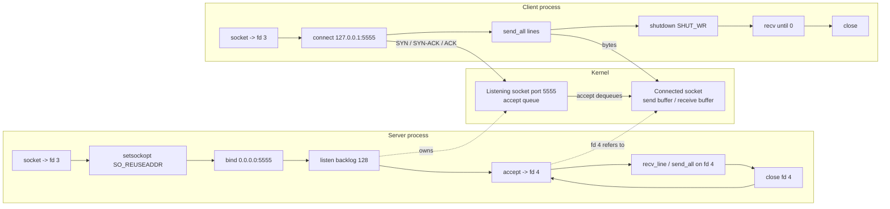

# Module 5.03: POSIX sockets API

**Estimated hours:** 5

**What you will learn**

1. The exact sequence of calls a TCP server and a TCP client make, what each one asks the kernel to do, and what each can fail with.
2. How to read and write correctly on a byte stream: `send_all`, `recv_line`, `EINTR`, `ECONNRESET`, `EPIPE`, and `shutdown` versus `close`.
3. How to wrap a socket in a move-only RAII type in C++17, so that `Socket` and `Listener` become the foundation of tcpkv.

**Prerequisites:** [Module 5.02: TCP](module-02-tcp.md). You also need RAII and move semantics from modules 2.03 and 2.06, the fd wrapper from module 3.08, `std::thread` from module 4.02, and byte order from module 1.02.

---

## 1. One-line intuition

A socket is a file descriptor whose `read` and `write` go to another machine; the sockets API is the handful of calls that create one, give it an address, and connect it to a peer.

## 2. Real-life analogy

A bank's telephone switchboard, before mobile phones.

- `socket()` buys a telephone. It has no number yet and is plugged into nothing.
- `bind()` assigns it a number (an IP address and a port). The loans desk insists on extension 7420 every day, so callers can memorise it.
- `listen()` tells the switchboard "I am taking calls on this line; hold up to N callers who ring while I am busy". That queue is the **backlog**.
- `accept()` picks up the next waiting caller. Here the analogy differs from a real phone in one important way: picking up gives you a **second, new telephone** dedicated to this caller. The original keeps ringing for others. One extension, many simultaneous conversations.
- `connect()` on the caller's side dials the number. The exchange does the three-way handshake (module 5.02) before either person hears a voice.
- `send()` and `recv()` are speaking and listening. You may speak a sentence and the listener may hear it in two halves, or two sentences as one; the line carries sounds, not sentences.
- `shutdown(SHUT_WR)` is saying "I am done talking, but I will stay on the line to hear your answer". `close()` is hanging up.
- The RAII wrapper is a rule in the office: whoever picked up a phone is responsible for hanging it up, and the phone hangs itself up when that person leaves the room.

## 3. Why it exists: the problem it solves

Before sockets (BSD Unix, 1983), every network program talked to the network card driver directly, and every operating system did it differently. The Berkeley sockets API gave networking the same shape as files: an integer descriptor, `read` and `write`, `close`. The same program could use a TCP connection, a Unix domain socket or (with small changes) a UDP endpoint. POSIX standardised it, Windows copied it as Winsock, and forty years later the calls in this module are still what every server in the world makes, including PostgreSQL, Redis, nginx, and the application server on your resume.

What breaks without it: no portable network code. What breaks when it is used carelessly: the four bugs this module trains out of you. Assuming one `send` is one `recv`. Ignoring short writes. Dying from `SIGPIPE` when a client disappears. Leaking the descriptor that `accept` returned.

## 4. Three layers of depth

### Layer 1 (beginner): the call sequences

**Server:**

```text
socket  ->  setsockopt(SO_REUSEADDR)  ->  bind  ->  listen  ->  accept  ->  recv/send loop  ->  close(client)
                                                                   ^                                 |
                                                                   +---------------------------------+
```

**Client:**

```text
socket  ->  connect  ->  send/recv loop  ->  shutdown(SHUT_WR)  ->  recv until 0  ->  close
```

| Call | What it asks the kernel | Returns | Typical failures |
|---|---|---|---|
| `socket(AF_INET, SOCK_STREAM, 0)` | Create a TCP/IPv4 socket | A new fd | `EMFILE` (too many open files) |
| `setsockopt(fd, SOL_SOCKET, SO_REUSEADDR, &one, sizeof one)` | Let me bind this port even if a `TIME_WAIT` socket still uses it | 0 | rarely fails |
| `bind(fd, addr, len)` | Give the socket this local address and port | 0 | `EADDRINUSE` (98), `EACCES` for ports below 1024 as non-root |
| `listen(fd, backlog)` | Start accepting handshakes; queue up to `backlog` completed ones | 0 | `EADDRINUSE` if no bind and auto-port failed |
| `accept(fd, peer, &len)` | Block until a completed connection is queued; return a new fd for it | New fd | `EINTR`, `EMFILE`, `ECONNABORTED` |
| `connect(fd, addr, len)` | Do the handshake with this remote address | 0 | `ECONNREFUSED` (RST), `ETIMEDOUT`, `ENETUNREACH` |
| `send(fd, buf, n, flags)` | Copy up to `n` bytes into the send buffer | Bytes accepted, may be less than `n` | `EPIPE`, `ECONNRESET`, `EINTR`, `EAGAIN` (non-blocking) |
| `recv(fd, buf, n, flags)` | Copy up to `n` bytes out of the receive buffer, blocking if empty | Bytes copied; 0 means peer sent FIN | `ECONNRESET`, `EINTR`, `EAGAIN` |
| `shutdown(fd, SHUT_WR)` | Send FIN now; keep the fd for reading | 0 | `ENOTCONN` |
| `close(fd)` | Release the fd; if it was the last reference, send FIN (or RST, see Layer 3) | 0 | `EBADF` |

**The address structure.** The kernel needs an address in a fixed binary layout:

```c
struct sockaddr_in {            /* 16 bytes, IPv4 */
    sa_family_t    sin_family;  /* AF_INET */
    in_port_t      sin_port;    /* 16-bit port in NETWORK byte order */
    struct in_addr sin_addr;    /* 32-bit IPv4 address in NETWORK byte order */
    unsigned char  sin_zero[8]; /* padding, set to zero */
};
```

Every address call takes a generic `struct sockaddr *` plus a length, so you cast: `(struct sockaddr *)&addr, sizeof addr`. The same calls accept a `struct sockaddr_in6` for IPv6; that is why the cast exists.

**Byte order.** From module 1.02 you know your x86-64 CPU stores the 16-bit number 5555 (`0x15B3`) as the bytes `B3 15`, little-endian. The TCP header, like every internet header, is big-endian: the byte `15` goes first. `htons` ("host to network short") does the swap for 16-bit values, `htonl` for 32-bit, and `ntohs`/`ntohl` swap back. Forget `htons(5555)` and you bind port `0xB315` = 45845 instead of 5555. `inet_pton(AF_INET, "127.0.0.1", &addr.sin_addr)` converts dotted text to the binary, already in network order; `inet_ntop` converts back.

**Portable version: `getaddrinfo`.** Hand-filling `sockaddr_in` ties you to IPv4. `getaddrinfo` (module 5.01) returns ready-made `ai_addr` and `ai_addrlen` for each address family. For a server pass `NULL` as the host and `AI_PASSIVE` in the hints to get the wildcard address. The client in section 6 uses it and loops over the results until one `connect` succeeds, which is also how it copes with `localhost` resolving to `::1` first while the server listens only on IPv4.

### Layer 2 (working engineer): the loops and the errors

**Short writes: `send_all`.** `send` may accept fewer bytes than you gave it (when the send buffer is nearly full, or when a signal interrupts it after some bytes went). Correct code loops:

```c
while (sent < len) {
    ssize_t n = send(fd, buf + sent, len - sent, MSG_NOSIGNAL);
    if (n < 0) { if (errno == EINTR) continue; return -1; }
    sent += (size_t)n;
}
```

**Short reads: `recv_line`.** `recv` returns whatever has arrived, from 1 byte up to your buffer size. To get one newline-terminated message you accumulate until you see `\n`. The C version in section 6 reads one byte at a time: correct, easy to understand, and slow (one system call per byte, 100 to 300 ns each from module 0.02). The C++ version keeps a buffer, reads 4 KB at a time and slices lines out of it. tcpkv uses the buffered one.

**`EINTR`.** A blocking call that is interrupted by a signal handler returns `-1` with `errno == EINTR` instead of finishing. The fix is to retry. This matters for tcpkv's "graceful shutdown on signals": `SIGINT` arriving while a thread sits in `accept` wakes it with `EINTR`, and the loop must check a shutdown flag rather than treat it as a failure.

**`ECONNRESET`.** The peer sent a RST: usually because it closed while its receive buffer still held unread data, or because its process died and the kernel reset the connection, or because a firewall dropped state. `recv` returns `-1` with this errno; treat it like a close.

**`EPIPE` and `SIGPIPE`.** Writing to a socket whose peer has already closed delivers the `SIGPIPE` signal to your process, and the default action is to **kill the process**. A server dying because one client hung up is the classic beginner server bug. Two fixes, use both: pass `MSG_NOSIGNAL` to every `send`, and (belt and braces) `signal(SIGPIPE, SIG_IGN)` at startup. With either, `send` returns `-1` with `errno == EPIPE` and you close that client.

**`shutdown(SHUT_WR)` versus `close`.** `close` releases your fd; the kernel sends FIN only when the **last** reference to the socket goes away (a forked child or a `dup` keeps it alive). `shutdown(SHUT_WR)` sends FIN immediately regardless of references, and leaves the fd open so you can still read the reply. A client that sends a request and wants the full response before the server sees end-of-stream uses `shutdown`, exactly as `echo_client.c` does.

**`SO_REUSEADDR`.** Without it, restarting a server within 60 seconds of a client connection closing fails with `EADDRINUSE`, because a `TIME_WAIT` socket (module 5.02) still owns the 5-tuple's local port. With it, `bind` is allowed while only `TIME_WAIT` sockets occupy the port. Every server sets it. It does not let two listening sockets share a port; that is `SO_REUSEPORT`, a different option.

**Blocking.** All calls in this module block: `accept` until a connection is queued, `recv` until bytes arrive or FIN, `send` until the send buffer has room, `connect` until the handshake finishes or fails. A blocking server can therefore serve only one client per thread, which is why section 6 ends with a thread per connection, and why modules 5.05 and 3.11 exist (thread pools, `epoll`).

### Layer 3 (internals): what the kernel does for each call

**`socket`.** Allocates a `struct socket` and a `struct sock` (for TCP, the larger `struct tcp_sock` from module 5.02), with empty send and receive queues, and installs a `struct file` whose operations point at the socket code. It returns the lowest free fd. From here on, `read`/`write`/`close` on that fd are routed to socket functions.

**`bind`.** Checks the port: below 1024 needs `CAP_NET_BIND_SERVICE`; already in use by a listener or an `ESTABLISHED` socket fails with `EADDRINUSE`; in use only by `TIME_WAIT` sockets fails unless `SO_REUSEADDR` is set. Then it inserts the socket in the **bind hash table** keyed by port.

**`listen`.** Moves the socket to the `LISTEN` state, puts it in the **listening hash table**, and allocates the **accept queue** with capacity `min(backlog, net.core.somaxconn)`. From now on, incoming SYNs are answered **by the kernel in softirq context**, without your program doing anything: the handshake completes, a new `struct sock` is created in `ESTABLISHED`, and it is appended to the accept queue. If the queue is full the kernel drops the SYN (module 5.04).

**`accept`.** Takes the first fully-established socket off the accept queue, wraps it in a new `struct file`, and returns a new fd. If the queue is empty it sleeps on the listening socket's wait queue; a completed handshake wakes it. This is why a client can connect, and even send data, before the server ever calls `accept`: the data sits in the new socket's receive buffer waiting.

**`connect`.** Picks an ephemeral port from `ip_local_port_range` that gives an unused 5-tuple, sends SYN, moves to `SYN_SENT` and sleeps. The incoming SYN-ACK is processed in softirq: the kernel sends the ACK, moves to `ESTABLISHED` and wakes the sleeper. A RST wakes it with `ECONNREFUSED`; `tcp_syn_retries` exhausted wakes it with `ETIMEDOUT`.

**`send`.** Copies user bytes into kernel socket buffers (`sk_buff`s) appended to the send queue, then calls the TCP output path, which transmits as much as the windows allow. If the send buffer is full the thread sleeps until ACKs free space. The return value is how many bytes were **copied into the kernel**, which says nothing about whether the peer received them.

**`recv`.** Walks the receive queue and `copy_to_user`s up to `n` bytes, consuming them. If the queue is empty and the connection is open it sleeps; FIN received with an empty queue returns 0. An `MSG_PEEK` flag copies without consuming.

**`close`.** Drops the fd. When the file's reference count reaches zero the socket's `tcp_close` runs: if there is **unread data in the receive buffer, it sends RST** instead of FIN, which is the most common cause of `ECONNRESET` on the other side; otherwise it sends FIN and the state machine from module 5.02 proceeds. The `struct sock` lives on in the kernel through `FIN_WAIT` and `TIME_WAIT` even though your fd is gone.

**What `strace` shows.** glibc implements `accept` with the `accept4` system call, `send` with `sendto` and `recv` with `recvfrom`, so those are the names you see in a trace. The lab makes you read one.

## 5. Architecture diagram



The handshake lands in the kernel's accept queue whether or not the server is currently inside `accept`. The connected socket is a separate kernel object from the listening one; `fd 4` refers to it and `fd 3` keeps listening.

## 6. Code

Three programs. The first two are C and are the minimum any socket programmer must be able to write from memory. The third is the C++17 RAII version that becomes tcpkv's `socket.hpp`.

### 6.1 Blocking echo server in C (one client at a time)

```c
/* echo_server.c
 * Blocking TCP echo server. Serves one client at a time: reads lines,
 * sends each line back unchanged, closes when the client closes.
 */
#include <arpa/inet.h>
#include <errno.h>
#include <netinet/in.h>
#include <signal.h>
#include <stdio.h>
#include <stdlib.h>
#include <string.h>
#include <sys/socket.h>
#include <unistd.h>

/* Send every byte of buf. Loops over short writes and EINTR.
 * Returns 0 on success, -1 on error with errno set. */
static int send_all(int fd, const char *buf, size_t len) {
    size_t sent = 0;
    while (sent < len) {
        ssize_t n = send(fd, buf + sent, len - sent, MSG_NOSIGNAL);
        if (n < 0) {
            if (errno == EINTR) continue;    /* interrupted by a signal: retry */
            return -1;                       /* EPIPE, ECONNRESET, ... */
        }
        sent += (size_t)n;
    }
    return 0;
}

/* Read one line, up to and including '\n', one byte at a time.
 * Returns the length, 0 if the peer closed before any byte, -1 on error. */
static ssize_t recv_line(int fd, char *buf, size_t cap) {
    size_t len = 0;
    while (len + 1 < cap) {
        char c;
        ssize_t n = recv(fd, &c, 1, 0);
        if (n < 0) {
            if (errno == EINTR) continue;
            return -1;
        }
        if (n == 0) break;                   /* FIN: peer has no more to send */
        buf[len++] = c;
        if (c == '\n') break;
    }
    buf[len] = '\0';
    return (ssize_t)len;
}

int main(int argc, char **argv) {
    unsigned short port = (argc > 1) ? (unsigned short)atoi(argv[1]) : 5555;
    signal(SIGPIPE, SIG_IGN);                /* never die because a client hung up */

    int lfd = socket(AF_INET, SOCK_STREAM, 0);
    if (lfd < 0) { perror("socket"); return 1; }

    int one = 1;                             /* allow restart while TIME_WAIT sockets exist */
    if (setsockopt(lfd, SOL_SOCKET, SO_REUSEADDR, &one, sizeof one) < 0) {
        perror("setsockopt"); return 1;
    }

    struct sockaddr_in addr;
    memset(&addr, 0, sizeof addr);
    addr.sin_family      = AF_INET;
    addr.sin_port        = htons(port);          /* network byte order! */
    addr.sin_addr.s_addr = htonl(INADDR_ANY);    /* 0.0.0.0: every interface */
    if (bind(lfd, (struct sockaddr *)&addr, sizeof addr) < 0) { perror("bind"); return 1; }
    if (listen(lfd, 128) < 0) { perror("listen"); return 1; }
    printf("listening on port %u\n", port);

    for (;;) {
        struct sockaddr_in peer;
        socklen_t plen = sizeof peer;
        int cfd = accept(lfd, (struct sockaddr *)&peer, &plen);
        if (cfd < 0) {
            if (errno == EINTR) continue;
            perror("accept"); return 1;
        }
        char ip[INET_ADDRSTRLEN];
        inet_ntop(AF_INET, &peer.sin_addr, ip, sizeof ip);
        printf("client %s:%u connected\n", ip, ntohs(peer.sin_port));

        char line[1024];
        for (;;) {
            ssize_t n = recv_line(cfd, line, sizeof line);
            if (n < 0) { printf("recv error: %s\n", strerror(errno)); break; }
            if (n == 0) { printf("client closed\n"); break; }
            printf("got %zd bytes: %s%s", n, line, line[n - 1] == '\n' ? "" : "\n");
            if (send_all(cfd, line, (size_t)n) < 0) {
                printf("send error: %s\n", strerror(errno)); break;
            }
        }
        close(cfd);                          /* the per-client fd; the listener stays */
    }
}
```

### 6.2 Client in C with `getaddrinfo`, `shutdown` and a read-until-EOF loop

```c
/* echo_client.c
 * Connect to host:port, send each argument as a line, half-close with
 * shutdown(SHUT_WR), then print everything the server sends until EOF.
 */
#include <errno.h>
#include <netdb.h>
#include <stdio.h>
#include <string.h>
#include <sys/socket.h>
#include <unistd.h>

static int send_all(int fd, const char *buf, size_t len) {
    size_t sent = 0;
    while (sent < len) {
        ssize_t n = send(fd, buf + sent, len - sent, MSG_NOSIGNAL);
        if (n < 0) { if (errno == EINTR) continue; return -1; }
        sent += (size_t)n;
    }
    return 0;
}

int main(int argc, char **argv) {
    if (argc < 4) { fprintf(stderr, "usage: %s host port line [line ...]\n", argv[0]); return 2; }

    struct addrinfo hints, *res;
    memset(&hints, 0, sizeof hints);
    hints.ai_family   = AF_UNSPEC;           /* IPv4 or IPv6 */
    hints.ai_socktype = SOCK_STREAM;
    int rc = getaddrinfo(argv[1], argv[2], &hints, &res);
    if (rc != 0) { fprintf(stderr, "getaddrinfo: %s\n", gai_strerror(rc)); return 1; }

    int fd = -1;                             /* try each address until one connects */
    for (struct addrinfo *p = res; p != NULL; p = p->ai_next) {
        fd = socket(p->ai_family, p->ai_socktype, p->ai_protocol);
        if (fd < 0) continue;
        if (connect(fd, p->ai_addr, p->ai_addrlen) == 0) break;
        close(fd);
        fd = -1;
    }
    freeaddrinfo(res);
    if (fd < 0) { fprintf(stderr, "connect: %s\n", strerror(errno)); return 1; }
    printf("connected\n");

    for (int i = 3; i < argc; ++i) {
        if (send_all(fd, argv[i], strlen(argv[i])) < 0 || send_all(fd, "\n", 1) < 0) {
            perror("send"); return 1;
        }
        printf("sent: %s\n", argv[i]);
    }
    shutdown(fd, SHUT_WR);                   /* FIN: "nothing more from me"; still reading */

    char buf[1024];
    for (;;) {
        ssize_t n = recv(fd, buf, sizeof buf, 0);
        if (n < 0) { if (errno == EINTR) continue; perror("recv"); return 1; }
        if (n == 0) break;                   /* server closed: its FIN arrived */
        fwrite(buf, 1, (size_t)n, stdout);
    }
    printf("server closed the connection\n");
    close(fd);
    return 0;
}
```

Compile and run (server in terminal 1, the rest in terminal 2):

```bash
gcc -std=gnu17 -Wall -Wextra -Werror -g -o echo_server echo_server.c
gcc -std=gnu17 -Wall -Wextra -Werror -g -o echo_client echo_client.c
./echo_server                                   # terminal 1
printf 'hello\nworld\n' | nc -N localhost 5555  # terminal 2
./echo_client localhost 5555 "loan 4471" status # terminal 2
```

Expected in terminal 2 (the `nc` run, then the client run):

```text
hello
world
connected
sent: loan 4471
sent: status
loan 4471
status
server closed the connection
```

Expected in terminal 1 (the client port will differ):

```text
listening on port 5555
client 127.0.0.1:40212 connected
got 6 bytes: hello
got 6 bytes: world
client closed
client 127.0.0.1:40218 connected
got 10 bytes: loan 4471
got 7 bytes: status
client closed
```

`nc -N` tells netcat to send FIN when its input ends, the same half-close the client does with `shutdown`. On `localhost` the client's `getaddrinfo` typically returns `::1` first; `connect` to it fails with `ECONNREFUSED` because the server listens on IPv4 only, and the loop moves on to `127.0.0.1`. Remove the loop and the client breaks on many machines: that is why the loop is not optional.

### 6.3 C++17: `socket.hpp` and a thread-per-connection echo server

This is the file tcpkv will use. `Socket` owns one fd, cannot be copied, can be moved, and closes in its destructor. `Listener` owns the listening socket and its `accept()` returns a `Socket` by value, so ownership of the new fd is transferred, never shared.

```cpp
// socket.hpp
// RAII, move-only wrappers for a connected TCP socket and a listening socket.
// Used by tcpkv. Blocking I/O only; non-blocking comes in module 5.05.
#pragma once
#include <netinet/in.h>
#include <sys/socket.h>
#include <unistd.h>
#include <cerrno>
#include <cstring>
#include <stdexcept>
#include <string>
#include <utility>

namespace tcpkv {

class Socket {
public:
    Socket() noexcept = default;
    explicit Socket(int fd) noexcept : fd_(fd) {}
    ~Socket() { reset(); }

    Socket(const Socket&) = delete;                      // exactly one owner
    Socket& operator=(const Socket&) = delete;
    Socket(Socket&& other) noexcept
        : fd_(other.fd_), buf_(std::move(other.buf_)) { other.fd_ = -1; }
    Socket& operator=(Socket&& other) noexcept {
        if (this != &other) {
            reset();
            fd_ = other.fd_; other.fd_ = -1;
            buf_ = std::move(other.buf_);
        }
        return *this;
    }

    int  fd() const noexcept { return fd_; }
    bool valid() const noexcept { return fd_ >= 0; }
    void reset() noexcept { if (fd_ >= 0) { ::close(fd_); fd_ = -1; } }
    void shutdown_write() const noexcept { ::shutdown(fd_, SHUT_WR); }

    // Send every byte; false on error (EPIPE, ECONNRESET, ...).
    bool send_all(const std::string& data) const noexcept {
        std::size_t sent = 0;
        while (sent < data.size()) {
            ssize_t n = ::send(fd_, data.data() + sent, data.size() - sent, MSG_NOSIGNAL);
            if (n < 0) { if (errno == EINTR) continue; return false; }
            sent += static_cast<std::size_t>(n);
        }
        return true;
    }

    // Read one line including '\n' into out, using a 4 KB buffered read.
    // Returns false on peer close with nothing pending, or on error.
    bool recv_line(std::string& out) {
        for (;;) {
            auto nl = buf_.find('\n');
            if (nl != std::string::npos) {
                out.assign(buf_, 0, nl + 1);
                buf_.erase(0, nl + 1);
                return true;
            }
            char chunk[4096];
            ssize_t n = ::recv(fd_, chunk, sizeof chunk, 0);
            if (n < 0) { if (errno == EINTR) continue; return false; }
            if (n == 0) {                                 // FIN
                if (buf_.empty()) return false;
                out.swap(buf_); buf_.clear();             // last line without '\n'
                return true;
            }
            buf_.append(chunk, static_cast<std::size_t>(n));
        }
    }

private:
    int fd_ = -1;
    std::string buf_;      // bytes received but not yet returned as a line
};

class Listener {
public:
    explicit Listener(unsigned short port, int backlog = 128) {
        int fd = ::socket(AF_INET, SOCK_STREAM, 0);
        if (fd < 0) throw std::runtime_error(std::string("socket: ") + std::strerror(errno));
        sock_ = Socket(fd);                               // owned from here on
        int one = 1;
        ::setsockopt(fd, SOL_SOCKET, SO_REUSEADDR, &one, sizeof one);
        sockaddr_in addr{};
        addr.sin_family      = AF_INET;
        addr.sin_port        = htons(port);
        addr.sin_addr.s_addr = htonl(INADDR_ANY);
        if (::bind(fd, reinterpret_cast<sockaddr*>(&addr), sizeof addr) < 0)
            throw std::runtime_error(std::string("bind: ") + std::strerror(errno));
        if (::listen(fd, backlog) < 0)
            throw std::runtime_error(std::string("listen: ") + std::strerror(errno));
    }

    // Block until a connection is ready; hand it back as an owned Socket.
    Socket accept() const {
        for (;;) {
            int cfd = ::accept(sock_.fd(), nullptr, nullptr);
            if (cfd >= 0) return Socket(cfd);
            if (errno == EINTR) continue;
            throw std::runtime_error(std::string("accept: ") + std::strerror(errno));
        }
    }

    int fd() const noexcept { return sock_.fd(); }

private:
    Socket sock_;          // Listener is move-only because Socket is
};

} // namespace tcpkv
```

```cpp
// echo_threaded.cpp
// Thread-per-connection echo server built on socket.hpp.
#include "socket.hpp"
#include <cstdio>
#include <cstdlib>
#include <string>
#include <thread>

// Runs on its own thread. Takes the Socket BY VALUE: this thread owns it.
static void serve(tcpkv::Socket client, int id) {
    std::string line;
    while (client.recv_line(line)) {
        std::printf("[conn %d] %zu bytes\n", id, line.size());
        if (!client.send_all(line)) break;
    }
    std::printf("[conn %d] closed\n", id);
}   // client's destructor runs here: close() happens with no code to forget

int main(int argc, char** argv) {
    unsigned short port = (argc > 1) ? static_cast<unsigned short>(std::atoi(argv[1])) : 5555;
    tcpkv::Listener listener(port);
    std::printf("listening on port %u\n", port);

    int next_id = 0;
    for (;;) {
        tcpkv::Socket client = listener.accept();       // ownership moves out of accept
        std::thread(serve, std::move(client), next_id++).detach();   // and into the thread
    }
}
```

Compile and run:

```bash
g++ -std=c++17 -Wall -Wextra -Werror -pthread -g -o echo_threaded echo_threaded.cpp
./echo_threaded                                  # terminal 1
nc localhost 5555                                # terminal 2, type lines
nc localhost 5555                                # terminal 3, type lines at the same time
```

Expected in terminal 1 as you type in both clients (order depends on your typing):

```text
listening on port 5555
[conn 0] 6 bytes
[conn 1] 4 bytes
[conn 0] 3 bytes
[conn 1] closed
[conn 0] closed
```

Both clients are served at once, which the C server could not do. `detach()` is the simplest thing that works and is not what tcpkv ships: there is no limit on threads and no way to join them at shutdown. Module 5.05 replaces it with a fixed thread pool and graceful shutdown.

## 7. Use case: core-banking loan-origination platform

The application server (claim H4) was, at its core, the loop in section 6.1 with a thread pool behind `accept`. Four decisions from this module shaped it:

- **`SIGPIPE` ignored at startup, `MSG_NOSIGNAL` on every write.** The first production crash of the server was not memory corruption; it was a branch user closing the client mid-response and the server process dying of `SIGPIPE` with 200 other sessions on it. One line fixed it. It became the first item in the server's startup checklist and is in tcpkv's `main` for the same reason.
- **Ownership of the accepted fd is explicit.** Each accepted connection became a `Connection` object owned by exactly one worker at a time, moved between the acceptor and the pool, never copied. Before that rule, a code path that returned early on a validation error leaked the fd, and after a few days the server hit `EMFILE` (1024 descriptors) and refused logins. The move-only `Socket` type in section 6.3 is that rule made into a compiler error.
- **Half-close for request-response.** Batch clients (end-of-day jobs) sent a stream of requests then `shutdown(SHUT_WR)`, and the server drained its replies before closing. Using `close` instead would have discarded replies still in the server's send buffer. The read-until-zero loop in `echo_client.c` is the client side of that decision.
- **`SO_REUSEADDR` on the listener.** Without it, a restart during the day failed with `EADDRINUSE` for up to a minute while `TIME_WAIT` sockets drained, which turned a 5-second restart into a 65-second outage. Every service at the bank sets it now.

## 8. Lab

### Part A: run and read the C server (30 minutes)

1. Build `echo_server` and `echo_client` from section 6. Run the server, then `printf 'hello\nworld\n' | nc -N localhost 5555` and `./echo_client localhost 5555 "loan 4471" status`. Confirm both outputs match section 6.
2. Change `htons(port)` to just `port` in the server, rebuild, run, and in another terminal run `ss -tlnp | grep echo`. Expected: the server listens on port 45845 (`0xB315`), not 5555. Change it back. This is the byte-order bug you will now recognise for life.
3. Comment out `signal(SIGPIPE, SIG_IGN);` and change `MSG_NOSIGNAL` to `0` in the server's `send_all`. Rebuild. Run the server and then `nc localhost 5555`; in the `nc` window type a line and press `Ctrl+C` **immediately**, before the echo reaches you (you may need a few tries, or add `sleep(1);` before the `send_all` call to make it reliable). Expected: the server prints nothing and simply disappears; `echo $?` in its terminal shows 141 (128 + signal 13, `SIGPIPE`). Restore both lines. This is the crash from section 7.
4. With the correct server running, open two `nc localhost 5555` clients. Type in the second one. Expected: nothing comes back until you close the first. The second client's handshake succeeded (the kernel did it and queued the connection in the backlog) but the server is busy in `recv_line` on the first. Run `ss -tan | grep 5555`: both connections show `ESTAB`.

### Part B: trace the system calls (20 minutes)

1. Run the server under strace, filtering to the socket calls:

```bash
strace -e trace=socket,setsockopt,bind,listen,accept4,recvfrom,sendto,close ./echo_server
```

2. In another terminal: `printf 'hi\n' | nc -N localhost 5555`. Expected trace (addresses, ports and the fd numbers 3 and 4 are typical):

```text
socket(AF_INET, SOCK_STREAM, IPPROTO_IP) = 3
setsockopt(3, SOL_SOCKET, SO_REUSEADDR, [1], 4) = 0
bind(3, {sa_family=AF_INET, sin_port=htons(5555), sin_addr=inet_addr("0.0.0.0")}, 16) = 0
listen(3, 128)                          = 0
accept4(3, {sa_family=AF_INET, sin_port=htons(40212), sin_addr=inet_addr("127.0.0.1")}, [16], 0) = 4
recvfrom(4, "h", 1, 0, NULL, NULL)      = 1
recvfrom(4, "i", 1, 0, NULL, NULL)      = 1
recvfrom(4, "\n", 1, 0, NULL, NULL)     = 1
sendto(4, "hi\n", 3, MSG_NOSIGNAL, NULL, 0) = 3
recvfrom(4, "", 1, 0, NULL, NULL)       = 0
close(4)                                = 0
accept4(3,
```

3. Annotate in your journal: `accept` became `accept4`, `recv` became `recvfrom`, `send` became `sendto` (glibc's choice of system call); the three one-byte `recvfrom` calls are the cost of byte-at-a-time `recv_line`; the final `recvfrom` returning 0 is the FIN; `close(4)` closes the client fd while fd 3 goes back into `accept4`.
4. Count system calls for the line `hello\n` (6 bytes): 6 `recvfrom` plus 1 `sendto`. At roughly 100 to 300 ns per system call that is already more than the time to copy the bytes. Now trace `echo_threaded` the same way with `-f` (follow threads) and send the same line. Expected: one `recvfrom(..., 4096, ...) = 6` instead of six. That is why the C++ version buffers.

### Part C: the RAII wrapper under pressure (30 minutes)

1. Build and run `echo_threaded`. Connect three `nc` clients at once and confirm all three echo independently.
2. In `serve`, add `if (line == "quit\n") return;` at the top of the loop body, rebuild, run, connect with `nc`, type `quit`. Expected: `nc` exits because the server closed the connection. There is no `close` call anywhere in `serve`; the `Socket` destructor did it on `return`. Run `ss -tan | grep 5555` and confirm the connection is gone (or in `TIME-WAIT` on the server side, because the server closed first).
3. Try to make a copy: add `tcpkv::Socket copy = client;` inside `serve`, rebuild. Expected: a compile error naming the deleted copy constructor. Delete the line. This error is the ownership rule from section 7, enforced by the compiler.
4. Change `std::move(client)` to `client` in `main`'s `std::thread` line. Expected: a compile error again, because `std::thread` would need to copy. Restore it. Then explain in one sentence in your journal who owns the fd after `accept()` returns and who owns it after the thread starts.

### Part D: errors you must recognise (20 minutes)

1. Start `echo_server` twice. Expected from the second: `bind: Address already in use` (that is `EADDRINUSE`, 98). `SO_REUSEADDR` does not allow two listeners; only `TIME_WAIT` leftovers.
2. Run `./echo_client localhost 5556 x`. Expected: `connect: Connection refused` (`ECONNREFUSED`, from the RST in module 5.02).
3. Run `./echo_server 80`. Expected: `bind: Permission denied` (`EACCES`), because ports below 1024 need root. Do not run it with `sudo`; a server that needs root for its port should have the capability granted instead (`setcap`), which module 11.02 covers.
4. Produce `ECONNRESET`: start `echo_server`, then run `./echo_client localhost 5555 a b c d e f g h` several times. Occasionally, and reliably if you add `sleep(1);` before the `recv_line` loop in the server, you will instead see the server print `recv error: Connection reset by peer` for a client that closed with unread data. Explain, using Layer 3, why a `close` with unread data sends RST instead of FIN. (If you cannot reproduce it, write the explanation anyway; the mechanism is deterministic, the timing is not.)

### Journal

Copy [journal/TEMPLATE.md](../journal/TEMPLATE.md) to `journal/YYYY-MM-DD-posix-sockets-api.md`. Record: the port you got with the missing `htons`, the exit code of the `SIGPIPE` crash, the annotated strace, the system-call count for one line in the C server versus the C++ server, the two compile errors from Part C and your one-sentence ownership answer, and the four error messages from Part D with their errno names.

## 9. Common mistakes and misconceptions

| Mistake | Why it is wrong | Bug it causes later |
|---|---|---|
| Forgetting `htons` on the port | The kernel reads the bytes big-endian; your CPU wrote them little-endian | Listening on 45845 when you asked for 5555; "connection refused" that makes no sense |
| Treating a short `send` as success | `send` returns bytes copied, which may be fewer than asked | Truncated messages that only appear under load when the send buffer fills |
| Treating `recv` returning less than the buffer as an error, or 0 as "try again" | Short reads are normal; 0 is FIN | Garbage parsing; busy loops on closed sockets |
| Not handling `SIGPIPE` | Default action kills the whole process | Server dies when any client hangs up mid-write |
| Not retrying on `EINTR` | Signals interrupt blocking calls | `accept` "fails" on `Ctrl+C` handling; spurious errors during graceful shutdown |
| Closing the listening fd after `accept` | The listener is separate from the connection | Server accepts exactly one client then dies |
| Returning early without `close(cfd)` | The fd belongs to the process until closed | `EMFILE` after a few days; the leak in section 7 |
| Using `close` when `shutdown(SHUT_WR)` was needed | `close` may also discard the reply you have not read yet, and sends FIN only when the last reference drops | Lost responses; servers that never see EOF because a forked child holds the fd |
| Expecting `send` to mean "delivered" | It means "copied into my kernel's buffer" | Treating a logged "sent" as a completed transaction |
| Copying a socket wrapper | Two owners means two `close` calls, and the second may close an unrelated fd that reused the number | Closing someone else's connection; one of the hardest bugs in Phase 8 |

## 10. Resume link

- **Claim E, "POSIX sockets".** Be able to write the server sequence on a whiteboard, with `SO_REUSEADDR`, the `sockaddr_in` fields, and `htons`. Then say the two loops: "`send_all` loops over short writes; `recv_line` accumulates until newline because TCP is a byte stream." Mention `MSG_NOSIGNAL` without being asked.
- **Claim I, "RAII socket/fd wrappers, move-only connection handles".** Section 6.3 is the artefact. Say: "`Socket` is move-only so there is exactly one owner of each fd; `accept()` returns it by value, the worker takes it by value, and the destructor closes it. Copying is a compile error, which I verified." You have the compile error from Part C in your journal.
- **Claim H4, "multithreaded application server ... RPC-over-TCP".** The `SIGPIPE` story and the fd leak from section 7 are the two incidents to tell. Both have a one-line fix and a concrete symptom (exit code 141; `EMFILE`).
- **Claim F, "incident triage".** `strace -e trace=network` on a misbehaving server is a standard first move. You can now read what it prints.

Likely follow-up: "What is the difference between `shutdown` and `close`?" Answer: `shutdown(SHUT_WR)` sends FIN now and keeps the fd readable; `close` drops the fd and sends FIN only when the last reference goes, or RST if unread data remains.

## 11. Interview questions

**Q1 (easy). List the system calls a TCP server makes, in order, and say what `accept` returns.**

<details>
<summary>Model answer</summary>

`socket` creates the descriptor; `setsockopt` with `SO_REUSEADDR` allows rebinding a port with lingering `TIME_WAIT` sockets; `bind` attaches a local address and port; `listen` switches the socket to passive mode and sizes the accept queue; `accept` blocks until the kernel has completed a handshake and returns a new descriptor for that one connection, leaving the listening descriptor in place; `recv` and `send` move bytes; `close` on the connection descriptor ends it. A client does `socket`, `connect`, `send`/`recv`, optionally `shutdown(SHUT_WR)`, then `close`.

</details>

**Q2 (easy). Why do you call `htons` on the port number?**

<details>
<summary>Model answer</summary>

TCP and IP headers are defined in network byte order, which is big-endian: the most significant byte first. x86-64 CPUs are little-endian, so the 16-bit value 5555 (`0x15B3`) is stored in memory as `B3 15`. The kernel copies the `sin_port` field into the header as-is, so without conversion the port on the wire would be `0xB315`, 45845. `htons` swaps the two bytes on little-endian machines and is a no-op on big-endian ones, which makes the code portable. `htonl` does the same for 32-bit addresses, and `inet_pton` already produces network order.

</details>

**Q3 (medium). What is the difference between `shutdown(fd, SHUT_WR)` and `close(fd)`, and when would a client use the first?**

<details>
<summary>Model answer</summary>

`shutdown(SHUT_WR)` sends a FIN to the peer immediately, telling it this side has no more data, but keeps the descriptor open so this side can continue to receive. `close` releases the descriptor; the FIN is sent only when the last reference to the socket is gone, which matters after `fork` or `dup`, and if the receive buffer still holds unread data the kernel sends RST instead of FIN, which the peer sees as `ECONNRESET`. A client that sends a batch of requests and wants all the responses uses `shutdown(SHUT_WR)` after the last request so the server sees end-of-stream, processes everything, and closes; the client reads until `recv` returns 0 and only then calls `close`. That is how the end-of-day batch clients talked to our application server.

</details>

**Q4 (medium). Your server process exits silently when a client disconnects during a response. What happened and how do you fix it?**

<details>
<summary>Model answer</summary>

The server wrote to a socket whose peer had already closed, the kernel delivered `SIGPIPE`, and the default disposition of `SIGPIPE` is to terminate the process; the exit status is 128 + 13 = 141. The fix is to make the write fail with `EPIPE` instead: pass `MSG_NOSIGNAL` on every `send`, and also ignore the signal process-wide with `signal(SIGPIPE, SIG_IGN)` so that any write path that uses plain `write` is covered too. Then handle `EPIPE` and `ECONNRESET` by closing that client and continuing. I reproduced this in the lab and saw exit code 141 before the fix.

</details>

**Q5 (hard). Design a move-only RAII wrapper for a socket descriptor. What must the move operations do, why is copying forbidden, and what goes wrong if you get the move assignment wrong?**

<details>
<summary>Model answer</summary>

The class holds an `int fd_` initialised to -1. The destructor calls `close` if `fd_ >= 0`. The copy constructor and copy assignment are deleted because a descriptor has one owner: two objects closing the same number would double-close, and since the kernel reuses the lowest free number, the second `close` could close an unrelated connection that was just accepted, a bug that shows up as another client's session being dropped. The move constructor copies `fd_` and sets the source to -1 so the source destructor is a no-op. Move assignment must first close the descriptor this object currently owns, then take the source's and null it, and must guard against self-assignment; forgetting the first step leaks the old descriptor, which in a long-running server becomes `EMFILE`. Both move operations are `noexcept` so containers can move rather than copy. A `Listener` whose `accept()` returns `Socket` by value transfers ownership through the return, and a worker that takes `Socket` by value takes it over; the compiler rejects any attempt to copy, which I verified by writing the copy and reading the error. In tcpkv this is `socket.hpp`.

</details>

## 12. Revision

- Server: `socket`, `setsockopt(SO_REUSEADDR)`, `bind` (with `htons`), `listen`, `accept` (returns a new fd), `recv`/`send`, `close` the client fd; client: `socket`, `connect`, send, `shutdown(SHUT_WR)`, read until 0, `close`.
- `send` may be short and `recv` returns what has arrived, so loop (`send_all`, `recv_line`); retry on `EINTR`; treat `ECONNRESET` and `EPIPE` as "client gone"; ignore `SIGPIPE` and use `MSG_NOSIGNAL` or the process dies.
- Wrap every fd in a move-only RAII type: one owner, destructor closes, copy is a compile error; `Listener::accept()` returns a `Socket` by value and that is the skeleton of tcpkv.

---

Previous: [Module 5.02: TCP](module-02-tcp.md) | Next: [Module 5.04: TCP internals](module-04-tcp-internals.md)
