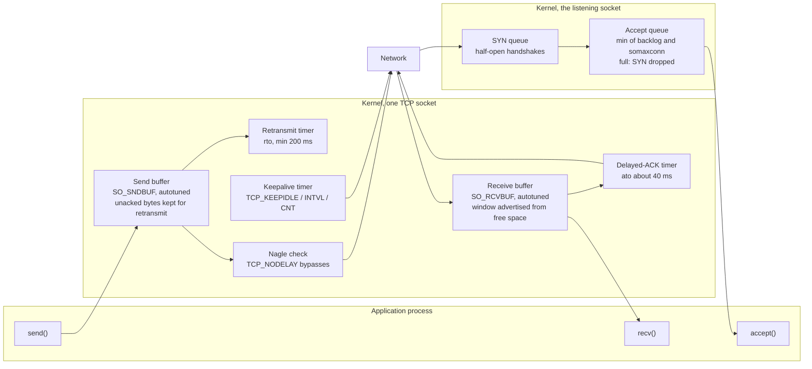

# Module 5.04: TCP internals

**Estimated hours:** 4

**What you will learn**

1. What the kernel keeps for each TCP socket (send buffer, receive buffer, accept queue, timers) and what blocks or is dropped when each one fills.
2. The four knobs every server engineer must know by name and effect: `TCP_NODELAY` (Nagle), `SO_REUSEADDR` and `TIME_WAIT`, the `listen` backlog, and `SO_KEEPALIVE`.
3. How to read `ss -tani` and a `tcpdump` of a data exchange, and how to recognise a `CLOSE_WAIT` leak and a half-open connection in a running server.

**Prerequisites:** [Module 5.03: POSIX sockets API](module-03-posix-sockets-api.md). You will reuse `echo_server` and `echo_threaded` from that module.

---

## 1. One-line intuition

Between your `send` and the other side's `recv` sit two buffers, a queue and a handful of timers inside the kernel, and every TCP performance problem you will ever debug is one of them filling up, waiting, or being forgotten.

## 2. Real-life analogy

Back to the loans desk and its telephone extension 7420.

- The desk has an **out-tray** (the **send buffer**). You drop letters in it and go back to work; the post room empties it when the recipient confirms they have room. If the out-tray is full you must stand there holding your letter (`send` blocks).
- The desk has an **in-tray** (the **receive buffer**). Letters land in it whether or not you are reading. If you stop reading, it fills, and the post room tells the sender "no room" (window 0).
- The post room has a rule: "do not send a half-empty envelope while an earlier envelope is still unconfirmed; wait and fill it" (**Nagle's algorithm**). The other post room has a rule: "do not confirm receipt right away; wait 40 ms in case a reply is about to go out and can carry the confirmation" (**delayed ACK**). Put those two polite rules together and a two-part letter waits 40 ms for no reason. `TCP_NODELAY` cancels the first rule.
- The switchboard holds callers who rang while you were busy (the **accept queue**). It has a fixed number of seats (the **backlog**). When the seats are full, new callers hear nothing and ring again later (SYN dropped, client retries).
- After hanging up, the desk keeps the call sheet for one minute in case a late letter from that caller arrives (**TIME_WAIT**).
- If a caller has said nothing for two hours, the switchboard whispers "are you still there?" (**keepalive**). If nobody answers after several tries, the line is declared dead.
- A caller who said "I am finished" but the clerk never hung up: the line stays open, the seat stays taken, forever (**CLOSE_WAIT leak**).

## 3. Why it exists: the problem it solves

Module 5.02 described TCP as if the two endpoints were one piece of code. In reality each endpoint is split in two: your program, which calls `send` and `recv` when it feels like it, and the kernel, which must keep the protocol running whether or not your program is paying attention. Buffers and queues decouple the two. Timers handle the cases where the other side goes silent. Options let a program tell the kernel which trade-off it wants.

What breaks without them: with no send buffer, `send` would have to wait for the ACK, and a request would cost a full round trip per call. With no accept queue, every handshake would need your thread to be sitting in `accept` at that exact moment. With no keepalive, a connection whose peer was unplugged would look healthy forever, holding a thread and a descriptor. The application server on your resume hit every one of these; section 7 names the decisions.

## 4. Three layers of depth

### Layer 1 (beginner): the parts and the knobs

| Part | Where | What happens when it is full or expires |
|---|---|---|
| Send buffer (`SO_SNDBUF`) | Sender's kernel | Blocking `send` sleeps; non-blocking `send` returns `EAGAIN` |
| Receive buffer (`SO_RCVBUF`) | Receiver's kernel | Advertised window goes to 0; the sender stops; the sender's send buffer then fills |
| Accept queue (`listen` backlog) | Server's kernel | New SYNs are dropped; clients retransmit after 1 s, 3 s, 7 s... |
| `TIME_WAIT` (60 s) | Side that closed first | The 5-tuple is unusable for a minute; too many of them on a client means no free ephemeral ports |
| Keepalive timer (`SO_KEEPALIVE`) | Either side | After idle time, probes are sent; if they all go unanswered the connection is reset with `ETIMEDOUT` |
| Delayed-ACK timer (about 40 ms) | Receiver | An ACK with no data to ride on is sent when it fires |
| Nagle (`TCP_NODELAY` off) | Sender | A small segment waits while earlier data is unacknowledged |

**The one-line rules.**

- **Buffers:** the kernel sizes them automatically (**autotuning**) from `net.ipv4.tcp_rmem` and `tcp_wmem`. Do not set `SO_SNDBUF`/`SO_RCVBUF` by hand unless you have measured a reason; setting them switches autotuning off for that socket.
- **Nagle:** every request-response server sets `TCP_NODELAY`. tcpkv does. The application server did. The experiment in section 6 shows why.
- **`TIME_WAIT`:** normal on the side that closes first. Servers set `SO_REUSEADDR` so they can restart; clients that open and close thousands of connections per minute run out of ports.
- **Backlog:** pass a real number (hundreds or more) to `listen`, and know that `net.core.somaxconn` (4096 on Linux 5.4 and later) caps it.
- **Keepalive:** turn it on for long-lived connections and set the idle time to something shorter than the default two hours.

### Layer 2 (working engineer): numbers, options and how to read the tools

**Buffer sizes.** `sysctl net.ipv4.tcp_rmem` prints three numbers: minimum, initial, maximum, typically `4096 131072 6291456` on a 6.x kernel; `tcp_wmem` is typically `4096 16384 4194304`. Autotuning grows a socket's buffer between the initial and maximum values based on how fast the application drains it and the measured bandwidth-delay product. If you set `SO_RCVBUF` yourself, the kernel doubles the value you give (to account for its own bookkeeping overhead) and caps it at `net.core.rmem_max`; `getsockopt` then returns the doubled number. A socket cannot have more unacknowledged data in flight than its send buffer, so on a long fat link (high bandwidth times high latency) a too-small buffer caps throughput: 128 KB of buffer over an 80 ms round trip is at most 1.6 MB/s regardless of the link speed.

**Backpressure, previewed.** Receiver stops reading, receive buffer fills, window hits zero, sender's send buffer fills, sender's `send` blocks. No application code is involved. In a thread-per-connection server that parks one thread. In a thread pool or reactor it can stall unrelated clients unless writes are non-blocking and bounded. Module 5.10 builds the bounded version; for now, know that the two buffers are what makes a slow reader slow the writer.

**Nagle and delayed ACK.** Nagle's rule (RFC 896, 1984, meant for telnet over slow links): if there is unacknowledged data in flight, hold small segments until it is acknowledged or a full segment accumulates. Delayed ACK (RFC 1122): a receiver may wait up to a fixed time before acknowledging, hoping to piggyback the ACK on data; Linux waits a minimum of about 40 ms. A client that does **write, write, read** (header, then body, then wait for the reply) triggers both: the body waits for the ACK of the header, the ACK waits for a reply that cannot be produced without the body. Result: about 40 ms per request on a loopback that should take 50 µs. Fixes, in order of preference: do not split one message across two `send` calls (build it in a buffer, or use `writev`); and set `TCP_NODELAY`, which disables Nagle so small segments go immediately. `TCP_CORK` is the opposite tool: hold everything until the cork is removed (or 200 ms pass), used by web servers to glue a header onto `sendfile` output. tcpkv sets `TCP_NODELAY` and never corks.

**`TIME_WAIT` arithmetic.** Linux hard-codes the duration at 60 seconds (there is no sysctl for it; `net.ipv4.tcp_fin_timeout` is a different thing, the limit for an orphaned `FIN_WAIT_2`). The client's ephemeral range is `net.ipv4.ip_local_port_range`, typically 32768 to 60999, so 28,232 ports. If a load generator opens a connection, sends one request and closes first, each connection parks one port for 60 s, so it can sustain at most about 470 connections per second to one server address and port before `connect` fails with `EADDRNOTAVAIL`. Ways out: keep connections open and reuse them (what tcpkv's load generator does), have the server close first so `TIME_WAIT` lands on the server side where it costs only memory, widen the range, or enable `net.ipv4.tcp_tw_reuse` (default 2 on recent kernels, which means "enabled for loopback only"). `SO_REUSEADDR` on the listener solves only the server-restart case.

**Backlog in detail.** Since Linux 2.2 there are two queues per listening socket. The **SYN queue** holds half-open handshakes (SYN received, SYN-ACK sent, ACK not yet back); its size relates to `net.ipv4.tcp_max_syn_backlog` and SYN cookies take over when it overflows under a flood. The **accept queue** holds fully established connections waiting for `accept`; its size is `min(backlog, somaxconn)`, and Linux lets in backlog + 1 entries. When the accept queue is full the kernel drops incoming SYNs (and, by default, also drops the final ACK of a handshake that would need a slot), counting `TcpExtListenOverflows` and `TcpExtListenDrops` in `nstat`. The client sees nothing and retransmits its SYN after 1 s, then 2 s, then 4 s. From the client's point of view "the server is slow to connect"; from `ss -ltn` the server's `Recv-Q` equals its `Send-Q`. A server that is busy and not calling `accept` fast enough shows exactly this.

**Keepalive.** Off by default per socket. With `SO_KEEPALIVE` on, after `net.ipv4.tcp_keepalive_time` seconds of idleness (default 7200, two hours) the kernel sends an empty probe; if unanswered it retries every `tcp_keepalive_intvl` seconds (default 75) up to `tcp_keepalive_probes` times (default 9), then kills the connection and the next `recv` or `send` fails with `ETIMEDOUT`. The defaults add up to over two hours, which is useless for a server; set per-socket values with `TCP_KEEPIDLE`, `TCP_KEEPINTVL`, `TCP_KEEPCNT`. Keepalive only acts on an **idle** connection. If you have data waiting to be sent to a dead peer, it is the retransmission timer that eventually gives up (`tcp_retries2`, default 15, about 15 minutes); `TCP_USER_TIMEOUT` bounds that wait in milliseconds and is the better tool for "fail if my data is not acknowledged within N seconds".

**Half-open connections and `CLOSE_WAIT` leaks.** If a branch PC is unplugged or rebooted, no FIN is ever sent. The server's socket stays `ESTABLISHED` with nothing arriving; that is a **half-open** connection, and only keepalive or an attempted send (which gets a RST if the peer has rebooted, or times out if it is gone) will reveal it. The opposite bug is entirely the server's: the peer sent FIN, the socket moved to `CLOSE_WAIT`, and the server code never called `close`. `ss -tan state close-wait` lists them; `ls /proc/<pid>/fd | wc -l` grows; eventually `EMFILE`. A handful of `CLOSE_WAIT` sockets is normal (a close is in progress); hundreds that persist are a leak.

**Reading `ss -tani`.** Here is a typical line for one established loopback connection (numbers vary):

```text
ESTAB 0 0 127.0.0.1:5555 127.0.0.1:40212
     cubic wscale:7,7 rto:204 rtt:0.03/0.015 ato:40 mss:65483 pmtu:65535 rcvmss:536 advmss:65483 cwnd:10 bytes_sent:6 bytes_acked:6 bytes_received:6 segs_out:4 segs_in:4 send 174Gbps lastsnd:1200 lastrcv:1200 lastack:1200 pacing_rate 349Gbps delivered:2 rcv_space:65483 minrtt:0.03
```

| Field | Meaning |
|---|---|
| `Recv-Q` (first 0) | Bytes in the receive buffer not yet read by the application; for a `LISTEN` socket, connections waiting in the accept queue |
| `Send-Q` (second 0) | Bytes in the send buffer not yet acknowledged; for a `LISTEN` socket, the backlog limit |
| `cubic` | Congestion control algorithm in use |
| `wscale:7,7` | Window scale sent and received (multiply windows by 128) |
| `rto:204` | Current retransmission timeout in ms (200 ms floor plus a little) |
| `rtt:0.03/0.015` | Smoothed round-trip time and its variance, in ms |
| `ato:40` | Delayed-ACK timeout in ms; the 40 you will see in section 6 |
| `mss:65483` | Segment size in use (loopback); 1448 is typical on Ethernet with timestamps |
| `cwnd:10` | Congestion window in segments; 10 is the initial value |
| `bytes_sent`, `bytes_acked`, `bytes_received` | Lifetime counters; `bytes_sent - bytes_acked` is data in flight |
| `lastsnd`, `lastrcv`, `lastack` | Milliseconds since the last send, receive and ACK; large values on an `ESTAB` socket mean an idle or half-open connection |

A non-zero `Recv-Q` that keeps growing on an `ESTAB` socket means the application is not reading. A non-zero `Send-Q` that keeps growing means the peer is not reading (or is gone).

**Reading a data exchange in `tcpdump`.** Flags `[P.]` mean PSH plus ACK: a data segment with "deliver to the application now". A plain `[.]` with `length 0` is a pure acknowledgement. The `seq a:b` range on a data segment and the `ack b` on the reply must match; if you see the same `seq a:b` twice, that is a retransmission, and `ss -tani` will show `retrans:` for it.

### Layer 3 (internals): what the kernel does

**Autotuning.** The receive side tracks how much the application reads per round trip (`rcv_space`) and grows `sk_rcvbuf` ahead of demand up to `tcp_rmem[2]`, while advertising a window slightly below the buffer (`rcv_ssthresh`) so a burst cannot overrun it. The send side grows `sk_sndbuf` to about twice the congestion window's worth of bytes up to `tcp_wmem[2]`, because that is what is needed to keep the pipe full while waiting for ACKs. Setting the option manually sets `SOCK_RCVBUF_LOCK`/`SOCK_SNDBUF_LOCK` flags and the kernel stops adjusting. Memory for all of this is counted against `net.ipv4.tcp_mem`; a machine with 100,000 connections and 128 KB buffers each has 12 GB of potential buffer, which is why the initial values are small and growth is on demand.

**The write path and Nagle.** `send` copies bytes into `sk_buff`s on the write queue and calls `tcp_write_xmit`. For each segment it checks, in order: is it within the receive window, within the congestion window, and does Nagle allow it. The Nagle check (`tcp_nagle_check`) holds a segment that is smaller than the MSS when there are unacknowledged bytes in flight and `TCP_NODELAY` is not set. `TCP_CORK` holds any partial segment until uncorked or a 200 ms timer. On the receive side, `tcp_event_data_recv` schedules an ACK: immediately while the socket is in "quick ACK" mode (the first segments of a connection, or after an out-of-order event), otherwise via the delayed-ACK timer whose timeout `ato` adapts between 40 ms and 200 ms. The receiver also leaves "ping-pong" mode (where delayed ACKs are preferred, because it has been replying promptly) whenever a delayed ACK actually has to be sent by the timer, which is why the stall in section 6 appears from about the second round trip onward and then repeats.

**The accept queue.** A listening socket's `icsk_accept_queue` is a linked list of established child sockets plus a counter compared against `sk_max_ack_backlog`. The handshake completes in softirq context: the SYN creates a `request_sock` in the SYN queue (or, under SYN cookies, no state at all), and the final ACK converts it to a full `struct sock` appended to the accept queue, after which any thread sleeping in `accept` is woken. If `sk_acceptq_is_full` when a SYN arrives, `tcp_conn_request` drops it and increments `LINUX_MIB_LISTENOVERFLOWS`; if it is full when the final ACK arrives, `tcp_v4_syn_recv_sock` drops the ACK (unless `net.ipv4.tcp_abort_on_overflow` is 1, in which case it sends RST). The client, having received a SYN-ACK, considers itself `ESTABLISHED` and may send data that the server's kernel discards until the retransmitted SYN-ACK and ACK finally find a free slot. That is the mechanism behind "connected but the first request hung for three seconds".

**`TIME_WAIT` storage.** A socket in `TIME_WAIT` is converted to a much smaller `inet_timewait_sock` (a few hundred bytes, no buffers) and parked in the established hash table so that any late segment for the 5-tuple is matched and answered correctly. A timer wheel expires it after `TCP_TIMEWAIT_LEN`, 60 × HZ ticks. `tcp_tw_reuse` lets `connect` take over such a socket for a new outgoing connection if the TCP timestamps prove the new connection's segments cannot be confused with the old; `SO_REUSEADDR` only relaxes the `bind` conflict check.

**Keepalive and the orphan path.** The keepalive timer runs only when the socket is idle in `ESTABLISHED` with `SO_KEEPALIVE` set; a probe is a segment with sequence number one less than the next expected, which forces the peer to ACK without carrying data. When your process calls `close` on a socket with data still unsent or unacknowledged, the socket becomes an **orphan**: it has no fd but the kernel keeps it to finish delivery, through `FIN_WAIT_1` and `FIN_WAIT_2`, bounded by `tcp_fin_timeout` in `FIN_WAIT_2` and by `tcp_orphan_retries` for retransmissions. `ss -tan` shows these with no process attached; they are the reason a server's connection count can exceed its fd count briefly after a burst of closes.

## 5. Architecture diagram



Follow a request from `send()` to the wire: into the send buffer, past the Nagle check, out. Follow the handshake: SYN queue, accept queue, `accept()`. Each box is something `ss -tani` or `ss -ltn` can show you.

## 6. Code

The experiment: a client that does **write, write, read** against the echo server from module 5.03, timing each round trip, with switches to turn on `TCP_NODELAY` or to combine the two writes into one. The server needs no change; `echo_server` reads until newline and replies, which is exactly the request-response pattern that triggers the stall.

```c
/* nagle_client.c
 * Measure the cost of the write-write-read pattern under Nagle's
 * algorithm plus delayed ACK, then fix it two ways.
 *   ./nagle_client            two sends per request, Nagle on   (slow)
 *   ./nagle_client --nodelay  two sends per request, TCP_NODELAY (fast)
 *   ./nagle_client --onesend  one send per request, Nagle on    (fast)
 * Run ./echo_server from module 5.03 first.
 */
#include <arpa/inet.h>
#include <errno.h>
#include <netinet/in.h>
#include <netinet/tcp.h>      /* TCP_NODELAY */
#include <stdio.h>
#include <string.h>
#include <sys/socket.h>
#include <time.h>
#include <unistd.h>

static double now_ms(void) {
    struct timespec ts;
    clock_gettime(CLOCK_MONOTONIC, &ts);
    return (double)ts.tv_sec * 1000.0 + (double)ts.tv_nsec / 1e6;
}

static int send_all(int fd, const char *buf, size_t len) {
    size_t sent = 0;
    while (sent < len) {
        ssize_t n = send(fd, buf + sent, len - sent, MSG_NOSIGNAL);
        if (n < 0) { if (errno == EINTR) continue; return -1; }
        sent += (size_t)n;
    }
    return 0;
}

/* Read until '\n'. Returns bytes read, 0 on close, -1 on error. */
static ssize_t recv_line(int fd, char *buf, size_t cap) {
    size_t len = 0;
    while (len + 1 < cap) {
        char c;
        ssize_t n = recv(fd, &c, 1, 0);
        if (n < 0) { if (errno == EINTR) continue; return -1; }
        if (n == 0) break;
        buf[len++] = c;
        if (c == '\n') break;
    }
    buf[len] = '\0';
    return (ssize_t)len;
}

int main(int argc, char **argv) {
    int nodelay = 0, onesend = 0;
    const int iterations = 20;
    for (int i = 1; i < argc; ++i) {
        if (strcmp(argv[i], "--nodelay") == 0) nodelay = 1;
        else if (strcmp(argv[i], "--onesend") == 0) onesend = 1;
    }

    int fd = socket(AF_INET, SOCK_STREAM, 0);
    if (fd < 0) { perror("socket"); return 1; }
    if (nodelay) {
        int one = 1;      /* disable Nagle: small segments go immediately */
        if (setsockopt(fd, IPPROTO_TCP, TCP_NODELAY, &one, sizeof one) < 0) {
            perror("setsockopt TCP_NODELAY"); return 1;
        }
    }
    struct sockaddr_in addr;
    memset(&addr, 0, sizeof addr);
    addr.sin_family = AF_INET;
    addr.sin_port = htons(5555);
    inet_pton(AF_INET, "127.0.0.1", &addr.sin_addr);
    if (connect(fd, (struct sockaddr *)&addr, sizeof addr) < 0) { perror("connect"); return 1; }

    const char header[] = "H";                 /* write 1: a 1-byte "header" */
    const char body[]   = "ello world\n";      /* write 2: the rest of the request */
    char reply[64];
    double start = now_ms();
    for (int i = 0; i < iterations; ++i) {
        double t0 = now_ms();
        if (onesend) {
            char msg[32];
            int len = snprintf(msg, sizeof msg, "%s%s", header, body);
            if (send_all(fd, msg, (size_t)len) < 0) { perror("send"); return 1; }
        } else {
            if (send_all(fd, header, 1) < 0) { perror("send"); return 1; }
            if (send_all(fd, body, strlen(body)) < 0) { perror("send"); return 1; }
        }
        if (recv_line(fd, reply, sizeof reply) <= 0) { fprintf(stderr, "server went away\n"); return 1; }
        printf("round trip %2d: %7.2f ms\n", i + 1, now_ms() - t0);
    }
    printf("total: %.2f ms for %d round trips (nodelay=%d onesend=%d)\n",
           now_ms() - start, iterations, nodelay, onesend);
    close(fd);
    return 0;
}
```

Compile and run (the echo server from module 5.03 in terminal 1):

```bash
gcc -std=gnu17 -Wall -Wextra -Werror -g -o nagle_client nagle_client.c
./echo_server            # terminal 1
./nagle_client           # terminal 2
./nagle_client --nodelay # terminal 2
./nagle_client --onesend # terminal 2
```

Typical output for the first run on one laptop (your exact times will differ; what should not differ is the shape: the first round trip or two fast, then about 40 ms each):

```text
round trip  1:    0.18 ms
round trip  2:   40.61 ms
round trip  3:   40.47 ms
...
round trip 20:   40.52 ms
total: 771.43 ms for 20 round trips (nodelay=0 onesend=0)
```

Typical output for `--nodelay` and for `--onesend`: every round trip well under 1 ms, total a few milliseconds. The 40 ms is not network latency (loopback is microseconds); it is the delayed-ACK timer on the server waiting for a reply that the server cannot produce until the body arrives, while the body waits in the client's send buffer for the ACK of the header. One `setsockopt`, or one fewer `send`, removes it. A request-response protocol that silently takes 40 ms per call instead of 0.1 ms is a 400-times slowdown that shows up as "the server is slow" with no CPU usage anywhere.

## 7. Use case: core-banking loan-origination platform

Four settings on the application server (claim H4), each the result of a specific incident or measurement:

- **`TCP_NODELAY` on every connection, and one `send` per RPC message.** The RPC layer originally wrote the 4-byte length prefix and then the body in two calls. Branch requests took 40 ms more than the server's own processing time, which nobody noticed on the WAN (80 ms round trips hid it) until a co-located test showed 40 ms for a call that should take 1 ms. The decision was both fixes: assemble each message into one buffer (one `send`), and set `TCP_NODELAY` anyway so a future two-write path could not reintroduce the stall. tcpkv does the same.
- **Keepalive with idle 60 s, interval 10 s, 3 probes.** Branch VPN links flapped. When a link died, the branch client reconnected on a new connection, but the server's old socket stayed `ESTABLISHED` and the worker thread serving it blocked in `recv` forever. After a bad day, the pool had 30 of 64 threads stuck on dead links. The fix was `SO_KEEPALIVE` with per-socket `TCP_KEEPIDLE=60`, `TCP_KEEPINTVL=10`, `TCP_KEEPCNT=3`: a dead branch link is detected within about 90 seconds and `recv` fails with `ETIMEDOUT`, freeing the thread. The default two hours was the first thing checked and the first thing changed.
- **Backlog 1024 and `somaxconn` raised to match.** At 9 a.m. all 400 branches logged in within a minute. With the original `listen(fd, 5)` (a copied example), `nstat` showed `ListenOverflows` climbing and branches reported "connecting... retrying". The accept loop was fast enough; the queue was just too small for the burst. The decision was a backlog of 1024 and a start-up check that `net.core.somaxconn` is at least that, logged as a warning otherwise.
- **`TIME_WAIT` awareness in the load generator.** The first load test of the server failed, not the server: the test client opened a fresh connection per request and ran out of ephemeral ports after about 30 seconds with `EADDRNOTAVAIL`. Thousands of `TIME-WAIT` lines in `ss` on the client told the story. The load generator was rewritten to hold a pool of long-lived connections, which is also how tcpkv's load generator works and why its results are stable.

## 8. Lab

Keep `echo_server` and `echo_threaded` from module 5.03 built. You will need `sudo` for `tcpdump` and for one `sysctl`.

### Part A: buffers and what the kernel reports (20 minutes)

1. Run `sysctl net.ipv4.tcp_rmem net.ipv4.tcp_wmem net.core.rmem_max net.core.somaxconn net.ipv4.ip_local_port_range net.ipv4.tcp_keepalive_time net.ipv4.tcp_fin_timeout`. Write all of them down; you will quote several in interviews.
2. Start `./echo_server`, connect with `nc localhost 5555`, and run `ss -tani | grep -A1 5555`. Find `rto`, `rtt`, `ato`, `cwnd`, `mss` in the output and write them down. Expected: `ato:40`, `cwnd:10`, `rto` just above 200, `rtt` well under 1 ms on loopback.
3. Stop the server and both `nc` processes with `Ctrl+C`. Now build a reader that never reads: in terminal 2 run `nc -l 5556`, then press `Ctrl+Z` to stop it (the listening socket stays open, but the process will never call `recv`). In terminal 3 run `yes | head -c 50000000 | nc -N localhost 5556 > /dev/null`. It connects (the kernel completes the handshake without the stopped process) and starts sending 50 MB. After a second, run `ss -tan | grep 5556`. Expected: the server-side connection shows a large `Recv-Q` (bytes the stopped `nc` has not read) and the client side shows a large `Send-Q`, both in the hundreds of kilobytes to a few megabytes, and the client `nc` is blocked in `send`. That is backpressure through two buffers. Type `fg` in terminal 2 to resume the reader and the transfer finishes.

### Part B: the Nagle experiment (25 minutes)

1. Build `nagle_client` and run the three variants from section 6 against `echo_server`. Record the total for each. Expected: the plain run is hundreds of milliseconds with most round trips near 40 ms; the other two are a few milliseconds in total.
2. Run the plain variant again with `sudo tcpdump -i lo -n port 5555` in another terminal. Pick one slow round trip and read the four lines: `[P.] length 1` (the header), then about 40 ms later a `[.] ack` from the server (the delayed ACK firing), then `[P.] length 11` (the body released by Nagle), then `[P.] length 12` (the echo, carrying the ACK). Note the timestamps and compute the gap. Expected: about 40 ms between the first and second lines, microseconds between the rest.
3. Run the `--nodelay` variant under the same capture. Expected: the header and body go out back to back with no 40 ms gap, and the server's reply ACKs both.
4. In your journal, write the two fixes and which one you would apply in a code review of a server that writes a length prefix and a body separately.

### Part C: backlog overflow and TIME_WAIT (25 minutes)

1. In `echo_server.c` change `listen(lfd, 128)` to `listen(lfd, 1)`, rebuild, run. Remember this server serves one client at a time, so every extra client waits in the accept queue.
2. Open `nc localhost 5555` in four terminals, one after another, typing nothing. After the fourth, run `ss -ltn | grep 5555` and `ss -tan | grep 5555`. Expected: the listener shows `Recv-Q 2 Send-Q 1` (backlog + 1 connections queued, limit 1); three connections are `ESTAB` (one being served, two queued) and the fourth client is in `SYN-SENT` and retransmitting. Run `nstat -az TcpExtListenOverflows TcpExtListenDrops`. Expected: both counters are non-zero.
3. Close the first `nc` with `Ctrl+C`. Watch the fourth: within a few seconds its retransmitted SYN is accepted and it joins the queue. Change the backlog back to 128 and rebuild.
4. Now `TIME_WAIT`. With the server running, run `for i in $(seq 1 200); do printf 'x\n' | nc -N localhost 5555 > /dev/null; done` then `ss -tan state time-wait | wc -l`. Expected: about 200 lines, all with the **client** port as the local port, because `nc` closed first. Wait 60 seconds and count again: zero. Then compute: with 28,232 ephemeral ports and 60 s, how many connections per second can a close-first client sustain to one server? Write the number down (about 470).
5. Stop the server and immediately restart it. Expected: it starts, because of `SO_REUSEADDR`. Remove the `setsockopt(SO_REUSEADDR)` line, rebuild, run the loop from step 4, stop the server, restart it within 60 s. Expected: `bind: Address already in use`. Restore the line.

### Part D: keepalive, half-open and the CLOSE_WAIT leak (30 minutes)

1. In `echo_server.c`, comment out the `close(cfd);` line at the end of the client loop. Rebuild and run. Connect with `nc localhost 5555`, type a line, press `Ctrl+C`. Repeat five times. Run `ss -tan state close-wait` and `ls /proc/$(pidof echo_server)/fd`. Expected: five `CLOSE-WAIT` sockets on port 5555 and five extra descriptors (numbered 4, 5, 6, 7, 8) in the process. This is the leak from section 7 of module 5.03 as the network sees it. Restore the `close`.
2. In `echo_threaded.cpp`, after `tcpkv::Socket client = listener.accept();` add keepalive on the accepted socket:

```cpp
        int on = 1, idle = 5, intvl = 2, cnt = 3;
        ::setsockopt(client.fd(), SOL_SOCKET, SO_KEEPALIVE, &on, sizeof on);
        ::setsockopt(client.fd(), IPPROTO_TCP, TCP_KEEPIDLE, &idle, sizeof idle);
        ::setsockopt(client.fd(), IPPROTO_TCP, TCP_KEEPINTVL, &intvl, sizeof intvl);
        ::setsockopt(client.fd(), IPPROTO_TCP, TCP_KEEPCNT, &cnt, sizeof cnt);
```

   (`socket.hpp` already includes `<netinet/in.h>`; add `#include <netinet/tcp.h>` at the top of `echo_threaded.cpp` for `TCP_KEEPIDLE`.) Rebuild. Run the server under `sudo tcpdump -i lo -n port 5555` and connect with `nc localhost 5555`; type nothing. Expected: after 5 s of silence, a `length 0` probe from the server every 2 s, each answered by the client's kernel with an ACK. The connection is alive, so nothing is dropped. Write down the probe's sequence number relative to the data: it is one less than the next expected byte.
3. Simulate a half-open connection. The clean way on one machine is to prevent the client's kernel from answering: with the keepalive server and `nc` still connected, run `sudo iptables -A INPUT -i lo -p tcp --dport 5555 -j DROP` to drop everything arriving at the server port, then watch `tcpdump`. Expected: the server sends its probe, gets no ACK, retries twice at 2 s intervals, and after about 5 + 3 × 2 = 11 s the server prints `[conn 0] closed` because `recv` failed with `ETIMEDOUT`. Remove the rule at once: `sudo iptables -D INPUT -i lo -p tcp --dport 5555 -j DROP`. (If `iptables` is not installed, `sudo apt install -y iptables`.) Without keepalive, the same server would have held that connection and thread for ever.
4. Run `ss -tani | grep -A1 5555` on a connection that has been idle for a while and note `lastsnd`, `lastrcv` and `lastack` climbing. That is what a monitoring script looks at to find connections that have gone quiet.

### Journal

Copy [journal/TEMPLATE.md](../journal/TEMPLATE.md) to `journal/YYYY-MM-DD-tcp-internals.md`. Record: the seven sysctl values from Part A; the `ss -tani` fields from Part A step 2; the three totals from Part B and the gap you measured in the capture; `Recv-Q`/`Send-Q` of the listener with backlog 1 and the two `nstat` counters; the `TIME-WAIT` count and your connections-per-second calculation; the `CLOSE-WAIT` count and the fd numbers from Part D; and the time it took keepalive to detect the half-open connection.

## 9. Common mistakes and misconceptions

| Mistake | Why it is wrong | Bug it causes later |
|---|---|---|
| Setting `SO_RCVBUF`/`SO_SNDBUF` to "a big number" everywhere | It disables autotuning and multiplies memory per connection | Low throughput on fast links when set too small; memory exhaustion when set too large |
| "Nagle is a bug, always disable it" | It is a sensible default for bulk streams; the problem is the write-write-read pattern | Disabling it and keeping two writes per message still sends two segments per request over the WAN |
| Tuning `tcp_fin_timeout` to shorten `TIME_WAIT` | It bounds orphaned `FIN_WAIT_2`, not `TIME_WAIT`, which is fixed at 60 s | Changing a sysctl that does nothing for the symptom |
| `TIME_WAIT` on the server means a server bug | It means the server closed first; that is a protocol choice | Chasing the server when the client's port exhaustion is the real limit, or vice versa |
| `listen(fd, 5)` copied from a tutorial | The accept queue holds about 6 connections; a login storm overflows it | Clients see slow or failed connects while the server looks idle |
| "The connection is `ESTABLISHED`, so the peer is alive" | A peer that was unplugged leaves no trace until something is sent | Threads parked for ever on half-open connections; keepalive off |
| Keepalive defaults are fine | Two hours idle plus nine probes at 75 s is over 2 hours 11 minutes | Dead connections hold resources for hours |
| Keepalive will fail a stuck `send` | Keepalive only runs on idle sockets; pending data is governed by retransmission limits | Waiting about 15 minutes for `ETIMEDOUT` when `TCP_USER_TIMEOUT` would have given 30 s |
| `CLOSE_WAIT` sockets will go away by themselves | Only `close` ends them | Descriptor exhaustion, `EMFILE`, server refuses new connections |
| A load test that opens a connection per request measures the server | The client runs out of ephemeral ports at about 470 connections/s | Reporting a "server limit" that is really the test client's `TIME_WAIT` count |

## 10. Resume link

- **Claim E, "TCP/IP, POSIX sockets"** and **claim I, "tcpkv ... concurrent load generator"**. Say: "tcpkv sets `TCP_NODELAY` and keepalive on every accepted socket, listens with a backlog of 1024, and its load generator holds persistent connections because a connect-per-request client exhausts ephemeral ports in `TIME_WAIT` at about 470 connections per second." Every number in that sentence came from this lab.
- **Claim H4, "multithreaded application server ... pooled request model".** The keepalive decision is the story: "Worker threads were blocking on dead branch links; `SO_KEEPALIVE` with idle 60 s, interval 10 s, 3 probes freed them within 90 s." Then the Nagle story: "A two-write RPC framing cost 40 ms per call; one buffer per message plus `TCP_NODELAY` fixed it."
- **Claim F, "incident triage".** The first three commands on a sick server are `ss -tani`, `ss -ltn` and `nstat`. You can now read `Recv-Q`, `Send-Q`, `CLOSE-WAIT`, `ListenOverflows` and `lastrcv`, and say what each one means for the application.

Likely follow-up: "How would you detect a leaked connection in production?" Answer: count `CLOSE-WAIT` sockets per process over time with `ss -tanp state close-wait`; a steadily rising count that never falls is a missing `close`, and `/proc/<pid>/fd` confirms it.

## 11. Interview questions

**Q1 (easy). What does `TCP_NODELAY` do and when do you set it?**

<details>
<summary>Model answer</summary>

It disables Nagle's algorithm, which holds back small segments while earlier data is unacknowledged. With Nagle on, a client that writes a header and a body in two calls and then waits for a reply can stall for about 40 ms, because the body waits for the ACK of the header and the receiver delays that ACK hoping to piggyback it on a reply. Request-response servers and clients, including tcpkv and the RPC layer I worked on, set `TCP_NODELAY` on every connection. The better fix alongside it is to send each message with a single `send` so there is nothing to hold back; I measured the stall at about 40 ms per round trip on loopback and under 1 ms with either fix.

</details>

**Q2 (easy). Why does a server set `SO_REUSEADDR`?**

<details>
<summary>Model answer</summary>

When a server closes connections, or when it restarts and the old process had been the side to close, sockets for its port sit in `TIME_WAIT` for 60 seconds on Linux. Without `SO_REUSEADDR`, `bind` on that port fails with `EADDRINUSE` until they expire, turning a quick restart into a minute of downtime. With the option, `bind` succeeds as long as the only conflicting sockets are in `TIME_WAIT`. It does not allow two active listeners on one port; that is `SO_REUSEPORT`.

</details>

**Q3 (medium). What is the `listen` backlog, what limits it, and what does a client see when it overflows?**

<details>
<summary>Model answer</summary>

The backlog sizes the accept queue: connections whose handshake the kernel has completed but which the application has not yet taken with `accept`. The effective size is the smaller of the argument and `net.core.somaxconn`, 4096 by default on recent kernels, and Linux admits backlog + 1 entries. There is a separate SYN queue for half-open handshakes, bounded by `tcp_max_syn_backlog` and backed by SYN cookies under a flood. When the accept queue is full the kernel drops new SYNs, and by default also drops the final ACK of a handshake that cannot be queued, counting `ListenOverflows` and `ListenDrops`. The client gets no error; its SYN is retransmitted after 1 s, 2 s, 4 s, so it sees slow connects, and if it had already sent data after a SYN-ACK that data is silently discarded until a slot frees. `ss -ltn` shows the queue length in `Recv-Q` and the limit in `Send-Q`.

</details>

**Q4 (medium). Your load generator reports connection failures with `EADDRNOTAVAIL` after thirty seconds, while the server is idle. What is happening and how do you fix it?**

<details>
<summary>Model answer</summary>

The client is exhausting ephemeral ports. It opens a connection per request and closes first, so each connection leaves a `TIME_WAIT` socket on the client for 60 seconds, each holding one of the roughly 28,000 ports in `ip_local_port_range` for the same destination address and port. At more than about 470 connections per second the pool is empty and `connect` fails. The correct fix is to reuse connections: keep a pool of long-lived sockets and send many requests over each, which is also what real clients do. Alternatives are to have the server close first so the `TIME_WAIT` cost moves to the server side where it is only memory, to widen the port range, or to enable `tcp_tw_reuse`, which on current kernels is already on for loopback. I hit this on a first load test and rewrote the generator to use persistent connections.

</details>

**Q5 (hard). A thread-pool server slowly loses worker threads over a day; `ss` shows many `ESTABLISHED` connections with `lastrcv` in the millions of milliseconds, and a separate set of sockets in `CLOSE_WAIT`. Explain both symptoms, their different causes, and the fix for each.**

<details>
<summary>Model answer</summary>

They are two different bugs. The `ESTABLISHED` sockets that have not received anything for a very long time are half-open connections: the peers went away without sending FIN, for example a VPN drop or a rebooted PC, so the server's kernel still believes the connection is alive and the worker is blocked in `recv` for ever. Nothing on the server will ever notice unless it tries to send or has keepalive on. The fix is `SO_KEEPALIVE` with short per-socket timers, say `TCP_KEEPIDLE` 60, `TCP_KEEPINTVL` 10, `TCP_KEEPCNT` 3, so an unanswered probe sequence resets the connection within about 90 seconds and `recv` returns `ETIMEDOUT`, releasing the worker; where the server has data pending, `TCP_USER_TIMEOUT` bounds that case too. The `CLOSE_WAIT` sockets are the opposite: the peer did send FIN, the kernel delivered end-of-stream, and the server's code took a path that never called `close`, typically an early return on an error or an exception. Those are leaked descriptors and will end in `EMFILE`. The fix is ownership: an RAII wrapper so that every path out of the handler closes the socket, which is exactly why tcpkv's `Socket` is move-only with a closing destructor. I would confirm the diagnosis with `ss -tanp` to attribute both sets to the process, `/proc/<pid>/fd` for the leak, and a rising `CLOSE-WAIT` count over time as the alert condition.

</details>

## 12. Revision

- Each TCP socket has an autotuned send buffer and receive buffer; a full receive buffer closes the window, a full send buffer blocks `send`: that is backpressure, with no application code involved.
- Nagle plus delayed ACK turns write-write-read into a 40 ms stall; fix with one `send` per message and `TCP_NODELAY`. `TIME_WAIT` is 60 s on the side that closes first; `SO_REUSEADDR` lets the server rebind, and a connect-per-request client runs out of ports at about 470/s.
- The accept queue holds `min(backlog, somaxconn)` connections and drops SYNs when full; keepalive (`SO_KEEPALIVE` with short `TCP_KEEPIDLE`/`INTVL`/`CNT`) is the only way to notice a half-open peer on an idle socket; `CLOSE_WAIT` sockets are a missing `close`; `ss -tani`, `ss -ltn` and `nstat` show all of it.

---

Previous: [Module 5.03: POSIX sockets API](module-03-posix-sockets-api.md) | Next: [Module 5.05: Server architectures](module-05-server-architectures.md)
