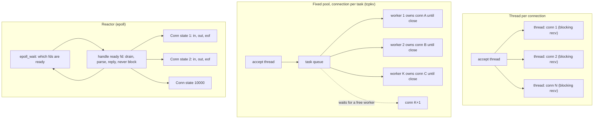

# Module 5.05: Server architectures

**Estimated hours:** 5

**What you will learn**

1. The four ways a server can serve many connections at once: one at a time, a thread per connection, a fixed thread pool, and an event loop (reactor) built on `epoll`.
2. What each one costs in memory, context switches and code complexity, and how to measure the difference instead of guessing.
3. Which architecture tcpkv and the banking app server use, why, and how to say so in an interview.

**Prerequisites:** [Module 5.04: TCP internals](module-04-tcp-internals.md). You also need the thread pool from module 4.10 and the line parser from module 2.16.

---

## 1. One-line intuition

A server architecture is the answer to one question: when 1,000 clients are connected and most of them are idle, who is waiting for whom, and what does that waiting cost?

## 2. Real-life analogy

Picture a bank branch with one door and many customers.

- **Iterative server:** one teller, one counter, one queue. The teller serves a customer completely, then calls the next. If one customer takes an hour, everybody waits an hour.
- **Thread per connection:** every customer who walks in gets a personal teller for as long as they stay. Wonderful for ten customers. With 10,000 customers the branch needs 10,000 tellers, most of them standing around doing nothing while "their" customer reads the forms.
- **Thread pool:** the branch has eight tellers. Customers take a token and sit. A free teller calls the next token. Eight is enough if most visits are short. But if eight customers all start one-hour loan applications, the ninth customer waits with a two-minute question. That is **head-of-line blocking**.
- **Reactor (event loop):** one very fast receptionist who never sits with anyone. Customers ring a bell only when they have something ready (a signed form, a question). The receptionist handles each ring in a few seconds and goes back to watching the bells. Nobody is "assigned". One person serves thousands, as long as no single ring takes long.

The kernel's `epoll` is the board of bells. A **non-blocking socket** is the rule "never sit with a customer; if they are not ready, move on".

## 3. Why it exists: the problem it solves

Module 5.03 taught you `accept`, `recv` and `send`. Each of those **blocks**: the calling thread sleeps until there is a connection, data, or buffer space. Blocking is fine for one client. It is the problem for many.

A thread that is blocked in `recv` is doing nothing useful, yet it still owns a stack, a kernel task structure and a slot in the scheduler. With one client, who cares. With 10,000 mostly idle connections (a real number for a branch-wide banking app server at month end, or a chat server, or a database), the questions become:

- How much memory do 10,000 waiting threads take?
- How much CPU does the scheduler spend switching between them?
- When a few connections are slow, do they stall the fast ones?
- When the server must stop, how do you wake up 10,000 blocked threads cleanly?

Every server architecture is a different answer. Without choosing one deliberately you get the default, which is "whatever the first prototype did", and you discover the limits in production at month end.

## 4. Three layers of depth

### Layer 1 (beginner): the four shapes

All four serve the same tiny protocol in the code below: a line `PING` gets `PONG`, any other line is echoed, `QUIT` closes. The difference is only *who* calls `recv` and *when*.

**1. Iterative.** `accept`, serve that client until it leaves, `accept` again. One thread, one connection at a time. Only acceptable for tools used by one person, like a debugging port.

```cpp
for (;;) serve_blocking(accept_one(listener));   // everyone else waits
```

**2. Thread per connection.** `accept`, start a thread for that client, go back to `accept`. Each thread runs the same blocking loop as the iterative server, so the code stays simple. Apache's classic prefork and worker modes work this way (with processes or threads).

```cpp
for (;;) {
    Fd conn = accept_one(listener);
    std::thread(serve_blocking, std::move(conn)).detach();
}
```

**3. Fixed thread pool with blocking I/O.** One accept thread. N worker threads created at start. The accept thread hands each new `Socket` to the pool as a task; a worker runs the blocking loop for that connection until it closes, then takes the next task. This is the tcpkv architecture (resume claim I: "fixed thread pool").

```cpp
ThreadPool pool(4);
for (;;) {
    Fd conn = accept_one(listener);
    auto shared = std::make_shared<Fd>(std::move(conn));
    pool.submit([shared] { serve_blocking(std::move(*shared)); });
}
```

**4. Reactor.** One thread. Every socket is set **non-blocking**, so `recv` returns immediately with `EAGAIN` ("nothing yet") instead of sleeping. The thread asks the kernel, through `epoll_wait`, "which of my sockets have something to do?", handles exactly those, and asks again. Each connection keeps its own small state (a partial input line, unsent output). nginx, Redis, Node.js and libuv work this way.

```cpp
for (;;) {
    int n = epoll_wait(ep, ready, 256, -1);        // sleep until something is ready
    for (int i = 0; i < n; ++i) handle(ready[i]);  // never block inside handle
}
```

**5. Proactor (mention only).** In the reactor the kernel says "you *can* read now" and you read. In a **proactor** you say "read into this buffer and tell me when it is *done*". Windows IOCP (I/O completion ports) and Linux `io_uring` are proactors. Same idea, one step further; module 3.11 covered the system calls. We do not build one in this course.

### Layer 2 (working engineer): costs, limits and the head-of-line problem

**Memory per thread.** Each thread has a stack. On Linux with glibc the default stack *reservation* is typically 8 MiB (from `ulimit -s`), but only the pages actually touched are backed by RAM, so a quiet thread typically costs tens of KB of real memory plus the kernel's task structure. 10,000 threads is therefore possible on a 64-bit machine (80 GB of *virtual* address space, which is free) but it is a lot of kernel objects to schedule. You can shrink the reservation with `pthread_attr_setstacksize` or `ulimit -s`; you cannot make the scheduler cost disappear.

**Context switch.** When thread A blocks and thread B runs, the kernel saves A's registers, switches page tables if needed, loads B's. Typical cost is on the order of 1 to 5 µs plus the cache misses that follow. With 10,000 connections each sending one small request per second, that is 10,000 wake-ups per second, which is fine. With 100 connections each sending 50,000 requests per second, the switch cost starts to dominate the work, and that is when the reactor pulls ahead.

**The C10K problem.** In 1999 the question "can one machine handle 10,000 simultaneous connections?" had the answer "not with a thread each". `epoll` (Linux 2.6, 2003) and `kqueue` (BSD) exist because of it. Today C10K is routine and the frontier is C10M, which needs kernel bypass. Know the term; interviewers use it.

**Fixed pool: two ways to dispatch.**

| Dispatch | What a task is | Good | Bad |
|---|---|---|---|
| Connection per task | A worker owns one connection from accept to close | Simple; the blocking loop from 5.03 works unchanged; each connection's state lives on one thread's stack | With N workers, connection N+1 waits in the queue until someone disconnects, even if the N are idle |
| Request per task | A worker takes one request, replies, puts the connection back | N workers serve thousands of idle connections | Someone must still *detect* that a connection has data without blocking a worker, which means an `epoll` loop anyway; partial-line state must live in a per-connection object, not on the stack |

tcpkv uses connection-per-task with a note on the limit. The app server (capstone C2) uses request-per-task because its connections are long-lived and mostly idle.

**Head-of-line blocking** (HOL) is the thread pool's disease. Eight workers, eight slow requests (say a 2-second report), and the ninth request, a 1 ms balance lookup, waits 2 seconds. Cures: more workers than you think you need, separate pools for slow and fast work, timeouts, and bounded queues (module 5.10). The reactor has the mirror-image disease: one slow *handler* stalls *every* connection, because there is only one thread. That is why reactors never do blocking database calls on the loop; they hand them to a pool.

**Trade-off table.** Measurements belong in your journal, not in this table; you will produce them in Part D with the load generator from module 5.11.

| Architecture | Threads for 1,000 idle connections | Code complexity | Blocking calls allowed in handler | Multi-core use | HOL risk | Typical users |
|---|---|---|---|---|---|---|
| Iterative | 1 | trivial | yes | none | total | debug ports, `inetd`-style tools |
| Thread per connection | 1,000 | low | yes | yes | low (one slow client hurts only itself) | Apache prefork/worker, many Java servers |
| Fixed pool, connection per task | N (e.g. 8) | low | yes | yes | high if clients outnumber workers | tcpkv |
| Fixed pool, request per task | N + 1 event loop | medium | yes, in workers | yes | medium | app server (C2), nginx + FastCGI backends |
| Reactor, single loop | 1 | high (state machines) | **no** | one core | one slow handler stalls all | Redis, Node.js |
| Reactor, N loops | N | high | no | yes | per loop | nginx workers, Envoy, Netty |
| Proactor | kernel threads + N | high | no | yes | per loop | Windows IOCP servers, io_uring |

**Real-world mapping.**

- **Apache httpd:** `prefork` = process per connection, `worker` = thread per connection inside a few processes, `event` = a reactor for idle keep-alive connections plus threads for active ones.
- **nginx:** a master and a few worker *processes*; each worker is a single-threaded `epoll` reactor. That is how one small VM serves tens of thousands of connections.
- **PostgreSQL:** process per connection (`fork` on connect). A connection costs several MB and a backend process, which is why every serious deployment puts a pooler (PgBouncer) in front. Module 6.12.
- **Redis:** one event loop thread does all command execution (since 6.0 extra threads may help with network reads and writes, but commands still run on one thread). That is why a single slow command such as `KEYS *` stalls every client.
- **YugabyteDB / RocksDB servers:** reactor-style I/O threads plus worker pools; the general pattern for anything that must use many cores and never block the loop.

### Layer 3 (internals): what `epoll` and a blocked thread actually are

**A blocked thread.** When a thread calls `recv` on an empty socket, the kernel puts the task into state `TASK_INTERRUPTIBLE`, adds it to the socket's **wait queue**, and calls the scheduler. The thread uses no CPU. When bytes arrive, the network stack walks that wait queue and marks the task runnable. The cost is the two context switches (into sleep, out of sleep), the scheduler bookkeeping, and the cold cache the thread comes back to. One thread per connection is one wait-queue entry per connection, which the kernel handles fine; the cost is in the switches and the stacks.

**`epoll` is a wait queue the application owns.** `epoll_create1` makes a kernel object holding an **interest list** (which fds, which events) and a **ready list**. `epoll_ctl(ADD)` hooks a callback into the fd's wait queue. When data arrives on any registered socket, the callback moves that fd onto the ready list. `epoll_wait` returns the ready list, or sleeps until it is non-empty. So the cost of waiting on 10,000 sockets is one sleeping thread, and the cost of *checking* is proportional to the number of *ready* sockets, not the number registered. That is the difference from the older `select` and `poll`, which scanned every fd on every call.

**Level-triggered vs edge-triggered.** By default (`EPOLLIN`) epoll is **level-triggered**: as long as unread bytes remain, `epoll_wait` keeps reporting the fd. With `EPOLLET` it is **edge-triggered**: reported once when new bytes arrive, then silent until more arrive. Edge-triggered saves wake-ups but *requires* you to read until `EAGAIN` every time or you lose data forever. The code below uses level-triggered and still drains to `EAGAIN`, which is the safe habit either way.

**Non-blocking sockets.** `fcntl(fd, F_SETFL, O_NONBLOCK)` sets a flag on the open file description. With it, `recv` on an empty socket returns `-1` with `errno == EAGAIN` (or `EWOULDBLOCK`, the same value on Linux) instead of sleeping, and `send` on a full socket buffer returns a partial count or `EAGAIN`. Your code must then keep the unsent bytes and ask for `EPOLLOUT` so the loop wakes you when space frees up. That is why each reactor connection carries an `out` buffer.

**Why the 2.16 parser fits the reactor.** A reactor never gets "a line"; it gets "some bytes" and must remember the partial line until the rest arrives. The parser you wrote in 2.16 already takes bytes, keeps a buffer, and yields complete commands, so its state object slots directly into the per-connection `Conn` struct.

**Thundering herd on accept.** With N reactor loops all waiting on the same listening socket, one new connection used to wake all N (the "thundering herd"). Modern kernels wake one with `EPOLLEXCLUSIVE`, or you give each loop its own listening socket with `SO_REUSEPORT`. nginx uses the latter.

## 5. Architecture diagram



In the first two shapes the connection's state lives on a thread's stack. In the reactor it lives in an explicit object, because no thread stays with the connection.

## 6. Code

One program, one protocol, four architectures chosen by a command-line flag. The `Fd` class is a cut-down copy of the `Socket` wrapper from 5.03 so the file stands alone; the `ThreadPool` is the 4.10 pool with the extras removed.

```cpp
// arch_servers.cpp
// One tiny line protocol ("PING" -> "PONG", anything else -> "ECHO <line>",
// "QUIT" closes), served by four different architectures chosen at start:
//   ./arch_servers iterative 7000
//   ./arch_servers thread    7000     (thread per connection)
//   ./arch_servers pool      7000     (fixed thread pool, one connection per task)
//   ./arch_servers epoll     7000     (single-threaded reactor)
// Press Ctrl+C to stop.
#include <arpa/inet.h>
#include <fcntl.h>
#include <netinet/in.h>
#include <sys/epoll.h>
#include <sys/socket.h>
#include <unistd.h>

#include <cerrno>
#include <condition_variable>
#include <cstring>
#include <functional>
#include <iostream>
#include <memory>
#include <mutex>
#include <queue>
#include <string>
#include <thread>
#include <unordered_map>
#include <vector>

// ---------------------------------------------------------------- RAII fd
// Same shape as the Socket class from module 5.03: owns one descriptor,
// move-only, closes in the destructor. Copied here so this file stands alone.
class Fd {
public:
    Fd() = default;
    explicit Fd(int fd) : fd_(fd) {}
    ~Fd() { if (fd_ >= 0) ::close(fd_); }
    Fd(Fd&& o) noexcept : fd_(o.fd_) { o.fd_ = -1; }
    Fd& operator=(Fd&& o) noexcept {
        if (this != &o) { if (fd_ >= 0) ::close(fd_); fd_ = o.fd_; o.fd_ = -1; }
        return *this;
    }
    Fd(const Fd&) = delete;
    Fd& operator=(const Fd&) = delete;
    int get() const { return fd_; }
private:
    int fd_ = -1;
};

// ---------------------------------------------------------------- protocol
// The "application": given one complete line, produce the reply.
static std::string handle_line(const std::string& line) {
    if (line == "PING") return "PONG\n";
    return "ECHO " + line + "\n";
}

// send() may write fewer bytes than asked; loop until all are out.
static bool send_all(int fd, const std::string& s) {
    size_t sent = 0;
    while (sent < s.size()) {
        ssize_t n = ::send(fd, s.data() + sent, s.size() - sent, MSG_NOSIGNAL);
        if (n < 0) { if (errno == EINTR) continue; return false; }
        sent += static_cast<size_t>(n);
    }
    return true;
}

// Blocking per-connection loop, shared by iterative, thread and pool modes.
// The buffer handles partial lines: TCP gives bytes, not lines.
static void serve_blocking(Fd conn) {
    std::string buf;
    char tmp[4096];
    for (;;) {
        ssize_t n = ::recv(conn.get(), tmp, sizeof tmp, 0);
        if (n <= 0) return;                      // peer closed or error
        buf.append(tmp, static_cast<size_t>(n));
        size_t pos;
        while ((pos = buf.find('\n')) != std::string::npos) {
            std::string line = buf.substr(0, pos);
            if (!line.empty() && line.back() == '\r') line.pop_back();
            buf.erase(0, pos + 1);
            if (line == "QUIT") return;
            if (!send_all(conn.get(), handle_line(line))) return;
        }
        if (buf.size() > 65536) return;          // line too long: drop client
    }
}

static Fd make_listener(uint16_t port) {
    int fd = ::socket(AF_INET, SOCK_STREAM, 0);
    if (fd < 0) { std::perror("socket"); std::exit(1); }
    int yes = 1;
    ::setsockopt(fd, SOL_SOCKET, SO_REUSEADDR, &yes, sizeof yes);
    sockaddr_in addr{};
    addr.sin_family = AF_INET;
    addr.sin_addr.s_addr = htonl(INADDR_ANY);
    addr.sin_port = htons(port);
    if (::bind(fd, reinterpret_cast<sockaddr*>(&addr), sizeof addr) < 0) {
        std::perror("bind"); std::exit(1);
    }
    if (::listen(fd, 128) < 0) { std::perror("listen"); std::exit(1); }
    return Fd(fd);
}

static Fd accept_one(const Fd& listener) {
    for (;;) {
        int c = ::accept(listener.get(), nullptr, nullptr);
        if (c >= 0) return Fd(c);
        if (errno != EINTR) { std::perror("accept"); std::exit(1); }
    }
}

// ---------------------------------------------------------------- 1. iterative
static void run_iterative(const Fd& listener) {
    for (;;) serve_blocking(accept_one(listener));   // one client at a time
}

// ---------------------------------------------------------------- 2. thread per connection
static void run_thread_per_conn(const Fd& listener) {
    for (;;) {
        Fd conn = accept_one(listener);
        std::thread(serve_blocking, std::move(conn)).detach();
    }
}

// ---------------------------------------------------------------- 3. fixed thread pool
// Cut-down version of the pool from module 4.10.
class ThreadPool {
public:
    explicit ThreadPool(unsigned n) {
        for (unsigned i = 0; i < n; ++i) workers_.emplace_back([this] { loop(); });
    }
    ~ThreadPool() {
        { std::lock_guard<std::mutex> lk(m_); stop_ = true; }
        cv_.notify_all();
        for (auto& t : workers_) t.join();
    }
    void submit(std::function<void()> task) {
        { std::lock_guard<std::mutex> lk(m_); q_.push(std::move(task)); }
        cv_.notify_one();
    }
private:
    void loop() {
        for (;;) {
            std::function<void()> task;
            {
                std::unique_lock<std::mutex> lk(m_);
                cv_.wait(lk, [this] { return stop_ || !q_.empty(); });
                if (stop_ && q_.empty()) return;
                task = std::move(q_.front());
                q_.pop();
            }
            task();
        }
    }
    std::mutex m_;
    std::condition_variable cv_;
    std::queue<std::function<void()>> q_;
    std::vector<std::thread> workers_;
    bool stop_ = false;
};

static void run_pool(const Fd& listener, unsigned n_workers) {
    ThreadPool pool(n_workers);
    for (;;) {
        Fd conn = accept_one(listener);
        // std::function must be copyable, so park the move-only Fd in a shared_ptr.
        auto shared = std::make_shared<Fd>(std::move(conn));
        pool.submit([shared] { serve_blocking(std::move(*shared)); });
    }
}

// ---------------------------------------------------------------- 4. reactor (epoll)
struct Conn {
    Fd fd;
    std::string in;    // bytes received, not yet a full line
    std::string out;   // bytes to send, not yet accepted by the kernel
    bool eof = false;  // peer has sent FIN; close once out is empty
};

static void set_nonblocking(int fd) {
    int flags = ::fcntl(fd, F_GETFL, 0);
    ::fcntl(fd, F_SETFL, flags | O_NONBLOCK);
}

static void epoll_update(int ep, int fd, uint32_t events) {
    epoll_event ev{};
    ev.events = events;
    ev.data.fd = fd;
    ::epoll_ctl(ep, EPOLL_CTL_MOD, fd, &ev);
}

static void run_epoll(const Fd& listener) {
    set_nonblocking(listener.get());
    Fd ep(::epoll_create1(0));
    epoll_event ev{};
    ev.events = EPOLLIN;
    ev.data.fd = listener.get();
    ::epoll_ctl(ep.get(), EPOLL_CTL_ADD, listener.get(), &ev);

    std::unordered_map<int, Conn> conns;        // per-connection state machine
    std::vector<epoll_event> ready(256);

    for (;;) {
        int n = ::epoll_wait(ep.get(), ready.data(), static_cast<int>(ready.size()), -1);
        if (n < 0) { if (errno == EINTR) continue; std::perror("epoll_wait"); return; }

        for (int i = 0; i < n; ++i) {
            int fd = ready[i].data.fd;

            if (fd == listener.get()) {            // new connections
                for (;;) {
                    int c = ::accept(listener.get(), nullptr, nullptr);
                    if (c < 0) break;              // EAGAIN: queue drained
                    set_nonblocking(c);
                    epoll_event cev{};
                    cev.events = EPOLLIN;
                    cev.data.fd = c;
                    ::epoll_ctl(ep.get(), EPOLL_CTL_ADD, c, &cev);
                    conns[c].fd = Fd(c);
                }
                continue;
            }

            Conn& conn = conns[fd];
            bool close_it = false;   // error, QUIT or oversize: drop now

            if (ready[i].events & EPOLLIN) {      // readable: drain the socket
                char tmp[4096];
                for (;;) {
                    ssize_t r = ::recv(fd, tmp, sizeof tmp, 0);
                    if (r > 0) { conn.in.append(tmp, static_cast<size_t>(r)); continue; }
                    if (r == 0) { conn.eof = true; break; }
                    if (errno == EAGAIN || errno == EWOULDBLOCK) break;
                    close_it = true; break;
                }
                size_t pos;
                bool quit = false;
                while (!close_it && !quit && (pos = conn.in.find('\n')) != std::string::npos) {
                    std::string line = conn.in.substr(0, pos);
                    if (!line.empty() && line.back() == '\r') line.pop_back();
                    conn.in.erase(0, pos + 1);
                    if (line == "QUIT") { quit = true; conn.eof = true; break; }   // flush, then close
                    conn.out += handle_line(line);
                }
                if (conn.in.size() > 65536) close_it = true;
            }

            if (!close_it && !conn.out.empty()) {  // try to send what we have
                ssize_t w = ::send(fd, conn.out.data(), conn.out.size(), MSG_NOSIGNAL);
                if (w > 0) conn.out.erase(0, static_cast<size_t>(w));
                else if (w < 0 && errno != EAGAIN && errno != EWOULDBLOCK) close_it = true;
                // Ask for EPOLLOUT only while there is unsent data.
                epoll_update(ep.get(), fd, conn.out.empty() ? EPOLLIN : (EPOLLIN | EPOLLOUT));
            }

            if (conn.eof && conn.out.empty()) close_it = true;   // replied; now close
            if (close_it || (ready[i].events & (EPOLLHUP | EPOLLERR))) {
                ::epoll_ctl(ep.get(), EPOLL_CTL_DEL, fd, nullptr);
                conns.erase(fd);                   // Fd destructor closes it
            }
        }
    }
}

// ---------------------------------------------------------------- main
int main(int argc, char** argv) {
    if (argc < 3) {
        std::cerr << "usage: " << argv[0] << " iterative|thread|pool|epoll <port>\n";
        return 1;
    }
    std::string mode = argv[1];
    auto port = static_cast<uint16_t>(std::stoi(argv[2]));
    Fd listener = make_listener(port);
    std::cout << "mode=" << mode << " listening on port " << port << "\n";

    if (mode == "iterative") run_iterative(listener);
    else if (mode == "thread") run_thread_per_conn(listener);
    else if (mode == "pool") run_pool(listener, 4);
    else if (mode == "epoll") run_epoll(listener);
    else { std::cerr << "unknown mode\n"; return 1; }
    return 0;
}
```

Compile, then run one mode in a terminal and talk to it from a second terminal:

```bash
g++ -std=c++17 -O2 -Wall -Wextra -Werror -g -pthread -o arch_servers arch_servers.cpp
./arch_servers epoll 7000
```

Second terminal:

```bash
printf 'PING\nhello bank\nQUIT\n' | nc -q1 127.0.0.1 7000
```

Expected output in the second terminal, identical for all four modes:

```text
PONG
ECHO hello bank
```

A bug you would have hit writing this yourself, and which the first draft of this program had: `nc -q1` sends its three lines and then immediately half-closes (sends FIN). In the reactor, the drain loop sees the bytes *and* the EOF in one go. If EOF simply meant "close now", the buffered `PING` would never be answered. That is why `Conn` has an `eof` flag and the loop answers everything it has before closing. Blocking servers never notice this because they reply after each `recv`. Reactors make the ordering explicit, which is the price and the power of the state machine.

## 7. Use case: core-banking loan-origination platform

Two servers in this course, two different decisions, both deliberate.

**tcpkv (capstone C1): fixed thread pool, one connection per worker task.** The decision: clarity and sanitizer-friendliness over maximum connection count. Each connection's state lives on one worker's stack, the blocking loop from 5.03 is reused unchanged, and ThreadSanitizer sees ordinary mutex-protected sharing (the store under `shared_mutex`) rather than a hand-written state machine with subtle lifetime rules. The limit is documented in the README: with K workers, the K+1-th connection waits for a disconnect. The documented upgrade path is the reactor: keep the parser from 2.16, move connection state into a `Conn` object, and run N epoll loops. Being able to say "I chose the pool for these reasons, measured where it breaks, and know exactly what the upgrade is" is worth more in an interview than having shipped the reactor.

**App server (capstone C2, resume claim H4): pooled workers with blocking database calls.** Every loan-origination request ends in one or more round trips to the distributed SQL database, typically a few milliseconds each (module 7.x will measure it). The CPU work of parsing and validating is microseconds. The DB round trip dominates by a factor of a thousand. A reactor would gain nothing on the network side and would force every DB call off the loop onto a pool anyway. So the decision was: an accept/dispatch front, a bounded request queue, and a pool of workers that block on the database driver. The **in-memory master-table cache** (branches, products, schemes) exists precisely to remove the one DB round trip that *every* request would otherwise make, which shortens the time each worker holds its slot and therefore raises how many requests the same pool can carry. Sizing the pool is a Little's-law exercise: at 5 ms per request and a target of 2,000 requests per second you need about 10 busy workers, so you provision 32 and leave headroom for a slow database day.

## 8. Lab

### Part A: watch threads appear and disappear (20 minutes)

1. Build `arch_servers`. Run `./arch_servers thread 7000`.
2. In a second terminal open 20 idle connections and keep them open:

```bash
for i in $(seq 1 20); do (sleep 60 | nc 127.0.0.1 7000) & done
```

3. In a third terminal: `ps -o pid,nlwp,rss,cmd -C arch_servers`. `nlwp` is the number of threads. Expected: 21 (20 connections plus the accept thread). `rss` is resident memory in KB.
4. Kill the `nc` processes (`pkill -f "nc 127.0.0.1 7000"`) and repeat the `ps`. Expected: `nlwp` back to 1.
5. Repeat steps 1 to 4 with `pool`. Expected: `nlwp` is 5 (4 workers plus accept) no matter how many clients connect. Now connect a fifth client and type `PING`: it gets no reply until one of the first four disconnects. Write down that this is the head-of-line limit of connection-per-task.
6. Repeat with `epoll`. Expected: `nlwp` is 1 with 20 clients, and all 20 are served.

### Part B: how much does a thread cost? (20 minutes)

1. `ulimit -s` prints the default stack reservation in KB (typically 8192).
2. With `./arch_servers thread 7000` running and 200 idle connections open (change `20` to `200` in the loop above), compare `VmSize` and `VmRSS` in `cat /proc/$(pgrep arch_servers)/status`.
3. Expected: `VmSize` (virtual) grows by roughly 8 MB per thread; `VmRSS` (real) grows by far less, typically tens of KB per thread. Record both numbers per thread. This is the honest answer to "how much memory does a thread take": a large reservation, a small footprint, until the thread actually uses its stack.

### Part C: break the reactor on purpose (20 minutes)

1. In `run_epoll`, inside `handle_line`'s call site, add a deliberate stall: `if (line == "SLOW") std::this_thread::sleep_for(std::chrono::seconds(5));` before `conn.out += handle_line(line);` (add `#include <chrono>`).
2. Rebuild, run `epoll`, and from two terminals send `SLOW` in one and `PING` in the other immediately after.
3. Expected: the `PING` client waits the full 5 seconds. One blocking handler stalls everyone. This is the reactor's head-of-line problem and the reason the app server does not run DB calls on a loop thread.
4. Repeat with `pool`: the `PING` client is answered immediately (as long as fewer than 4 clients are `SLOW`). Remove the stall when done.

### Part D: the measurement plan (do it in module 5.11; plan it now)

You will build a load generator in module 5.11. Prepare this table in your journal and fill it in then, for each of `thread`, `pool` and `epoll`:

| Connections | Mode | ops/sec | p50 latency | p99 latency | threads (`nlwp`) | RSS |
|---|---|---|---|---|---|---|
| 10 | | | | | | |
| 100 | | | | | | |
| 1000 | | | | | | |

Predict now, before measuring, which mode wins at 10 and which at 1,000 connections, and write the prediction down. Expected pattern (typical, not a promise): at 10 connections all three are close; at 1,000 the thread mode shows higher p99 and much more RSS, the pool with 4 workers cannot even serve 1,000 (connection-per-task), and epoll serves all with one thread. Your numbers are the interview story.

### Journal

Copy [journal/TEMPLATE.md](../journal/TEMPLATE.md) to `journal/YYYY-MM-DD-server-architectures.md`. Record: the `nlwp` counts per mode from Part A; the virtual and resident bytes per thread from Part B; what the `PING` client experienced in Part C under each mode; your prediction table from Part D; and one paragraph stating which architecture tcpkv uses and the two reasons why.

## 9. Common mistakes and misconceptions

| Mistake | Why it is wrong | Bug it causes later |
|---|---|---|
| "Threads are expensive, so always use epoll" | A thread per connection is fine up to a few hundred connections and is far simpler | Weeks spent on a state machine for a server with 30 clients |
| "epoll makes the server multi-core" | One epoll loop is one thread; you need N loops or a pool for N cores | A reactor that maxes out one core while seven sit idle |
| Blocking inside a reactor handler | The loop cannot serve anyone else meanwhile | One slow DB query freezes every connection |
| Assuming one `recv` returns one message | TCP is a byte stream; lines and frames straddle reads | Commands silently merged or split under load, never in tests |
| Edge-triggered epoll without draining to `EAGAIN` | The event fires once; unread bytes never trigger again | A connection that hangs forever with data sitting in its buffer |
| Forgetting `EPOLLOUT` handling | `send` on a full buffer returns partial or `EAGAIN` | Truncated replies to slow clients, usually only in production |
| Closing on EOF before flushing pending output | The peer may half-close right after sending its request | Clients that use `shutdown(SHUT_WR)` never get their last reply |
| Fixed pool sized to the CPU count for blocking I/O | Workers spend most of their time waiting, not computing | Throughput capped at `workers / latency` far below what the CPU could do |
| Sharing a per-connection buffer across worker threads | Request-per-task hands the same connection to different threads over time | Data races in the parser that TSan catches only under load |

## 10. Resume link

- **Claim I, "tcpkv: a C++17 multithreaded TCP key-value server with a fixed thread pool".** The interview question is always "why a pool and not epoll?". Answer from section 7: "Connection-per-task on a fixed pool kept each connection's state on one stack, reused the blocking I/O path, and made TSan runs meaningful. I documented the limit, K connections for K workers, and measured it with my load generator (numbers from Part D). The upgrade path is N epoll loops with the same parser, because the parser already handles partial lines."
- **Claim H4, "multithreaded application server ... pooled request model".** Say: "Requests were queued to a worker pool that made blocking calls to the database. The DB round trip, a few milliseconds, dominated the microseconds of CPU work, so a reactor would not have helped; sizing the pool and shortening the time each worker held a slot did. The master-table cache existed to cut one round trip per request."
- **Claim C, "thread pools".** Be ready for "what is head-of-line blocking in a pool and how do you mitigate it?": more workers than cores for blocking work, separate pools for slow and fast operations, bounded queues and timeouts (module 5.10).

Likely follow-up: "How does nginx serve 10,000 connections with a handful of processes?" Answer: each worker is a single-threaded epoll reactor with non-blocking sockets; the cost of waiting is one sleeping thread, and the cost per wake-up is proportional to the number of *ready* sockets, not the number connected.

## 11. Interview questions

**Q1 (easy). What is the difference between a blocking and a non-blocking socket?**

<details>
<summary>Model answer</summary>

On a blocking socket, `recv` sleeps the calling thread until data arrives and `send` sleeps until the kernel has room; the thread does nothing else meanwhile. On a non-blocking socket (`O_NONBLOCK`), the same calls return immediately with `EAGAIN` when they cannot proceed, so the thread can go and serve other sockets. Non-blocking sockets are only useful together with a readiness mechanism such as `epoll` that tells the thread which sockets to try next; otherwise the thread would spin.

</details>

**Q2 (easy). Why not simply create one thread per connection?**

<details>
<summary>Model answer</summary>

It works and is the simplest correct design up to a few hundred connections. Beyond that, each thread costs a stack reservation (typically 8 MiB virtual, tens of KB resident), a kernel task and scheduler work. With thousands of mostly idle connections the server spends its time context-switching, and the memory and thread-count limits of the machine become the capacity limit. A pool bounds the thread count; a reactor removes the per-connection thread entirely.

</details>

**Q3 (medium). Explain head-of-line blocking in a fixed thread pool and in a single-threaded reactor. Which design suffers which?**

<details>
<summary>Model answer</summary>

In a pool with N workers, N slow requests occupy all workers and every later request, however fast, waits behind them: the queue head blocks the line. Mitigations are over-provisioning workers for blocking work, separate pools for slow and fast operations, bounded queues and timeouts. In a single-threaded reactor the problem is inverted: one handler that blocks (a disk read, a DB call, a long computation) stalls every connection, because the only thread is busy. The rule is that reactor handlers must never block; slow work is handed to a pool and its result delivered back to the loop. tcpkv uses a pool and documents the first problem; the app server uses pooled workers precisely because its handlers block on the database.

</details>

**Q4 (medium). What does `epoll_wait` do that `select` and `poll` do not?**

<details>
<summary>Model answer</summary>

`select` and `poll` take the full list of file descriptors on every call; the kernel scans all of them and the application scans the result, so the cost grows with the number of connections even when only a few are active. `epoll` keeps the interest list inside the kernel (`epoll_ctl` adds or removes once), hooks a callback into each descriptor's wait queue, and maintains a ready list. `epoll_wait` returns only the ready descriptors, so the cost is proportional to activity, not to connection count. That property is what made 10,000 or more concurrent connections per process practical. It also offers edge-triggered mode and `EPOLLEXCLUSIVE` to avoid thundering-herd wake-ups on a shared listening socket.

</details>

**Q5 (hard). You run a tcpkv-style server as a reactor. A client sends `SET k v\nGET k\n` and then immediately half-closes with `shutdown(SHUT_WR)`. Walk through what the loop must do, and name the bug a naive implementation has.**

<details>
<summary>Model answer</summary>

`epoll_wait` reports the socket readable. The handler drains with `recv` until `EAGAIN`: the first call returns the bytes, a later call returns 0 because the FIN arrived. A naive loop treats 0 as "close now" and drops the connection with the two commands still sitting unprocessed in the input buffer, so the client never sees `OK` or `VALUE`. The correct sequence is: append bytes to the per-connection input buffer; record EOF in the connection state; parse all complete lines and append replies to the output buffer; attempt `send`, enabling `EPOLLOUT` if the kernel accepts only part; and close only when EOF has been seen *and* the output buffer is empty. A second subtlety: if the client later sends more data after a half-close it cannot, so once EOF is set the loop must not expect further input; the state machine is strictly read-to-EOF, flush, close. Blocking servers reply after each `recv`, so they never meet this ordering; reactors make it explicit.

</details>

## 12. Revision

- Four shapes: iterative (one at a time), thread per connection (simple, costs a stack and a context switch per client), fixed pool (bounded threads, head-of-line risk), reactor (one thread, non-blocking sockets, `epoll`, explicit per-connection state, handlers must never block).
- `epoll` keeps the interest list in the kernel and returns only ready descriptors, so waiting on 10,000 sockets costs one sleeping thread; nginx and Redis are reactors, Apache prefork and PostgreSQL are process-per-connection, tcpkv is a fixed pool with one connection per task.
- The app server pools workers that block on the database because the DB round trip dominates; the reactor is tcpkv's documented upgrade path and the 2.16 parser already fits it.

---

Previous: [Module 5.04: TCP internals](module-04-tcp-internals.md) | Next: [Module 5.06: Wire protocol design](module-06-wire-protocol-design.md)
