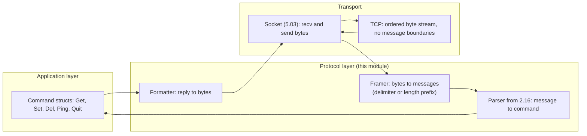

# Module 5.06: Wire protocol design

**Estimated hours:** 4

**What you will learn**

1. Why TCP gives you bytes and not messages, and the four ways to put message boundaries back (framing).
2. How to choose between a text protocol and a binary one, how to version a protocol without breaking old clients, and how to make commands safe to retry.
3. The complete tcpkv protocol, written as a specification you can hand to someone else, plus the list of malformed inputs your parser must reject.

**Prerequisites:** [Module 5.05: Server architectures](module-05-server-architectures.md), and the parser from module 2.16.

---

## 1. One-line intuition

A wire protocol is the written agreement about which bytes mean what; framing is the part of that agreement that says where one message ends and the next begins.

## 2. Real-life analogy

Two clerks in different buildings communicate by a pneumatic tube that carries a continuous paper ribbon. The ribbon has no gaps. If clerk A writes "GET loan 77" and then "SET loan 78 approved", clerk B sees `GETloan77SETloan78approved` and has to guess the boundaries.

Three fixes, which are the three framing families:

- **Draw a line after each message** (a delimiter). Works until a message itself contains the line symbol.
- **Write "the next message is 11 characters" at the start of each** (a length prefix). Works for anything, but a smudged number ("the next message is 4,000,000,000 characters") makes B wait forever or run out of paper.
- **Agree that every message is exactly 20 characters** (fixed size). Fast and dumb; wasteful for short messages, impossible for long ones.

And the language question: do the clerks write in plain English ("GET loan 77"), which anyone can read with a magnifying glass but takes more ink, or in a private code of numbers, which is compact and precise but needs a codebook to debug? That is text versus binary.

## 3. Why it exists: the problem it solves

Module 5.04 showed it: TCP is a **byte stream**. The sender calls `send` three times; the receiver may get the bytes in one `recv`, in seven, or with the end of one message and the start of the next in the same buffer. Nothing in TCP remembers where a `send` call started.

Without a framing rule the server works in tests (one small message, one `recv`) and fails in production (bursts, slow links, Nagle's algorithm coalescing writes). Symptoms are the classic "works on localhost, breaks over the WAN".

Without a protocol *specification*, two engineers write client and server from the same vague conversation and they disagree on a detail: is the value allowed to contain spaces? Is `get` the same as `GET`? What does the server send on an unknown command? Each disagreement is a production bug. The spec exists so the disagreements happen on paper.

## 4. Three layers of depth

### Layer 1 (beginner): four framing strategies

| Strategy | Rule | Example | Needs |
|---|---|---|---|
| Delimiter | A special byte ends each message | `GET k\n` | A way to handle the delimiter inside data (forbid it or escape it) and a maximum length |
| Length prefix | A fixed-size number first, then that many bytes | `00 00 00 05 P I N G` | A sanity cap on the length, and an agreed byte order for the number |
| Fixed-size records | Every message is exactly N bytes | 64-byte market-data ticks | Nothing, but wastes space and cannot grow |
| Self-describing (TLV) | Each field is Type, Length, Value | ASN.1, Protobuf wire format | A schema or registry to interpret types |

**Delimiter framing** is what tcpkv uses: a line ends at `\n` (`\r\n` is tolerated so `telnet` and Windows `nc` work). Because the delimiter cannot appear inside a key or value, values that need a newline must be escaped or are simply forbidden. tcpkv forbids them, which is the simplest honest choice for a key-value store with short values. A **maximum line length** is mandatory: without it, a client that never sends `\n` makes the server buffer forever and run out of memory.

**Length-prefix framing** is what the app server's RPC layer uses (module 5.07): 4 bytes holding the body length in **big-endian** order (also called **network byte order**: most significant byte first), then the body. Big-endian is the convention for anything called a "network" header, and `htonl` / `ntohl` ("host to network long" and back) convert for you. A length-prefixed body can hold any bytes, including newlines and zeros. The mandatory safety rule: **sanity-cap the length before allocating**. A client that sends `FF FF FF FF` is asking you to allocate 4 GiB.

**Fixed-size records** appear in market data feeds and in the Berkeley DB packed records from capstone C3, where a struct is written as-is. Fast to parse (a pointer cast, after checking alignment and endianness) and impossible to extend.

**TLV** (type-length-value) lets each field describe itself. It is how Protobuf encodes fields on the wire, and how TLS and ASN.1 certificates are built. Flexible, self-skipping (unknown types can be stepped over using their length), and more work to hand-write.

### Layer 2 (working engineer): text vs binary, versioning, errors, idempotency

**Text vs binary.**

| Property | Text line protocol (tcpkv, Redis RESP, SMTP, HTTP/1.1) | Length-prefixed binary (RPC in 5.07, HTTP/2, PostgreSQL wire) |
|---|---|---|
| Debug with `nc` or `telnet` | Yes, type commands by hand | No, you need a client or a hex dump |
| Size on the wire | Larger: `SET loan:77 25000\n` is 18 bytes | Smaller: integers are 4 or 8 bytes regardless of value |
| Parse cost | Tokenising and `std::stoll`; fine for small messages | A few `memcpy` calls; cheaper per message |
| Type safety | Everything is a string until you convert it | The layout says "this is a u64"; the schema is the contract |
| Ambiguity risk | Spaces in values, case, trailing `\r`, encodings | Byte order, struct padding, version skew |
| Extensibility | Add a new command word; old servers reply `ERR UNKNOWN_COMMAND` | Add fields at the end; readers ignore trailing bytes |
| Where it wins | Operator-facing tools, low message rates, teaching | High message rates, structured records, machine-to-machine |

Neither is "better". Redis is text and serves hundreds of thousands of operations per second per core; its designers chose debuggability and kept the parser cheap by design (prefix lengths inside the text format, so no scanning for delimiters in bulk strings). The app server chose binary because its messages are structured loan records with a dozen typed fields, sent at high rate, between two programs no human ever types at.

**Versioning.** A protocol that cannot change is dead; one that changes carelessly breaks every old client at 2 a.m. Rules:

1. **Carry a version** somewhere a reader sees before anything else: a version byte in a binary header, or a `HELLO <version>` first line in text.
2. **Negotiate on HELLO.** Client says what it speaks; server answers with what it will use. Both sides then know. TLS and HTTP/2 do exactly this (ALPN, module 5.09).
3. **Additive changes only.** Add a new command, a new reply, a new optional field at the end. Never change the meaning of an existing byte, never reuse a removed field's position, never make an optional field required.
4. **Old readers skip what they do not know.** Length prefixes make this possible: an unknown trailing field is just bytes to skip.

**Error replies.** Every protocol needs a reply that says "I understood you but cannot do that" and one that says "I did not understand you". They must be distinguishable from success by the first token, so a client never has to guess. tcpkv uses `ERR <code> <message>`: the code is for programs, the message is for humans. Error codes are part of the specification, not an afterthought.

**Idempotency.** A command is **idempotent** if doing it twice has the same effect as doing it once. This matters because clients retry on timeout, and a timeout does not tell you whether the first attempt was applied.

| Command | Idempotent? | Why |
|---|---|---|
| `GET k` | yes | reads only |
| `PING` | yes | reads nothing |
| `SET k v` | yes | the second `SET` leaves the same value |
| `DEL k` | in effect, yes; in reply, no | the key is gone either way, but the second attempt says `NOT_FOUND` instead of `DELETED` |
| `INCR k` (if we had it) | **no** | a retry adds 1 twice |

For non-idempotent operations such as "create a loan" the fix is an **idempotency key**: the client attaches a unique request id and the server remembers which ids it has applied. Module 5.07 builds it. tcpkv deliberately has no `INCR` so that every command is safe to retry.

### Layer 3 (internals): what the bytes look like and where parsers fail

**What a length-prefixed frame looks like.** The body `PING` is 4 bytes, so the prefix is `00 00 00 04`:

```text
offset  0  1  2  3  4  5  6  7
bytes  00 00 00 04 50 49 4e 47
        \_________/ \_________/
         len = 4      "PING"
```

On an x86-64 machine (little-endian), the integer 4 is stored in memory as `04 00 00 00`. `htonl(4)` turns that into `00 00 00 04`. Forgetting `htonl` on one side and not the other gives a length of `0x04000000` = 67,108,864 bytes, which the sanity cap catches. Without the cap the server would `malloc` 64 MB per connection and wait forever.

**Where delimiter parsers fail.** The dangerous cases are all about *where the read boundary falls*:

1. The delimiter is the last byte of one `recv` and the next message starts in the following `recv` (works by accident in most code).
2. The delimiter is the *first* byte of a `recv` (the previous read ended one byte short).
3. Two complete messages arrive in one `recv` (code that processes only one line per read silently delays the second until more data arrives, which may be never).
4. A `\r\n` pair is split across reads: the `\r` stays at the end of a line and the `\n` arrives later. A parser that strips `\r` *after* splitting on `\n` handles this; one that searches for `\r\n` as a unit does not.
5. No delimiter ever arrives (the max-length rule).

**Where length-prefix parsers fail.**

1. Fewer than 4 bytes have arrived (the header itself is split).
2. The header is complete but the body is partial.
3. The length is zero (legal or not? the spec must say; the RPC frame in 5.07 says a body must be at least 6 bytes).
4. The length is larger than the cap, or larger than the agreed maximum message.
5. The length is fine but the body's *internal* structure is truncated (a string says it is 300 bytes and only 20 remain). The byte-level reader in 5.07 bounds-checks every field for this reason: reading past the end is undefined behaviour and the classic remote exploit.

**Signed overflow traps.** A length read into an `int` and then used in `buf.size() < 4 + len` can wrap negative. Use `uint32_t` for lengths and `size_t` for sizes, and compare in unsigned arithmetic.

## 5. Architecture diagram



The framer and the parser are separate on purpose. The framer knows about bytes and boundaries and nothing about commands. The parser knows about commands and nothing about `recv`. The same parser from 2.16 then works under the pool server, the reactor, and a unit test that feeds it strings.

## 6. Code

The program below runs both framing strategies on the same stream cut into awkward chunks, and shows that both reject hostile input.

```cpp
// framing_demo.cpp
// Shows the two framing strategies tcpkv and the app server use:
//   1. delimiter framing  (text lines ending in '\n')
//   2. length-prefix framing (4-byte big-endian length, then the body)
// Both are fed the same byte stream cut into awkward chunks, exactly as TCP
// may deliver it. Neither one may ever rely on "one recv == one message".
#include <arpa/inet.h>   // htonl, ntohl

#include <algorithm>
#include <cstdint>
#include <cstdio>
#include <cstring>
#include <iostream>
#include <optional>
#include <string>
#include <vector>

// ------------------------------------------------- 1. delimiter framing
class LineFramer {
public:
    explicit LineFramer(size_t max_line) : max_line_(max_line) {}

    // Feed whatever recv() returned. Returns false if the client must be
    // dropped (a line longer than the limit, which is a protocol violation).
    bool feed(const char* data, size_t n) {
        buf_.append(data, n);
        return buf_.size() <= max_line_ || buf_.find('\n') != std::string::npos;
    }

    // Pull the next complete line (without the terminator), if there is one.
    std::optional<std::string> next() {
        size_t pos = buf_.find('\n');
        if (pos == std::string::npos) return std::nullopt;
        std::string line = buf_.substr(0, pos);
        if (!line.empty() && line.back() == '\r') line.pop_back();  // accept CRLF too
        buf_.erase(0, pos + 1);
        if (line.size() > max_line_) return std::string();           // caller treats "" as error
        return line;
    }
private:
    std::string buf_;
    size_t max_line_;
};

// ------------------------------------------------- 2. length-prefix framing
constexpr uint32_t kMaxFrame = 1u << 20;   // 1 MiB sanity cap: never trust a length

// Encoder: 4-byte big-endian ("network order") length, then the body bytes.
std::string encode_frame(const std::string& body) {
    uint32_t len_be = htonl(static_cast<uint32_t>(body.size()));
    std::string out(reinterpret_cast<const char*>(&len_be), 4);
    out += body;
    return out;
}

class FrameDecoder {
public:
    bool feed(const char* data, size_t n) {        // false = protocol violation
        buf_.append(data, n);
        if (buf_.size() >= 4) {
            uint32_t len_be;
            std::memcpy(&len_be, buf_.data(), 4);
            if (ntohl(len_be) > kMaxFrame) return false;   // reject before allocating
        }
        return true;
    }
    std::optional<std::string> next() {
        if (buf_.size() < 4) return std::nullopt;             // header incomplete
        uint32_t len_be;
        std::memcpy(&len_be, buf_.data(), 4);
        uint32_t len = ntohl(len_be);
        if (buf_.size() < 4 + len) return std::nullopt;       // body incomplete
        std::string body = buf_.substr(4, len);
        buf_.erase(0, 4 + len);
        return body;
    }
private:
    std::string buf_;
};

static void hex_dump(const std::string& s) {
    for (unsigned char c : s) std::printf("%02x ", c);
    std::printf("\n");
}

int main() {
    // ---- text lines, delivered in three unhelpful chunks
    std::cout << "--- delimiter framing ---\n";
    const std::string stream = "GET branch:001\r\nSET loan:77 25000\nPI";   // "NG\n" arrives later
    std::vector<std::string> chunks = {stream.substr(0, 7), stream.substr(7, 20),
                                       stream.substr(27), "NG\n"};
    LineFramer lf(1024);
    for (const auto& c : chunks) {
        std::cout << "recv " << c.size() << " bytes\n";
        lf.feed(c.data(), c.size());
        while (auto line = lf.next()) std::cout << "  line: [" << *line << "]\n";
    }

    // ---- the same messages, length-prefixed
    std::cout << "--- length-prefix framing ---\n";
    std::string wire = encode_frame("GET branch:001") + encode_frame("PING");
    std::cout << "encoded bytes: ";
    hex_dump(wire);
    FrameDecoder fd;
    for (size_t i = 0; i < wire.size(); i += 5) {        // feed 5 bytes at a time
        size_t n = std::min<size_t>(5, wire.size() - i);
        fd.feed(wire.data() + i, n);
        while (auto body = fd.next()) std::cout << "  frame: [" << *body << "]\n";
    }

    // ---- a hostile length
    std::cout << "--- malformed input ---\n";
    FrameDecoder hostile;
    const char evil[4] = {'\xff', '\xff', '\xff', '\xff'};   // length 4294967295
    std::cout << "length 0xffffffff accepted? " << (hostile.feed(evil, 4) ? "yes" : "no") << "\n";
    LineFramer tiny(8);
    std::string long_line(20, 'A');
    std::cout << "20-byte line with 8-byte limit accepted? "
              << (tiny.feed(long_line.data(), long_line.size()) ? "yes" : "no") << "\n";
    return 0;
}
```

```bash
g++ -std=c++17 -O2 -Wall -Wextra -Werror -g -pthread -o framing_demo framing_demo.cpp
./framing_demo
```

Expected output (deterministic, no network involved):

```text
--- delimiter framing ---
recv 7 bytes
recv 20 bytes
  line: [GET branch:001]
recv 9 bytes
  line: [SET loan:77 25000]
recv 3 bytes
  line: [PING]
--- length-prefix framing ---
encoded bytes: 00 00 00 0e 47 45 54 20 62 72 61 6e 63 68 3a 30 30 31 00 00 00 04 50 49 4e 47 
  frame: [GET branch:001]
  frame: [PING]
--- malformed input ---
length 0xffffffff accepted? no
20-byte line with 8-byte limit accepted? no
```

Read the hex: `00 00 00 0e` is 14, the length of `GET branch:001`; then the 14 ASCII bytes; then `00 00 00 04` and `PING`. The first `recv` of 7 bytes (`GET bra`) produced no line, which is correct: the framer waits. The `\r\n` after `branch:001` was handled by stripping `\r` after splitting on `\n`.

## 7. Use case: core-banking loan-origination platform

Two protocols, one platform, two decisions.

**tcpkv chose a text line protocol.** The decision it drove: debuggability first. The server is a teaching and infrastructure component; an operator must be able to `nc localhost 7000`, type `GET branch:001`, and see the answer. A text protocol made the 2.16 parser testable with plain strings, made the load generator in 5.11 trivial to write, and made every bug report reproducible with a copy-pasted line. The cost, larger messages and a tokenising parser, is irrelevant at the message sizes a key-value cache sees.

**The app server chose length-prefixed binary.** A loan-origination request carries a dozen typed fields (customer id, amount in paise, tenure, product code, branch, timestamps). Encoding that as text means quoting, escaping, and parsing numbers on every request, with every field a potential "is 25000 a string or an integer" bug across two teams. A binary frame with a schema made the contract explicit, the parser a few `memcpy` calls, and the message a quarter of the size. The price was paid up front in the specification document and in a hex-dump tool the team kept next to the server. Module 5.07 builds exactly this frame.

The **versioning rule** came from an incident pattern every bank sees: branch clients are updated weeks after the server. A server that could not speak to last month's client would have meant a bank-wide simultaneous rollout. "Additive changes only, optional fields at the end, version negotiated on connect" was the rule that let the server be deployed first and the clients trickle in.

## 8. Lab

### Part A: see TCP split and merge your messages (20 minutes)

1. Run the 5.05 server in `epoll` mode: `./arch_servers epoll 7000`.
2. Send two commands in one `send` with no delay: `printf 'PING\nPING\n' | nc -q1 127.0.0.1 7000`. Expected: two `PONG` lines. The server processed two messages from one read.
3. Send one command in two pieces: `(printf 'PI'; sleep 1; printf 'NG\n') | nc -q1 127.0.0.1 7000`. Expected: one `PONG`, after about a second. The server waited for the delimiter.
4. Watch it on the wire: in another terminal `sudo tcpdump -i lo -A port 7000` while repeating step 3. You will see two segments, `PI` and `NG\n`, arrive separately. Framing is your job, not TCP's.

### Part B: break the parser with every malformed input (30 minutes)

Run the same server and try each line below with `printf '...' | nc -q1 127.0.0.1 7000`. Record what happens: a reply, silence, or disconnection. For each, decide what the tcpkv spec in section 8E says *should* happen.

1. An empty line: `'\n'`.
2. Only a carriage return: `'\r\n'`.
3. A 70,000-byte line: `head -c 70000 /dev/zero | tr '\0' 'A' | nc -q1 127.0.0.1 7000`. Expected: the server drops the connection (line too long) and its memory does not grow.
4. A line that never ends: `printf 'PING' | nc 127.0.0.1 7000` with no `\n` and no `-q`. Expected: no reply until you press Ctrl+C. Note that a server without a max length and idle timeout can be held open forever this way (module 5.10).
5. Bytes that are not text: `printf '\x00\x01\x02\n' | nc -q1 127.0.0.1 7000`. The demo server echoes them; tcpkv must reply `ERR UNKNOWN_COMMAND`.
6. Lower-case `ping\n`. Decide: is it `PONG` or an error? The spec says.

### Part C: write the binary framing by hand (30 minutes)

1. Build and run `framing_demo`. Confirm the output matches section 6 exactly.
2. Change `encode_frame("PING")` to `encode_frame("")` and run. What does the decoder yield for a zero-length frame? Decide whether a zero-length body should be legal, and add a check in `feed` if you decide not.
3. Remove `htonl` from `encode_frame` only (keep `ntohl` in the decoder) and run. Expected: the decoder reads `0e 00 00 00` as `0x0e000000` = 234,881,024, which exceeds `kMaxFrame`, so `feed` returns false. Without the cap the decoder would wait for 234 MB that never comes. Put `htonl` back.
4. Make the hostile check stricter: reject any frame longer than 65,536 bytes and re-run step 3 of Part B against your own decoder by feeding a 70,000-byte body.

### Part D: write the spec review (20 minutes)

Read the tcpkv specification below as if you were the engineer writing the client in another team. Write down three questions it does not answer or answers unclearly. Then answer them yourself and note where in the spec the answer should go. This is what a protocol review in a real team looks like, and you will do it for the RPC frame in 5.07.

### Part E: the tcpkv protocol specification (read, then keep)

This is the document capstone C1 implements. It is consistent with the parser from module 2.16. Copy it into `capstones/tcpkv/PROTOCOL.md` when you start the capstone.

```text
tcpkv wire protocol, version 1
==============================

1. Transport
   TCP. One connection carries any number of commands, in order. The server
   answers every command with exactly one reply, in the same order.

2. Framing
   A message is a line: a sequence of bytes ending in LF (0x0A). A CR (0x0D)
   immediately before the LF is ignored. A line, excluding its terminator,
   is at most 65536 bytes. A connection that sends more than 65536 bytes
   without an LF is closed by the server without a reply.

3. Grammar (ABNF-style; SP is one space 0x20; tokens are separated by exactly
   one SP unless stated)
   command  = get / set / del / ping / quit
   get      = "GET" SP key
   set      = "SET" SP key SP value
   del      = "DEL" SP key
   ping     = "PING"
   quit     = "QUIT"
   key      = 1*256( %x21-7E )          ; printable ASCII, no space, 1..256 bytes
   value    = *65000( %x20-7E )         ; printable ASCII and spaces, may be empty,
                                        ; everything after the second SP up to the LF
   reply    = "VALUE" SP value / "NOT_FOUND" / "OK" / "DELETED" / "PONG"
            / "ERR" SP code SP message
   code     = "UNKNOWN_COMMAND" / "BAD_ARGS" / "KEY_TOO_LONG" / "LINE_TOO_LONG"
            / "SHUTTING_DOWN"
   message  = *( %x20-7E )              ; human-readable, free text

4. Semantics
   GET key        -> "VALUE <value>" if present, else "NOT_FOUND"
   SET key value  -> "OK"; replaces any existing value
   DEL key        -> "DELETED" if a value was removed, else "NOT_FOUND"
   PING           -> "PONG"
   QUIT           -> "OK", then the server closes the connection
   Command words are case-sensitive and upper-case. "get" is UNKNOWN_COMMAND.
   An empty line is BAD_ARGS.

5. Errors
   UNKNOWN_COMMAND  first token is not one of the five commands
   BAD_ARGS         wrong number of tokens for the command (e.g. "GET" alone,
                    "SET k" without a value, "PING extra")
   KEY_TOO_LONG     key longer than 256 bytes
   LINE_TOO_LONG    reserved; in version 1 the server closes instead (section 2)
   SHUTTING_DOWN    the server is draining; the client should reconnect later
   An error never closes the connection except as stated in section 2.

6. Idempotency
   Every command in version 1 may be safely retried after a timeout.
   DEL's reply may differ on retry (DELETED then NOT_FOUND); its effect is the same.

7. Limits
   key <= 256 bytes, value <= 65000 bytes, line <= 65536 bytes.
   The server may limit the number of keys and the number of connections;
   on the latter it closes new connections without a reply.

8. Versioning
   Version 1 has no handshake. Future versions add commands and reply kinds
   only; existing commands and replies keep their meaning. A future "HELLO
   <version>" command is reserved for negotiation; a version-1 server answers
   it with ERR UNKNOWN_COMMAND, which a client treats as "version 1".

9. Examples (C = client sends, S = server sends)
   C: PING                      S: PONG
   C: SET branch:001 Mumbai Fort S: OK
   C: GET branch:001            S: VALUE Mumbai Fort
   C: GET branch:999            S: NOT_FOUND
   C: DEL branch:001            S: DELETED
   C: DEL branch:001            S: NOT_FOUND
   C: get branch:001            S: ERR UNKNOWN_COMMAND command words are upper-case
   C: SET branch:001            S: ERR BAD_ARGS SET needs key and value
   C: QUIT                      S: OK   (then close)
```

**Malformed inputs the parser must reject** (the fuzz list; each becomes a GoogleTest case in C1):

1. Empty line.
2. Line of only spaces.
3. Leading space (` GET k`).
4. Two spaces between tokens (`GET  k`), which makes the key empty.
5. `GET` with no key; `SET k` with no value token at all; `DEL` with two keys.
6. Key of 257 bytes.
7. Key containing a non-printable byte (0x01) or a byte above 0x7E.
8. Lower-case or mixed-case command word.
9. A `\r` in the middle of a line.
10. A line of 65,537 bytes without LF (the framer, not the parser, must stop this).
11. A `\0` byte anywhere (printable range excludes it; also catches C-string bugs).
12. `PING` with trailing garbage (`PING x`).

### Journal

Copy [journal/TEMPLATE.md](../journal/TEMPLATE.md) to `journal/YYYY-MM-DD-wire-protocol-design.md`. Record: the tcpdump segments from Part A step 4; the outcome table from Part B (input, what happened, what the spec says); the bogus length value from Part C step 3; your three spec-review questions and answers from Part D; and one sentence on why tcpkv is text and the app server is binary.

## 9. Common mistakes and misconceptions

| Mistake | Why it is wrong | Bug it causes later |
|---|---|---|
| "One `send` is one `recv`" | TCP is a byte stream; boundaries are not preserved | Commands merged or split only under load or across a real network |
| No maximum line length | A client that never sends `\n` makes you buffer forever | Memory exhaustion from one misbehaving or malicious client |
| Trusting the length prefix | The peer chose that number | A 4 GiB allocation, or an infinite wait for bytes that never come |
| Forgetting `htonl` on one side | Each side assumes its own byte order | Lengths off by a factor of 16 million; works between two x86 machines by accident until an ARM client appears |
| Searching for `\r\n` as a unit | The pair can split across reads | A line that is never recognised when the `\r` arrives in one segment and `\n` in the next |
| Signed `int` for lengths and offsets | Wraps negative on large values | Bounds checks that pass when they should fail |
| Reusing a removed field's position in version 2 | Old readers interpret new bytes with the old meaning | Silent data corruption between versions, the worst kind |
| Error replies that look like success | Clients must parse the whole reply to know it failed | Clients that treat `ERR` text as a value |
| Making `SET` or `DEL` non-idempotent | Retries after a timeout become unsafe | Double-applied operations after network blips |
| No specification, only code | Two implementations disagree on details | The client team's `get` and the server's `GET` meet in production |

## 10. Resume link

- **Claim I, "tcpkv ... line-based text protocol".** Say: "I wrote the protocol as a spec first: LF-framed lines, a 64 KiB maximum, upper-case commands, five commands and six reply kinds with `ERR <code> <message>`. Every command is idempotent so retries are safe. The parser is separate from the framer, so the same parser runs under the thread pool and in unit tests." Have the fuzz list ready; interviewers love "what inputs did you test?".
- **Claim E, "RPC"** and **claim H4, "RPC-over-TCP".** Say: "The app server used length-prefixed binary frames because messages were structured, typed records at high rate; the trade was debuggability, which we recovered with a hex-dump tool. Versioning was additive-only with a version negotiated at connect, so servers could be upgraded before branch clients."
- **Claim F, "memory corruption".** Binary parsers that trust lengths are the classic remote memory-corruption bug. Say: "Every length was sanity-capped before allocation and every field read was bounds-checked; a truncated message threw instead of reading past the buffer."

Likely follow-up: "Why text for one and binary for the other?" Section 7, two sentences.

## 11. Interview questions

**Q1 (easy). What is framing and why does TCP need it?**

<details>
<summary>Model answer</summary>

Framing is the rule that tells the receiver where one application message ends and the next begins. TCP needs it because TCP delivers an ordered byte stream and does not preserve the boundaries of `send` calls: one message may arrive in several reads, or several messages in one read. Common framings are a delimiter such as newline, a fixed-size length prefix, fixed-size records, or self-describing type-length-value fields.

</details>

**Q2 (easy). What is network byte order and what do `htonl` and `ntohl` do?**

<details>
<summary>Model answer</summary>

Network byte order is big-endian: the most significant byte of a multi-byte integer is sent first. x86 and most ARM systems store integers little-endian in memory, so a 4-byte length must be converted. `htonl` converts a 32-bit value from host order to network order for sending; `ntohl` converts back after receiving. On a big-endian host they are no-ops. Using them on both sides, or using explicit byte-shifting helpers, is what makes a binary protocol portable between machines.

</details>

**Q3 (medium). Compare a text line protocol with a length-prefixed binary protocol. When would you choose each?**

<details>
<summary>Model answer</summary>

Text is human-readable, debuggable with `nc` or `telnet`, easy to test with string fixtures, and naturally extensible by adding command words; it costs more bytes and a tokenising parser, and invites ambiguity about spaces, case and encodings. Length-prefixed binary is compact, cheap to parse, type-safe by schema, and can carry arbitrary bytes; it needs tooling to inspect, a specified byte order, and discipline about versioning. I chose text for tcpkv because operators and tests interact with it directly and message sizes are small; I chose binary for the app server because the messages were structured typed loan records at high rate between two programs. Redis shows text can be fast; gRPC and database wire protocols show binary is standard for machine-to-machine.

</details>

**Q4 (medium). How do you evolve a binary protocol without breaking deployed clients?**

<details>
<summary>Model answer</summary>

Carry a version number in the header or negotiate one at connect. Make only additive changes: new message types, new optional fields appended at the end of existing messages, with length prefixes so old readers can skip bytes they do not understand and new readers can detect a short, older message and apply defaults. Never change the meaning or type of an existing field position and never reuse a removed one. Deploy servers that accept both old and new before clients that send new. In the banking platform this let the server be upgraded first and hundreds of branch clients follow over weeks.

</details>

**Q5 (hard). Design the framing and error handling for a key-value protocol so that it survives a malicious client. List the specific attacks and the defence for each.**

<details>
<summary>Model answer</summary>

Attacks and defences. (1) A line or body that never ends: enforce a maximum message size at the framer and close the connection when exceeded, plus an idle timeout so a silent client does not hold a slot. (2) A huge length prefix: sanity-cap the length before any allocation and reject the connection; use unsigned arithmetic so comparisons cannot wrap. (3) Truncated internal structure, such as a string field claiming more bytes than remain: a bounds-checked reader that throws or returns an error on every field, never a raw pointer walk, because reading past the buffer is undefined behaviour and the classic remote-code-execution bug. (4) Many connections each holding partial messages: a per-connection buffer limit and a global connection limit so memory is bounded by `connections × max_message`. (5) Command flooding: bounded queues and backpressure so the server stops reading from a client whose replies it cannot send (module 5.10). (6) Ambiguous input: a strict grammar with explicit error codes so the server never guesses; unknown commands get `ERR UNKNOWN_COMMAND`, not an attempt to interpret. (7) Non-idempotent commands retried after timeouts: idempotency keys or a design where every command is naturally idempotent. Finally, fuzz the parser with a list of malformed inputs as unit tests and run it under ASan so an out-of-bounds read is caught in CI rather than in production.

</details>

## 12. Revision

- TCP has no messages; framing puts them back by delimiter (tcpkv: LF, max 64 KiB), length prefix (RPC: 4-byte big-endian, sanity-capped), fixed records, or TLV; the framer and the parser are separate layers.
- Text is debuggable and extensible, binary is compact and typed; version with a header or HELLO and change additively only; errors are `ERR <code> <message>`; every tcpkv command is idempotent.
- The tcpkv spec: five commands, six reply kinds, five error codes, limits of 256-byte keys and 65,536-byte lines, and a twelve-item fuzz list that becomes the C1 test suite.

---

Previous: [Module 5.05: Server architectures](module-05-server-architectures.md) | Next: [Module 5.07: RPC and serialization](module-07-rpc-and-serialization.md)
