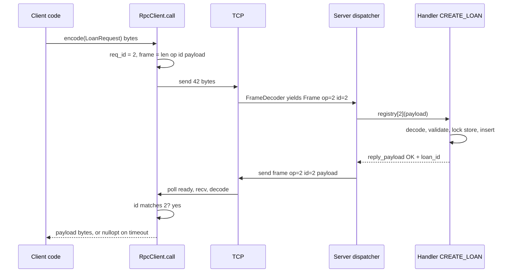

# Module 5.07: RPC and serialization

**Estimated hours:** 5

**What you will learn**

1. What a remote procedure call (RPC) is, and every way "call a function on another machine" differs from calling one in your own process: partial failure, timeouts, retries, duplicates.
2. How to turn a C++ struct into bytes and back (marshalling), with explicit byte order, length-prefixed strings, optional fields and rules for changing the schema later.
3. How to build a small but honest RPC layer in C++17, test it with GoogleTest, and explain how it compares to Protobuf, gRPC, JSON and the rest.

**Prerequisites:** [Module 5.06: Wire protocol design](module-06-wire-protocol-design.md). You also need the Factory pattern from module 2.11 and the packed-record encoding from module 1.07.

---

## 1. One-line intuition

RPC makes a network request look like a function call, and every bug in RPC comes from the places where that illusion breaks.

## 2. Real-life analogy

You phone the loan desk at head office and say "create a loan for customer 42, 25 lakh, 240 months". That is a remote procedure call. Compare it with walking to the desk yourself:

- **The line may drop mid-sentence** (partial failure). Did they hear "create" and not the amount? Did they create the loan and the line dropped before they could tell you the loan number?
- **Nobody answers for a minute** (timeout). Is head office down, or just slow? You have to decide how long to wait.
- **You call again** (retry). If the first call *did* create the loan, you have now created two. Unless you said "this is request number 7731, the same one as before", and the clerk checks their log (an **idempotency key**).
- **Which answer is for which question** (correlation). You asked three things on three calls that overlapped; the replies must carry the question number (a **request id**).
- **You both need to speak the same language** (marshalling). "25 lakh" means nothing to a clerk who expects paise as an integer. Both sides agree in advance exactly how each field is written down.

A local function call has none of these problems: it cannot half-happen, it cannot time out, and the arguments are already in memory in the right format. That is why RPC is a networking topic and not just a programming convenience.

## 3. Why it exists: the problem it solves

Module 5.06 gave you a way to send *messages*. Applications do not think in messages; they think in operations: `create_loan(req)`, `get_loan(id)`. RPC is the layer that turns an operation into a request message, sends it, waits for the matching reply message, and turns that back into a return value or an error.

Without an RPC layer, every operation is hand-written socket code: build bytes, send, read, parse, handle timeouts, match replies. Done forty times for forty operations, each slightly differently, each with its own bugs. The RPC layer does it once.

Without *honesty* about failure, an RPC layer is dangerous. The 1994 paper "A Note on Distributed Computing" (Waldo and others) made the point that the industry keeps relearning: pretending a remote call is a local call hides exactly the failures that matter. A good RPC layer makes partial failure, timeouts and retries visible in its API, not hidden behind a return value.

## 4. Three layers of depth

### Layer 1 (beginner): the parts of an RPC

| Part | What it is | In this module |
|---|---|---|
| Operation code (opcode) | A number naming which function to call | `PING = 1`, `CREATE_LOAN = 2`, `GET_LOAN = 3` |
| Request id | A number the client chooses per call; the server echoes it | `req_id`, 4 bytes, increments per call |
| Marshalling (serialization) | Turning arguments into bytes | `encode(LoanRequest)` |
| Unmarshalling (deserialization) | Turning bytes back into a struct | `decode_loan_request(bytes)` |
| Frame | The envelope on the wire: length, opcode, id, payload | 4 + 2 + 4 bytes header, from 5.06 |
| Stub (client side) | A function that looks local but sends a request | `client.call(CREATE_LOAN, bytes)` |
| Dispatcher (server side) | Looks up the handler for an opcode | `std::unordered_map<uint16_t, Handler>` |
| Handler | The real function on the server | the lambda registered for `CREATE_LOAN` |
| Status | The reply's first field: did it work | `OK`, `NOT_FOUND`, `BAD_REQUEST`, `UNKNOWN_OP` |

**The frame used in this module** (header fields in big-endian, matching the 5.06 framer):

```text
offset  0        4      6          10
        +--------+------+----------+-----------------+
        | len    | op   | req_id   | payload         |
        | u32 BE | u16  | u32 BE   | len - 6 bytes   |
        +--------+------+----------+-----------------+
```

`len` counts everything after itself. A frame with no payload has `len = 6`.

**What a serialized `LoanRequest` looks like.** Fields are written in order with explicit little-endian helpers, strings as a 2-byte length then the bytes:

```text
customer_id   u64 LE   2a 00 00 00 00 00 00 00      (42)
amount_paise  i64 LE   80 b2 e6 0e 00 00 00 00      (250000000)
tenure_months u16 LE   f0 00                        (240)
product_code  str      04 00 48 4c 30 31            (len 4, "HL01")
branch_code   str      06 00 4d 55 4d 2d 30 37      (len 6, "MUM-07")  <- v2 field
```

Why little-endian for the payload when the header is big-endian? Because the spec says so, and that is the only answer that matters. The header uses network order so any language's `ntohl` can read the length; the payload uses the little-endian helpers from module 1.07 because that is how the packed records in capstone C3 are laid out and because both ends are x86. The lesson is not "which order is right" but "write the order in the spec and never let the CPU's native order leak in".

### Layer 2 (working engineer): everything that goes wrong, and the rules

**Partial failure.** A local call either returns or crashes your process; you always know. A remote call has a third outcome: *unknown*. The request may have been lost before arrival, applied and the reply lost, or still in progress. Your client code must have a branch for "I do not know whether that happened".

**Timeouts.** Without one, a dead server hangs the caller forever and, in a thread pool, eventually hangs every worker. The client in section 6 uses `poll` with a deadline. Choosing the number is engineering: typically a small multiple of the expected p99 latency (module 5.11), not "30 seconds because that felt safe".

**Retries and duplicates.** After a timeout the natural move is to retry. For `GET_LOAN` that is harmless. For `CREATE_LOAN` it may create two loans. Options:

1. Make the operation idempotent by design: "create loan with client-chosen id X" is safe to repeat; the second attempt finds X exists.
2. Attach an **idempotency key** (a UUID the client generates once per logical operation and reuses on retries) and have the server keep a table of keys it has applied, returning the stored reply for a repeat. Payment APIs (Stripe, UPI switches) work this way.
3. Do not retry non-idempotent operations automatically; surface the unknown state to the caller.

The request id in the frame is **not** an idempotency key: it is per connection and per attempt, and exists to match replies to requests. The idempotency key is per logical operation and survives reconnects. Do not confuse them in an interview.

**Correlation.** On one connection a client may send request 7 and then 8 before 7's reply arrives (pipelining). Replies carry the id so the client can match them, and so a late reply to a call that already timed out is recognised and discarded rather than mistaken for the next call's answer. The client in section 6 does exactly this ("stale reply ignored").

**Schema evolution rules.** A "schema" is the agreed layout of a message. Rules that keep old and new programs talking:

| Rule | Why |
|---|---|
| Add new fields only at the end | Old readers stop early and never see them; new readers detect the shorter message and use defaults |
| Never remove or reorder a field; deprecate it and keep writing a default | Position is identity in positional encodings |
| Never change a field's type or width | A reader cannot tell a u16 from a u32 by looking at bytes |
| Prefix every variable-size field with its length | So any reader can skip what it does not understand |
| Tag-based formats (Protobuf): never reuse a tag number | A reused tag makes old data mean something new |
| Carry a version or negotiate at connect | So a reader can refuse what it truly cannot parse |

`decode_loan_request` applies the first rule: `branch_code` was added in version 2, so the decoder reads it only if bytes remain, and the test `V1SenderWithoutBranchCodeStillDecodes` proves it.

**The serialization landscape.** This course hand-rolls the encoding so you understand every byte. Industry mostly does not:

| Format | Kind | Schema | Size | Speed | Human-readable | Schema evolution | Typical use |
|---|---|---|---|---|---|---|---|
| Hand-rolled positional (this module) | binary | in code and a spec | smallest | fastest | no | manual, fragile | embedded, hot paths, teaching |
| Protocol Buffers | binary, tagged | `.proto` file, code generated | small | fast | no | excellent (tags, optional fields) | gRPC, Google, most microservices |
| MessagePack / CBOR | binary, self-describing | none required | small | fast | no | by field name | caches, IoT, Redis modules |
| Cap'n Proto / FlatBuffers | binary, zero-copy | schema file | small | no parse step | no | good | games, high-frequency systems |
| JSON | text | none (or JSON Schema) | large | slow-ish | yes | by field name, loose | web APIs, config, logs |
| XML / SOAP | text | XSD / WSDL | largest | slowest | yes | formal | legacy enterprise, banking core systems |

**gRPC** is Protobuf messages over HTTP/2 with generated client stubs and server interfaces, streaming, deadlines and cancellation built in. It is what a greenfield service would use today (module 5.08 returns to this). The reason to hand-roll here is the same reason you wrote a thread pool before using one: the interviewer will ask what Protobuf's varint encoding or gRPC's deadline propagation actually does, and you will be able to answer because you built the equivalent by hand.

### Layer 3 (internals): bytes, alignment and why `memcpy` and not a cast

**Why not `send(&struct, sizeof struct)`?** Three reasons, all from Phase 1:

1. **Padding.** The compiler inserts gaps between fields for alignment (module 1.07). `struct { uint8_t a; uint64_t b; }` is 16 bytes, not 9, and the gap's contents are whatever was in memory. Sending it leaks stack bytes and makes the layout compiler-dependent.
2. **Endianness.** The bytes of `b` are little-endian on x86 and would be read wrongly by a big-endian receiver. Even between two x86 machines, the spec should not silently depend on it.
3. **Pointers and strings.** `std::string` holds a pointer to heap memory; sending the struct sends the pointer, which is meaningless in another process.

So serialization is field by field, with explicit widths and order, and strings as length plus bytes. The `Writer` class in section 6 does exactly that with shifts and masks, which the compiler turns into efficient code; on x86 at `-O2` a `u32_le` becomes a single 4-byte store because the shifts match the native order.

**Why `memcpy` instead of `*reinterpret_cast<uint32_t*>(p)`.** The cast is undefined behaviour when `p` is not suitably aligned or does not point at an actual `uint32_t` object (strict aliasing, module 1.12). On x86 it usually "works"; on ARM it may fault; under UBSan it is reported. `memcpy` of 4 bytes into a `uint32_t` is well-defined everywhere and the compiler emits the same single load. The `Reader` class avoids both problems by reading byte by byte, which is also well-defined and, at `-O2`, also becomes a single load.

**Two's complement across the wire.** `amount_paise` is a signed `int64_t`. Writing it as `static_cast<uint64_t>` and reading it back with `static_cast<int64_t>` preserves the bit pattern, and since C++20 the standard guarantees two's complement; in C++17 every real compiler already does. The test `LoanRequestRoundTrip` checks a negative value survives. Money is an integer number of paise, never a `double`: `0.1 + 0.2 != 0.3` is not a joke in a ledger.

**Bounds checking is the security boundary.** Every `Reader` method calls `need(k)` before touching bytes. A message that says "string of length 300" with 20 bytes left throws `std::runtime_error` instead of reading 280 bytes past the buffer. Reading past the buffer is the bug class behind Heartbleed. The server catches the exception per request and replies `BAD_REQUEST`; the connection survives, the process is never corrupted.

**What the kernel sees.** A `CREATE_LOAN` call is one `send` of 4 + 6 + 32 = 42 bytes and one `recv` of 4 + 6 + 10 = 20 bytes. With Nagle's algorithm on (default) and a reply pending, the kernel may delay small writes up to about 40 ms waiting to coalesce; request-reply protocols set `TCP_NODELAY` (module 5.04). The app server does.

## 5. Architecture diagram



The client blocks in `poll` with a deadline between "send" and "recv". A reply with a different id (a late answer to an earlier timed-out call) is discarded and the wait continues.

## 6. Code

Five files, about 520 lines in all. `net.hpp` is the socket helper (the `Socket`/`Listener` shape from 5.03, shortened). `rpc.hpp` is the layer under test. `server.cpp` and `client.cpp` are the two programs. `rpc_test.cpp` is the GoogleTest suite. Put them in one directory.

**`net.hpp`**

```cpp
// net.hpp - minimal RAII socket helpers (same shape as Socket/Listener in 5.03).
#pragma once
#include <arpa/inet.h>
#include <netinet/in.h>
#include <sys/socket.h>
#include <unistd.h>

#include <cerrno>
#include <cstdio>
#include <cstdlib>
#include <string>

namespace net {

class Fd {
public:
    Fd() = default;
    explicit Fd(int fd) : fd_(fd) {}
    ~Fd() { if (fd_ >= 0) ::close(fd_); }
    Fd(Fd&& o) noexcept : fd_(o.fd_) { o.fd_ = -1; }
    Fd& operator=(Fd&& o) noexcept {
        if (this != &o) { if (fd_ >= 0) ::close(fd_); fd_ = o.fd_; o.fd_ = -1; }
        return *this;
    }
    Fd(const Fd&) = delete;
    Fd& operator=(const Fd&) = delete;
    int get() const { return fd_; }
private:
    int fd_ = -1;
};

inline Fd listen_on(uint16_t port) {
    int fd = ::socket(AF_INET, SOCK_STREAM, 0);
    if (fd < 0) { std::perror("socket"); std::exit(1); }
    int yes = 1;
    ::setsockopt(fd, SOL_SOCKET, SO_REUSEADDR, &yes, sizeof yes);
    sockaddr_in a{};
    a.sin_family = AF_INET;
    a.sin_addr.s_addr = htonl(INADDR_ANY);
    a.sin_port = htons(port);
    if (::bind(fd, reinterpret_cast<sockaddr*>(&a), sizeof a) < 0) { std::perror("bind"); std::exit(1); }
    if (::listen(fd, 128) < 0) { std::perror("listen"); std::exit(1); }
    return Fd(fd);
}

inline Fd connect_to(const std::string& ip, uint16_t port) {
    int fd = ::socket(AF_INET, SOCK_STREAM, 0);
    if (fd < 0) { std::perror("socket"); std::exit(1); }
    sockaddr_in a{};
    a.sin_family = AF_INET;
    a.sin_port = htons(port);
    ::inet_pton(AF_INET, ip.c_str(), &a.sin_addr);
    if (::connect(fd, reinterpret_cast<sockaddr*>(&a), sizeof a) < 0) { std::perror("connect"); std::exit(1); }
    return Fd(fd);
}

inline bool send_all(int fd, const std::string& s) {
    size_t done = 0;
    while (done < s.size()) {
        ssize_t n = ::send(fd, s.data() + done, s.size() - done, MSG_NOSIGNAL);
        if (n < 0) { if (errno == EINTR) continue; return false; }
        done += static_cast<size_t>(n);
    }
    return true;
}

}  // namespace net
```

**`rpc.hpp`**

```cpp
// rpc.hpp - a tiny RPC layer: framing, byte-level encoding, message structs.
// Frame on the wire (all header fields big-endian = network byte order):
//   +----------+----------+------------+-----------------+
//   | len u32  | op u16   | req_id u32 | payload (len-6) |
//   +----------+----------+------------+-----------------+
// len counts everything after itself (opcode + id + payload).
// Payload fields are little-endian, written with explicit helpers, the same
// approach as the packed records in module 1.07. The spec says which order
// each field uses; nothing is ever "whatever the CPU happens to do".
#pragma once
#include <cstdint>
#include <cstring>
#include <optional>
#include <stdexcept>
#include <string>

namespace rpc {

// ---------------------------------------------------------------- opcodes
enum Op : uint16_t { PING = 1, CREATE_LOAN = 2, GET_LOAN = 3 };

// Reply payload always starts with a u16 status.
enum Status : uint16_t { OK = 0, NOT_FOUND = 1, BAD_REQUEST = 2, UNKNOWN_OP = 3 };

constexpr uint32_t kHeaderAfterLen = 6;          // op(2) + req_id(4)
constexpr uint32_t kMaxFrameLen = 1u << 20;      // 1 MiB: sanity cap on len

// ---------------------------------------------------------------- byte writer
class Writer {
public:
    void u8(uint8_t v)   { buf_.push_back(static_cast<char>(v)); }
    void u16_le(uint16_t v) { for (int i = 0; i < 2; ++i) u8(static_cast<uint8_t>(v >> (8 * i))); }
    void u32_le(uint32_t v) { for (int i = 0; i < 4; ++i) u8(static_cast<uint8_t>(v >> (8 * i))); }
    void u64_le(uint64_t v) { for (int i = 0; i < 8; ++i) u8(static_cast<uint8_t>(v >> (8 * i))); }
    void i64_le(int64_t v)  { u64_le(static_cast<uint64_t>(v)); }   // two's complement bits
    void str(const std::string& s) {                                  // u16 length + bytes
        if (s.size() > 0xFFFF) throw std::length_error("string too long for u16 length");
        u16_le(static_cast<uint16_t>(s.size()));
        buf_ += s;
    }
    // Big-endian variants for the frame header.
    void u16_be(uint16_t v) { u8(static_cast<uint8_t>(v >> 8)); u8(static_cast<uint8_t>(v)); }
    void u32_be(uint32_t v) { for (int i = 3; i >= 0; --i) u8(static_cast<uint8_t>(v >> (8 * i))); }
    const std::string& bytes() const { return buf_; }
private:
    std::string buf_;
};

// ---------------------------------------------------------------- byte reader
// Every read checks bounds. A truncated message throws, it never reads past
// the end (that would be undefined behaviour and a classic remote exploit).
class Reader {
public:
    Reader(const char* p, size_t n) : p_(p), n_(n) {}
    explicit Reader(const std::string& s) : Reader(s.data(), s.size()) {}
    size_t remaining() const { return n_ - pos_; }
    uint8_t u8() { need(1); return static_cast<uint8_t>(p_[pos_++]); }
    uint16_t u16_le() { uint16_t v = 0; for (int i = 0; i < 2; ++i) v |= uint16_t(u8()) << (8 * i); return v; }
    uint32_t u32_le() { uint32_t v = 0; for (int i = 0; i < 4; ++i) v |= uint32_t(u8()) << (8 * i); return v; }
    uint64_t u64_le() { uint64_t v = 0; for (int i = 0; i < 8; ++i) v |= uint64_t(u8()) << (8 * i); return v; }
    int64_t  i64_le() { return static_cast<int64_t>(u64_le()); }
    std::string str() { uint16_t len = u16_le(); need(len); std::string s(p_ + pos_, len); pos_ += len; return s; }
    uint16_t u16_be() { uint16_t hi = u8(); return static_cast<uint16_t>((hi << 8) | u8()); }
    uint32_t u32_be() { uint32_t v = 0; for (int i = 0; i < 4; ++i) v = (v << 8) | u8(); return v; }
private:
    void need(size_t k) const {
        if (remaining() < k) throw std::runtime_error("truncated message");
    }
    const char* p_;
    size_t n_;
    size_t pos_ = 0;
};

// ---------------------------------------------------------------- frames
struct Frame {
    uint16_t op = 0;
    uint32_t req_id = 0;
    std::string payload;
};

inline std::string encode_frame(const Frame& f) {
    Writer w;
    w.u32_be(static_cast<uint32_t>(kHeaderAfterLen + f.payload.size()));
    w.u16_be(f.op);
    w.u32_be(f.req_id);
    return w.bytes() + f.payload;
}

// Incremental decoder: feed bytes as they arrive, pull frames when complete.
class FrameDecoder {
public:
    // Returns false when the stream is malformed and the peer must be dropped.
    bool feed(const char* data, size_t n) {
        buf_.append(data, n);
        if (buf_.size() >= 4) {
            uint32_t len = Reader(buf_).u32_be();
            if (len < kHeaderAfterLen || len > kMaxFrameLen) return false;
        }
        return true;
    }
    std::optional<Frame> next() {
        if (buf_.size() < 4) return std::nullopt;
        uint32_t len = Reader(buf_).u32_be();
        if (buf_.size() < 4 + len) return std::nullopt;
        Reader r(buf_.data() + 4, len);
        Frame f;
        f.op = r.u16_be();
        f.req_id = r.u32_be();
        f.payload.assign(buf_.data() + 4 + kHeaderAfterLen, len - kHeaderAfterLen);
        buf_.erase(0, 4 + len);
        return f;
    }
private:
    std::string buf_;
};

// ---------------------------------------------------------------- messages
// CREATE_LOAN request, version 1 fields first, version 2 appended at the end.
struct LoanRequest {
    uint64_t customer_id = 0;
    int64_t  amount_paise = 0;      // money as integer paise, never a double
    uint16_t tenure_months = 0;
    std::string product_code;       // e.g. "HL01"
    std::string branch_code;        // v2: added later; "" when absent
};

inline std::string encode(const LoanRequest& m) {
    Writer w;
    w.u64_le(m.customer_id);
    w.i64_le(m.amount_paise);
    w.u16_le(m.tenure_months);
    w.str(m.product_code);
    w.str(m.branch_code);           // v2 field, always written by a v2 sender
    return w.bytes();
}

inline LoanRequest decode_loan_request(const std::string& bytes) {
    Reader r(bytes);
    LoanRequest m;
    m.customer_id = r.u64_le();
    m.amount_paise = r.i64_le();
    m.tenure_months = r.u16_le();
    m.product_code = r.str();
    if (r.remaining() > 0) m.branch_code = r.str();   // tolerate a v1 sender
    return m;                                          // extra trailing bytes ignored
}

struct LoanRecord {
    uint64_t loan_id = 0;
    LoanRequest req;
};

inline std::string encode(const LoanRecord& rec) {
    Writer w;
    w.u64_le(rec.loan_id);
    return w.bytes() + encode(rec.req);
}

inline LoanRecord decode_loan_record(const std::string& bytes) {
    Reader r(bytes);
    LoanRecord rec;
    rec.loan_id = r.u64_le();
    rec.req = decode_loan_request(bytes.substr(8));
    return rec;
}

// Reply helpers: status first, then an optional body.
inline std::string reply_payload(Status st, const std::string& body = "") {
    Writer w;
    w.u16_le(st);
    return w.bytes() + body;
}

}  // namespace rpc
```

**`server.cpp`**

```cpp
// server.cpp - RPC server: a handler registry keyed by opcode (Factory pattern
// from 2.11), an in-memory loan table guarded by a mutex, one thread per
// connection (swap in the pool from 5.05 for the capstone).
//   ./rpc_server 9000
#include "net.hpp"
#include "rpc.hpp"

#include <functional>
#include <iostream>
#include <map>
#include <mutex>
#include <thread>
#include <unordered_map>

using Handler = std::function<std::string(const std::string& payload)>;

struct LoanStore {
    std::mutex m;
    uint64_t next_id = 1000;
    std::map<uint64_t, rpc::LoanRequest> loans;
};

static std::unordered_map<uint16_t, Handler> make_registry(LoanStore& store) {
    std::unordered_map<uint16_t, Handler> reg;

    reg[rpc::PING] = [](const std::string&) { return rpc::reply_payload(rpc::OK); };

    reg[rpc::CREATE_LOAN] = [&store](const std::string& payload) {
        rpc::LoanRequest req;
        try { req = rpc::decode_loan_request(payload); }
        catch (const std::exception&) { return rpc::reply_payload(rpc::BAD_REQUEST); }
        if (req.amount_paise <= 0 || req.tenure_months == 0)
            return rpc::reply_payload(rpc::BAD_REQUEST);
        uint64_t id;
        {
            std::lock_guard<std::mutex> lk(store.m);
            id = store.next_id++;
            store.loans[id] = req;
        }
        rpc::Writer w;
        w.u64_le(id);
        return rpc::reply_payload(rpc::OK, w.bytes());
    };

    reg[rpc::GET_LOAN] = [&store](const std::string& payload) {
        uint64_t id;
        try { id = rpc::Reader(payload).u64_le(); }
        catch (const std::exception&) { return rpc::reply_payload(rpc::BAD_REQUEST); }
        std::lock_guard<std::mutex> lk(store.m);
        auto it = store.loans.find(id);
        if (it == store.loans.end()) return rpc::reply_payload(rpc::NOT_FOUND);
        rpc::LoanRecord rec{id, it->second};
        return rpc::reply_payload(rpc::OK, rpc::encode(rec));
    };
    return reg;
}

static void serve(net::Fd conn, const std::unordered_map<uint16_t, Handler>& reg) {
    rpc::FrameDecoder dec;
    char tmp[4096];
    for (;;) {
        ssize_t n = ::recv(conn.get(), tmp, sizeof tmp, 0);
        if (n <= 0) return;
        if (!dec.feed(tmp, static_cast<size_t>(n))) {
            std::cerr << "malformed frame, dropping client\n";
            return;
        }
        while (auto f = dec.next()) {
            rpc::Frame reply;
            reply.op = f->op;
            reply.req_id = f->req_id;                 // correlation: echo the id
            auto it = reg.find(f->op);
            reply.payload = (it == reg.end()) ? rpc::reply_payload(rpc::UNKNOWN_OP)
                                              : it->second(f->payload);
            std::cout << "req_id=" << f->req_id << " op=" << f->op
                      << " -> " << reply.payload.size() << " payload bytes" << std::endl;
            if (!net::send_all(conn.get(), rpc::encode_frame(reply))) return;
        }
    }
}

int main(int argc, char** argv) {
    uint16_t port = argc > 1 ? static_cast<uint16_t>(std::stoi(argv[1])) : 9000;
    LoanStore store;
    auto registry = make_registry(store);
    net::Fd listener = net::listen_on(port);
    std::cout << "rpc_server listening on " << port << "\n";
    for (;;) {
        int c = ::accept(listener.get(), nullptr, nullptr);
        if (c < 0) { if (errno == EINTR) continue; std::perror("accept"); return 1; }
        std::thread(serve, net::Fd(c), std::cref(registry)).detach();
    }
}
```

**`client.cpp`**

```cpp
// client.cpp - RPC client: sends a request with a fresh id, waits for the reply
// with that id using poll() so a dead server cannot hang us forever.
//   ./rpc_client 127.0.0.1 9000
#include "net.hpp"
#include "rpc.hpp"

#include <poll.h>

#include <iostream>
#include <optional>

class RpcClient {
public:
    RpcClient(const std::string& ip, uint16_t port, int timeout_ms)
        : sock_(net::connect_to(ip, port)), timeout_ms_(timeout_ms) {}

    // Returns the reply payload, or nullopt on timeout / connection loss.
    std::optional<std::string> call(uint16_t op, const std::string& payload) {
        rpc::Frame req;
        req.op = op;
        req.req_id = next_id_++;
        req.payload = payload;
        if (!net::send_all(sock_.get(), rpc::encode_frame(req))) return std::nullopt;

        for (;;) {
            if (auto f = dec_.next()) {
                if (f->req_id == req.req_id) return f->payload;   // ours
                std::cerr << "stale reply id=" << f->req_id << " ignored\n";
                continue;                                           // e.g. late after a timeout
            }
            pollfd p{sock_.get(), POLLIN, 0};
            int r = ::poll(&p, 1, timeout_ms_);
            if (r == 0) { std::cerr << "timeout after " << timeout_ms_ << " ms\n"; return std::nullopt; }
            if (r < 0) { if (errno == EINTR) continue; return std::nullopt; }
            char tmp[4096];
            ssize_t n = ::recv(sock_.get(), tmp, sizeof tmp, 0);
            if (n <= 0 || !dec_.feed(tmp, static_cast<size_t>(n))) return std::nullopt;
        }
    }
private:
    net::Fd sock_;
    int timeout_ms_;
    uint32_t next_id_ = 1;
    rpc::FrameDecoder dec_;
};

static const char* status_name(uint16_t s) {
    switch (s) {
        case rpc::OK: return "OK";
        case rpc::NOT_FOUND: return "NOT_FOUND";
        case rpc::BAD_REQUEST: return "BAD_REQUEST";
        case rpc::UNKNOWN_OP: return "UNKNOWN_OP";
    }
    return "?";
}

int main(int argc, char** argv) {
    std::string ip = argc > 1 ? argv[1] : "127.0.0.1";
    uint16_t port = argc > 2 ? static_cast<uint16_t>(std::stoi(argv[2])) : 9000;
    RpcClient client(ip, port, 2000);

    // 1. PING
    auto r = client.call(rpc::PING, "");
    if (!r) return 1;
    std::cout << "PING -> " << status_name(rpc::Reader(*r).u16_le()) << "\n";

    // 2. CREATE_LOAN
    rpc::LoanRequest lr;
    lr.customer_id = 42;
    lr.amount_paise = 2500000 * 100LL;     // 25,00,000 rupees in paise
    lr.tenure_months = 240;
    lr.product_code = "HL01";
    lr.branch_code = "MUM-07";
    r = client.call(rpc::CREATE_LOAN, rpc::encode(lr));
    if (!r) return 1;
    rpc::Reader cr(*r);
    uint16_t st = cr.u16_le();
    uint64_t loan_id = (st == rpc::OK) ? cr.u64_le() : 0;
    std::cout << "CREATE_LOAN -> " << status_name(st) << " loan_id=" << loan_id << "\n";

    // 3. GET_LOAN (found)
    rpc::Writer w;
    w.u64_le(loan_id);
    r = client.call(rpc::GET_LOAN, w.bytes());
    if (!r) return 1;
    rpc::Reader gr(*r);
    st = gr.u16_le();
    if (st == rpc::OK) {
        rpc::LoanRecord rec = rpc::decode_loan_record(r->substr(2));
        std::cout << "GET_LOAN " << loan_id << " -> OK customer=" << rec.req.customer_id
                  << " amount_paise=" << rec.req.amount_paise << " tenure=" << rec.req.tenure_months
                  << " product=" << rec.req.product_code << " branch=" << rec.req.branch_code << "\n";
    }

    // 4. GET_LOAN (missing)
    rpc::Writer w2;
    w2.u64_le(999999);
    r = client.call(rpc::GET_LOAN, w2.bytes());
    if (!r) return 1;
    std::cout << "GET_LOAN 999999 -> " << status_name(rpc::Reader(*r).u16_le()) << "\n";

    // 5. Unknown opcode
    r = client.call(77, "");
    if (!r) return 1;
    std::cout << "op 77 -> " << status_name(rpc::Reader(*r).u16_le()) << "\n";
    return 0;
}
```

**`rpc_test.cpp`**

```cpp
// rpc_test.cpp - GoogleTest round trips for the encoding and framing layer.
#include "rpc.hpp"

#include <gtest/gtest.h>

TEST(Writer, LittleEndianLayout) {
    rpc::Writer w;
    w.u32_le(0x11223344);
    const std::string& b = w.bytes();
    ASSERT_EQ(b.size(), 4u);
    EXPECT_EQ(static_cast<unsigned char>(b[0]), 0x44);   // least significant byte first
    EXPECT_EQ(static_cast<unsigned char>(b[3]), 0x11);
}

TEST(Writer, BigEndianHeaderLayout) {
    rpc::Writer w;
    w.u32_be(0x11223344);
    EXPECT_EQ(static_cast<unsigned char>(w.bytes()[0]), 0x11);  // most significant first
}

TEST(Codec, LoanRequestRoundTrip) {
    rpc::LoanRequest in;
    in.customer_id = 42;
    in.amount_paise = -5;            // negative survives two's complement
    in.tenure_months = 240;
    in.product_code = "HL01";
    in.branch_code = "MUM-07";
    rpc::LoanRequest out = rpc::decode_loan_request(rpc::encode(in));
    EXPECT_EQ(out.customer_id, 42u);
    EXPECT_EQ(out.amount_paise, -5);
    EXPECT_EQ(out.tenure_months, 240);
    EXPECT_EQ(out.product_code, "HL01");
    EXPECT_EQ(out.branch_code, "MUM-07");
}

TEST(Codec, V1SenderWithoutBranchCodeStillDecodes) {
    rpc::Writer w;                   // hand-build a v1 payload: no branch_code
    w.u64_le(7); w.i64_le(100); w.u16_le(12); w.str("PL02");
    rpc::LoanRequest out = rpc::decode_loan_request(w.bytes());
    EXPECT_EQ(out.product_code, "PL02");
    EXPECT_EQ(out.branch_code, "");  // default for the missing field
}

TEST(Codec, TruncatedPayloadThrows) {
    std::string bytes = rpc::encode(rpc::LoanRequest{});
    bytes.resize(bytes.size() - 3);
    EXPECT_THROW(rpc::decode_loan_request(bytes), std::runtime_error);
}

TEST(Frame, RoundTripInOneByteChunks) {
    rpc::Frame f;
    f.op = rpc::CREATE_LOAN;
    f.req_id = 0xDEADBEEF;
    f.payload = "hello";
    std::string wire = rpc::encode_frame(f);
    ASSERT_EQ(wire.size(), 4u + 6u + 5u);
    rpc::FrameDecoder dec;
    int got = 0;
    for (char c : wire) {
        ASSERT_TRUE(dec.feed(&c, 1));
        while (auto out = dec.next()) {
            ++got;
            EXPECT_EQ(out->op, rpc::CREATE_LOAN);
            EXPECT_EQ(out->req_id, 0xDEADBEEFu);
            EXPECT_EQ(out->payload, "hello");
        }
    }
    EXPECT_EQ(got, 1);
}

TEST(Frame, HostileLengthRejected) {
    rpc::FrameDecoder dec;
    const char evil[4] = {'\x7f', '\xff', '\xff', '\xff'};
    EXPECT_FALSE(dec.feed(evil, 4));
    rpc::FrameDecoder dec2;
    const char too_short[4] = {0, 0, 0, 2};   // len 2 cannot hold op + id
    EXPECT_FALSE(dec2.feed(too_short, 4));
}
```

**Build and run.** Three binaries; the test links GoogleTest.

```bash
g++ -std=c++17 -O2 -Wall -Wextra -Werror -g -pthread -o rpc_server server.cpp
g++ -std=c++17 -O2 -Wall -Wextra -Werror -g -pthread -o rpc_client client.cpp
g++ -std=c++17 -O2 -Wall -Wextra -Werror -g -pthread -o rpc_test rpc_test.cpp -lgtest -lgtest_main
./rpc_test
```

Expected tail of the test output:

```text
[----------] 2 tests from Frame
[ RUN      ] Frame.RoundTripInOneByteChunks
[       OK ] Frame.RoundTripInOneByteChunks (0 ms)
[ RUN      ] Frame.HostileLengthRejected
[       OK ] Frame.HostileLengthRejected (0 ms)
[----------] 2 tests from Frame (0 ms total)

[----------] Global test environment tear-down
[==========] 7 tests from 3 test suites ran. (2 ms total)
[  PASSED  ] 7 tests.
```

Terminal 1:

```bash
./rpc_server 9000
```

Terminal 2:

```bash
./rpc_client 127.0.0.1 9000
```

Expected output in terminal 2:

```text
PING -> OK
CREATE_LOAN -> OK loan_id=1000
GET_LOAN 1000 -> OK customer=42 amount_paise=250000000 tenure=240 product=HL01 branch=MUM-07
GET_LOAN 999999 -> NOT_FOUND
op 77 -> UNKNOWN_OP
```

Expected output in terminal 1:

```text
rpc_server listening on 9000
req_id=1 op=1 -> 2 payload bytes
req_id=2 op=2 -> 10 payload bytes
req_id=3 op=3 -> 42 payload bytes
req_id=4 op=3 -> 2 payload bytes
req_id=5 op=77 -> 2 payload bytes
```

Check the sizes by hand: `PING` reply is status only (2 bytes). `CREATE_LOAN` reply is status + u64 (10). `GET_LOAN` found is status + u64 loan id + the 32-byte request encoding = 2 + 8 + (8 + 8 + 2 + 6 + 8) = 42. Being able to do this arithmetic is what "I understand the wire format" means.

**What carries over to capstone C2.** `rpc.hpp` and `net.hpp` go into `capstones/app-server/src/` almost unchanged; the capstone adds opcodes (`APPROVE_LOAN`, `LIST_LOANS`, `GET_MASTER`), replaces the `std::map` with PostgreSQL then YugabyteDB behind the same handler signature, replaces thread-per-connection in `server.cpp` with the pooled dispatch from 5.05, and keeps `rpc_test.cpp` as the base of the test suite. The frame, the `Writer`/`Reader` and the registry are the transport behind the resume phrase "RPC-over-TCP".

## 7. Use case: core-banking loan-origination platform

The app server (claim H4) exposed about forty operations to branch clients: create application, attach document, run eligibility, approve, disburse, query status. Each was an opcode with a request and reply struct in a shared header that both teams compiled against. The decisions this drove:

- **Request ids on every frame, pipelining allowed.** A branch client sends an eligibility check and a document upload without waiting; the server replies as each finishes. Correlation by id made that safe and made "which reply is this" a non-question.
- **Idempotency keys on every mutating operation.** `CREATE_LOAN` carried a client-generated key stored in a table with the resulting loan id. A branch on a flaky link that retried after a timeout got the *same* loan id back instead of a duplicate application, which in a bank is the difference between a retry and an audit finding. The key, not the frame's request id, was what prevented duplicates; the request id is reset on every reconnect.
- **Additive-only schema with a version negotiated at connect.** The branch rollout took weeks. The server shipped first and read both old and new `CREATE_LOAN` layouts, exactly like `decode_loan_request` handling a missing `branch_code`.
- **Bounds-checked decoding.** A malformed frame from a misbehaving client became a `BAD_REQUEST` reply, never a crash. This mattered twice: once for security, once because the crash dumps in claim H5 are far easier to read when the parser is not a suspect.
- **Timeouts at the client and deadlines at the server.** Each call carried a client timeout; the server dropped work whose client had already given up, so a slow database did not pile up abandoned requests in the pool (module 5.10).

## 8. Lab

### Part A: run it, watch the bytes (20 minutes)

1. Build the three binaries and run the test; all 7 must pass.
2. Start the server; in another terminal run `sudo tcpdump -i lo -X port 9000` and then the client. Find the `CREATE_LOAN` request in the dump. Identify, byte by byte: the length (`00 00 00 26` = 38 = 6 + 32), the opcode `00 02`, the request id `00 00 00 02`, then `2a 00 ...` for customer 42, then the amount, tenure `f0 00`, `04 00 48 4c 30 31` for "HL01", and the branch string.
3. In the reply, confirm the status `00 00` and the loan id `e8 03 00 00 00 00 00 00` (1000 little-endian).

### Part B: timeouts and stale replies (20 minutes)

1. Start a fake server that accepts but never answers: `nc -l 9001`.
2. Run `./rpc_client 127.0.0.1 9001`. Expected: `timeout after 2000 ms` on stderr and exit code 1 (`echo $?`). Stop `nc`.
3. Now make the real server slow for one call: in `server.cpp`, inside the `PING` handler, add `std::this_thread::sleep_for(std::chrono::milliseconds(2500));` (add `#include <chrono>`). Rebuild and run the client. Expected: the `PING` times out and the client exits before `CREATE_LOAN`.
4. Change the client's `main` to ignore the `PING` failure (replace the first `if (!r) return 1;` with nothing) and run again. Expected: `stale reply id=1 ignored` appears on stderr during the `CREATE_LOAN` call, because the late `PING` reply arrived first and was correctly discarded. Without the id check it would have been read as the `CREATE_LOAN` reply with a 2-byte payload, and `cr.u64_le()` would have thrown. Remove the sleep.

### Part C: duplicates and the idempotency key (40 minutes)

1. Run the client twice. Expected: loan ids 1000 and 1001. The same logical request created two loans, which is what a retry after a lost reply would do.
2. Add an idempotency key: append `std::string idem_key;` to `LoanRequest` as a v3 field at the end; encode it after `branch_code`; decode it when bytes remain. Add `std::map<std::string, uint64_t> applied;` to `LoanStore`. In the `CREATE_LOAN` handler, under the lock: if `idem_key` is non-empty and already in `applied`, return `OK` with the stored id instead of creating a loan.
3. In the client set `lr.idem_key = "branch7-2026-10-18-0001";`. Rebuild both and run the client twice. Expected: both runs print `loan_id=1000`. Add a test to `rpc_test.cpp` proving a v2 payload (no key) still decodes with an empty key.
4. Write down why the request id could not have done this job (hint: run the client twice and look at the ids the server logs).

### Part D: break the schema rules and watch what happens (20 minutes)

1. In `encode(const LoanRequest&)` only, swap the order of `tenure_months` and `product_code`. Do not touch the decoder. Rebuild and run `rpc_test`. Expected: `LoanRequestRoundTrip` fails, and read the failure: the decoder interpreted the string's length bytes as the tenure. This is "never reorder fields", demonstrated.
2. Restore the order. Now change `tenure_months` to `u32_le` in the encoder only. Expected: the round-trip test fails differently; with a real client you would see a corrupted product code and perhaps a `truncated message` exception. This is "never change a field's width".
3. Restore everything; the 7 tests must pass again.

### Journal

Copy [journal/TEMPLATE.md](../journal/TEMPLATE.md) to `journal/YYYY-MM-DD-rpc-and-serialization.md`. Record: the annotated hex of one request and one reply from Part A; the exact stderr lines from Part B steps 2 and 4; the loan ids from Part C before and after the idempotency key, and your answer to step 4; and the two test failure messages from Part D. Note which files you will carry into capstone C2.

## 9. Common mistakes and misconceptions

| Mistake | Why it is wrong | Bug it causes later |
|---|---|---|
| Treating a timeout as "it did not happen" | It may have happened and the reply was lost | Duplicate loans, double payments on retry |
| Using the frame's request id as the idempotency key | It is per connection and per attempt | Retries after reconnect are not recognised as repeats |
| Sending a struct with `send(&s, sizeof s)` | Padding, endianness and pointers | Works between two identical builds; breaks on the next compiler or platform |
| `reinterpret_cast<uint32_t*>` on a byte buffer | Alignment and strict-aliasing UB | Crashes on ARM, silent miscompiles at `-O2` |
| No bounds check in the decoder | A malicious length reads past the buffer | Information leak or remote code execution (Heartbleed class) |
| Reordering or re-typing a field | Positional encodings identify fields by position | Silent corruption between client and server versions |
| `double` for money | Binary floating point cannot represent 0.10 exactly | Ledger that does not balance by a few paise |
| No client timeout | A dead server blocks the caller forever | Every worker in a pool wedged on one outage |
| Matching replies by order instead of id | A late reply shifts every later match by one | Wrong data returned to the wrong call, only after a timeout |
| Logging the full payload at INFO | Payloads carry customer data | Compliance incident (PCI-DSS, module 11.06) |

## 10. Resume link

- **Claim H4, "multithreaded application server handling loan-origination requests over RPC-over-TCP".** This module *is* the "RPC-over-TCP" phrase. Say: "Length-prefixed frames with an opcode and a request id; payloads hand-encoded field by field with explicit byte order and length-prefixed strings; a handler registry keyed by opcode; client-side timeouts with `poll`; idempotency keys on mutating calls. I have the encoder tests and a tcpdump of the frames." Expect "why not gRPC?" and answer honestly (section 7 of module 5.08).
- **Claim E, "RPC".** Be ready to define it in one sentence and list the four failure modes: lost request, lost reply, slow server, duplicate on retry. Then say how each was handled.
- **Claim B, "undefined-behaviour-aware coding".** The `Reader` is the concrete example: bounds checks on every read, byte-wise assembly instead of casts, no reliance on alignment or aliasing.
- **Claim G, "GoogleTest".** `rpc_test.cpp` is a real example of testing a codec: round trips, version skew, truncation and hostile lengths.

Likely follow-up: "How did you evolve the message format without downtime?" Answer with the additive-only rules and the `branch_code` example, and mention the server-first rollout order.

## 11. Interview questions

**Q1 (easy). What is RPC?**

<details>
<summary>Model answer</summary>

Remote procedure call: a way to invoke an operation on another process or machine so that it looks like a function call. The client encodes the arguments into a message (marshalling), sends it with an operation identifier and a request id, waits for the reply with the matching id, and decodes the result. Unlike a local call it can fail partially, time out, or be applied twice if retried, so a good RPC layer exposes timeouts and makes retry safety explicit.

</details>

**Q2 (easy). What is serialization and why can't you just send the bytes of a C++ struct?**

<details>
<summary>Model answer</summary>

Serialization turns an in-memory object into a defined sequence of bytes that another program can read back. A raw struct copy is not that: it contains compiler-inserted padding, uses the CPU's byte order, and may hold pointers such as a `std::string`'s heap pointer, which mean nothing to another process. Field-by-field encoding with explicit widths, explicit byte order and length-prefixed variable fields makes the layout a contract instead of an accident.

</details>

**Q3 (medium). After a timeout on a "create loan" call, should the client retry? What makes a retry safe?**

<details>
<summary>Model answer</summary>

Not blindly: the timeout means the outcome is unknown; the loan may exist. A retry is safe only if the operation is idempotent. Either design it so (the client supplies the loan id, so a repeat finds it exists) or attach an idempotency key: a unique id per logical operation, reused on every retry, which the server records along with its reply and returns again for a repeat. The per-frame request id does not serve this purpose because it is scoped to one connection and attempt. In the banking platform every mutating call carried such a key, so a branch on a flaky link got the same loan id on retry instead of a duplicate application.

</details>

**Q4 (medium). How do you change an RPC message format without breaking clients that have not been updated?**

<details>
<summary>Model answer</summary>

Only make additive changes: new opcodes, new fields appended at the end of a message, each with a default when absent. Keep every existing field's position, type and width. Length-prefix variable fields so readers can skip what they do not know. Readers of the new version check whether bytes remain before reading a new field; readers of the old version ignore trailing bytes. Negotiate or carry a version so truly incompatible changes can be refused rather than misread. Deploy the server before the clients. Tag-based formats like Protobuf make this easier by naming fields with numbers, with the rule never to reuse a tag.

</details>

**Q5 (hard). Compare your hand-rolled RPC with gRPC. What does gRPC give you that you had to build or skip, and when would you still hand-roll?**

<details>
<summary>Model answer</summary>

gRPC provides: a schema language and generated code for messages and stubs in many languages, so clients and servers cannot disagree on layout; Protobuf's tagged encoding with built-in schema evolution; HTTP/2 transport with multiplexed streams, so pipelining and correlation come free and one connection carries many concurrent calls without head-of-line blocking at the application layer; deadlines that propagate from client to server and cancel work the caller abandoned; streaming calls; standard status codes; TLS, authentication hooks, load balancing and observability integration. My layer has framing, opcodes, request-id correlation, a client timeout and a hand-written codec with tests; I had to write schema evolution rules by hand and I skipped streaming, cancellation and cross-language support. I would still hand-roll for a hot path where Protobuf's varint decoding and allocations are measurable, for an embedded or constrained environment, for a protocol that must interoperate with an existing fixed binary format such as a legacy core-banking frame, or to understand what the framework does. For a greenfield service today I would use gRPC and spend the saved time on the business logic.

</details>

## 12. Revision

- RPC = opcode + request id + marshalled arguments in a frame; the illusion of a local call breaks on partial failure, timeouts, retries and duplicates, so the layer exposes timeouts and needs idempotency keys for mutating calls.
- Serialize field by field with explicit widths and byte order, strings as length + bytes, bounds-check every read, money as integer paise; evolve by appending optional fields and never reordering, retyping or reusing a position.
- The frame is `len u32 BE | op u16 | req_id u32 | payload`; `rpc.hpp`, `net.hpp` and `rpc_test.cpp` carry straight into capstone C2 as the transport behind "RPC-over-TCP"; industry uses gRPC/Protobuf and you can now explain what those do underneath.

---

Previous: [Module 5.06: Wire protocol design](module-06-wire-protocol-design.md) | Next: [Module 5.08: HTTP/1.1, HTTP/2 and HTTP/3](module-08-http.md)
