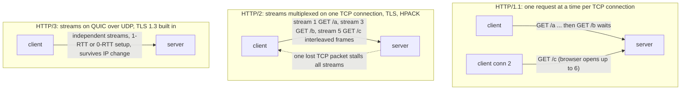

# Module 5.08: HTTP/1.1, HTTP/2 and HTTP/3

**Estimated hours:** 4

**What you will learn**

1. HTTP/1.1 as a text protocol over TCP: the request line, headers, blank line and body, how the body's end is found, and what the status codes mean.
2. How to speak raw HTTP/1.1 from a C++ program with the `Socket` class, and how to write a tiny HTTP server that `curl` is happy with.
3. Why HTTP/2 and HTTP/3 exist (multiplexing, head-of-line blocking, QUIC) and how to explain them, plus how the banking app server's custom RPC relates to HTTP.

**Prerequisites:** [Module 5.07: RPC and serialization](module-07-rpc-and-serialization.md). You will use `curl` and `nc`, installed in module 0.04.

---

## 1. One-line intuition

HTTP is a request-reply text protocol over TCP where every message is "a first line, some `Name: value` headers, a blank line, then optionally a body"; everything since 1997 has been about sending more of those at once.

## 2. Real-life analogy

HTTP/1.1 is a customer at a counter with one clerk. You hand over a form (the request): at the top, what you want and where (`GET /health HTTP/1.1`); below, some notes about yourself (`Host:`, `Accept:`); then, if you are submitting something, the papers themselves (the body). The clerk hands back a form: a verdict at the top (`200 OK` or `404 Not Found`), notes (`Content-Type:`, `Content-Length:`), then the document.

The rule in HTTP/1.1 is one form at a time per counter. You can stay at the counter for several forms (**keep-alive**), but if your second form needs a slow lookup, your third form waits behind it (**head-of-line blocking**). Browsers cheat by opening six counters.

HTTP/2 replaces the paper forms with numbered envelopes on a conveyor belt. You can drop ten envelopes on the belt at once; the clerk works on all of them and sends back numbered envelopes as each finishes. One counter, no waiting in line, but the belt itself (TCP) still stops if one envelope falls on the floor and must be re-sent.

HTTP/3 rebuilds the belt (QUIC over UDP) so that a dropped envelope stalls only its own stream, and bakes the security check (TLS) into the belt instead of running it separately first.

## 3. Why it exists: the problem it solves

Before HTTP, every service invented its own protocol, its own framing, its own error codes. HTTP standardised the request-reply shape, a vocabulary of methods (`GET`, `POST`, `PUT`, `DELETE`), a vocabulary of outcomes (status codes), and a header mechanism that lets anyone add metadata without breaking anyone else. That is why a load balancer, a cache, a proxy and a browser from different vendors can all handle the same message.

HTTP/1.0 opened a TCP connection per request: three-way handshake, slow start, request, reply, close. Pages with fifty images paid fifty handshakes. HTTP/1.1 (1997, RFC 2068; current text RFC 9112) added persistent connections and chunked transfer. HTTP/2 (2015, RFC 7540; now RFC 9113) fixed the one-at-a-time limit with multiplexing. HTTP/3 (2022, RFC 9114) fixed the limit that TCP itself imposes. Each version exists because the previous one was measured and found wanting on real networks.

## 4. Three layers of depth

### Layer 1 (beginner): reading a request and a response

A request, byte for byte. Every line ends in `\r\n` (CRLF); the empty line marks the end of the headers.

```text
GET /health HTTP/1.1\r\n            <- request line: METHOD SP PATH SP VERSION
Host: 127.0.0.1:8080\r\n            <- mandatory in HTTP/1.1
User-Agent: curl/8.5.0\r\n
Accept: */*\r\n
\r\n                                <- blank line: headers are over; no body for GET
```

A response:

```text
HTTP/1.1 200 OK\r\n                 <- status line: VERSION SP CODE SP REASON
Content-Type: application/json\r\n
Content-Length: 37\r\n              <- the body is exactly 37 bytes
Connection: keep-alive\r\n
\r\n
{"status":"ok","service":"loan-app"}
```

**Methods** you must know: `GET` (read, no body, safe to repeat), `POST` (create or act, has a body, not safe to repeat), `PUT` (replace, idempotent), `DELETE` (idempotent), `HEAD` (like `GET` but headers only). The idempotency vocabulary from 5.06 applies directly; it is why browsers warn before re-sending a `POST`.

**Status code classes.**

| Class | Meaning | Ones you will meet |
|---|---|---|
| 1xx | Informational | `100 Continue` (send the body now) |
| 2xx | Success | `200 OK`, `201 Created`, `204 No Content` |
| 3xx | Redirect | `301 Moved Permanently`, `302 Found`, `304 Not Modified` (cache is still good) |
| 4xx | Client's fault | `400 Bad Request`, `401 Unauthorized`, `403 Forbidden`, `404 Not Found`, `429 Too Many Requests` |
| 5xx | Server's fault | `500 Internal Server Error`, `502 Bad Gateway`, `503 Service Unavailable`, `504 Gateway Timeout` |

A `4xx` means "do not retry unchanged"; a `503` or `504` means "retry later, with backoff". Load balancers and monitoring systems act on the class, which is why returning `200` with `{"error": ...}` inside is a bug.

**Where does the body end?** This is framing (module 5.06), and HTTP/1.1 has three answers:

1. `Content-Length: N`: read exactly N bytes. Needs the sender to know the size up front.
2. `Transfer-Encoding: chunked`: the body is a series of chunks, each `size-in-hex\r\n` then the bytes then `\r\n`, ended by a zero-size chunk `0\r\n\r\n`. For replies generated on the fly whose length is unknown.
3. `Connection: close` and no length: read until the server closes. Only valid for responses; the raw client below uses it to stay short.

**Keep-alive.** In HTTP/1.1 the connection stays open after a reply unless either side says `Connection: close`. The next request goes on the same connection, saving a handshake. The server must therefore consume each request's body exactly, so the next request starts at the right byte: the same discipline as the frame decoder in 5.07.

### Layer 2 (working engineer): `curl -v`, head-of-line, HTTP/2, HTTP/3

**Reading `curl -v`.** `>` lines are what curl sent, `<` lines what it received, `*` lines are curl's commentary. Run `curl -v http://example.com/ -o /dev/null` and you see (captured on one machine; dates, IPs and the `CF-RAY` id will differ):

```text
* Host example.com:80 was resolved.                 <- DNS, module 5.01
* IPv6: 2606:4700:8395:72db:f239:5f0:ef6b:ff98
* IPv4: 104.20.23.154, 172.66.147.243
*   Trying 104.20.23.154:80...                       <- TCP connect, module 5.02
* Connected to example.com (104.20.23.154) port 80
> GET / HTTP/1.1                                     <- request line
> Host: example.com                                  <- required header
> User-Agent: curl/8.5.0
> Accept: */*
>                                                    <- blank line; request is complete
< HTTP/1.1 200 OK                                    <- status line
< Date: Sun, 18 Oct 2026 18:46:47 GMT
< Content-Type: text/html; charset=utf-8
< Transfer-Encoding: chunked                         <- body framed as chunks
< Connection: keep-alive                             <- connection stays open
< Server: cloudflare
< Last-Modified: Tue, 13 Oct 2026 20:08:28 GMT
< Age: 496                                           <- served from a cache, 496 s old
< alt-svc: h3=":443"; ma=86400                       <- "I also speak HTTP/3 on 443"
<
{ [577 bytes data]
* Connection #0 to host example.com left intact      <- keep-alive honoured
```

Two lines deserve a second look. `Transfer-Encoding: chunked` means the raw bytes of the body start with a hex size; the C++ client below shows them. `alt-svc: h3=":443"` is how a server advertises HTTP/3; a browser that sees it switches on its next visit.

**Head-of-line blocking in HTTP/1.1.** One request at a time per connection. Browsers open up to six connections per host to work around it; APIs with many small calls pay a round trip each. **Pipelining** (sending several requests before the first reply) exists in the spec but replies must come back in order, so one slow reply still blocks the rest, and most proxies broke it; it is effectively dead.

**HTTP/2.** Same methods, headers, status codes, so applications did not change. Underneath, everything changed:

| Feature | What it means | Why |
|---|---|---|
| Binary framing | Messages are typed frames (`HEADERS`, `DATA`, `SETTINGS`, `WINDOW_UPDATE`, ...) with a 9-byte header: length, type, flags, stream id | No more text parsing ambiguity; cheap to parse; same idea as the 5.07 frame |
| Streams | Each request-reply pair is a numbered stream; client streams are odd, server-pushed ones even | Identity for interleaving, exactly like the request id in 5.07 |
| Multiplexing | Frames of many streams interleave on one TCP connection | One connection, no HTTP-level head-of-line blocking, one handshake, one TLS session |
| HPACK | Header compression with a static table of common headers and a dynamic table per connection | Headers like cookies repeat on every request; HPACK sends an index instead |
| Flow control | Per-stream and per-connection windows | A slow consumer of one stream does not starve others (module 5.10) |
| Prioritisation, server push | Hints about ordering; pushing resources before asked | Mostly unused in practice; push was later removed from browsers |

Negotiation happens in the TLS handshake through **ALPN** (Application-Layer Protocol Negotiation): the client lists `h2, http/1.1`, the server picks. Plain-text HTTP/2 (`h2c`) exists but browsers refuse it, so in practice HTTP/2 means TLS.

**HTTP/2's remaining problem.** All streams share one TCP connection. If one packet is lost, TCP holds back *every* byte after it until the retransmission arrives, even bytes belonging to other streams. On a lossy mobile link, one HTTP/2 connection can be slower than six HTTP/1.1 ones. This is **TCP head-of-line blocking**, and no amount of work above TCP can fix it.

**HTTP/3 and QUIC.** QUIC (RFC 9000) is a transport protocol built on UDP in user space. It provides what TCP provides (reliability, ordering, congestion control, flow control) but per stream: a lost packet stalls only the stream whose bytes it carried. TLS 1.3 is built in, so the connection and the encryption are set up in one round trip (zero on repeat visits), against TCP's one for the handshake plus one or two for TLS. Connections are identified by an id rather than the 4-tuple, so a phone moving from Wi-Fi to 4G keeps its connection. HTTP/3 is HTTP/2's semantics on QUIC with a new header compression (QPACK) that tolerates reordering. The cost: UDP is sometimes blocked or throttled by middleboxes, the implementation lives in user space (more CPU per byte than kernel TCP), and every application needs a QUIC library instead of the kernel's TCP. Browsers, Google, Cloudflare and most CDNs use it; internal service-to-service traffic mostly does not yet.

**Watching HTTP/2 negotiate.** `curl --http2 -v https://www.cloudflare.com/ -o /dev/null` (captured on one machine; certificate dates will differ):

```text
* ALPN: curl offers h2,http/1.1                       <- client's list
* TLSv1.3 (OUT), TLS handshake, Client hello (1):
* TLSv1.3 (IN), TLS handshake, Server hello (2):
...
* SSL connection using TLSv1.3 / TLS_AES_256_GCM_SHA384 / X25519 / id-ecPublicKey
* ALPN: server accepted h2                           <- server chose HTTP/2
* Server certificate:
*  subject: CN=www.cloudflare.com
*  SSL certificate verify ok.
* using HTTP/2
* [HTTP/2] [1] OPENED stream for https://www.cloudflare.com/
* [HTTP/2] [1] [:method: GET]                        <- pseudo-headers replace the request line
* [HTTP/2] [1] [:scheme: https]
* [HTTP/2] [1] [:authority: www.cloudflare.com]
* [HTTP/2] [1] [:path: /]
> GET / HTTP/2                                       <- curl prints it as text for you; the wire is binary frames
```

Stream `[1]` is the first client stream. Request-line pieces became `:method`, `:scheme`, `:authority`, `:path` pseudo-headers inside a `HEADERS` frame. The `>` lines are curl's translation; nothing on the wire looks like that.

**REST, briefly.** REST is a style of using HTTP for APIs: resources are URLs (`/loans/1000`), methods are the verbs (`GET` reads, `POST /loans` creates, `PUT` replaces, `DELETE` removes), status codes carry the outcome, JSON carries the data, and the server keeps no per-client session state. Module 10.01 designs one properly. For now notice the mapping onto 5.07: `CREATE_LOAN` is `POST /loans`, `GET_LOAN` is `GET /loans/{id}`, `NOT_FOUND` is `404`, `BAD_REQUEST` is `400`, and the request id becomes an `X-Request-Id` header or an HTTP/2 stream.

### Layer 3 (internals): the bytes of chunked encoding and a binary frame

**Chunked body on the wire.** The raw client below prints the body of `example.com` *without* decoding chunks, so you see what the browser normally hides:

```text
241\r\n                              <- 0x241 = 577 bytes follow
<!doctype html><html lang=en>...     <- 577 bytes of HTML
\r\n
0\r\n                                <- last chunk, size zero
\r\n                                 <- end of body
```

A parser reads the hex size line, reads exactly that many bytes, expects `\r\n`, repeats until a zero chunk. Trailing headers may follow the zero chunk. The dangers are the same as in 5.06: a chunk size of `ffffffff`, a missing final `\r\n`, a size line without a terminator. Every one of these has been a CVE in some server.

**An HTTP/2 frame.** Nine header bytes then the payload:

```text
+-----------------------------------------------+
| Length (24 bits)                              |   payload size, default max 16384
+---------------+---------------+---------------+
| Type (8)      | Flags (8)     |
+-+-------------+---------------+---------------+
|R| Stream Identifier (31 bits)                 |   0 = the connection itself
+=+=============================================+
| Frame Payload (0..Length bytes)               |
+-----------------------------------------------+
```

Compare with the 5.07 frame: `len | op | req_id | payload`. HTTP/2's `Type` is the opcode, the stream id is the request id, and the 24-bit length is capped by `SETTINGS_MAX_FRAME_SIZE`, which is the sanity cap you wrote by hand in 5.06. You already built an HTTP/2-shaped protocol; HTTP/2 adds flow-control windows, a settings exchange and header compression on top.

**What the server below does for keep-alive.** It loops: read until `\r\n\r\n`, parse the request line, lower-case the headers to find `Content-Length` and `Connection`, read and discard exactly the body, reply, and loop again unless `Connection: close` was requested or the client is HTTP/1.0 (where close is the default). The `std::string buf` carries bytes of the next request that arrived early, the same partial-message discipline as every parser in this phase. A real server adds: a header count and size limit, a read timeout, `Transfer-Encoding: chunked` on requests, `Expect: 100-continue`, `HEAD`, `Date` headers, and case-insensitive header lookup done properly.

**TCP details that show up in HTTP.** Small request, small reply, same connection: Nagle's algorithm and delayed ACK can interact to add up to about 40 ms per request on keep-alive connections; servers set `TCP_NODELAY` (module 5.04). The `Connection: close` path triggers `FIN`, `TIME_WAIT` on the closing side, and with thousands of short connections per second the ephemeral port range runs out, which is a reason to prefer keep-alive on the client side of a load balancer.

## 5. Architecture diagram



Each version keeps the same methods, headers and status codes; what changes is how many conversations share one connection and what stalls them.

## 6. Code

Two programs. The first speaks raw HTTP/1.1 to any server and prints what comes back, undecoded. The second is a minimal server that `curl` accepts. Both use a cut-down `Fd` so they stand alone; in the capstone you use the `Socket` class from 5.03.

**`http_get.cpp`**

```cpp
// http_get.cpp - speak raw HTTP/1.1 to a server and print the whole reply.
//   ./http_get example.com 80 /
//   ./http_get 127.0.0.1 8080 /health
#include <netdb.h>
#include <sys/socket.h>
#include <unistd.h>

#include <cstring>
#include <iostream>
#include <string>

// Minimal RAII fd (same shape as Socket in 5.03).
class Fd {
public:
    explicit Fd(int fd) : fd_(fd) {}
    ~Fd() { if (fd_ >= 0) ::close(fd_); }
    Fd(const Fd&) = delete;
    Fd& operator=(const Fd&) = delete;
    int get() const { return fd_; }
private:
    int fd_;
};

// Resolve a host name (DNS) and connect to the first address that works.
static int connect_to(const char* host, const char* port) {
    addrinfo hints{};
    hints.ai_family = AF_UNSPEC;         // IPv4 or IPv6
    hints.ai_socktype = SOCK_STREAM;     // TCP
    addrinfo* res = nullptr;
    if (int e = ::getaddrinfo(host, port, &hints, &res); e != 0) {
        std::cerr << "getaddrinfo: " << ::gai_strerror(e) << "\n";
        return -1;
    }
    int fd = -1;
    for (addrinfo* p = res; p; p = p->ai_next) {
        fd = ::socket(p->ai_family, p->ai_socktype, p->ai_protocol);
        if (fd < 0) continue;
        if (::connect(fd, p->ai_addr, p->ai_addrlen) == 0) break;
        ::close(fd);
        fd = -1;
    }
    ::freeaddrinfo(res);
    return fd;
}

int main(int argc, char** argv) {
    if (argc != 4) { std::cerr << "usage: http_get <host> <port> <path>\n"; return 1; }
    const char* host = argv[1];
    Fd sock(connect_to(host, argv[2]));
    if (sock.get() < 0) { std::perror("connect"); return 1; }

    // An HTTP/1.1 request: request line, headers, blank line. CRLF everywhere.
    std::string req = std::string("GET ") + argv[3] + " HTTP/1.1\r\n"
                    + "Host: " + host + "\r\n"
                    + "User-Agent: http_get/0.1\r\n"
                    + "Connection: close\r\n"      // server closes after one reply
                    + "\r\n";
    if (::send(sock.get(), req.data(), req.size(), 0) < 0) { std::perror("send"); return 1; }

    // Because we asked for Connection: close, "read until EOF" is a valid framing.
    std::string reply;
    char buf[4096];
    for (;;) {
        ssize_t n = ::recv(sock.get(), buf, sizeof buf, 0);
        if (n <= 0) break;
        reply.append(buf, static_cast<size_t>(n));
    }
    size_t hdr_end = reply.find("\r\n\r\n");
    std::cout << "--- headers (" << (hdr_end == std::string::npos ? 0 : hdr_end) << " bytes) ---\n"
              << reply.substr(0, hdr_end) << "\n--- body ("
              << (hdr_end == std::string::npos ? 0 : reply.size() - hdr_end - 4) << " bytes) ---\n"
              << (hdr_end == std::string::npos ? reply : reply.substr(hdr_end + 4)) << "\n";
    return 0;
}
```

**`http_health_server.cpp`**

```cpp
// http_health_server.cpp - the smallest honest HTTP/1.1 server:
// GET /health -> 200 with a JSON body; anything else -> 404 JSON.
// Supports keep-alive (several requests on one connection) and Content-Length.
//   ./http_health_server 8080
#include <arpa/inet.h>
#include <netinet/in.h>
#include <sys/socket.h>
#include <unistd.h>

#include <cerrno>
#include <cstdio>
#include <iostream>
#include <string>
#include <thread>

class Fd {
public:
    explicit Fd(int fd) : fd_(fd) {}
    ~Fd() { if (fd_ >= 0) ::close(fd_); }
    Fd(Fd&& o) noexcept : fd_(o.fd_) { o.fd_ = -1; }
    Fd(const Fd&) = delete;
    Fd& operator=(const Fd&) = delete;
    int get() const { return fd_; }
private:
    int fd_;
};

static bool send_all(int fd, const std::string& s) {
    size_t done = 0;
    while (done < s.size()) {
        ssize_t n = ::send(fd, s.data() + done, s.size() - done, MSG_NOSIGNAL);
        if (n < 0) { if (errno == EINTR) continue; return false; }
        done += static_cast<size_t>(n);
    }
    return true;
}

static std::string response(int code, const char* reason, const std::string& json, bool close) {
    return "HTTP/1.1 " + std::to_string(code) + " " + reason + "\r\n"
         + "Content-Type: application/json\r\n"
         + "Content-Length: " + std::to_string(json.size()) + "\r\n"   // tells the client where the body ends
         + (close ? "Connection: close\r\n" : "Connection: keep-alive\r\n")
         + "\r\n" + json;
}

static void serve(Fd conn) {
    std::string buf;
    char tmp[4096];
    for (;;) {
        // 1. Read until the blank line that ends the headers.
        size_t hdr_end;
        while ((hdr_end = buf.find("\r\n\r\n")) == std::string::npos) {
            if (buf.size() > 16384) return;                        // header too big: drop
            ssize_t n = ::recv(conn.get(), tmp, sizeof tmp, 0);
            if (n <= 0) return;                                    // client went away
            buf.append(tmp, static_cast<size_t>(n));
        }
        std::string head = buf.substr(0, hdr_end);
        buf.erase(0, hdr_end + 4);

        // 2. Parse the request line: METHOD SP PATH SP VERSION
        size_t sp1 = head.find(' '), sp2 = head.find(' ', sp1 + 1), eol = head.find("\r\n");
        if (sp1 == std::string::npos || sp2 == std::string::npos) return;
        std::string method = head.substr(0, sp1);
        std::string path = head.substr(sp1 + 1, sp2 - sp1 - 1);
        std::string version = head.substr(sp2 + 1, (eol == std::string::npos ? head.size() : eol) - sp2 - 1);

        // 3. Headers we care about (case-insensitive in real HTTP; lower-case copy here).
        std::string lower = head;
        for (char& c : lower) c = static_cast<char>(std::tolower(static_cast<unsigned char>(c)));
        bool close = version == "HTTP/1.0" || lower.find("connection: close") != std::string::npos;
        size_t body_len = 0;
        if (size_t cl = lower.find("content-length:"); cl != std::string::npos)
            body_len = std::stoul(lower.substr(cl + 15));

        // 4. Consume the body so the next request starts at the right byte.
        while (buf.size() < body_len) {
            ssize_t n = ::recv(conn.get(), tmp, sizeof tmp, 0);
            if (n <= 0) return;
            buf.append(tmp, static_cast<size_t>(n));
        }
        buf.erase(0, body_len);

        // 5. Route and reply.
        std::cout << method << " " << path << " " << version << std::endl;
        std::string out = (method == "GET" && path == "/health")
            ? response(200, "OK", "{\"status\":\"ok\",\"service\":\"loan-app\"}\n", close)
            : response(404, "Not Found", "{\"error\":\"no such route\"}\n", close);
        if (!send_all(conn.get(), out) || close) return;
        // keep-alive: loop and wait for the next request on the same connection
    }
}

int main(int argc, char** argv) {
    uint16_t port = argc > 1 ? static_cast<uint16_t>(std::stoi(argv[1])) : 8080;
    int lfd = ::socket(AF_INET, SOCK_STREAM, 0);
    int yes = 1;
    ::setsockopt(lfd, SOL_SOCKET, SO_REUSEADDR, &yes, sizeof yes);
    sockaddr_in a{};
    a.sin_family = AF_INET;
    a.sin_addr.s_addr = htonl(INADDR_ANY);
    a.sin_port = htons(port);
    if (::bind(lfd, reinterpret_cast<sockaddr*>(&a), sizeof a) < 0 || ::listen(lfd, 128) < 0) {
        std::perror("bind/listen"); return 1;
    }
    Fd listener(lfd);
    std::cout << "http_health_server on http://127.0.0.1:" << port << "/health\n";
    for (;;) {
        int c = ::accept(listener.get(), nullptr, nullptr);
        if (c < 0) { if (errno == EINTR) continue; std::perror("accept"); return 1; }
        std::thread(serve, Fd(c)).detach();      // thread per connection; see 5.05
    }
}
```

**Build.**

```bash
g++ -std=c++17 -O2 -Wall -Wextra -Werror -g -pthread -o http_get http_get.cpp
g++ -std=c++17 -O2 -Wall -Wextra -Werror -g -pthread -o http_health_server http_health_server.cpp
```

**Run the server (terminal 1) and talk to it three ways (terminal 2).**

```bash
./http_health_server 8080
```

```bash
./http_get 127.0.0.1 8080 /health
curl -i http://127.0.0.1:8080/health
curl -i http://127.0.0.1:8080/nope
```

Expected output in terminal 2:

```text
--- headers (86 bytes) ---
HTTP/1.1 200 OK
Content-Type: application/json
Content-Length: 37
Connection: close
--- body (37 bytes) ---
{"status":"ok","service":"loan-app"}

HTTP/1.1 200 OK
Content-Type: application/json
Content-Length: 37
Connection: keep-alive

{"status":"ok","service":"loan-app"}
HTTP/1.1 404 Not Found
Content-Type: application/json
Content-Length: 26
Connection: keep-alive

{"error":"no such route"}
```

The server logs one line per request:

```text
http_health_server on http://127.0.0.1:8080/health
GET /health HTTP/1.1
GET /health HTTP/1.1
GET /nope HTTP/1.1
```

Notice the first reply says `Connection: close` (our client asked for it) and curl's say `keep-alive` (curl did not). `Content-Length: 37` counts the 36 characters of JSON plus the trailing newline.

**Against a real site.** `./http_get example.com 80 /` prints the undecoded chunked body described in Layer 3 (headers vary; the shape does not):

```text
--- headers (337 bytes) ---
HTTP/1.1 200 OK
Date: Sun, 18 Oct 2026 18:46:47 GMT
Content-Type: text/html; charset=utf-8
Transfer-Encoding: chunked
Connection: close
Server: cloudflare
...
alt-svc: h3=":443"; ma=86400
--- body (589 bytes) ---
241
<!doctype html><html lang=en><head>...</html>

0

```

`241` hex = 577 bytes of HTML, then the zero chunk. 589 = 3 + 2 + 577 + 2 + 1 + 2 + 2: the size line, its CRLF, the data, its CRLF, `0`, CRLF, CRLF.

## 7. Use case: core-banking loan-origination platform

**Why the app server spoke a custom RPC and not HTTP.** The honest answer, which an interviewer will respect more than a flattering one:

- The platform's design dates from the 2010s, when the internal choice for C++ services was a custom binary protocol or SOAP over HTTP/1.1. SOAP was XML-heavy, slow to parse in C++, and the available libraries were poor. A custom frame (module 5.07) gave compact, typed messages and full control of timeouts and pipelining with a few hundred lines of code.
- The clients were the bank's own branch applications, not browsers or third parties. Nobody needed caches, proxies, or a public API shape. The interoperability HTTP buys was not needed.
- HTTP/1.1's one-request-at-a-time limit mattered: a branch client fired several lookups per screen, and the custom frame's request ids allowed pipelining on one connection. HTTP/2 did not exist when the design was made.
- Operational tooling had to be built: a hex-dump decoder, a load generator, a replay tool. With HTTP these come free (`curl`, `wrk`, every proxy's logs). That was the real cost of the decision and it is worth saying so.

**What a greenfield design would use today.** Internal service-to-service: **gRPC** (Protobuf over HTTP/2) for typed contracts, multiplexing, deadlines and generated clients in every language the bank uses. Anything a browser, partner or mobile app calls: **HTTP/2 (or HTTP/3 at the edge) with JSON over TLS**, REST-shaped, behind a gateway that handles authentication, rate limiting and observability (Phase 10). The custom frame survives only where it must interoperate with an existing legacy counterpart, or in a measured hot path where the gRPC overhead was shown to matter. The decision this drove in the capstone: C2 keeps the custom RPC so you build and understand the transport, and adds a `GET /health` HTTP endpoint exactly like the server above, because the deployment tooling (load balancer health checks, Kubernetes probes, monitoring) speaks HTTP and nothing else.

## 8. Lab

### Part A: HTTP by hand with `nc` (15 minutes)

1. Run `./http_health_server 8080`.
2. In another terminal run `nc 127.0.0.1 8080` and type, pressing Enter after each line and once more for the blank line:

```text
GET /health HTTP/1.1
Host: localhost

```

Expected: the `200 OK` reply with the JSON body, and the connection stays open (keep-alive). Type the same request again without reconnecting; you get a second reply. Type `GET /health HTTP/1.0` plus a blank line; the reply says `Connection: close` and `nc` exits. HTTP/1.0 defaults to close, HTTP/1.1 to keep-alive.

3. Try `POST /health HTTP/1.1`, `Host: x`, `Content-Length: 5`, blank line, then type `hello`. Expected: `404` (we only route `GET /health`), and the connection is still usable because the server consumed exactly 5 body bytes. Now send `Content-Length: 5` and type only `hel`: the server waits for two more bytes. That wait is why real servers have a body read timeout.

### Part B: annotate `curl -v` (15 minutes)

1. Run `curl -v http://example.com/ -o /dev/null 2>&1 | head -40`.
2. In your journal, copy the output and label each `>` line as request line or header, each `<` line as status line or header, and each `*` line with the module where that step was taught (DNS 5.01, TCP connect 5.02, keep-alive 5.04/5.08).
3. Run `./http_get example.com 80 /`. Find the chunk size line and convert it from hex. Confirm it equals the number of HTML bytes before the `0` chunk.

### Part C: HTTP/2 and HTTP/3 negotiation (20 minutes)

1. `curl --http2 -v https://www.cloudflare.com/ -o /dev/null 2>&1 | grep -E "ALPN|using HTTP|HTTP/2\] \[1\]"`. Expected: `ALPN: curl offers h2,http/1.1`, `ALPN: server accepted h2`, `using HTTP/2`, and the `:method`, `:scheme`, `:authority`, `:path` pseudo-headers on stream 1.
2. `curl --http1.1 -v https://www.cloudflare.com/ -o /dev/null 2>&1 | grep -E "ALPN|HTTP/1.1"`. Expected: curl offers only `http/1.1` and the request line is `GET / HTTP/1.1`. Same site, same TLS; only ALPN decided.
3. `curl -sI https://www.cloudflare.com/ | grep -i alt-svc`. Expected: an `alt-svc: h3=":443"` header, the HTTP/3 advertisement. Then try `curl --http3 -v https://www.cloudflare.com/ -o /dev/null`. On Ubuntu 24.04's stock curl 8.5 this prints an error that HTTP/3 support is not built in; that is expected and is itself a lesson: QUIC lives in user-space libraries that must be compiled in, not in the kernel. If you want to see it work, `docker run --rm curlimages/curl --http3 -sv https://www.cloudflare.com/ -o /dev/null 2>&1 | grep -i "using HTTP"` uses a build with HTTP/3 (requires Docker from 0.05 and internet access).
4. Write two sentences: why HTTP/2 needed TLS in practice (ALPN, browser policy), and what HTTP/3 fixes that HTTP/2 cannot (TCP head-of-line blocking).

### Part D: make the server lie, and watch clients break (20 minutes)

1. Change `Content-Length` in `response()` to `json.size() + 5`. Rebuild and run `curl -i http://127.0.0.1:8080/health`. Expected: curl prints the body, then hangs waiting for 5 more bytes until you Ctrl+C (or, with `--max-time 3`, reports a transfer error). Framing lies are hangs, not errors.
2. Change it to `json.size() - 5`. Expected: curl prints a truncated body and, on keep-alive, the next request on the same connection is parsed against the 5 leftover bytes and fails with a protocol error. Restore the correct length.
3. Remove the `\r` from one of the `\r\n` in `response()` (use `\n` only on the `Content-Type` line). Run `curl -i`. curl tolerates a bare `\n`; many strict clients and proxies do not. Restore it. Lesson: be strict in what you send.

### Journal

Copy [journal/TEMPLATE.md](../journal/TEMPLATE.md) to `journal/YYYY-MM-DD-http.md`. Record: the `nc` session transcript from Part A including the HTTP/1.0 close; your annotated `curl -v` from Part B and the chunk size in hex and decimal; the ALPN lines from Part C and your two sentences; and exactly what curl did in each of the three lies in Part D.

## 9. Common mistakes and misconceptions

| Mistake | Why it is wrong | Bug it causes later |
|---|---|---|
| "HTTP is slow because it is text" | Parsing is rarely the bottleneck; round trips and head-of-line blocking are | Rewriting in binary without fixing the connection model, gaining nothing |
| Returning `200` with an error in the body | Load balancers, retries and monitoring act on the status class | Failures invisible to every tool, retries that never happen |
| Omitting `Host:` in HTTP/1.1 | Mandatory; virtual hosting depends on it | `400 Bad Request` from any real server |
| Reading until EOF on a keep-alive connection | The server will not close; EOF never comes | A client that hangs on the first request |
| Wrong `Content-Length` | The client waits, or parses the next request against leftover bytes | Hangs, or "protocol error" on the second request only |
| Matching headers case-sensitively | Header names are case-insensitive; HTTP/2 lower-cases them all | `Content-Length` found, `content-length` missed |
| "HTTP/2 makes everything faster" | It removes HTTP-level HOL blocking but shares one TCP connection | Worse than HTTP/1.1 on lossy links; that is why HTTP/3 exists |
| "HTTP/3 is HTTP over UDP without reliability" | QUIC adds reliability, ordering per stream and congestion control in user space | Thinking packets can be lost at the application layer |
| Assuming `POST` is safe to retry | It is not idempotent by definition | Duplicate loan applications after a timeout |
| No limits on header size or count | A client can send headers forever | Memory exhaustion from one connection |

## 10. Resume link

- **Claim E, "HTTP, client-server architecture".** Say: "HTTP/1.1 is a CRLF-delimited text protocol with three body framings: `Content-Length`, chunked, and close-delimited. I wrote a client and a keep-alive server by hand and tested them with curl and nc. HTTP/2 moves to binary frames with multiplexed streams and HPACK on one TLS connection; HTTP/3 moves those streams to QUIC over UDP to remove TCP head-of-line blocking." If you can also explain ALPN and `alt-svc` you are ahead of most candidates.
- **Claim H4, "RPC-over-TCP".** Expect "why not HTTP or gRPC?" and answer with section 7: the era, the private clients, pipelining with request ids, and the tooling cost that custom protocols impose. Then say what you would pick today. Honesty about a 2010s decision is a strength.
- **Claim G, "Docker, GitHub Actions"** and Phase 10. Every deployment platform probes services over HTTP; the `GET /health` endpoint you just wrote is the one C2's container will expose.

Likely follow-up: "What is head-of-line blocking in HTTP/1.1, HTTP/2 and HTTP/3?" Three sentences: one request at a time per connection; one lost TCP segment stalls all streams; QUIC streams are independent.

## 11. Interview questions

**Q1 (easy). What are the parts of an HTTP/1.1 request and response?**

<details>
<summary>Model answer</summary>

A request is a request line (method, path, version), zero or more `Name: value` header lines, a blank line, and an optional body. A response is a status line (version, numeric code, reason phrase), headers, a blank line, and an optional body. Lines end in CRLF. `Host` is mandatory in requests. The body's length is given by `Content-Length`, by `Transfer-Encoding: chunked`, or, for responses only, by the server closing the connection.

</details>

**Q2 (easy). What does `Transfer-Encoding: chunked` do and when is it used?**

<details>
<summary>Model answer</summary>

It frames the body as a sequence of chunks, each a hexadecimal size line, the bytes, and CRLF, terminated by a zero-size chunk. It lets a server start sending a response before it knows the total length, for example streaming a generated report or a proxy forwarding data as it arrives, while still keeping the connection open for the next request. The receiver must parse chunk sizes carefully; oversized or malformed sizes are a classic source of server vulnerabilities.

</details>

**Q3 (medium). Why does HTTP/2 exist, and what did it change versus HTTP/1.1?**

<details>
<summary>Model answer</summary>

HTTP/1.1 allows one request in flight per connection, so pages and APIs with many small requests either serialise them or open many connections. HTTP/2 keeps the same methods, headers and status codes but replaces the text framing with binary frames carrying a stream id, so many requests and responses interleave on one TCP connection. It adds HPACK header compression to stop re-sending identical headers, per-stream flow control, and is negotiated via ALPN during the TLS handshake, which is why in practice it is always encrypted. The result is one handshake and one TLS session per host, no HTTP-level head-of-line blocking, and smaller headers.

</details>

**Q4 (medium). What problem does HTTP/3 solve that HTTP/2 cannot, and what does it cost?**

<details>
<summary>Model answer</summary>

HTTP/2 multiplexes streams on one TCP connection, and TCP delivers bytes strictly in order, so a single lost packet stalls every stream until retransmission: TCP head-of-line blocking. HTTP/3 runs on QUIC, a UDP-based transport in user space that provides reliability and ordering per stream, so loss stalls only the affected stream. QUIC also integrates TLS 1.3 so connection and encryption set up in one round trip (zero for resumed sessions), and uses connection ids so a client surviving an IP change keeps its connection. The costs are higher CPU per byte than kernel TCP, dependence on UDP not being blocked by middleboxes, and needing a QUIC library in every client and server rather than the OS's TCP stack.

</details>

**Q5 (hard). You are asked whether the loan-origination app server should migrate from its custom RPC to gRPC or HTTP+JSON. Lay out the trade-offs and give a recommendation.**

<details>
<summary>Model answer</summary>

Start with what the custom RPC provides: compact typed frames, request-id pipelining, client timeouts, and compatibility with hundreds of deployed branch clients. Its costs: every tool (load generator, decoder, replay, tracing) is home-grown; no cross-language clients without hand-porting the codec; schema evolution is by discipline rather than tooling; new engineers must learn a private protocol. gRPC gives generated clients and servers in any language, Protobuf's tagged schema evolution, HTTP/2 multiplexing and deadlines, interceptors for auth, metrics and tracing, and compatibility with gateways and service meshes; its cost is a dependency, more CPU per message than a hand-rolled codec, and a migration. HTTP+JSON is the right choice only for the externally facing edge, where browsers and partners need it; internally its parsing cost and loose typing are drawbacks. Recommendation: do not rip out the working transport. Add a gRPC listener beside the custom one, expose a REST/JSON gateway at the edge for new consumers, migrate branch clients to gRPC as they are updated, and retire the custom frame when the last client is gone, measuring p99 latency at each step (module 5.11) to confirm the overhead is acceptable. The `GET /health` endpoint goes in immediately because every deployment platform needs it.

</details>

## 12. Revision

- HTTP/1.1: CRLF text, request line or status line, headers, blank line, body framed by `Content-Length`, chunked, or close; keep-alive by default; one request at a time per connection; status classes 2xx/3xx/4xx/5xx drive retries and monitoring.
- HTTP/2: same semantics, binary frames with stream ids multiplexed on one TLS connection (ALPN), HPACK headers, flow control; HTTP/3: same semantics on QUIC over UDP with per-stream loss recovery and TLS 1.3 built in, advertised by `alt-svc`.
- The app server's custom RPC was a 2010s choice for private clients and pipelining; a greenfield design uses gRPC internally and HTTP/2 + JSON at the edge, and every service exposes `GET /health` over HTTP regardless.

---

Previous: [Module 5.07: RPC and serialization](module-07-rpc-and-serialization.md) | Next: [Module 5.09: TLS basics](module-09-tls-basics.md)
