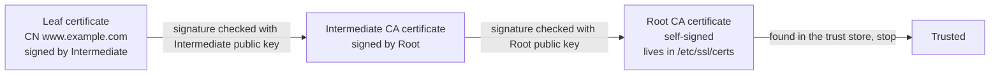
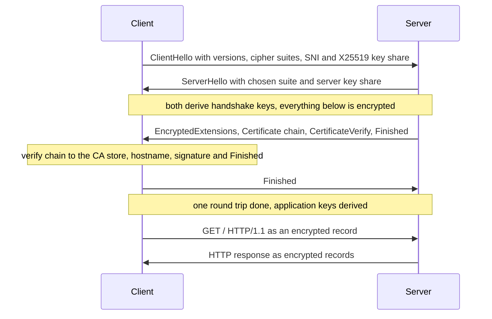
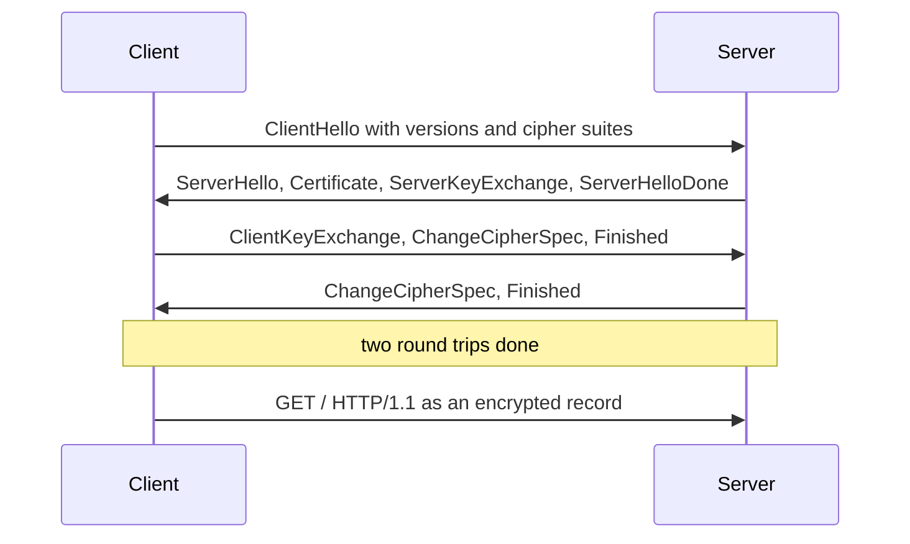

# Module 5.09: TLS basics

**Estimated hours:** 3

**What you will learn**

1. The three building blocks of TLS in plain words: symmetric keys, public/private key pairs, and hashes with signatures.
2. What a certificate is, how a chain of trust reaches the CA store on your machine, and what the TLS 1.3 handshake sends in one round trip.
3. How to inspect a real TLS connection with `openssl s_client`, run your own TLS server with a self-signed certificate, and call the OpenSSL API from C++.

**Prerequisites:** [Module 5.08: HTTP/1.1, HTTP/2 and HTTP/3](module-08-http.md). You should be comfortable with the `Socket` and `Listener` RAII wrappers from 5.02 and with reading a `tcpdump` capture from 5.03.

---

## 1. One-line intuition

TLS is an envelope around a TCP connection: the two sides agree on a secret key nobody listening can learn, prove who they are with a certificate, and then every byte is scrambled and sealed so it cannot be read or altered on the way.

## 2. Real-life analogy

Imagine a branch manager sending loan files to head office by courier.

- **Plain TCP** is a postcard. The courier, the sorting office, and anyone who picks it up can read it and even rewrite a number.
- **Symmetric encryption** is a steel box with one key. Both offices need the same key. The problem is getting that key to the other office safely: if you post it, the courier can copy it.
- **Asymmetric encryption** is a padlock that head office hands out freely. Anyone can snap it shut, but only head office has the key that opens it. The branch puts a fresh box key inside a parcel, snaps head office's padlock on, and sends it. Now both sides have the box key and nobody in between does.
- **A certificate** is head office's identity card: its padlock (public key), its name, and a stamp from a registry everyone trusts (the certificate authority). Without the stamp, a fraudster could hand the branch their own padlock and say "I am head office".
- **A hash** is a fingerprint of a document. Change one digit and the fingerprint changes completely.
- **A signature** is the fingerprint, locked with the signer's private key. Anyone with the public key can open it and compare fingerprints. If they match, the document is untouched and came from the signer.

The TLS **handshake** is the first exchange that checks the identity card and agrees on the box key. After that, every message is a locked box.

## 3. Why it exists: the problem it solves

Every TCP packet from 5.01 is sent as plain bytes. In the labs you watched `tcpdump` print your own protocol in clear text. On a real network, the same is possible for anyone on the path: the Wi-Fi access point, the office switch, the ISP, a compromised router. Three attacks follow:

1. **Reading**: a customer's account number, a PIN, a loan decision, a session token.
2. **Changing**: altering a transfer amount in flight. TCP checksums catch accidents, not attackers; an attacker recomputes the checksum.
3. **Impersonating**: a fake server that answers to the bank's hostname and collects logins.

TLS (Transport Layer Security) solves all three with three properties:

| Property | Meaning | Mechanism |
|---|---|---|
| Confidentiality | Nobody in between can read the bytes | Symmetric encryption with a fresh per-connection key |
| Integrity | Any change is detected and the connection is dropped | Authentication tag on every record (AEAD, defined below) |
| Authentication | The client knows it reached the real server | Certificate signed by a trusted authority, plus a signature made during the handshake |

What breaks without it: in 2010 a browser extension called Firesheep let anyone on a coffee-shop Wi-Fi take over other users' logged-in sessions, because most sites sent session cookies in plain HTTP. The industry's answer was "HTTPS everywhere". A bank without TLS today would fail its audit on day one (section 7).

TLS used to be called SSL (Secure Sockets Layer). The library is still called OpenSSL and the API still says `SSL_`, but the protocol versions in use are TLS 1.2 (2008) and TLS 1.3 (2018). SSL 3.0, TLS 1.0 and TLS 1.1 are retired and must be disabled.

## 4. Three layers of depth

### Layer 1 (beginner): the vocabulary

**Symmetric encryption.** One key, shared by both sides, used both to scramble (encrypt) and unscramble (decrypt). Fast: a modern CPU with AES hardware instructions encrypts several gigabytes per second per core. The algorithm TLS 1.3 uses most is **AES-GCM**, with 128-bit or 256-bit keys. The weakness is only the delivery of the key.

**Asymmetric encryption (public-key cryptography).** A matched pair: a **public key** you give to everyone and a **private key** you never reveal. What one locks, only the other opens. Roughly a thousand times slower than symmetric, so TLS uses it only during the handshake, to agree on a symmetric key. Families you will see: **RSA** (keys of 2048 or 3072 bits) and **elliptic curve** (ECDSA for signing, X25519 for key exchange, keys of 256 bits that are as strong as RSA 3072).

**Hash.** A function that turns any input into a fixed-size fingerprint. **SHA-256** gives 32 bytes. It is one-way (you cannot get the input back) and collision-resistant (you cannot find two inputs with the same fingerprint). Changing one bit of input changes about half of the output bits.

**Digital signature.** Hash the message, then transform the hash with the private key. Anyone holding the public key can check that the signature matches the message. A signature proves two things: the message was not altered, and the holder of the private key produced it.

**Certificate.** A small file (X.509 format) containing: a public key, the identity it belongs to (a hostname such as `www.example.com`), a validity period, and a signature from a **certificate authority (CA)** saying "we checked that this identity controls this key". The CA's own certificate is signed by a higher CA, up to a **root CA** that signs itself.

**CA store.** The list of root certificates your machine trusts. On Ubuntu it is the `ca-certificates` package, unpacked into `/etc/ssl/certs/` with one bundle file `/etc/ssl/certs/ca-certificates.crt`. Browsers ship their own list. If a root is not in the store, every certificate below it is "untrusted".

**Handshake.** The first messages on a TLS connection: agree on a version and cipher, exchange key material, present the certificate, prove possession of the private key. In TLS 1.3 this takes one network round trip.

**Record.** After the handshake, data is sent in chunks of up to 16 KB, each encrypted and tagged. The tag is a 16-byte checksum that only the key holders can compute, so any alteration is caught. Ciphers that encrypt and tag together are called **AEAD** (authenticated encryption with associated data).

**Cipher suite.** The name of the combination in use. In TLS 1.3 there are only a few: `TLS_AES_256_GCM_SHA384`, `TLS_AES_128_GCM_SHA256`, `TLS_CHACHA20_POLY1305_SHA256`. The key exchange and signature are negotiated separately.

### Layer 2 (working engineer): chains, verification and what you configure

**The chain of trust.** A server sends its own certificate (the **leaf**) plus the **intermediate** certificates between it and a root. The client walks the chain:



Verification checks, in order: every signature is valid, every certificate is inside its validity dates, the root is in the trust store, the leaf's name matches the hostname the client wanted (the **Subject Alternative Name**, SAN, field), and the certificate has not been revoked. Any failure stops the connection before application data is sent.

**Hostname matters twice.** The client sends the hostname in the clear in the first message. This is **SNI** (Server Name Indication): it lets one IP address serve many sites with different certificates. Then after the handshake the client checks that the certificate's SAN list includes that hostname. Encrypting to the right key but the wrong name is still a failure.

**Key exchange and forward secrecy.** TLS 1.3 always uses ephemeral Diffie-Hellman (usually on the X25519 curve). Both sides create a fresh key pair, exchange public halves, and each computes the same shared secret. The server's long-term private key is used only to sign the handshake, not to encrypt the secret. So if the server's key leaks next year, recordings of today's traffic still cannot be decrypted. This is **forward secrecy**, and it is one reason TLS 1.2's RSA key exchange was removed in 1.3.

**TLS 1.2 versus 1.3 in practice.**

| | TLS 1.2 | TLS 1.3 |
|---|---|---|
| Handshake | 2 round trips | 1 round trip (0 on resumption) |
| Key exchange | RSA or DHE or ECDHE | ECDHE or DHE only (forward secrecy always) |
| Cipher suites | Hundreds, many weak | 5, all AEAD |
| Handshake messages | Mostly plaintext | Encrypted after ServerHello |
| Status | Still allowed, must be configured carefully | Preferred |

Ubuntu 24.04 ships OpenSSL 3.0.x, which uses TLS 1.3 by default for both client and server and still accepts 1.2.

**Where the configuration lives.** As an engineer you touch TLS in four places:

| Place | What you set | Example |
|---|---|---|
| Server | Certificate, private key, minimum version, cipher list | nginx `ssl_certificate`, PostgreSQL `ssl = on` with `server.crt` and `server.key` |
| Client | Trust store, hostname to verify, minimum version | libpq `sslmode=verify-full sslrootcert=root.crt` |
| Internal CA | Who issues certificates for internal hosts | A bank runs its own CA for branch-to-datacentre links |
| Rotation | Certificates expire (publicly trusted ones at most 398 days today, with shorter limits being phased in) | Automation renews them; an expired certificate is a classic outage |

**PostgreSQL `sslmode`.** The option name you will use in Phase 6 with both PostgreSQL and YugabyteDB:

| `sslmode` | Encrypted | Server certificate checked | Hostname checked |
|---|---|---|---|
| `disable` | no | no | no |
| `require` | yes | no | no |
| `verify-ca` | yes | yes | no |
| `verify-full` | yes | yes | yes |

`require` stops eavesdropping but not impersonation. For a production link the right answer is `verify-full` with the bank's root certificate.

**Mutual TLS (mTLS).** Normally only the server presents a certificate. In mTLS the server also sends a `CertificateRequest`, the client presents its own certificate, and the server verifies it against a CA it trusts. Each side now knows who the other is at the transport layer, with no passwords. Banks use this for service-to-service links: the app server to the payment switch, the migration engine to the database. With `openssl` it is `s_server -Verify 1 -CAfile ca.pem` on one side and `s_client -cert client.pem -key client.key` on the other.

### Layer 3 (internals): the TLS 1.3 handshake message by message

Here is what crosses the wire when your laptop connects to `example.com:443` with TLS 1.3.

1. **ClientHello** (plaintext). Supported versions, the list of cipher suites, the SNI hostname, the signature algorithms the client accepts, and a **key share**: the public half of a fresh X25519 key pair. Sending the key share up front is the whole reason 1.3 saves a round trip; the client guesses which curve the server will want.
2. **ServerHello** (plaintext). The chosen suite and the server's own X25519 key share. At this instant both sides can compute the shared secret and derive the **handshake keys**. Everything after this is encrypted.
3. **EncryptedExtensions**, then **Certificate** (the chain), then **CertificateVerify**: a signature, made with the server's private key, over a hash of every handshake message so far. This is the proof that the server owns the private key matching the certificate. Then the server's **Finished**: a keyed hash of the whole transcript so far, proving nothing was tampered with.
4. The client verifies the chain, the hostname, the `CertificateVerify` signature and the `Finished` hash, then sends its own **Finished**.
5. Both sides derive the **application keys** (different from the handshake keys) and application data begins. The client can in fact send its first application record right after its Finished, without waiting, so the whole cost is one round trip.

Every record after the handshake is `[5-byte header][encrypted payload][16-byte tag]`. The payload is encrypted with AES-GCM under the application key and a counter-based nonce, so the same plaintext never produces the same ciphertext twice. The receiver checks the tag first; if it fails, the connection is closed with a fatal alert.

**Resumption and 0-RTT.** After one full handshake the server can issue a **session ticket**. On the next connection the client presents the ticket and may send application data in its very first flight (0-RTT). This is fast but the 0-RTT data can be replayed by an attacker, so it is only safe for idempotent requests. Banks typically keep 0-RTT off.

**Where the CPU time goes.** A full handshake costs roughly a signature (a fraction of a millisecond with ECDSA, a few milliseconds with RSA-2048 on a typical core) plus two scalar multiplications for X25519. Bulk data then costs well under a microsecond per kilobyte with AES-NI. In practice the cost that matters is the round trip, not the maths, which is why connection reuse (keep-alive from 5.08, pooled database connections from 6.12) matters even more with TLS than without.

**What TLS does not do.** It protects bytes in motion between two endpoints. It does not protect a compromised endpoint: malware on the branch PC reads the screen before encryption. It does not protect plaintext that the server writes to a log file after decryption. It does not hide who is talking to whom: IP addresses, packet sizes and timing, and the SNI hostname in ClientHello are visible. And it does not make bad application logic safe: an SQL injection travels perfectly encrypted.

## 5. Architecture diagram

TLS 1.3, one round trip before the client can send its request:



TLS 1.2, two round trips, with the certificate and key exchange in the clear:



Count the arrows before the first application record: four in 1.2 (two round trips), two in 1.3 (one round trip). On a 40 ms link that is 80 ms saved on every new connection.

## 6. Code

### 6a. Inspect a real server with `openssl s_client`

No code yet; this command is the tool you will use for the rest of your career when "the TLS connection fails".

```bash
openssl version
openssl s_client -connect example.com:443 -servername example.com </dev/null
```

`-servername` sets the SNI hostname. `</dev/null` closes standard input so the command exits instead of waiting for you to type. Expected output, trimmed and annotated. Issuer names, dates and byte counts will differ on your run because certificates are renewed; read the shape, not the exact strings:

```text
OpenSSL 3.0.13 30 Jan 2024
CONNECTED(00000003)                              <- TCP connected, fd 3
depth=2 C = US, O = DigiCert Inc, ... CN = DigiCert Global Root G2
verify return:1                                  <- root: found in /etc/ssl/certs
depth=1 C = US, O = DigiCert Inc, CN = DigiCert Global G2 TLS RSA SHA256 2020 CA1
verify return:1                                  <- intermediate: signature ok
depth=0 C = US, ST = California, ... CN = *.example.com
verify return:1                                  <- leaf: signature and name ok
---
Certificate chain
 0 s:C = US, ... CN = *.example.com               <- s: subject (who it is)
   i:C = US, O = DigiCert Inc, CN = ...            <- i: issuer (who signed it)
   a:PKEY: rsaEncryption, 2048 (bit); sigalg: RSA-SHA256
   v:NotBefore: Jan 15 00:00:00 2025 GMT; NotAfter: Jan 15 23:59:59 2026 GMT
 1 s:C = US, O = DigiCert Inc, CN = ...            <- the intermediate
   i:C = US, O = DigiCert Inc, ... CN = DigiCert Global Root G2
---
Server certificate
-----BEGIN CERTIFICATE-----
MIIH...                                          <- the leaf, base64 encoded
-----END CERTIFICATE-----
---
Peer signing digest: SHA256
Peer signature type: RSA-PSS                     <- CertificateVerify algorithm
Server Temp Key: X25519, 253 bits                <- ephemeral key exchange
---
SSL handshake has read 4257 bytes and written 393 bytes
Verification: OK
---
New, TLSv1.3, Cipher is TLS_AES_256_GCM_SHA384   <- version and cipher suite
Server public key is 2048 bit
...
    Verify return code: 0 (ok)                   <- the line you check first
---
```

Common `Verify return code` values: `0 (ok)`, `10 (certificate has expired)`, `18 (self-signed certificate)`, `19 (self-signed certificate in certificate chain)`, `20 (unable to get local issuer certificate)` which means the chain does not reach anything in your trust store, and `62 (hostname mismatch)` when you add `-verify_hostname`.

### 6b. A self-signed certificate and a local TLS server

A **self-signed** certificate is one where the subject signed its own public key. No CA vouches for it, so clients reject it unless you tell them to trust that exact file. It is perfect for labs and internal test systems.

```bash
mkdir -p ~/course/tls && cd ~/course/tls
openssl req -x509 -newkey rsa:2048 -noenc -days 365 \
    -keyout key.pem -out cert.pem \
    -subj "/CN=localhost" \
    -addext "subjectAltName=DNS:localhost,IP:127.0.0.1"
openssl x509 -in cert.pem -noout -subject -issuer -dates
```

`-x509` means "output a certificate, not a signing request"; `-newkey rsa:2048` makes a fresh key; `-noenc` leaves the key file unencrypted (older docs write `-nodes`); `-addext` adds the SAN so hostname checks can pass. Expected:

```text
subject=CN = localhost
issuer=CN = localhost           <- same as subject: self-signed
notBefore=Oct 18 09:12:44 2026 GMT
notAfter=Oct 18 09:12:44 2027 GMT
```

Now a TLS server in terminal 1 and a client in terminal 2:

```bash
# terminal 1
openssl s_server -accept 8443 -cert cert.pem -key key.pem
```

```bash
# terminal 2
openssl s_client -connect 127.0.0.1:8443 -CAfile cert.pem -verify_hostname localhost
```

Terminal 1 prints `ACCEPT` and then the handshake details when the client arrives. Terminal 2 prints the same shape as 6a, ending with `Verify return code: 0 (ok)` because `-CAfile cert.pem` told it to trust this certificate. Type a line in either terminal; it appears in the other. Both sides are reading and writing records that are encrypted on the loopback interface, which you will confirm with `tcpdump` in the lab. Press `Ctrl+C` in both when done.

Run the client once more without `-CAfile`. Now the last line is `Verify return code: 18 (self-signed certificate)`. The data still flows, because `s_client` is a diagnostic tool and continues after a verify failure; a real client must stop.

### 6c. The OpenSSL API from C++ (optional but recommended)

This program fetches `https://example.com/` and prints the protocol, cipher, verify result and HTTP status line. It shows the API shape you would use to add TLS to any socket program: a `SSL_CTX` (configuration, created once) and one `SSL` object per connection wrapped around a plain file descriptor.

```bash
sudo apt install -y libssl-dev
```

```cpp
// tls_get.cpp
// Opens a TCP connection, wraps it in TLS with OpenSSL, verifies the server
// against the system CA store and the expected hostname, sends one HTTP
// request and prints the status line.
#include <openssl/err.h>
#include <openssl/ssl.h>

#include <netdb.h>
#include <sys/socket.h>
#include <unistd.h>

#include <cstdio>
#include <cstring>
#include <string>

// Plain TCP connect, same idea as module 5.02 but with getaddrinfo so a
// hostname works. Returns -1 on failure.
static int tcp_connect(const char* host, const char* port) {
    addrinfo hints{};
    hints.ai_family   = AF_UNSPEC;      // IPv4 or IPv6
    hints.ai_socktype = SOCK_STREAM;    // TCP
    addrinfo* res = nullptr;
    if (getaddrinfo(host, port, &hints, &res) != 0) return -1;
    int fd = -1;
    for (addrinfo* p = res; p != nullptr; p = p->ai_next) {
        fd = socket(p->ai_family, p->ai_socktype, p->ai_protocol);
        if (fd < 0) continue;
        if (connect(fd, p->ai_addr, p->ai_addrlen) == 0) break;
        close(fd);
        fd = -1;
    }
    freeaddrinfo(res);
    return fd;
}

int main(int argc, char** argv) {
    const char* host = (argc > 1) ? argv[1] : "example.com";
    const char* want = (argc > 2) ? argv[2] : host;   // name we expect in the cert

    // 1. Context: created once per program, holds trust store and policy.
    SSL_CTX* ctx = SSL_CTX_new(TLS_client_method());
    if (ctx == nullptr) { ERR_print_errors_fp(stderr); return 1; }
    SSL_CTX_set_min_proto_version(ctx, TLS1_2_VERSION);   // refuse anything older
    SSL_CTX_set_verify(ctx, SSL_VERIFY_PEER, nullptr);    // fail if chain is bad
    if (SSL_CTX_set_default_verify_paths(ctx) != 1) {     // use /etc/ssl/certs
        ERR_print_errors_fp(stderr);
        return 1;
    }

    // 2. Plain TCP first. TLS sits on top of an ordinary connected socket.
    int fd = tcp_connect(host, "443");
    if (fd < 0) { std::perror("tcp_connect"); return 1; }

    // 3. One SSL object per connection, bound to the fd.
    SSL* ssl = SSL_new(ctx);
    SSL_set_fd(ssl, fd);
    SSL_set_tlsext_host_name(ssl, host);   // SNI: tell the server which site
    SSL_set1_host(ssl, want);              // verify the certificate's SAN against this

    // 4. The handshake. On failure the reason is on the OpenSSL error queue.
    if (SSL_connect(ssl) != 1) {
        std::fprintf(stderr, "handshake failed: verify result = %ld\n",
                     SSL_get_verify_result(ssl));
        ERR_print_errors_fp(stderr);
        return 1;
    }
    std::printf("protocol : %s\n", SSL_get_version(ssl));
    std::printf("cipher   : %s\n", SSL_get_cipher(ssl));
    std::printf("verify   : %ld (0 means ok)\n", SSL_get_verify_result(ssl));

    // 5. From here SSL_write / SSL_read replace send / recv.
    std::string req = "GET / HTTP/1.1\r\nHost: " + std::string(host) +
                      "\r\nConnection: close\r\n\r\n";
    if (SSL_write(ssl, req.data(), static_cast<int>(req.size())) <= 0) {
        ERR_print_errors_fp(stderr);
        return 1;
    }
    std::string reply;
    char buf[4096];
    for (;;) {
        int n = SSL_read(ssl, buf, sizeof buf);
        if (n <= 0) break;                 // 0 = clean close_notify from server
        reply.append(buf, static_cast<size_t>(n));
    }
    std::printf("status   : %s\n", reply.substr(0, reply.find("\r\n")).c_str());
    std::printf("received : %zu bytes in total\n", reply.size());

    // 6. Tidy up in reverse order. (In real code: an RAII wrapper, as in 5.02.)
    SSL_shutdown(ssl);
    SSL_free(ssl);
    close(fd);
    SSL_CTX_free(ctx);
    return 0;
}
```

```bash
g++ -std=c++17 -O2 -Wall -Wextra -Werror -g -pthread -o tls_get tls_get.cpp -lssl -lcrypto
./tls_get
```

Expected output (the cipher may be `TLS_AES_128_GCM_SHA256` depending on what the server prefers; the byte count varies):

```text
protocol : TLSv1.3
cipher   : TLS_AES_256_GCM_SHA384
verify   : 0 (0 means ok)
status   : HTTP/1.1 200 OK
received : 1762 bytes in total
```

Now ask it to verify the wrong name:

```bash
./tls_get example.com wrong.example.net
```

```text
handshake failed: verify result = 62
...:SSL routines::certificate verify failed:...
```

62 is `X509_V_ERR_HOSTNAME_MISMATCH`. The encryption would have worked; the identity check refused. That is the check a fake server fails.

## 7. Use case: core-banking loan-origination platform

The platform from resume claim H4 has three network hops, and each one carried customer data that a regulator cares about:

| Hop | Data on the wire | Decision |
|---|---|---|
| Branch client to app server (RPC over TCP) | Customer identity, income, decisions | TLS 1.2 or later, bank-internal CA, client certificates (mTLS) so only enrolled branch machines can connect |
| App server to database (PostgreSQL, then YugabyteDB) | Every row read or written | libpq `sslmode=verify-full` with the internal root certificate; not `require`, which would accept an impostor database |
| Migration engine to both databases (claim H1) | The full loan book during cutover | Same as above, plus running inside one datacentre network segment |

**The decision it drove: terminate TLS at the app server, not in front of it.** A load balancer that strips TLS and forwards plaintext to the app server is simpler, but then the plaintext loan data travels on the datacentre LAN and the app server cannot tell which branch certificate presented the request. Keeping TLS end to end to the app server process, using the OpenSSL API shape from 6c on the server side (`SSL_accept` on each accepted fd), kept the audit boundary at the process that logs the request.

**What the auditor asks.** PCI DSS, the card industry standard, requires strong cryptography for cardholder data crossing open or public networks and has forbidden SSL and early TLS since 2018. A loan system is not always in PCI scope, but the bank's own policy applied the same rule everywhere. Module 11.05 walks through the standard; for now the two facts to remember are "TLS 1.2 minimum, 1.3 preferred" and "a certificate inventory with expiry dates", because the second most common TLS incident after a misconfiguration is an expired certificate at 2 a.m.

**What TLS did not fix.** An incident from the RCA set in capstone C6 had the app server writing the full RPC payload, including a customer's identity number, into a debug log in plaintext. The wire was encrypted; the disk was not. Encryption in transit is one control among several, and interviewers like candidates who say so.

**tcpkv stays plaintext by design.** The capstone project speaks a line protocol over plain TCP so you can read it with `nc` and `tcpdump` while learning. If it ever had to carry real data, the change is contained: the `Connection` type would hold a `SSL*` next to its fd, `accept` would be followed by `SSL_accept`, and `recv`/`send` would become `SSL_read`/`SSL_write`. Nothing in the protocol parser or the store changes. The quicker alternative for a lab is to put `stunnel` or an nginx stream proxy in front of port 7000 and leave the server untouched.

## 8. Lab

Work in `~/course/tls`. Keep the certificate from section 6b.

### Part A: the trust store and a real chain (20 minutes)

1. Count what your machine trusts:

```bash
ls /etc/ssl/certs/*.pem | wc -l
grep -c "BEGIN CERTIFICATE" /etc/ssl/certs/ca-certificates.crt
```

Expected: a few hundred (typically 140 to 150 roots on Ubuntu 24.04; the exact number depends on the `ca-certificates` package version).

2. Save a real chain and read the leaf certificate as text:

```bash
openssl s_client -connect example.com:443 -servername example.com -showcerts </dev/null 2>/dev/null \
    | sed -n '/BEGIN CERTIFICATE/,/END CERTIFICATE/p' > chain.pem
grep -c "BEGIN CERTIFICATE" chain.pem
openssl x509 -in chain.pem -noout -text | grep -E "Issuer:|Subject:|Not (Before|After)|DNS:|Public Key Algorithm|Signature Algorithm" 
```

Expected: 2 or 3 certificates in `chain.pem` (leaf plus intermediates; the root is usually not sent because the client already has it). The `DNS:` line lists the SANs, the names this certificate is valid for.

3. Count round trips. Compare the message flow of 1.3 and 1.2 against the diagrams in section 5:

```bash
openssl s_client -connect example.com:443 -servername example.com -msg </dev/null 2>/dev/null | grep -E "^(<<<|>>>)"
openssl s_client -connect example.com:443 -servername example.com -tls1_2 -msg </dev/null 2>/dev/null | grep -E "^(<<<|>>>)"
```

`>>>` is sent, `<<<` is received. In the 1.3 run you should see one `ClientHello` out, `ServerHello` in, then the encrypted server messages, then one `Finished` out. In the 1.2 run you should see `ServerKeyExchange` and `ServerHelloDone` in, then `ClientKeyExchange` out, and a second server flight. If the server refuses `-tls1_2`, try another public site.

### Part B: your own TLS server, and proof it is encrypted (25 minutes)

1. Start the plaintext echo server from module 5.03 on port 7000 in terminal 1, and `sudo tcpdump -i lo -A port 7000` in terminal 2. In terminal 3, `nc 127.0.0.1 7000` and type `LOAN 1001 25000`. Watch the capture print the text.
2. Stop them. Now `openssl s_server -accept 8443 -cert cert.pem -key key.pem` in terminal 1, `sudo tcpdump -i lo -A port 8443` in terminal 2, `openssl s_client -connect 127.0.0.1:8443 -CAfile cert.pem -verify_hostname localhost` in terminal 3. Type the same line.
3. Expected: in step 1 the capture shows `LOAN 1001 25000` in clear. In step 2 the capture shows only random-looking bytes after the first two packets; the only readable string in the whole exchange is `localhost` inside the ClientHello (SNI is plaintext) and the certificate fields the server sends in 1.2 mode would be too, but in 1.3 even those are encrypted.
4. Run the client without `-CAfile` and record the verify return code. Then run it with `-verify_return_error` added and without `-CAfile`: it now refuses to continue, which is how a real client must behave.

### Part C: the C++ client and a broken identity (20 minutes)

1. Build and run `tls_get` from section 6c. Record the protocol, cipher and verify result.
2. Run `./tls_get example.com wrong.example.net`. Record the verify result number and look it up with `openssl verify -help 2>&1 | head -1; man verify` or in `/usr/include/openssl/x509_vfy.h.in` (search for `HOSTNAME_MISMATCH`).
3. Change `TLS1_2_VERSION` to `TLS1_3_VERSION` in `SSL_CTX_set_min_proto_version`, rebuild, run. It still works because the server offers 1.3. Now point it at your local server from Part B by changing the port to `8443` in `tcp_connect` and running `./tls_get localhost`. Expected: `handshake failed: verify result = 18`, because `cert.pem` is not in the system store. Add `SSL_CTX_load_verify_file(ctx, "cert.pem")` after `SSL_CTX_set_default_verify_paths` and run again: `verify : 0`. Restore the port afterwards.

### Part D: hashes and signatures by hand (20 minutes)

1. A hash changes completely on a one-bit change:

```bash
printf 'hello' | sha256sum
printf 'hellp' | sha256sum
```

Expected: the first is `2cf24dba5fb0a30e26e83b2ac5b9e29e1b161e5c1fa7425e73043362938b9824`. The second shares no visible pattern with it.

2. Sign a loan file with the private key and verify with the public key:

```bash
echo "loan 1001 approved 25000" > decision.txt
openssl pkey -in key.pem -pubout -out pub.pem
openssl dgst -sha256 -sign key.pem -out decision.sig decision.txt
openssl dgst -sha256 -verify pub.pem -signature decision.sig decision.txt
sed -i 's/25000/35000/' decision.txt
openssl dgst -sha256 -verify pub.pem -signature decision.sig decision.txt
```

Expected: `Verified OK`, then after the edit `Verification failure`. That is exactly what the client does to the server's `CertificateVerify` message, and what every certificate in the chain does to the one below it.

3. Look at the sizes: `ls -l decision.sig pub.pem key.pem`. The signature is 256 bytes for RSA-2048 regardless of how long the file is, because it signs the 32-byte hash, not the file.

### Journal

Copy [journal/TEMPLATE.md](../journal/TEMPLATE.md) to `journal/YYYY-MM-DD-tls-basics.md`. Record: the number of roots in your trust store; the chain length, issuer and SAN list for `example.com` on the day you ran it; the message flights you counted for 1.3 and 1.2; the verify return codes you saw (0, 18, 62) and what each meant; and one sentence on what the capture looked like before and after TLS.

## 9. Common mistakes and misconceptions

| Mistake | Why it is wrong | Bug it causes later |
|---|---|---|
| "HTTPS means the site is safe" | TLS proves you reached the named host and nobody read the bytes; it says nothing about what the host does | Trusting a phishing site that has a valid certificate for its own name |
| `sslmode=require` is enough for the database | It encrypts but does not check who the server is | An attacker on the network path presents any certificate and reads every query |
| Disabling verification "just for now" in code | `SSL_VERIFY_NONE` ships to production more often than anyone admits | Silent impersonation; audit finding |
| Self-signed certificates are insecure | The cryptography is identical; only the trust path differs | Rejecting a good internal design, or the opposite, trusting a self-signed cert without pinning the file |
| TLS makes the whole system encrypted | Only the wire between two endpoints; logs, disks and memory are plaintext | Customer identifiers in debug logs after a perfectly encrypted request |
| The certificate's `CN` is what is checked | Modern clients check the SAN list; a certificate without SANs fails hostname checks | "Works in `openssl s_client`, fails in the application" |
| Certificates last forever | Public ones at most 398 days today, and the limit is shrinking | The 2 a.m. outage when the branch link certificate expires |
| TLS is slow | A handshake is one round trip plus a fraction of a millisecond of CPU; bulk encryption is under a microsecond per KB with AES-NI | Leaving plaintext in place "for performance" |

## 10. Resume link

- **Claim E, "POSIX sockets, TCP/IP, RPC, HTTP, client-server architecture".** TLS is the layer every real deployment of these sits under. Be able to say: "TLS 1.3 is a one-round-trip handshake: the client sends a key share in ClientHello, the server answers with its share and an encrypted certificate and signature, and application data starts after the client's Finished. Everything after ServerHello is AEAD-encrypted records with a 16-byte tag."
- **Claim H4, "application server ... RPC-over-TCP against distributed SQL".** Say where TLS terminated and why: at the app server process, so the audit boundary and the client-certificate identity were in the same place as the request log; and `verify-full` to the database, because `require` does not stop impersonation.
- **Claim H1 and H3, migration and parity.** The migration engine moved the full loan book; "encrypted in transit with the bank's internal CA" is a sentence an interviewer expects to hear unprompted.
- **Claim I, tcpkv.** State the design choice: "Plaintext by design so the protocol can be inspected with `nc`; adding TLS is contained to the connection type, replacing `recv`/`send` with `SSL_read`/`SSL_write` after `SSL_accept`."

Likely follow-ups: "What is the difference between TLS 1.2 and 1.3?" (round trips, forward secrecy always, only AEAD suites, encrypted handshake). "What does `verify-full` add over `require`?" (chain and hostname verification). "What does TLS not protect?" (endpoints, logs, metadata, SNI). You have run all three in this lab.

## 11. Interview questions

**Q1 (easy). What is the difference between symmetric and asymmetric encryption, and where does TLS use each?**

<details>
<summary>Model answer</summary>

Symmetric encryption uses one shared key for both encrypting and decrypting; it is fast, and TLS uses it (AES-GCM or ChaCha20-Poly1305) for all application data. Asymmetric encryption uses a public/private key pair; it is about a thousand times slower, so TLS uses it only during the handshake: an ephemeral Diffie-Hellman exchange (usually X25519) to agree the symmetric key, and a signature with the server's long-term private key to prove the server owns the certificate.

</details>

**Q2 (easy). What is a certificate and what is a certificate authority?**

<details>
<summary>Model answer</summary>

A certificate is an X.509 document binding a public key to an identity (a hostname in the SAN field) for a validity period, signed by an issuer. A certificate authority is an issuer whose own certificate is trusted by clients, either directly as a root in the trust store (`/etc/ssl/certs` on Ubuntu) or through a chain to such a root. The client verifies each signature up the chain, checks dates and hostname, and stops at a root it already trusts.

</details>

**Q3 (medium). Walk through the TLS 1.3 handshake and explain why it needs only one round trip.**

<details>
<summary>Model answer</summary>

The client sends ClientHello with supported versions, cipher suites, SNI and a key share, the public half of a fresh X25519 key pair. The server replies with ServerHello carrying its chosen suite and its own key share; both sides now compute the shared secret and switch to encrypted handshake keys. In the same flight the server sends EncryptedExtensions, its certificate chain, CertificateVerify (a signature over the transcript with its private key) and Finished (a keyed hash of the transcript). The client verifies the chain against the trust store, the hostname against the SAN list, the signature and the Finished hash, then sends its own Finished and can immediately send application data under the application keys. It is one round trip because the client guesses the key-exchange group and sends its share in the first message, instead of waiting for the server to say which group to use as TLS 1.2 did with ServerKeyExchange.

</details>

**Q4 (medium). A service connects to PostgreSQL with `sslmode=require` and the team says the link is secure. What is missing, and what would you change?**

<details>
<summary>Model answer</summary>

`require` negotiates TLS but does not verify the server's certificate, so a machine on the network path that intercepts the TCP connection and presents any certificate is accepted; the client then encrypts everything to the attacker. The fix is `sslmode=verify-full` with `sslrootcert` pointing at the bank's internal root certificate, which checks the chain and that the certificate's SAN matches the hostname in the connection string. For service-to-service links I would add mutual TLS so the database also authenticates the application by certificate, and I would check that the server enforces a minimum of TLS 1.2 and rotates certificates before expiry.

</details>

**Q5 (hard). An interviewer says: "TLS is enabled everywhere, so the loan data is protected." Give three concrete things TLS does not protect against and the control you would add for each.**

<details>
<summary>Model answer</summary>

First, compromised endpoints: TLS decrypts at the app server process, so anything on that host, including a debug log that writes the request payload, holds plaintext; the control is log redaction of customer identifiers and disk encryption at rest. Second, impersonation when verification is weak: `sslmode=require` or `SSL_VERIFY_NONE` encrypts to whoever answers; the control is full chain and hostname verification, ideally mTLS, and a CI check that greps for verification being disabled. Third, metadata and application bugs: SNI, IP addresses, packet sizes and timing are visible, and an SQL injection or an authorisation bug travels perfectly encrypted; the controls are network segmentation, parameterised queries (module 11.03) and server-side authorisation in the stored-procedure layer (claim H6). I would also mention operational failure: an expired certificate is an outage, not a security event, so certificate inventory and automated renewal are part of "TLS everywhere".

</details>

## 12. Revision

- TLS gives confidentiality, integrity and authentication over TCP: symmetric AEAD encryption for data, an ephemeral key exchange plus a certificate signature in the handshake.
- A certificate is a public key plus identity plus a CA signature; the client walks the chain to a root in `/etc/ssl/certs`, checks dates and the SAN hostname; `verify-full`, not `require`.
- TLS 1.3 is one round trip, encrypted from ServerHello onward, forward-secret always; `openssl s_client` and `Verify return code` are your first diagnostic; TLS does not protect endpoints, logs or metadata.

---

Previous: [Module 5.08: HTTP/1.1, HTTP/2 and HTTP/3](module-08-http.md) | Next: [Module 5.10: Backpressure, timeouts and flow control](module-10-backpressure-timeouts-flow-control.md)
