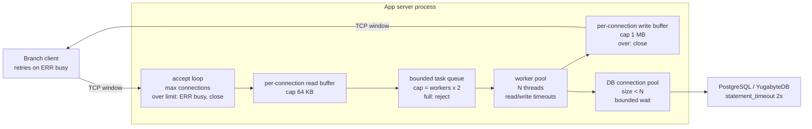

# Module 5.10: Backpressure, timeouts and flow control

**Estimated hours:** 3

**What you will learn**

1. What backpressure is (a slow consumer must slow the producer), how TCP already provides it, and the three places inside a server where it silently stops working.
2. The four design rules that keep a server alive under overload: bounded queues, connection limits, timeouts on everything, and load shedding that fails fast.
3. Why a system running near 100% utilisation has unbounded latency (Little's law), shown with a tiny simulation you can run.

**Prerequisites:** [Module 5.09: TLS basics](module-09-tls-basics.md). You will reuse the thread-per-connection echo server idea from 5.03, the `BoundedQueue` from 4.04 and the `ss` and `tcpdump` tools from 5.01 and 5.03.

---

## 1. One-line intuition

If the thing receiving work cannot keep up, the thing sending work must be told to slow down or be refused; any design where that signal is missing will eventually run out of memory, threads or time.

## 2. Real-life analogy

A bank branch on salary day.

- **Flow control** is the token machine at the door. It hands out at most 40 tokens. When the hall is full, the machine stops and new customers wait outside. The counters never see more people than there are chairs.
- **No flow control** is a branch without the machine. People keep coming in. The hall fills, then the corridor, then the stairs. Nobody can move, the staff cannot reach the printer, and the people at the back will wait three hours. Some will faint. Nobody at the counter is working faster; the queue just got longer.
- **A slow client** is the customer who reaches the counter, then takes a phone call for 20 minutes while holding the teller. One such customer per counter and the branch is closed to everyone else.
- **A timeout** is the rule "if you are not ready after two minutes, step aside and take a new token".
- **Load shedding** is the guard at the door saying "we are full, come back after 2 pm". It feels rude. It is far better than letting people in to wait three hours and then closing at 4 pm with half of them unserved.
- **Little's law** is what the branch manager learned by counting: the number of people in the hall equals how fast they arrive times how long each one stays. If 2 arrive per minute and each stays 20 minutes, there are 40 people in the hall. Always.

## 3. Why it exists: the problem it solves

In 5.04 you built servers that handled many connections at once. All of them assumed that the client reads its replies promptly and that the database answers quickly. Drop either assumption and every design you have seen fails in the same way: work comes in faster than it goes out, the difference piles up somewhere, and that somewhere is finite.

Three true stories, all with the same root cause:

1. A thread-per-connection server where each client got a thread. A monitoring tool opened connections and never closed them. After a weekend, 30,000 threads, no memory left for a new stack, the server stopped accepting logins.
2. A thread-pool server with an unbounded task queue. The database slowed down for ten minutes during a backup. Requests kept arriving at the normal rate, queued, and the queue grew to two million entries. When the database recovered, the server spent forty minutes replying to requests whose clients had given up half an hour earlier, and then ran out of memory anyway.
3. An app server with 64 workers and a database with 100 connections. One slow query held a lock. All 64 workers blocked on it. The health check, which ran a different, fast query, also needed a worker. The load balancer marked the server dead. The slow query finished two seconds later, but the server had already been removed from service.

What breaks without backpressure is not throughput. Throughput is the same: the slow part sets the pace either way. What breaks is **latency** and **memory**: a queue with no bound grows without limit, and every item in it waits for everything in front of it. Backpressure means moving the waiting to where it is cheapest, which is usually the client, and making it visible.

## 4. Three layers of depth

### Layer 1 (beginner): the words and where the queues are

**Producer and consumer.** Whoever generates work and whoever does it. A client is a producer for the server; the server is a producer for the database.

**Backpressure.** A signal that travels from consumer to producer meaning "slow down". It can be explicit (a reply saying "busy") or implicit (the producer's call to send blocks until there is room).

**Flow control.** The mechanism that implements backpressure between two parties. TCP has one built in (Layer 2).

**Queue.** Anywhere work waits. Inside one server there are more queues than you expect:

| Queue | Where | Bounded by default? |
|---|---|---|
| Listen backlog (connections accepted by the kernel, not yet by you) | Kernel | Yes, the `backlog` argument to `listen` |
| Socket receive buffer | Kernel | Yes, a few hundred KB to a few MB |
| Socket send buffer | Kernel | Yes |
| Your per-connection read buffer | Your code | Only if you cap it |
| Your task queue in front of the thread pool | Your code | Only if you cap it |
| Your per-connection write buffer | Your code | Only if you cap it |
| Database connection pool wait list | Your code or the pool library | Usually a timeout, not always |

The kernel queues are bounded because kernel engineers learned this lesson decades ago. The ones in your code are bounded only if you bound them.

**Timeout.** A limit on how long one operation may wait before it is abandoned with an error. Without timeouts a single stuck peer can hold a resource forever.

**Load shedding.** Deliberately refusing some work so the remaining work finishes in time. "Fail fast" means telling the client "no" in a millisecond rather than "maybe" in thirty seconds.

**Utilisation.** The fraction of time a worker is busy. 0.9 means busy nine seconds out of ten.

### Layer 2 (working engineer): how TCP does it, where it breaks, and the design rules

**TCP's built-in flow control.** Every TCP segment carries a **receive window**: "I have room for this many more bytes". The receiver's kernel shrinks the window as its receive buffer fills, because the application has not called `recv` yet. When the window reaches zero the sender's kernel stops sending. The sender's `send` call then finds its own send buffer full and **blocks** (or, on a non-blocking socket, returns `-1` with `errno == EAGAIN`). So a slow reader slows the writer all the way back to the writer's application code, with no action from anyone. You will see it in the lab with `ss -tn`, where `Recv-Q` and `Send-Q` show the bytes waiting on each side.

**Where it breaks inside a server.** TCP's backpressure only works if the signal keeps travelling. Three common ways to break the chain:

1. **An unbounded queue in the middle.** Reader thread drains the socket into a `std::deque` for a worker pool. The socket never fills, so TCP never pushes back on the client, and the deque grows until the process is killed (the Linux **OOM killer**, out-of-memory killer, ends the process holding the most memory).
2. **A slow client holding a worker.** The worker finished the real work and is now in `send`, blocked because the client is not reading. That worker is doing nothing useful for anyone. Enough such clients and every worker is stuck; the server is up, the port is open, and nothing gets served.
3. **A slow downstream stalling every worker.** All workers block inside a database call. New requests pile up in the task queue (see 1), and the server cannot even answer a health check.

**Design rule 1: every queue has a bound, and a policy for "full".** Two honest policies: **block** the producer (which pushes backpressure one step further back, eventually to the TCP socket and the client), or **reject** immediately with an error the client can act on. The dishonest policy is "grow".

**Design rule 2: per-connection limits.** A maximum number of connections, enforced at `accept`: when over the limit, accept, write one line (`ERR busy`), close. Accept-then-reject beats not accepting, because an unaccepted connection sits in the backlog and the client cannot tell "busy" from "dead". Also a cap on the per-connection write buffer: if a client has more than, say, 1 MB of unread replies, close it; it is not keeping up and will never catch up.

**Design rule 3: a timeout on everything that waits.** Connect, read, write, idle, queue wait, database statement, lock acquisition. The tools:

| Wait | Mechanism | Typical value |
|---|---|---|
| Idle connection, blocking socket | `setsockopt(SO_RCVTIMEO)`: `recv` returns `-1`/`EAGAIN` after the time | 30 s to several minutes for interactive clients |
| Write to a slow client | `SO_SNDTIMEO`, or `poll` with `POLLOUT` and a timeout | 5 to 30 s |
| Any wait in a reactor | `poll`/`epoll_wait` timeout plus a per-connection "last activity" clock | per design |
| Outbound connect | Non-blocking `connect` then `poll` with timeout | 1 to 5 s |
| Database statement | PostgreSQL `SET statement_timeout = '2s'`, `lock_timeout`, `idle_in_transaction_session_timeout` | hundreds of ms to a few seconds |
| Waiting for a pooled connection | Bounded wait on the pool | shorter than the client's own timeout |

Every timeout must be **shorter than the one upstream of it**. If the branch client gives up after 10 s, the app server's database timeout must be below that, or the server does work nobody will collect.

**Design rule 4: shed load early.** Fail fast beats fail slow because of a simple asymmetry: a fast "busy, retry" costs the client one retry; a slow "maybe" costs the client a wait, then a retry anyway, and costs the server a worker for the whole wait. Under real overload, slow failure makes the overload worse (retries from timed-out clients arrive on top of new traffic). Fast failure caps the damage at the point where the server stopped being able to help.

**Measuring instead of guessing.** `ss -tn` for queue bytes, thread count via `ls /proc/<pid>/task | wc -l`, and the latency percentiles you build in 5.11. A server that is "slow" with empty kernel queues has a slow worker; a server with full queues has too much work for its workers.

### Layer 3 (internals): Little's law and why 100% busy means infinite waiting

**Little's law.** For any stable system: `L = λ × W`, where `L` is the average number of items in the system, `λ` is the arrival rate, and `W` is the average time each item spends inside. It holds for any arrival pattern and any service discipline, which is why it is the first thing to write down when sizing anything.

Example: an app server receives 200 requests per second and each takes 50 ms end to end. `L = 200 × 0.05 = 10` requests in flight on average. If you want at most 64 in flight (one per worker), then at 200 per second each request must average under 320 ms, or at 50 ms each you can sustain up to 1,280 per second. Turn it around: if you observe 500 requests in flight at 200 per second, your average latency is 2.5 s whether or not anyone measured it.

**Why utilisation near 1 explodes latency.** For a single worker with random arrivals (rate λ) and random service times (mean `s`, rate μ = 1/s), the simplest queueing model (called M/M/1) gives an average time in the system of:

```text
W = s / (1 - ρ)        where ρ = λ / μ is the utilisation
```

With `s` = 1 ms:

| Utilisation ρ | Average time in system | p99 (about 4.6 × average for this model) |
|---|---|---|
| 0.50 | 2 ms | 9 ms |
| 0.80 | 5 ms | 23 ms |
| 0.90 | 10 ms | 46 ms |
| 0.95 | 20 ms | 92 ms |
| 0.99 | 100 ms | 460 ms |
| 1.00 | unbounded | unbounded |

Going from 50% to 90% busy multiplies waiting by five. From 90% to 99% multiplies it by ten more. The queue is where the waiting lives; at ρ = 1 the queue has no reason ever to drain. This is the mathematics behind "run production at 60 to 70% and treat 85% as the alarm", and it is why bounding the queue is not optional: a bound converts unbounded latency into a bounded latency plus a visible rejection rate.

Real systems are worse than M/M/1 in one way (arrivals come in bursts, which lengthens queues) and better in another (many workers in parallel smooth things out). The shape of the curve is the same.

**What the kernel does on a zero window.** When the receiver advertises window 0, the sender starts a **persist timer** and sends tiny probes (one byte) at increasing intervals until the window opens. The connection stays alive indefinitely in this state. That is the point: TCP will wait forever on your behalf unless *you* set a timeout. A blocked `send` on a zero-window connection is the exact mechanism behind "slow client holds a worker".

**What `SO_RCVTIMEO` does.** It sets a field on the socket (`sk_rcvtimeo`) that the blocking receive path uses as the maximum sleep in its wait queue. When the timer expires with no data, the system call returns `-EAGAIN`. Nothing about the connection changes; your code decides what to do. In a reactor you do not use it; instead `epoll_wait` takes a timeout and you keep a per-connection "last activity" timestamp and close connections older than the limit on every wake-up.

## 5. Architecture diagram



Every box has a number on it. Each number is a decision you can defend. The arrows labelled "TCP window" are where the kernel's own flow control carries the signal to and from the client.

## 6. Code

### 6a. An echo server with a connection limit and idle timeouts

This is the thread-per-connection echo server from 5.03 with two knobs added: `--max-workers` (connection limit with fail-fast rejection) and `--idle-timeout` (seconds; `SO_RCVTIMEO` and `SO_SNDTIMEO`). Both default to off so you can see the problem before the fix.

```cpp
// echo_limited.cpp
// Thread-per-connection echo server with a connection cap and idle timeouts.
//   ./echo_limited --port 7000 --max-workers 4 --idle-timeout 5
#include <arpa/inet.h>
#include <netinet/in.h>
#include <sys/socket.h>
#include <sys/time.h>
#include <unistd.h>

#include <atomic>
#include <cerrno>
#include <cstdint>
#include <cstdio>
#include <cstdlib>
#include <cstring>
#include <string>
#include <thread>

struct Fd {                       // minimal RAII owner, same idea as Socket in 5.02
    int fd;
    explicit Fd(int f) : fd(f) {}
    ~Fd() { if (fd >= 0) close(fd); }
    Fd(const Fd&) = delete;
    Fd& operator=(const Fd&) = delete;
};

static std::atomic<int> g_active{0};   // connections currently served

static bool send_all(int fd, const char* p, size_t n) {
    while (n > 0) {
        ssize_t k = send(fd, p, n, MSG_NOSIGNAL);   // no SIGPIPE on a dead peer
        if (k <= 0) return false;                    // error, or timeout (EAGAIN)
        p += k;
        n -= static_cast<size_t>(k);
    }
    return true;
}

static void serve(int client_fd, int idle_timeout_s) {
    Fd client(client_fd);
    if (idle_timeout_s > 0) {
        timeval tv{};
        tv.tv_sec = idle_timeout_s;
        setsockopt(client.fd, SOL_SOCKET, SO_RCVTIMEO, &tv, sizeof tv);  // recv gives up
        setsockopt(client.fd, SOL_SOCKET, SO_SNDTIMEO, &tv, sizeof tv);  // send gives up
    }
    char buf[4096];
    for (;;) {
        ssize_t n = recv(client.fd, buf, sizeof buf, 0);
        if (n == 0) break;                                   // peer closed cleanly
        if (n < 0) {
            if (errno == EAGAIN || errno == EWOULDBLOCK) {   // the timeout fired
                std::printf("[worker] fd %d idle for %ds, closing\n", client.fd, idle_timeout_s);
                send_all(client.fd, "ERR idle timeout\n", 17);
            }
            break;
        }
        if (!send_all(client.fd, buf, static_cast<size_t>(n))) {
            std::printf("[worker] fd %d send failed or timed out, closing\n", client.fd);
            break;
        }
    }
    g_active.fetch_sub(1);
    std::printf("[worker] fd %d done, active=%d\n", client.fd, g_active.load());
}

int main(int argc, char** argv) {
    int port = 7000, max_workers = 0, idle_timeout = 0;
    for (int i = 1; i + 1 < argc; i += 2) {
        std::string k = argv[i];
        if (k == "--port") port = std::atoi(argv[i + 1]);
        else if (k == "--max-workers") max_workers = std::atoi(argv[i + 1]);
        else if (k == "--idle-timeout") idle_timeout = std::atoi(argv[i + 1]);
    }

    Fd listener(socket(AF_INET, SOCK_STREAM, 0));
    if (listener.fd < 0) { std::perror("socket"); return 1; }
    int one = 1;
    setsockopt(listener.fd, SOL_SOCKET, SO_REUSEADDR, &one, sizeof one);
    sockaddr_in addr{};
    addr.sin_family      = AF_INET;
    addr.sin_addr.s_addr = htonl(INADDR_ANY);
    addr.sin_port        = htons(static_cast<uint16_t>(port));
    if (bind(listener.fd, reinterpret_cast<sockaddr*>(&addr), sizeof addr) < 0) {
        std::perror("bind");
        return 1;
    }
    if (listen(listener.fd, 128) < 0) { std::perror("listen"); return 1; }
    std::printf("echo_limited: port %d, max_workers=%d (0=unlimited), idle_timeout=%ds (0=none)\n",
                port, max_workers, idle_timeout);

    for (;;) {
        int c = accept(listener.fd, nullptr, nullptr);
        if (c < 0) {
            if (errno == EINTR) continue;
            std::perror("accept");
            break;
        }
        if (max_workers > 0 && g_active.load() >= max_workers) {
            // Load shedding: accept, say no in one line, close. Fail fast.
            std::printf("[accept] busy, rejecting fd %d (active=%d)\n", c, g_active.load());
            send_all(c, "ERR busy\n", 9);
            close(c);
            continue;
        }
        g_active.fetch_add(1);
        std::printf("[accept] fd %d, active=%d\n", c, g_active.load());
        std::thread(serve, c, idle_timeout).detach();
    }
    return 0;
}
```

```bash
g++ -std=c++17 -O2 -Wall -Wextra -Werror -g -pthread -o echo_limited echo_limited.cpp
./echo_limited --max-workers 2 --idle-timeout 5
```

In a second terminal, `nc 127.0.0.1 7000`, type `hello`, see it echoed, then type nothing for five seconds. Expected on the server:

```text
echo_limited: port 7000, max_workers=2 (0=unlimited), idle_timeout=5s (0=none)
[accept] fd 4, active=1
[worker] fd 4 idle for 5s, closing
[worker] fd 4 done, active=0
```

And `nc` prints `hello` then `ERR idle timeout` and exits. The lab builds the attack and the fix on top of this.

### 6b. A bounded queue, and what the bound buys you

The `BoundedQueue` from module 4.04 with one addition, `try_push`, which refuses instead of waiting. The demo pushes 100,000 items as fast as it can into a queue drained at roughly 10,000 per second, and measures how long each accepted item waited.

```cpp
// bounded_queue_demo.cpp
// Fast producer, slow consumer. Compare a capped queue with an uncapped one.
//   ./bounded_queue_demo 64      (cap 64, reject when full)
//   ./bounded_queue_demo 0       (no cap: everything is accepted, and waits)
#include <chrono>
#include <condition_variable>
#include <cstdio>
#include <cstdlib>
#include <limits>
#include <mutex>
#include <queue>
#include <thread>

using Clock = std::chrono::steady_clock;

template <typename T>
class BoundedQueue {
public:
    explicit BoundedQueue(size_t cap) : cap_(cap) {}

    // Non-blocking: false if full. The caller decides what "full" means.
    bool try_push(T v) {
        std::lock_guard<std::mutex> lk(m_);
        if (q_.size() >= cap_) return false;
        q_.push(std::move(v));
        not_empty_.notify_one();
        return true;
    }
    // Blocking alternative: wait for room. Pushes backpressure onto the caller.
    void push(T v) {
        std::unique_lock<std::mutex> lk(m_);
        not_full_.wait(lk, [&] { return q_.size() < cap_; });
        q_.push(std::move(v));
        not_empty_.notify_one();
    }
    bool pop(T& out) {                       // false only when closed and empty
        std::unique_lock<std::mutex> lk(m_);
        not_empty_.wait(lk, [&] { return !q_.empty() || closed_; });
        if (q_.empty()) return false;
        out = std::move(q_.front());
        q_.pop();
        not_full_.notify_one();
        return true;
    }
    void close() {
        std::lock_guard<std::mutex> lk(m_);
        closed_ = true;
        not_empty_.notify_all();
    }

private:
    std::mutex m_;
    std::condition_variable not_empty_, not_full_;
    std::queue<T> q_;
    size_t cap_;
    bool closed_ = false;
};

int main(int argc, char** argv) {
    size_t cap = (argc > 1) ? std::strtoul(argv[1], nullptr, 10) : 64;
    if (cap == 0) cap = std::numeric_limits<size_t>::max();   // "unbounded"
    BoundedQueue<Clock::time_point> q(cap);

    long accepted = 0, rejected = 0;
    double max_wait_ms = 0;
    auto t0 = Clock::now();

    std::thread consumer([&] {
        Clock::time_point enqueued;
        while (q.pop(enqueued)) {
            double w = std::chrono::duration<double, std::milli>(Clock::now() - enqueued).count();
            if (w > max_wait_ms) max_wait_ms = w;
            std::this_thread::sleep_for(std::chrono::microseconds(100));  // ~10k items/s
        }
    });

    for (int i = 0; i < 100000; ++i) {              // producer: as fast as possible
        if (q.try_push(Clock::now())) ++accepted; else ++rejected;
    }
    q.close();
    consumer.join();

    double total_s = std::chrono::duration<double>(Clock::now() - t0).count();
    std::printf("cap=%s accepted=%ld rejected=%ld max_wait=%.1f ms total=%.2f s\n",
                (argc > 1) ? argv[1] : "64", accepted, rejected, max_wait_ms, total_s);
    return 0;
}
```

```bash
g++ -std=c++17 -O2 -Wall -Wextra -Werror -g -pthread -o bounded_queue_demo bounded_queue_demo.cpp
./bounded_queue_demo 64
./bounded_queue_demo 0
```

Expected shape (the exact counts and times depend on your machine's timer resolution; in WSL2 a 100 µs sleep often takes longer):

```text
cap=64 accepted=71 rejected=99929 max_wait=7.4 ms total=0.01 s
cap=0 accepted=100000 rejected=0 max_wait=11236.8 ms total=11.24 s
```

Read the two lines together. The consumer did the same work per item in both runs. With a cap, 99.9% of the work was refused instantly and the work that was accepted finished within about 7 ms. Without a cap, everything was accepted and the last item waited eleven seconds. If those items were requests, the first server told 99,929 clients "busy, retry" in under a millisecond each; the second server made 100,000 clients wait, most of them longer than any client timeout, and then did the work anyway for nobody. That is Little's law: `L = λ × W`, and with `λ` fixed by the consumer, a huge `L` means a huge `W`.

### 6c. A queueing simulation

Forty lines that reproduce the table in Layer 3.

```cpp
// queue_sim.cpp
// One worker, random arrivals, random 1 ms average service. Prints how the
// time in the system grows as utilisation approaches 1.
#include <algorithm>
#include <cstdio>
#include <random>
#include <vector>

int main() {
    const double service_ms = 1.0;
    const int    N = 400000;                       // arrivals per run
    for (double rho : {0.5, 0.8, 0.9, 0.95, 0.99}) {
        std::mt19937_64 rng(42);
        std::exponential_distribution<double> next_arrival(rho / service_ms);
        std::exponential_distribution<double> service(1.0 / service_ms);
        double now = 0, worker_free_at = 0, sum = 0;
        std::vector<double> in_system;
        in_system.reserve(N);
        for (int i = 0; i < N; ++i) {
            now += next_arrival(rng);                             // when it arrives
            double start = std::max(now, worker_free_at);         // waits if busy
            worker_free_at = start + service(rng);
            double w = worker_free_at - now;                      // queue + service
            in_system.push_back(w);
            sum += w;
        }
        std::sort(in_system.begin(), in_system.end());
        std::printf("util=%.2f  mean=%6.1f ms  p99=%6.1f ms  (M/M/1 theory mean %5.1f ms)\n",
                    rho, sum / N, in_system[static_cast<size_t>(N * 0.99)],
                    service_ms / (1.0 - rho));
    }
    return 0;
}
```

```bash
g++ -std=c++17 -O2 -Wall -Wextra -Werror -g -pthread -o queue_sim queue_sim.cpp
./queue_sim
```

Expected: the simulated mean lands close to the theory column for the first four rows (within about 10%). The 0.99 row is noisy because the queue at that load takes a very long time to settle; raise `N` to 4,000,000 and it converges. Typical shape:

```text
util=0.50  mean=   2.0 ms  p99=   9.2 ms  (M/M/1 theory mean   2.0 ms)
util=0.80  mean=   5.0 ms  p99=  23.1 ms  (M/M/1 theory mean   5.0 ms)
util=0.90  mean=  10.1 ms  p99=  46.4 ms  (M/M/1 theory mean  10.0 ms)
util=0.95  mean=  19.6 ms  p99=  90.2 ms  (M/M/1 theory mean  20.0 ms)
util=0.99  mean=  88.7 ms  p99= 410.5 ms  (M/M/1 theory mean 100.0 ms)
```

The worker did exactly 1 ms of work per request in every row. Only the waiting changed.

## 7. Use case: core-banking loan-origination platform

The app server from resume claim H4 sat between a few hundred branch clients and a database. The decisions below were all answers to the three failure stories in section 3, and each one is a number you can explain.

**Decision: the request pool size is the maximum number of in-flight requests, and it is small.** Sixty-four pooled worker slots, a task queue capped at 128, and nothing else holds a request. By Little's law, with the database answering a loan-create in about 20 ms, 64 in flight supports well over 1,000 requests per second, far above the branch load. The cap exists not for the normal day but for the bad hour.

**Decision: branch clients get a `BUSY` status code, not a timeout.** When the queue is full the server replies within a millisecond with an RPC status meaning "server busy, retry after N ms". The branch client shows "please retry" and backs off with jitter. During the database backup incident this turned forty minutes of serving dead requests into a two-minute window where some branches saw a retry message and the rest were unaffected.

**Decision: the database connection pool is smaller than the worker count, on purpose.** Sixteen database connections for sixty-four workers. This makes the database the bottleneck by design, and the queue in front of it is the pool's bounded wait, inside the server, where it can be measured and timed out, rather than inside the database where it would show up as hundreds of idle-in-transaction sessions. Workers that are not waiting on the database are free to answer health checks and cache-only requests (the master-table cache from 4.13 served those without touching the pool at all).

**Decision: `statement_timeout` of 2 s on every pooled connection, `lock_timeout` of 1 s, idle-connection timeout of 10 minutes on the branch side.** Each one is shorter than the timeout upstream of it: lock 1 s < statement 2 s < pool wait 3 s < client RPC timeout 10 s. The single slow query from story 3 now fails one request after two seconds instead of freezing the server.

The interviewer's follow-up is always "how did you pick the numbers?" The honest answer: from the load generator you build in 5.11 and from the first incident. Say both.

## 8. Lab

Build `echo_limited` from 6a. You will need three or four terminals. Replace `7000` if the port is in use.

### Part A: the slow-client attack, no limits (20 minutes)

1. Start `./echo_limited` with no options. Note its PID: `pidof echo_limited`.
2. Open twenty idle connections that never send or read, all from one shell:

```bash
for i in $(seq 1 20); do (sleep 600 | nc 127.0.0.1 7000) & done
```

3. Count the server's threads and connections:

```bash
ls /proc/$(pidof echo_limited)/task | wc -l
ss -tn state established '( sport = :7000 )' | wc -l
```

Expected: 21 threads (main plus one per connection) and 20 established connections. Every one of those threads is parked in `recv` forever. On a thread-per-connection server with no cap, this is 20 idle `nc` processes costing you 20 threads; the attacker's cost and yours are equal, and the attacker has more laptops. Kill the clients with `pkill -f "nc 127.0.0.1 7000"` and `pkill sleep` (or close the shell), and stop the server.

### Part B: a connection limit without a timeout (15 minutes)

1. Start `./echo_limited --max-workers 4`.
2. Open four idle connections with the loop from Part A but `seq 1 4`.
3. Now be the legitimate user: `nc 127.0.0.1 7000` and type `hello`.

Expected: the legitimate user sees `ERR busy` immediately and `nc` exits. The server prints `[accept] busy, rejecting fd 8 (active=4)`. The server is protected (it will never run out of threads) but useless: four idle clients hold all four slots forever. A limit without a timeout only moves the problem.

### Part C: the fix, idle timeouts (15 minutes)

1. Restart with `./echo_limited --max-workers 4 --idle-timeout 5`.
2. Open four idle connections again. Count seconds. After five seconds the server prints four `idle for 5s, closing` lines and `active=0`.
3. Be the legitimate user again: `nc 127.0.0.1 7000`, type `hello`, see `hello`.
4. Open the four idle connections while you are typing. Your own connection keeps working as long as you type at least every five seconds; the idle ones are closed. The attacker now has to keep reconnecting, which costs them more than it costs you, and the limit keeps the cost bounded.

Expected: a legitimate client gets through within five seconds of any attack burst. Record the time between an attack burst and your next successful `hello`.

### Part D: see TCP's own backpressure (20 minutes)

1. Restart with `./echo_limited --max-workers 4` (no timeout). Connect with a client that sends without limit and never reads its echoes, by giving `nc` a stdout nobody drains:

```bash
yes | nc 127.0.0.1 7000 | sleep 300
```

`yes` writes `y` lines forever; `nc` sends them; the server echoes them back; `nc` writes the echoes into a pipe that `sleep` never reads. When that pipe is full, `nc` stops reading the socket.

2. In another terminal, every few seconds:

```bash
ss -tn '( sport = :7000 or dport = :7000 )'
```

Expected: within a few seconds both `Recv-Q` and `Send-Q` on the server-side socket (local port 7000) stop at some fixed values in the hundreds of KB to a few MB, and the client side fills too. The numbers then stop changing. Everything is full; the server's worker is blocked in `send`; `yes` is blocked writing into `nc`. Nothing is broken and nothing is moving. TCP delivered the backpressure from `sleep` all the way back to `yes` without any of the programs knowing about each other.

3. Now restart the server with `--idle-timeout 5` and run step 1 again. Expected: about five seconds after the buffers fill, the server prints `send failed or timed out, closing` and the worker is freed. That one `setsockopt` is the difference between a server that survives a slow client and one that does not.

4. Run `./queue_sim` and `./bounded_queue_demo 64` then `./bounded_queue_demo 0` and record the numbers.

### Journal

Copy [journal/TEMPLATE.md](../journal/TEMPLATE.md) to `journal/YYYY-MM-DD-backpressure-timeouts.md`. Record: the thread count under attack in Part A; the exact server line and client reply in Part B; the recovery time in Part C; the `Recv-Q`/`Send-Q` values where Part D stalled and how long after that the timeout fired; the `max_wait` and `total` for cap 64 versus cap 0; and the simulated mean at utilisation 0.5, 0.9 and 0.99. Then write one paragraph: the four numbers you would put on the H4 app server (workers, queue cap, DB pool, statement timeout) and why each.

## 9. Common mistakes and misconceptions

| Mistake | Why it is wrong | Bug it causes later |
|---|---|---|
| "The queue is unbounded so we never drop requests" | You drop them later, after they waited, plus the process when memory runs out | OOM kill during the first database slowdown |
| A connection limit is enough | A limit without a timeout lets idle clients hold every slot forever | Server up, port open, nobody served |
| Timeouts are for flaky networks | They are for every wait, including ones you trust | A single slow query freezes all workers |
| Longer timeouts are safer | Each timeout must be shorter than the one upstream, or you do work nobody collects | Server busy serving requests whose clients gave up |
| Fail slow is kinder to the client than fail fast | The client waits, then retries anyway; the server paid for the wait | Retry storms that turn a slowdown into an outage |
| More threads fix overload | Throughput is set by the slowest stage; more threads only lengthen the queue in front of it | Hundreds of threads waiting on sixteen DB connections |
| Utilisation 95% means 5% headroom | Latency at 95% is ten times latency at 50%, and still climbing | "CPU is fine" while p99 is a second |
| TCP handles backpressure for me | Only if your code does not insert an unbounded buffer between the socket and the worker | Reader thread drains the socket into a deque that grows forever |
| Not accepting is the same as rejecting | An unaccepted connection sits in the backlog; the client cannot tell busy from dead | Clients time out instead of retrying intelligently |

## 10. Resume link

- **Claim H4, "pooled request model".** This module is the reason the word "pooled" is on the resume. Say: "The pool size was the hard cap on in-flight requests. Behind it was a bounded queue; when full, the server answered `BUSY` in under a millisecond and the branch client retried with backoff. The DB pool was deliberately smaller than the worker count so the database was the bottleneck by design and the wait was inside the server, measured and timed out."
- **Claim I, tcpkv, "fixed thread pool" and "graceful shutdown".** A fixed pool is a bound. In capstone C1 you add a bounded task queue, a connection cap with `ERR busy`, and an idle timeout, and you will show with the 5.11 load generator that p99 stays bounded under a slow-client attack.
- **Claim F, "incident triage".** The three stories in section 3 are the shape of most overload incidents. Being able to say "first I look at `ss -tn` queue depths and the thread count; empty queues mean a slow worker, full queues mean too much work" is triage.
- **Claim D, PostgreSQL.** `statement_timeout`, `lock_timeout` and `idle_in_transaction_session_timeout` are the database side of this module (6.12 covers the pool itself).

Follow-up to expect: "What happens at 100% utilisation?" Answer with Little's law and the 1/(1-ρ) curve, and quote your `queue_sim` numbers.

## 11. Interview questions

**Q1 (easy). What is backpressure?**

<details>
<summary>Model answer</summary>

A signal from a slow consumer to its producer to slow down, so that work does not pile up without limit in between. TCP provides it between two hosts through the receive window: when the receiver's buffer fills, the sender's `send` blocks or returns `EAGAIN`. Inside a server you keep it working by making every queue bounded and choosing a policy for "full": block the producer, or reject with an error the client can act on.

</details>

**Q2 (easy). Why does a server need timeouts even on a reliable network?**

<details>
<summary>Model answer</summary>

Because the peer, not the network, is the usual reason for waiting forever: a client that connects and never sends, a client that stops reading its replies so `send` blocks on a zero window, a database query stuck behind a lock. Each of those holds a worker, a connection or a pool slot indefinitely. A timeout turns "forever" into a bounded cost and frees the resource. Each timeout must be shorter than the one upstream, so the server never does work the client has already abandoned.

</details>

**Q3 (medium). A thread-pool server has an unbounded task queue. Describe what happens when the database slows down for ten minutes, and what you would change.**

<details>
<summary>Model answer</summary>

Requests keep arriving at the normal rate while completion drops, so the queue grows by the difference, potentially to millions of entries, with memory growing until the OOM killer ends the process. Every queued request waits behind everything ahead of it, so latency exceeds every client's timeout; clients retry, adding load. When the database recovers, the server spends a long time serving requests nobody is waiting for. I would cap the queue at a small multiple of the worker count, reject with a fast "busy, retry" reply when full, put a statement timeout on the database calls so one slow query frees its worker, and size the DB connection pool below the worker count so the wait for the database is bounded and measurable inside the server.

</details>

**Q4 (medium). Explain Little's law and use it to size a worker pool.**

<details>
<summary>Model answer</summary>

`L = λ × W`: the average number of items in a system equals the arrival rate times the average time each spends inside. For a server receiving 200 requests per second with 50 ms end-to-end latency, there are on average 10 requests in flight. If each request occupies one worker for its whole life, 10 workers are busy on average, and a pool of 64 gives headroom for bursts. Turning it around, a cap of 64 in flight at 200 per second means latency cannot exceed 320 ms on average before requests are rejected, which bounds the client's worst case. The law also says that adding workers beyond what the slowest stage can feed only increases `L` without reducing `W`.

</details>

**Q5 (hard). Why does latency explode as utilisation approaches 100%, and what does that imply for how you run production?**

<details>
<summary>Model answer</summary>

With random arrivals and random service times, the simplest single-server model gives average time in system `W = s / (1 - ρ)`, where `s` is the service time and `ρ` the utilisation. At 50% busy `W` is twice the service time; at 90% ten times; at 99% a hundred times; at 100% the queue has no reason to drain, so `W` is unbounded. The cause is variance: when the worker is nearly always busy, any burst of arrivals cannot be absorbed and the queue it creates takes a long time to clear, because there is almost no idle time to clear it in. Tail latency is worse than the mean, roughly 4.6 times the mean at the 99th percentile in that model, and real traffic is burstier than the model. So in production I run the hot stage at 60 to 70% utilisation, alarm above 85%, and treat a bounded queue plus fast rejection as the way to convert unbounded latency into bounded latency with a visible rejection rate, which is exactly how the app server's bounded request pool and `BUSY` status were designed.

</details>

## 12. Revision

- Backpressure means a slow consumer slows its producer; TCP does it with the receive window, and it breaks the moment your code inserts an unbounded queue, lets a slow client hold a worker, or lets a slow database hold every worker.
- Four rules: bound every queue with a block-or-reject policy, cap connections and accept-then-`ERR busy`, put a timeout on every wait (shorter than the one upstream), and shed load fast rather than fail slow.
- Little's law `L = λ × W`; time in system grows like `1/(1-ρ)`, so run hot stages at 60 to 70% and size the DB pool below the worker count so the bottleneck is where you can measure it.

---

Previous: [Module 5.09: TLS basics](module-09-tls-basics.md) | Next: [Module 5.11: Load generator and latency percentiles](module-11-load-generator-and-latency.md)
