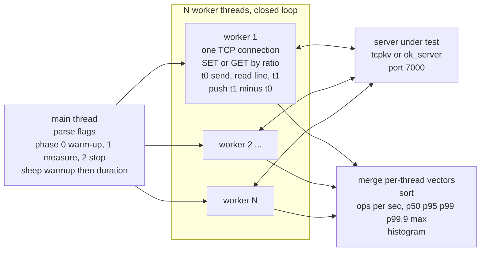

# Module 5.11: Load generator and latency percentiles

**Estimated hours:** 3

**What you will learn**

1. What a latency percentile is, how to compute p50, p95, p99 and p99.9 from raw samples by hand, and why an average hides the users who matter.
2. How throughput (operations per second) and latency relate under load, and what a closed-loop generator can and cannot measure (coordinated omission).
3. How to build `load_gen`, a 200-line C++17 tool that drives a line-protocol server from N threads and reports ops/sec, percentiles and a histogram, and how to state its numbers honestly on a resume.

**Prerequisites:** [Module 5.10: Backpressure, timeouts and flow control](module-10-backpressure-timeouts-flow-control.md). You need the `echo_limited` server from 5.10 (or the echo server from 5.03) and the tcpkv protocol spec from 5.05.

---

## 1. One-line intuition

To know how fast a server is, send it real requests from several clients at once, write down how long every single one took, sort the list, and read the values at the 50th, 95th and 99th positions out of 100; the average is the one number you should not quote.

## 2. Real-life analogy

A branch manager wants to report how long customers wait.

- She takes 100 wait times. Most are 3 to 5 minutes. Three people waited over 40 minutes because their files were in the archive.
- The **average** is 6.1 minutes. She reports "customers wait about six minutes". Nobody waited six minutes. Most waited less; the three unhappy ones waited seven times longer.
- The **median** (the 50th out of 100 sorted) is 4 minutes: what a typical customer saw.
- The **99th percentile** (the 99th out of 100 sorted) is 42 minutes: what the unluckiest one in a hundred saw. That is the customer who writes the complaint, and the one the auditor reads about.
- **Throughput** is how many customers the branch served per hour. The branch can raise it by opening more counters, up to the point where the archive clerk cannot keep up. After that, more counters just mean more people waiting on the clerk, and the wait times climb while customers per hour stays flat.
- A **load generator** is hiring a hundred actors to walk in with scripted requests, each one carrying a stopwatch, so the manager can see the branch under a known load instead of waiting for salary day to find out.

## 3. Why it exists: the problem it solves

Every claim about speed on a resume will be challenged with one question: "How did you measure that?" A number without a method is a guess. Two things go wrong without a proper tool and proper statistics:

1. **The number is wrong.** Timing one request in a loop from one thread measures the round trip of an idle server. The production server is never idle. Under load the queueing effects from 5.10 appear, and the only way to see them is to apply load.
2. **The number hides the problem.** The login-latency bottleneck from resume claim H7 had an average of a few hundred milliseconds. The complaint was from users waiting five seconds. The average was dominated by the fast majority; the slow minority were in the tail, and the tail is where the full-table scan lived. Averages hide tails because one slow request out of a hundred moves the mean by one percent of its own size.

So you need a tool that applies concurrent load, records every latency, and reports percentiles. Public tools exist (`wrk`, `wrk2`, `redis-benchmark`, `pgbench`, `k6`), but tcpkv speaks its own protocol, and the resume claims "a concurrent load generator" as part of the project. You write it; it is about 200 lines; and the lessons about measurement are worth more than the tool.

## 4. Three layers of depth

### Layer 1 (beginner): percentiles from scratch

**A sample.** One measured latency: the time from sending a request until its reply arrives, as seen by the client. A run produces thousands or millions of samples.

**Sort them.** Put the samples in ascending order. Now the position of a value tells you what fraction of requests were at least that fast.

**Percentile.** The value at position `p` percent of the way through the sorted list. p50 is the **median**: half the requests were faster, half slower. p99: 99 out of 100 were faster; one in a hundred was slower. p99.9: one in a thousand was slower. The **max** is the single worst sample.

Ten samples in milliseconds, already sorted:

```text
position:  1   2   3   4   5   6   7   8   9   10
value:     2   3   3   4   4   5   6   8   12  95
```

- **Mean (average):** (2+3+3+4+4+5+6+8+12+95) / 10 = 14.2 ms. Nine of the ten requests were faster than the "average".
- **p50:** position 50% × 10 = 5, value **4 ms**. The typical request.
- **p90:** position 9, value **12 ms**.
- **p99:** position 99% × 10 = 9.9, rounded up to 10, value **95 ms**. With only ten samples the top percentiles are just the max; you need at least a few thousand samples for p99 to mean anything and tens of thousands for p99.9.

The rule used here is **nearest rank**: position = ceiling(p / 100 × n), 1-based. Other tools interpolate between neighbours. The differences are small on large samples; just say which rule you used.

**Throughput.** Requests completed per second over the measured window: total completed divided by seconds. Written as ops/sec, req/s or QPS.

**Why both.** Throughput tells you how much work the server can do. Latency tells you how long each user waits. A server can have high throughput and terrible p99 (big queue, everyone waits) or low throughput and great p99 (idle). You always report both, and you report the load they were measured under, because neither means anything alone.

### Layer 2 (working engineer): how to run a benchmark that means something

**Closed loop versus open loop.** A **closed-loop** generator has N clients; each sends a request, waits for the reply, then sends the next. The number in flight is at most N. An **open-loop** generator sends requests on a schedule (say 10,000 per second) regardless of whether earlier ones have been answered, so in-flight grows when the server slows. Real users are closer to open loop: they do not stop arriving because the server is slow. `load_gen` is closed loop because it is simple and because it cannot overload the tool itself; the price is the next paragraph.

**Coordinated omission.** In a closed loop, when the server stalls for 100 ms, each client thread sends *one* slow request during that stall instead of the ten it would have sent at the normal pace. The stall is recorded once instead of ten times, so p99 looks better than a real user would see. This is called coordinated omission (the term is from Gil Tene, author of HdrHistogram). The honest fix is an open-loop generator, or a correction that back-fills the missing samples. For this course: know the name, state that `load_gen` is closed loop, and never claim its p99 is what an open-loop user would see under a stall. In a stable run with no stalls, closed-loop numbers are fine.

**Warm-up.** The first second of a run includes connection setup, cold caches, page faults on fresh memory, and the server's threads being scheduled for the first time. Discard it. `load_gen --warmup 1` records nothing for the first second.

**Run length.** One second gives noisy percentiles. Five seconds is the minimum for a quick look; thirty seconds for a number you will quote; several minutes to catch periodic effects such as a compaction or a garbage collection in the thing you are testing.

**Repeat and report the spread.** Run three times. If p99 is 150, 160 and 410 µs, the third run hit something (another process, a WSL2 hiccup) and the honest report is "p99 150 to 160 µs in two of three runs, one outlier at 410". A single run is an anecdote.

**Thread count is part of the number.** Closed loop with 4 threads means at most 4 requests in flight. The same server with 64 threads will show higher throughput until the bottleneck saturates, and higher latency after. The useful experiment is a sweep: 1, 2, 4, 8, 16, 32 threads, with ops/sec and p99 for each. You will see the "knee": throughput stops growing and p99 starts climbing. That knee is the server's capacity, and it is the number that sized the pools in 5.10.

**Key space and ratio.** `--keys 1000` with `--ratio 50` means a thousand distinct keys and half the requests are writes. A small key space keeps everything in cache; a huge one measures memory. A read-heavy ratio measures `shared_mutex` reader paths; a write-heavy one measures the exclusive path. Say which you used.

**What goes on the resume.** Machine (CPU model and core count), environment (WSL2 on Windows 11, loopback), server configuration (pool size), generator settings (threads, duration, ratio, key space), ops/sec, p50 and p99, and that it was repeated. One honest sentence beats a big number: "On an 8-core laptop in WSL2 over loopback, 8 closed-loop clients, 50/50 SET/GET over 10,000 keys, 30-second runs repeated three times: about N ops/sec with p99 under X µs." Fill in N and X from your own run. Never round up. Never quote the average.

### Layer 3 (internals): where the microseconds go, and how the clock works

**The clock.** `std::chrono::steady_clock` on Linux is `CLOCK_MONOTONIC`: it never jumps backwards and is unaffected by someone changing the wall-clock time. Reading it is a vDSO call (a kernel-provided function mapped into your process, no system call), taking roughly 20 to 30 ns, and it has nanosecond resolution. Two reads around a request cost nothing compared with the request. Never time with `system_clock`; NTP adjusts it under you.

**Anatomy of one loopback request** on a thread-per-connection server, in rough order of cost on a typical laptop:

1. Client `send`: one system call, about 1 to 2 µs, data copied into the kernel socket buffer.
2. Kernel delivers to the server socket over the loopback device: a few microseconds, no network card involved.
3. Server thread wakes from `recv`: a context switch, typically 2 to 10 µs, more if the core was asleep in a deep idle state.
4. Server parses, touches the store under `shared_mutex`, builds a reply: usually under 1 µs for tcpkv.
5. Server `send`, client wakes from `recv`: same costs again in reverse.

Add it up and a loopback round trip is typically 20 to 60 µs, and most of it is wake-ups and system calls, not your code. This is why a line-protocol server over TCP tops out in the tens of thousands of requests per second per connection, and why batching or pipelining (several requests per `send`) is the first optimisation in every real protocol.

**Why the tail spikes.** p99.9 and max are dominated by things that are not your code: the scheduler moving a thread to another core, a timer tick, another process taking the CPU, a page fault on first touch of a buffer, the hypervisor behind WSL2 taking the whole virtual CPU for a moment. On WSL2 expect occasional 1 to 10 ms outliers that would not appear on bare metal. Report them, do not hide them, and do not blame your server for them until you have run on bare Linux.

**The tool measures itself too.** Every sample includes the generator's own cost: building the request string, two clock reads, the `send` and `recv` calls on the client side. With N threads larger than the core count, generator threads compete with server threads for CPU, and the numbers describe the pair, not the server. Keep the generator's thread count at or below half the cores when you want to attribute a result to the server, or run the generator on another machine.

**Storing samples.** `load_gen` keeps every sample as a `double` in a per-thread `std::vector`, then merges and sorts. At 100,000 samples per second per thread for 30 seconds that is 3 million doubles per thread, 24 MB, fine. For hours-long runs the professional answer is a fixed-memory histogram with logarithmic buckets (HdrHistogram), which gives percentiles to within 1% with a few KB. The nine-bucket histogram `load_gen` prints is the toy version of that idea.

**Nearest rank in code.** With `n` sorted samples and percentile `p`: `rank = ceil(p / 100 × n)`, index `rank - 1` (0-based), clamped to the array. For p99.9 with 312,884 samples that is index 312,571; the 313 samples above it are the 0.1% tail.

## 5. Architecture diagram



Each worker owns its connection and its sample vector, so there is no shared state during the run and no lock on the hot path. The only shared thing is one atomic phase flag the workers read.

## 6. Code

### 6a. A stub server that says OK

tcpkv proper is assembled in capstone C1. Until then, this server answers `OK` to every line so `load_gen` has something that speaks the protocol's shape. It is thread-per-connection, like 5.03.

```cpp
// ok_server.cpp
// Replies "OK\n" to every line received. Thread per connection.
//   ./ok_server 7000
#include <arpa/inet.h>
#include <netinet/in.h>
#include <sys/socket.h>
#include <unistd.h>

#include <cstdint>
#include <cstdio>
#include <cstdlib>
#include <string>
#include <thread>

static void serve(int fd) {
    char buf[4096];
    for (;;) {
        ssize_t n = recv(fd, buf, sizeof buf, 0);
        if (n <= 0) break;
        int lines = 0;
        for (ssize_t i = 0; i < n; ++i) if (buf[i] == '\n') ++lines;
        std::string reply;
        for (int i = 0; i < lines; ++i) reply += "OK\n";
        if (!reply.empty() && send(fd, reply.data(), reply.size(), MSG_NOSIGNAL) <= 0) break;
    }
    close(fd);
}

int main(int argc, char** argv) {
    int port = (argc > 1) ? std::atoi(argv[1]) : 7000;
    int lfd = socket(AF_INET, SOCK_STREAM, 0);
    if (lfd < 0) { std::perror("socket"); return 1; }
    int one = 1;
    setsockopt(lfd, SOL_SOCKET, SO_REUSEADDR, &one, sizeof one);
    sockaddr_in addr{};
    addr.sin_family      = AF_INET;
    addr.sin_addr.s_addr = htonl(INADDR_ANY);
    addr.sin_port        = htons(static_cast<uint16_t>(port));
    if (bind(lfd, reinterpret_cast<sockaddr*>(&addr), sizeof addr) < 0) { std::perror("bind"); return 1; }
    if (listen(lfd, 128) < 0) { std::perror("listen"); return 1; }
    std::printf("ok_server on port %d\n", port);
    for (;;) {
        int c = accept(lfd, nullptr, nullptr);
        if (c < 0) continue;
        std::thread(serve, c).detach();
    }
}
```

```bash
g++ -std=c++17 -O2 -Wall -Wextra -Werror -g -pthread -o ok_server ok_server.cpp
./ok_server 7000
```

### 6b. `load_gen`

This file becomes `capstones/tcpkv/tools/load_gen.cpp`. It assumes the request format from the 5.05 spec (`SET key value` and `GET key`, each one line) and one reply line per request. If your spec's GET reply spans more than one line, change `read_line` to read the number of lines your spec defines.

```cpp
// load_gen.cpp
// Closed-loop load generator for a line-based TCP key-value server.
// N threads, one connection each, SET/GET by ratio over a key space, every
// request timed with steady_clock. Prints ops/sec, percentiles, histogram.
//
//   ./load_gen --host 127.0.0.1 --port 7000 --threads 4 --duration 5 \
//              --ratio 50 --keys 1000 --warmup 1
#include <arpa/inet.h>
#include <netdb.h>
#include <netinet/tcp.h>
#include <sys/socket.h>
#include <sys/time.h>
#include <unistd.h>

#include <algorithm>
#include <atomic>
#include <chrono>
#include <cmath>
#include <cstdio>
#include <cstdlib>
#include <cstring>
#include <functional>
#include <random>
#include <string>
#include <thread>
#include <vector>

using Clock = std::chrono::steady_clock;

struct Options {
    std::string host = "127.0.0.1";
    int port     = 7000;
    int threads  = 4;
    int duration = 5;     // measured seconds
    int ratio    = 50;    // percent of requests that are SET
    int keys     = 1000;  // key space: key0 .. key(keys-1)
    int warmup   = 1;     // seconds discarded before measuring
};

static Options parse(int argc, char** argv) {
    Options o;
    for (int i = 1; i + 1 < argc; i += 2) {
        std::string k = argv[i];
        const char* v = argv[i + 1];
        if      (k == "--host")     o.host = v;
        else if (k == "--port")     o.port = std::atoi(v);
        else if (k == "--threads")  o.threads = std::atoi(v);
        else if (k == "--duration") o.duration = std::atoi(v);
        else if (k == "--ratio")    o.ratio = std::atoi(v);
        else if (k == "--keys")     o.keys = std::atoi(v);
        else if (k == "--warmup")   o.warmup = std::atoi(v);
        else { std::fprintf(stderr, "unknown option %s\n", argv[i]); std::exit(2); }
    }
    if (o.threads < 1 || o.keys < 1 || o.duration < 1) { std::fprintf(stderr, "bad options\n"); std::exit(2); }
    return o;
}

// One blocking TCP connection that reads whole lines. RAII: closes on destruction.
class LineConn {
public:
    LineConn() = default;
    ~LineConn() { if (fd_ >= 0) close(fd_); }
    LineConn(const LineConn&) = delete;
    LineConn& operator=(const LineConn&) = delete;

    bool connect_to(const std::string& host, int port) {
        addrinfo hints{};
        hints.ai_family   = AF_UNSPEC;
        hints.ai_socktype = SOCK_STREAM;
        addrinfo* res = nullptr;
        if (getaddrinfo(host.c_str(), std::to_string(port).c_str(), &hints, &res) != 0) return false;
        for (addrinfo* p = res; p != nullptr; p = p->ai_next) {
            fd_ = socket(p->ai_family, p->ai_socktype, p->ai_protocol);
            if (fd_ < 0) continue;
            if (connect(fd_, p->ai_addr, p->ai_addrlen) == 0) break;
            close(fd_);
            fd_ = -1;
        }
        freeaddrinfo(res);
        if (fd_ < 0) return false;
        int one = 1;
        setsockopt(fd_, IPPROTO_TCP, TCP_NODELAY, &one, sizeof one);  // send small requests at once
        timeval tv{};                                                  // lesson from 5.10:
        tv.tv_sec = 5;                                                 // never wait forever
        setsockopt(fd_, SOL_SOCKET, SO_RCVTIMEO, &tv, sizeof tv);
        return true;
    }

    bool send_all(const std::string& s) {
        const char* p = s.data();
        size_t n = s.size();
        while (n > 0) {
            ssize_t k = send(fd_, p, n, MSG_NOSIGNAL);
            if (k <= 0) return false;
            p += k;
            n -= static_cast<size_t>(k);
        }
        return true;
    }

    // One '\n'-terminated line into out, newline removed. False on error/timeout/close.
    bool read_line(std::string& out) {
        for (;;) {
            size_t nl = buf_.find('\n');
            if (nl != std::string::npos) {
                out.assign(buf_, 0, nl);
                buf_.erase(0, nl + 1);
                return true;
            }
            char tmp[4096];
            ssize_t k = recv(fd_, tmp, sizeof tmp, 0);
            if (k <= 0) return false;
            buf_.append(tmp, static_cast<size_t>(k));
        }
    }

private:
    int fd_ = -1;
    std::string buf_;
};

struct WorkerResult {
    std::vector<double> latency_us;   // one sample per measured request
    long ops = 0;
    long errors = 0;                  // ERR replies plus a broken connection
    bool connected = false;
};

// phase: 0 = warm-up (run, do not record), 1 = measure, 2 = stop
static void worker(int id, const Options& o, const std::atomic<int>& phase, WorkerResult& r) {
    LineConn c;
    if (!c.connect_to(o.host, o.port)) { r.errors = 1; return; }
    r.connected = true;
    r.latency_us.reserve(1u << 20);
    std::mt19937_64 rng(1234 + static_cast<unsigned>(id));
    std::uniform_int_distribution<int> pick_key(0, o.keys - 1);
    std::uniform_int_distribution<int> pct(0, 99);
    std::string req, reply;

    while (phase.load(std::memory_order_relaxed) != 2) {
        int key = pick_key(rng);
        if (pct(rng) < o.ratio)
            req = "SET key" + std::to_string(key) + " value" + std::to_string(key) + "\n";
        else
            req = "GET key" + std::to_string(key) + "\n";

        auto t0 = Clock::now();
        bool ok = c.send_all(req) && c.read_line(reply);
        auto t1 = Clock::now();
        if (!ok) { ++r.errors; return; }              // connection broke: this worker stops

        if (phase.load(std::memory_order_relaxed) == 1) {
            ++r.ops;
            if (reply.compare(0, 3, "ERR") == 0) ++r.errors;
            r.latency_us.push_back(std::chrono::duration<double, std::micro>(t1 - t0).count());
        }
    }
}

// Nearest-rank percentile on a sorted vector.
static double pctl(const std::vector<double>& sorted, double p) {
    if (sorted.empty()) return 0.0;
    size_t rank = static_cast<size_t>(std::ceil(p / 100.0 * static_cast<double>(sorted.size())));
    size_t idx  = (rank == 0) ? 0 : rank - 1;
    if (idx >= sorted.size()) idx = sorted.size() - 1;
    return sorted[idx];
}

int main(int argc, char** argv) {
    Options o = parse(argc, argv);
    std::printf("load_gen: host=%s port=%d threads=%d duration=%ds ratio=%d%% SET keys=%d warmup=%ds\n",
                o.host.c_str(), o.port, o.threads, o.duration, o.ratio, o.keys, o.warmup);

    std::atomic<int> phase{0};
    std::vector<WorkerResult> results(static_cast<size_t>(o.threads));
    std::vector<std::thread> pool;
    for (int i = 0; i < o.threads; ++i)
        pool.emplace_back(worker, i, std::cref(o), std::cref(phase), std::ref(results[static_cast<size_t>(i)]));

    std::this_thread::sleep_for(std::chrono::seconds(o.warmup));
    auto start = Clock::now();
    phase.store(1);
    std::this_thread::sleep_for(std::chrono::seconds(o.duration));
    phase.store(2);
    auto end = Clock::now();
    for (auto& t : pool) t.join();

    // Merge.
    std::vector<double> all;
    long ops = 0, errors = 0;
    int connected = 0;
    for (const auto& r : results) {
        connected += r.connected ? 1 : 0;
        ops += r.ops;
        errors += r.errors;
        all.insert(all.end(), r.latency_us.begin(), r.latency_us.end());
    }
    std::printf("connected %d/%d threads\n", connected, o.threads);
    if (all.empty()) { std::printf("no requests completed in the measured window\n"); return 1; }
    std::sort(all.begin(), all.end());

    double secs = std::chrono::duration<double>(end - start).count();
    double mean = 0;
    for (double v : all) mean += v;
    mean /= static_cast<double>(all.size());

    std::printf("ops      : %ld in %.2f s  =  %.0f ops/s\n", ops, secs, static_cast<double>(ops) / secs);
    std::printf("errors   : %ld\n", errors);
    std::printf("latency  : mean=%.1f us  p50=%.1f  p95=%.1f  p99=%.1f  p99.9=%.1f  max=%.1f us\n",
                mean, pctl(all, 50), pctl(all, 95), pctl(all, 99), pctl(all, 99.9), all.back());

    // Histogram with fixed bucket edges in microseconds.
    const double edges[] = {50, 100, 200, 500, 1000, 2000, 5000, 10000};
    const char* labels[] = {"<50", "50-100", "100-200", "200-500", "500-1000",
                            "1k-2k", "2k-5k", "5k-10k", ">=10k"};
    long counts[9] = {0};
    for (double v : all) {
        int b = 0;
        while (b < 8 && v >= edges[b]) ++b;
        ++counts[b];
    }
    long maxc = *std::max_element(counts, counts + 9);
    std::printf("histogram (us):\n");
    for (int b = 0; b < 9; ++b) {
        int bar = (maxc > 0) ? static_cast<int>(counts[b] * 50 / maxc) : 0;
        std::printf("%10s | %-50s %ld\n", labels[b], std::string(static_cast<size_t>(bar), '#').c_str(), counts[b]);
    }
    return 0;
}
```

```bash
g++ -std=c++17 -O2 -Wall -Wextra -Werror -g -pthread -o load_gen load_gen.cpp
./load_gen --host 127.0.0.1 --port 7000 --threads 4 --duration 5 --ratio 50 --keys 1000 --warmup 1
```

Expected output shape. These numbers are from one laptop in WSL2 over loopback and yours will differ; what should match is the structure, `errors : 0`, and p50 well under p99:

```text
load_gen: host=127.0.0.1 port=7000 threads=4 duration=5s ratio=50% SET keys=1000 warmup=1s
connected 4/4 threads
ops      : 312884 in 5.00 s  =  62577 ops/s
errors   : 0
latency  : mean=63.6 us  p50=58.1  p95=97.4  p99=152.0  p99.9=410.2  max=3120.5 us
histogram (us):
       <50 | ##################                                 112034
    50-100 | ################################################## 181220
   100-200 | ####                                               16890
   200-500 |                                                    2412
  500-1000 |                                                    251
     1k-2k |                                                    61
     2k-5k |                                                    16
    5k-10k |                                                    0
     >=10k |                                                    0
```

Read it the way an interviewer will: four closed-loop clients, so at most four requests in flight; about 60,000 replies per second, so each connection did about 15,000 round trips per second, which is about 64 µs each, which matches p50 plus a little. The mean is above p50 because the tail pulls it up. The max is 50 times p50; that is the scheduler, not the server, and the lab will show you how to tell.

## 7. Use case: core-banking loan-origination platform

Two of the resume's claims are numbers, and both came from this kind of tool.

**The pool sizes in 5.10 came from a sweep.** The question "how many workers?" has no answer without a load generator. The team ran a closed-loop generator against a test app server with 1, 4, 16, 64 and 128 clients. Throughput rose until 16 clients, then stayed flat because the database connection pool (16) was saturated; p99 was flat until 16 and then climbed linearly with the number of waiting clients, exactly as Little's law predicts. **Decision:** 64 workers, 16 DB connections, and a queue cap of 128, because at 128 waiting requests the p99 crossed the branch client's 10-second timeout and any further queueing was work for nobody.

**The login-latency fix (claim H7) was found and proved with percentiles.** Average login time was under a second and the dashboards were green. The p99 was five seconds. Splitting samples by branch showed the tail came from branches whose master-table lookups were keyed by business code and hitting a full-table scan on a multi-node cluster. After the composite and covering indexes, the generator run was repeated with the same settings: p50 barely moved, p99 dropped by an order of magnitude. **Decision:** the team's latency SLO was rewritten as a p99 target, not an average, because the average never showed the problem and would not have shown the fix.

**The honest sentence.** Ask yourself what you would say under challenge: "Measured with our own closed-loop generator, 16 client threads from a separate machine, five-minute runs repeated three times, after a one-minute warm-up; the p99 figures are from the median run." That is a sentence that survives follow-up questions. "It was about ten times faster" is not.

## 8. Lab

Work in a folder with `ok_server`, `load_gen` and `echo_limited` from 5.10 built.

### Part A: percentiles by hand and by pipeline (15 minutes)

1. Take these twelve latencies in µs: `71 55 62 980 58 60 66 59 2100 64 57 63`. Sort them, then compute mean, p50, p90 and p99 with nearest rank. Write your answers down before opening the box.

<details>
<summary>Answers</summary>

Sorted: 55 57 58 59 60 62 63 64 66 71 980 2100. Mean = 3695 / 12 = 307.9 µs. p50: rank ceil(6) = 6, value 62. p90: rank ceil(10.8) = 11, value 980. p99: rank ceil(11.88) = 12, value 2100. The mean (308) is larger than ten of the twelve samples.

</details>

2. Do it with shell tools, which is what you will do with a log file in an incident:

```bash
printf '%s\n' 71 55 62 980 58 60 66 59 2100 64 57 63 | sort -n > lat.txt
awk '{s+=$1} END {print "mean", s/NR}' lat.txt
awk '{a[NR]=$1} END {n=NR; p50=a[int((50*n+99)/100)]; p99=a[int((99*n+99)/100)]; print "p50", p50, "p99", p99}' lat.txt
```

Expected: `mean 307.917`, `p50 62 p99 2100`. The `(p*n+99)/100` trick is integer ceiling.

### Part B: baseline and the thread sweep (30 minutes)

1. Start `./ok_server 7000`. Run the baseline command from 6b. Record ops/s, p50, p99, p99.9, max.
2. Run it three times. Record the spread of p99. If one run is far off, note what else was running.
3. Sweep threads: `for t in 1 2 4 8 16 32; do ./load_gen --threads $t --duration 5 | grep -E "ops|latency"; done`. Build a table: threads, ops/s, p50, p99.

Expected: ops/s rises with threads, then flattens around your core count (the `ok_server` is thread-per-connection, so it scales until cores run out); p50 and p99 rise after that point. Find the knee: the first thread count where ops/s stops growing by more than about 10% while p99 keeps climbing. That is this server's capacity on this machine. Write the knee down with the machine's core count (`nproc`).

4. Compare `--ratio 0` and `--ratio 100` against `ok_server`. Expected: nearly identical, because the stub does the same work for both. Against tcpkv in capstone C1 they will differ, and the difference measures the shared-versus-exclusive lock paths.

### Part C: load against a limited server, and a slow server (25 minutes)

1. Stop `ok_server`. Start `./echo_limited --max-workers 2` from 5.10 (it echoes the request line, which is a valid one-line reply). Run `./load_gen --threads 4 --duration 5`.

Expected: `connected 4/4 threads` but two workers receive `ERR busy` on their first request and the `errors` line counts them (one error each, then the worker stops because the server closed its connection). `ops` reflects only two active connections. This is what load shedding looks like from the client side: fast, visible, countable.

2. Make the server slow on purpose. In `ok_server.cpp` add `#include <chrono>` and, inside `serve` before building the reply, `std::this_thread::sleep_for(std::chrono::milliseconds(2));`. Rebuild, start it, run the sweep from Part B step 3 again.

Expected: with 1 thread, about 400 to 500 ops/s (each request waits at least 2 ms plus overhead) and p50 around 2.1 ms. With 4 threads about four times the throughput and the same p50: closed-loop clients on independent connections do not queue behind each other. With 32 threads, 32 times the throughput only if the machine can run 32 sleeping server threads, which it can, so throughput keeps scaling and latency stays flat. This is the signature of a server whose cost is waiting, not CPU: more concurrency is free until some shared resource saturates. Compare with the Part B sweep, where the cost was CPU and the knee came at the core count. Remove the sleep afterwards.

### Part D: variance, run length and what you may claim (20 minutes)

1. Against the plain `ok_server`, run `--threads 4 --duration 1` five times and record p99 each time. Then `--duration 30` once. Expected: the five short runs spread more than the long run would across repeats; p99.9 in a one-second run has only a few hundred samples above it and jumps around.
2. Run the baseline with `--warmup 0` and compare p99.9 and max with `--warmup 1`. Expected: `--warmup 0` usually shows a larger max, from connection setup and first-touch page faults in the first few hundred milliseconds.
3. Run `top` or `htop` in another terminal during a 16-thread run. Note that `load_gen` and `ok_server` together consume most of your cores. Write one sentence on why the 16-thread numbers describe the pair, not the server.
4. Write the resume sentence. Use this template and only your own numbers: "On a [CPU model], [N]-core laptop in WSL2 over loopback, [T] closed-loop client threads, [ratio] SET/GET over [K] keys, [D]-second runs repeated three times after a 1-second warm-up: about [ops] ops/s, p50 [x] µs, p99 [y] µs (median run)." Keep it in your journal; you will replace `ok_server` with tcpkv in capstone C1 and rewrite it with real numbers.

### Journal

Copy [journal/TEMPLATE.md](../journal/TEMPLATE.md) to `journal/YYYY-MM-DD-load-gen-and-percentiles.md`. Record: the hand-computed percentiles from Part A; the full thread-sweep table from Part B with the knee and `nproc`; the `errors` count and ops/s against `echo_limited --max-workers 2`; the sweep against the 2 ms server and one sentence on why it scaled differently; the p99 spread across five one-second runs versus the thirty-second run; and the resume sentence from Part D. Copy `load_gen.cpp` to `capstones/tcpkv/tools/load_gen.cpp` when you reach capstone C1.

## 9. Common mistakes and misconceptions

| Mistake | Why it is wrong | Bug it causes later |
|---|---|---|
| Quoting the average latency | One slow request in a hundred barely moves the mean; the users it hurt are invisible | Green dashboards during a user-visible outage; the H7 bottleneck hidden for months |
| Quoting p99 from a one-second run | A few hundred tail samples; the number jumps between runs | A "regression" or an "improvement" that is noise |
| Timing one request from one thread and calling it the server's latency | No queueing, no contention; the server is idle | Pools sized for an idle server, overloaded on day one |
| Quoting throughput without the thread count and latency | 60k ops/s at p99 150 µs and 60k ops/s at p99 2 s are different servers | Claims an interviewer dismantles in one question |
| Using `system_clock` or `clock()` | Wall clock can jump; `clock()` is CPU time, not elapsed time | Negative or wrong latencies |
| Generator and server on the same cores with more generator threads than cores | You are measuring the pair and the scheduler | Blaming the server for the tool's own contention |
| Not warming up | Connection setup, page faults and cold caches land in the samples | Inflated max and p99.9 |
| Believing closed-loop p99 under a stall | Coordinated omission records a stall once per client instead of once per missed request | Underestimating user-visible latency during pauses |
| Rounding numbers up on the resume | The interviewer will ask for the method and the machine | Credibility lost in the first five minutes |

## 10. Resume link

- **Claim I, tcpkv, "Valgrind/ASan/TSan clean under a concurrent load generator".** This module is that load generator. In capstone C1 you run tcpkv under TSan while `load_gen --threads 16` hammers it; "clean under load" means TSan reported nothing with sixteen concurrent clients doing mixed SET/GET. Say: "I wrote a closed-loop generator, N threads each with one connection, every request timed with `steady_clock`, merged and sorted for percentiles. I report p50 and p99 with the thread count and run length, never the average."
- **Claim H7, "login-latency bottleneck".** The story is a percentile story: "The average looked fine; p99 was five seconds. Splitting samples by branch pointed at the master-table lookups, EXPLAIN showed the scan, and after the composite and covering indexes the same generator run showed p99 down by an order of magnitude with p50 unchanged." You will reproduce exactly this in capstone C5.
- **Claim H4, "pooled request model".** The pool sizes have a measurement behind them: a thread sweep showing the knee where throughput flattens and p99 climbs. Quote your own Part B table as the shape, and the C1 and C2 runs as the numbers.
- **Claim F, "performance ... benchmarking, latency percentiles"** (Phase 8 goes deeper). Know the words: closed versus open loop, coordinated omission, warm-up, nearest rank, HdrHistogram.

Follow-ups to expect: "Why p99 and not the mean?" (tails, the H7 story). "What is coordinated omission?" (Layer 2, one paragraph). "What machine, how many threads, how long?" (your journal sentence).

## 11. Interview questions

**Q1 (easy). What is a p99 latency and why is it reported instead of the average?**

<details>
<summary>Model answer</summary>

Sort all measured latencies; p99 is the value at the 99th percent position, so 99% of requests were at least that fast and 1% were slower. It is reported because the average hides the tail: one request in a hundred taking fifty times longer moves the mean by half, which looks fine, while that one-in-a-hundred user had a terrible experience. With a hundred thousand users a day, 1% is a thousand complaints. SLOs are written as percentiles for this reason.

</details>

**Q2 (easy). What is the relationship between throughput and latency?**

<details>
<summary>Model answer</summary>

They are independent until the server saturates. At low load, adding clients raises throughput and latency stays near the single-request round trip. Once some resource (CPU, a lock, a database pool) is fully used, throughput flattens and every extra client only adds to a queue, so latency rises linearly with the number waiting, as Little's law says: in-flight equals throughput times latency. The knee in a thread sweep, where throughput stops growing and p99 starts climbing, is the capacity of the server on that machine, and it is the number that sizes pools and queue caps.

</details>

**Q3 (medium). Describe how you would build a load generator for a custom TCP line protocol and what it should report.**

<details>
<summary>Model answer</summary>

N threads, each owning one connection and a private vector of samples, so the hot path has no shared state. Each thread runs a closed loop: pick an operation by a configured read/write ratio and a key from a configured key space, read `steady_clock`, send the request, read one reply line, read the clock again, and push the difference. A main thread controls phases with one atomic: warm-up with no recording, a measured window, then stop. At the end merge the vectors, sort, and print throughput as completed requests over the measured seconds, p50, p95, p99, p99.9 and max by nearest rank, an error count, and a histogram. Report alongside the numbers the thread count, duration, ratio, key space, machine and the fact that it is closed loop. Set a receive timeout on each connection so a hung server cannot hang the tool.

</details>

**Q4 (medium). What is coordinated omission and how does it affect your numbers?**

<details>
<summary>Model answer</summary>

In a closed-loop generator each client waits for a reply before sending the next request. When the server stalls for 100 ms, each client records one 100 ms sample instead of the ten requests it would have issued at its normal pace, so the stall is under-represented and the reported p99 is better than what an open-loop user, who keeps arriving on schedule, would experience. The generator's pace is coordinated with the server's stall, hence the name. Fixes are an open-loop generator that sends on a schedule and measures from the intended send time, or a post-hoc correction that back-fills the missing samples as HdrHistogram's tooling does. My tool is closed loop, so I state that, and I treat its p99 as valid for stable runs and optimistic during stalls.

</details>

**Q5 (hard). Your benchmark shows p50 of 60 µs and max of 3 ms on loopback. An interviewer asks whether the 3 ms is your server's fault. How do you answer, and how would you find out?**

<details>
<summary>Model answer</summary>

Probably not, and I would not claim either way without evidence. On loopback a request is two system calls and two thread wake-ups per side, roughly 20 to 60 µs, so 3 ms is fifty times the normal path and is the size of a scheduling event: the server thread being preempted, a timer tick, another process on the core, a page fault on first touch, or the hypervisor behind WSL2 taking the CPU. To find out: first count them, since p99.9 at 400 µs with a handful of samples above 1 ms says they are rare; second, check whether they correlate with warm-up by comparing `--warmup 0` and `--warmup 1`; third, run with the generator thread count at or below half the cores so the tool is not competing with the server; fourth, repeat on bare-metal Linux if available, where WSL2 hiccups disappear; and fifth, if they persist, instrument the server to time its own handling of each request and compare with the client-side sample, which separates server time from everything around it. If the server-side time is flat at a few microseconds while the client sees 3 ms, the cause is outside the server.

</details>

## 12. Revision

- Sort every latency; p50 is the typical request, p99 is the one-in-a-hundred user, the mean hides the tail; use nearest rank and say so; you need thousands of samples for p99 and tens of thousands for p99.9.
- Throughput and latency are independent until the knee, where a resource saturates; after it, throughput flattens and latency grows with the queue; report both with the thread count, duration, ratio, key space, machine, warm-up and repeats.
- `load_gen` is closed loop (N threads, one connection each, `steady_clock` per request, merge, sort, percentiles, histogram); closed loop suffers coordinated omission under stalls, so it is honest for stable runs and optimistic during pauses.

---

Previous: [Module 5.10: Backpressure, timeouts and flow control](module-10-backpressure-timeouts-flow-control.md) | Next: [Module 6.01: What a database is](../phase-06-databases-from-zero-to-internals/module-01-what-a-database-is.md)
