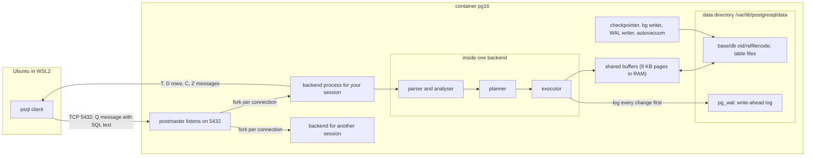

# Module 6.01: What a database is

**Estimated hours:** 3

**What you will learn**

1. What a database is, and the four problems it solves that plain files cannot: many users at once, crashes, searching, and rules about valid data.
2. The relational model in plain words: table (relation), row (tuple), column (attribute), primary key, foreign key and NULL.
3. How to talk to PostgreSQL with `psql` over TCP port 5432: create the `lending` database, create two tables, insert and read rows, and find the files on disk that hold them.

**Prerequisites:** [Module 5.11: Load generator and latency percentiles](../phase-05-networking-and-servers/module-11-load-generator-and-latency.md). You also need the `pg16` container from module 0.05, the 19-byte packed loan record from module 1.07, and the binary file I/O from module 1.09.

---

## 1. One-line intuition

A database is a server program that keeps your data in files for you, lets many clients read and change it at the same time, never leaves it half-written after a crash, and refuses data that breaks your rules.

## 2. Real-life analogy

Picture the **records room** at a bank branch.

- **The registrar** sits behind a window. Clerks never walk into the room and write in the books themselves. They pass a **request slip** through the window ("add this customer", "show me all loans at MUM01") and wait for the answer. The registrar is the **database server**. The clerk is a **client**. The slip is a **query**.
- **The registers** on the shelves are **tables**. Each register is about one kind of thing: one for branches, one for customers, one for loans.
- **Each register has ruled columns** with printed headings: customer number, name, PAN, date of birth. Those are **columns**. Each heading says what kind of value may go there (a date, a number, some text). That is the column's **data type**.
- **Each line in a register** is one entry: one customer. That is a **row**.
- **Every line has a unique number** in the first column. No two customers share it. That is the **primary key**.
- **A cross-reference** like "home branch: see branch register, entry MUM01" is a **foreign key**. The registrar refuses a slip that points to a branch that does not exist.
- **A blank cell** means "not known yet". It is not zero and it is not an empty name. That is **NULL**.
- **The carbon-copy journal**: before changing any register, the registrar writes what is about to change in a journal. If the lights go out halfway, the journal says exactly what to finish or undo. That is the **write-ahead log** (module 6.06).
- **Ten clerks at the window at once** do not get their slips mixed up, and two clerks cannot both update the same line at the same moment. That is **concurrency control** (modules 6.04 and 6.08).

## 3. Why it exists: the problem it solves

In module 1.09 you wrote loan records to a binary file with `fwrite` and read them back with `fread`. In module 1.15 you built a hash map to find a record by key. That is a tiny database. Now put it in a bank with 400 branches and see what breaks.

| Problem | With your own files | What a database does | Where you see the internals |
|---|---|---|---|
| **Many users at once** | Two app servers append to `loans.dat` at the same moment. Records interleave or overwrite. File locks (`flock`) lock the whole file, so only one writer works at a time. | Many clients connect at once. Row-level locks let 100 clerks update 100 different loans in parallel. | 6.07, 6.08 |
| **Crashes** | Power fails after 11 of the 19 bytes of a record are written. Or after you debited one record and before you credited the other. The file is now wrong and nothing says so. | A change is either fully applied or not at all, even across a crash. A confirmed change survives power loss. | 6.04, 6.06 |
| **Searching** | "All loans at MUM01 above Rs 10 lakh" means reading every record. Every new question needs new C code, a recompile and a release. | You ask in one line of SQL. Indexes find rows without reading everything. | 6.02, 6.09, 6.10 |
| **Rules about valid data** | Nothing stops a record with branch `XXX99` or a negative amount. The check lives in every program that writes the file, and one of them forgets. | Rules are declared once, in the database: this column must not be empty, this branch must exist. Every client is checked. | 6.03 |

There are more: who is allowed to read what (permissions), backups while the system is running (6.16), and copies on other machines for when one dies (6.16, Phase 7).

What breaks without a database is not hypothetical. A bank that kept its loan book in shared files would have, on a busy day, two clerks posting a repayment to the same loan and one payment silently vanishing. You will produce exactly that bug on purpose in module 6.04, and fix it.

## 4. Three layers of depth

### Layer 1 (beginner): the words you need

| Word | Meaning | Example |
|---|---|---|
| **Database** | A named collection of tables managed together | `lending` |
| **DBMS** (database management system) | The program that manages databases | PostgreSQL, Oracle, SQL Server, YugabyteDB |
| **Relational database** | A DBMS where all data is stored in tables that refer to each other by values | All four above |
| **Table** | A set of rows that all have the same columns | `customers` |
| **Column** | A named slot in every row, with a data type | `dob date` |
| **Row** | One entry in a table | customer 1001, Asha Rao |
| **Data type** | What kind of value a column holds | `bigint` (8-byte integer), `text`, `date`, `varchar(6)` (text of at most 6 characters) |
| **Schema** | The set of table definitions; also a namespace inside a database (the default one is called `public`) | `public.customers` |
| **SQL** (Structured Query Language, said "S-Q-L" or "sequel") | The language you use to define tables and ask questions | `SELECT name FROM branches;` |
| **Query** | One request in SQL | as above |
| **Primary key** | A column (or set of columns) whose value is unique in every row and never empty | `customer_id` |
| **Foreign key** | A column whose value must match a primary key in another table | `customers.branch_code` must exist in `branches` |
| **NULL** | The marker for "no value / unknown" | `last_login_at` for a user who has never logged in |

Here is what two tables of the lending database look like. A table is just a grid.

```text
branches                                          customers
+-------------+-------------+--------+            +-------------+-------------+-------------+------------+
| branch_code | name        | city   |            | customer_id | branch_code | full_name   | kyc_status |
+-------------+-------------+--------+            +-------------+-------------+-------------+------------+
| MUM01       | Mumbai Fort | Mumbai | <--------- | 1001        | MUM01       | Asha Rao    | VERIFIED   |
| DEL01       | Delhi CP    | Delhi  | <--+------ | 1002        | MUM01       | Vikram Shah | VERIFIED   |
+-------------+-------------+--------+    +------ | 1003        | DEL01       | Neha Gupta  | PENDING    |
  primary key: branch_code                        +-------------+-------------+-------------+------------+
                                                    primary key: customer_id
                                                    foreign key: branch_code -> branches
```

**SQL says what, not how.** In C you wrote a loop: open the file, read each record, compare, print. In SQL you write the result you want and the database decides how to get it:

```sql
SELECT full_name FROM customers WHERE branch_code = 'MUM01';
```

There is no loop, no file name, no read call. The database chooses whether to read every row or use an index. This is called a **declarative** language, and it is why one line of SQL replaces fifty lines of C.

**Two kinds of commands.** Commands that start with a backslash, like `\dt`, belong to the `psql` program itself. Everything else (`SELECT`, `CREATE TABLE`) is SQL that `psql` sends to the server. SQL statements end with a semicolon; until `psql` sees one, it keeps waiting for more lines.

### Layer 2 (working engineer): the relational model and the client-server shape

**The relational model.** In 1970 Edgar F. Codd at IBM published "A Relational Model of Data for Large Shared Data Banks". His idea: store everything as **relations** (tables), and let programs ask for data by its values, never by where it sits on disk. The formal words map to the everyday ones:

| Formal term | Everyday term |
|---|---|
| Relation | Table |
| Tuple | Row |
| Attribute | Column |
| Domain | Data type plus allowed values |
| Candidate key | Any column set that is unique and not null (a customer has both `customer_id` and `pan`) |
| Primary key | The candidate key you pick as the main identifier |

Three consequences matter every day:

1. **A relation is a set, so rows have no order.** If you want rows sorted, you must say `ORDER BY`. Without it, PostgreSQL returns rows in whatever order is cheapest, and that order can change after an update or a vacuum. Code that relies on "rows come back in insert order" works in testing and breaks in production.
2. **Rows refer to each other by value, not by pointer.** A customer row holds the text `MUM01`, not the memory address or file offset of the branch row. That is why the database can move rows around on disk freely. Contrast your 1.15 hash map, where entries pointed at each other with C pointers.
3. **NULL is not a value, it is the absence of one.** `NULL = NULL` is not true; it is unknown. Module 6.02 covers the three-valued logic this causes. For now: test for it with `IS NULL`, never `= NULL`.

**Keys.** A **composite key** is a primary key made of more than one column. In the lending schema, a user is identified by `(branch_code, user_code)` because user code `U01` exists in every branch. A **natural key** is one with business meaning (`branch_code`, `pan`). A **surrogate key** is a number invented by the system (`customer_id`). Module 6.03 compares the two; resume claim H7 depends on that choice.

**The client-server shape.** PostgreSQL is a server, exactly like the servers you built in Phase 5.

- The **postmaster** is the main server process. It listens on TCP port **5432**.
- When `psql` connects, the postmaster `fork()`s a new **backend process** for that one connection (module 3.01 covered `fork`). The backend lives as long as the connection. This is the process-per-connection architecture from module 5.05, and it is the reason connection pools exist (module 6.12): a backend costs several megabytes and a fork.
- Client and backend talk using the **PostgreSQL frontend/backend protocol, version 3**. It is a length-prefixed binary protocol of the kind you designed in module 5.06: every message is a 1-byte type, a 4-byte big-endian length, then the payload. A simple query is one `Q` message holding the SQL text. The server answers with `T` (row description: column names and types), one `D` per row (data row), `C` (command complete, for example `SELECT 2`), and `Z` (ready for query, with one byte saying whether you are inside a transaction).
- Background processes do housekeeping: the **checkpointer** and **background writer** flush changed pages to disk, the **WAL writer** flushes the log, the **autovacuum launcher** cleans up old row versions. You will see them in the lab.

**The hierarchy inside one server.**

```text
PostgreSQL server ("cluster": one data directory, one port)
 +-- database "postgres"      (default, for admin connections)
 +-- database "lending"       (yours)
 |    +-- schema "public"
 |         +-- table branches
 |         +-- table customers
 +-- database "template1"     (copied to make every new database)
```

A connection is always to one database. To query another one you reconnect (`\c lending`). This surprises people coming from MySQL or SQL Server, where you can switch databases inside one connection.

**psql essentials.**

| Command | What it does |
|---|---|
| `\l` | List databases |
| `\c lending` | Connect to database `lending` (a new backend process) |
| `\dt` | List tables in the current database |
| `\d customers` | Describe one table: columns, types, keys, indexes |
| `\x` | Toggle expanded display: one column per line, for wide rows |
| `\timing` | Toggle printing how long each statement took |
| `\conninfo` | Show which server, port, database and user you are connected as |
| `\?` | Help on backslash commands |
| `\h CREATE TABLE` | Help on one SQL command |
| `\q` | Quit |

**Spelling rules that bite beginners.** Single quotes make a **string**: `'MUM01'`. Double quotes make an **identifier** (a table or column name): `"customers"`. Unquoted identifiers are folded to lower case, so `SELECT * FROM Customers` finds the table `customers`. Writing `WHERE full_name = "Asha Rao"` asks for a column called `Asha Rao`, and fails.

### Layer 3 (internals): what happens to one query, and where the bytes live

**The path of one `SELECT`.**

1. `psql` sends a `Q` message over the TCP connection.
2. The backend's **parser** checks the grammar and builds a parse tree.
3. The **analyser** looks up every name in the system catalogs (tables such as `pg_class` and `pg_attribute` that describe your tables; the catalog is itself made of tables).
4. The **planner** considers ways to run the query (read the whole table, or use an index; which join order) and picks the cheapest by estimated cost. Module 6.10 is all about this step.
5. The **executor** runs the plan. It asks for pages of the table from the **buffer pool** (shared memory, `shared_buffers`, module 6.06). If a page is not in memory, it is read from the file.
6. Rows are sent back as `D` messages, then `C` and `Z`.

Backslash commands are not special to the server. `\dt` is turned by `psql` into an ordinary `SELECT` on the catalogs. Start `psql -E` and it prints the hidden query before running it. You will do this in the lab.

**Where the bytes live.** Everything is under the **data directory**. In the official `postgres:16` Docker image it is `/var/lib/postgresql/data` inside the container.

- Each database is a folder: `base/<database oid>`. An **OID** (object identifier) is PostgreSQL's internal number for an object. In PostgreSQL 15 and later, `template1` is 1, `template0` is 4 and `postgres` is 5; databases and tables you create get numbers from 16384 upward.
- Each table is a file in that folder, named by its **relfilenode** (another number, usually equal to the table's OID at first). `SELECT pg_relation_filepath('customers')` prints it, for example `base/16410/16418`.
- The file is a sequence of **8 KB pages** (8192 bytes). An empty table has a 0-byte file. The first row makes it 8192 bytes. Rows are packed into a page until it is full, then a new page is added. Module 6.05 opens a page and reads every byte.
- Every change is first written to the **write-ahead log** in `pg_wal/`, and only later to the table file. That ordering is what makes crashes safe (module 6.06).

So a table is not magic. It is a file of fixed-size blocks, like the record file you wrote in 1.09, plus a log, plus a process that guards both.

**Preview: key-value store versus relational database.** Resume claims H1 and H2 are about moving a lending platform from **Berkeley DB** to **YugabyteDB** (a distributed database that speaks PostgreSQL's SQL and protocol). They are different kinds of system:

| | Berkeley DB (module 6.13) | PostgreSQL / YugabyteDB |
|---|---|---|
| Shape | A library linked into your program; no server, no port | A separate server reached over TCP |
| What it stores | Key bytes mapped to value bytes. It does not know what the bytes mean | Rows with named, typed columns |
| How you read | `get(key)` or a cursor that walks keys in order | SQL, any column, joins across tables |
| Who enforces rules | Your C code | The database (keys, types, foreign keys, checks) |
| Who can access it | Processes on the same machine that open the same environment | Any client on the network with permission |

Migrating from the first to the second means: every packed value (like the 19-byte record of module 1.07) is decoded into columns; every packed key becomes a primary key, often a composite one; and code that walked a cursor record by record is rewritten as SQL that works on whole sets of rows. That is claim H2, and modules 6.02 and 6.03 build both halves.

## 5. Architecture diagram



One client, one backend process. The backend never reads table files directly when the page is already in shared buffers; every change goes to the WAL before the table file.

## 6. Code

First, stop typing the password every time. `psql` reads a file `~/.pgpass` with lines `host:port:database:user:password`. The file must be readable only by you, or `psql` ignores it.

```bash
echo 'localhost:5432:*:postgres:postgres' >> ~/.pgpass
chmod 600 ~/.pgpass
docker start pg16                       # if it is not already running
psql -h localhost -U postgres -c 'SELECT 1 AS ok;'
```

Expected:

```text
 ok
----
  1
(1 row)
```

Now the script for this module. Save it as `lending_01.sql` in a folder such as `~/phase6/`. It creates the `lending` database and two tables. The two `CREATE TABLE` statements are exactly the course's canonical definitions, which module 6.03 explains column by column.

```sql
-- lending_01.sql
-- Module 6.01: create the lending database, two tables, a few rows.
-- Run:  psql -h localhost -U postgres -f lending_01.sql
\set ON_ERROR_STOP on

DROP DATABASE IF EXISTS lending;     -- start clean every time you run this
CREATE DATABASE lending;
\c lending

-- A branch of the bank. branch_code is the business code staff type every day.
CREATE TABLE branches (
  branch_code  varchar(6) PRIMARY KEY,
  name         text NOT NULL,
  city         text NOT NULL,
  region       text NOT NULL,
  opened_on    date NOT NULL
);

-- A customer belongs to one home branch (a foreign key to branches).
CREATE TABLE customers (
  customer_id  bigint PRIMARY KEY,
  branch_code  varchar(6) NOT NULL REFERENCES branches,
  full_name    text NOT NULL,
  pan          char(10) NOT NULL UNIQUE,
  dob          date NOT NULL,
  kyc_status   text NOT NULL,               -- PENDING, VERIFIED, REJECTED
  created_at   timestamptz NOT NULL DEFAULT now()
);

INSERT INTO branches (branch_code, name, city, region, opened_on) VALUES
  ('MUM01', 'Mumbai Fort',           'Mumbai',    'WEST',  '2009-04-01'),
  ('PUN01', 'Pune Camp',             'Pune',      'WEST',  '2012-07-16'),
  ('DEL01', 'Delhi Connaught Place', 'Delhi',     'NORTH', '2010-01-11'),
  ('BLR01', 'Bengaluru MG Road',     'Bengaluru', 'SOUTH', '2015-09-01'),
  ('CHN01', 'Chennai Anna Salai',    'Chennai',   'SOUTH', '2018-03-05');

INSERT INTO customers (customer_id, branch_code, full_name, pan, dob, kyc_status) VALUES
  (1001, 'MUM01', 'Asha Rao',    'ABCPR1234K', '1988-02-14', 'VERIFIED'),
  (1002, 'MUM01', 'Vikram Shah', 'BCDPS2345L', '1979-11-30', 'VERIFIED'),
  (1003, 'DEL01', 'Neha Gupta',  'CDEPG3456M', '1992-06-05', 'PENDING'),
  (1004, 'BLR01', 'Arjun Nair',  'DEFPN4567N', '1985-09-21', 'VERIFIED');

SELECT branch_code, name, city FROM branches ORDER BY branch_code;

SELECT customer_id, full_name, branch_code, kyc_status
FROM customers
WHERE branch_code = 'MUM01'
ORDER BY customer_id;
```

Line by line, the new pieces:

- `\set ON_ERROR_STOP on` is a `psql` setting: stop at the first error instead of carrying on with the rest of the file.
- `CREATE TABLE` defines the columns. `PRIMARY KEY` means unique and not null, and it builds an index automatically. `NOT NULL` forbids empty values. `REFERENCES branches` makes a foreign key to the primary key of `branches`. `UNIQUE` forbids two customers with the same PAN (the Indian tax ID, 10 characters). `DEFAULT now()` fills `created_at` with the current time when you do not give a value.
- `INSERT INTO ... VALUES (...), (...)` adds rows. Listing the column names is optional but protects you if someone later adds a column.
- `SELECT columns FROM table WHERE condition ORDER BY column` reads rows. Module 6.02 is the full tutorial.

Run it:

```bash
cd ~/phase6
psql -h localhost -U postgres -f lending_01.sql
```

Expected output on the first run. On later runs the `NOTICE` line is absent because the database already exists and is dropped.

```text
psql:lending_01.sql:6: NOTICE:  database "lending" does not exist, skipping
DROP DATABASE
CREATE DATABASE
You are now connected to database "lending" as user "postgres".
CREATE TABLE
CREATE TABLE
INSERT 0 5
INSERT 0 4
 branch_code |         name          |   city
-------------+-----------------------+-----------
 BLR01       | Bengaluru MG Road     | Bengaluru
 CHN01       | Chennai Anna Salai    | Chennai
 DEL01       | Delhi Connaught Place | Delhi
 MUM01       | Mumbai Fort           | Mumbai
 PUN01       | Pune Camp             | Pune
(5 rows)

 customer_id |  full_name  | branch_code | kyc_status
-------------+-------------+-------------+------------
        1001 | Asha Rao    | MUM01       | VERIFIED
        1002 | Vikram Shah | MUM01       | VERIFIED
(2 rows)
```

`INSERT 0 5` means "inserted 5 rows" (the 0 is a leftover field that is always 0 now). Every statement prints a **command tag** like this; it is the `C` message from Layer 2.

Now open an interactive session and look around. Type the lines after the prompt `lending=#` (the `#` means you are a superuser; an ordinary user sees `>`).

```bash
psql -h localhost -U postgres -d lending
```

```sql
\dt
\d customers
```

Expected:

```text
           List of relations
 Schema |   Name    | Type  |  Owner
--------+-----------+-------+----------
 public | branches  | table | postgres
 public | customers | table | postgres
(2 rows)

                        Table "public.customers"
   Column    |           Type           | Collation | Nullable | Default
-------------+--------------------------+-----------+----------+---------
 customer_id | bigint                   |           | not null |
 branch_code | character varying(6)     |           | not null |
 full_name   | text                     |           | not null |
 pan         | character(10)            |           | not null |
 dob         | date                     |           | not null |
 kyc_status  | text                     |           | not null |
 created_at  | timestamp with time zone |           | not null | now()
Indexes:
    "customers_pkey" PRIMARY KEY, btree (customer_id)
    "customers_pan_key" UNIQUE CONSTRAINT, btree (pan)
Foreign-key constraints:
    "customers_branch_code_fkey" FOREIGN KEY (branch_code) REFERENCES branches(branch_code)
```

Read the `Indexes` section: the primary key and the unique constraint each created a **B-tree index** (module 6.09) without you asking. `varchar(6)` is shown by its long name `character varying(6)`, and `timestamptz` as `timestamp with time zone`.

## 7. Use case: core-banking loan-origination platform

The lending platform on the resume started with its loan data in **Berkeley DB**: each application server process opened a Berkeley DB environment on its own disk and stored packed records keyed by packed keys. That works well for one process on one machine. It stopped working when the bank needed three things at once:

1. **Several application servers on several machines** handling branch traffic (claim H4). A Berkeley DB environment is shared through files and shared memory on one host, so two machines cannot share one environment.
2. **Questions nobody had written C for.** Branch managers wanted "pending applications per branch, per product, older than 3 days". In Berkeley DB that was a new cursor-walking program for every question. In SQL it is one `SELECT ... GROUP BY`.
3. **Rules that hold for every writer.** A record pointing at a closed branch code was possible because the check lived in application code, and a batch job had skipped it. A foreign key makes that impossible for every client.

**The decision it drove:** move the system of record to a client-server relational database speaking PostgreSQL's protocol (PostgreSQL first, then the distributed YugabyteDB), and keep Berkeley DB only as the migration source. Every other resume line follows from that decision and its costs:

- Every lookup is now a network round trip instead of a function call, so the hot path needed an in-memory master-table cache (H4, module 4.13).
- Every packed record needed decoding into typed columns and keys (H2, module 6.03).
- The live data had to be streamed across without downtime (H1) and proven identical (H3).

When an interviewer asks "why did you migrate off Berkeley DB?", these three reasons, in this order, are the answer.

## 8. Lab

Keep two WSL terminals open. All commands assume `pg16` is running and `~/.pgpass` exists (section 6).

### Part A: explore the server (20 minutes)

1. Connect: `psql -h localhost -U postgres`. Read the first line. It shows the client version and, if different, the server version, for example `psql (16.10 (Ubuntu ...), server 16.x (Debian ...))`. Your exact numbers will differ.
2. Run `\conninfo`, then `\l`. Expected `\l` shape (the `Collate` column is `en_US.utf8` in the Docker image; details vary):

```text
                                                      List of databases
   Name    |  Owner   | Encoding | Locale Provider |  Collate   |   Ctype    | ICU Locale | ICU Rules |   Access privileges
-----------+----------+----------+-----------------+------------+------------+------------+-----------+-----------------------
 lending   | postgres | UTF8     | libc            | en_US.utf8 | en_US.utf8 |            |           |
 postgres  | postgres | UTF8     | libc            | en_US.utf8 | en_US.utf8 |            |           |
 template0 | postgres | UTF8     | libc            | en_US.utf8 | en_US.utf8 |            |           | =c/postgres          +
...
```

3. `\c lending`, then `\dt`. Then `\q`.
4. Start `psql -h localhost -U postgres -d lending -E` and type `\dt`. Expected: a block headed `********* QUERY **********` containing a `SELECT ... FROM pg_catalog.pg_class c LEFT JOIN pg_catalog.pg_namespace n ...`, then the usual table list. That is the proof that backslash commands are ordinary SQL on the catalog tables.
5. Try `\h CREATE TABLE` and skim the syntax. `\q` to quit.

### Part B: tables, rows and the rules (30 minutes)

1. Run `lending_01.sql` from section 6 if you have not.
2. In `psql -d lending`, run `\x` then `SELECT * FROM customers WHERE customer_id = 1001;` then `\x` again. Expected (the `created_at` value is the moment you inserted the row):

```text
Expanded display is on.
-[ RECORD 1 ]------------------------------
customer_id | 1001
branch_code | MUM01
full_name   | Asha Rao
pan         | ABCPR1234K
dob         | 1988-02-14
kyc_status  | VERIFIED
created_at  | 2026-10-19 04:38:42.443878+00
```

3. Break each rule once. Type each statement and read the error:

```sql
INSERT INTO customers (customer_id, branch_code, full_name, pan, dob, kyc_status)
VALUES (1001, 'MUM01', 'Ravi Kumar', 'GHIPK7890R', '1990-05-05', 'PENDING');

INSERT INTO customers (customer_id, branch_code, full_name, pan, dob, kyc_status)
VALUES (1005, 'HYD01', 'Ravi Kumar', 'GHIPK7890R', '1990-05-05', 'PENDING');

INSERT INTO customers (customer_id, branch_code, full_name, pan, dob)
VALUES (1005, 'MUM01', 'Ravi Kumar', 'GHIPK7890R', '1990-05-05');

INSERT INTO customers (customer_id, branch_code, full_name, pan, dob, kyc_status)
VALUES (1005, 'MUM01', 'Ravi Kumar', 'ABCPR1234K', '1990-05-05', 'PENDING');

DELETE FROM branches WHERE branch_code = 'MUM01';
```

Expected, in order (the timestamp in the third `DETAIL` will differ):

```text
ERROR:  duplicate key value violates unique constraint "customers_pkey"
DETAIL:  Key (customer_id)=(1001) already exists.
ERROR:  insert or update on table "customers" violates foreign key constraint "customers_branch_code_fkey"
DETAIL:  Key (branch_code)=(HYD01) is not present in table "branches".
ERROR:  null value in column "kyc_status" of relation "customers" violates not-null constraint
DETAIL:  Failing row contains (1005, MUM01, Ravi Kumar, GHIPK7890R, 1990-05-05, null, 2026-10-19 04:38:42.751731+00).
ERROR:  duplicate key value violates unique constraint "customers_pan_key"
DETAIL:  Key (pan)=(ABCPR1234K) already exists.
ERROR:  update or delete on table "branches" violates foreign key constraint "customers_branch_code_fkey" on table "customers"
DETAIL:  Key (branch_code)=(MUM01) is still referenced from table "customers".
```

Five bad writes, five refusals, and none of them needed a line of your C code. Note the last one: the foreign key also protects the parent row.

4. Two spelling traps. Run `SELECT full_name FROM Customers WHERE customer_id = 1003;` (works: `Customers` is folded to `customers`). Then `SELECT * FROM customers WHERE full_name = "Asha Rao";`. Expected:

```text
ERROR:  column "Asha Rao" does not exist
LINE 1: SELECT * FROM customers WHERE full_name = "Asha Rao";
                                                  ^
```

Fix it with single quotes. Then try a branch code that is too long: `INSERT INTO branches VALUES ('HYDERABAD', 'x', 'x', 'x', '2026-01-01');`. Write down the error text (`value too long for type character varying(6)`).

5. Finally add a fifth customer correctly (any valid branch, a new PAN, a new id) and `SELECT` it back.

### Part C: find the files on disk (25 minutes)

1. In `psql -d lending`:

```sql
SHOW data_directory;
SELECT oid, datname FROM pg_database ORDER BY oid;
SELECT pg_relation_filepath('customers'), pg_relation_size('customers');
```

Expected (your `lending` OID and file number will differ):

```text
      data_directory
--------------------------
 /var/lib/postgresql/data
(1 row)

  oid  |  datname
-------+-----------
     1 | template1
     4 | template0
     5 | postgres
 16410 | lending
(4 rows)

 pg_relation_filepath | pg_relation_size
----------------------+------------------
 base/16410/16418     |             8192
(1 row)
```

2. In the second terminal, look at that exact file (use your numbers):

```bash
docker exec pg16 ls -l /var/lib/postgresql/data/base/16410/16418
```

Expected: one file of 8192 bytes. Four customers fit easily in one 8 KB page.

3. Watch a table grow page by page. Back in `psql`:

```sql
CREATE TABLE growth_test (id bigint, label text);
SELECT pg_relation_size('growth_test') AS bytes;
INSERT INTO growth_test VALUES (1, 'first row');
SELECT pg_relation_size('growth_test') AS bytes;
INSERT INTO growth_test SELECT g, 'row number ' || g FROM generate_series(2, 10000) AS g;
SELECT pg_relation_size('growth_test') AS bytes, pg_relation_size('growth_test') / 8192 AS pages;
DROP TABLE growth_test;
```

`generate_series(2, 10000)` is a function that returns the numbers 2 to 10000 as rows; `INSERT ... SELECT` inserts one row per number. Expected: `0`, then `8192`, then:

```text
 bytes  | pages
--------+-------
 524288 |    64
(1 row)
```

Check it by hand: each row is a 24-byte header, 8 bytes of `id`, about 16 bytes of `label`, plus a 4-byte pointer: about 52 bytes. An 8 KB page holds about 157 of them, and 10,000 / 157 is about 64 pages. The file only ever grows in whole 8 KB pages. Module 6.05 explains every byte of that header.

### Part D: see the client-server shape (20 minutes)

1. Terminal 1: `psql -h localhost -U postgres -d lending`, then `SELECT pg_backend_pid();`. Note the number. That is the PID of the backend process serving you, inside the container.
2. Terminal 2: `psql -h localhost -U postgres -d lending -c "SELECT pid, backend_type, datname, client_addr, state FROM pg_stat_activity ORDER BY pid;"`. Expected shape (PIDs and addresses vary):

```text
 pid  |         backend_type         | datname | client_addr | state
------+------------------------------+---------+-------------+--------
   27 | checkpointer                 |         |             |
   28 | background writer            |         |             |
   30 | walwriter                    |         |             |
   31 | autovacuum launcher          |         |             |
   32 | logical replication launcher |         |             |
  118 | client backend               | lending | 172.17.0.1  | idle
  121 | client backend               | lending | 172.17.0.1  | active
(7 rows)
```

You see the housekeeping processes, your idle session from terminal 1, and the backend running this very query (`active`). `client_addr` is Docker's forwarding address, not `127.0.0.1`, because Docker Desktop relays the connection into the container.

3. Still in terminal 2, run `ss -tn | grep 5432`. Expected: a line like `ESTAB 0 0 127.0.0.1:50644 127.0.0.1:5432`. That is the TCP connection of terminal 1, the same kind you opened with `connect()` in module 5.03.
4. In terminal 1 type `\q`. Re-run the `pg_stat_activity` query in terminal 2. The `idle` backend is gone: closing the connection ended the process.

### Journal

Copy [journal/TEMPLATE.md](../journal/TEMPLATE.md) to `journal/YYYY-MM-DD-what-a-database-is.md`. Record: the client and server version strings; the five error messages from Part B and which rule each one enforced; your `lending` OID, the `customers` file path and size; the page count for 10,000 `growth_test` rows and your hand calculation; the backend PID from Part D and the list of background processes.

## 9. Common mistakes and misconceptions

| Mistake | Why it is wrong | Bug it causes later |
|---|---|---|
| Expecting rows in insert order without `ORDER BY` | A table is a set; the engine returns rows in whatever order is cheapest | Reports and pagination that reshuffle after an update or vacuum |
| Treating NULL as zero or an empty string | NULL means unknown; `NULL = NULL` is not true | Rows silently missing from `WHERE x = NULL` filters (module 6.02) |
| Forgetting the semicolon | `psql` keeps collecting lines; the prompt changes from `lending=#` to `lending-#` | "My query does nothing"; then a pile of lines runs as one broken statement |
| Double quotes around strings | Double quotes mean identifiers in SQL | `column "Asha Rao" does not exist` |
| Mixed-case table names in `CREATE TABLE "Customers"` | Quoted names keep their case and must be quoted forever | Every query needs `"Customers"`; tools and colleagues trip on it |
| Querying the wrong database | A connection belongs to one database; `\dt` in `postgres` shows nothing of yours | "My tables disappeared" (you are in `postgres`, not `lending`) |
| Thinking backslash commands work in every client | `\dt` is a `psql` feature; a C program using libpq must send real SQL | Code that tries to send `\d table` to the server and gets a syntax error |
| Believing a database is "just files" you can copy while it runs | Pages in memory and the WAL are part of the state; a file copy mid-write is torn | Corrupt "backups"; use `pg_dump` or `pg_basebackup` (module 6.16) |

## 10. Resume link

- **Claim A, "SQL" and claim D, "PostgreSQL".** This module is where both start. You can now say concretely what PostgreSQL is: a process-per-connection server on port 5432, storing each table as a file of 8 KB pages under `base/<db oid>/`, with a write-ahead log in `pg_wal`.
- **Claims H1 and H2, "streaming a live Berkeley DB environment into YugabyteDB" and "decoding packed key/record layouts into a normalised schema".** Use the comparison table in Layer 3. An interviewer who asks "what is the difference between Berkeley DB and PostgreSQL?" wants: library versus server, opaque bytes versus typed columns, cursor walking versus declarative SQL, application-enforced versus database-enforced rules.
- **Claim H4, "RPC-over-TCP against distributed SQL".** Every query is a round trip to a backend process over TCP, with the message types from Layer 2. That is why the app server cached master tables: a function call is nanoseconds, a database round trip is typically 0.5 to 2 ms.

Likely follow-up: "Why does PostgreSQL use a process per connection, and what does that cost?" Answer from Layer 2: isolation between sessions (one crashing backend does not corrupt another's memory), at the cost of several MB and a fork per connection, which is why production systems put a pooler in front (module 6.12).

## 11. Interview questions

**Q1 (easy). What is the difference between a primary key and a foreign key?**

<details>
<summary>Model answer</summary>

A primary key is the column or set of columns that uniquely identifies each row in its own table; it must be unique and not null, and PostgreSQL builds a unique B-tree index for it. A foreign key is a column in one table whose value must match a primary (or unique) key in another table, for example `customers.branch_code` referencing `branches.branch_code`. The database rejects an insert that points at a missing branch and, by default, rejects deleting a branch that customers still point to. Primary keys give identity; foreign keys give referential integrity.

</details>

**Q2 (easy). What does NULL mean, and why is it not the same as zero?**

<details>
<summary>Model answer</summary>

NULL means the value is missing or unknown. Zero is a known number; an empty string is a known string of length zero. For example, `last_login_at` is NULL for a user who has never logged in; putting a zero date there would be a lie. Because NULL is unknown, comparisons with it give unknown rather than true or false: `NULL = NULL` is not true. You test it with `IS NULL` or `IS NOT NULL`.

</details>

**Q3 (medium). Why would a bank keep loans in a database instead of in files written by its own C program?**

<details>
<summary>Model answer</summary>

Four reasons. Concurrency: many app servers and users must read and update the same data at once, and a database gives row-level locking and isolation instead of whole-file locks. Crash safety: a database makes each transaction all-or-nothing and durable through its write-ahead log, while a custom file can be left half-written. Querying: SQL answers new questions without new code, and indexes avoid full scans. Integrity: keys, foreign keys and checks are enforced once for every client. Plus backups, replication and permissions. A custom file format is reasonable for a single-process cache or a log, not for a shared system of record.

</details>

**Q4 (medium). What happens, process by process, when `psql` connects to PostgreSQL and runs a SELECT?**

<details>
<summary>Model answer</summary>

`psql` opens a TCP connection to port 5432, where the postmaster is listening. The postmaster authenticates the startup message and forks a dedicated backend process for this connection. `psql` sends the query as a `Q` message (1-byte type, 4-byte length, SQL text). The backend parses it, resolves names against the system catalogs, plans it by estimated cost, and executes the plan, reading 8 KB pages through the shared buffer pool and from the table files under `base/<db oid>/` if they are not cached. It streams a `T` row description, one `D` message per row, a `C` command-complete tag and a `Z` ready-for-query message that carries the transaction state. The backend lives until the client disconnects.

</details>

**Q5 (hard). You are migrating a lending platform from Berkeley DB to a PostgreSQL-compatible database. What fundamentally changes for the application, and what new problems appear?**

<details>
<summary>Model answer</summary>

Data representation changes: Berkeley DB stores opaque key and value bytes whose layout only the C code knows, so every packed record must be decoded into typed columns, and every packed key into a primary key, often composite, with business codes becoming foreign keys to master tables. Access changes: cursor loops that walked records one at a time become set-based SQL statements, which is both faster and different in failure behaviour. Rule enforcement moves into the database through constraints. Deployment changes from an in-process library to a network server, so each operation now costs a round trip; that drives connection pooling, batching and an in-memory cache for hot master data. New problems: the migration itself must run against a live source without downtime, it must be restartable, and you must prove parity record by record before cutover, because the two systems interpret the same data through different code.

</details>

## 12. Revision

- A database is a server that stores tables of typed rows, enforces keys and rules for every client, keeps changes all-or-nothing and durable, and answers SQL queries without new code.
- Relational words: table = relation, row = tuple, column = attribute; primary key identifies a row, foreign key points to another table's key, NULL means unknown, rows have no order without `ORDER BY`.
- PostgreSQL: postmaster on TCP 5432 forks one backend per connection; `psql` backslash commands are client-side; each table is a file of 8 KB pages at `base/<db oid>/<relfilenode>` with changes logged first in `pg_wal`.

---

Previous: [Module 5.11: Load generator and latency percentiles](../phase-05-networking-and-servers/module-11-load-generator-and-latency.md) | Next: [Module 6.02: SQL from scratch](module-02-sql-from-scratch.md)
