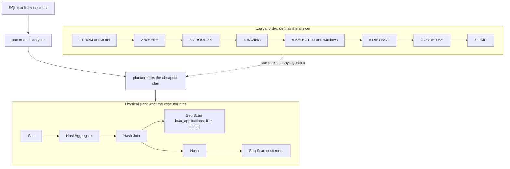

# Module 6.02: SQL from scratch

**Estimated hours:** 6

**What you will learn**

1. How to read data with `SELECT`, `WHERE`, `ORDER BY`, `LIMIT`, expressions, `DISTINCT`, the five join types, `GROUP BY`/`HAVING`, subqueries, CTEs, `CASE` and a first window function.
2. How to change data with `INSERT`, `UPDATE`, `DELETE`, `RETURNING` and UPSERT (`ON CONFLICT`), and how NULL and three-valued logic change the answers.
3. How to think in sets: replace a row-by-row loop with one statement, and measure the difference yourself (resume claim H2).

**Prerequisites:** [Module 6.01: What a database is](module-01-what-a-database-is.md). The `lending` database must exist and `~/.pgpass` must be set up.

---

## 1. One-line intuition

SQL is a language for describing the table you want back; the database works out the loops, the order of work and the shortcuts.

## 2. Real-life analogy

Go back to the records room and its registrar.

- A **SELECT** is a slip that describes a result, not a procedure: "every customer at MUM01, name and PAN, oldest first". You never say "open register 3, start at page 1, check each line".
- **WHERE** is a stencil laid over the register: only lines that show through are kept.
- A **JOIN** is laying two registers side by side and drawing a line between entries that share a value, such as the same branch code.
- **GROUP BY** is sorting slips into piles (one per branch) and writing one summary card per pile: how many, how much.
- A **subquery** is a slip that needs another slip's answer first: "applications bigger than the average application".
- An **UPDATE** with no WHERE is the registrar correcting every line in the register at once: either the most efficient request you can make or the worst mistake of your week.

## 3. Why it exists: the problem it solves

Databases before SQL (the network and hierarchical systems of the 1960s and 70s, such as CODASYL and IBM's IMS) were navigated by programs: "find the first loan record, follow the pointer to its customer, get next". Every new question was a new program, and changing the storage layout broke every program.

IBM's System R project (mid 1970s) produced SEQUEL, later SQL: a declarative language over Codd's relational model. You describe the result; the database's planner chooses the access path. SQL became an ANSI standard in 1986, and PostgreSQL's dialect stays close to the standard.

What breaks without it is what the lending platform lived through before its migration. Data sat in Berkeley DB, which has no query language. Each management report was a C program that opened a cursor, walked records one by one, decoded each and summed in memory. Bulk changes, such as repricing every floating-rate loan, were loops touching one record per call. Resume claim H2 is about replacing that style with set-based SQL, and section 6 measures what that is worth.

## 4. Three layers of depth

Run the setup script from section 6 first. It builds six tables of the lending schema with a small fixed data set (5 branches, 6 customers, 4 products, 8 applications, 3 loans, 6 repayments), so every output below matches yours exactly. Run the examples in `psql -h localhost -U postgres -d lending`. Money is integer **paise** (1 rupee = 100 paise) in `bigint` columns, and rates are **basis points** (850 = 8.50%); module 6.03 explains why.

### Layer 1 (beginner): reading and changing rows

**The shape of a query.** Clauses appear in this order; only `SELECT` and `FROM` are required.

```sql
SELECT   columns or expressions     -- what to show
FROM     table                      -- where from
WHERE    condition                  -- which rows to keep
ORDER BY column [DESC]              -- sort (ascending by default)
LIMIT    n;                         -- keep only the first n
```

The three largest applications that were not rejected:

```sql
SELECT application_id, branch_code, amount_paise
FROM loan_applications
WHERE status <> 'REJECTED'
ORDER BY amount_paise DESC
LIMIT 3;
```

```text
 application_id | branch_code | amount_paise
----------------+-------------+--------------
           5006 | PUN01       |    600000000
           5001 | MUM01       |    450000000
           5007 | MUM01       |    120000000
(3 rows)
```

`<>` means "not equal". `LIMIT` without `ORDER BY` gives "some 3 rows", not "the first 3": there is no first without an order.

**Expressions and functions.** A `SELECT` list can compute; `AS` names the result column.

```sql
SELECT product_code,
       round(base_rate_bp / 100.0, 2)                   AS rate_pct,
       max_amount_paise / 100                           AS max_rupees,
       to_char(max_amount_paise / 100, 'FM99,99,99,999') AS max_indian
FROM products
ORDER BY base_rate_bp;
```

```text
 product_code | rate_pct | max_rupees | max_indian
--------------+----------+------------+-------------
 HL01         |     8.50 |   10000000 | 1,00,00,000
 AL01         |     9.25 |    2000000 | 20,00,000
 GL01         |     9.75 |     500000 | 5,00,000
 PL01         |    11.50 |    2500000 | 25,00,000
(4 rows)
```

Integer divided by integer is integer division (`7 / 2` is `3`); write `100.0` to get an exact `numeric` result, then `round(x, 2)` because numeric division carries many decimals. `to_char` places commas where the pattern says, so Indian lakh and crore grouping is just a pattern.

| Kind | Examples | Result |
|---|---|---|
| Text | `upper('mum01')`, `length('Asha Rao')`, `left(pan, 5)`, `full_name \|\| ' (' \|\| branch_code \|\| ')'` | `MUM01`, `8`, `ABCPR`, `Asha Rao (MUM01)` |
| Numbers | `round(8.456, 2)`, `abs(-5)`, `7 % 2`, `greatest(3, 9)` | `8.46`, `5`, `1`, `9` |
| Dates | `now()`, `current_date`, `date '2026-01-31' + 1`, `age(date '2026-01-01', dob)`, `extract(year FROM dob)` | timestamp, today, `2026-02-01`, an interval, `1988` |
| NULL helpers | `coalesce(a, b)`, `nullif(x, 0)` | first non-NULL argument; NULL if `x = 0` |

**DISTINCT** removes duplicate result rows: `SELECT DISTINCT status FROM loan_applications ORDER BY status;` returns five rows, `APPROVED`, `DISBURSED`, `DRAFT`, `REJECTED`, `SUBMITTED`, although the table has eight.

**Conditions.** `=`, `<>`, `<`, `<=`, `>`, `>=`, `AND`, `OR`, `NOT`, and three shortcuts: `status IN ('APPROVED', 'SUBMITTED')`; `amount_paise BETWEEN 100000000 AND 500000000` (inclusive at both ends); `full_name LIKE 'A%'` (`%` matches any run of characters, `_` exactly one; `ILIKE` ignores case).

`AND` binds tighter than `OR`, like `*` and `+`. This query was meant to find rejected or draft applications at MUM01:

```sql
SELECT application_id, branch_code, status
FROM loan_applications
WHERE status = 'REJECTED' OR status = 'DRAFT' AND branch_code = 'MUM01'
ORDER BY application_id;
```

```text
 application_id | branch_code |  status
----------------+-------------+----------
           5005 | BLR01       | REJECTED
           5007 | MUM01       | DRAFT
           5008 | DEL01       | REJECTED
(3 rows)
```

It means `REJECTED OR (DRAFT AND MUM01)`, so it returned rejected applications from every branch. With brackets, `WHERE (status = 'REJECTED' OR status = 'DRAFT') AND branch_code = 'MUM01'`, the answer is one row, 5007. Always bracket a mix of `AND` and `OR`.

**Testing for NULL.** `paid_at` is NULL for unpaid repayments.

```sql
SELECT count(*) AS eq_null FROM repayments WHERE paid_at = NULL;
SELECT repayment_id, status FROM repayments WHERE paid_at IS NULL ORDER BY repayment_id;
```

```text
 eq_null
---------
       0
(1 row)

 repayment_id | status
--------------+---------
         9003 | OVERDUE
         9005 | DUE
(2 rows)
```

`= NULL` is never true, so it silently matches nothing. Use `IS NULL` / `IS NOT NULL`; Layer 2 explains why.

**INSERT, UPDATE, DELETE with RETURNING.** `RETURNING` hands back the rows you just changed, which saves a second query and a second round trip from your app server.

```sql
INSERT INTO loan_applications
       (application_id, branch_code, customer_id, product_code, amount_paise, tenure_months, status, created_by)
VALUES (5009, 'CHN01', 1004, 'GL01', 5000000, 12, 'DRAFT', 'U01')
RETURNING application_id, status, created_at IS NOT NULL AS has_created_at;

UPDATE loan_applications
SET status = 'SUBMITTED'
WHERE application_id = 5009 AND status = 'DRAFT'
RETURNING application_id, status;

DELETE FROM loan_applications
WHERE application_id = 5009
RETURNING application_id, branch_code, amount_paise;
```

```text
 application_id | status | has_created_at
----------------+--------+----------------
           5009 | DRAFT  | t
(1 row)

INSERT 0 1
 application_id |  status
----------------+-----------
           5009 | SUBMITTED
(1 row)

UPDATE 1
 application_id | branch_code | amount_paise
----------------+-------------+--------------
           5009 | CHN01       |      5000000
(1 row)

DELETE 1
```

Note `AND status = 'DRAFT'` in the UPDATE. Run that UPDATE twice and the second prints `UPDATE 0`. Putting the expected current state in the `WHERE` and checking the row count is how a workflow step avoids double-processing; module 6.04 uses it for disbursement. An `UPDATE` or `DELETE` with no `WHERE` changes every row, and `psql` will not ask "are you sure?".

### Layer 2 (working engineer): joins, groups, subqueries, NULL logic

**Joins with small row tables.** Make a throwaway table of sales targets (`TEMP` tables vanish when you disconnect). HYD01 is deliberately not a real branch.

```sql
CREATE TEMP TABLE targets (branch_code varchar(6), target_paise bigint);
INSERT INTO targets VALUES ('MUM01', 900000000), ('DEL01', 300000000), ('HYD01', 500000000);
```

```text
branches (5 rows)    targets (3 rows)
MUM01   <-------->   MUM01  900000000
PUN01                DEL01  300000000
DEL01   <-------->   (DEL01 above)
BLR01                HYD01  500000000  (no such branch)
CHN01

join type    rows  keeps
INNER JOIN      2  matched pairs only: MUM01, DEL01
LEFT JOIN       5  every branch; target columns NULL where unmatched
RIGHT JOIN      3  every target; branch columns NULL for HYD01
FULL JOIN       6  everything from both sides, NULLs where a side is missing
CROSS JOIN     15  every branch with every target (5 x 3), no condition
```

```sql
SELECT b.branch_code, b.city, t.target_paise
FROM branches b
LEFT JOIN targets t ON t.branch_code = b.branch_code
ORDER BY b.branch_code;
```

```text
 branch_code |   city    | target_paise
-------------+-----------+--------------
 BLR01       | Bengaluru |
 CHN01       | Chennai   |
 DEL01       | Delhi     |    300000000
 MUM01       | Mumbai    |    900000000
 PUN01       | Pune      |
(5 rows)
```

`b` and `t` are **table aliases**. `JOIN` alone means `INNER JOIN`; `LEFT JOIN` is short for `LEFT OUTER JOIN`; a RIGHT JOIN is a LEFT JOIN with the tables swapped. Change `LEFT` to `INNER`, `RIGHT`, `FULL` and check the row counts against the table; for `FULL`, order by `coalesce(b.branch_code, t.branch_code)` and see HYD01 appear with an empty branch side. `CROSS JOIN targets` has no `ON` at all.

**A real three-table join.** Applications at MUM01 with names:

```sql
SELECT a.application_id, c.full_name, p.name AS product, a.amount_paise / 100 AS rupees, a.status
FROM loan_applications a
JOIN customers c ON c.customer_id  = a.customer_id
JOIN products  p ON p.product_code = a.product_code
WHERE a.branch_code = 'MUM01'
ORDER BY a.application_id;
```

```text
 application_id |  full_name  |    product    | rupees  |  status
----------------+-------------+---------------+---------+-----------
           5001 | Asha Rao    | Home loan     | 4500000 | DISBURSED
           5002 | Vikram Shah | Personal loan |  300000 | DISBURSED
           5007 | Asha Rao    | Auto loan     | 1200000 | DRAFT
(3 rows)
```

This is the shape of query the app server ran on every request before it cached `products` in memory (claim H4).

**Finding what is missing (anti-join).** LEFT JOIN, then keep the rows where the right side is NULL. Customers with no application:

```sql
SELECT c.customer_id, c.full_name, c.kyc_status
FROM customers c
LEFT JOIN loan_applications a ON a.customer_id = c.customer_id
WHERE a.application_id IS NULL;
```

```text
 customer_id |  full_name  | kyc_status
-------------+-------------+------------
        1006 | Rohan Mehta | REJECTED
(1 row)
```

**The LEFT JOIN trap.** Count verified customers per branch, including branches with none:

```sql
SELECT b.branch_code, count(c.customer_id) AS verified_customers
FROM branches b
LEFT JOIN customers c ON c.branch_code = b.branch_code
WHERE c.kyc_status = 'VERIFIED'
GROUP BY b.branch_code ORDER BY b.branch_code;
```

```text
 branch_code | verified_customers
-------------+--------------------
 BLR01       |                  1
 MUM01       |                  2
 PUN01       |                  1
(3 rows)
```

CHN01 and DEL01 vanished. For CHN01 the LEFT JOIN made a row with `c.kyc_status` NULL, and the `WHERE` threw it away, turning the outer join back into an inner join. Move the condition into `ON` (`LEFT JOIN customers c ON c.branch_code = b.branch_code AND c.kyc_status = 'VERIFIED'`, no `WHERE`) and all five branches appear, CHN01 and DEL01 with 0. Rule: conditions on the optional side of a LEFT JOIN go in `ON`.

**GROUP BY and aggregates.** `count(*)`, `count(col)`, `sum`, `avg`, `min`, `max` collapse rows; `GROUP BY` gives one result row per group; `HAVING` filters groups after aggregation, while `WHERE` filters rows before it.

```sql
SELECT status, count(*) AS n, sum(amount_paise) AS total_paise
FROM loan_applications
GROUP BY status
ORDER BY n DESC, status;

SELECT branch_code, count(*) AS apps, max(amount_paise) / 100 AS largest_rupees
FROM loan_applications
GROUP BY branch_code
HAVING count(*) >= 2
ORDER BY branch_code;
```

```text
  status   | n | total_paise
-----------+---+-------------
 DISBURSED | 3 |   560000000
 REJECTED  | 2 |    25000000
 APPROVED  | 1 |   600000000
 DRAFT     | 1 |   120000000
 SUBMITTED | 1 |    20000000
(5 rows)

 branch_code | apps | largest_rupees
-------------+------+----------------
 BLR01       |    2 |         800000
 DEL01       |    2 |         200000
 MUM01       |    3 |        4500000
(3 rows)
```

Every `SELECT` column must be in `GROUP BY` or inside an aggregate. `count(*)` counts rows; `count(col)` counts non-NULL values, so on `repayments`, `count(*)` is 6 and `count(paid_at)` is 4. `sum` of a `bigint` returns `numeric`, which cannot overflow even across a whole bank's book.

**Subqueries.** A query inside a query, in four forms:

```sql
-- Scalar (one value): applications above the average amount. Returns 5001 and 5006.
SELECT application_id, amount_paise FROM loan_applications
WHERE amount_paise > (SELECT avg(amount_paise) FROM loan_applications);

-- IN (a list): customers holding an ACTIVE loan. Returns 1001 Asha Rao, 1004 Arjun Nair.
SELECT customer_id, full_name FROM customers
WHERE customer_id IN (SELECT customer_id FROM loans WHERE status = 'ACTIVE');

-- EXISTS (any row?): branches with an ACTIVE loan. Returns BLR01, MUM01.
SELECT b.branch_code FROM branches b
WHERE EXISTS (SELECT 1 FROM loans l WHERE l.branch_code = b.branch_code AND l.status = 'ACTIVE');

-- Correlated (refers to the outer row): each customer's largest application.
SELECT a.customer_id, a.application_id, a.amount_paise
FROM loan_applications a
WHERE a.amount_paise = (SELECT max(a2.amount_paise) FROM loan_applications a2
                        WHERE a2.customer_id = a.customer_id)
ORDER BY a.customer_id;
```

The output of the last one:

```text
 customer_id | application_id | amount_paise
-------------+----------------+--------------
        1001 |           5001 |    450000000
        1002 |           5002 |     30000000
        1003 |           5003 |     20000000
        1004 |           5004 |     80000000
        1005 |           5006 |    600000000
(5 rows)
```

A correlated subquery is logically re-run for each outer row; the planner often rewrites it as a join. `EXISTS` can stop at the first matching row, which is why it is cheap.

**CTEs (common table expressions).** `WITH name AS (query)` names a subquery so a long query reads top to bottom. Active loan book per branch, including empty branches:

```sql
WITH branch_book AS (
    SELECT branch_code, sum(outstanding_paise) AS book_paise
    FROM loans
    WHERE status = 'ACTIVE'
    GROUP BY branch_code
)
SELECT b.branch_code, b.city, coalesce(bb.book_paise, 0) AS book_paise
FROM branches b
LEFT JOIN branch_book bb ON bb.branch_code = b.branch_code
ORDER BY book_paise DESC, b.branch_code;
```

```text
 branch_code |   city    | book_paise
-------------+-----------+------------
 MUM01       | Mumbai    |  448559500
 BLR01       | Bengaluru |   78946200
 CHN01       | Chennai   |          0
 DEL01       | Delhi     |          0
 PUN01       | Pune      |          0
(5 rows)
```

**CASE** is SQL's if/else and works anywhere an expression does. The first matching `WHEN` wins.

```sql
SELECT application_id, amount_paise / 100 AS rupees,
       CASE
         WHEN amount_paise >= 100000000 THEN 'LARGE'
         WHEN amount_paise >=  20000000 THEN 'MEDIUM'
         ELSE 'SMALL'
       END AS size_band
FROM loan_applications
WHERE application_id IN (5001, 5004, 5005)
ORDER BY application_id;
```

```text
 application_id | rupees  | size_band
----------------+---------+-----------
           5001 | 4500000 | LARGE
           5004 |  800000 | MEDIUM
           5005 |  150000 | SMALL
(3 rows)
```

Inside an aggregate, `sum(CASE WHEN status = 'REJECTED' THEN 1 ELSE 0 END)` counts rejected applications per group; PostgreSQL also offers the shorter `count(*) FILTER (WHERE status = 'REJECTED')`.

**UPSERT: insert, or update if it already exists.** `ON CONFLICT` needs a primary key or unique constraint to detect the conflict; `EXCLUDED` is the row you tried to insert.

```sql
INSERT INTO products (product_code, name, min_amount_paise, max_amount_paise, max_tenure_months, base_rate_bp)
VALUES ('PL01', 'Personal loan', 5000000, 250000000, 60, 1099)
ON CONFLICT (product_code) DO UPDATE
   SET base_rate_bp = EXCLUDED.base_rate_bp
RETURNING product_code, base_rate_bp;
```

```text
 product_code | base_rate_bp
--------------+--------------
 PL01         |         1099
(1 row)

INSERT 0 1
```

PL01 existed, so its rate changed from 1150 to 1099; a new code would have been inserted. `ON CONFLICT (product_code) DO NOTHING` skips the row instead (`INSERT 0 0`). UPSERT is atomic: two sessions running it at once cannot both insert. Restore PL01 with `UPDATE products SET base_rate_bp = 1150 WHERE product_code = 'PL01';`.

**NULL and three-valued logic.** Every comparison returns true, false or **unknown** (NULL). `WHERE` keeps a row only when the condition is true.

| `a` | `b` | `a AND b` | `a OR b` | `NOT a` |
|---|---|---|---|---|
| true | unknown | unknown | true | false |
| false | unknown | false | unknown | true |
| unknown | unknown | unknown | unknown | unknown |

```sql
SELECT NULL = NULL AS eq, NULL <> 1 AS ne, NULL IS NULL AS is_null,
       (NULL = 1) OR true AS or_true, (NULL = 1) AND false AS and_false,
       NULL IS DISTINCT FROM 1 AS distinct_from;
```

```text
 eq | ne | is_null | or_true | and_false | distinct_from
----+----+---------+---------+-----------+---------------
    |    | t       | t       | f         | t
(1 row)
```

The blanks are NULL. `IS DISTINCT FROM` treats NULL as an ordinary value and always answers true or false; use it to compare nullable columns. The most expensive NULL bug is `NOT IN` with a NULL in the list:

```sql
SELECT count(*) AS not_in_with_null
FROM customers
WHERE customer_id NOT IN (SELECT 1004 UNION ALL SELECT NULL);
```

```text
 not_in_with_null
------------------
                0
(1 row)
```

Zero, although five of the six customers are not 1004. `x NOT IN (1004, NULL)` means `x <> 1004 AND x <> NULL`; the second part is unknown, so the whole condition is never true. In real code the list is a subquery over a nullable column, and one stray NULL row empties a report. `NOT EXISTS` has no such problem; prefer it. Also: aggregates skip NULLs, `ORDER BY` puts NULLs last when ascending and first when descending (`NULLS FIRST` / `NULLS LAST` override), and `coalesce` supplies a default.

**Window functions (preview).** An aggregate collapses rows; a **window function** computes across related rows but keeps every row. `OVER (PARTITION BY ... ORDER BY ...)` defines the window.

```sql
SELECT branch_code, application_id, amount_paise,
       rank() OVER (PARTITION BY branch_code ORDER BY amount_paise DESC) AS rank_in_branch
FROM loan_applications
WHERE branch_code IN ('BLR01', 'MUM01')
ORDER BY branch_code, rank_in_branch;
```

```text
 branch_code | application_id | amount_paise | rank_in_branch
-------------+----------------+--------------+----------------
 BLR01       |           5004 |     80000000 |              1
 BLR01       |           5005 |     15000000 |              2
 MUM01       |           5001 |    450000000 |              1
 MUM01       |           5007 |    120000000 |              2
 MUM01       |           5002 |     30000000 |              3
(5 rows)
```

`sum(amount_paise) OVER (PARTITION BY loan_id ORDER BY due_date)` gives a running total of installments per loan (for loan 7001: 3905200, 7810400, 11715600), and `lag(due_date) OVER (...)` the previous row's value. They replace a lot of application-side looping.

### Layer 3 (internals): the order SQL really runs in, and why sets win

**Written order is not evaluation order.** Logically, a query is evaluated as: 1 `FROM`/`JOIN`, 2 `WHERE`, 3 `GROUP BY`, 4 `HAVING`, 5 the `SELECT` list (including window functions and aliases), 6 `DISTINCT`, 7 `ORDER BY`, 8 `LIMIT`. That explains two classic errors. An alias cannot be used in `WHERE`, because aliases are made in step 5:

```sql
SELECT application_id, amount_paise / 100 AS rupees
FROM loan_applications
WHERE rupees > 1000000;
```

```text
ERROR:  column "rupees" does not exist
LINE 3: WHERE rupees > 1000000;
              ^
```

And `WHERE count(*) > 1` fails with `aggregate functions are not allowed in WHERE`, because groups do not exist until step 3; that is what `HAVING` is for. `ORDER BY rupees` works, because sorting is step 7.

**What the server actually builds.** The logical order defines the answer, not the work. The planner turns the query into a **plan**, a tree of operators. `EXPLAIN` shows it (`COSTS OFF` hides the estimates that module 6.10 explains):

```sql
EXPLAIN (COSTS OFF)
SELECT c.full_name, count(*) AS apps
FROM loan_applications a
JOIN customers c ON c.customer_id = a.customer_id
WHERE a.status <> 'DRAFT'
GROUP BY c.full_name
ORDER BY apps DESC;
```

```text
                        QUERY PLAN
----------------------------------------------------------
 Sort
   Sort Key: (count(*)) DESC
   ->  HashAggregate
         Group Key: c.full_name
         ->  Hash Join
               Hash Cond: (a.customer_id = c.customer_id)
               ->  Seq Scan on loan_applications a
                     Filter: (status <> 'DRAFT'::text)
               ->  Hash
                     ->  Seq Scan on customers c
(10 rows)
```

Read from the bottom: scan `customers` and build a hash table on `customer_id` (the structure of your module 1.15 hash map); scan `loan_applications`, applying the `WHERE` during the scan, and probe the hash table for each row; group in another hash table; sort the groups. The executor runs this as a pipeline of iterators, each node asking its child "next row, please". Nothing in your SQL said "hash": the planner chose a **hash join**, and with other sizes or indexes it would choose a nested loop or merge join (module 6.10).

**Why one statement beats a loop of statements.** To update 10,000 loans one row at a time from a client, each row pays:

- a network round trip (typically 0.1 to 1 ms on one machine, more across machines),
- parsing and planning the statement, plus executor start-up,
- and in autocommit mode a **commit**, which waits for the write-ahead log to be flushed to disk with `fsync` (module 6.06), often a millisecond or more by itself.

One `UPDATE ... FROM` pays those costs once and then runs a tight C loop over the rows next to the data, so per-row cost drops from milliseconds to microseconds. Two more wins matter even more in banking:

- **Atomicity.** One statement changes all 10,000 rows or none. A loop that dies at row 6,000 leaves 6,000 repriced loans and 4,000 old ones.
- **A consistent read.** One statement reads its input as of one moment. A loop reads `products` 10,000 times, and a rate change halfway through gives half the loans the old rate.

One caution from the PostgreSQL documentation on `UPDATE target SET ... FROM other WHERE ...`: if a target row matches more than one row of `other`, only one of them is used, and which one is unpredictable. Join on a key.

## 5. Architecture diagram



## 6. Code

**The setup script.** Save as `sql02_setup.sql` next to `lending_01.sql`. It drops and recreates six tables of `lending` with the canonical definitions (module 6.03 explains every column; `roles`, `users` and `audit_log` come there) and loads the data used above. Re-run it whenever you want a clean slate.

```sql
-- sql02_setup.sql : six tables of the lending schema with a small fixed data set.
-- Safe to re-run. Run:  psql -h localhost -U postgres -d lending -f sql02_setup.sql
\set ON_ERROR_STOP on
SET client_min_messages = warning;      -- hide "table does not exist" notices
DROP TABLE IF EXISTS repayments, loans, loan_applications, products, customers, branches CASCADE;

CREATE TABLE branches (
  branch_code varchar(6) PRIMARY KEY, name text NOT NULL, city text NOT NULL,
  region text NOT NULL, opened_on date NOT NULL);
CREATE TABLE customers (
  customer_id bigint PRIMARY KEY, branch_code varchar(6) NOT NULL REFERENCES branches,
  full_name text NOT NULL, pan char(10) NOT NULL UNIQUE, dob date NOT NULL,
  kyc_status text NOT NULL, created_at timestamptz NOT NULL DEFAULT now());
CREATE TABLE products (
  product_code varchar(8) PRIMARY KEY, name text NOT NULL,
  min_amount_paise bigint NOT NULL, max_amount_paise bigint NOT NULL,
  max_tenure_months int NOT NULL, base_rate_bp int NOT NULL,
  active boolean NOT NULL DEFAULT true);
CREATE TABLE loan_applications (
  application_id bigint PRIMARY KEY, branch_code varchar(6) NOT NULL REFERENCES branches,
  customer_id bigint NOT NULL REFERENCES customers, product_code varchar(8) NOT NULL REFERENCES products,
  amount_paise bigint NOT NULL, tenure_months int NOT NULL, status text NOT NULL,
  created_by varchar(10) NOT NULL, created_at timestamptz NOT NULL DEFAULT now());
CREATE TABLE loans (
  loan_id bigint PRIMARY KEY, application_id bigint NOT NULL UNIQUE REFERENCES loan_applications,
  branch_code varchar(6) NOT NULL REFERENCES branches, customer_id bigint NOT NULL REFERENCES customers,
  product_code varchar(8) NOT NULL REFERENCES products, principal_paise bigint NOT NULL,
  outstanding_paise bigint NOT NULL, rate_bp int NOT NULL, tenure_months int NOT NULL,
  disbursed_at timestamptz, status text NOT NULL);
CREATE TABLE repayments (
  repayment_id bigint PRIMARY KEY, loan_id bigint NOT NULL REFERENCES loans,
  due_date date NOT NULL, amount_paise bigint NOT NULL, paid_at timestamptz, status text NOT NULL);

INSERT INTO branches VALUES
  ('MUM01', 'Mumbai Fort',           'Mumbai',    'WEST',  '2009-04-01'),
  ('PUN01', 'Pune Camp',             'Pune',      'WEST',  '2012-07-16'),
  ('DEL01', 'Delhi Connaught Place', 'Delhi',     'NORTH', '2010-01-11'),
  ('BLR01', 'Bengaluru MG Road',     'Bengaluru', 'SOUTH', '2015-09-01'),
  ('CHN01', 'Chennai Anna Salai',    'Chennai',   'SOUTH', '2018-03-05');
INSERT INTO customers VALUES
  (1001, 'MUM01', 'Asha Rao',    'ABCPR1234K', '1988-02-14', 'VERIFIED', '2025-01-06 10:15+05:30'),
  (1002, 'MUM01', 'Vikram Shah', 'BCDPS2345L', '1979-11-30', 'VERIFIED', '2025-01-20 11:40+05:30'),
  (1003, 'DEL01', 'Neha Gupta',  'CDEPG3456M', '1992-06-05', 'PENDING',  '2025-02-03 09:05+05:30'),
  (1004, 'BLR01', 'Arjun Nair',  'DEFPN4567N', '1985-09-21', 'VERIFIED', '2025-02-11 15:30+05:30'),
  (1005, 'PUN01', 'Meera Joshi', 'EFGPJ5678P', '1990-01-09', 'VERIFIED', '2025-03-02 12:00+05:30'),
  (1006, 'DEL01', 'Rohan Mehta', 'FGHPM6789Q', '1996-12-17', 'REJECTED', '2025-03-18 16:45+05:30');
-- amounts in paise: Rs 45,00,000 = 450000000 paise
INSERT INTO products VALUES
  ('HL01', 'Home loan',     50000000, 1000000000, 360,  850, true),
  ('PL01', 'Personal loan',  5000000,  250000000,  60, 1150, true),
  ('AL01', 'Auto loan',     10000000,  200000000,  84,  925, true),
  ('GL01', 'Gold loan',      1000000,   50000000,  24,  975, true);
INSERT INTO loan_applications VALUES
  (5001, 'MUM01', 1001, 'HL01', 450000000, 240, 'DISBURSED', 'U01', '2025-03-01 10:00+05:30'),
  (5002, 'MUM01', 1002, 'PL01',  30000000,  36, 'DISBURSED', 'U01', '2025-03-04 11:30+05:30'),
  (5003, 'DEL01', 1003, 'PL01',  20000000,  24, 'SUBMITTED', 'U01', '2025-03-20 14:10+05:30'),
  (5004, 'BLR01', 1004, 'AL01',  80000000,  60, 'DISBURSED', 'U02', '2025-03-25 10:45+05:30'),
  (5005, 'BLR01', 1004, 'PL01',  15000000,  12, 'REJECTED',  'U02', '2025-04-01 09:20+05:30'),
  (5006, 'PUN01', 1005, 'HL01', 600000000, 300, 'APPROVED',  'U01', '2025-04-07 13:00+05:30'),
  (5007, 'MUM01', 1001, 'AL01', 120000000,  60, 'DRAFT',     'U02', '2025-04-15 17:05+05:30'),
  (5008, 'DEL01', 1003, 'PL01',  10000000,  12, 'REJECTED',  'U01', '2025-04-21 10:30+05:30');
INSERT INTO loans VALUES
  (7001, 5001, 'MUM01', 1001, 'HL01', 450000000, 448559500,  850, 240, '2025-03-10 12:00+05:30', 'ACTIVE'),
  (7002, 5002, 'MUM01', 1002, 'PL01',  30000000,         0, 1150,  36, '2025-03-15 12:00+05:30', 'CLOSED'),
  (7003, 5004, 'BLR01', 1004, 'AL01',  80000000,  78946200,  925,  60, '2025-04-02 12:00+05:30', 'ACTIVE');
INSERT INTO repayments VALUES
  (9001, 7001, '2025-04-10', 3905200, '2025-04-09 18:20+05:30', 'PAID'),
  (9002, 7001, '2025-05-10', 3905200, '2025-05-12 10:05+05:30', 'PAID'),
  (9003, 7001, '2025-06-10', 3905200, NULL,                     'OVERDUE'),
  (9004, 7003, '2025-05-02', 1670500, '2025-05-02 09:00+05:30', 'PAID'),
  (9005, 7003, '2025-06-02', 1670500, NULL,                     'DUE'),
  (9006, 7002, '2025-04-15',  989300, '2025-04-15 11:00+05:30', 'PAID');

SELECT 'branches' AS tbl, count(*) FROM branches
UNION ALL SELECT 'customers', count(*) FROM customers
UNION ALL SELECT 'products', count(*) FROM products
UNION ALL SELECT 'loan_applications', count(*) FROM loan_applications
UNION ALL SELECT 'loans', count(*) FROM loans
UNION ALL SELECT 'repayments', count(*) FROM repayments;
```

```bash
psql -h localhost -U postgres -d lending -f sql02_setup.sql
```

Expected: `SET`, `DROP TABLE`, six `CREATE TABLE` lines, then `INSERT 0 5`, `INSERT 0 6`, `INSERT 0 4`, `INSERT 0 8`, `INSERT 0 3`, `INSERT 0 6`, and finally (`UNION ALL` glues the rows of several queries into one result):

```text
        tbl        | count
-------------------+-------
 branches          |     5
 customers         |     6
 products          |     4
 loan_applications |     8
 loans             |     3
 repayments        |     6
(6 rows)
```

If you come back to this module after 6.03, re-run 6.03's `lending_schema.sql` and `lending_seed.sql` afterwards: this script's `CASCADE` also drops the foreign keys that the full schema's other tables have on these six.

**Set-based versus row-by-row.** Three small files. The first builds 10,000 practice loans whose `rate_bp` is 0 and must be set from their product.

```sql
-- rate_demo_setup.sql: 10,000 practice loans with rate 0, to be repriced from products
\set ON_ERROR_STOP on
DROP TABLE IF EXISTS rate_demo;
CREATE TABLE rate_demo (
  loan_id      bigint PRIMARY KEY,
  product_code varchar(8) NOT NULL REFERENCES products,
  rate_bp      int NOT NULL
);
INSERT INTO rate_demo (loan_id, product_code, rate_bp)
SELECT g, (ARRAY['HL01', 'PL01', 'AL01', 'GL01'])[1 + g % 4], 0
FROM generate_series(1, 10000) AS g;
```

The second behaves like a cursor-walking client: fetch the work list, then send one UPDATE per row. `\gexec` is a `psql` command that runs each value of the result as its own statement, each a separate round trip.

```sql
-- row_by_row.sql: what a cursor-style client does.
-- Step 1 fetches the work list; \gexec then sends ONE UPDATE per row,
-- each its own round trip, its own parse and plan, its own commit.
SELECT format('UPDATE rate_demo SET rate_bp = %s WHERE loan_id = %s',
              p.base_rate_bp, d.loan_id)
FROM rate_demo d
JOIN products p ON p.product_code = d.product_code
\gexec
```

```sql
-- set_based.sql: the same change as one statement.
UPDATE rate_demo AS d
SET    rate_bp = p.base_rate_bp
FROM   products AS p
WHERE  p.product_code = d.product_code;
```

Run and time them (`-q` hides the 10,000 `UPDATE 1` tags; `time` is the shell's stopwatch):

```bash
psql -h localhost -U postgres -d lending -f rate_demo_setup.sql
time psql -h localhost -U postgres -d lending -q -f row_by_row.sql
psql -h localhost -U postgres -d lending -q -f rate_demo_setup.sql
time psql -h localhost -U postgres -d lending -f set_based.sql
psql -h localhost -U postgres -d lending -c "SELECT product_code, rate_bp, count(*) FROM rate_demo GROUP BY 1, 2 ORDER BY 1;"
```

Both methods leave the same table:

```text
 product_code | rate_bp | count
--------------+---------+-------
 AL01         |     925 |  2500
 GL01         |     975 |  2500
 HL01         |     850 |  2500
 PL01         |    1150 |  2500
(4 rows)
```

The `real` times are machine-dependent. On the laptop used to check this module (PostgreSQL 16 on Linux over local TCP), the row-by-row run took between 20 and 80 seconds across repeats, and the set-based `UPDATE 10000` about 0.3 seconds including `psql` start-up. The row-by-row time swings because it is dominated by 10,000 disk flushes, one per autocommitted statement; lab Part D separates that cost from the round trips. Your numbers will differ, especially through Docker's port forwarding. The ratio, typically a hundred times or more, is the lesson.

## 7. Use case: core-banking loan-origination platform

Floating-rate home loans are linked to an external benchmark rate. When it moves, every active floating-rate loan must be repriced: a new `rate_bp` from the product's new base rate plus the loan's spread, then a new EMI. Before the migration this was a nightly C job over Berkeley DB: open a cursor on the loan database, decode each record, look up its product record, compute, write the record back. A straight port to the client-server database, one `UPDATE` per loan, was measured exactly as in section 6. For a book of a few hundred thousand loans the per-row cost times the row count did not fit the overnight window, and when the job failed partway it left the book half repriced with no record of where it stopped.

**The decision it drove:** bulk changes are written as set-based statements (`UPDATE loans l SET rate_bp = p.base_rate_bp + spread FROM products p WHERE ...`), each in one transaction, so a repricing happens to the whole book or not at all. Where one transaction was too large, the work was split into key ranges (`WHERE loan_id BETWEEN x AND y`), each range one set-based statement, with the last finished range recorded so the job could restart: the "restartable batch" idea of claim H1, applied to SQL. Per-row loops in application code were allowed only where each row needed a call to another system.

## 8. Lab

Run `sql02_setup.sql` first. Write each query yourself before opening the answer. Parts A and B only read; Part C changes data, so re-run the setup afterwards.

### Part A: warm-up (30 minutes)

Type every example from Layers 1 and 2 and compare with the text. Run the INNER, RIGHT, FULL and CROSS joins against `targets` and confirm 2, 3, 6 and 15 rows. Fix the LEFT JOIN trap by moving the condition into `ON` and confirm five rows, CHN01 and DEL01 at 0.

### Part B: practice queries, reading (90 minutes)

1. Every product with its rate as a percentage with two decimals, cheapest first.
2. Customers born before 1 January 1990, oldest first.
3. The number of customers per KYC status.
4. Every application at DEL01 with the customer's name and the product's name.
5. Branches with no customers (use `NOT EXISTS`).
6. Total principal disbursed per product, from `loans`, with 0 for products that have no loans.
7. Customers with more than one application.
8. The single largest application in each branch (hint: PostgreSQL's `DISTINCT ON (col)` keeps the first row per value of `col` in `ORDER BY` order).
9. Unpaid repayments (`DUE` or `OVERDUE`) with the customer's name and the amount in rupees with two decimals, earliest due date first.
10. For each loan: the number of paid installments and the paise paid so far.
11. Customers who hold no loan. Use `NOT EXISTS`, then explain why `NOT IN` would be risky.
12. The number of customers per age band (`under 30`, `30-44`, `45+`) as of 1 January 2026, using `CASE`.

<details>
<summary>Answers 1 to 7</summary>

```sql
-- 1. Expected 4 rows: HL01 8.50, AL01 9.25, GL01 9.75, PL01 11.50
SELECT product_code, name, round(base_rate_bp / 100.0, 2) AS rate_pct
FROM products ORDER BY base_rate_bp;

-- 2. Expected 3 rows: Vikram Shah 1979-11-30, Arjun Nair 1985-09-21, Asha Rao 1988-02-14
SELECT full_name, dob FROM customers WHERE dob < date '1990-01-01' ORDER BY dob;

-- 3. Expected: PENDING 1, REJECTED 1, VERIFIED 4
SELECT kyc_status, count(*) AS customers FROM customers GROUP BY kyc_status ORDER BY kyc_status;

-- 4. Expected 2 rows: 5003 Neha Gupta Personal loan SUBMITTED, 5008 Neha Gupta Personal loan REJECTED
SELECT a.application_id, c.full_name, p.name AS product, a.status
FROM loan_applications a
JOIN customers c ON c.customer_id = a.customer_id
JOIN products p  ON p.product_code = a.product_code
WHERE a.branch_code = 'DEL01'
ORDER BY a.application_id;

-- 5. Expected 1 row: CHN01 Chennai Anna Salai
SELECT b.branch_code, b.name FROM branches b
WHERE NOT EXISTS (SELECT 1 FROM customers c WHERE c.branch_code = b.branch_code);

-- 6. Expected: HL01 450000000, AL01 80000000, PL01 30000000, GL01 0
SELECT p.product_code, coalesce(sum(l.principal_paise), 0) AS disbursed_paise
FROM products p
LEFT JOIN loans l ON l.product_code = p.product_code
GROUP BY p.product_code
ORDER BY disbursed_paise DESC, p.product_code;

-- 7. Expected: 1001 2, 1003 2, 1004 2
SELECT customer_id, count(*) AS applications
FROM loan_applications GROUP BY customer_id HAVING count(*) > 1 ORDER BY customer_id;
```

</details>

<details>
<summary>Answers 8 to 12</summary>

```sql
-- 8.
SELECT DISTINCT ON (branch_code) branch_code, application_id, amount_paise
FROM loan_applications
ORDER BY branch_code, amount_paise DESC;

-- 9.
SELECT r.repayment_id, c.full_name, r.due_date, round(r.amount_paise / 100.0, 2) AS rupees, r.status
FROM repayments r
JOIN loans l     ON l.loan_id = r.loan_id
JOIN customers c ON c.customer_id = l.customer_id
WHERE r.status IN ('DUE', 'OVERDUE')
ORDER BY r.due_date;

-- 10.
SELECT l.loan_id,
       count(r.repayment_id) FILTER (WHERE r.status = 'PAID') AS paid_installments,
       coalesce(sum(r.amount_paise) FILTER (WHERE r.status = 'PAID'), 0) AS paid_paise
FROM loans l
LEFT JOIN repayments r ON r.loan_id = l.loan_id
GROUP BY l.loan_id ORDER BY l.loan_id;

-- 11. Expected 3 rows: 1003 Neha Gupta, 1005 Meera Joshi, 1006 Rohan Mehta
SELECT c.customer_id, c.full_name FROM customers c
WHERE NOT EXISTS (SELECT 1 FROM loans l WHERE l.customer_id = c.customer_id)
ORDER BY c.customer_id;

-- 12. Expected: 30-44 4, 45+ 1, under 30 1
SELECT CASE
         WHEN age(date '2026-01-01', dob) < interval '30 years' THEN 'under 30'
         WHEN age(date '2026-01-01', dob) < interval '45 years' THEN '30-44'
         ELSE '45+'
       END AS age_band,
       count(*) AS customers
FROM customers GROUP BY age_band ORDER BY age_band;
```

```text
 branch_code | application_id | amount_paise
-------------+----------------+--------------
 BLR01       |           5004 |     80000000
 DEL01       |           5003 |     20000000
 MUM01       |           5001 |    450000000
 PUN01       |           5006 |    600000000
(4 rows)

 repayment_id | full_name  |  due_date  |  rupees  | status
--------------+------------+------------+----------+---------
         9005 | Arjun Nair | 2025-06-02 | 16705.00 | DUE
         9003 | Asha Rao   | 2025-06-10 | 39052.00 | OVERDUE
(2 rows)

 loan_id | paid_installments | paid_paise
---------+-------------------+------------
    7001 |                 2 |    7810400
    7002 |                 1 |     989300
    7003 |                 1 |    1670500
(3 rows)
```

On question 11: if `loans.customer_id` could ever be NULL, `customer_id NOT IN (SELECT customer_id FROM loans)` would return no rows at all, as the Layer 2 demonstration showed. The column is `NOT NULL` here, so it would happen to work, but `NOT EXISTS` is correct whatever the schema.

</details>

### Part C: practice queries, changing data (30 minutes)

13. Open branch HYD01 ("Hyderabad Banjara Hills", Hyderabad, SOUTH, opening 2026-11-01) with an UPSERT that updates `name` and `opened_on` if the code exists. Run it again with "Hyderabad Hitec City" and 2026-12-01. Show the row each time with `RETURNING`.
14. In one statement, mark repayment 9005 as PAID at `2025-06-02 10:00+05:30` and reduce loan 7003's outstanding by that installment's amount. (Hint: a `WITH` clause may contain `UPDATE ... RETURNING`, and an outer `UPDATE ... FROM` can use its output.)
15. In one set-based statement, set every ACTIVE AL01 loan's `rate_bp` to the product's base rate plus 50 bp, returning loan ids and new rates.

<details>
<summary>Answers 13 to 15</summary>

```sql
-- 13. First run returns HYD01 | Hyderabad Banjara Hills | 2026-11-01 and INSERT 0 1;
--     the second run returns HYD01 | Hyderabad Hitec City | 2026-12-01 and also INSERT 0 1.
INSERT INTO branches (branch_code, name, city, region, opened_on)
VALUES ('HYD01', 'Hyderabad Banjara Hills', 'Hyderabad', 'SOUTH', '2026-11-01')
ON CONFLICT (branch_code) DO UPDATE
  SET name = EXCLUDED.name, opened_on = EXCLUDED.opened_on
RETURNING branch_code, name, opened_on;

-- 14.
WITH paid AS (
  UPDATE repayments
  SET status = 'PAID', paid_at = '2025-06-02 10:00+05:30'
  WHERE repayment_id = 9005 AND status <> 'PAID'
  RETURNING loan_id, amount_paise
)
UPDATE loans l
SET outstanding_paise = l.outstanding_paise - paid.amount_paise
FROM paid
WHERE l.loan_id = paid.loan_id
RETURNING l.loan_id, l.outstanding_paise;

-- 15. Expected: 7003 | 975, then UPDATE 1
UPDATE loans l
SET rate_bp = p.base_rate_bp + 50
FROM products p
WHERE p.product_code = l.product_code
  AND l.product_code = 'AL01'
  AND l.status = 'ACTIVE'
RETURNING l.loan_id, l.rate_bp;
```

Expected output of 14:

```text
 loan_id | outstanding_paise
---------+-------------------
    7003 |          77275700
(1 row)

UPDATE 1
```

78946200 - 1670500 = 77275700. Both changes happen in one statement, so they succeed or fail together (a preview of module 6.04), and the `status <> 'PAID'` guard means a second run prints `UPDATE 0` instead of reducing the balance twice. Re-run `sql02_setup.sql` now.

</details>

### Part D: measure set-based against row-by-row (30 minutes)

1. Run the three scripts from section 6 and record both `real` times.
2. Separate the two costs inside the row-by-row number. `psql -1` wraps the whole file in one transaction, so the 10,000 UPDATEs still make 10,000 round trips but only one commit:

```bash
psql -h localhost -U postgres -d lending -q -f rate_demo_setup.sql
time psql -h localhost -U postgres -d lending -1 -q -f row_by_row.sql
```

On the checking laptop this took about 5.5 seconds: much faster than autocommit (the 10,000 disk flushes are gone) and still about 18 times slower than set-based (the round trips, parses and plans remain).
3. Tabulate your three numbers (autocommit loop, single-transaction loop, set-based) and divide each by 10,000 for a per-row cost in microseconds. Compare the single-transaction loop's per-row cost with the round-trip latencies you measured in module 5.11.
4. `DROP TABLE rate_demo;`

### Journal

Copy [journal/TEMPLATE.md](../journal/TEMPLATE.md) to `journal/YYYY-MM-DD-sql-from-scratch.md`. Record: which practice queries you got wrong first and why (the LEFT JOIN trap and `NOT IN` are the usual ones); your three Part D timings with per-row costs; and one sentence for an interviewer on where the time goes in a row-by-row loop.

## 9. Common mistakes and misconceptions

| Mistake | Why it is wrong | Bug it causes later |
|---|---|---|
| `WHERE col = NULL` | Comparisons with NULL are unknown, never true | Filters that silently match nothing |
| `NOT IN (subquery)` on a nullable column | One NULL in the list makes every row unknown | Reports that suddenly return zero rows |
| Filtering a LEFT JOIN's optional table in `WHERE` | NULL-extended rows fail the condition | "Branches with no customers" vanish from the report |
| Mixing `AND` and `OR` without brackets | `AND` binds tighter | Rejected applications from every branch in a branch report |
| `LIMIT` without `ORDER BY` | There is no "first" in an unordered set | Pagination that repeats or skips rows |
| Integer division in money maths (`amount / 12`) | `bigint / int` truncates | Paise lost on every installment |
| `UPDATE` or `DELETE` without `WHERE` | Applies to every row, no confirmation | A whole table repriced or wiped |
| Looping over rows in the app for a bulk change | N round trips, plans and commits; not atomic | Jobs that take hours and fail half-done |
| `UPDATE ... FROM` with a join matching several rows | Only one match is used, unpredictably | Loans repriced from the wrong row |

## 10. Resume link

- **Claim A, "SQL".** You can now write all join types, aggregates with `HAVING`, correlated subqueries, CTEs, UPSERT and window functions, and explain NULL's three-valued logic. Interviewers test exactly these on a whiteboard schema; practise by explaining your Part B answers aloud.
- **Claim H2, "moving from cursor access to set-based SQL".** Say it with your numbers: "Updating 10,000 rows one statement at a time took tens of seconds; one `UPDATE ... FROM` took about 0.3 seconds. Wrapping the loop in one transaction cut it to about 5 seconds, which showed most of the loop's cost was per-statement commits, and the rest round trips and planning."
- **Claim H4, "master-table cache that removes joins from the hot path".** The three-table join in Layer 2 is the hot-path query the cache removed: the app already holds `products` and `branches` in memory and queries only `loan_applications`.

Likely follow-up: "When would you still process rows one at a time?" When each row needs a call to another system (a credit bureau, a notification service) or logic SQL cannot express; then batch (for example 500 rows per round trip) and make each batch restartable.

## 11. Interview questions

**Q1 (easy). What is the difference between `WHERE` and `HAVING`?**

<details>
<summary>Model answer</summary>

`WHERE` filters individual rows before grouping and cannot use aggregates. `HAVING` filters groups after `GROUP BY` and aggregation, so it can say `HAVING count(*) > 1`. A condition without an aggregate belongs in `WHERE`, because removing rows early means less work for the grouping step.

</details>

**Q2 (easy). Explain INNER, LEFT and FULL OUTER JOIN using two small tables.**

<details>
<summary>Model answer</summary>

With branches {MUM01, DEL01, CHN01} and targets {MUM01, HYD01}, joined on branch code: INNER returns only matched pairs, so MUM01. LEFT returns every branch, with target columns NULL where unmatched: MUM01 with its target, DEL01 and CHN01 with NULLs. FULL returns matched pairs plus the unmatched rows of both sides: the three branches, plus HYD01 with NULL branch columns. RIGHT is LEFT with the sides swapped, and CROSS pairs every row with every row (3 x 2 = 6).

</details>

**Q3 (medium). Why can `NOT IN` return no rows when you expect many, and what do you use instead?**

<details>
<summary>Model answer</summary>

`x NOT IN (a, b, NULL)` expands to `x <> a AND x <> b AND x <> NULL`. The last comparison is unknown, so the conjunction is never true, and `WHERE` keeps only rows whose condition is true. If the subquery behind `NOT IN` yields even one NULL, the result is empty. `NOT EXISTS (SELECT 1 FROM t WHERE t.col = outer.col)` only asks whether a matching row exists, so NULLs do not poison it, and the planner runs it as an efficient anti-join.

</details>

**Q4 (medium). A report counts verified customers per branch with a LEFT JOIN, but branches with none are missing. What is wrong?**

<details>
<summary>Model answer</summary>

The condition on the right-hand table, `c.kyc_status = 'VERIFIED'`, is in `WHERE`. For a branch with no matching customers the LEFT JOIN produces one row with NULL customer columns; `WHERE NULL = 'VERIFIED'` is unknown, so the row is dropped and the outer join has become an inner join. Moving the condition into the `ON` clause restricts which customers join without discarding the branch, and `count(c.customer_id)` returns 0 for it because `count(col)` ignores NULLs.

</details>

**Q5 (hard). You must reprice 2 million loans. A developer proposes an application loop that reads each loan and sends an UPDATE. Argue for a set-based approach, and say what you do if the update is too big for one transaction.**

<details>
<summary>Model answer</summary>

Per row the loop pays a network round trip, parsing and planning, executor start-up, and in autocommit a commit that waits for a WAL flush: typically milliseconds, so hours for 2 million rows. One `UPDATE loans l SET rate_bp = ... FROM products p WHERE p.product_code = l.product_code AND ...` pays those fixed costs once and loops inside the server; in my lab 10,000 rows went from tens of seconds to about 0.3 seconds. It is also atomic and reads `products` once, so no loan sees a half-applied rate change. If one transaction is too big (long-held locks, a burst of WAL, a long rollback on failure, replica lag), split into key ranges, each a set-based UPDATE in its own transaction; record the last completed range in a control table inside the same transaction; and make each range idempotent with a guard such as `AND rate_bp <> new_rate`, so the job restarts after a failure without double-applying.

</details>

## 12. Revision

- Clauses are written `SELECT ... FROM ... WHERE ... GROUP BY ... HAVING ... ORDER BY ... LIMIT` but evaluated FROM, WHERE, GROUP BY, HAVING, SELECT, DISTINCT, ORDER BY, LIMIT; joins match rows by value (inner, left, right, full, cross); subqueries, CTEs, CASE and window functions build reports without application loops.
- NULL is unknown: use `IS NULL`, prefer `NOT EXISTS` to `NOT IN`, put conditions on a LEFT JOIN's optional side in `ON`, and remember aggregates skip NULLs.
- Change data with `INSERT`/`UPDATE`/`DELETE ... RETURNING` and UPSERT; do bulk changes as one set-based statement (`UPDATE ... FROM`), which avoids per-row round trips, plans and commits and is atomic.

---

Previous: [Module 6.01: What a database is](module-01-what-a-database-is.md) | Next: [Module 6.03: Data modelling and normalisation](module-03-data-modelling-and-normalisation.md)
