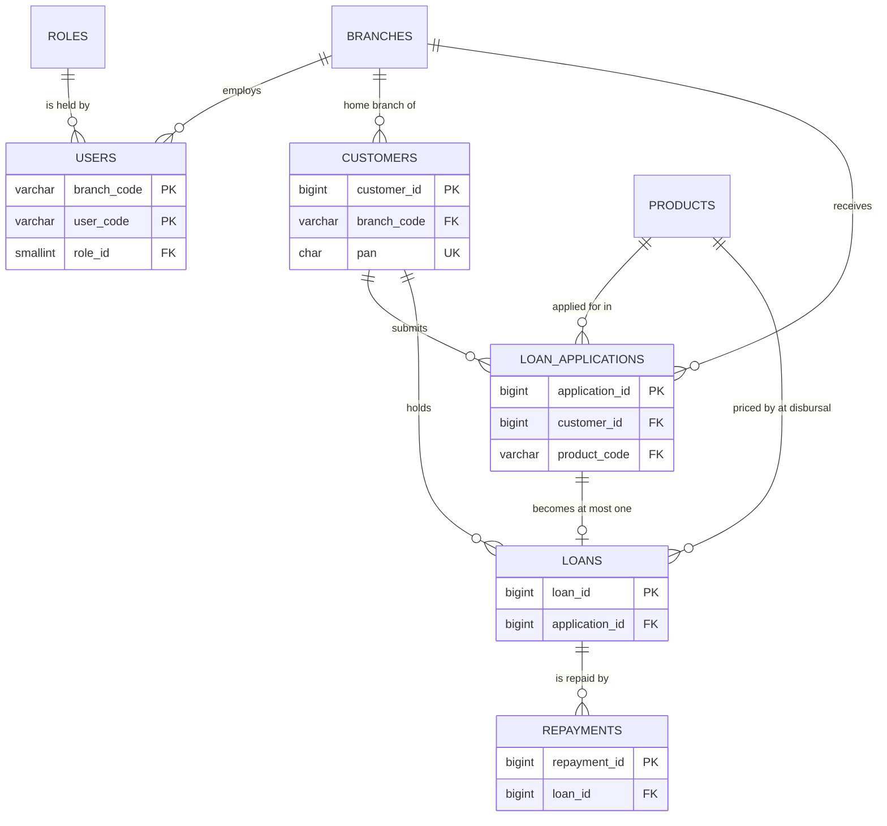

# Module 6.03: Data modelling and normalisation

**Estimated hours:** 4

**What you will learn**

1. How to model a business as entities, attributes and relationships, and how to choose keys (natural or surrogate, simple or composite) knowing what each choice does to indexes (claim H7).
2. How to normalise a flat loan-application sheet to third normal form, naming the update, insert and delete anomalies each step removes, and when to denormalise on purpose.
3. How to build the course's canonical lending schema with constraints, money in integer paise, `timestamptz` and lookup tables, plus a deterministic seed script that every later module and capstone C5 reuses; and how the 19-byte packed record of module 1.07 maps onto it (claim H2).

**Prerequisites:** [Module 6.02: SQL from scratch](module-02-sql-from-scratch.md). You also need the packed loan record from module 1.07 and the master-table cache idea from module 4.13.

---

## 1. One-line intuition

Data modelling is deciding what things exist, what identifies each one, and where each fact lives, so that every fact is stored exactly once and the database itself can enforce the rules.

## 2. Real-life analogy

Think about the paper forms in a branch.

- A **loan application form** where the clerk copies the branch's full address onto every form. When the branch moves across the road, ten thousand forms in the cabinet are wrong, and nobody will fix them all. That is an **update anomaly**.
- The bank cannot write down a new branch's address until the first customer applies there, because the address only lives on application forms. That is an **insert anomaly**.
- The last application from a small branch is shredded, and with it the only record of where that branch is. That is a **delete anomaly**.
- The fix is a **branch register**: one line per branch, holding its address once. Every form just writes the branch code. That is **normalisation**: each fact in exactly one register, and registers pointing at each other by code.
- A "documents submitted" box where the clerk scribbles "PAN, salary slip, bank statement" on one line cannot be ticked off item by item. A separate checklist with one line per document can. That is **first normal form**.

## 3. Why it exists: the problem it solves

A schema is the longest-lived part of a system. Application code is rewritten every few years; the tables, and the data in them, stay for decades. Mistakes made here are paid for in every query that follows:

- **Duplicated facts drift apart.** If a branch's city is stored on every application, some copies will be updated and others not, and two reports will disagree. In a bank, two reports that disagree start an audit.
- **Missing rules let bad data in.** If nothing says "a loan's application must exist", a batch job will one day insert a loan for application 0. Constraints in the schema stop that for every client, forever.
- **Keys decide performance.** Every primary key is also an index, and the way rows are identified decides which lookups are cheap. Resume claim H7 is a story about master tables keyed by business codes and a login query that could not use those keys. That story starts with the key choices made in this module.

What breaks without modelling is exactly what the lending platform's Berkeley DB records had: each packed record carried copies of branch and product fields so that one `get()` returned everything, and when a product's rate changed, a batch job had to rewrite every record that embedded it.

## 4. Three layers of depth

### Layer 1 (beginner): entities, relationships and keys

An **entity** is a kind of thing the business cares about and can tell apart: a branch, a customer, a loan application. Each becomes a table. An **attribute** is a fact about one entity: a customer's date of birth. Each becomes a column. A **relationship** says how entities connect, and its **cardinality** says how many on each side.

| Relationship | Example | How it becomes tables |
|---|---|---|
| One-to-many (1:N) | One branch has many customers | Foreign key on the "many" side: `customers.branch_code` |
| One-to-one (1:1) | One approved application becomes at most one loan | Foreign key plus `UNIQUE`: `loans.application_id` is both |
| Many-to-many (M:N) | An application can have several applicants (co-borrowers), and a customer can be on several applications | A **junction table** with two foreign keys, for example `application_parties(application_id, customer_id, role)` with primary key on the first two |

The course schema has eight business tables plus an audit log:

| Table | Kind | Key | One row is |
|---|---|---|---|
| `branches` | master | `branch_code` (business code) | a branch |
| `roles` | master (lookup) | `role_id` | a job role such as CLERK |
| `users` | master | `(branch_code, user_code)` | a staff login at one branch |
| `products` | master | `product_code` (business code) | a loan product such as HL01 |
| `customers` | transactional | `customer_id` | a customer |
| `loan_applications` | transactional | `application_id` | one application |
| `loans` | transactional | `loan_id` | one disbursed loan |
| `repayments` | transactional | `repayment_id` | one scheduled installment |
| `audit_log` | append-only | `audit_id` (generated) | one recorded action |

**Master tables** hold reference data that changes rarely and is read on almost every request. **Transactional tables** grow with business activity. That split matters for caching (module 4.13) and for keys.

**Key vocabulary.** A **candidate key** is any set of columns that is unique and never null; a customer has two, `customer_id` and `pan`. The **primary key** is the one you choose as the main identifier. A **natural key** has business meaning (`branch_code = 'MUM01'`, a PAN). A **surrogate key** is a meaningless number the system generates (`customer_id = 1001`). A **composite key** has more than one column.

### Layer 2 (working engineer): normal forms, denormalisation, constraints and types

**Normalisation on a real sheet.** Before the migration, a branch kept applications in a spreadsheet like this, one row per application:

```text
application_id | customer_name | customer_pan | branch_code | branch_city | product_code | product_rate_bp | amount_paise | documents
1              | Asha Rao      | ABCPR1234K   | MUM01       | Mumbai      | HL01         |  850            | 450000000    | PAN, Salary slip, Bank statement
2              | Vikram Shah   | BCDPS2345L   | MUM01       | Mumbai      | PL01         | 1150            |  30000000    | PAN, Salary slip
3              | Asha Rao      | ABCPR1234K   | MUM01       | Mumbai      | AL01         |  925            | 120000000    | PAN
```

**First normal form (1NF): every cell holds one value, and there are no repeating groups.** `documents` holds a list. You cannot index it, constrain it, or reliably ask "which applications lack a salary slip?" (string matching on `'%Salary slip%'` breaks on the first typo). Fix: a separate table `application_documents(application_id, doc_type)` with one row per document and primary key `(application_id, doc_type)`.

**Second normal form (2NF): 1NF, and every non-key column depends on the whole key.** This only bites with composite keys. Suppose the documents table also carried `customer_name`. Its key is `(application_id, doc_type)`, but the name depends only on `application_id`, part of the key. Three documents mean three copies of the name, and a correction must find all three. Fix: keep `customer_name` (or rather a customer reference) on the application, not on the document row.

**Third normal form (3NF): 2NF, and no non-key column depends on another non-key column.** In the sheet, `branch_city` depends on `branch_code`, which depends on the application: a **transitive dependency**. Same for `product_rate_bp` via `product_code`, and `customer_name` via `customer_pan`. All three anomalies live here:

- **Update:** the branch moves; the city must change on every application row.
- **Insert:** a new branch has no city on record until its first application.
- **Delete:** delete the last application at a branch and its city is gone.

Fix: move each fact to the table of the thing it describes (`branches(branch_code, city)`, `products(product_code, base_rate_bp)`, `customers(customer_id, pan, full_name)`) and keep only the codes on the application. The informal test for 3NF, worth memorising: every non-key column depends on "the key, the whole key, and nothing but the key". (Boyce-Codd normal form, BCNF, tightens this for tables with overlapping candidate keys; 3NF is the practical target.)

The lab reproduces the update anomaly on the sheet with real SQL, and you will see one branch with two cities.

**Denormalisation: breaking the rules on purpose.** Normalised schemas need joins. Sometimes you deliberately store a copy of a fact. Three legitimate reasons, all in this platform:

1. **Historical facts are not duplicates.** `loans.rate_bp` looks like a copy of `products.base_rate_bp`. It is not. It is the rate the customer signed for on disbursement day, and it must not change when the product's rate changes next month. Likewise `loans.product_code` and `loans.customer_id` are frozen at disbursement. Ask of any copied column: "should this change when the source changes?" If no, it is a separate fact and belongs in the row.
2. **Reporting.** Month-end reports join five tables over millions of rows. A summary table (or a materialized view, a stored query result refreshed on demand) rebuilt nightly trades freshness for speed. The system of record stays normalised.
3. **Caching outside the database.** The `MasterCache` of module 4.13 holds `branches` and `products` in the app server's memory, so the hot path reads them without a join. That is denormalisation in RAM, with a known staleness bound, and it only works because master data changes rarely.

**Constraints: rules the database enforces for every client.**

| Constraint | Meaning | In the schema |
|---|---|---|
| `NOT NULL` | A value is required | Almost every column |
| `UNIQUE` | No two rows share the value (NULLs do not clash) | `customers.pan`, `roles.role_name`, `loans.application_id` |
| `PRIMARY KEY` | `UNIQUE` plus `NOT NULL`, one per table | Every table |
| `FOREIGN KEY ... REFERENCES` | Value must exist in the parent's key | `customers.branch_code`, `loans.application_id`, and more |
| `CHECK (expr)` | Every row must make `expr` true (or NULL) | Not in the shared schema; see below |
| `DEFAULT` | Value used when the insert omits the column | `created_at DEFAULT now()`, `users.status DEFAULT 'A'` |

A foreign key also decides what happens when the parent row is deleted or its key changes:

| `ON DELETE` | Effect | Fits |
|---|---|---|
| `NO ACTION` (default) / `RESTRICT` | Refuse while children exist | Anything financial: a branch with customers, a loan with repayments |
| `CASCADE` | Delete the children too | Children meaningless alone, such as `application_documents` |
| `SET NULL` / `SET DEFAULT` | Detach the children | Optional links, such as "assigned officer" |

The canonical schema uses the default everywhere: in a bank, deleting financial history by cascade is never acceptable; rows are closed by status, not deleted.

**Why the shared schema has no CHECK constraints.** A production schema would add rules such as `CHECK (amount_paise > 0)`, `CHECK (status IN ('DRAFT','SUBMITTED','APPROVED','REJECTED','DISBURSED'))` and `CHECK (min_amount_paise <= max_amount_paise)`. The course schema deliberately keeps only keys and `NOT NULL`, so that the internals modules (6.04 to 6.10) can insert the odd rows their experiments need, and so that capstone C5 can add validation itself and measure the effect (claim H6). You will try CHECKs inside a transaction in the lab and roll them back.

**Money: integer paise, not floating point.** Binary floating point cannot represent 0.1 exactly:

```sql
SELECT 0.1::float8 + 0.2::float8 = 0.3::float8 AS float_equal,
       0.1::numeric + 0.2::numeric = 0.3::numeric AS numeric_equal,
       10 + 20 = 30 AS paise_equal;
SELECT 0.1::float8 + 0.2::float8 AS float_sum;
```

```text
 float_equal | numeric_equal | paise_equal
-------------+---------------+-------------
 f           | t             | t
(1 row)

      float_sum
---------------------
 0.30000000000000004
(1 row)
```

A balance that is off by 0.00000000000000004 rupees fails a reconciliation that compares with `=`. The options:

| Type | Exact? | Size | Notes |
|---|---|---|---|
| `float8` / `real` | No | 8 / 4 bytes | Never for money |
| `numeric(p,s)` | Yes | Variable: about 2 bytes per 4 decimal digits plus a header; `1234567.89` takes 12 bytes | Slower arithmetic; fine for rates and reports |
| `bigint` paise | Yes | 8 bytes, fixed | Fast integer maths; maps 1:1 to C's `int64_t` |

The schema uses `bigint` paise: exact, compact, fast, and identical to the `int64_t principal_paise` field of the 1.07 packed record, so the migration engine copies the value without conversion. The maximum, about 9.2 x 10^18 paise, is 92 thousand lakh crore rupees: enough. Rates are `int` basis points for the same reason. The rule that comes with it: every division (EMI, interest) states its rounding explicitly, and results are rounded to whole paise at a defined step.

**Time: `timestamptz`, not `timestamp`.** `timestamptz` ("timestamp with time zone") stores an absolute instant in UTC and displays it in the session's time zone. Plain `timestamp` stores a wall-clock reading with no zone, so `2026-01-03 11:00` from a Mumbai server and from a UTC replica are different instants with the same bytes. Same row, two sessions:

```sql
SET TIME ZONE 'UTC';
SELECT application_id, created_at FROM loan_applications WHERE application_id = 10001;
SET TIME ZONE 'Asia/Kolkata';
SELECT application_id, created_at FROM loan_applications WHERE application_id = 10001;
```

```text
 application_id |       created_at
----------------+------------------------
          10001 | 2026-01-03 05:30:00+00
(1 row)

 application_id |        created_at
----------------+---------------------------
          10001 | 2026-01-03 11:00:00+05:30
(1 row)
```

One instant, two displays. (The Docker image's default time zone is UTC, which is why all outputs in this course show `+00`.) Use `date` for things that are calendar days with no time, such as `dob` and `due_date`.

**Status values: text, enum or lookup table.** Three ways to restrict a column to a set of values:

| Option | Pros | Cons | Used for |
|---|---|---|---|
| `text` + `CHECK (status IN (...))` | Readable, easy to change | The list lives in DDL, not data | Application, loan and repayment statuses (CHECK added in C5) |
| `CREATE TYPE ... AS ENUM` | 4 bytes, ordered, typo-proof | Values can be added or renamed but not removed | Not used |
| Lookup table + foreign key | Values are data; can carry extra columns (descriptions, permissions) | One more join (or a cache entry) | `roles`: a role will later carry its permissions |

**Natural versus surrogate keys: the H7 setup.** The canonical `users` table is keyed by business codes, because staff log in as "branch MUM01, user U01", and user codes repeat across branches:

```sql
\d users
SELECT user_code, count(*) FROM users GROUP BY user_code ORDER BY user_code;
```

```text
                             Table "public.users"
    Column     |           Type           | Collation | Nullable |   Default
---------------+--------------------------+-----------+----------+-------------
 branch_code   | character varying(6)     |           | not null |
 user_code     | character varying(10)    |           | not null |
 full_name     | text                     |           | not null |
 password_hash | text                     |           | not null |
 role_id       | smallint                 |           | not null |
 status        | character(1)             |           | not null | 'A'::bpchar
 last_login_at | timestamp with time zone |           |          |
Indexes:
    "users_pkey" PRIMARY KEY, btree (branch_code, user_code)
Foreign-key constraints:
    "users_branch_code_fkey" FOREIGN KEY (branch_code) REFERENCES branches(branch_code)
    "users_role_id_fkey" FOREIGN KEY (role_id) REFERENCES roles(role_id)

 user_code | count
-----------+-------
 U01       |     5
 U02       |     5
 U03       |     5
 U04       |     5
(4 rows)
```

The alternative design gives every user a surrogate number and keeps the business codes unique:

```sql
CREATE TABLE users_surrogate (
  user_id       bigint GENERATED ALWAYS AS IDENTITY PRIMARY KEY,
  branch_code   varchar(6) NOT NULL REFERENCES branches,
  user_code     varchar(10) NOT NULL,
  full_name     text NOT NULL,
  UNIQUE (branch_code, user_code)
);
```

To try it without keeping it, run it between `BEGIN;` and `ROLLBACK;` (DDL is transactional, Layer 3). `\d users_surrogate` then lists **two** indexes: `users_surrogate_pkey ... btree (user_id)` and `users_surrogate_branch_code_user_code_key ... btree (branch_code, user_code)`. Compare:

| | Natural composite key (canonical) | Surrogate key |
|---|---|---|
| Indexes | One, on `(branch_code, user_code)` | Two: `user_id`, plus the unique pair |
| Login lookup by branch and user code | Uses the primary key directly | Uses the unique index; the `user_id` index serves nobody at login |
| Child rows referencing a user | Store both codes (16 or so bytes) | Store one `bigint` (8 bytes) |
| Renaming a code | Must update every child row | One row |
| Readability of child rows | `MUM01/U01`: obvious | `4711`: needs a join to read |

Both designs share one trap, and it is the heart of claim H7. A B-tree index on `(branch_code, user_code)` is sorted by branch first, like a phone book sorted by surname then first name. A query that knows both (`WHERE branch_code = 'MUM01' AND user_code = 'U01'`) or just the branch can use it. A query that knows only the user code (`WHERE user_code = 'U01'`) cannot jump into it, any more than you can find everyone called "Asha" in a phone book sorted by surname; on a large table the planner then reads every row. The same happens with `WHERE upper(user_code) = ...` or a type mismatch between the column and the parameter. Module 6.09 explains the index structure, and capstone C5 recreates a slow login of this kind on purpose and fixes it with composite and covering indexes.

The rule the platform settled on: **master tables keyed by their business codes** (they are small, stable, and every request arrives carrying the codes), **transactional tables keyed by numeric ids** (they are large, their rows are referenced from other large tables, and the ids came verbatim from the legacy system).

### Layer 3 (internals): what keys, constraints and types cost

- **Every primary key and unique constraint is a B-tree index**, built and maintained automatically. Each insert updates every index of the table; module 6.09 measures what that costs.
- **Foreign key columns are not indexed automatically.** `\d loans` lists only `loans_pkey` and `loans_application_id_key`; there is no index on `loans.customer_id`, `branch_code` or `product_code`. Two consequences: queries such as "all loans of customer 1008" scan the table until you add an index, and deleting or re-keying a parent row must find its children, which without an index means scanning the child table for every parent row deleted. Indexing FK columns that are searched or whose parents are deleted is a standard step after modelling.
- **How a foreign key is checked.** PostgreSQL implements foreign keys with internal triggers. Inserting a loan runs, in effect, `SELECT 1 FROM branches WHERE branch_code = $1 FOR KEY SHARE` for each referenced parent: a lookup through the parent's primary key index plus a light row lock that stops the parent being deleted until your transaction ends (module 6.08 covers lock modes). That is why foreign keys must point at a primary key or unique constraint: the check needs an index.
- **Width matters in every row and every index.** A `varchar(6)` value of 5 characters takes 6 bytes (1 length byte plus the characters); a `bigint` takes 8 but is aligned on 8 bytes (module 6.05). `numeric` is variable-length, which is part of why paise in `bigint` is faster. `timestamptz` is an 8-byte count of microseconds since 2000-01-01 00:00 UTC; the time zone is not stored at all, only applied when displaying.
- **DDL is transactional in PostgreSQL.** `CREATE TABLE`, `ALTER TABLE ... ADD CONSTRAINT` and even `DROP TABLE` can be rolled back. The lab uses this to try constraints safely. (Oracle and MySQL commit DDL implicitly; module 6.15.)

## 5. Architecture diagram



`||--o{` reads "exactly one to zero or more"; `||--o|` reads "exactly one to zero or one". Only key columns are drawn; section 6 has every column. `audit_log` is not drawn: it deliberately has no foreign keys, so audit rows survive anything that happens to the rows they describe.

## 6. Code

Two scripts that the rest of the course reuses. Keep them in `~/phase6/`. Every later module that says "the canonical schema and seed" means these two files.

**The canonical schema.** It recreates the `lending` database from nothing (`WITH (FORCE)` disconnects any other session using it).

```sql
-- lending_schema.sql : the canonical lending schema used from module 6.03 onward.
-- Recreates the database from nothing. Run:
--   psql -h localhost -U postgres -f lending_schema.sql
\set ON_ERROR_STOP on
DROP DATABASE IF EXISTS lending WITH (FORCE);   -- FORCE ends other sessions on it
CREATE DATABASE lending;
\c lending

-- ---------- master tables: keyed by business codes ----------
CREATE TABLE branches (
  branch_code  varchar(6) PRIMARY KEY,
  name         text NOT NULL,
  city         text NOT NULL,
  region       text NOT NULL,
  opened_on    date NOT NULL
);
CREATE TABLE roles (
  role_id      smallint PRIMARY KEY,
  role_name    text NOT NULL UNIQUE          -- e.g. CLERK, CREDIT_OFFICER, BRANCH_MANAGER, AUDITOR
);
CREATE TABLE users (
  branch_code   varchar(6) NOT NULL REFERENCES branches,
  user_code     varchar(10) NOT NULL,
  full_name     text NOT NULL,
  password_hash text NOT NULL,
  role_id       smallint NOT NULL REFERENCES roles,
  status        char(1) NOT NULL DEFAULT 'A', -- A active, L locked
  last_login_at timestamptz,
  PRIMARY KEY (branch_code, user_code)
);
CREATE TABLE products (
  product_code      varchar(8) PRIMARY KEY,  -- e.g. HL01 home loan, PL01 personal loan
  name              text NOT NULL,
  min_amount_paise  bigint NOT NULL,
  max_amount_paise  bigint NOT NULL,
  max_tenure_months int NOT NULL,
  base_rate_bp      int NOT NULL,            -- basis points, 850 = 8.50%
  active            boolean NOT NULL DEFAULT true
);

-- ---------- transactional tables: keyed by numeric ids ----------
CREATE TABLE customers (
  customer_id  bigint PRIMARY KEY,
  branch_code  varchar(6) NOT NULL REFERENCES branches,
  full_name    text NOT NULL,
  pan          char(10) NOT NULL UNIQUE,
  dob          date NOT NULL,
  kyc_status   text NOT NULL,               -- PENDING, VERIFIED, REJECTED
  created_at   timestamptz NOT NULL DEFAULT now()
);
CREATE TABLE loan_applications (
  application_id  bigint PRIMARY KEY,
  branch_code     varchar(6) NOT NULL REFERENCES branches,
  customer_id     bigint NOT NULL REFERENCES customers,
  product_code    varchar(8) NOT NULL REFERENCES products,
  amount_paise    bigint NOT NULL,
  tenure_months   int NOT NULL,
  status          text NOT NULL,             -- DRAFT, SUBMITTED, APPROVED, REJECTED, DISBURSED
  created_by      varchar(10) NOT NULL,
  created_at      timestamptz NOT NULL DEFAULT now()
);
CREATE TABLE loans (
  loan_id          bigint PRIMARY KEY,
  application_id   bigint NOT NULL UNIQUE REFERENCES loan_applications,
  branch_code      varchar(6) NOT NULL REFERENCES branches,
  customer_id      bigint NOT NULL REFERENCES customers,
  product_code     varchar(8) NOT NULL REFERENCES products,
  principal_paise  bigint NOT NULL,
  outstanding_paise bigint NOT NULL,
  rate_bp          int NOT NULL,
  tenure_months    int NOT NULL,
  disbursed_at     timestamptz,
  status           text NOT NULL            -- ACTIVE, CLOSED, NPA
);
CREATE TABLE repayments (
  repayment_id  bigint PRIMARY KEY,
  loan_id       bigint NOT NULL REFERENCES loans,
  due_date      date NOT NULL,
  amount_paise  bigint NOT NULL,
  paid_at       timestamptz,
  status        text NOT NULL               -- DUE, PAID, OVERDUE
);
CREATE TABLE audit_log (
  audit_id     bigserial PRIMARY KEY,
  at           timestamptz NOT NULL DEFAULT now(),
  branch_code  varchar(6),
  user_code    varchar(10),
  action       text NOT NULL,
  entity       text NOT NULL,
  entity_id    bigint,
  detail       jsonb
);
```

Column by column, the decisions that are not obvious:

- `branches.branch_code varchar(6)`: the code staff type (`MUM01`), six characters to match the legacy record's 6-byte field. `region` is plain text; a region table would be the next normalisation step if regions gained attributes.
- `roles` is a lookup table (Layer 2). `smallint` because there will never be 32,767 roles.
- `users` has the composite natural key from Layer 2. `password_hash` stores a hash, never a password (Phase 11 covers hashing). `status` is one character, `A` or `L`. `last_login_at` is nullable: NULL means "never logged in", which is different from any date.
- `products`: limits in paise, tenure in months, rate in basis points. `active` lets a product be withdrawn without deleting it, because old loans still reference it.
- `customers.pan char(10) UNIQUE`: the PAN is a natural candidate key, but not the primary key, because a PAN can be entered wrongly and corrected, and a primary key should never change. `customer_id` is the stable surrogate.
- `loan_applications.created_by varchar(10)`: the user code of the clerk. It has no foreign key, because `users` is keyed by `(branch_code, user_code)`; a composite foreign key `(branch_code, created_by) REFERENCES users` would enforce it, and you will try it in the lab.
- `loans.application_id UNIQUE`: makes application-to-loan one-to-one. `branch_code`, `customer_id`, `product_code` and `rate_bp` are frozen copies at disbursement (Layer 2). `disbursed_at` is nullable to allow a loan to be booked before money moves.
- `audit_log.audit_id bigserial`: an auto-generated `bigint` from a sequence (module 6.04 shows sequences can have gaps). `detail jsonb` holds a flexible, binary JSON document of whatever changed. No foreign keys, on purpose.

**The seed data.** It is deterministic (no `random()`), so every learner, every module and capstone C5 see identical rows. It uses `generate_series` to make rows, `ARRAY[...][i]` to pick names, and `%` (remainder) to spread values.

```sql
-- lending_seed.sql : deterministic seed data for the canonical schema (module 6.03).
-- 5 branches, 4 roles, 20 users, 4 products, 50 customers,
-- 200 applications, 120 loans, 360 repayments (first 3 installments of each loan).
-- No random(): every run produces exactly the same rows. Safe to re-run. Run:
--   psql -h localhost -U postgres -d lending -f lending_seed.sql
\set ON_ERROR_STOP on
SET client_min_messages = warning;   -- hide "does not exist, skipping" notices
BEGIN;
TRUNCATE audit_log, repayments, loans, loan_applications, customers,
         users, products, roles, branches RESTART IDENTITY;

INSERT INTO branches (branch_code, name, city, region, opened_on) VALUES
  ('MUM01', 'Mumbai Fort',           'Mumbai',    'WEST',  '2009-04-01'),
  ('PUN01', 'Pune Camp',             'Pune',      'WEST',  '2012-07-16'),
  ('DEL01', 'Delhi Connaught Place', 'Delhi',     'NORTH', '2010-01-11'),
  ('BLR01', 'Bengaluru MG Road',     'Bengaluru', 'SOUTH', '2015-09-01'),
  ('CHN01', 'Chennai Anna Salai',    'Chennai',   'SOUTH', '2018-03-05');

INSERT INTO roles (role_id, role_name) VALUES
  (1, 'CLERK'), (2, 'CREDIT_OFFICER'), (3, 'BRANCH_MANAGER'), (4, 'AUDITOR');

INSERT INTO products VALUES
  ('HL01', 'Home loan',     50000000, 1000000000, 360,  850, true),
  ('PL01', 'Personal loan',  5000000,  250000000,  60, 1150, true),
  ('AL01', 'Auto loan',     10000000,  200000000,  84,  925, true),
  ('GL01', 'Gold loan',      1000000,   50000000,  24,  975, true);

-- 20 users: 4 per branch. User codes U01..U04 repeat in every branch,
-- so only (branch_code, user_code) together identifies a user.
INSERT INTO users (branch_code, user_code, full_name, password_hash, role_id,
                   status, last_login_at)
SELECT b.branch_code,
       'U0' || k,
       (ARRAY['Anil Kulkarni','Bhavna Desai','Chetan Patil','Divya Menon',
              'Farhan Ali','Gauri Sathe','Harish Pawar','Isha Bhat',
              'Jatin Malhotra','Kiran Sethi','Lalit Verma','Mansi Arora',
              'Naveen Hegde','Pooja Shetty','Rahul Kamath','Sneha Rao',
              'Tarun Pillai','Uma Krishnan','Varun Subramanian','Yamini Raman'])[(b.n - 1) * 4 + k],
       'seed-placeholder-' || b.branch_code || '-U0' || k,   -- real hashing: Phase 11
       k,                                                    -- U01 clerk ... U04 auditor
       CASE WHEN b.branch_code = 'DEL01' AND k = 4 THEN 'L' ELSE 'A' END,
       CASE WHEN b.branch_code = 'CHN01' AND k = 4 THEN NULL
            ELSE timestamptz '2026-10-01 09:00+05:30' + ((b.n - 1) * 4 + k) * interval '37 minutes'
       END
FROM (SELECT branch_code, row_number() OVER (ORDER BY opened_on) AS n FROM branches) AS b
CROSS JOIN generate_series(1, 4) AS k;

-- 50 customers, ids 1001..1050, spread round-robin over the 5 branches.
INSERT INTO customers (customer_id, branch_code, full_name, pan, dob, kyc_status, created_at)
SELECT 1000 + n,
       (ARRAY['MUM01','PUN01','DEL01','BLR01','CHN01'])[1 + (n - 1) % 5],
       f.first_name || ' ' || f.last_name,
       chr(65 + n % 26) || chr(65 + (n * 7) % 26) || chr(65 + (n * 11) % 26)
         || 'P' || left(f.last_name, 1) || lpad(n::text, 4, '0') || chr(65 + (n * 3) % 26),
       date '1965-01-01' + (n * 2711) % 12000,
       CASE WHEN n % 10 = 0 THEN 'PENDING'
            WHEN n IN (37, 47) THEN 'REJECTED'
            ELSE 'VERIFIED' END,
       timestamptz '2025-06-01 10:00+05:30' + n * interval '5 days'
FROM generate_series(1, 50) AS n
CROSS JOIN LATERAL (
  SELECT (ARRAY['Asha','Vikram','Neha','Arjun','Meera',
                'Rohan','Kavya','Imran','Priya','Suresh'])[1 + (n - 1) % 10] AS first_name,
         (ARRAY['Rao','Shah','Gupta','Nair','Joshi',
                'Mehta','Iyer','Khan','Das','Reddy'])[1 + ((n - 1) / 10 + (n - 1)) % 10] AS last_name
) AS f;

-- 200 applications, ids 10001..10200, only for KYC-verified customers.
-- Status by n % 10: 0,1,2,5,6,7 DISBURSED (120); 3 APPROVED; 4 SUBMITTED; 8 REJECTED; 9 DRAFT (20 each).
INSERT INTO loan_applications (application_id, branch_code, customer_id, product_code,
                               amount_paise, tenure_months, status, created_by, created_at)
SELECT 10000 + g.n,
       c.branch_code,
       c.customer_id,
       p.product_code,
       p.min_amount_paise + ((g.n * 37) % 20) * ((p.max_amount_paise - p.min_amount_paise) / 20),
       least(p.max_tenure_months, 12 * (1 + g.n % 10)),
       CASE g.n % 10 WHEN 3 THEN 'APPROVED' WHEN 4 THEN 'SUBMITTED'
                     WHEN 8 THEN 'REJECTED' WHEN 9 THEN 'DRAFT'
                     ELSE 'DISBURSED' END,
       'U0' || (1 + g.n % 2),
       timestamptz '2026-01-02 10:00+05:30' + g.n * interval '1 day' + (g.n % 7) * interval '1 hour'
FROM generate_series(1, 200) AS g(n)
JOIN (SELECT customer_id, branch_code,
             row_number() OVER (ORDER BY customer_id) - 1 AS k,
             count(*) OVER () AS total
      FROM customers WHERE kyc_status = 'VERIFIED') AS c
  ON c.k = (g.n * 7) % c.total
JOIN products p
  ON p.product_code = (ARRAY['HL01','PL01','AL01','GL01'])[1 + g.n % 4];

-- 120 loans, ids 20001..20120, one per DISBURSED application.
INSERT INTO loans (loan_id, application_id, branch_code, customer_id, product_code,
                   principal_paise, outstanding_paise, rate_bp, tenure_months,
                   disbursed_at, status)
SELECT 20000 + d.rn,
       d.application_id, d.branch_code, d.customer_id, d.product_code,
       d.amount_paise,
       CASE WHEN d.rn % 20 = 0 THEN 0
            ELSE d.amount_paise - d.amount_paise * (d.rn % 6) / 20 END,
       p.base_rate_bp + (d.rn % 3) * 25,
       d.tenure_months,
       d.created_at + interval '7 days',
       CASE WHEN d.rn % 20 = 0 THEN 'CLOSED'
            WHEN d.rn % 20 = 7 THEN 'NPA'
            ELSE 'ACTIVE' END
FROM (SELECT a.*, row_number() OVER (ORDER BY application_id) AS rn
      FROM loan_applications a WHERE status = 'DISBURSED') AS d
JOIN products p ON p.product_code = d.product_code;

-- 360 repayments: installments 1..3 of every loan.
-- EMI = P * r * (1+r)^n / ((1+r)^n - 1), r = monthly rate, rounded to whole paise.
INSERT INTO repayments (repayment_id, loan_id, due_date, amount_paise, paid_at, status)
SELECT 100000 + (l.loan_id - 20001) * 3 + k,
       l.loan_id,
       s.due_date,
       round(l.principal_paise * m.r * power(1 + m.r, l.tenure_months)
             / (power(1 + m.r, l.tenure_months) - 1))::bigint,
       CASE WHEN s.st = 'PAID'
            THEN (s.due_date + time '11:00') AT TIME ZONE 'Asia/Kolkata' END,
       s.st
FROM loans l
CROSS JOIN generate_series(1, 3) AS k
CROSS JOIN LATERAL (SELECT l.rate_bp / 120000.0 AS r) AS m
CROSS JOIN LATERAL (
  SELECT ((l.disbursed_at AT TIME ZONE 'Asia/Kolkata')::date
            + make_interval(months => k))::date AS due_date,
         CASE WHEN l.status = 'CLOSED'           THEN 'PAID'
              WHEN l.status = 'NPA' AND k > 1    THEN 'OVERDUE'
              WHEN l.status = 'ACTIVE' AND k = 3 THEN 'DUE'
              ELSE 'PAID' END AS st
) AS s;

-- Id generators for NEW rows. The table DDL has no defaults on purpose, so a
-- migration (capstone C3) can insert legacy ids verbatim; new rows call nextval().
DROP SEQUENCE IF EXISTS application_id_seq, loan_id_seq, repayment_id_seq;
CREATE SEQUENCE application_id_seq START 10201;
CREATE SEQUENCE loan_id_seq        START 20121;
CREATE SEQUENCE repayment_id_seq   START 100361;
COMMIT;

ANALYZE;   -- fresh planner statistics (module 6.10)

SELECT 'branches' AS table_name, count(*) AS row_count FROM branches
UNION ALL SELECT 'roles',             count(*) FROM roles
UNION ALL SELECT 'users',             count(*) FROM users
UNION ALL SELECT 'products',          count(*) FROM products
UNION ALL SELECT 'customers',         count(*) FROM customers
UNION ALL SELECT 'loan_applications', count(*) FROM loan_applications
UNION ALL SELECT 'loans',             count(*) FROM loans
UNION ALL SELECT 'repayments',        count(*) FROM repayments
UNION ALL SELECT 'audit_log',         count(*) FROM audit_log;
```

New pieces: `CROSS JOIN LATERAL (subquery)` lets the subquery use columns of the row to its left (here `n` and `l`). `row_number() OVER (ORDER BY ...)` numbers rows 1, 2, 3 (a window function from 6.02). `make_interval(months => k)` adds k calendar months. A **sequence** is a database object that hands out increasing numbers with `nextval('name')`; module 6.04 uses these three.

Run both:

```bash
cd ~/phase6
psql -h localhost -U postgres -f lending_schema.sql
psql -h localhost -U postgres -d lending -f lending_seed.sql
```

Expected: the schema script prints `DROP DATABASE` (preceded on the very first run by a `NOTICE` that it did not exist), `CREATE DATABASE`, the `You are now connected` line and nine `CREATE TABLE`. The seed script prints `SET`, `BEGIN`, `TRUNCATE TABLE`, `INSERT 0 5`, `INSERT 0 4`, `INSERT 0 4`, `INSERT 0 20`, `INSERT 0 50`, `INSERT 0 200`, `INSERT 0 120`, `INSERT 0 360`, `DROP SEQUENCE`, three `CREATE SEQUENCE`, `COMMIT`, `ANALYZE`, then:

```text
    table_name     | row_count
-------------------+-----------
 branches          |         5
 roles             |         4
 users             |        20
 products          |         4
 customers         |        50
 loan_applications |       200
 loans             |       120
 repayments        |       360
 audit_log         |         0
(9 rows)
```

Quick sanity checks on the shape of the data:

```sql
SELECT status, count(*) AS loans, sum(principal_paise) AS principal_paise
FROM loans GROUP BY status ORDER BY status;
SELECT status, count(*) FROM repayments GROUP BY status ORDER BY status;
```

```text
 status | loans | principal_paise
--------+-------+-----------------
 ACTIVE |   108 |     15814700000
 CLOSED |     6 |       638000000
 NPA    |     6 |       399300000
(3 rows)

 status  | count
---------+-------
 DUE     |   108
 OVERDUE |    12
 PAID    |   240
(3 rows)
```

The seed also guarantees: every application amount is within its product's limits, every tenure is within the product's maximum, every application's branch is its customer's home branch, 43 of the 50 customers are KYC-verified and only they have applications, and DEL01's user U04 is locked (`status = 'L'`) while CHN01's U04 has never logged in (`last_login_at` NULL). Later modules rely on these facts.

## 7. Use case: core-banking loan-origination platform

The record-to-relational mapping layer of claim H2 had to turn Berkeley DB records into rows. The legacy loan record was the 19-byte layout of module 1.07: `loan_id` (4 bytes, little-endian), `branch_code` (6 bytes, space-padded), `product` (1 byte, a legacy numeric code, 7 = home loan), `principal_paise` (8 bytes, little-endian). Other legacy records embedded copies of branch and product fields so that one `get()` returned everything a screen needed.

The mapping, field by field:

| Legacy field | Bytes | Becomes | Rule |
|---|---|---|---|
| `loan_id` | 0-3, `uint32` LE | `loans.loan_id bigint` | Copied verbatim; ids are never renumbered, so old printouts and branch ledgers still match |
| `branch_code` | 4-9, space-padded | `loans.branch_code varchar(6)` FK to `branches` | Right-trimmed; must exist in `branches`, or the row is rejected and logged |
| `product` | 10, `uint8` | `loans.product_code varchar(8)` FK to `products` | Translated through a mapping table (7 to `HL01`) |
| `principal_paise` | 11-18, `int64` LE | `loans.principal_paise bigint` | Copied verbatim; no float anywhere in the path |
| embedded branch and product copies | various | nothing | Dropped; the normalised row references the master tables instead |

**The decisions it drove:** (1) normalise to 3NF rather than reproduce the record layout as wide tables, so a product rate change became a one-row update instead of a batch job over millions of records; (2) key master tables by their business codes and transactional tables by the legacy numeric ids, so the migration could copy keys verbatim and every request, which already carried business codes, could use them without a translation join; (3) money as `bigint` paise end to end, so the parity suite of claim H3 could compare source and target with exact equality. Decision (2) is the one that later surfaced as the login-latency problem of claim H7: a lookup that did not lead with the key's first column could not use the composite primary key.

## 8. Lab

Parts A to D take about 2.5 hours. Run the two scripts from section 6 first.

### Part A: explore the schema (20 minutes)

1. `\dt` in `lending`: nine tables. `\d loans`: note that under `Indexes` there are only `loans_pkey` and `loans_application_id_key`, and under `Referenced by` the `repayments` foreign key. List the foreign key columns of `loans` that have no index.
2. Run the two sanity-check queries from section 6 and the users query below; compare with the expected output.

```sql
SELECT u.branch_code, u.user_code, u.full_name, r.role_name, u.status
FROM users u JOIN roles r USING (role_id)
WHERE u.branch_code = 'DEL01' ORDER BY u.user_code;
```

```text
 branch_code | user_code |  full_name   |   role_name    | status
-------------+-----------+--------------+----------------+--------
 DEL01       | U01       | Farhan Ali   | CLERK          | A
 DEL01       | U02       | Gauri Sathe  | CREDIT_OFFICER | A
 DEL01       | U03       | Harish Pawar | BRANCH_MANAGER | A
 DEL01       | U04       | Isha Bhat    | AUDITOR        | L
(4 rows)
```

`USING (role_id)` is shorthand for `ON u.role_id = r.role_id` when both columns have the same name.

### Part B: watch an anomaly happen, then normalise (40 minutes)

1. Build the flat sheet as a temporary table and break it:

```sql
CREATE TEMP TABLE app_sheet (
  application_id bigint PRIMARY KEY,
  customer_name  text,
  customer_pan   char(10),
  branch_code    varchar(6),
  branch_city    text,
  product_code   varchar(8),
  product_rate_bp int,
  amount_paise   bigint,
  documents      text
);
INSERT INTO app_sheet VALUES
 (1, 'Asha Rao',    'ABCPR1234K', 'MUM01', 'Mumbai', 'HL01',  850, 450000000, 'PAN, Salary slip, Bank statement'),
 (2, 'Vikram Shah', 'BCDPS2345L', 'MUM01', 'Mumbai', 'PL01', 1150,  30000000, 'PAN, Salary slip'),
 (3, 'Asha Rao',    'ABCPR1234K', 'MUM01', 'Mumbai', 'AL01',  925, 120000000, 'PAN');
UPDATE app_sheet SET branch_city = 'Navi Mumbai' WHERE application_id = 1;
SELECT DISTINCT branch_code, branch_city FROM app_sheet ORDER BY branch_city;
```

Expected:

```text
 branch_code | branch_city
-------------+-------------
 MUM01       | Mumbai
 MUM01       | Navi Mumbai
(2 rows)
```

One branch, two cities: the update anomaly. Nothing in the table can stop it.

2. On paper, decompose `app_sheet` into 3NF tables. Name each table, its primary key, its foreign keys, and which anomaly each move removes. Then compare with the answer.

<details>
<summary>Answer</summary>

- `customers(pan PK, full_name)`: removes the customer-name update anomaly (Asha Rao appears once). In the real schema a surrogate `customer_id` is the key and `pan` is `UNIQUE`.
- `branches(branch_code PK, city)`: removes all three branch anomalies.
- `products(product_code PK, base_rate_bp)`: a rate change becomes one row. If an application must remember the rate quoted at the time, that is a separate fact and gets its own column on the application (the `loans.rate_bp` argument in Layer 2).
- `applications(application_id PK, customer_pan FK, branch_code FK, product_code FK, amount_paise)`.
- `application_documents(application_id FK, doc_type, PRIMARY KEY (application_id, doc_type))`: fixes 1NF; "applications without a salary slip" becomes a `NOT EXISTS` query.

</details>

### Part C: constraints and types (40 minutes)

1. Try to delete a branch: `DELETE FROM branches WHERE branch_code = 'CHN01';`. Expected:

```text
ERROR:  update or delete on table "branches" violates foreign key constraint "users_branch_code_fkey" on table "users"
DETAIL:  Key (branch_code)=(CHN01) is still referenced from table "users".
```

2. Try production CHECK constraints safely, inside a transaction you roll back:

```sql
BEGIN;
ALTER TABLE loan_applications
  ADD CONSTRAINT amount_positive CHECK (amount_paise > 0);
INSERT INTO loan_applications (application_id, branch_code, customer_id, product_code,
                               amount_paise, tenure_months, status, created_by)
VALUES (99001, 'MUM01', 1001, 'HL01', -500, 120, 'DRAFT', 'U01');
ROLLBACK;
```

Expected (the timestamp differs):

```text
BEGIN
ALTER TABLE
ERROR:  new row for relation "loan_applications" violates check constraint "amount_positive"
DETAIL:  Failing row contains (99001, MUM01, 1001, HL01, -500, 120, DRAFT, U01, 2026-10-19 04:53:05.5214+00).
ROLLBACK
```

After `ROLLBACK`, `\d loan_applications` shows no `amount_positive`: the DDL was rolled back too. Repeat with `CHECK (status IN ('DRAFT','SUBMITTED','APPROVED','REJECTED','DISBURSED'))` and try `UPDATE loan_applications SET status = 'APROVED' WHERE application_id = 10004;` (note the typo) to see a CHECK catch a misspelt status.

3. The composite foreign key the schema leaves out. Add it inside a transaction and test it:

```sql
BEGIN;
ALTER TABLE loan_applications
  ADD CONSTRAINT created_by_fkey FOREIGN KEY (branch_code, created_by) REFERENCES users;
UPDATE loan_applications SET created_by = 'U09' WHERE application_id = 10001;
ROLLBACK;
```

Expected: `ALTER TABLE` succeeds (every seeded application was created by a real user of its branch), then:

```text
ERROR:  insert or update on table "loan_applications" violates foreign key constraint "created_by_fkey"
DETAIL:  Key (branch_code, created_by)=(DEL01, U09) is not present in table "users".
```

4. Run the floating-point money query from Layer 2, then `SELECT sum(x) FROM (SELECT 0.1::float8 AS x FROM generate_series(1, 10)) s;`. Expected `0.9999999999999999`: ten payments of Rs 0.10 that do not add up to Rs 1.00.
5. Run the two time-zone queries from Layer 2 and confirm one instant, two displays.

### Part D: decode the 1.07 record in SQL (30 minutes)

The migration engine decodes records in C (capstone C3), but you can prove the mapping in SQL. `decode(hex, 'hex')` turns the 19 bytes printed by module 1.07 into a `bytea` (byte array); `get_byte(b, i)` reads byte `i`; `<<` shifts left.

```sql
WITH rec AS (
  SELECT decode('E90300004D554D3031200780B2E60E00000000', 'hex') AS r
),
decoded AS (
  SELECT get_byte(r, 0) | (get_byte(r, 1) << 8) | (get_byte(r, 2) << 16)
           | (get_byte(r, 3)::bigint << 24)                      AS loan_id,
         rtrim(convert_from(substring(r FROM 5 FOR 6), 'UTF8'))  AS branch_code,
         get_byte(r, 10)                                         AS legacy_product,
         (SELECT sum(get_byte(r, 11 + i)::bigint << (8 * i))
          FROM generate_series(0, 7) AS i)::bigint               AS principal_paise
  FROM rec
),
legacy_product_map (legacy_code, product_code) AS (
  VALUES (3, 'PL01'), (5, 'AL01'), (7, 'HL01'), (9, 'GL01')
)
SELECT d.loan_id, d.branch_code, b.city, m.product_code, p.name AS product, d.principal_paise
FROM decoded d
JOIN legacy_product_map m ON m.legacy_code = d.legacy_product
JOIN products p ON p.product_code = m.product_code
JOIN branches b ON b.branch_code = d.branch_code;
```

Expected:

```text
 loan_id | branch_code |  city  | product_code |  product  | principal_paise
---------+-------------+--------+--------------+-----------+-----------------
    1001 | MUM01       | Mumbai | HL01         | Home loan |       250000000
(1 row)
```

Little-endian decoding, trimming of the space-padded code, translation of a legacy code through a mapping table, and joins that prove the foreign keys would hold: claim H2 in one query. Three things to try:

1. Remove the brackets: `SELECT 1 | 3 << 8 AS no_parens, 1 | (3 << 8) AS with_parens;` gives `768` and `769`. In PostgreSQL `|` and `<<` have the **same** precedence and group left to right, unlike C, where `<<` binds tighter. A decoder written without brackets is silently wrong.
2. Remove `::bigint` from byte 3 and decode the hex `E90300804D554D3031200780B2E60E00000000` (byte 3 is now `0x80`). Explain the negative `loan_id` (an `int` shifted into its sign bit) and why the `::bigint` matters for a `uint32` field.
3. Change the branch bytes to `484944303120` ("HID01 ") and rerun. The join to `branches` returns 0 rows: in the real engine that record goes to a reject log instead of failing the batch.

### Journal

Copy [journal/TEMPLATE.md](../journal/TEMPLATE.md) to `journal/YYYY-MM-DD-data-modelling.md`. Record: your 3NF decomposition and which anomaly each table removes; the FK columns of `loans` with no index; the exact error texts from Part C; the decoded row from Part D and what went wrong without brackets and without `::bigint`; and one paragraph arguing natural versus surrogate keys for `users`, mentioning the leading-column rule.

## 9. Common mistakes and misconceptions

| Mistake | Why it is wrong | Bug it causes later |
|---|---|---|
| Storing a list in one column (`'PAN, Salary slip'`) | Violates 1NF; cannot be indexed or constrained | "Missing document" checks done with fragile `LIKE` matching |
| Copying master attributes onto transactional rows | Transitive dependency; copies drift | Two reports disagree on a branch's city |
| Treating every copied column as redundancy | Some copies are historical facts (rate at disbursement) | "Normalising" `loans.rate_bp` away silently reprices old loans |
| `float` or `double` for money | Binary fractions are inexact | Reconciliation breaks by fractions of a paisa |
| `timestamp` without time zone across servers | Same bytes, different instants | Events out of order between Mumbai and UTC replicas |
| Assuming foreign keys create indexes | Only the referenced key is indexed | Slow customer-to-loans queries and slow parent deletes |
| `ON DELETE CASCADE` on financial tables | One delete removes history | Repayments vanish with a loan |
| A primary key that can change (PAN, phone number) | Children must all be updated | Broken references after a data correction |
| Composite key queried without its leading column | The B-tree is sorted by the first column | Full-table scans on login (claim H7) |

## 10. Resume link

- **Claim H2, "a record-to-relational mapping layer: decoding packed key/record layouts and composite keys into a normalised, indexed schema".** Speak from Part D and section 7: "Each legacy record was a packed little-endian layout; we decoded fields, trimmed fixed-width codes, translated legacy numeric codes through mapping tables, dropped embedded copies of master data, and loaded 3NF tables keyed by the legacy ids, with money kept as integer paise end to end."
- **Claim H7, "master tables keyed by business codes".** Explain the trade-off table for `users`, then the leading-column rule. That sets up the story you will finish in 6.09 and C5 with real execution plans.
- **Claim D, "PostgreSQL".** Constraints, transactional DDL, and the fact that foreign keys are enforced by triggers taking `KEY SHARE` locks are details that separate someone who has modelled a schema from someone who has only queried one.

Likely follow-ups: "Why not just use UUIDs everywhere?" (16 bytes per key in every row and index, random insert order scatters B-tree pages, and they are unreadable in support calls; fine for distributed id generation, not needed here). "Did you denormalise anything?" (historical copies on `loans`, the master cache in the app server, nightly reporting tables).

## 11. Interview questions

**Q1 (easy). Explain 1NF, 2NF and 3NF in one sentence each.**

<details>
<summary>Model answer</summary>

1NF: every column holds a single value and there are no repeating groups, so a list of documents becomes rows in a child table. 2NF: in a table with a composite key, every non-key column depends on the whole key, not part of it. 3NF: no non-key column depends on another non-key column, so a branch's city lives in `branches`, not on every application. Together: each fact depends on the key, the whole key and nothing but the key.

</details>

**Q2 (easy). Why store money as integer paise rather than `float` or `double`?**

<details>
<summary>Model answer</summary>

Binary floating point cannot represent most decimal fractions exactly: `0.1 + 0.2` is `0.30000000000000004`, and ten additions of 0.1 give `0.9999999999999999`. Money must add up exactly and compare with equality in reconciliations. Integer paise in a `bigint` is exact, 8 bytes, fast, and maps directly to `int64_t` in C. `numeric` is also exact but variable-length and slower; it is fine for reports. Whatever the type, divisions such as EMI calculation must round explicitly to whole paise at a defined step.

</details>

**Q3 (medium). Natural key or surrogate key for a `users` table where staff log in with branch code and user code?**

<details>
<summary>Model answer</summary>

A natural composite key `(branch_code, user_code)` gives one index that serves the login lookup directly, keeps child rows readable, and matches what every request already carries. A surrogate `user_id` makes child rows narrower and renames cheap, but needs a second unique index on `(branch_code, user_code)` for login, so two indexes to maintain. For a small, stable master table I prefer the natural key. In both designs the index is ordered by `branch_code` first, so any query that filters only on `user_code` cannot use it and will scan the table; that was the cause of a real login-latency problem I fixed with a composite index matched to the query.

</details>

**Q4 (medium). When is it right to denormalise? Give examples from a lending system.**

<details>
<summary>Model answer</summary>

When the copy is a different fact, when read performance justifies a controlled copy, or when the copy lives outside the system of record. The loan row keeps the rate, product and customer as of disbursement because those must not change when the product's base rate changes: that is a historical fact, not redundancy. Month-end reporting uses summary tables or materialized views rebuilt nightly, trading freshness for speed. And the app server caches master tables in memory to remove joins from the hot path, with a written staleness bound. The transactional tables themselves stay in 3NF.

</details>

**Q5 (hard). Your schema has foreign keys from `loans` and `repayments` to their parents. What happens physically on an insert into `repayments`, and what problems appear at scale if you stop there?**

<details>
<summary>Model answer</summary>

PostgreSQL enforces the foreign key with an internal trigger that, for each inserted row, looks up the parent `loans` row through its primary key index and takes a `FOR KEY SHARE` lock on it until the transaction ends, so the parent cannot be deleted or have its key changed concurrently; that is one extra index lookup and a lightweight lock per insert. At scale three problems appear. First, the child FK columns are not indexed automatically, so "all repayments of loan X" scans the table, and deleting or re-keying a loan must scan `repayments` to find children; I add an index on `repayments(loan_id)`. Second, many concurrent inserts referencing the same hot parent row all take key-share locks on it, which can contend with updates of that row that change key columns, and they record multixact information. Third, bulk loads pay the check per row, so migrations often load in dependency order, or add the constraints after loading and validate them once with `ALTER TABLE ... ADD CONSTRAINT ... NOT VALID` followed by `VALIDATE CONSTRAINT`.

</details>

## 12. Revision

- Model entities as tables, attributes as columns, 1:N as a foreign key, 1:1 as a foreign key plus UNIQUE, M:N as a junction table; normalise to 3NF so each fact depends on the key, the whole key and nothing but the key, removing update, insert and delete anomalies.
- Denormalise only on purpose: historical copies (`loans.rate_bp`), reporting tables, and the in-memory master cache; enforce rules with NOT NULL, UNIQUE, CHECK and foreign keys (default NO ACTION for financial data), and index FK columns yourself.
- Money is `bigint` paise, rates are basis points, instants are `timestamptz`; master tables are keyed by business codes and transactional tables by numeric ids, and a composite key only helps queries that lead with its first column (claim H7).

---

Previous: [Module 6.02: SQL from scratch](module-02-sql-from-scratch.md) | Next: [Module 6.04: Transactions and ACID](module-04-transactions-and-acid.md)
