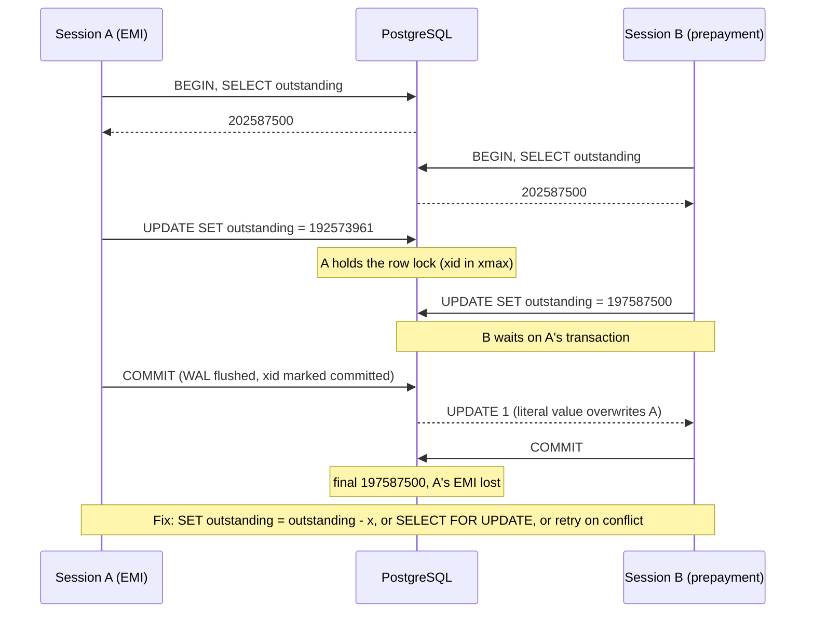

# Module 6.04: Transactions and ACID

**Estimated hours:** 4

**What you will learn**

1. What a transaction is, the four ACID promises with a banking failure story for each, and how `BEGIN`, `COMMIT`, `ROLLBACK`, `SAVEPOINT` and `psql`'s autocommit behave.
2. How to prove atomicity and durability on your own machine: kill a client in the middle of a transaction, kill the server right after `COMMIT`, and watch PostgreSQL roll back or recover.
3. How the lost-update problem happens between two sessions, three ways to prevent it, and the rules for scoping transactions in an application server, all built around the loan disbursement transaction.

**Prerequisites:** [Module 6.03: Data modelling and normalisation](module-03-data-modelling-and-normalisation.md), with `lending_schema.sql` and `lending_seed.sql` loaded. You also need data races from module 4.02 and timeouts from module 5.10.

---

## 1. One-line intuition

A transaction is a group of changes the database treats as one: all of them happen or none do, the result obeys the rules, concurrent groups do not trample each other, and once the database says "committed" the changes survive a crash.

## 2. Real-life analogy

Picture the disbursement desk at a branch.

- To disburse a loan, the officer fills in a **four-part voucher**: stamp the application "DISBURSED", open the loan account, attach the repayment schedule, and write a line in the audit register.
- The voucher counts for nothing until the manager **signs at the bottom**. That signature is `COMMIT`.
- If the officer is called away and the half-filled voucher is torn up, none of the four parts happened. That is `ROLLBACK`. There is no such thing as a voucher with two parts done.
- Signed vouchers go straight into a **fireproof safe**. A fire the next minute does not undo a signed voucher. That is **durability**.
- Two officers cannot write on the same ledger line at the same moment. The second one **waits** until the first has signed or torn up the voucher. That is **isolation**, enforced by locks.
- A **pencil mark** the officer can rub out without tearing up the whole voucher is a `SAVEPOINT`.

## 3. Why it exists: the problem it solves

In Phase 4 you saw what happens when two threads change shared memory without a lock: lost updates and torn values. A database has the same problem across many processes and machines, plus two more: the power can fail between any two writes, and a client can vanish mid-request. Disbursing a loan touches four tables. Without transactions, every one of these happens eventually:

| Failure | What goes wrong without a transaction |
|---|---|
| The app server crashes after marking the application DISBURSED but before inserting the loan | The application says the money went out; there is no loan to collect on |
| Two clerks post repayments to the same loan at the same moment | One payment silently disappears from the outstanding balance |
| The database server loses power just after telling the branch "disbursed" | On restart the loan is gone, but the customer already has the money |
| A batch job fails at row 6,000 of 10,000 | Half the book is changed, and nobody knows which half |

Each application could write its own recovery and locking code. Every one would get it subtly wrong. A transaction moves that responsibility into the database, which has one carefully tested implementation of it: the write-ahead log (module 6.06), MVCC (6.07) and locks (6.08).

## 4. Three layers of depth

### Layer 1 (beginner): BEGIN, COMMIT, ROLLBACK and the four promises

A **transaction** starts with `BEGIN` and ends with `COMMIT` (make it permanent) or `ROLLBACK` (throw it away). Everything between is invisible to other sessions until `COMMIT`.

```sql
BEGIN;
UPDATE products SET base_rate_bp = 9999 WHERE product_code = 'HL01';
SELECT product_code, base_rate_bp FROM products WHERE product_code = 'HL01';
ROLLBACK;
SELECT product_code, base_rate_bp FROM products WHERE product_code = 'HL01';
```

```text
BEGIN
UPDATE 1
 product_code | base_rate_bp
--------------+--------------
 HL01         |         9999
(1 row)

ROLLBACK
 product_code | base_rate_bp
--------------+--------------
 HL01         |          850
(1 row)
```

Inside the transaction you see your own change; after `ROLLBACK` it never happened.

**Autocommit.** If you do not type `BEGIN`, every statement is its own transaction, committed as soon as it finishes. That is `psql`'s default, and most client libraries' default too. It is why a single `UPDATE` is always all-or-nothing even without `BEGIN`, and why a loop of single statements (module 6.02) is not.

**The prompt tells you where you are.** `lending=#` means no transaction is open. After `BEGIN` it becomes `lending=*#`. If a statement inside the transaction fails, it becomes `lending=!#`: the transaction is **aborted**, and the database refuses everything until you end it.

```sql
BEGIN;
UPDATE loans SET outstanding_paise = outstanding_paise - 100 WHERE loan_id = 20001;
SELECT 1 / 0;
SELECT outstanding_paise FROM loans WHERE loan_id = 20001;
COMMIT;
```

```text
BEGIN
UPDATE 1
ERROR:  division by zero
ERROR:  current transaction is aborted, commands ignored until end of transaction block
ROLLBACK
```

Read the last line carefully: you typed `COMMIT` and the server answered `ROLLBACK`. Once any statement fails, the only possible outcome is a rollback; the `UPDATE` is gone too. Application code that ignores the command tag of `COMMIT` can believe it saved something it did not.

**SAVEPOINT** marks a point inside a transaction you can roll back to without losing everything:

```sql
BEGIN;
INSERT INTO audit_log (branch_code, user_code, action, entity, entity_id)
VALUES ('MUM01', 'U01', 'BULK_REMINDER', 'loan', 20002);
SAVEPOINT before_reminder;
INSERT INTO audit_log (branch_code, user_code, action, entity, entity_id)
VALUES ('MUM01', 'U01', NULL, 'loan', 20003);
ROLLBACK TO SAVEPOINT before_reminder;
INSERT INTO audit_log (branch_code, user_code, action, entity, entity_id)
VALUES ('MUM01', 'U01', 'BULK_REMINDER', 'loan', 20004);
COMMIT;
SELECT audit_id, action, entity_id FROM audit_log ORDER BY audit_id;
```

```text
BEGIN
INSERT 0 1
SAVEPOINT
ERROR:  null value in column "action" of relation "audit_log" violates not-null constraint
DETAIL:  Failing row contains (2, 2026-10-19 04:54:42.142283+00, MUM01, U01, null, loan, 20003, null).
ROLLBACK
INSERT 0 1
COMMIT
 audit_id | action        | entity_id
----------+---------------+-----------
        1 | BULK_REMINDER |     20002
        3 | BULK_REMINDER |     20004
(2 rows)
```

The failed insert was undone, the first and third survived. Notice `audit_id` jumps from 1 to 3: the failed row had already taken id 2 from the sequence behind `bigserial`, and sequences are never rolled back (Layer 2 explains why). `psql` prints `ROLLBACK` for `ROLLBACK TO SAVEPOINT`. (Your timestamp in the `DETAIL` line will differ. If you ran this on a fresh seed, `audit_log` was empty, which is why the ids start at 1.)

**ACID: the four promises, each with the failure it prevents.**

| Letter | Promise | Failure story it prevents |
|---|---|---|
| **A**tomicity | All statements of a transaction take effect, or none do | The app server crashes between "mark DISBURSED" and "insert loan"; without atomicity the application is disbursed with no loan |
| **C**onsistency | A transaction moves the database from one valid state to another: every constraint holds at commit | A loan pointing at a non-existent application is refused, so the book never contains orphans. (Rules the database does not know about, like "outstanding never exceeds principal", remain the application's job unless you declare them as constraints) |
| **I**solation | Concurrent transactions do not see each other's half-done work, and behave as if run in some order (how strictly depends on the isolation level) | Two clerks post repayments to the same loan at once and one payment vanishes: the lost update, Layer 2 |
| **D**urability | Once `COMMIT` returns, the change survives a crash or power loss | The server dies one second after telling the branch "disbursed"; on restart the loan is still there |

### Layer 2 (working engineer): what each promise means in practice

**Atomicity when the client dies.** If a client disconnects with a transaction open (crash, killed process, network cut), the backend notices the closed socket and rolls the transaction back. The server log says so:

```text
LOG:  unexpected EOF on client connection with an open transaction
```

Until the backend notices, the transaction stays open, holding its locks. A client that hangs (rather than dies) with a transaction open is worse: the server sees a live connection in state `idle in transaction` and waits forever, unless `idle_in_transaction_session_timeout` is set. The lab shows both.

**Durability is a promise about `COMMIT` returning.** When `COMMIT` returns, PostgreSQL has written a commit record to the write-ahead log and flushed it to disk. The table pages themselves may still be only in memory; after a crash, recovery replays the log (Layer 3). The setting `synchronous_commit = off` makes `COMMIT` return before the flush: much faster for many small transactions, at the price that a crash can lose the last few hundred milliseconds of "committed" transactions (never corrupting anything, just losing them). It is never acceptable for a disbursement and is sometimes acceptable for, say, a click-stream log.

**Some things are deliberately not transactional.**

- `now()` (and `current_timestamp`) is the start time of the transaction, the same for every statement in it, so all rows of one disbursement get the same timestamp. `clock_timestamp()` is the real wall clock.
- **Sequences** never roll back. If they did, a second transaction waiting for the first to decide would serialise every insert in the system. The price is gaps:

```sql
BEGIN;
SELECT nextval('loan_id_seq');
ROLLBACK;
SELECT nextval('loan_id_seq');
```

```text
BEGIN
 nextval
---------
   20121
(1 row)

ROLLBACK
 nextval
---------
   20122
(1 row)
```

Loan number 20121 will never exist. If a regulator requires gap-free numbering (some invoice and voucher series do), you need a counter row updated inside the transaction, which serialises all transactions that take a number; that is a deliberate, measured choice, not a default.

- **DDL is transactional in PostgreSQL**: `BEGIN; DROP TABLE repayments; ROLLBACK;` leaves the table and its 360 rows intact. Oracle and MySQL commit DDL implicitly (module 6.15).

**The lost-update problem.** Two clerks post to loan 20001 (outstanding 202,587,500 paise) at the same time: A posts an EMI of 10,013,539, B a prepayment of 5,000,000. Each does what naive application code does: read the balance, subtract in the application, write the result back.

| Step | Session A | Session B | What happens |
|---|---|---|---|
| 1 | `BEGIN; SELECT outstanding_paise FROM loans WHERE loan_id = 20001;` | | A reads 202587500 |
| 2 | | `BEGIN; SELECT outstanding_paise FROM loans WHERE loan_id = 20001;` | B also reads 202587500 (A has changed nothing yet) |
| 3 | `UPDATE loans SET outstanding_paise = 192573961 WHERE loan_id = 20001;` | | A writes 202587500 - 10013539; A now holds the row lock |
| 4 | | `UPDATE loans SET outstanding_paise = 197587500 WHERE loan_id = 20001;` | B **blocks**: no output, no prompt. It is waiting for A's row lock |
| 5 | `COMMIT;` | | A commits. B's UPDATE wakes up and prints `UPDATE 1` |
| 6 | | `COMMIT;` | B's value overwrites A's |

The balance ends at 197,587,500. The correct answer is 202,587,500 - 10,013,539 - 5,000,000 = 187,573,961. A's EMI of Rs 1,00,135.39 is gone, and no error was raised anywhere. The database did exactly what it was told: B told it to write the literal number 197587500. The lock in step 4 did not help, because B's arithmetic was done in the application, on a stale read from step 2.

Three ways to prevent it, from simplest to most general:

1. **Let the database do the arithmetic.** `UPDATE loans SET outstanding_paise = outstanding_paise - 5000000 WHERE loan_id = 20001;`. In step 4 B still waits for A's lock, but when it wakes up, PostgreSQL re-reads the newest committed version of the row and applies `- 5000000` to it. Result: 187573961. This is the default fix whenever the change can be expressed relative to the current value.
2. **Lock the row when you read it.** `SELECT outstanding_paise FROM loans WHERE loan_id = 20001 FOR UPDATE;`. Now B blocks at step 2, not step 4, and when A commits, B's `SELECT` returns the new value 192573961, so B's arithmetic is right. Use this when the application must read, decide, then write (for example "reject the payment if it exceeds the balance").
3. **Detect the conflict and retry.** Either compare-and-set (`UPDATE ... SET outstanding_paise = 197587500 WHERE loan_id = 20001 AND outstanding_paise = 202587500` returns `UPDATE 0` if someone else got there first, and the application re-reads and retries), or run the transaction at a stricter isolation level: with `BEGIN ISOLATION LEVEL REPEATABLE READ`, B's step 4 fails with `ERROR:  could not serialize access due to concurrent update` once A commits, and the application retries the whole transaction. Module 6.08 covers isolation levels and `SERIALIZABLE`.

**Transaction scope rules for an application server.** These are the rules the capstone C2 server follows. Each one exists because breaking it caused an incident somewhere.

1. **One request, at most one short transaction.** Parse input, validate, read master data (from the cache, module 4.13), and only then `BEGIN`, do the writes, `COMMIT`. Typical target: milliseconds.
2. **Never hold a transaction open across a network call** to anything slow or unreliable: the branch client (waiting for a clerk to click "confirm"), a credit bureau, an SMS gateway. While it is open, its row locks block every other request touching those rows, it pins a pooled connection (module 6.12), and it holds back VACUUM's cleanup horizon (module 6.07). A clerk who goes to lunch with a confirmation dialog open must not freeze a loan for an hour.
3. **Put the expected state in the WHERE clause** (`... AND status = 'APPROVED'`) and check the row count. That makes a retried request harmless: the second attempt matches nothing.
4. **Retry on purpose.** Serialization failures (SQLSTATE `40001`) and deadlocks (`40P01`) are normal at stricter isolation; retry the whole transaction a few times with a short backoff. If the connection drops during `COMMIT`, the outcome is unknown: check by business key (is the application DISBURSED?) before retrying.
5. **Set safety nets on the application's database role**: `idle_in_transaction_session_timeout` (for example 30 s) and `statement_timeout`, so a hung client cannot hold locks forever.
6. **Make "commit or roll back" automatic in code.** In C++ that is RAII (module 2.05): a transaction guard object whose destructor rolls back unless `commit()` was called, so an exception can never leak an open transaction.

### Layer 3 (internals): how PostgreSQL keeps the promises

- **Transaction IDs.** Each transaction that writes gets a 32-bit **transaction id (xid)**, assigned lazily at its first write: `BEGIN; SELECT pg_current_xact_id_if_assigned();` returns NULL until you change something. Every row version stores the xid that created it (`xmin`) and the one that deleted or replaced it (`xmax`) in its header (module 6.05).
- **The commit log.** The directory `pg_xact` holds two status bits per xid: in progress, committed, aborted (or sub-committed, for savepoints). Whether a row version is visible to you is decided by looking up its `xmin` and `xmax` there (module 6.07).
- **What `COMMIT` does.** It writes a commit record to the write-ahead log (WAL), then **flushes the WAL to disk** (`fdatasync` by default on Linux) up to that record, then sets the xid's bits in `pg_xact` to committed, then releases locks and returns. The changed table pages are still only in shared buffers; the checkpointer writes them later. Durability comes entirely from the flushed WAL, which is sequential and small, rather than from writing scattered table pages. Module 6.06 goes byte by byte.
- **What `ROLLBACK` does.** Almost nothing: it marks the xid aborted in `pg_xact` and releases locks. The new row versions it wrote stay in the table, invisible to everyone because their `xmin` is aborted, until VACUUM removes them. There is no undo log to replay, which is why a rollback in PostgreSQL is instant no matter how much was changed, and why aborted transactions still leave bloat (module 6.07).
- **Crash recovery.** On restart after a crash, the startup process reads the WAL from the last checkpoint and replays every record onto the pages (redo). Transactions with a commit record in the flushed WAL are committed; any xid without one is treated as aborted. This is why `docker kill` after `COMMIT` loses nothing, and a kill before `COMMIT` leaves no trace. One honest caveat for the lab: `docker kill` kills processes, not the machine, so the operating system's page cache survives. It proves PostgreSQL's recovery logic, not your disk's honesty about flushes; a real power-loss test needs real power loss.
- **Row locks live in the row.** `UPDATE` and `SELECT ... FOR UPDATE` lock a row by writing the locker's xid into the row version's `xmax` (with flag bits saying it is only a lock). There is no in-memory table of row locks, so locking a million rows costs no lock memory. A session that finds a locked row waits on a lock on the **other transaction's xid**, which is released when that transaction ends. That is the wait you see in step 4 of the lost-update table.
- **Why the relative UPDATE is correct.** In the default `READ COMMITTED` level, when an UPDATE has waited for another transaction that then commits a change to the same row, PostgreSQL follows the row to its newest version, re-checks the `WHERE` clause against it, and evaluates the `SET` expressions on that newest version (this re-check is called EvalPlanQual). `outstanding_paise - 5000000` therefore sees A's result. A literal `197587500` has nothing to re-evaluate.

## 5. Architecture diagram



## 6. Code

The disbursement transaction: four writes, all or nothing. It uses `psql` variables: `-v app_id=10003` sets a variable, `:app_id` inserts its value, `:'branch_code'` inserts it as a quoted string, and `\gset` stores the columns of a query's single result row into variables named after the columns. Save as `disburse.sql`.

```sql
-- disburse.sql : disburse one APPROVED application. All four writes or none.
-- Run:  psql -h localhost -U postgres -d lending -v app_id=10003 -v officer=U03 -f disburse.sql
\set ON_ERROR_STOP on
BEGIN;

-- Step 1: flip the application. "AND status = 'APPROVED'" makes a second
-- attempt match zero rows, and \gset then stops the script (nothing commits).
UPDATE loan_applications
SET    status = 'DISBURSED'
WHERE  application_id = :app_id AND status = 'APPROVED'
RETURNING branch_code, customer_id, product_code, amount_paise, tenure_months
\gset

-- Step 2: the loan. The product's rate today is COPIED into the loan row.
INSERT INTO loans (loan_id, application_id, branch_code, customer_id, product_code,
                   principal_paise, outstanding_paise, rate_bp, tenure_months,
                   disbursed_at, status)
SELECT nextval('loan_id_seq'), :app_id, :'branch_code', :customer_id, :'product_code',
       :amount_paise, :amount_paise, p.base_rate_bp, :tenure_months, now(), 'ACTIVE'
FROM products p
WHERE p.product_code = :'product_code'
RETURNING loan_id, rate_bp
\gset

-- Step 3: the repayment schedule, one row per month.
-- EMI = P * r * (1+r)^n / ((1+r)^n - 1), r = monthly rate = rate_bp / 120000.
INSERT INTO repayments (repayment_id, loan_id, due_date, amount_paise, status)
SELECT nextval('repayment_id_seq'), :loan_id,
       (current_date + make_interval(months => k))::date,
       round(:amount_paise * m.r * power(1 + m.r, :tenure_months)
             / (power(1 + m.r, :tenure_months) - 1))::bigint,
       'DUE'
FROM generate_series(1, :tenure_months) AS k,
     (SELECT :rate_bp / 120000.0 AS r) AS m;

-- Step 4: the audit row.
INSERT INTO audit_log (branch_code, user_code, action, entity, entity_id, detail)
VALUES (:'branch_code', :'officer', 'DISBURSE', 'loan', :loan_id,
        jsonb_build_object('application_id', :app_id,
                           'principal_paise', :amount_paise,
                           'rate_bp', :rate_bp));
COMMIT;

SELECT l.loan_id, a.status AS app_status, l.principal_paise, l.rate_bp,
       count(r.*) AS installments, min(r.amount_paise) AS emi_paise
FROM loans l
JOIN loan_applications a ON a.application_id = l.application_id
JOIN repayments r        ON r.loan_id = l.loan_id
WHERE l.loan_id = :loan_id
GROUP BY l.loan_id, a.status, l.principal_paise, l.rate_bp;
```

Reload the seed so the numbers match, then disburse application 10003 (an APPROVED gold loan at BLR01; U03 is the branch manager):

```bash
cd ~/phase6
psql -h localhost -U postgres -d lending -q -f lending_seed.sql
psql -h localhost -U postgres -d lending -v app_id=10003 -v officer=U03 -f disburse.sql
```

Expected (`-q` keeps the seed quiet apart from its summary table):

```text
BEGIN
UPDATE 1
INSERT 0 1
INSERT 0 24
INSERT 0 1
COMMIT
 loan_id | app_status | principal_paise | rate_bp | installments | emi_paise
---------+------------+-----------------+---------+--------------+-----------
   20121 | DISBURSED  |        27950000 |     975 |           24 |   1286528
(1 row)
```

Rs 2,79,500 at 9.75% for 24 months is an EMI of Rs 12,865.28, and the schedule has 24 rows. The `INSERT 0 24` is one set-based statement creating the whole schedule (module 6.02). Due dates start one month from the day you run it.

Run the same command again:

```text
BEGIN
psql:disburse.sql:12: error: no rows returned for \gset
UPDATE 0
```

(The two lines after `BEGIN` may appear in either order.) The status guard matched nothing because 10003 is already DISBURSED, `\gset` raised an error, `ON_ERROR_STOP` ended `psql`, and the server rolled back the open transaction when the connection closed. No second loan. A retried request from a branch whose first response was lost is now harmless.

Now break step 3 on purpose. The schema has no `CHECK` on tenure (module 6.03), so an application with a zero tenure can exist, and the EMI formula then divides by zero:

```bash
psql -h localhost -U postgres -d lending -c "UPDATE loan_applications SET tenure_months = 0 WHERE application_id = 10013"
psql -h localhost -U postgres -d lending -v app_id=10013 -v officer=U03 -f disburse.sql
psql -h localhost -U postgres -d lending -c "SELECT application_id, status FROM loan_applications WHERE application_id = 10013" -c "SELECT count(*) AS loans_for_10013 FROM loans WHERE application_id = 10013"
```

Expected:

```text
UPDATE 1
BEGIN
UPDATE 1
INSERT 0 1
psql:disburse.sql:34: ERROR:  division by zero
 application_id |  status
----------------+----------
          10013 | APPROVED
(1 row)

 loans_for_10013
-----------------
               0
(1 row)
```

Steps 1 and 2 ran (`UPDATE 1`, `INSERT 0 1`), step 3 failed, and afterwards the application is still APPROVED and there is no loan: atomicity. The one trace left behind is a gap: loan id 20122 was taken by the failed attempt and will never be used. Put the tenure back with `UPDATE loan_applications SET tenure_months = 24 WHERE application_id = 10013;`.

## 7. Use case: core-banking loan-origination platform

In the application server of claim H4, disbursement is one RPC from the branch client. The first design did this:

1. `BEGIN`; mark the application DISBURSED and insert the loan.
2. Send the schedule back to the branch client and wait for the clerk to confirm it on screen.
3. On confirmation, insert the repayments and the audit row; `COMMIT`.

It passed every test. In production, clerks left confirmation dialogs open over lunch. Each open dialog held a transaction with row locks on an application and a new loan, so repayment postings and status queries for those rows queued behind it; pooled connections ran out (each waiting dialog pinned one); and when the branch's network dropped, the server only noticed after TCP timed out, so the locks stayed even longer.

**The decision it drove:** a disbursement is **one short database transaction with no network call inside it**. The clerk reviews a preview computed without any transaction; the "confirm" RPC then runs the four writes of `disburse.sql` in a single transaction of a few milliseconds, guarded by `status = 'APPROVED'`. If the response to the branch is lost and the branch retries, the guard turns the retry into "already disbursed, loan 20121" instead of a second loan. Database roles used by the app server got `idle_in_transaction_session_timeout` as a safety net, and the server's transaction guard object (RAII) guarantees a rollback on any exception path. The same pattern (short transaction, state guard, idempotent retry) became the template for every write RPC in capstone C2.

## 8. Lab

Reload the seed before you start: `psql -h localhost -U postgres -d lending -q -f lending_seed.sql`. Parts B to D need two terminals side by side, called T1 and T2.

### Part A: transaction behaviour (30 minutes)

1. Run the `BEGIN ... ROLLBACK` example from Layer 1. Watch the prompt change to `lending=*#`.
2. Run the division-by-zero example and watch the prompt become `lending=!#`. Type `SELECT 1;` while aborted and read the error. Confirm `COMMIT` answers `ROLLBACK`.
3. Run the savepoint example and explain the gap in `audit_id`.
4. Prove that `now()` is frozen inside a transaction:

```sql
BEGIN;
SELECT now() AS t0 \gset
SELECT pg_sleep(1);
SELECT now() = :'t0'::timestamptz AS now_unchanged,
       clock_timestamp() - :'t0'::timestamptz > interval '1 second' AS clock_moved;
COMMIT;
```

Expected: `now_unchanged` and `clock_moved` both `t`.
5. Turn autocommit off: `\set AUTOCOMMIT off`, then `UPDATE products SET base_rate_bp = 860 WHERE product_code = 'HL01';`. The prompt shows `*`: `psql` sent a hidden `BEGIN`. `ROLLBACK;`, then `\set AUTOCOMMIT on`, and confirm the rate is still 850. (Some tools default to autocommit off. A session left like that holds its locks until someone types `COMMIT`.)
6. `BEGIN; DROP TABLE repayments; ROLLBACK; SELECT count(*) FROM repayments;` returns 360.

### Part B: atomicity when the client dies (30 minutes)

1. In T1, open `psql -h localhost -U postgres -d lending` and type:

```sql
\! echo $PPID
BEGIN;
UPDATE repayments SET status = 'PAID', paid_at = now() WHERE repayment_id = 100003;
UPDATE loans SET outstanding_paise = outstanding_paise - 10013539 WHERE loan_id = 20001;
```

`\!` runs a shell command; `$PPID` is the shell's parent, which is your `psql`, so this prints the `psql` process id. Note it. Do not commit.
2. In T2, look at the open transaction:

```bash
psql -h localhost -U postgres -d lending -c "SELECT pid, state, left(query, 60) AS last_query FROM pg_stat_activity WHERE datname = 'lending' AND pid <> pg_backend_pid();"
```

Expected (the pid varies):

```text
  pid  |        state        |                          last_query
-------+---------------------+--------------------------------------------------------------
 11368 | idle in transaction | UPDATE loans SET outstanding_paise = outstanding_paise - 100
(1 row)
```

3. In T2, kill T1's `psql` as a crash would: `kill -9 <the pid from step 1>`. T1 prints `Killed`.
4. In T2, check both rows:

```bash
psql -h localhost -U postgres -d lending -c "SELECT r.status, r.paid_at, l.outstanding_paise FROM repayments r JOIN loans l USING (loan_id) WHERE r.repayment_id = 100003;"
docker logs pg16 2>&1 | tail -2
```

Expected: both changes are gone, and the server log explains why.

```text
 status | paid_at | outstanding_paise
--------+---------+-------------------
 DUE    |         |         202587500
(1 row)

... LOG:  unexpected EOF on client connection with an open transaction
```

5. Repeat steps 1 and 2, but this time do not kill anything: in T2 run `UPDATE loans SET outstanding_paise = outstanding_paise - 1 WHERE loan_id = 20001;`. It hangs, waiting for T1's lock. In T1 type `ROLLBACK;` and watch T2 finish. Now imagine T1 were a server thread waiting on a branch client: that is rule 2 of Layer 2. Put the balance back with `UPDATE loans SET outstanding_paise = 202587500 WHERE loan_id = 20001;`.

### Part C: durability when the server dies (30 minutes)

1. In T1, commit a change and note the time:

```sql
BEGIN;
UPDATE loans SET status = 'NPA' WHERE loan_id = 20002;
INSERT INTO audit_log (action, entity, entity_id) VALUES ('MARK_NPA', 'loan', 20002);
COMMIT;
```

2. Immediately, in T2: `docker kill pg16`. This sends SIGKILL to PostgreSQL's main process; every process in the container dies at once, with no shutdown and no checkpoint. `docker ps -a` shows `Exited (137)` (128 + signal 9).
3. `docker start pg16`, wait two seconds, then `docker logs pg16 2>&1 | tail -12`. Typical lines (timestamps, process ids and WAL positions differ):

```text
PostgreSQL Database directory appears to contain a database; Skipping initialization
...
LOG:  database system was interrupted; last known up at 2026-10-19 04:51:39 UTC
LOG:  database system was not properly shut down; automatic recovery in progress
LOG:  redo starts at 0/5277540
LOG:  invalid record length at 0/582EEE8: expected at least 24, got 0
LOG:  redo done at 0/582EEC0 system usage: CPU: user: 0.00 s, system: 0.09 s, elapsed: 0.10 s
LOG:  checkpoint starting: end-of-recovery immediate wait
LOG:  checkpoint complete: ...
LOG:  database system is ready to accept connections
```

Read them in order: the server knows it did not shut down cleanly, replays the WAL from the last checkpoint ("redo"), stops at the first empty record (the end of the log, which is what "invalid record length ... got 0" means here), writes a checkpoint, and opens for business.
4. Reconnect and check: `SELECT loan_id, status FROM loans WHERE loan_id = 20002;` shows `NPA`, and the `MARK_NPA` audit row is there. Both were in the WAL before `COMMIT` returned.
5. Repeat, but kill the server **before** `COMMIT` (type `BEGIN;` and the `UPDATE`, then `docker kill pg16` from T2). After restart the change is absent: recovery found no commit record for that xid.

### Part D: the lost update, its fixes, and disbursement (60 minutes)

1. Reproduce the lost update exactly as in the Layer 2 table, typing each step in the terminal shown. In step 4, confirm T2 hangs until T1 commits. Final balance: 197587500.
2. Reset (`UPDATE loans SET outstanding_paise = 202587500 WHERE loan_id = 20001;`) and repeat with fix 1: both sessions use `SET outstanding_paise = outstanding_paise - <amount>`, no prior SELECT needed. B's statement waits, then shows the right result if you add `RETURNING outstanding_paise`. Final balance: 187573961.
3. Reset and repeat with fix 2: both sessions read with `SELECT ... FOR UPDATE`. T2 now blocks at its SELECT, and when T1 commits, T2's SELECT returns 192573961. T2 writes 192573961 - 5000000 = 187573961.
4. Reset and repeat the original literal-value version, but start both transactions with `BEGIN ISOLATION LEVEL REPEATABLE READ;`. After T1 commits, T2's UPDATE fails:

```text
ERROR:  could not serialize access due to concurrent update
```

T2 must `ROLLBACK` and redo the whole read-compute-write. That is the retry loop of rule 4.
5. Run `disburse.sql` from section 6 for application 10003, run it again, then run the broken-tenure experiment. Then disburse application 10023 (also APPROVED) and query `audit_log` to see the `DISBURSE` rows with their `jsonb` detail.

### Journal

Copy [journal/TEMPLATE.md](../journal/TEMPLATE.md) to `journal/YYYY-MM-DD-transactions-acid.md`. Record: the prompt markers you saw; the `pg_stat_activity` row and server log line from Part B; the recovery log lines from Part C and what each means; the final balances for the lost update and each fix; the output of `disburse.sql` on first run, rerun and broken run; and the loan id gap you observed and why sequences behave that way.

## 9. Common mistakes and misconceptions

| Mistake | Why it is wrong | Bug it causes later |
|---|---|---|
| Read a value, compute in the app, write a literal back | Another session's change between read and write is overwritten | Lost repayments, wrong balances, no error anywhere |
| Ignoring the result of `COMMIT` | After an error inside the transaction, `COMMIT` actually rolls back | The app reports success for work that was discarded |
| Holding a transaction open across a network call | Locks, a pooled connection and the vacuum horizon are held for as long as the remote side takes | Request pile-ups and pool exhaustion when a branch link is slow |
| Assuming each statement in a loop is part of one unit | In autocommit, each statement commits alone | A failed batch leaves half its rows changed |
| Expecting sequence numbers to be gap-free | `nextval` is never rolled back | Audit queries "missing loan 20122" and false fraud alarms |
| Using `synchronous_commit = off` for money movement | A crash can lose recently "committed" transactions | A customer has the money, the bank has no loan |
| Retrying a request whose `COMMIT` outcome is unknown, blindly | The first attempt may have committed | Double disbursement; use a state guard or idempotency key |
| Believing `docker kill` proves disk durability | The OS page cache survives a process kill | False confidence about write caches on real hardware |

## 10. Resume link

- **Claim D, "MVCC and transactions, WAL".** You can now explain what `COMMIT` physically does (commit record, WAL flush, `pg_xact` bits), why `ROLLBACK` is instant, and how recovery replays the WAL, and you have watched each one happen.
- **Claim H4, "a multithreaded application server handling loan-origination requests over RPC-over-TCP against distributed SQL".** Use section 7: one short transaction per write RPC, no network calls inside it, state guards for idempotent retries, a timeout safety net, RAII rollback. Interviewers probe this with "what happens if the client times out after the server committed?" Answer: the client retries, the status guard matches nothing, and the server returns the existing loan id.
- **Claim H3, "data parity ... gating a zero-downtime cutover".** Atomic, durable commits on the target are what make a parity check meaningful: the migration engine's batch either fully exists in YugabyteDB or not at all, so a restart resumes from the last committed batch (claim H1).

Likely follow-up: "How did you prevent double-posting of repayments?" Answer with the lost-update table and fix 1 (relative updates) for balances, plus a unique constraint or status guard on the repayment row so the same installment cannot be marked paid twice.

## 11. Interview questions

**Q1 (easy). What does ACID stand for? Give one example per letter.**

<details>
<summary>Model answer</summary>

Atomicity: all of a transaction's changes happen or none do; a disbursement's four inserts and updates cannot half-happen. Consistency: each commit leaves every declared constraint satisfied; a loan cannot reference a non-existent application. Isolation: concurrent transactions do not see each other's uncommitted work and behave as if serialised to the degree the isolation level promises; two repayment postings do not overwrite each other when written correctly. Durability: once `COMMIT` returns, the change survives a crash, because the commit record has been flushed to the write-ahead log.

</details>

**Q2 (easy). What happens to an open transaction if the client process is killed?**

<details>
<summary>Model answer</summary>

The backend detects the closed connection the next time it reads from the socket, logs "unexpected EOF on client connection with an open transaction", and aborts the transaction, releasing its locks. Nothing it wrote becomes visible. If the client is hung rather than dead, the backend sits in `idle in transaction` holding locks until the client returns or `idle_in_transaction_session_timeout` ends the session.

</details>

**Q3 (medium). Explain the lost-update problem and three ways to prevent it.**

<details>
<summary>Model answer</summary>

Two transactions read the same value, each computes a new value in the application, and each writes it back; the second write overwrites the first, so one change is lost, with no error. Fixes: express the change relative to the current value in SQL (`SET balance = balance - x`), so that after waiting for the row lock the database re-evaluates against the newest version; lock the row at read time with `SELECT ... FOR UPDATE` so the second reader waits and then sees the updated value; or detect conflicts and retry, either with compare-and-set (`WHERE balance = old_value`, check the row count) or by running at `REPEATABLE READ` or `SERIALIZABLE`, where the second writer gets a serialization error and retries the whole transaction.

</details>

**Q4 (medium). Why do PostgreSQL sequences produce gaps, and what would you do if the business requires gap-free numbering?**

<details>
<summary>Model answer</summary>

`nextval` is deliberately non-transactional: once a value is handed out it is never returned, even if the transaction rolls back. If it were transactional, every transaction needing a number would have to wait for the previous one to commit or abort, serialising all inserts. So rollbacks, failed inserts and crashes leave gaps. For gap-free numbering, keep a counter row per series and increment it with `UPDATE counters SET last = last + 1 WHERE series = ... RETURNING last` inside the business transaction. The row lock makes allocation strictly sequential and rolled-back numbers are reused, at the cost that all transactions taking numbers in that series serialise on one row, so keep those transactions very short and use it only where regulation demands it.

</details>

**Q5 (hard). Walk through what PostgreSQL does from `COMMIT` to the response, and what happens if the server crashes just before or just after the WAL flush.**

<details>
<summary>Model answer</summary>

During the transaction, each change was applied to pages in shared buffers and described by WAL records in the WAL buffers, and the transaction's xid is stamped as `xmin` or `xmax` on the row versions it touched. At `COMMIT` the backend appends a commit record to the WAL and flushes the WAL to durable storage up to that record (with `synchronous_commit = on`), then marks the xid committed in `pg_xact`, releases its locks and replies. The dirty table pages are written later by the checkpointer or background writer. If the server crashes before the flush completes, recovery finds no commit record for the xid, treats it as aborted, and its row versions stay invisible; the client never got a success reply, so nothing was promised. If it crashes after the flush but before the reply reaches the client, recovery replays the WAL from the last checkpoint, including the commit, so the transaction is durable, but the client does not know; that is the "commit outcome unknown" case, which the application handles by checking the business state before retrying. With `synchronous_commit = off`, the reply can precede the flush, so a crash can lose transactions the client was told had committed, though the database remains consistent.

</details>

## 12. Revision

- A transaction (`BEGIN` ... `COMMIT`/`ROLLBACK`) is all-or-nothing; `psql` autocommits each statement otherwise; after any error the transaction is aborted and `COMMIT` returns `ROLLBACK`; savepoints undo part of a transaction; sequences and `now()` are deliberately not transactional.
- Atomicity: a dead client's transaction is rolled back; durability: `COMMIT` returns only after the commit record is flushed to the WAL, and crash recovery replays the WAL; rollback just marks the xid aborted.
- Lost update = read, compute in the app, write a literal; fix with relative `UPDATE`, `SELECT ... FOR UPDATE`, or conflict detection and retry; keep each request to one short transaction with no network calls inside, guarded by expected state so retries are harmless.

---

Previous: [Module 6.03: Data modelling and normalisation](module-03-data-modelling-and-normalisation.md) | Next: [Module 6.05: PostgreSQL storage: pages, tuples and the heap](module-05-postgresql-storage-pages-and-tuples.md)
