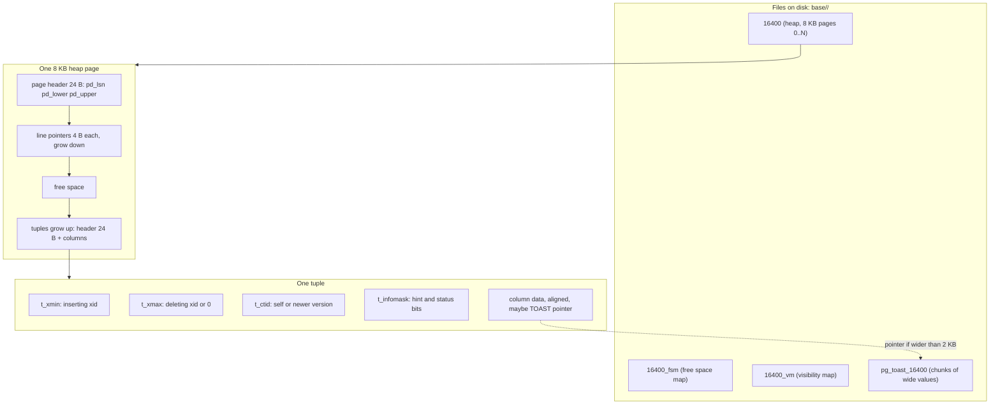

# Module 6.05: PostgreSQL storage: pages, tuples and the heap

**Estimated hours:** 5

**What you will learn**

1. Where a table physically lives: one or more files on disk, cut into 8 KB pages, each page holding row versions called tuples.
2. How to read a real page with the `pageinspect` extension: line pointers, tuple headers, `xmin`, `xmax`, `ctid`, and what changes after an UPDATE.
3. What happens to wide values (TOAST), why column order and alignment change the size of a table, and how to measure a table's size and waste.

**Prerequisites:** [Module 6.04: Transactions and ACID](module-04-transactions-and-acid.md). You also need the struct-padding ideas from module 1.07 and the file and page-cache ideas from modules 0.02 and 3.04.

---

## 1. One-line intuition

A PostgreSQL table is a plain file of 8 KB pages, and every row you have ever inserted or updated is a small byte record ("tuple") stuffed into one of those pages with a 24-byte header that says which transaction created it and which one deleted it.

## 2. Real-life analogy

Picture a loan ledger kept as a set of **ring binders**.

- **The binder** is the **table file** (the "heap"). A big table has several binders, each at most 1 GB.
- **Each page in the binder** is one **8 KB database page**. The page number is its **block number**, starting at 0.
- **The top margin of each page** is the **page header**: a few numbers saying how full the page is and when it was last changed.
- **A sticky index strip down the left edge** is the list of **line pointers**: entry 1 says "the first record on this page starts 40 lines from the bottom". New entries are added to the strip going down.
- **The records themselves** are written from the bottom of the page upwards. So the strip grows down, the records grow up, and the gap in the middle is the **free space**.
- Every record has a **stamp**: "written by clerk 741" and later maybe "cancelled by clerk 760". Those stamps are `xmin` and `xmax`, the transaction IDs that created and deleted the row version.
- A record's **address** is "page 3, strip entry 7". That is the `ctid`: `(3,7)`.
- If a document is too thick to fit on a page (a scanned ID proof, a long JSON blob), the clerk puts it in a **separate overflow binder** and leaves a small slip on the main page saying where it is. That overflow binder is **TOAST**.

When a clerk "updates" a record, the old one is not erased. It is stamped "cancelled by 760", and a fresh copy is written. The old copy stays until a cleaner (VACUUM, module 6.07) removes it.

## 3. Why it exists: the problem it solves

In module 6.04 you saw that `COMMIT` promises durability and that two transactions must not corrupt each other's writes. Those promises are kept by code, but the code has to put bytes somewhere, and the choice of layout decides everything that follows:

1. **Disk and memory move in blocks.** An SSD reads 4 KB at a time; the OS caches files in 4 KB pages. PostgreSQL reads and writes 8 KB pages so that one I/O moves many rows and the buffer pool (module 6.06) can cache them as units.
2. **Rows are not fixed size.** A customer name is 5 or 50 characters. The page therefore needs an index of where each row starts: the line pointers. That also lets a row move inside its page without changing its address.
3. **Readers and writers must not block each other.** PostgreSQL keeps old row versions next to the new ones so a reader that started earlier can keep seeing the old one. That is only possible because each tuple carries `xmin` and `xmax` in its header. Module 6.07 is entirely built on these two fields.

What breaks without this layout: without line pointers, every index entry would have to be rewritten whenever a row moved; without `xmin`/`xmax`, a writer would have to lock out every reader (which is exactly what older databases did); without TOAST, one 1 MB document would need 128 pages and every scan of the table would drag it through memory.

## 4. Three layers of depth

### Layer 1 (beginner): files, pages, tuples, ctid

**Where the table is.** Every table is a set of files under the data directory, in `base/<database oid>/<relfilenode>`. An **OID** is PostgreSQL's internal object number. The **relfilenode** is the number used for the file name; it usually equals the table's OID but changes after `TRUNCATE`, `VACUUM FULL` or `CLUSTER`, which write a new file. The function `pg_relation_filepath('loans')` shows the path. Files longer than 1 GB continue in `<relfilenode>.1`, `.2` and so on.

Beside the main file there are small side files called **forks**: `<relfilenode>_fsm` (free space map: which pages have room) and `<relfilenode>_vm` (visibility map: which pages have only visible rows, used by VACUUM and index-only scans).

**Pages.** The main file is a sequence of 8 KB (8192-byte) pages, numbered from 0. The number is the **block number**. `pg_relation_size('loans') / 8192` is the page count.

**Tuples.** A tuple is one row version: a header followed by the column values. A table with one row that has been updated three times holds four tuples until VACUUM cleans up. `SELECT` only shows the versions your transaction is allowed to see.

**ctid.** Every tuple has a physical address `(block number, line pointer number)`. You can read it with `SELECT ctid, * FROM loans`. The first row in the first page is `(0,1)`. A `ctid` is not stable: an UPDATE creates a new tuple at a new `ctid`. Never store it in your application.

**Why this matters to you now.** When an interviewer asks "what does an UPDATE actually do in PostgreSQL?", the answer begins here: it writes a new tuple and stamps the old one, it does not overwrite in place.

### Layer 2 (working engineer): page layout, tuple header, TOAST, sizes

**Page layout.** Here is one page. Numbers are byte offsets from the start of the page.

```text
offset 0     +--------------------------------------------------+
             | page header, 24 bytes                            |
             |   pd_lsn (8)  WAL position of last change        |
             |   pd_checksum (2)  pd_flags (2)                  |
             |   pd_lower (2)  end of line pointers             |
             |   pd_upper (2)  start of tuple data              |
             |   pd_special (2)  pd_pagesize_version (2)        |
             |   pd_prune_xid (4)                               |
offset 24    +--------------------------------------------------+
             | line pointer 1 (4 bytes): offset, flags, length  |
             | line pointer 2 (4 bytes)                         |
             | line pointer 3 (4 bytes)      grows DOWNWARDS    |
pd_lower --> +--------------------------------------------------+
             |                                                  |
             |                 free space                       |
             |                                                  |
pd_upper --> +--------------------------------------------------+
             | tuple 3: header (24) + data                      |
             | tuple 2: header (24) + data   grows UPWARDS      |
             | tuple 1: header (24) + data                      |
offset 8192  +--------------------------------------------------+
             (heap pages have no special space; pd_special = 8192)
```

A **line pointer** (also called an item pointer or `ItemId`) is 4 bytes: a 15-bit offset into the page, 2 bits of flags (normal, unused, redirect, dead) and a 15-bit length. Because row addresses go through the line pointer, a tuple can be moved inside the page (during cleanup) without changing its `ctid`.

Free space is `pd_upper - pd_lower`. A new tuple fits if its size plus 4 bytes for a new line pointer is at most that gap. With a 24-byte header and 4-byte pointer, the fixed overhead of every row is at least 28 bytes, so a table of tiny rows is mostly headers. A page can hold at most 291 tuples.

**Tuple header.** The 23-byte structure `HeapTupleHeaderData`, padded to 24:

| Field | Bytes | Meaning |
|---|---|---|
| `t_xmin` | 4 | Transaction ID (xid) that inserted this version |
| `t_xmax` | 4 | xid that deleted or updated it; 0 if still live. Also used for row locks (module 6.08) |
| `t_cid` / `t_xvac` | 4 | Command number inside the transaction (so a statement does not see its own inserts) |
| `t_ctid` | 6 | For a live tuple, its own address. For an updated tuple, the address of the newer version (a chain) |
| `t_infomask2` | 2 | Number of columns (low 11 bits) plus flags: `HEAP_HOT_UPDATED`, `HEAP_ONLY_TUPLE`, `HEAP_KEYS_UPDATED` |
| `t_infomask` | 2 | Flag bits: has nulls, has variable-width columns, has external (TOAST) values, `XMIN_COMMITTED`, `XMIN_INVALID`, `XMAX_COMMITTED`, `XMAX_INVALID`, `UPDATED`, lock bits |
| `t_hoff` | 1 | Offset to the start of the column data (24 with no nulls; larger if the null bitmap needs more space) |
| null bitmap | 0 or more | One bit per column, present only if some column is NULL |

The `XMIN_COMMITTED` and `XMAX_COMMITTED` bits are **hint bits**. They are not set by the inserting transaction (it does not know yet whether it will commit). The first reader that checks the commit log sets them, which is why a `SELECT` after a big load can write to pages.

**Column data and alignment.** Column values follow the header in table-column order, each aligned as the C compiler would align a struct member (module 1.07): `int4` on 4 bytes, `int8` and `timestamp` on 8, `bool` on 1, variable-length types (`text`, `numeric`, `jsonb`) on 4 (or unaligned when they use the 1-byte short header for values under 127 bytes). Padding bytes are wasted. `(bool, int8, bool, int8)` costs 32 bytes of data; the same columns ordered `(int8, int8, bool, bool)` cost 18, padded to 24. On a 100-million-row table that is gigabytes. The lab measures it.

**TOAST (The Oversized-Attribute Storage Technique).** A tuple must fit in a page, so PostgreSQL cannot store a 50 KB JSON document inline. The rule: when a tuple would be wider than about 2 KB (`TOAST_TUPLE_THRESHOLD`, 2000 bytes), the engine tries to shrink it below that target by, in order, compressing the widest variable-length columns and then moving them out of line into a hidden table `pg_toast.pg_toast_<table oid>`. Out-of-line values are cut into chunks of just under 2 KB (`chunk_id, chunk_seq, chunk_data`), with an index on `(chunk_id, chunk_seq)`. The main tuple keeps an 18-byte pointer. Each column has a storage strategy: `plain` (never toast), `main` (compress, move out only as a last resort), `external` (move out, do not compress), `extended` (compress then move out; the default for `text`, `jsonb`, `bytea`). Compression is `pglz` by default; `lz4` is faster if the server was built with it (`SET default_toast_compression = 'lz4'`). Reading a toasted column costs extra index lookups and page reads; a query that does not mention the column never touches TOAST at all.

**Fillfactor.** `CREATE TABLE ... WITH (fillfactor = 90)` tells inserts to leave 10% of each page empty. That space lets an UPDATE put the new version on the same page as the old one, which enables a **HOT update** (heap-only tuple: no index entries need to change). Module 6.07 covers HOT in full; for now remember that fillfactor trades disk space for cheaper updates.

**Measuring.**

| Function | Includes |
|---|---|
| `pg_relation_size('t')` | Main fork only (the heap pages) |
| `pg_table_size('t')` | Heap + TOAST + FSM + VM |
| `pg_indexes_size('t')` | All indexes of the table |
| `pg_total_relation_size('t')` | Everything above |
| `pg_size_pretty(bytes)` | Human-readable string |

The `pgstattuple` extension scans a table and reports live tuples, dead tuples and free space in bytes and percent. It is the honest way to answer "how bloated is this table?".

### Layer 3 (internals): what an INSERT and an UPDATE do to the page

**INSERT path.** `heap_insert` builds the tuple in memory: header, null bitmap if needed, aligned column data; if the tuple is wider than the TOAST threshold it runs the TOAST logic first. It asks the free space map for a page with enough room (or extends the file by one page), pins that page in the buffer pool and takes its content lock. It writes the tuple at `pd_upper - len`, adds a line pointer at `pd_lower`, sets `t_xmin` to the current xid, `t_xmax` to 0 with `XMAX_INVALID` set, and `t_ctid` to its own address. Then it writes a WAL record describing the change (module 6.06), stamps the page's `pd_lsn` with the WAL position, marks the buffer dirty and releases the lock. The page file on disk is **not** written now; the buffer pool writes it later.

**UPDATE path.** `heap_update` finds the current tuple version, checks that no other transaction has changed it since your snapshot (otherwise you wait on their row lock; module 6.08), and then:

1. Sets the old tuple's `t_xmax` to your xid and clears `XMAX_INVALID`.
2. Writes the new version as a new tuple, with `t_xmin` = your xid. If it fits in the same page and no indexed column changed, it is a HOT update: the old tuple's `t_ctid` points to the new one, the old gets `HEAP_HOT_UPDATED`, the new gets `HEAP_ONLY_TUPLE`, and no index is touched.
3. Otherwise the new tuple goes to another page and every index on the table gets a new entry pointing at it.

Nothing is overwritten. If your transaction rolls back, the old tuple's `t_xmax` still holds your xid, but the commit log says your xid aborted, so every reader ignores the `xmax` and the old version stays visible. The new tuple is garbage from birth. This is why rollback in PostgreSQL is instant and why module 6.07's VACUUM exists.

**Checksums and the LSN.** `pd_lsn` holds the write-ahead-log position of the last change to the page. Recovery (module 6.06) compares a page's LSN with a WAL record's LSN to decide whether to replay the record. `pd_checksum` is only maintained if the cluster was created with `--data-checksums` (the official Docker image does not, by default); it catches silent disk corruption on read.

## 5. Architecture diagram



## 6. Code

All four internals modules (6.05 to 6.08) use a small copy of the lending schema in its own database, so that every command here runs exactly as written. Save this as `storage_setup.sql`.

```sql
-- storage_setup.sql
-- A small, self-contained copy of the lending schema from module 6.03.
-- Run once:  psql -h localhost -U postgres -f storage_setup.sql
\set ON_ERROR_STOP on
DROP DATABASE IF EXISTS lending_internals;
CREATE DATABASE lending_internals;
\c lending_internals

CREATE EXTENSION IF NOT EXISTS pageinspect;   -- look inside pages
CREATE EXTENSION IF NOT EXISTS pgstattuple;   -- live/dead/free space report

CREATE TABLE branches (
    branch_id   int  PRIMARY KEY,
    branch_code text NOT NULL UNIQUE,
    name        text NOT NULL
);
CREATE TABLE customers (
    customer_id int  PRIMARY KEY,
    full_name   text NOT NULL,
    pan         text NOT NULL UNIQUE
);
CREATE TABLE products (
    product_id   int     PRIMARY KEY,
    product_code text    NOT NULL UNIQUE,
    name         text    NOT NULL,
    rate         numeric(5,2) NOT NULL
);
CREATE TABLE users (
    user_id   int  PRIMARY KEY,
    username  text NOT NULL UNIQUE,
    branch_id int  NOT NULL REFERENCES branches
);
CREATE TABLE loan_applications (
    application_id int  PRIMARY KEY,
    customer_id    int  NOT NULL REFERENCES customers,
    product_id     int  NOT NULL REFERENCES products,
    branch_id      int  NOT NULL REFERENCES branches,
    amount         numeric(14,2) NOT NULL,
    status         text NOT NULL DEFAULT 'NEW',
    details        jsonb                      -- the wide column (section 7)
);
CREATE TABLE loans (
    loan_id        int  PRIMARY KEY,
    application_id int  NOT NULL REFERENCES loan_applications,
    customer_id    int  NOT NULL REFERENCES customers,
    principal      numeric(14,2) NOT NULL,
    balance        numeric(14,2) NOT NULL,
    status         text NOT NULL DEFAULT 'ACTIVE'
);
CREATE TABLE repayments (
    repayment_id int  PRIMARY KEY,
    loan_id      int  NOT NULL REFERENCES loans,
    amount       numeric(14,2) NOT NULL,
    paid_on      date NOT NULL
);

INSERT INTO branches VALUES (1, 'MUM01', 'Mumbai Fort'), (2, 'DEL01', 'Delhi CP');
INSERT INTO customers VALUES (1, 'Asha Rao', 'ABCPR1234K'), (2, 'Vikram Shah', 'XYZPS5678L');
INSERT INTO products VALUES (1, 'PL', 'Personal loan', 12.50), (2, 'HL', 'Home loan', 8.75);
INSERT INTO users VALUES (1, 'asha.officer', 1), (2, 'vik.manager', 2);
INSERT INTO loan_applications (application_id, customer_id, product_id, branch_id, amount)
VALUES (101, 1, 1, 1, 250000), (102, 2, 2, 2, 4500000), (103, 1, 2, 1, 1200000);
INSERT INTO loans VALUES
    (1001, 101, 1,  250000,  250000, 'ACTIVE'),
    (1002, 102, 2, 4500000, 4500000, 'ACTIVE'),
    (1003, 103, 1, 1200000, 1200000, 'ACTIVE');
```

Now the script that looks inside a page. Save as `look_inside.sql`.

```sql
-- look_inside.sql
-- Shows: file path, page header, each tuple's header fields, and the
-- effect of one UPDATE on the same page.
-- Run:  psql -h localhost -U postgres -d lending_internals -f look_inside.sql
\c lending_internals
\echo '--- where the loans table lives on disk ---'
SELECT pg_relation_filepath('loans') AS file,
       pg_relation_size('loans')     AS bytes,
       pg_relation_size('loans') / 8192 AS pages;

\echo '--- the page header of block 0 ---'
SELECT lsn, lower, upper, special, pagesize, upper - lower AS free_bytes
FROM page_header(get_raw_page('loans', 0));

\echo '--- every tuple in block 0, before the update ---'
SELECT lp, lp_off, lp_len, t_xmin, t_xmax, t_ctid,
       to_hex(t_infomask) AS infomask, to_hex(t_infomask2) AS infomask2
FROM heap_page_items(get_raw_page('loans', 0));

\echo '--- update one row: balance only, no indexed column ---'
UPDATE loans SET balance = balance - 25000 WHERE loan_id = 1001;

\echo '--- the same page after the update ---'
SELECT lp, lp_off, lp_len, t_xmin, t_xmax, t_ctid,
       to_hex(t_infomask) AS infomask, to_hex(t_infomask2) AS infomask2
FROM heap_page_items(get_raw_page('loans', 0));

\echo '--- what SELECT shows (only the visible version) ---'
SELECT ctid, xmin, xmax, loan_id, balance FROM loans ORDER BY loan_id;
```

Run both:

```bash
psql -h localhost -U postgres -f storage_setup.sql
psql -h localhost -U postgres -d lending_internals -f look_inside.sql
```

Expected output of the second script (xids, the LSN, the file numbers and the exact `lp_off` values will differ on your machine; the shape will not):

```text
--- where the loans table lives on disk ---
      file       | bytes | pages
-----------------+-------+-------
 base/16388/16440 |  8192 |     1

--- the page header of block 0 ---
    lsn     | lower | upper | special | pagesize | free_bytes
------------+-------+-------+---------+----------+------------
 0/1A1D2F8  |    36 |  7976 |    8192 |     8192 |       7940

--- every tuple in block 0, before the update ---
 lp | lp_off | lp_len | t_xmin | t_xmax | t_ctid | infomask | infomask2
----+--------+--------+--------+--------+--------+----------+-----------
  1 |   8120 |     72 |    748 |      0 | (0,1)  | 802      | 6
  2 |   8048 |     72 |    748 |      0 | (0,2)  | 802      | 6
  3 |   7976 |     72 |    748 |      0 | (0,3)  | 802      | 6

--- update one row: balance only, no indexed column ---
UPDATE 1

--- the same page after the update ---
 lp | lp_off | lp_len | t_xmin | t_xmax | t_ctid | infomask | infomask2
----+--------+--------+--------+--------+--------+----------+-----------
  1 |   8120 |     72 |    748 |    749 | (0,4)  | 102      | 4006
  2 |   8048 |     72 |    748 |      0 | (0,2)  | 902      | 6
  3 |   7976 |     72 |    748 |      0 | (0,3)  | 902      | 6
  4 |   7904 |     72 |    749 |      0 | (0,4)  | 2802     | 8006

--- what SELECT shows (only the visible version) ---
 ctid  | xmin | xmax | loan_id |  balance
-------+------+------+---------+------------
 (0,4) |  749 |    0 |    1001 |  225000.00
 (0,2) |  748 |    0 |    1002 | 4500000.00
 (0,3) |  748 |    0 |    1003 | 1200000.00
```

Read the flags with the table in Layer 2. Before the update, `infomask = 0x0802` means `HEAP_XMAX_INVALID` (0x0800) plus `HEAP_HASVARWIDTH` (0x0002): no deleter, and the row has variable-width columns (`numeric`, `text`). `infomask2 = 6` is just the column count. After the update: tuple 1 has `t_xmax = 749` (the updating transaction), `t_ctid = (0,4)` pointing at the new version, and `infomask2 = 0x4006`, which is 6 columns plus `HEAP_HOT_UPDATED`. Tuple 4 is the new version: `t_xmin = 749`, `infomask` carries `HEAP_UPDATED` (0x2000), and `infomask2 = 0x8006` marks it `HEAP_ONLY_TUPLE`: this was a HOT update, so the primary key index still points at line pointer 1, and the engine follows the chain `(0,1) -> (0,4)`. Tuples 2 and 3 gained bit 0x0100, `HEAP_XMIN_COMMITTED`: the hint bit set by the first reader. `SELECT` shows only the three visible versions; tuple 1 is now a dead version waiting for VACUUM.

## 7. Use case: core-banking loan-origination platform

The `loan_applications` table in the real platform had a `details` column holding the full application form as a JSON document: addresses, employer, co-applicants, uploaded-document metadata. Typically 5 to 30 KB per application. Every value that size is toasted: compressed, cut into chunks, stored in `pg_toast.pg_toast_<oid>` and reached through the TOAST index.

Two hot-path queries ran thousands of times a day: "list the applications pending at my branch" (the work queue screen) and "get the status and amount of application X" (polled by the RPC server from claim H4). Neither needs `details`. But the original code did `SELECT *`. Every row fetched therefore cost: the heap page, plus one TOAST index descent, plus three to fifteen TOAST chunk pages, plus decompression. The work-queue query for a busy branch read hundreds of extra pages per call and evicted useful pages from the buffer pool (module 6.06).

The decision it drove: **the hot-path queries name their columns and never touch `details`**, so the TOAST table is simply never read on those paths; and the three fields the work queue filters on (`status`, `branch_id`, `amount`) stay as real columns, not keys inside the JSON. A second decision followed: `details` was set to `STORAGE EXTERNAL` for a while to skip compression, because the documents were already gzip-compressed by the client, and compressing compressed data burns CPU for nothing. The measurement the team kept: pages read per work-queue call before and after, from `EXPLAIN (ANALYZE, BUFFERS)` (module 6.10). You will create and measure the same situation in the lab.

## 8. Lab

All parts use the `lending_internals` database from section 6. Keep one terminal open with `psql -h localhost -U postgres -d lending_internals`.

### Part A: find the file and watch it grow (20 minutes)

1. Run `SELECT pg_relation_filepath('loans');` and note the path.
2. Open a shell inside the container and look at the file:

```bash
docker exec -it pg16 bash
ls -l /var/lib/postgresql/data/base/<db oid>/<relfilenode>*
```

Expected: a file of exactly 8192 bytes. (The `_fsm` and `_vm` forks may not exist yet; they appear after the first VACUUM.)

3. Back in psql, add 1,000 loans and check again:

```sql
INSERT INTO loans
SELECT 2000 + g, 101, 1, 100000, 100000, 'ACTIVE' FROM generate_series(1, 1000) AS g;
SELECT pg_relation_size('loans') / 8192 AS pages,
       pg_size_pretty(pg_relation_size('loans')) AS heap,
       pg_size_pretty(pg_total_relation_size('loans')) AS total_with_indexes;
```

Expected: about 10 pages (1,003 tuples of roughly 72 bytes plus 4-byte pointers, around 105 per page), and the total is larger than the heap because the primary key index now holds 1,003 entries. Run `ls -l` in the container again: the file is `pages * 8192` bytes.

4. Check `SELECT ctid, loan_id FROM loans ORDER BY ctid DESC LIMIT 3;`. The last rows are on the last page, with line pointer numbers that count the tuples on that page.

### Part B: alignment padding costs real bytes (25 minutes)

```sql
CREATE TABLE pad_bad  (a bool, b bigint, c bool, d bigint);
CREATE TABLE pad_good (b bigint, d bigint, a bool, c bool);
INSERT INTO pad_bad  SELECT true, g, false, g FROM generate_series(1, 100000) g;
INSERT INTO pad_good SELECT g, g, true, false FROM generate_series(1, 100000) g;
SELECT 'bad'  AS layout, pg_size_pretty(pg_relation_size('pad_bad'))
UNION ALL
SELECT 'good', pg_size_pretty(pg_relation_size('pad_good'));
SELECT lp_len FROM heap_page_items(get_raw_page('pad_bad', 0))  LIMIT 1;
SELECT lp_len FROM heap_page_items(get_raw_page('pad_good', 0)) LIMIT 1;
```

Expected: `pad_bad` tuples are 56 bytes (24 header + 1 + 7 padding + 8 + 1 + 7 padding + 8) and `pad_good` tuples are 48 bytes (24 + 8 + 8 + 1 + 1, padded to a multiple of 8). The bad table should be roughly 15% bigger: on the order of 5.8 MB versus 5.0 MB. Work out the expected page count by hand first (usable bytes per page are 8168; each tuple also needs a 4-byte line pointer) and compare. Record both sizes.

### Part C: TOAST in action (30 minutes)

1. Find the TOAST table and confirm it is empty:

```sql
SELECT reltoastrelid::regclass AS toast_table FROM pg_class WHERE relname = 'loan_applications';
SELECT count(*) FROM pg_toast.pg_toast_<oid>;   -- use the name printed above
```

2. Store a small document (stays inline) and a large random one (must go out of line):

```sql
UPDATE loan_applications SET details = jsonb_build_object('employer', 'Acme', 'city', 'Mumbai')
WHERE application_id = 101;
UPDATE loan_applications SET details = jsonb_build_object(
    'scan', (SELECT string_agg(md5(g::text || random()::text), '') FROM generate_series(1, 300) g))
WHERE application_id = 102;
SELECT application_id,
       pg_column_size(details)       AS stored_bytes,
       octet_length(details::text)   AS text_bytes
FROM loan_applications ORDER BY application_id;
SELECT chunk_id, chunk_seq, length(chunk_data) FROM pg_toast.pg_toast_<oid> ORDER BY 1, 2;
```

Expected: application 101 stores a few dozen bytes inline. Application 102's text is about 9,600 bytes of hex, which `pglz` can only shrink a little, so it is stored out of line in about five chunks of up to 1,996 bytes each. `pg_column_size` for 102 reports the compressed size, which is larger than 2 KB, which is exactly why it was moved out.

3. Prove that the hot path never reads TOAST. Turn on buffer counting and compare:

```sql
EXPLAIN (ANALYZE, BUFFERS) SELECT application_id, status, amount FROM loan_applications;
EXPLAIN (ANALYZE, BUFFERS) SELECT application_id, details FROM loan_applications;
```

Expected: the first query reports `Buffers: shared hit=1` (one heap page). The second reports more buffers, because fetching `details` also reads the TOAST index and chunk pages. (`EXPLAIN` is explained fully in module 6.10; for today just read the `Buffers` line.)

4. Change the strategy and watch the effect: `ALTER TABLE loan_applications ALTER COLUMN details SET STORAGE EXTERNAL;` then re-run the big UPDATE for 102 and the chunk query. Expected: the value is no longer compressed, so there are a few more chunks. `SET STORAGE` only affects values written afterwards.

### Part D: pgstattuple and free space (20 minutes)

```sql
SELECT * FROM pgstattuple('loans');
UPDATE loans SET balance = balance - 1 WHERE loan_id > 2000;
SELECT tuple_count, dead_tuple_count, dead_tuple_percent, free_space, free_percent
FROM pgstattuple('loans');
```

Expected: before the update, `dead_tuple_count` is small (the one from section 6). After updating 1,000 rows, roughly 1,000 dead tuples and the table has grown, because each page was already nearly full so most new versions went to new pages. Note the numbers; module 6.07 returns to this exact table and cleans it.

### Journal

Copy [journal/TEMPLATE.md](../journal/TEMPLATE.md) to `journal/YYYY-MM-DD-postgres-pages-tuples.md`. Record: the file path and size of `loans` before and after 1,000 inserts; the `lp_len` and table sizes for `pad_bad` and `pad_good` with your hand calculation; the chunk count for the toasted document and the `Buffers` lines from the two `EXPLAIN`s; the `pgstattuple` figures before and after the update.

## 9. Common mistakes and misconceptions

| Mistake | Why it is wrong | Bug it causes later |
|---|---|---|
| "UPDATE changes the row in place" | It writes a new tuple and stamps the old one with `xmax` | Surprise at table growth; not understanding why VACUUM is needed |
| Using `ctid` as a row identifier in the application | It changes on every UPDATE and after VACUUM FULL | Updates that silently hit nothing or the wrong row |
| `SELECT *` on tables with wide columns | Every row fetch also reads TOAST chunks and decompresses | Slow list screens, buffer pool full of JSON nobody asked for |
| Column order does not matter | Alignment padding is paid per row | 10-20% larger tables and indexes, more I/O for ever |
| `pg_relation_size` is the table's size | It is the heap only; TOAST and indexes are often bigger | Capacity plans that are wrong by 2-5x |
| A page is 4 KB like the OS page | PostgreSQL pages are 8 KB; an 8 KB write is two OS pages | Misunderstanding torn pages and full-page writes (module 6.06) |
| Hint bits mean "committed" was decided by the writer | The first reader sets them after checking the commit log | Confusion when a `SELECT` after a bulk load generates writes |

## 10. Resume link

- **Claim D, "storage engines".** This is the first module where you can describe one from the bytes up. In an interview say: "A PostgreSQL heap page is 8 KB with a 24-byte header, line pointers growing down and tuples growing up; each tuple carries xmin and xmax, so an update is an insert plus a stamp." Then offer the numbers from Part B.
- **Claim H2, "record-to-relational mapping layer: decoding packed key/record layouts".** Berkeley DB records (module 6.13) were packed C structs with the same alignment rules you measured in `pad_bad`. Being able to say "I know what padding costs in both the source record and the target tuple" is a specific, checkable claim.
- **Claim H4, "in-memory master-table cache that removes joins from the hot path".** Part C is the database-side half of the same idea: keep the hot path away from bytes it does not need. Mention TOAST and column selection when asked how you reduced database load.

Likely follow-up: "Why is PostgreSQL's update model more expensive than Oracle's?" Answer: because the old version stays in the table, not in a separate undo area, so the table bloats and VACUUM must clean it (6.07); the gain is that readers never block and rollback is free.

## 11. Interview questions

**Q1 (easy). What is a heap page in PostgreSQL and how big is it?**

<details>
<summary>Model answer</summary>

A heap page is the 8 KB unit in which a table file is stored and cached. It starts with a 24-byte header (`pd_lsn`, `pd_lower`, `pd_upper` and so on), followed by an array of 4-byte line pointers growing downwards and the tuples themselves growing upwards from the end of the page. The gap between `pd_lower` and `pd_upper` is free space. Heap pages have no special area; index pages do. Rows are addressed by `(block number, line pointer)`, the `ctid`.

</details>

**Q2 (easy). What are `xmin` and `xmax` on a tuple?**

<details>
<summary>Model answer</summary>

They are the transaction IDs stored in the tuple header. `xmin` is the transaction that inserted this row version; `xmax` is the transaction that deleted or updated it, or zero if none has. A reader compares them with its snapshot to decide whether the version is visible to it. `xmax` is also where row locks (`SELECT FOR UPDATE`) are recorded. They are the foundation of MVCC in PostgreSQL.

</details>

**Q3 (medium). What is TOAST, when does it kick in, and what does it cost at read time?**

<details>
<summary>Model answer</summary>

TOAST stores variable-length values that would make a tuple wider than about 2 KB. The engine first compresses the widest columns (pglz or lz4), and if the tuple is still too wide it moves them out of line into a hidden `pg_toast.pg_toast_<oid>` table in chunks of just under 2 KB, leaving an 18-byte pointer in the main tuple. Reading such a column costs a lookup in the TOAST index plus one page per chunk plus decompression. Queries that do not select the column never touch TOAST, which is why hot-path queries should name their columns rather than `SELECT *`. Storage strategies per column (`plain`, `main`, `external`, `extended`) tune whether to compress and whether to move out of line.

</details>

**Q4 (medium). Why does column order affect table size, and how would you check it?**

<details>
<summary>Model answer</summary>

Column values are laid out in declaration order with C-style alignment: 8-byte types on 8-byte boundaries, 4-byte on 4, and so on. A 1-byte `bool` followed by a `bigint` wastes 7 padding bytes; two such pairs waste 14 bytes per row on top of a 24-byte header. Ordering columns from widest alignment to narrowest minimises padding. I would check with `pageinspect`: `heap_page_items` shows `lp_len` per tuple, and `pg_relation_size` on two layouts of the same data shows the total difference, typically 10 to 20 percent for tables mixing small and large fixed-width columns.

</details>

**Q5 (hard). Walk through exactly what happens on the page when a transaction updates one column of one row and then rolls back.**

<details>
<summary>Model answer</summary>

The executor finds the current tuple version, say at `(0,1)`. `heap_update` checks that `xmax` is zero or belongs to an aborted transaction, otherwise it waits for the row lock. It sets the old tuple's `xmax` to the current xid, clears `XMAX_INVALID`, and builds the new version. If no indexed column changed and the page has room, it is a HOT update: the new tuple goes on the same page at `(0,4)`, the old tuple's `t_ctid` is set to `(0,4)` and flagged `HEAP_HOT_UPDATED`, the new one is flagged `HEAP_ONLY_TUPLE`, and no index is modified. A WAL record for the update is written and the page's `pd_lsn` is set; the buffer is marked dirty but not written to disk yet. On `ROLLBACK`, nothing on the page is touched: the transaction's status in the commit log is set to aborted. Any later reader sees that the old tuple's `xmax` belongs to an aborted transaction, treats the old version as live, and sees that the new tuple's `xmin` is aborted, so it is invisible. The first reader may set hint bits (`XMAX_INVALID` on the old tuple, `XMIN_INVALID` on the new) so later readers skip the commit-log check. The dead new tuple is reclaimed by HOT pruning or VACUUM. This is why rollback is O(1) in PostgreSQL and why aborted transactions still create bloat.

</details>

## 12. Revision

- A table is a file of 8 KB pages; each page has a 24-byte header, line pointers growing down, tuples growing up, and the gap is free space; a row's `ctid` is `(page, line pointer)`.
- Every tuple carries a 24-byte header with `xmin` (inserter), `xmax` (deleter or 0), `t_ctid` (next version) and flag bits; UPDATE writes a new tuple and stamps the old one, it never overwrites.
- Values that would make a tuple wider than about 2 KB are compressed and moved to the TOAST table in sub-2 KB chunks; column order changes padding; measure with `pg_total_relation_size`, `pageinspect` and `pgstattuple`.

---

Previous: [Module 6.04: Transactions and ACID](module-04-transactions-and-acid.md) | Next: [Module 6.06: Buffer pool and write-ahead log](module-06-buffer-pool-and-wal.md)
