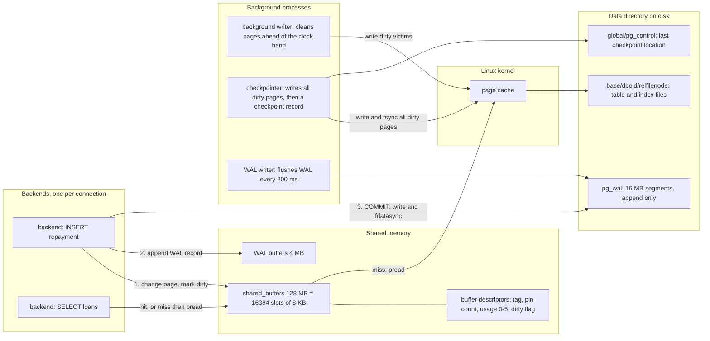

# Module 6.06: Buffer pool and write-ahead log

**Estimated hours:** 5

**What you will learn**

1. How PostgreSQL keeps 8 KB pages in memory (`shared_buffers`), how it chooses which page to throw out (clock sweep), and why the operating system's page cache sits underneath as a second cache.
2. What the write-ahead log (WAL) is, how to read real WAL records with `pg_waldump`, and why "committed" means exactly "the commit record reached the disk through an `fsync`".
3. How dirty pages, the background writer, checkpoints, full-page writes and crash recovery fit together, and which durability settings a bank may and may not change.

**Prerequisites:** [Module 6.05: PostgreSQL storage: pages, tuples and the heap](module-05-postgresql-storage-pages-and-tuples.md). You also need `fsync` and the kernel page cache from module 1.09, and the durability promise of `COMMIT` from module 6.04.

---

## 1. One-line intuition

PostgreSQL changes pages only in memory and writes a short, sequential diary entry (the WAL) for every change; the diary is forced to disk at each commit, the pages themselves are written lazily later, and after a crash the diary is replayed to rebuild whatever the pages missed.

## 2. Real-life analogy

A busy branch office with a strong-room of ledgers.

- **The strong-room** is the **data files on disk**. Every ledger (table) lives there, page by page. Walking to the strong-room is slow.
- **The counter desk** is **`shared_buffers`**, the buffer pool. Clerks bring the pages they are working on to the desk. The desk has a fixed number of slots (16,384 slots of 8 KB in a default install).
- **When the desk is full**, a supervisor walks round it with a pointer (the **clock hand**). Each page on the desk carries a few "recently used" ticks. Each time the pointer passes a page, it rubs out one tick. A page with no ticks left that nobody is holding goes back to the strong-room to make room. That walk is the **clock sweep**.
- **A desk page with pencil changes not yet copied into the strong-room** is a **dirty page**.
- **The day book** is the **write-ahead log**. Before a clerk changes a page on the desk, they write one line in the day book: "loans, page 0, row 2: locked by transaction 963". The day book is filled front to back and never rewritten. Writing in it is fast because you never search for the right page; you always write on the next line.
- **The counter rule:** the customer hears "your disbursement is done" only when the day-book line "transaction 963 committed" is in ink in the bound book. That ink is the `fsync`. The strong-room ledgers can be updated in the evening.
- **The evening clerk** is the **checkpointer**. Every so often it copies every dirty desk page back to the strong-room and then writes in the day book: "everything before this line is in the ledgers". A junior clerk (the **background writer**) quietly copies a few dirty pages back during the day so that counter clerks rarely have to stop and do it themselves.
- **A fire alarm** (power cut, `kill -9`) clears the desk. Next morning the supervisor opens the day book at the last "everything before this line" mark and redoes every line after it. That is **crash recovery**.

## 3. Why it exists: the problem it solves

Module 6.04 promised durability: once `COMMIT` returns, the change survives a crash. The obvious way to keep that promise is to write every changed data page to disk and `fsync` it before `COMMIT` returns. That is far too slow, for four reasons:

1. **The pages are scattered.** A disbursement changes a `loans` page, a `loan_applications` page, two or three index pages and an `audit_log` page: five random places in five files. Five random writes plus five `fsync`s per transaction would cap the server at a few hundred transactions per second on an SSD and a few dozen on a spinning disk.
2. **A page is 8 KB but a change is 50 bytes.** Writing 40 KB to record a 200-byte change wastes almost all of the I/O.
3. **Hot pages change constantly.** The page holding a branch's master row or the root of an index changes thousands of times a minute. Writing it after every change is pointless; writing it once every few minutes is enough.
4. **A crash can tear a page.** If the power fails halfway through writing an 8 KB page, the file can hold half old and half new bytes. Without protection, that page is garbage.

The write-ahead log solves all four. Only the small change descriptions are forced to disk, and they go into one sequential stream. The 8 KB pages are written lazily, once per checkpoint however many times they changed. And the log carries a full copy of a page the first time it changes after each checkpoint, so a torn page can be rebuilt.

What breaks without it: you lose either durability (pages in memory vanish in a crash) or performance (synchronous random page writes). That is why every serious engine has a log: PostgreSQL's WAL, Oracle's redo log, SQL Server's transaction log, MySQL InnoDB's redo log.

## 4. Three layers of depth

### Layer 1 (beginner): two caches and one log

**Buffer pool.** PostgreSQL never reads a row straight from disk into your query. It reads the whole 8 KB page into a slot in a shared memory area called **`shared_buffers`** (the **buffer pool**), and every backend process (PostgreSQL starts one process per connection) works on the page there. The default is 128 MB: 16,384 slots of 8 KB. All connections share the one pool.

**Hit and read.** If a query needs a page that is already in the pool, that is a **hit**: no I/O at all. If not, PostgreSQL asks the operating system for the page: a **read**. `EXPLAIN (ANALYZE, BUFFERS)` prints both counters, for example `Buffers: shared hit=12 read=1`.

**The OS page cache.** PostgreSQL uses ordinary buffered file reads (`pread`). So a "read" goes to the Linux kernel, which may already hold that part of the file in its own page cache (module 1.09) and answer from RAM in microseconds. Only when the kernel does not have it does the SSD do any work. Two caches are stacked: `shared_buffers` on top, the kernel page cache below. That is why the usual starting point for `shared_buffers` on a dedicated server is about 25% of RAM, not 90%: the rest feeds the OS cache and per-query memory.

**Dirty page.** When a transaction changes a row, it changes the page in the pool and marks the slot **dirty** (the memory copy now differs from the disk copy). The table file is **not** written at commit time.

**WAL.** Instead, every change is also described by a **WAL record** appended to the **write-ahead log**: a series of 16 MB files ("segments") in the `pg_wal` directory. Every record has a position called an **LSN** (log sequence number): a byte offset in the endless log, printed as two hex numbers such as `0/2667BB0`. `SELECT pg_current_wal_lsn();` shows the current position.

**Commit.** `COMMIT` appends a commit record and then calls `fdatasync` (the data-only form of `fsync`) on the WAL file, which returns only when the record is on stable storage. Only then does the client receive `COMMIT`. That one `fsync` is the durability promise.

**Checkpoint.** Every few minutes the **checkpointer** process writes all dirty pages to the table files, `fsync`s them, and records in the WAL that a checkpoint happened. WAL older than that point is no longer needed for crash recovery, so its segment files are recycled.

**Crash recovery.** After a crash, PostgreSQL reads the WAL from the last checkpoint onwards and re-applies every record. When it reaches the end, the table files contain every committed change, and the server opens for connections.

### Layer 2 (working engineer): writers, settings and trade-offs

**Who writes dirty pages to disk.** Three kinds of process. You want the first two to do nearly all of it.

| Writer | When | Where to see it in PostgreSQL 16 |
|---|---|---|
| Checkpointer | At each checkpoint, spread over time | `pg_stat_bgwriter.buffers_checkpoint`; log line `checkpoint complete: wrote N buffers` |
| Background writer | Every `bgwriter_delay` (200 ms), up to `bgwriter_lru_maxpages` (100) pages just ahead of the clock hand | `pg_stat_bgwriter.buffers_clean`, `maxwritten_clean` |
| The backend itself | When it needs a free slot and the chosen victim is dirty | `pg_stat_bgwriter.buffers_backend`; `pg_stat_io` rows for `client backend` |

A backend that must write somebody's dirty page before it can read its own adds that write to the user's query time. A high `buffers_backend` compared with the other two means the pool is too small or the background writer too timid. In PostgreSQL 17 the checkpointer columns moved to a new view, `pg_stat_checkpointer`, and `buffers_backend` was dropped in favour of `pg_stat_io` (which already exists in 16). On PostgreSQL 16, `pg_stat_bgwriter` is the view to read.

**What starts a checkpoint.** `checkpoint_timeout` (default 5 min) has passed; or the WAL written since the last checkpoint approaches `max_wal_size` (default 1 GB, a soft limit); or someone runs `CHECKPOINT`; or the server shuts down. `checkpoint_completion_target` (0.9) spreads the writes over 90% of the interval so that the disks do not see one big storm. If WAL volume forces checkpoints closer together than `checkpoint_warning` (30 s), the log says `checkpoints are occurring too frequently` and hints at raising `max_wal_size`.

The trade-off: longer intervals mean fewer page writes and fewer full-page images (next paragraph), but more WAL to replay after a crash, so a longer recovery. Typical production settings are a `checkpoint_timeout` of 15 to 30 minutes, with `max_wal_size` large enough that the timeout, not WAL volume, triggers most checkpoints.

**Full-page writes.** With `full_page_writes = on` (the default), the first change to a page after a checkpoint puts a complete image of the page into the WAL record (a **full-page image**, FPI; `pg_waldump` prints `FPW`). The reason is the torn page from section 3: the OS and the disk write in 4 KB or smaller units, so a crash can leave an 8 KB page half written. Recovery first restores the image, then replays later records onto it. The cost is a burst of WAL just after every checkpoint. The output in section 6 shows it: the same small insert produced 8,600 bytes of WAL the first time after a checkpoint and 256 bytes the second time. `wal_compression` (`pglz`, `lz4` or `zstd` since PostgreSQL 15) shrinks the images.

**WAL settings you must recognise.**

| Setting | Default | Meaning |
|---|---|---|
| `wal_level` | `replica` | How much detail goes into WAL; `replica` is enough for streaming replicas and point-in-time recovery (6.16) |
| `wal_buffers` | `-1` = 1/32 of `shared_buffers`, max 16 MB (4 MB here) | Shared memory holding WAL not yet written to the file |
| `wal_sync_method` | `fdatasync` on Linux | The system call that forces WAL to disk |
| `synchronous_commit` | `on` | Wait for the WAL flush before acknowledging `COMMIT` |
| `fsync` | `on` | Whether PostgreSQL ever forces anything to disk |
| `commit_delay` / `commit_siblings` | `0` / `5` | Optional short wait to batch more commits into one flush |
| `wal_writer_delay` | 200 ms | How often the WAL writer flushes in the background |

**`synchronous_commit = off` versus `fsync = off`.** They sound alike and are completely different.

- `synchronous_commit = off`: `COMMIT` returns before the commit record is flushed. The WAL writer flushes it shortly afterwards; the worst-case delay is three times `wal_writer_delay`, so up to about 600 ms by default. A crash in that window **loses** those transactions, but the database stays **consistent**: they simply never happened. It can be set per transaction with `SET LOCAL synchronous_commit = off`.
- `fsync = off`: PostgreSQL never forces anything to disk. A crash can leave the WAL and the data files disagreeing with each other: **corruption**, not just lost transactions. Only for throwaway test databases.

The other values, `local`, `remote_write` and `remote_apply`, decide how long a commit waits for a synchronous standby; they matter once you have replicas (6.16 and Phase 7).

**Group commit.** If 50 connections commit within the same millisecond, PostgreSQL does not perform 50 `fsync`s. The backend that gets the WAL write lock flushes everything inserted so far, which covers the other commit records too; the others then find their records already flushed and return. Throughput therefore rises with concurrency even when each `fsync` takes milliseconds. `commit_delay` (in microseconds) makes the flushing backend pause briefly to gather more commits, but only when at least `commit_siblings` other transactions are active. It is rarely needed.

**Why WAL is cheap and heap writes are not.** WAL is append-only: each commit writes the next few hundred bytes after the previous ones, into segment files that already exist (they are created ahead of time and recycled), followed by one `fdatasync`. The heap and index pages that the same transaction touched are scattered over several files. With WAL, those random writes happen later, in bulk, sorted by file and block by the checkpointer, and each page is written once per checkpoint no matter how many times it changed. On a spinning disk the difference is around 100 times. On an SSD it is still large, because the number of `fsync` calls per commit, not the number of bytes, sets the latency floor of every commit.

**Sizing the pool.** Changing `shared_buffers` needs a restart. A typical starting point is 25% of RAM on a dedicated server. Too small: hot pages keep being evicted and re-read from the OS cache, and backends end up writing dirty pages themselves. Too large: the OS cache shrinks, pages are cached twice, and each checkpoint has more dirty pages to flush. Measure a table's hit ratio from `pg_statio_user_tables` (`heap_blks_hit` against `heap_blks_read`), and use the `pg_buffercache` extension to see what actually occupies the pool.

**Big scans do not wipe the cache.** A sequential scan of a table larger than a quarter of `shared_buffers` reads through a private **ring** of 256 KB instead of the whole pool. `VACUUM` uses a ring sized by `vacuum_buffer_usage_limit` (new in 16, default 256 kB), and bulk writes such as `COPY` use a 16 MB ring. So a night-time report that scans all of `repayments` does not push the login path's master-table pages out of memory.

### Layer 3 (internals): descriptors, clock sweep, WAL records, recovery

**Buffer descriptors.** Next to the 16,384 page slots, shared memory holds one **buffer descriptor** per slot, padded to 64 bytes so that each sits in its own CPU cache line (module 4.08). It contains:

- the **buffer tag**: tablespace, database, relfilenode, fork number and block number, which is exactly "which page of which file is in this slot";
- one 32-bit atomic **state** word that packs the **pin count** (how many backends are using the page right now; a pinned page is never evicted), the **usage count** (0 to 5) and flag bits such as `DIRTY`, `VALID` and `IO_IN_PROGRESS`;
- a **content lock**, a lightweight reader-writer lock like the `shared_mutex` of module 4.05: shared to read tuples, exclusive to change them.

A hash table, the **buffer mapping table**, maps tag to slot. It is split into 128 partitions, each with its own lock, so lookups from many backends rarely collide.

**Reading a page.** To get block 0 of `loans`, a backend hashes the tag, takes that partition's lock in shared mode and looks it up. If found: pin it (atomically add 1 to the pin count and to the usage count, capped at 5), release the partition lock, take the content lock, read the tuples, release, unpin. If not found: choose a victim slot (next paragraph); if the victim is dirty, flush WAL up to the victim page's `pd_lsn` and write the page out; re-tag the slot under the partition locks; then `pread` the 8 KB from the table file into it.

**Clock sweep.** A shared counter, `nextVictimBuffer`, walks round all the slots. At each slot: if pinned, skip it; if its usage count is above 0, decrement it and move on; if the count is 0 and nobody has it pinned, that slot is the victim. A page used often keeps having its count pushed back up to 5 and survives five full sweeps without use; a page read once by a scan has a count of 1 and goes on the next pass. This approximates LRU (least recently used) without a linked list that every single access would have to lock. A free list exists too, but it only holds slots that were never used or were released by `DROP` or `TRUNCATE`; in a warm server the clock sweep does nearly all the work.

**The WAL rule.** Before a dirty data page may be written to its file, all WAL up to that page's `pd_lsn` must already be flushed. The buffer manager enforces this by calling `XLogFlush(pd_lsn)` inside the page-write path. This one rule is what "write-ahead" means: the description reaches disk before the change does.

**Inserting a WAL record.** A change such as the `heap_insert` from module 6.05 runs in a critical section: modify the page in its buffer, mark it dirty, build a WAL record, reserve space in the WAL buffers (several insertion locks let backends copy records in parallel), copy the record in, and stamp the page with the record's LSN in `pd_lsn`. Each record is a 24-byte header (`xl_tot_len`, `xl_xid`, `xl_prev` pointing at the previous record, `xl_info`, `xl_rmid` naming the **resource manager** such as Heap, Btree or Transaction, and a CRC-32C checksum), then **block references** (which page of which relation, optionally with a full-page image), then the record's own data (for an insert: the line pointer number and the new tuple bytes).

**Reading the `pg_waldump` lines in section 6.** Each line is one record:

- `rmgr: Heap ... desc: INSERT off: 2 ... blkref #0: rel 1663/16812/16994 blk 0 FPW` means the heap resource manager inserted a tuple at line pointer 2 of block 0 of relation `1663/16812/16994` (tablespace OID / database OID / relfilenode, the same numbers `pg_relation_filepath` prints), and attached a full-page image because this was the page's first change since the checkpoint.
- `Btree ... INSERT_LEAF off: 2` is the new key in `repayments_pkey`.
- `Heap ... LOCK xmax: 963 ... infobits: [LOCK_ONLY, KEYSHR_LOCK]` on the `loans` file, 8,183 bytes long, is the foreign-key check on `repayments.loan_id` locking the parent loan row in `FOR KEY SHARE` mode (module 6.08). Row locks live in the tuple header's `xmax` (module 6.05), so locking a row changes the page, so it must be WAL-logged; and because that `loans` page had not changed since the checkpoint, the record carries the whole page.
- `Transaction ... COMMIT` is the commit record. Its flush is the durability point.

**Durability is the commit record's `fsync`.** At commit, PostgreSQL inserts the commit record, calls `XLogFlush` up to its LSN (unless `synchronous_commit = off`), and then marks the transaction committed in the commit log, `pg_xact`, which keeps two status bits per transaction ID (module 6.07). The heap and index pages may still be dirty in memory. That is fine: the WAL can rebuild them.

**A checkpoint, step by step.** (1) Note the current WAL insert position; this is the **redo point**. (2) Write every buffer that was dirty at that moment, sorted by file and block, paced by `checkpoint_completion_target`. (3) `fsync` every data file that was written. (4) Write a checkpoint record into the WAL that contains the redo point. (5) Update the control file `global/pg_control` to point at that record; `pg_controldata` prints it as "Latest checkpoint location" and "Latest checkpoint's REDO location". (6) Remove or recycle WAL segments older than the redo point, unless replication slots, `wal_keep_size` or archiving still need them.

**Crash recovery.** The startup process reads `pg_control`, finds the last checkpoint record and its redo point, and replays every record from there. For each block reference it reads the page and compares the page's `pd_lsn` with the record's LSN. If the page already contains the change (`pd_lsn` is not older than the record), it skips it; otherwise it applies the change and advances `pd_lsn`. If the record carries a full-page image, it simply copies the image in, which also repairs a torn page. Replay stops at the first record that is missing or fails its CRC; the log then prints a line like `invalid record length at 0/26A16F8: expected at least 24, got 0`, which is the normal end of the WAL, not an error. Transactions with no commit record are treated as aborted: their tuples stay in the pages, but their transaction IDs are never marked committed, so MVCC (6.07) makes those tuples invisible. Finally an **end-of-recovery checkpoint** runs and the server accepts connections.

**ARIES in one paragraph.** ARIES (Mohan and colleagues at IBM, 1992) is the textbook recovery algorithm behind DB2, SQL Server and InnoDB. It allows **steal** (dirty pages of uncommitted transactions may be written to disk) and **no-force** (committed pages need not be written at commit), logs every change ahead of the page with an LSN stored on each page, and recovers in three passes: **analysis** (starting from the last checkpoint, work out which transactions were active and which pages may be dirty), **redo** ("repeat history": reapply every logged change, even those of unfinished transactions, wherever the page LSN is older than the record), and **undo** (roll back the unfinished transactions, logging compensation records so that a crash during undo is safe). PostgreSQL follows ARIES for WAL, page LSNs, steal, no-force and redo, but it has **no undo pass**. An aborted or unfinished transaction's new tuples are simply left in place and are invisible because its ID is not committed; VACUUM removes them later. That is why PostgreSQL recovery is "redo only" and why its rollback is instant.

## 5. Architecture diagram



The only synchronous disk write on the commit path is arrow 3, into the WAL. Everything that reaches the table files is written later by the background writer and the checkpointer (or, when things go badly, by a backend that needs a free slot).

## 6. Code

Modules 6.06, 6.07 and 6.08 all run against one database, `lending_internals`: the canonical lending schema from module 6.03 plus generated rows, so that every output below is reproducible on your machine. Save this as `internals_setup.sql`. It drops and rebuilds the database, so rerun it whenever you want a clean start.

```sql
-- internals_setup.sql
-- lending_internals = the canonical lending schema from module 6.03
-- plus 1,000 generated customers and applications and 900 loans.
-- Drops and rebuilds the database, so rerun it whenever you want a clean start.
-- Run:  psql -h localhost -U postgres -f internals_setup.sql
\set ON_ERROR_STOP on
DROP DATABASE IF EXISTS lending_internals;
CREATE DATABASE lending_internals;
\c lending_internals
CREATE EXTENSION pageinspect;     -- raw pages              (6.05)
CREATE EXTENSION pg_buffercache;  -- what is in the pool    (6.06)
CREATE EXTENSION pg_visibility;   -- visibility map         (6.07)
CREATE EXTENSION pgstattuple;     -- live/dead/free bytes   (6.05, 6.07)

CREATE TABLE branches (branch_code varchar(6) PRIMARY KEY, name text NOT NULL,
  city text NOT NULL, region text NOT NULL, opened_on date NOT NULL);
CREATE TABLE roles (role_id smallint PRIMARY KEY, role_name text NOT NULL UNIQUE);
CREATE TABLE users (branch_code varchar(6) NOT NULL REFERENCES branches,
  user_code varchar(10) NOT NULL, full_name text NOT NULL, password_hash text NOT NULL,
  role_id smallint NOT NULL REFERENCES roles, status char(1) NOT NULL DEFAULT 'A',
  last_login_at timestamptz, PRIMARY KEY (branch_code, user_code));
CREATE TABLE customers (customer_id bigint PRIMARY KEY,
  branch_code varchar(6) NOT NULL REFERENCES branches, full_name text NOT NULL,
  pan char(10) NOT NULL UNIQUE, dob date NOT NULL, kyc_status text NOT NULL,
  created_at timestamptz NOT NULL DEFAULT now());
CREATE TABLE products (product_code varchar(8) PRIMARY KEY, name text NOT NULL,
  min_amount_paise bigint NOT NULL, max_amount_paise bigint NOT NULL,
  max_tenure_months int NOT NULL, base_rate_bp int NOT NULL,
  active boolean NOT NULL DEFAULT true);
CREATE TABLE loan_applications (application_id bigint PRIMARY KEY,
  branch_code varchar(6) NOT NULL REFERENCES branches,
  customer_id bigint NOT NULL REFERENCES customers,
  product_code varchar(8) NOT NULL REFERENCES products,
  amount_paise bigint NOT NULL, tenure_months int NOT NULL, status text NOT NULL,
  created_by varchar(10) NOT NULL, created_at timestamptz NOT NULL DEFAULT now());
CREATE TABLE loans (loan_id bigint PRIMARY KEY,
  application_id bigint NOT NULL UNIQUE REFERENCES loan_applications,
  branch_code varchar(6) NOT NULL REFERENCES branches,
  customer_id bigint NOT NULL REFERENCES customers,
  product_code varchar(8) NOT NULL REFERENCES products,
  principal_paise bigint NOT NULL, outstanding_paise bigint NOT NULL,
  rate_bp int NOT NULL, tenure_months int NOT NULL, disbursed_at timestamptz,
  status text NOT NULL);
CREATE TABLE repayments (repayment_id bigint PRIMARY KEY,
  loan_id bigint NOT NULL REFERENCES loans, due_date date NOT NULL,
  amount_paise bigint NOT NULL, paid_at timestamptz, status text NOT NULL);
CREATE TABLE audit_log (audit_id bigserial PRIMARY KEY, at timestamptz NOT NULL DEFAULT now(),
  branch_code varchar(6), user_code varchar(10), action text NOT NULL,
  entity text NOT NULL, entity_id bigint, detail jsonb);

INSERT INTO branches VALUES
  ('MUM001', 'Mumbai Fort',           'Mumbai',    'West',  '2009-04-01'),
  ('DEL001', 'Delhi Connaught Place', 'New Delhi', 'North', '2011-07-15'),
  ('BLR001', 'Bengaluru MG Road',     'Bengaluru', 'South', '2014-01-10');
INSERT INTO roles VALUES (1, 'CLERK'), (2, 'CREDIT_OFFICER'), (3, 'BRANCH_MANAGER'), (4, 'AUDITOR');
INSERT INTO users (branch_code, user_code, full_name, password_hash, role_id) VALUES
  ('MUM001', 'U1001', 'Asha Rao',    'bcrypt-hash-placeholder', 2),
  ('MUM001', 'U1002', 'Kiran Desai', 'bcrypt-hash-placeholder', 3),
  ('DEL001', 'U2001', 'Vikram Shah', 'bcrypt-hash-placeholder', 2);
INSERT INTO products VALUES
  ('HL01', 'Home loan',     50000000, 1000000000, 360,  850, true),
  ('PL01', 'Personal loan',  5000000,  250000000,  60, 1150, true);

-- customer g lives at branch number (g mod 3)
INSERT INTO customers (customer_id, branch_code, full_name, pan, dob, kyc_status)
SELECT 5000 + g, (ARRAY['MUM001', 'DEL001', 'BLR001'])[1 + g % 3], 'Customer ' || g,
       'ABCDE' || lpad(g::text, 4, '0') || 'F', DATE '1980-01-01' + g * 7, 'VERIFIED'
FROM generate_series(1, 1000) AS g;

-- application 9000+g for customer 5000+g; every 4th is a home loan;
-- 9001..9900 are DISBURSED, 9901..10000 are still SUBMITTED
INSERT INTO loan_applications (application_id, branch_code, customer_id, product_code,
                               amount_paise, tenure_months, status, created_by)
SELECT 9000 + g, (ARRAY['MUM001', 'DEL001', 'BLR001'])[1 + g % 3], 5000 + g,
       CASE WHEN g % 4 = 0 THEN 'HL01' ELSE 'PL01' END,
       CASE WHEN g % 4 = 0 THEN 250000000 + (g % 10) * 10000000
                           ELSE   5000000 + (g % 50) *  1000000 END,
       CASE WHEN g % 4 = 0 THEN 240 ELSE 36 END,
       CASE WHEN g <= 900 THEN 'DISBURSED' ELSE 'SUBMITTED' END, 'U1001'
FROM generate_series(1, 1000) AS g;

-- loan 7000+g for each disbursed application 9000+g
INSERT INTO loans (loan_id, application_id, branch_code, customer_id, product_code,
                   principal_paise, outstanding_paise, rate_bp, tenure_months,
                   disbursed_at, status)
SELECT application_id - 2000, application_id, branch_code, customer_id, product_code,
       amount_paise, amount_paise, CASE WHEN product_code = 'HL01' THEN 850 ELSE 1150 END,
       tenure_months, now() - interval '30 days', 'ACTIVE'
FROM loan_applications WHERE status = 'DISBURSED';

ANALYZE;
SELECT (SELECT count(*) FROM customers) AS customers,
       (SELECT count(*) FROM loan_applications) AS applications,
       (SELECT count(*) FROM loans) AS loans;
```

The four extensions ship inside the official `postgres:16` image; `CREATE EXTENSION` only switches them on for this database. Rows you will meet again: loan 7001 is a personal loan (`PL01`) at `DEL001` with a principal of 6,000,000 paise (Rs 60,000); loan 7002 is at `BLR001` with 7,000,000 paise; every fourth loan is a home loan (`HL01`); applications 9901 to 10000 are still `SUBMITTED` (34 at `DEL001`, 33 each at the other two branches).

Now the script for this module. Save it as `buffer_wal.sql`.

```sql
-- buffer_wal.sql
-- Shows: cached pages, WAL bytes for an EMI insert right after a
-- checkpoint versus the same insert again, and the dirty pages left behind.
-- Run:  psql -h localhost -U postgres -d lending_internals -f buffer_wal.sql
\set ON_ERROR_STOP on
\echo '--- 1. loans pages sitting in shared_buffers ---'
SELECT count(*) AS loans_rows FROM loans;
SELECT c.relname, count(*) AS buffers,
       count(*) FILTER (WHERE b.isdirty) AS dirty,
       round(avg(b.usagecount), 1) AS avg_usage
FROM pg_buffercache b
JOIN pg_class c ON b.relfilenode = pg_relation_filenode(c.oid)
WHERE b.reldatabase = (SELECT oid FROM pg_database WHERE datname = current_database())
  AND b.relforknumber = 0                    -- main fork only
  AND c.relname IN ('loans', 'loans_pkey')
GROUP BY c.relname ORDER BY c.relname;

\echo '--- 2. warm-up: EMI 1 for loan 7002 ---'
INSERT INTO repayments VALUES (1, 7002, DATE '2026-11-05', 1658000, NULL, 'DUE');

\echo '--- 3. force a checkpoint: every dirty page goes to disk ---'
SELECT pg_walfile_name(pg_current_wal_lsn()) IS NOT NULL AS warm;  -- load functions now
CHECKPOINT;
SELECT pg_current_wal_lsn() AS lsn1,
       pg_walfile_name(pg_current_wal_lsn()) AS wal_file \gset

\echo '--- 4. EMI 2: first change to these pages since the checkpoint ---'
INSERT INTO repayments VALUES (2, 7002, DATE '2026-12-05', 1658000, NULL, 'DUE');
SELECT pg_current_wal_lsn() AS lsn2 \gset

\echo '--- 5. EMI 3: the same pages again ---'
INSERT INTO repayments VALUES (3, 7002, DATE '2027-01-05', 1658000, NULL, 'DUE');
SELECT pg_current_wal_lsn() AS lsn3 \gset

SELECT :'wal_file' AS wal_file, :'lsn1' AS from_lsn, :'lsn3' AS to_lsn,
       pg_wal_lsn_diff(:'lsn2', :'lsn1') AS emi2_wal_bytes,
       pg_wal_lsn_diff(:'lsn3', :'lsn2') AS emi3_wal_bytes;

\echo '--- 6. dirty pages waiting in the buffer pool ---'
SELECT c.relname, b.relblocknumber AS block, b.usagecount
FROM pg_buffercache b
JOIN pg_class c ON b.relfilenode = pg_relation_filenode(c.oid)
WHERE b.reldatabase = (SELECT oid FROM pg_database WHERE datname = current_database())
  AND b.isdirty
  AND c.relname IN ('loans', 'repayments', 'repayments_pkey')
ORDER BY 1, 2;
```

`\gset` stores a query's output columns in psql variables, and `:'name'` pastes a variable back in as a quoted string. Run both scripts (set `PGPASSWORD=postgres` in your shell first, or keep using the `~/.pgpass` file if you created one):

```bash
psql -h localhost -U postgres -f internals_setup.sql
psql -h localhost -U postgres -d lending_internals -f buffer_wal.sql
```

Expected tail of the first script:

```text
 customers | applications | loans
-----------+--------------+-------
      1000 |         1000 |   900
(1 row)
```

Expected output of the second (LSNs and the WAL file name will differ; the byte counts should match closely, and the `dirty` column in step 1 is 0 if a timed checkpoint ran between the two scripts):

```text
--- 1. loans pages sitting in shared_buffers ---
 loans_rows
------------
        900
(1 row)

  relname   | buffers | dirty | avg_usage
------------+---------+-------+-----------
 loans      |      12 |    12 |       5.0
 loans_pkey |       5 |     5 |       5.0
(2 rows)

--- 2. warm-up: EMI 1 for loan 7002 ---
INSERT 0 1
--- 3. force a checkpoint: every dirty page goes to disk ---
 warm
------
 t
(1 row)

CHECKPOINT
--- 4. EMI 2: first change to these pages since the checkpoint ---
INSERT 0 1
--- 5. EMI 3: the same pages again ---
INSERT 0 1
         wal_file         | from_lsn  |  to_lsn   | emi2_wal_bytes | emi3_wal_bytes
--------------------------+-----------+-----------+----------------+----------------
 000000010000000000000002 | 0/2667BB0 | 0/2669E48 |           8600 |            256
(1 row)

--- 6. dirty pages waiting in the buffer pool ---
     relname     | block | usagecount
-----------------+-------+------------
 loans           |     0 |          5
 repayments      |     0 |          5
 repayments_pkey |     1 |          3
(3 rows)
```

Now read the WAL itself. `pg_waldump` is inside the container; pass it your own `from_lsn` and `to_lsn`:

```bash
docker exec -u postgres pg16 pg_waldump -p /var/lib/postgresql/data/pg_wal -s 0/2667BB0 -e 0/2669E48
```

Expected (transaction IDs, LSNs, OIDs and the timestamp differ on your machine; the record types, `off` values, `FPW` markers and lengths should match):

```text
rmgr: Heap        len (rec/tot):     54/   214, tx:        963, lsn: 0/02667BB0, prev 0/02667B38, desc: INSERT off: 2, flags: 0x00, blkref #0: rel 1663/16812/16994 blk 0 FPW
rmgr: Btree       len (rec/tot):     53/   133, tx:        963, lsn: 0/02667C88, prev 0/02667BB0, desc: INSERT_LEAF off: 2, blkref #0: rel 1663/16812/16999 blk 1 FPW
rmgr: Heap        len (rec/tot):     59/  8183, tx:        963, lsn: 0/02667D10, prev 0/02667C88, desc: LOCK xmax: 963, off: 2, infobits: [LOCK_ONLY, KEYSHR_LOCK], flags: 0x00, blkref #0: rel 1663/16812/16965 blk 0 FPW
rmgr: Transaction len (rec/tot):     34/    34, tx:        963, lsn: 0/02669D20, prev 0/02667D10, desc: COMMIT 2026-10-19 04:39:48.788482 UTC
rmgr: Heap        len (rec/tot):     91/    91, tx:        964, lsn: 0/02669D48, prev 0/02669D20, desc: INSERT off: 3, flags: 0x00, blkref #0: rel 1663/16812/16994 blk 0
rmgr: Btree       len (rec/tot):     64/    64, tx:        964, lsn: 0/02669DA8, prev 0/02669D48, desc: INSERT_LEAF off: 3, blkref #0: rel 1663/16812/16999 blk 1
rmgr: Heap        len (rec/tot):     54/    54, tx:        964, lsn: 0/02669DE8, prev 0/02669DA8, desc: LOCK xmax: 964, off: 2, infobits: [LOCK_ONLY, KEYSHR_LOCK], flags: 0x00, blkref #0: rel 1663/16812/16965 blk 0
rmgr: Transaction len (rec/tot):     34/    34, tx:        964, lsn: 0/02669E20, prev 0/02669DE8, desc: COMMIT 2026-10-19 04:39:48.794751 UTC
```

What to notice:

- **8,600 bytes versus 256 bytes for the same insert.** EMI 2 was the first change to three pages since the checkpoint, so each record carried a full-page image (`FPW`). The `loans` page is full of tuples, so its image is almost 8 KB; the `repayments` page held one tiny row, so its image is small (PostgreSQL leaves out the empty "hole" between `pd_lower` and `pd_upper`). EMI 3 touched the same pages again and logged only the changes.
- **`len (rec/tot): 54/214`** means 54 bytes of record and 214 in total including the image.
- **The insert into `repayments` also changed `loans`.** That `LOCK` record is the foreign-key check (6.08). A write to a child table dirties the parent's page.
- **`xmax: 963` on a `LOCK` record** is the same `t_xmax` field you read with `pageinspect` in 6.05; here it holds a lock, not a delete (`LOCK_ONLY`).
- **Step 6 lists the same three blocks the WAL names**: `loans` block 0, `repayments` block 0, `repayments_pkey` block 1. They exist only in memory right now. They are safe because the WAL describes them, and the next checkpoint will write them.
- If you see an extra line such as `Heap2 ... PRUNE` on a catalog relation or `Standby ... RUNNING_XACTS`, that is background or catalog work that fell into your LSN range. Ignore it.

## 7. Use case: core-banking loan-origination platform

The disbursement call in the application server (claim H4) is one transaction: set the application to `DISBURSED`, insert the `loans` row, insert the EMI schedule into `repayments`, insert an `audit_log` row (and, in the full design of module 10.10, the double-entry ledger postings), then `COMMIT`. Only after `COMMIT` returns does the server reply to the branch and release the payment instruction to the funds-transfer system.

During a performance review, commit time turned out to be the largest single slice of the disbursement call's latency, and someone proposed `synchronous_commit = off`. The proposal looked attractive on paper: on the laptop used to write this module, the pgbench run in Part C went from about 180 to about 920 transactions per second with that one setting.

**The decision it drove: `synchronous_commit` stays `on` for every database role that writes loan state or money, and the application server refuses to start if `SHOW synchronous_commit` returns anything else.** The reasoning fits in one sentence: the durability of a disbursement is the `fsync` of its commit record. With `off`, a crash in the few hundred milliseconds after `COMMIT` can erase a disbursement that the branch has already been told about and whose payment instruction has already left the bank. That is money out of the bank with no loan record: a reconciliation break, an audit finding and a regulatory problem. No throughput gain is worth that on ledger writes.

How the team got throughput without weakening durability:

1. **Group commit through concurrency.** The pooled request model (module 4.13) keeps many connections committing at once, so one WAL flush covers several disbursements.
2. **A fast, honest WAL device.** `pg_wal` sits on low-latency storage with power-loss-protected write cache, chosen by running `pg_test_fsync` on candidate disks.
3. **Short transactions.** No network calls inside a transaction, so commits do not queue behind row locks (6.08).

`synchronous_commit = off` was allowed in exactly one place: the transaction that updates an officer's "recently viewed applications" list, a convenience table that can be lost without harm. It is set with `SET LOCAL` inside that one transaction, never globally.

A second decision came from the month-end EMI batch, which updates `outstanding_paise` on every active loan. With the default `max_wal_size` of 1 GB, WAL volume forced a checkpoint every minute or so, the log filled with `checkpoints are occurring too frequently`, and `pg_waldump --stats` showed that much of the WAL was full-page images re-logged after each checkpoint. The team raised `max_wal_size`, set `checkpoint_timeout` to 15 minutes and turned on `wal_compression`, then measured crash-recovery time in a disaster-recovery drill to confirm it still met the recovery-time objective. Longer checkpoints are only safe if you have measured the replay time they imply.

## 8. Lab

All parts use the `lending_internals` database. If you have changed it, rerun `internals_setup.sql`. Keep one terminal with `psql -h localhost -U postgres -d lending_internals` open.

### Part A: the buffer pool, cold and warm (25 minutes)

1. Empty `shared_buffers` by restarting the container (a clean shutdown and start): `docker restart pg16`. Reconnect psql.
2. Read `loans` twice with buffer and I/O timing reporting:

```sql
SET track_io_timing = on;
EXPLAIN (ANALYZE, BUFFERS, COSTS OFF, TIMING OFF) SELECT count(*) FROM loans;
EXPLAIN (ANALYZE, BUFFERS, COSTS OFF, TIMING OFF) SELECT count(*) FROM loans;
```

Expected: the first plan shows `Buffers: shared read=12` and an `I/O Timings: shared read=...` line; the second shows `Buffers: shared hit=12` and no I/O line. "read" means "asked the kernel": the kernel may have answered from its page cache (a few microseconds per page) or from the disk (around 100 microseconds or more per page on an SSD). PostgreSQL cannot tell the two apart; the timing gives you a hint, and on Docker Desktop's virtual disk it is noisy.

3. Look at the whole pool and at usage counts:

```sql
SELECT * FROM pg_buffercache_summary();
SELECT * FROM pg_buffercache_usage_counts();
SELECT c.relname, count(*) AS buffers, round(avg(b.usagecount), 1) AS avg_usage
FROM pg_buffercache b
JOIN pg_class c ON b.relfilenode = pg_relation_filenode(c.oid)
WHERE b.reldatabase = (SELECT oid FROM pg_database WHERE datname = current_database())
GROUP BY c.relname ORDER BY buffers DESC LIMIT 8;
```

Expected: `buffers_used` in the hundreds and `buffers_unused` around 16,000. A lab database is far smaller than 128 MB, so most slots are empty; in production the pool is always full and the clock sweep is always running.

4. Run `SELECT count(*) FROM loans;` four more times and rerun the last query. Expected: `loans` climbs to an average usage count of 5.0 and stops there (the cap). Record the counts after each run.

### Part B: WAL records and full-page writes (30 minutes)

1. If you have not yet, run `buffer_wal.sql` and the `pg_waldump` command from section 6. Label every line: resource manager, operation, relation, block, `FPW` or not.
2. Find the files: `SELECT pg_walfile_name(pg_current_wal_lsn());` then `docker exec -u postgres pg16 ls -l /var/lib/postgresql/data/pg_wal`. Expected: files with 24-hex-digit names, each exactly 16777216 bytes. Decode the name: the first 8 digits are the timeline (1 until you do a point-in-time recovery, 6.16), the middle 8 are the part of the LSN before the slash, and the last 8 are the part after the slash divided by 16 MB. So `0/2667BB0` lives in `000000010000000000000002`.
3. Measure the full-page-write effect on a bigger change:

```sql
SELECT checkpoints_req, buffers_checkpoint, buffers_clean, buffers_backend FROM pg_stat_bgwriter;
CHECKPOINT;
SELECT pg_current_wal_lsn() AS a \gset
UPDATE loans SET outstanding_paise = outstanding_paise - 100 WHERE loan_id <= 7300;
SELECT pg_current_wal_lsn() AS b \gset
UPDATE loans SET outstanding_paise = outstanding_paise - 100 WHERE loan_id <= 7300;
SELECT pg_current_wal_lsn() AS c \gset
SELECT pg_size_pretty(pg_wal_lsn_diff(:'b', :'a')) AS first_update_wal,
       pg_size_pretty(pg_wal_lsn_diff(:'c', :'b')) AS second_update_wal;
SELECT checkpoints_req, buffers_checkpoint, buffers_clean, buffers_backend FROM pg_stat_bgwriter;
```

Expected: the first update writes clearly more WAL than the identical second one (one run: 177 kB against 104 kB), because the first carried images of every page it touched; `checkpoints_req` went up by 1 and `buffers_checkpoint` by the number of pages that checkpoint wrote.

4. Read the checkpoint in the server log: `docker logs --tail 5 pg16`. Expected: `checkpoint starting: immediate force wait` followed by `checkpoint complete: wrote N buffers (...)`, with write, sync and total times and `distance=... kB` (the WAL written since the previous checkpoint).

### Part C: what a commit costs (30 minutes)

1. Measure how fast the container's disk can `fsync`:

```bash
docker exec -u postgres pg16 pg_test_fsync -s 2 -f /var/lib/postgresql/data/fsync_test.tmp
```

Read the `fdatasync` line in the first block ("one 8kB write"). That number is roughly the maximum commits per second for a single connection with no group commit. On the laptop used to write this module (WSL2, not Docker) it was about 180 operations per second, about 5.6 ms each. A server SSD with power-loss protection typically does thousands to tens of thousands.

2. Compare `synchronous_commit` on and off with the built-in benchmark tool:

```bash
docker exec -u postgres pg16 createdb bench
docker exec -u postgres pg16 pgbench -i -s 10 -q bench
docker exec -u postgres pg16 pgbench -c 8 -j 4 -T 30 bench
docker exec -u postgres -e PGOPTIONS='-c synchronous_commit=off' pg16 pgbench -c 8 -j 4 -T 30 bench
```

Record the `tps` and `latency average` lines of both runs. Expected: the `off` run is several times faster. On the author's laptop (WSL2, 8 clients) it was about 180 tps against about 920 tps. Machine-dependent; what matters is the ratio and the reason.

3. Prove that the setting can be scoped to one transaction:

```sql
BEGIN;
SET LOCAL synchronous_commit = off;
SHOW synchronous_commit;      -- off, inside this transaction only
UPDATE users SET last_login_at = now() WHERE branch_code = 'MUM001' AND user_code = 'U1001';
COMMIT;
SHOW synchronous_commit;      -- on again
```

This only demonstrates the scoping. Whether a lost `last_login_at` is acceptable after a crash is a business decision (security teams often say it is not); in the use case above, only a disposable convenience table qualified.

### Part D: crash and recovery (30 minutes)

1. Save and run this disbursement:

```sql
-- disburse.sql: one disbursement, committed
\set ON_ERROR_STOP on
BEGIN;
UPDATE loan_applications SET status = 'DISBURSED' WHERE application_id = 9901;
INSERT INTO loans (loan_id, application_id, branch_code, customer_id, product_code,
                   principal_paise, outstanding_paise, rate_bp, tenure_months,
                   disbursed_at, status)
SELECT 7901, application_id, branch_code, customer_id, product_code,
       amount_paise, amount_paise, 1150, tenure_months, now(), 'ACTIVE'
FROM loan_applications WHERE application_id = 9901;
COMMIT;
SELECT pg_current_wal_lsn() AS lsn_after_commit;
SELECT loan_id, branch_code, principal_paise, status FROM loans WHERE loan_id = 7901;
```

Expected: `COMMIT`, an LSN, and the row `7901 | DEL001 | 6000000 | ACTIVE`.

2. Record where recovery will start: `docker exec -u postgres pg16 pg_controldata | grep -E "cluster state|REDO location"`. Expected: `in production` and a REDO location.
3. Open a second psql, run `BEGIN; INSERT INTO audit_log (action, entity, entity_id) VALUES ('DISBURSE', 'loan', 7902);` and **do not commit**.
4. Pull the plug: `docker kill -s KILL pg16`. `docker ps -a` shows the container `Exited (137)`; 137 means killed by signal 9. Nothing got a clean shutdown.
5. Start it and read the log: `docker start pg16` then `docker logs --tail 12 pg16`. Expected lines (from a run on the author's machine; timestamps, PIDs and LSNs differ, and the Docker image also prints "Skipping initialization" and "listening on" lines):

```text
LOG:  database system was interrupted; last known up at 2026-10-19 04:39:48 UTC
LOG:  database system was not properly shut down; automatic recovery in progress
LOG:  redo starts at 0/2667B00
LOG:  invalid record length at 0/26A16F8: expected at least 24, got 0
LOG:  redo done at 0/26A16D0 system usage: CPU: user: 0.00 s, system: 0.01 s, elapsed: 0.04 s
LOG:  checkpoint starting: end-of-recovery immediate wait
LOG:  checkpoint complete: wrote 58 buffers (0.4%); 0 WAL file(s) added, 0 removed, 0 recycled; ...
LOG:  database system is ready to accept connections
```

Check: "redo starts at" equals the REDO location you recorded in step 2 (unless a timed checkpoint ran in between). "invalid record length ... got 0" is the end of the WAL, not damage.

6. Reconnect and check: `SELECT loan_id, status FROM loans WHERE loan_id = 7901;` returns the row (committed, so recovered). `SELECT count(*) FROM audit_log WHERE entity_id = 7902;` returns 0 (never committed, so its tuple, if it reached a page at all, is invisible).

### Journal

Copy [journal/TEMPLATE.md](../journal/TEMPLATE.md) to `journal/YYYY-MM-DD-buffer-pool-and-wal.md`. Record: the cold and warm `Buffers` lines and the I/O time from Part A; the WAL bytes for EMI 2 and EMI 3 and for the two 300-row updates; your `fdatasync` operations per second and the two pgbench tps numbers; the four recovery log lines and whether "redo starts at" matched `pg_controldata`. Write two sentences on why your bank must not run ledger writes with `synchronous_commit = off`.

## 9. Common mistakes and misconceptions

| Mistake | Why it is wrong | Bug it causes later |
|---|---|---|
| "COMMIT writes my rows into the table file" | `COMMIT` flushes only WAL; table pages are written later by the checkpointer and background writer | Wrong I/O models, extra `fsync` calls in application code, wrong capacity plans |
| "`synchronous_commit = off` is like `fsync = off`" | The first can lose the last few hundred ms of commits but stays consistent; the second can corrupt the cluster | Either refusing a safe optimisation for re-creatable data, or running a production database that cannot survive a power cut |
| "A bigger `shared_buffers` is always better" | Pages get cached twice (pool and OS), checkpoints grow, a restart is needed to change it | Worse latency after an over-sized setting; OOM kills in containers with memory limits |
| Turning off `full_page_writes` to save WAL | Torn pages can no longer be repaired by recovery | Silent page corruption after a power failure |
| Ignoring `checkpoints are occurring too frequently` | WAL volume drives checkpoints, each followed by a wave of full-page images, which makes more WAL | I/O spikes during batches and replicas falling behind |
| "`shared read` in EXPLAIN means a disk read" | It means a request to the kernel, which may come from the OS page cache | Mis-sizing memory, chasing the wrong bottleneck |
| Deleting files from `pg_wal` to free disk space | Those segments may be needed for recovery or by replicas | A cluster that will not start, or lost data |
| Treating "invalid record length ... got 0" in a recovery log as corruption | It is how PostgreSQL finds the normal end of the WAL | Hours lost in an incident chasing a non-problem |
| Trusting durability tests on a laptop or VM | Virtual disks and consumer drives may acknowledge a flush before data is durable | "Committed" data lost on real power failure; always test the production storage stack |

## 10. Resume link

- **Claim D, "storage engines, WAL".** Say: "PostgreSQL changes pages in a shared buffer pool and logs every change to an append-only WAL first; a commit is one `fdatasync` of the WAL, pages are written later by the checkpointer, and recovery replays from the last checkpoint's redo point." Then give your Part B numbers: "In my lab, the same insert produced 8.6 KB of WAL right after a checkpoint and 256 bytes the second time, because of full-page writes."
- **Claim H4, "multithreaded application server handling loan-origination requests".** The durability rule for the disbursement path: "A disbursement is durable when its commit record is fsynced. I kept `synchronous_commit` on for ledger writes and got throughput from group commit through the pooled request model instead." Quote your pgbench ratio and say why you still refused it.
- **Claim H5, "production crash-dump and live-incident debugging".** After an unclean restart, reading "redo starts at", "redo done at" and the end-of-recovery checkpoint in the log tells you the database recovered normally, so the investigation can move to the application.

Likely follow-up: "How would you make commits faster without losing durability?" Answer: more concurrency so group commit batches flushes, a lower-latency WAL device with power-loss protection, shorter transactions, several rows per transaction where the business rules allow, `commit_delay` under heavy concurrency, and `synchronous_commit = off` only for data that can be lost or rebuilt.

## 11. Interview questions

**Q1 (easy). What is `shared_buffers`, and what happens when a query needs a page that is not in it?**

<details>
<summary>Model answer</summary>

It is PostgreSQL's buffer pool: a shared memory array of 8 KB page slots (128 MB, 16,384 slots by default) used by every backend. To read a page, a backend looks up its tag (relation, fork, block) in the buffer mapping hash table. On a miss, it picks a victim slot with the clock sweep (skip pinned slots, decrement usage counts until it finds an unpinned slot with count 0); if the victim is dirty, it first ensures WAL is flushed up to that page's LSN and writes the page out; then it reads the requested page from the file with a normal buffered read, which the kernel may satisfy from its own page cache. The page is then pinned and its usage count raised.

</details>

**Q2 (easy). What does "write-ahead" mean in write-ahead logging?**

<details>
<summary>Model answer</summary>

The log record describing a change must reach stable storage before the changed data page does. PostgreSQL enforces it in the buffer manager: before writing a dirty page it flushes WAL up to the page's `pd_lsn`. At commit, the commit record is flushed before success is returned. Together these mean that after any crash, the WAL contains every change that might be in the data files and every committed transaction, so redo can bring the files to a consistent, committed state.

</details>

**Q3 (medium). Compare `synchronous_commit = off` with `fsync = off`. When, if ever, would you use each?**

<details>
<summary>Model answer</summary>

`synchronous_commit = off` returns success before the commit record is flushed; the WAL writer flushes it within about three `wal_writer_delay` intervals (up to roughly 600 ms by default). A crash can lose those recent transactions, but WAL ordering is preserved, so the database is consistent; it is as if they never committed. It can be scoped to a session or a single transaction, so I would use it only for data that can be lost or rebuilt, such as a UI convenience table, never for ledger or loan-state writes. `fsync = off` stops PostgreSQL from forcing anything to disk, including WAL before data pages, so a crash can leave pages and WAL inconsistent: real corruption. I would only use it for a throwaway database, for example a CI test run.

</details>

**Q4 (medium). What are full-page writes, why does WAL volume jump right after a checkpoint, and how do you reduce the cost?**

<details>
<summary>Model answer</summary>

A PostgreSQL page is 8 KB, but the OS and disk only guarantee atomic writes of 4 KB or smaller, so a crash during a page write can tear it. With `full_page_writes = on`, the first change to each page after a checkpoint logs the entire page image in the WAL record; recovery restores the image and replays later changes onto it. Right after a checkpoint, every page touched for the first time pays this cost, so WAL volume spikes, then falls as pages have already been imaged. To reduce it: make checkpoints less frequent (raise `checkpoint_timeout` and `max_wal_size`, accepting longer recovery), enable `wal_compression`, and avoid touching many pages needlessly. Turning `full_page_writes` off is only safe on storage that guarantees atomic 8 KB writes.

</details>

**Q5 (hard). Walk through PostgreSQL crash recovery and compare it with ARIES. What happens if the crash hits in the middle of a checkpoint?**

<details>
<summary>Model answer</summary>

On start, the startup process reads `global/pg_control`, which points at the last completed checkpoint record; that record holds the redo point, the WAL position at which the checkpoint began. Replay starts there. For each record, every referenced block is read; if the record has a full-page image it is restored, otherwise the change is applied only if the page's `pd_lsn` is older than the record's LSN, which makes redo idempotent. Replay ends at the first missing or CRC-failing record, which is the normal end of WAL. Transactions without a commit record are treated as aborted through the commit log, and an end-of-recovery checkpoint is written. Compared with ARIES, PostgreSQL shares WAL, page LSNs, steal and no-force, and a "repeat history" redo, but it has no analysis-driven undo pass because MVCC leaves uncommitted tuples in place and makes them invisible; VACUUM cleans them up later. If the crash happens during a checkpoint, `pg_control` still points at the previous complete checkpoint, so recovery simply starts from the previous redo point; pages the interrupted checkpoint did or did not manage to write are both fine, and any torn page is repaired from the full-page image logged since that earlier redo point. A crash in the middle of writing a WAL record leaves a record that fails its CRC; since no commit was acknowledged before its record was flushed, no acknowledged commit is lost.

</details>

## 12. Revision

- Pages live and change in `shared_buffers` (128 MB default, clock sweep with usage counts 0 to 5, OS page cache underneath); dirty pages are written later by the background writer, the checkpointer, or in the worst case the backend itself.
- Every change is first described in the append-only WAL (LSN, resource manager, block references, full-page image on first touch after a checkpoint); a commit is durable exactly when its commit record has been `fdatasync`ed, which group commit shares across concurrent transactions.
- Crash recovery replays WAL from the last checkpoint's redo point, skipping changes already on the page by LSN; PostgreSQL is redo-only, `synchronous_commit = off` may lose recent commits, `fsync = off` may corrupt, and ledger writes keep `synchronous_commit = on`.

---

Previous: [Module 6.05: PostgreSQL storage: pages, tuples and the heap](module-05-postgresql-storage-pages-and-tuples.md) | Next: [Module 6.07: MVCC, visibility and vacuum](module-07-mvcc-and-vacuum.md)
