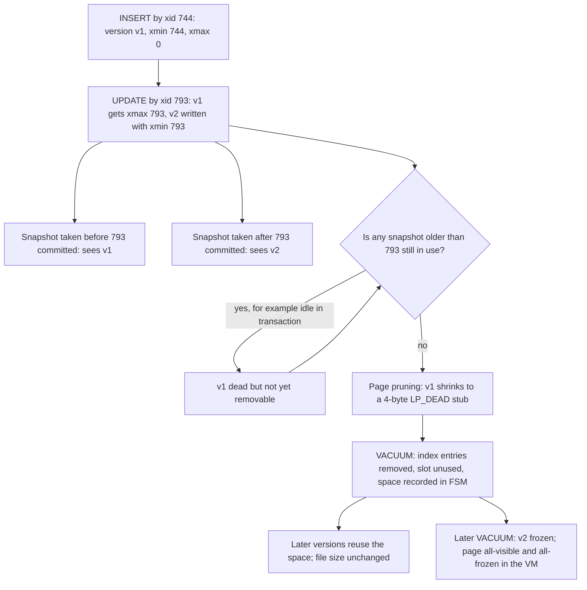

# Module 6.07: MVCC, visibility and vacuum

**Estimated hours:** 5

**What you will learn**

1. How PostgreSQL lets readers and writers run at the same time by keeping several versions of each row, and the exact rules (`xmin`, `xmax`, snapshot) that decide which version a transaction sees.
2. Why every UPDATE and DELETE leaves a dead tuple behind, how HOT updates and page pruning limit the damage, and what `VACUUM`, autovacuum and `VACUUM FULL` each do about it.
3. Why 32-bit transaction IDs force freezing, how wraparound is prevented and monitored, and how one forgotten "idle in transaction" session can bloat a whole database.

**Prerequisites:** [Module 6.06: Buffer pool and write-ahead log](module-06-buffer-pool-and-wal.md). You need the tuple header fields (`t_xmin`, `t_xmax`, `t_ctid`, infomask) from module 6.05 and the `lending_internals` database built by `internals_setup.sql` in module 6.06, section 6.

---

## 1. One-line intuition

In PostgreSQL an UPDATE never overwrites a row: it writes a new version and stamps the old one, every transaction carries a snapshot that says which stamps it may believe, so readers never wait for writers, and VACUUM later sweeps away the versions nobody can see any more.

## 2. Real-life analogy

The interest-rate notice board in a branch.

- Each product's rate card is pinned on the board. To change a rate, the clerk never rubs out the old card. They pin a new card stamped "pinned by change 793" and write "replaced by change 793" on the old one. Those two stamps are `xmin` and `xmax`.
- Every officer who comes to read the board first takes a printed slip from a machine: "changes finished before you arrived: everything below 793; still in progress: none". That slip is a **snapshot**.
- An officer believes a card if its "pinned by" change is finished on their slip and its "replaced by" change is blank or not finished on their slip. Two officers holding different slips can read different cards at the same moment, and neither waits for the clerk.
- A cleaner (**VACUUM**) takes down replaced cards, but only when every officer still in the room holds a slip on which the replacement is finished. One officer who stands in the corner for a week with an old slip stops the cleaner from removing anything newer than that slip. The board fills with dead cards. That is the "idle in transaction" incident in section 7.
- The change numbers are printed on a wheel with about four billion positions. Before the wheel comes round again, very old cards must be stamped "valid forever" so their old number cannot be mistaken for a new one. That stamp is **freezing**.

## 3. Why it exists: the problem it solves

At month end, a batch job updates `outstanding_paise` on every loan. At the same moment, branch officers open loan screens and a regulatory report sums the whole loan book. Without row versions there are two choices, both bad:

1. **Readers lock.** Readers take shared locks and wait for writers; writers wait for readers. A long report blocks the batch, and the batch blocks disbursements. This is how SQL Server behaves by default and how most databases worked before multi-versioning.
2. **Readers do not lock and read whatever is on the page.** The report then adds some loans before and some after the batch, and may even count amounts from a transaction that later rolls back (a "dirty read").

**MVCC** (multi-version concurrency control) gives a third option. Writers create new versions; each reader sees one consistent picture as of its snapshot; readers never block writers and writers never block readers. Only two writers on the same row wait for each other (module 6.08).

The price is the subject of this module. Old versions occupy space in the table until something removes them (bloat). Something must remove them (VACUUM). And the transaction IDs stamped on versions are only 32 bits, so they must be recycled safely (freezing). Getting these wrong causes the classic PostgreSQL production incidents: tables many times their real size, autovacuum that never catches up, and in the worst case a database that stops accepting writes to protect itself.

## 4. Three layers of depth

### Layer 1 (beginner): versions, stamps and snapshots

**Transaction IDs.** Every transaction that writes gets a **transaction ID** (xid), a 32-bit counter, at its first write. Read-only transactions never use one up. `SELECT pg_current_xact_id();` shows yours (and assigns one if you had none).

**Stamps.** From module 6.05, every tuple header has `xmin` (the xid that created this version) and `xmax` (the xid that deleted or replaced it, or 0). You can read them as hidden columns: `SELECT ctid, xmin, xmax, * FROM loans WHERE loan_id = 7001;`.

- INSERT writes a new tuple with `xmin` = my xid and `xmax` = 0.
- DELETE sets `xmax` = my xid on the current version. Nothing is removed.
- UPDATE is a DELETE plus an INSERT: the old version gets `xmax` = my xid and a `t_ctid` pointing at the new version; the new version gets `xmin` = my xid.

**Snapshot.** When a transaction needs to read, PostgreSQL takes a **snapshot**: a record of which transactions had finished at that moment. `SELECT pg_current_snapshot();` prints it as `xmin:xmax:list`, for example `18793:18793:` or `745:750:745,748`.

**The visibility rule in plain words.** A row version is visible to me if both are true:

1. The transaction that created it (`xmin`) committed, and had already committed when my snapshot was taken (or it is my own earlier change).
2. The transaction that deleted it (`xmax`) is empty, aborted, still running, or committed only after my snapshot was taken (or `xmax` only records a row lock).

For any snapshot, at most one version of a row passes both tests.

**When the snapshot is taken.**

- `READ COMMITTED` (the default): a new snapshot for every statement. Two SELECTs in one transaction can see different committed data.
- `REPEATABLE READ` and `SERIALIZABLE`: one snapshot, taken at the first statement (not at `BEGIN`), used for the whole transaction. Module 6.08 builds the isolation levels on this.

**Dead tuples.** When a version's `xmax` has committed and no running transaction's snapshot could still need it, the version is **dead**: invisible to everyone, for ever. It still takes space in its page. **VACUUM** finds dead tuples and frees their space for reuse. **Autovacuum** runs VACUUM for you in the background.

### Layer 2 (working engineer): snapshots, HOT, VACUUM, autovacuum, freezing

**The three snapshot fields.**

| Field | Meaning |
|---|---|
| `xmin` | Oldest xid still running when the snapshot was taken; every xid below it has finished (committed or aborted) |
| `xmax` | One past the newest finished xid; every xid at or above it counts as not finished, so its changes are invisible |
| `xip` list | Xids between `xmin` and `xmax` that were still running |

The section 6 output `18793:18793:` was taken inside transaction 18793 itself: nothing older was running, and its own xid is at or above `xmax`. A transaction sees its own changes through a separate rule that uses command IDs (`cmin`/`cmax`): each statement sees the changes of earlier statements in the same transaction, but not its own.

**Commit status.** Whether xid 18793 committed is stored in `pg_xact` (the commit log, or "clog"), two bits per xid. Looking that up for every tuple would be slow, so the first reader that learns the answer sets **hint bits** in the tuple header (`XMIN_COMMITTED`, `XMAX_COMMITTED` and friends from module 6.05).

**HOT updates and page pruning.** A normal update must add an entry to **every** index on the table, because the new version lives at a new `ctid`. A **HOT** (heap-only tuple) update avoids that when two conditions hold: no column used by any index changed (PostgreSQL 16 makes an exception for columns covered only by BRIN indexes), and the new version fits on the same page as the old. Then the old version's `t_ctid` points to the new one, the indexes keep pointing at the old line pointer, and readers follow the chain inside the page. Dead versions in such chains can be removed by **page pruning**: a mini-cleanup that any backend performs when it reads a page that is nearly full and holds versions dead to everyone. Pruning needs no VACUUM. Two choices make updates HOT: a `fillfactor` below 100 (6.05) and not indexing columns that change all the time, such as `outstanding_paise`. Compare `n_tup_hot_upd` with `n_tup_upd` in `pg_stat_user_tables`. In Lab Part B, `fillfactor = 70` made 7,946 of 9,000 updates HOT and the table grew from 18 to 38 pages; with the default it grew from 13 to 129 (section 6).

Pruning frees space inside one page, but it does not tell the **free space map**, does not clean indexes and does not set visibility-map bits. Only VACUUM does those.

**Plain `VACUUM`.**

- Removes dead tuples and the index entries pointing to them, records the freed space in the free space map, sets visibility-map bits, freezes old tuples, and cuts off empty pages at the very end of the file.
- Takes a `SHARE UPDATE EXCLUSIVE` lock: reads, inserts, updates and deletes carry on; only DDL and another VACUUM on the same table wait.
- Does **not** give space back to the operating system, apart from those trailing empty pages. The file stays the same size, and new versions fill the holes. Section 6: 129 pages before VACUUM, 129 after it, and still 129 after an eleventh full-table update, because that update reused the freed space.

**`VACUUM FULL`.**

- Copies the live rows into a brand-new file (a new relfilenode), rebuilds every index and deletes the old file. Section 6: 129 pages down to 12.
- Takes an `ACCESS EXCLUSIVE` lock: nobody can even read the table while it runs, and it needs free disk space for a whole copy. On a busy production table that is an outage. The `pg_repack` extension rebuilds a table online with only brief locks; better still, keep autovacuum effective so you never need either.

**Autovacuum.** A launcher wakes every `autovacuum_naptime` (1 minute) and starts worker processes (`autovacuum_max_workers`, 3). A table is vacuumed when

```text
n_dead_tup > autovacuum_vacuum_threshold (50) + autovacuum_vacuum_scale_factor (0.2) x reltuples
```

and also after many inserts (`autovacuum_vacuum_insert_threshold` 1000 plus 0.2 x rows, since PostgreSQL 13, so that insert-only tables get frozen and their visibility map set). It is analysed (statistics refreshed for the planner, 6.10) after 50 + 0.1 x rows changes. With a scale factor of 0.2, a 50-million-row `loans` table waits for 10 million dead tuples: far too lazy. Per-table settings fix it: `ALTER TABLE loans SET (autovacuum_vacuum_scale_factor = 0.01);`. Workers are throttled (`autovacuum_vacuum_cost_delay` 2 ms with a cost limit of 200 shared among the workers) so they do not starve foreground queries; on fast disks you raise the limit. `pg_stat_user_tables` shows `n_dead_tup`, `last_autovacuum` and `autovacuum_count`, and autovacuum runs longer than `log_autovacuum_min_duration` (10 minutes by default since PostgreSQL 15) are logged.

**Bloat.** Space in table and index files that holds no live rows. Some is healthy: it is where HOT updates and new rows go. Too much means every sequential scan reads more pages and the buffer pool (6.06) caches mostly empty space. Measure it exactly with `pgstattuple` (reads the whole table) or cheaply with `pgstattuple_approx`, and watch `n_dead_tup`.

**Visibility map.** The `_vm` side file (6.05) holds two bits per heap page: **all-visible** (every tuple on the page is visible to every transaction) and **all-frozen** (every tuple is frozen). VACUUM sets them; any change to the page clears them. Two payoffs: **index-only scans** skip the heap for all-visible pages (Lab Part D: `Heap Fetches: 300` before VACUUM, `0` after; module 6.09 builds on this), and VACUUM skips pages that are already all-visible (or all-frozen, for the aggressive kind).

**Wraparound and freezing.** Xids are 32 bits and compared modulo 2^32: from any xid, about 2.1 billion xids count as "the past" and 2.1 billion as "the future". A tuple created by xid 100 would, 2.1 billion transactions later, suddenly look as if it came from the future and disappear. To prevent that, VACUUM **freezes** old tuples: it sets infomask bits meaning "committed long ago, visible to everyone" (`HEAP_XMIN_FROZEN` is `XMIN_COMMITTED` and `XMIN_INVALID` set together; the xmin number itself is kept for debugging). Each table records `relfrozenxid` (every xid older than this in the table is frozen) and each database `datfrozenxid` (the minimum over its tables). `age(xid)` tells you how many transactions ago that was.

| Setting | Default | Effect |
|---|---|---|
| `vacuum_freeze_min_age` | 50 million | Tuples older than this are frozen when VACUUM visits their page |
| `vacuum_freeze_table_age` | 150 million | VACUUM turns **aggressive**: it scans every page that is not already all-frozen |
| `autovacuum_freeze_max_age` | 200 million | Autovacuum forces an anti-wraparound vacuum on the table, even if autovacuum is switched off for it |
| `vacuum_failsafe_age` | 1.6 billion | VACUUM drops its cost delay and skips index cleanup to finish freezing as fast as possible |

If all of that fails, the server logs warnings when the oldest unfrozen xid is 40 million transactions from wraparound, and refuses to assign new xids at 3 million: no more writes until someone runs VACUUM in that database. Every DBA graphs `SELECT datname, age(datfrozenxid) FROM pg_database;`. Multixact IDs (used when several transactions lock the same row, module 6.08) have the same problem and matching settings; check `mxid_age(datminmxid)`.

**The xmin horizon and long transactions.** VACUUM may only remove a version whose deleter committed before the oldest snapshot still in use anywhere in the cluster. That boundary is the **xmin horizon**; VACUUM VERBOSE prints it as `removable cutoff`. What holds it back:

| Holder | Where you see it |
|---|---|
| A transaction that has written anything (it has an xid), however idle | `pg_stat_activity.backend_xid` |
| A transaction holding a snapshot: REPEATABLE READ or SERIALIZABLE, a long-running query, an open cursor, `pg_dump` | `pg_stat_activity.backend_xmin` |
| A replication slot, or a standby with `hot_standby_feedback` | `pg_replication_slots.xmin`, `catalog_xmin` |
| A forgotten prepared transaction (two-phase commit) | `pg_prepared_xacts` |

A subtle point you will verify: a `READ COMMITTED` session that is idle in a transaction but has only run SELECTs does **not** hold the horizon, because its snapshot is released at the end of each statement. As soon as it has written one row, it does.

Defences: `idle_in_transaction_session_timeout` (ends a session that sits idle inside a transaction too long), `statement_timeout`, and monitoring of the oldest `xact_start` and `age(backend_xmin)`. PostgreSQL 17 adds `transaction_timeout`; on 16 you do not have it.

**How other engines keep old versions** (module 6.15 goes further):

| | PostgreSQL | Oracle | SQL Server |
|---|---|---|---|
| Where old versions live | In the table, next to the new ones | Undo segments in an undo tablespace | Version store in `tempdb` (or in the database itself with Accelerated Database Recovery, 2019+) |
| What an UPDATE does | Writes a new tuple; old one stays | Changes the row in place; before-image goes to undo | Changes the row in place; old version copied to the version store, 14-byte pointer added to the row |
| How a reader gets an older version | Checks `xmin`/`xmax` against its snapshot | Rebuilds a consistent-read copy of the block from undo, using the SCN (Oracle's commit sequence number) | Follows the version chain, but only if `READ_COMMITTED_SNAPSHOT` or `SNAPSHOT` isolation is on; by default readers take shared locks |
| Cleanup | VACUUM and autovacuum | Undo space reused after `undo_retention` | Background version-store cleanup |
| Signature failure | Table bloat, xid wraparound | `ORA-01555: snapshot too old` | `tempdb` growth, long version chains |
| Cost of ROLLBACK | Instant: mark the xid aborted | Apply undo, proportional to the work done | Undo from the log, proportional to the work done |

### Layer 3 (internals): the visibility check, snapshots and VACUUM's phases

**The visibility check** (`HeapTupleSatisfiesMVCC`), simplified:

1. **Check `xmin`.** If the hint bits say it aborted, the tuple is invisible. If `xmin` is my own xid, the tuple is visible only if an earlier command of mine inserted it (`cmin` below my current command ID) and no earlier command of mine deleted it. Otherwise, if no hint bit is set yet: if the xid is still running (a scan of the shared **ProcArray**, the table of running backends), the tuple is invisible; otherwise read `pg_xact` and set `XMIN_COMMITTED` or `XMIN_INVALID` accordingly.
2. **Check `xmin` against the snapshot.** If `xmin` is at or above the snapshot's `xmax`, or appears in its `xip` list, it committed too late for me: invisible.
3. **Check `xmax`.** Empty, aborted or lock-only: visible. My own: deleted by me (visibility depends on `cmax`). Still running, or committed but too late for my snapshot: visible. Committed before my snapshot: invisible.

Thanks to hint bits, step 1 is a bit test for almost every tuple; step 2 is arithmetic plus a binary search of a short array. That is why MVCC reads are cheap.

**Taking a snapshot** (`GetSnapshotData`) reads the ProcArray under a shared lock and collects every running xid. Since PostgreSQL 14, a snapshot is reused if no transaction has finished since the last one was built, which removed a long-standing bottleneck with thousands of connections.

**What lazy VACUUM does, phase by phase.**

1. **Scan the heap**, skipping pages the visibility map says need no work. Prune each page (dead HOT chains collapse; dead tuples become 4-byte `LP_DEAD` stubs), collect the TIDs of dead items in memory (6 bytes each, limited by `maintenance_work_mem` or `autovacuum_work_mem`, and in PostgreSQL 16 by an absolute cap of 1 GB), freeze tuples older than the cutoff, and set visibility-map bits on pages that are now all-visible.
2. **Vacuum every index**: scan the whole index and delete each entry whose TID is in the dead list. If the dead-TID memory fills up, phases 2 and 3 run and then the heap scan resumes, so a big table with too little memory means several full passes over every index. (PostgreSQL 17 replaced the array with a much denser structure.)
3. **Vacuum the heap again**: mark the `LP_DEAD` line pointers unused, so their slots and space can be reused, and record free space in the free space map.
4. **Truncate** empty pages at the end of the file (a brief `ACCESS EXCLUSIVE` lock; can be switched off per table with `vacuum_truncate = off`).
5. **Update `pg_class`** (`relpages`, `reltuples`, `relfrozenxid`, `relminmxid`) and the statistics.

Phase 2 is why pruning alone is not enough: a line pointer that an index still references cannot be reused, so pruning leaves the stub, and only VACUUM, after cleaning the indexes, can free it. In section 6, `VACUUM VERBOSE` reports `1027 removed` (whole dead tuples still on pages) and `8752 dead item identifiers removed` (the stubs that page pruning had left during the ten updates).

**Why the file kept growing even though pruning freed space.** During the ten updates, each page full of old versions was pruned when the next update scanned it, so `pgstattuple` already shows 77% free space before VACUUM. But the new versions are written to the page chosen by the free space map, and only VACUUM updates the free space map. So each update extended the file with new pages, while the freed holes sat unused until VACUUM ran.

**Statistics after a crash.** The counters in `pg_stat_user_tables` (including `n_dead_tup`) live in shared memory and are saved to disk only at a clean shutdown. After a crash, like the one in module 6.06 Part D, they start again from zero, so autovacuum underestimates the dead tuples until the counters catch up. After an unclean restart, a manual `VACUUM ANALYZE` of the busiest tables is a sensible precaution.

## 5. Architecture diagram



Every arrow after `UPD` is cleanup. A version's life ends only when the xmin horizon has passed its `xmax`; everything that holds the horizon back (the diamond) turns directly into bloat.

## 6. Code

If your `lending_internals` database has been changed by earlier labs, rebuild it first with `internals_setup.sql` from module 6.06. Then save this as `mvcc_bloat.sql`.

```sql
-- mvcc_bloat.sql
-- Shows: two versions of one row, then bloat from ten EMI postings,
-- what VACUUM does and does not do, and what VACUUM FULL does.
-- Run:  psql -h localhost -U postgres -d lending_internals -f mvcc_bloat.sql
\set ON_ERROR_STOP on
\echo '--- 1. one update leaves two versions ---'
BEGIN;
SELECT pg_current_xact_id() AS my_xid;
SELECT pg_current_snapshot() AS my_snapshot;
SELECT ctid, xmin, xmax, outstanding_paise FROM loans WHERE loan_id = 7001;
UPDATE loans SET outstanding_paise = outstanding_paise - 2170000 WHERE loan_id = 7001;
SELECT ctid, xmin, xmax, outstanding_paise FROM loans WHERE loan_id = 7001;
SELECT 'old' AS version, lp, t_xmin, t_xmax, t_ctid
FROM heap_page_items(get_raw_page('loans', 0)) WHERE lp = 1
UNION ALL
SELECT 'new', lp, t_xmin, t_xmax, t_ctid
FROM heap_page_items(get_raw_page('loans', 12)) WHERE lp = 1;
COMMIT;

\echo '--- 2. ten month-end EMI postings, autovacuum switched off for the demo ---'
ALTER TABLE loans SET (autovacuum_enabled = off);
SELECT pg_relation_size('loans') / 8192 AS pages_before;
SELECT format('UPDATE loans SET outstanding_paise = outstanding_paise - 100000 WHERE status = %L', 'ACTIVE')
FROM generate_series(1, 10) \gexec
SELECT pg_relation_size('loans') / 8192 AS pages_after_10,
       pg_relation_size('loans_pkey') / 8192 AS pkey_pages;
SELECT pg_sleep(1);   -- statistics are sent at most once a second
SELECT n_dead_tup, n_tup_upd, n_tup_hot_upd
FROM pg_stat_user_tables WHERE relname = 'loans';
SELECT tuple_count, dead_tuple_count, round(free_percent) AS free_pct FROM pgstattuple('loans');

\echo '--- 3. VACUUM: space becomes reusable, the file does not shrink ---'
VACUUM (VERBOSE) loans;
SELECT pg_relation_size('loans') / 8192 AS pages_after_vacuum;
SELECT tuple_count, dead_tuple_count, round(free_percent) AS free_pct FROM pgstattuple('loans');
UPDATE loans SET outstanding_paise = outstanding_paise - 100000 WHERE status = 'ACTIVE';
SELECT pg_relation_size('loans') / 8192 AS pages_after_11th_update;

\echo '--- 4. VACUUM FULL: copy live rows into a new file ---'
SELECT pg_relation_filepath('loans') AS file_before;
VACUUM FULL loans;
SELECT pg_relation_filepath('loans') AS file_after,
       pg_relation_size('loans') / 8192 AS pages_after_full;
ALTER TABLE loans RESET (autovacuum_enabled);
```

`\gexec` runs every row of the previous query's result as a separate SQL statement, so the ten UPDATEs run as ten separate transactions, exactly like ten monthly batch runs. Run it:

```bash
psql -h localhost -U postgres -f internals_setup.sql
psql -h localhost -U postgres -d lending_internals -f mvcc_bloat.sql
```

Expected output (transaction IDs, OIDs and the file names differ on your machine; page counts and tuple counts should match; the VACUUM report is trimmed):

```text
--- 1. one update leaves two versions ---
BEGIN
 my_xid
--------
  18793
(1 row)

 my_snapshot
--------------
 18793:18793:
(1 row)

 ctid  | xmin  | xmax | outstanding_paise
-------+-------+------+-------------------
 (0,1) | 18744 |    0 |           6000000
(1 row)

UPDATE 1
  ctid  | xmin  | xmax | outstanding_paise
--------+-------+------+-------------------
 (12,1) | 18793 |    0 |           3830000
(1 row)

 version | lp | t_xmin | t_xmax | t_ctid
---------+----+--------+--------+--------
 old     |  1 |  18744 |  18793 | (12,1)
 new     |  1 |  18793 |      0 | (12,1)
(2 rows)

COMMIT
--- 2. ten month-end EMI postings, autovacuum switched off for the demo ---
ALTER TABLE
 pages_before
--------------
           13
(1 row)

UPDATE 900
(... ten times ...)
 pages_after_10 | pkey_pages
----------------+------------
            129 |          9
(1 row)

 n_dead_tup | n_tup_upd | n_tup_hot_upd
------------+-----------+---------------
       8946 |      9001 |           249
(1 row)

 tuple_count | dead_tuple_count | free_pct
-------------+------------------+----------
         900 |             1027 |       77
(1 row)

--- 3. VACUUM: space becomes reusable, the file does not shrink ---
INFO:  vacuuming "lending_internals.public.loans"
INFO:  finished vacuuming "lending_internals.public.loans": index scans: 1
pages: 0 removed, 129 remain, 129 scanned (100.00% of total)
tuples: 1027 removed, 900 remain, 0 are dead but not yet removable
removable cutoff: 18805, which was 0 XIDs old when operation ended
new relfrozenxid: 18804, which is 69 XIDs ahead of previous value
frozen: 0 pages from table (0.00% of total) had 0 tuples frozen
index scan needed: 118 pages from table (91.47% of total) had 8752 dead item identifiers removed
index "loans_pkey": pages: 9 in total, 0 newly deleted, 0 currently deleted, 0 reusable
index "loans_application_id_key": pages: 9 in total, 0 newly deleted, 0 currently deleted, 0 reusable
...
 pages_after_vacuum
--------------------
                129
(1 row)

 tuple_count | dead_tuple_count | free_pct
-------------+------------------+----------
         900 |                0 |       90
(1 row)

UPDATE 900
 pages_after_11th_update
-------------------------
                     129
(1 row)

--- 4. VACUUM FULL: copy live rows into a new file ---
   file_before
------------------
 base/28431/28584
(1 row)

VACUUM
    file_after    | pages_after_full
------------------+------------------
 base/28431/28643 |               12
(1 row)
```

What to notice:

- **Two versions, one row.** Inside the transaction, the old version at `(0,1)` already has `t_xmax` = 18793 and `t_ctid` pointing at the new version `(12,1)`. Page 0 was full, so the new version went to a new page 12: not a HOT update, so both indexes on `loans` got new entries.
- **The table grew ten-fold for the same 900 rows**: 13 pages to 129, and the primary key index from 5 to 9 pages. Only 249 of 9,001 updates were HOT, because pages were full.
- **VACUUM made 90% of the file free and reusable but the file stayed 129 pages.** The eleventh update fitted into that space without growing the file.
- **VACUUM FULL wrote a new file** (the relfilenode changed) of 12 pages. Remember the price: an `ACCESS EXCLUSIVE` lock for the whole time.
- **`removable cutoff`** equals the newest xid here because no other session was running. In Lab Part C you will see it stuck behind an idle session.

## 7. Use case: core-banking loan-origination platform

The disbursement handler in the application server (claim H4) originally worked like this: `BEGIN`; lock the application row; **call the payment gateway over HTTPS**; record the result; `COMMIT`. On a normal day the gateway answered in under a second and nobody noticed. Then the gateway had a partial outage and hung connections for many minutes. Dozens of database sessions sat `idle in transaction`, each holding an xid, for hours.

Nothing failed visibly. But the month-end EMI batch ran during that window and updated every active loan, and autovacuum could not remove a single old version newer than the oldest stuck transaction. Its log lines showed large numbers of "dead but not yet removable" tuples. `loans` and `repayments` grew several times over, the work-queue and loan-enquiry screens slowed down as every scan read mostly dead space, and when the gateway recovered, the files stayed big, because plain VACUUM does not shrink files (section 6). The cleanup needed `pg_repack` in a maintenance window.

**The decision it drove: no network call may happen inside a database transaction.** The handler now records "disbursement requested" and commits, calls the gateway with no transaction open, then records the outcome in a second short transaction, with an outbox table and an idempotency key making the two steps safe to retry (module 10.10). Three guard rails were added with it:

1. `idle_in_transaction_session_timeout = '60s'` on the application's database role (`ALTER ROLE ... SET ...`), so a stuck transaction is killed instead of bloating the database.
2. An alert when the oldest transaction is older than five minutes, from `pg_stat_activity.xact_start`, and when `age(datfrozenxid)` passes 500 million.
3. Per-table autovacuum settings on the two hottest tables, `loans` and `repayments` (`autovacuum_vacuum_scale_factor = 0.01`), and `fillfactor = 85` on `loans` so that monthly `outstanding_paise` updates are mostly HOT. Lab Part B shows the effect of fillfactor on exactly this update.

In an interview, this is the story that proves you understand MVCC rather than just its definition: the bug was in the application, the symptom was in the database, and the mechanism connecting them was the xmin horizon.

## 8. Lab

Start each part from a clean database by rerunning `psql -h localhost -U postgres -f internals_setup.sql` (from 6.06), so that your numbers match. Open two terminals, A and B, each running `psql -h localhost -U postgres -d lending_internals`.

### Part A: a reader that keeps seeing the past (25 minutes)

Run the steps in order, switching terminals as shown.

| Step | Terminal A | Terminal B |
|---|---|---|
| 1 | `BEGIN ISOLATION LEVEL REPEATABLE READ;` | |
| 2 | `SELECT pg_current_snapshot();` | |
| 3 | `SELECT ctid, xmin, xmax, outstanding_paise FROM loans WHERE loan_id = 7001;` | |
| 4 | | `BEGIN;` `SELECT pg_current_xact_id();` |
| 5 | | `UPDATE loans SET outstanding_paise = outstanding_paise - 2170000 WHERE loan_id = 7001;` |
| 6 | | `COMMIT;` |
| 7 | `SELECT ctid, xmin, xmax, outstanding_paise FROM loans WHERE loan_id = 7001;` | |
| 8 | | `SELECT lp, t_xmin, t_xmax, t_ctid FROM heap_page_items(get_raw_page('loans', 0)) WHERE lp = 1;` |
| 9 | `COMMIT;` then repeat the SELECT of step 7 | |

Expected:

- Step 3: `(0,1)`, `xmax` 0, `6000000`.
- Step 7: still `(0,1)` and `6000000`, but now `xmax` shows B's xid. A's snapshot was taken at step 2, before B's xid existed, so B's delete is "in the future" for A and the old version stays visible to A.
- Step 8: the old tuple is physically present, with `t_xmax` = B's xid and `t_ctid` = `(12,1)`. VACUUM cannot remove it while A is open.
- Step 9: after A commits, a new statement takes a new snapshot: `(12,1)`, `3830000`.

Now repeat the whole table with `BEGIN;` (READ COMMITTED) at step 1, after rebuilding the database. Expected: step 7 already shows `(12,1)` and `3830000`, because READ COMMITTED takes a fresh snapshot for every statement. Write down both results; module 6.08 names this difference "non-repeatable read".

### Part B: HOT updates and fillfactor (25 minutes)

```sql
ALTER TABLE loans SET (autovacuum_enabled = off, fillfactor = 70);
VACUUM FULL loans;                    -- rewrite: every page now 30% empty
SELECT pg_stat_reset_single_table_counters('loans'::regclass);
SELECT pg_relation_size('loans') / 8192 AS pages_before;
SELECT format('UPDATE loans SET outstanding_paise = outstanding_paise - 100000 WHERE status = %L', 'ACTIVE')
FROM generate_series(1, 10) \gexec
SELECT pg_sleep(1);
SELECT pg_relation_size('loans') / 8192 AS pages_after_10,
       pg_relation_size('loans_pkey') / 8192 AS pkey_pages;
SELECT n_tup_upd, n_tup_hot_upd FROM pg_stat_user_tables WHERE relname = 'loans';
ALTER TABLE loans RESET (autovacuum_enabled, fillfactor);
```

Expected: `pages_before` 18 (the same 900 rows spread thinner), `pages_after_10` 38, `pkey_pages` 7, and `n_tup_hot_upd` 7946 of `n_tup_upd` 9000. Compare with section 6: 129 heap pages, 9 index pages, 249 HOT. Then predict, before trying it, what would happen to the HOT ratio if `outstanding_paise` had an index. (Answer: zero HOT updates, because an indexed column changes every time.)

### Part C: the idle-in-transaction incident (30 minutes)

| Step | Terminal A (the "stuck handler") | Terminal B (the DBA) |
|---|---|---|
| 1 | `BEGIN;` `UPDATE users SET last_login_at = now() WHERE branch_code = 'MUM001' AND user_code = 'U1001';` and then do nothing | |
| 2 | | `UPDATE loans SET outstanding_paise = outstanding_paise - 100000 WHERE loan_id <= 7100;` |
| 3 | | `VACUUM (VERBOSE) loans;` |
| 4 | | The query below |
| 5 | `COMMIT;` | |
| 6 | | `VACUUM (VERBOSE) loans;` again |

The step 4 query, the one you will run in every real incident of this kind:

```sql
SELECT pid, state, backend_xid, backend_xmin,
       age(coalesce(backend_xid, backend_xmin)) AS xid_age,
       now() - xact_start AS xact_age, left(query, 40) AS last_query
FROM pg_stat_activity
WHERE (backend_xid IS NOT NULL OR backend_xmin IS NOT NULL)
  AND pid <> pg_backend_pid()
ORDER BY xact_start;
```

Expected at step 3: `tuples: 0 removed, 1000 remain, 100 are dead but not yet removable`, and a `removable cutoff` equal to A's xid. Step 4 shows A as `idle in transaction` with that `backend_xid` and its `last_query`. Step 6: `tuples: 100 removed, 900 remain, 0 are dead but not yet removable`.

Two variations, each from a clean database:

1. In A, run `BEGIN; SELECT count(*) FROM loans;` (no write) instead. Expected: step 3 removes all 100, because a READ COMMITTED transaction that has not written holds no snapshot between statements. Then try `BEGIN ISOLATION LEVEL REPEATABLE READ; SELECT count(*) FROM loans;`. Expected: 100 not yet removable again, and the query shows a `backend_xmin` instead of a `backend_xid`.
2. Protect yourself: in A, run `SET idle_in_transaction_session_timeout = '5s';` before `BEGIN; UPDATE users ...`, wait ten seconds, then type `SELECT 1;`. Expected: `FATAL:  terminating connection due to idle-in-transaction timeout`, and psql reconnects. The stuck transaction was rolled back by the server.

### Part D: visibility map, index-only scans and freezing (25 minutes)

```sql
SELECT * FROM pg_visibility_map_summary('loans');
EXPLAIN (ANALYZE, COSTS OFF, TIMING OFF, SUMMARY OFF)
SELECT count(*) FROM loans WHERE loan_id BETWEEN 7001 AND 7300;
VACUUM loans;
SELECT * FROM pg_visibility_map_summary('loans');
EXPLAIN (ANALYZE, COSTS OFF, TIMING OFF, SUMMARY OFF)
SELECT count(*) FROM loans WHERE loan_id BETWEEN 7001 AND 7300;
SELECT datname, age(datfrozenxid) AS xid_age FROM pg_database ORDER BY 2 DESC;
SELECT relname, age(relfrozenxid) AS xid_age FROM pg_class
WHERE relname IN ('loans', 'customers', 'loan_applications') ORDER BY 1;
VACUUM (FREEZE) loans;
SELECT * FROM pg_visibility_map_summary('loans');
SELECT relname, age(relfrozenxid) AS xid_age FROM pg_class
WHERE relname IN ('loans', 'customers', 'loan_applications') ORDER BY 1;
SELECT lp, t_xmin, to_hex(t_infomask) AS infomask
FROM heap_page_items(get_raw_page('loans', 0)) WHERE lp <= 2;
SELECT ctid, xmin, loan_id FROM loans WHERE loan_id IN (7001, 7002);
```

Expected:

- Fresh table: `all_visible 0, all_frozen 0`, and the plan is an `Index Only Scan using loans_pkey` with `Heap Fetches: 300`: every index entry had to be checked in the heap because no page was known to be all-visible.
- After `VACUUM`: `12 | 0`, and `Heap Fetches: 0`. Same plan, no heap access.
- The database ages are small on a fresh container (hundreds to a few thousand); on a busy production server they climb by millions per day. The `relfrozenxid` ages of the three tables are a few dozen.
- After `VACUUM (FREEZE)`: `12 | 12`, the age of `loans` drops to 0, and the infomask of each tuple is `b02`: `0x0800` (no xmax) + `0x0200` + `0x0100` (both together mean frozen) + `0x0002` (has variable-width columns). The `xmin` column still shows the original number; frozen tuples keep it for debugging, but nobody compares it any more.

### Journal

Copy [journal/TEMPLATE.md](../journal/TEMPLATE.md) to `journal/YYYY-MM-DD-mvcc-and-vacuum.md`. Record: the snapshot strings and the step 7 results from Part A at both isolation levels; pages and HOT counts with fillfactor 100 (section 6) and 70 (Part B); the "dead but not yet removable" line and the blocking session's row from Part C; the visibility-map summaries and `Heap Fetches` before and after VACUUM from Part D. Then write the section 7 incident in your own words as a three-line RCA: cause, mechanism, fix.

## 9. Common mistakes and misconceptions

| Mistake | Why it is wrong | Bug it causes later |
|---|---|---|
| "VACUUM shrinks the table" | It makes space reusable inside the file; only trailing empty pages are cut off | Disk alerts that VACUUM "did not fix"; panicked `VACUUM FULL` in business hours |
| Running `VACUUM FULL` on a live production table | It takes `ACCESS EXCLUSIVE` for the whole rewrite | Every query on the table blocks: an outage |
| Turning autovacuum off "because it uses I/O" | Dead tuples pile up and anti-wraparound vacuum will run anyway, at a worse time | Bloat, then a forced aggressive vacuum during peak hours |
| Leaving the default scale factor on huge tables | 20% of 50 million rows is 10 million dead tuples before anything happens | Long, heavy autovacuum runs and steady bloat |
| Holding a transaction open across a network call or user think-time | Its xid holds the xmin horizon for everybody | Cluster-wide bloat (section 7) |
| Indexing a column that is updated constantly | Every update becomes non-HOT and touches every index | Index bloat and slower writes |
| "BEGIN takes the REPEATABLE READ snapshot" | The snapshot is taken at the first statement after `BEGIN` | Wrong reasoning about what a report saw |
| Ignoring `age(datfrozenxid)` | Wraparound protection eventually stops all writes | A database that refuses writes until a long manual VACUUM finishes |
| Treating `n_dead_tup` as exact | It is a statistics estimate and resets after a crash | Misjudging whether autovacuum is keeping up |

## 10. Resume link

- **Claim D, "MVCC and transactions".** Say: "PostgreSQL keeps row versions in the heap: an update writes a new tuple with my xid as `xmin` and stamps the old one's `xmax`. A snapshot (xmin, xmax, in-progress list) decides which version each transaction sees, so readers never block writers. The cost is dead tuples, which VACUUM reclaims once the xmin horizon passes them." Then quote your numbers: "Ten full-table updates grew my 13-page table to 129 pages; VACUUM made 90% of it reusable without shrinking it; with fillfactor 70, 88% of the updates were HOT and the table only reached 38 pages."
- **Claim H4, "application server against distributed SQL".** The section 7 story: idle-in-transaction sessions from network calls inside transactions, the xmin horizon, the outbox fix and `idle_in_transaction_session_timeout`. Interviewers love it because it connects application design to database internals.
- **Claim H5, "live-incident debugging and RCA".** The Part C query is your first move for "the database is getting slower and bigger": find the oldest transaction and what it last ran.

Likely follow-up: "How is this different in Oracle?" Answer with the section 4 table: Oracle updates in place and keeps before-images in undo, so it does not bloat the table, but long queries can fail with `ORA-01555: snapshot too old` when undo is overwritten; PostgreSQL never fails the reader, it makes the table grow instead.

## 11. Interview questions

**Q1 (easy). What are `xmin` and `xmax`, and how does PostgreSQL decide whether a row version is visible?**

<details>
<summary>Model answer</summary>

They are transaction IDs in every tuple header: `xmin` is the transaction that created the version, `xmax` the one that deleted or replaced it (or 0). A version is visible to a snapshot if `xmin` committed before the snapshot was taken (or is the reader's own earlier change) and `xmax` is empty, aborted, lock-only, or not yet committed as of the snapshot. Commit status comes from `pg_xact`, cached in hint bits; "as of the snapshot" means the xid is below the snapshot's `xmax` and not in its in-progress list. In READ COMMITTED each statement takes a new snapshot; in REPEATABLE READ and SERIALIZABLE the first statement's snapshot is used for the whole transaction.

</details>

**Q2 (easy). What is the difference between `VACUUM` and `VACUUM FULL`?**

<details>
<summary>Model answer</summary>

Plain VACUUM removes dead tuples and their index entries, marks the space reusable in the free space map, updates the visibility map and freezes old tuples. It runs alongside normal reads and writes (`SHARE UPDATE EXCLUSIVE`) and does not shrink the file, except for empty pages at the end. `VACUUM FULL` rewrites the table into a new compact file and rebuilds its indexes, returning space to the OS, but it holds `ACCESS EXCLUSIVE` for the duration, blocking even reads, and needs room for a full copy. In production you rely on autovacuum and use `pg_repack` if you really must compact a live table.

</details>

**Q3 (medium). What is a HOT update, when can it not happen, and how do you encourage it?**

<details>
<summary>Model answer</summary>

A heap-only tuple update places the new version on the same page as the old one and links them through `t_ctid`, without adding entries to any index, because the indexes keep pointing at the original line pointer. It requires that no indexed column changed (PostgreSQL 16 excepts BRIN-only columns) and that the page has room. Dead versions in HOT chains can be removed by page pruning during normal reads, without VACUUM. To encourage it: set a fillfactor below 100 on frequently updated tables, avoid indexing columns that change on every update, and check `n_tup_hot_upd` against `n_tup_upd`. In my lab, fillfactor 70 turned 249 HOT updates out of 9,001 into 7,946 out of 9,000.

</details>

**Q4 (medium). The database keeps growing and autovacuum logs "dead but not yet removable". What is happening and what do you do?**

<details>
<summary>Model answer</summary>

Something is holding back the xmin horizon, so VACUUM cannot remove versions deleted after it. Candidates: a session idle in transaction that has an xid (`backend_xid`), a long query or REPEATABLE READ transaction or `pg_dump` holding a snapshot (`backend_xmin`), a replication slot or a standby with `hot_standby_feedback`, or an orphaned prepared transaction. I check `pg_stat_activity` ordered by `xact_start` with `age(backend_xid)` and `age(backend_xmin)`, then `pg_replication_slots` and `pg_prepared_xacts`. Short term: end the offender (commit, `pg_terminate_backend`, drop an unused slot) and let VACUUM catch up. Long term: no network calls or user waits inside transactions, `idle_in_transaction_session_timeout` and `statement_timeout` for application roles, and alerts on the oldest transaction age. Already-bloated files need `pg_repack` or a maintenance-window rewrite.

</details>

**Q5 (hard). Explain transaction ID wraparound and freezing. What happens if you ignore it?**

<details>
<summary>Model answer</summary>

Xids are 32 bits and compared modulo 2^32, so each xid sees roughly 2.1 billion xids as past and 2.1 billion as future. Without intervention, a tuple's `xmin` would eventually appear to be in the future and the row would vanish. VACUUM prevents this by freezing tuples older than `vacuum_freeze_min_age`: it sets the frozen infomask bits so the tuple counts as visible to everyone regardless of the xid number. Each table's `relfrozenxid` and each database's `datfrozenxid` record the oldest unfrozen xid, and `age()` measures the distance. Normal vacuums can skip all-visible pages, so at `vacuum_freeze_table_age` VACUUM becomes aggressive and scans every page not marked all-frozen; at `autovacuum_freeze_max_age` (200 million) autovacuum forces an anti-wraparound vacuum even if disabled; at `vacuum_failsafe_age` (1.6 billion) VACUUM drops throttling and index cleanup to finish. If that still fails, the server warns at 40 million xids before wraparound and stops assigning new xids at 3 million, so all writes fail until a manual VACUUM completes. The usual root causes are the same as bloat: long-lived transactions or slots holding the horizon, or autovacuum throttled too hard on very large tables. Multixact IDs have an equivalent mechanism. I monitor `age(datfrozenxid)` and `mxid_age(datminmxid)` per database and alert well before 200 million.

</details>

## 12. Revision

- An UPDATE writes a new tuple (`xmin` = my xid) and stamps the old one (`xmax` = my xid); a snapshot (`xmin:xmax:in-progress`) decides which version each statement or transaction sees, so readers never block writers.
- Dead versions are removed by page pruning (inside a page, HOT chains) and VACUUM (indexes, free space map, visibility map, freezing); VACUUM never shrinks the file except at its tail, VACUUM FULL rewrites it under an exclusive lock, and anything holding the xmin horizon (idle transactions with an xid, old snapshots, slots) turns into bloat.
- 32-bit xids force freezing: `relfrozenxid`/`datfrozenxid` ages drive aggressive and anti-wraparound vacuums at 150 and 200 million, and ignoring them ends with the server refusing new xids.

---

Previous: [Module 6.06: Buffer pool and write-ahead log](module-06-buffer-pool-and-wal.md) | Next: [Module 6.08: Isolation levels and locking](module-08-isolation-levels-and-locking.md)
