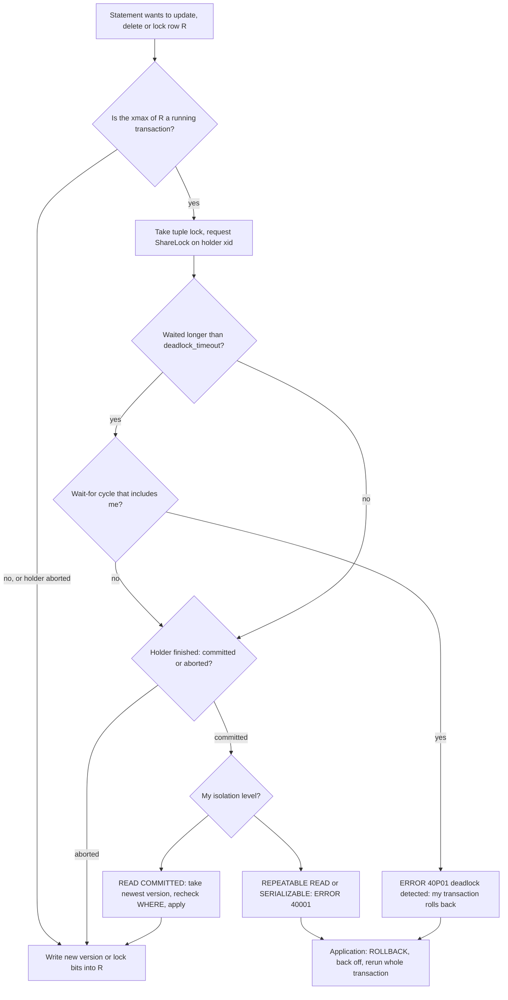

# Module 6.08: Isolation levels and locking

**Estimated hours:** 5

**What you will learn**

1. The five concurrency anomalies (dirty read, non-repeatable read, phantom, lost update, write skew), each reproduced with two psql sessions on the lending schema, and which PostgreSQL isolation level prevents which.
2. How PostgreSQL actually implements READ COMMITTED, REPEATABLE READ (snapshot isolation) and SERIALIZABLE (serializable snapshot isolation), and the retry loop every application must have.
3. Row locks (`FOR UPDATE`, `FOR NO KEY UPDATE`, `FOR SHARE`, `FOR KEY SHARE`, `NOWAIT`, `SKIP LOCKED`), table lock modes, how to find who blocks whom, deadlock detection, timeouts, advisory locks, and the locking rules of the loan application server.

**Prerequisites:** [Module 6.07: MVCC, visibility and vacuum](module-07-mvcc-and-vacuum.md). You also need deadlocks and lock ordering from module 4.11, the lost-update problem from module 6.04, and the `lending_internals` database from module 6.06 (`internals_setup.sql`).

---

## 1. One-line intuition

An isolation level decides how much of other people's concurrent work your transaction is allowed to notice; locks decide who queues behind whom when two transactions want the same row; and PostgreSQL's promise is that when it cannot make concurrent transactions look as if they ran one at a time, it raises an error instead of silently corrupting your data.

## 2. Real-life analogy

A loan file room with several credit officers.

- **READ COMMITTED**: every time you pull a file, you see its latest signed version. Pull it twice in one task and you may see two different versions.
- **REPEATABLE READ**: at the start of your task you get a photocopy of the whole room and work from it. If you try to amend a file that somebody amended after your photocopy was made, the supervisor refuses: "your copy is out of date, start again".
- **SERIALIZABLE**: the supervisor also notes which files each officer read. If two officers each made a decision based on files the other one changed, so that no one-at-a-time order could explain both decisions, one of them is sent back to redo the task.
- **A row lock** is a red "in use" clip on one file. Anyone who wants to amend that file waits in line; people who only read ignore the clip.
- **A deadlock**: two officers each hold one clipped file and wait for the other's. After one second of waiting, the supervisor checks for such circles and sends one officer back.
- **An advisory lock** is the key to the batch room: the supervisor does not know or care what it protects, but everybody has agreed that only the key holder runs the end-of-day batch.

## 3. Why it exists: the problem it solves

Banking bugs from concurrency are silent. Nothing crashes; the numbers are just wrong:

- Two tellers post repayments of Rs 15,000 and Rs 10,000 on the same loan at the same moment. Each reads the outstanding balance, subtracts its amount and writes the result. One payment vanishes from the balance (**lost update**).
- Two credit officers approve two applications for the same customer at the same time. Each checks "total approved exposure is within the limit", each sees room, and together they exceed the limit (**write skew**).
- A branch officer double-clicks "disburse", or the RPC client retries after a timeout. Two workers disburse the same application twice.

The SQL standard defines isolation levels by which anomalies they allow. PostgreSQL implements them with MVCC snapshots (6.07) for reading and locks for writing, and adds a serialization checker on top. You need to know exactly what each level guarantees, because the cheapest correct choice differs per transaction: too weak and money goes missing; too strong and you pay with blocked sessions or retries.

## 4. Three layers of depth

### Layer 1 (beginner): anomalies, levels and row locks

**The five anomalies.**

| Anomaly | What happens | Lending example |
|---|---|---|
| Dirty read | You read data another transaction has not committed (and may roll back) | An officer sees a disbursement that is later rolled back |
| Non-repeatable read | You read the same row twice and get different committed values | Application 9902 is `SUBMITTED`, then `APPROVED`, inside one task |
| Phantom | You run the same query twice and get a different set of rows | The count of pending applications at `DEL001` goes from 34 to 35 |
| Lost update | Two read-modify-write cycles on one row; the second write overwrites the first | Two repayments posted at once; one disappears from `outstanding_paise` |
| Write skew | Two transactions read overlapping data, write different rows, and together break a rule that each checked | Two approvals for one customer together exceed the exposure limit |

**The four levels as PostgreSQL implements them.**

| Level | Dirty read | Non-repeatable read | Phantom | Lost update (read, then write) | Write skew |
|---|---|---|---|---|---|
| `READ UNCOMMITTED` (behaves exactly as READ COMMITTED) | never | possible | possible | possible | possible |
| `READ COMMITTED` (default) | never | possible | possible | possible | possible |
| `REPEATABLE READ` | never | never | never (stronger than the standard requires) | error `40001` | possible |
| `SERIALIZABLE` | never | never | never | error `40001` | error `40001` |

`40001` is the SQLSTATE code `serialization_failure`. Your program must catch it and run the whole transaction again (section 6).

**Choosing a level.** `BEGIN ISOLATION LEVEL REPEATABLE READ;` for one transaction, `SET default_transaction_isolation = 'serializable'` for a session, or `ALTER ROLE ... SET default_transaction_isolation = ...` for a role.

**Row locks.** `UPDATE` and `DELETE` lock the rows they change until the transaction ends. A second transaction that wants to change the same row waits. Readers never wait for row locks (6.07). `SELECT ... FOR UPDATE` takes the same lock without changing anything, so that you can read a row, decide, and write it, knowing nobody else can change it in between.

### Layer 2 (working engineer): what each level really does, locks, timeouts

**READ COMMITTED.** Every statement gets a fresh snapshot. When an `UPDATE` or `DELETE` (or `SELECT FOR UPDATE`) reaches a row that a concurrent transaction is changing, it waits for that transaction to finish. If the other one committed, PostgreSQL takes the **newest** version of the row, re-checks the `WHERE` clause against it, and applies the change to that version (this re-check is called **EvalPlanQual**). That is why `UPDATE loans SET outstanding_paise = outstanding_paise - 1000000 WHERE loan_id = 7002` is safe under READ COMMITTED: the subtraction happens on the latest value. A read in the application followed by a write of a computed value is not safe: that is the lost update in Lab Part A.

**REPEATABLE READ** is **snapshot isolation**. One snapshot, taken at the first statement, for the whole transaction, so repeated reads and repeated queries return the same answer. If the transaction tries to update, delete or lock a row that another transaction changed and committed after the snapshot, it gets

```text
ERROR:  could not serialize access due to concurrent update
```

and must be retried. Write skew is still possible, because the two transactions write **different** rows: neither sees a conflict.

**SERIALIZABLE** is **serializable snapshot isolation** (SSI, PostgreSQL 9.1+, from Cahill, Rohm and Fekete's 2008 work). It runs exactly like REPEATABLE READ and, in addition, records what each transaction read using **SIRead locks** (predicate locks that never block anybody). When it sees a read-write dependency pattern that could make the result impossible to explain by any one-at-a-time order, it aborts one transaction:

```text
ERROR:  could not serialize access due to read/write dependencies among transactions
DETAIL:  Reason code: Canceled on identification as a pivot, during commit attempt.
HINT:  The transaction might succeed if retried.
```

Costs: memory for predicate locks, some false positives (aborts that a perfect checker would not need), and more retries under contention. A query that scans the whole table records a lock on the whole table, so good indexes also reduce false aborts. For long read-only reports, `BEGIN ISOLATION LEVEL SERIALIZABLE READ ONLY DEFERRABLE` waits for a safe moment and then runs without any risk of being aborted.

**The retry rule.** With REPEATABLE READ or SERIALIZABLE, any statement, including `COMMIT`, may fail with `40001`; with any level, a deadlock fails with `40P01`. The application must `ROLLBACK`, wait a little (with random jitter so the two do not collide again), and rerun **the whole transaction from `BEGIN`, re-reading everything**. Never retry just the failed statement, and never repeat external side effects (sending money, sending an SMS) inside the retried part. If the connection itself drops during `COMMIT`, you do not know whether it committed: that is what idempotency keys are for (module 10.10).

**Row lock modes.** Four strengths:

| Requested \ already held | `FOR KEY SHARE` | `FOR SHARE` | `FOR NO KEY UPDATE` | `FOR UPDATE` |
|---|---|---|---|---|
| `FOR KEY SHARE` | ok | ok | ok | waits |
| `FOR SHARE` | ok | ok | waits | waits |
| `FOR NO KEY UPDATE` | ok | waits | waits | waits |
| `FOR UPDATE` | waits | waits | waits | waits |

Which statement takes which: a plain `UPDATE` that does not change a key column takes `FOR NO KEY UPDATE`; `DELETE`, or an `UPDATE` of a column with a unique index usable by a foreign key, takes `FOR UPDATE`; a **foreign-key check** (inserting a `repayments` row checks its `loans` parent) takes `FOR KEY SHARE` on the parent row. So an explicit `SELECT ... FOR UPDATE` on a loan blocks every concurrent insert of a repayment for that loan, while `FOR NO KEY UPDATE` does not. In Lab Part C the same insert waited 4.5 seconds behind `FOR UPDATE` and took milliseconds behind `FOR NO KEY UPDATE`.

**Not waiting.** `FOR UPDATE NOWAIT` fails immediately with `could not obtain lock on row in relation "loan_applications"`. `FOR UPDATE SKIP LOCKED` silently skips locked rows: the standard way to build a job queue in a table, where several workers each claim different pending rows.

**Table lock modes.** Every statement also takes a lock on each table it touches. The ones you will meet:

| Mode | Taken by | Blocks |
|---|---|---|
| `ACCESS SHARE` | `SELECT` | Only `ACCESS EXCLUSIVE` |
| `ROW SHARE` | `SELECT ... FOR UPDATE/SHARE` | `EXCLUSIVE`, `ACCESS EXCLUSIVE` |
| `ROW EXCLUSIVE` | `INSERT`, `UPDATE`, `DELETE` | `SHARE` and stronger |
| `SHARE UPDATE EXCLUSIVE` | `VACUUM`, `ANALYZE`, `CREATE INDEX CONCURRENTLY` | Itself and stronger, not normal reads or writes |
| `SHARE` | `CREATE INDEX` (non-concurrent) | All writes to the table |
| `SHARE ROW EXCLUSIVE` | `CREATE TRIGGER`, `ADD FOREIGN KEY` | Writes, and other DDL |
| `ACCESS EXCLUSIVE` | `DROP`, `TRUNCATE`, `VACUUM FULL`, most `ALTER TABLE`, `LOCK TABLE` | Everything, including `SELECT` |

Lock requests queue in order. An `ALTER TABLE` waiting for `ACCESS EXCLUSIVE` behind one long transaction also blocks every **new** `SELECT` on that table, because they queue behind it. Lab Part C shows a plain `SELECT` stuck for seconds behind a waiting `ALTER TABLE`. Rule for migrations: `SET lock_timeout = '2s'` before DDL, and retry later if it fails.

**Timeouts.**

| Setting | Default | What it does |
|---|---|---|
| `deadlock_timeout` | 1 s | How long a lock wait lasts before the deadlock check runs (also the threshold for `log_lock_waits`) |
| `lock_timeout` | 0 (off) | Cancel a statement that waits longer than this for any lock: `canceling statement due to lock timeout` |
| `statement_timeout` | 0 (off) | Cancel any statement that runs longer: `canceling statement due to statement timeout` |
| `idle_in_transaction_session_timeout` | 0 (off) | End a session idle inside a transaction (6.07) |

Set them per application role, not globally: a nightly report and a disbursement RPC need different limits.

**Deadlocks.** Transaction A locks loan 7001 and wants 7002; B locks 7002 and wants 7001. Neither can proceed. After `deadlock_timeout`, PostgreSQL detects the cycle and aborts one of them:

```text
ERROR:  deadlock detected
DETAIL:  Process 8186 waits for ShareLock on transaction 18165; blocked by process 8182.
Process 8182 waits for ShareLock on transaction 18166; blocked by process 8186.
HINT:  See server log for query details.
CONTEXT:  while updating tuple (0,1) in relation "loans"
```

The cure is the one from module 4.11: take locks in one global order. If a transaction touches several loans, lock them in ascending `loan_id` (`SELECT ... WHERE loan_id IN (...) ORDER BY loan_id FOR UPDATE`).

**Advisory locks.** Locks on a number of your choosing, which PostgreSQL never takes by itself: `pg_advisory_lock(key)` (wait), `pg_try_advisory_lock(key)` (return true or false at once), `pg_advisory_unlock(key)`, and `pg_advisory_xact_lock(key)` (released automatically at transaction end). Typical use: make sure only one end-of-day interest-accrual job runs per branch, with `key = hashtext('EOD:MUM001')`. Session-level advisory locks survive `COMMIT`, which breaks badly behind a transaction-pooling connection pooler (module 6.12); prefer the `_xact_` form.

**Who blocks whom.** `pg_stat_activity` shows each session's state and what it waits for; `pg_blocking_pids(pid)` lists the sessions blocking it; `pg_locks` lists every lock, granted or waiting. Lab Part C gives you the two queries to keep.

**YugabyteDB differences (preview of module 7.08).** YSQL accepts the same syntax, including the row-lock clauses, but the engine underneath is distributed. Serializable and snapshot (REPEATABLE READ) isolation are always available; true READ COMMITTED needs the tserver flag `yb_enable_read_committed_isolation=true`, and without it a READ COMMITTED request runs as snapshot isolation. Conflicts between transactions are detected in the storage layer (DocDB); depending on version and flags, a conflicting transaction either waits (wait-on-conflict, as in PostgreSQL) or one of the two is aborted at once (fail-on-conflict). Clock uncertainty between nodes can also force "restart read" errors. The practical consequence is the same rule, only stronger: every transaction in the application server must sit inside a retry loop. Check your release before relying on advisory locks in YSQL; they arrived much later than in PostgreSQL.

### Layer 3 (internals): where locks live and how waits are resolved

**Two lock systems.** Table locks (and advisory locks, and transaction-ID locks) live in the **shared lock manager**, a hash table in shared memory sized for `max_locks_per_transaction` (64) times the number of allowed connections. Weak table locks (`ACCESS SHARE`, `ROW SHARE`, `ROW EXCLUSIVE`) usually use a **fast path**: up to 16 per backend are recorded in the backend's own slot without touching the shared table. **Row locks do not live in shared memory at all.** They are written into the tuple header: `xmax` = the locker's xid plus infomask bits (`HEAP_XMAX_LOCK_ONLY`, `HEAP_XMAX_EXCL_LOCK`, `HEAP_XMAX_KEYSHR_LOCK`). That is why the foreign-key check in module 6.06 produced a `Heap LOCK` WAL record and dirtied a `loans` page, and why PostgreSQL can lock ten million rows without running out of lock memory (SQL Server instead escalates to a table lock). When several transactions share-lock the same row, `xmax` holds a **MultiXact ID**, which points to a member list in `pg_multixact`.

**How a row-lock wait works.** Every transaction holds an `ExclusiveLock` on its own transaction ID in the lock manager for its whole life. A transaction that finds a row whose `xmax` belongs to a running transaction first takes a heavyweight **tuple lock** (so that waiters queue fairly), then requests a `ShareLock` on the holder's transaction ID, and sleeps until the holder commits or aborts and releases it. That is exactly what `pg_locks` shows in Lab Part C (`transactionid ... ShareLock ... granted f`) and why the deadlock message speaks of "ShareLock on transaction". A second waiter for the same row queues on the tuple lock held by the first waiter, so `pg_blocking_pids` can point at another waiter rather than at the original holder.

**Deadlock detection.** Waiting backends do not check for deadlocks continuously. When a backend has waited `deadlock_timeout`, a timer fires and that backend builds the wait-for graph from the lock manager. If it finds a cycle that includes itself and cannot fix it by reordering wait queues, it aborts **its own** transaction. So the victim is not chosen by cost (SQL Server, by contrast, picks the cheaper transaction to roll back, adjustable with `DEADLOCK_PRIORITY`): it is whichever waiter's timer fires while the cycle exists. When the two waits start more than `deadlock_timeout` apart, as when you type commands by hand, the first waiter's check finds no cycle yet, so the second waiter, the one that closes the cycle, is the victim. When both start waiting within the same second, the first waiter's check usually finds the cycle and the first waiter dies. Both cases were reproduced while writing this module.

**Inside SSI.** SIRead locks are kept in a separate predicate lock table at tuple granularity, promoted to page and then whole-relation granularity when a transaction holds many (the limit comes from `max_pred_locks_per_transaction`, 64 by default, and related settings). A read-write **antidependency** T1 -> T2 means T1 read a version that T2 overwrote. SSI aborts when it finds a **dangerous structure**: two consecutive antidependencies T1 -> T2 -> T3 where T3 committed first (T1 and T3 may be the same transaction, which is the write-skew case). T2 is the **pivot**; the `DETAIL` line says which transaction was cancelled and at what point ("during write", "during commit attempt").

## 5. Architecture diagram



Every path that ends in an error ends at the same box: the application's retry loop. That box is code you write, which is why section 6 is a C++ program and not a SQL script.

## 6. Code

This program is the shape of every database call in the capstone C2 application server: one transaction in a function, a typed error with its SQLSTATE, and a retry loop around it. It approves an application only if the customer's total approved unsecured exposure stays within Rs 1,00,000 (10,000,000 paise), runs at SERIALIZABLE because the rule spans several rows (the write-skew case), and retries on `40001` and `40P01`. Save it as `approve_retry.cpp`.

```cpp
// approve_retry.cpp
// Approves or rejects one loan application under SERIALIZABLE, enforcing a
// per-customer unsecured exposure limit, and retries the whole transaction
// on serialization failure (40001) or deadlock (40P01).
// Build (one line):
//   g++ -std=c++17 -O2 -Wall -Wextra -Werror -g -pthread approve_retry.cpp -o approve_retry -I/usr/include/postgresql -lpq
// Run:   ./approve_retry <application_id> <pause_ms>
#include <libpq-fe.h>

#include <chrono>
#include <cstdio>
#include <cstdlib>
#include <initializer_list>
#include <memory>
#include <random>
#include <string>
#include <thread>
#include <vector>

namespace {

constexpr long long kExposureLimitPaise = 10'000'000;  // Rs 1,00,000 unsecured limit
constexpr int kMaxAttempts = 5;

using Conn   = std::unique_ptr<PGconn, decltype(&PQfinish)>;
using Result = std::unique_ptr<PGresult, decltype(&PQclear)>;

struct DbError {                 // any SQL error, with its five-character SQLSTATE
    std::string sqlstate;
    std::string message;
};

Result exec(PGconn* c, const char* sql, std::initializer_list<std::string> params = {}) {
    std::vector<const char*> values;
    for (const std::string& p : params) values.push_back(p.c_str());
    Result r(PQexecParams(c, sql, static_cast<int>(values.size()), nullptr,
                          values.data(), nullptr, nullptr, 0),
             &PQclear);
    const ExecStatusType st = PQresultStatus(r.get());
    if (st != PGRES_COMMAND_OK && st != PGRES_TUPLES_OK) {
        const char* code = PQresultErrorField(r.get(), PG_DIAG_SQLSTATE);
        const char* text = PQresultErrorField(r.get(), PG_DIAG_MESSAGE_PRIMARY);
        throw DbError{code ? code : "?????", text ? text : PQerrorMessage(c)};
    }
    return r;
}

// One attempt of the whole transaction. Returns the decision; throws DbError.
std::string approve_once(PGconn* c, const std::string& app, int pause_ms) {
    exec(c, "BEGIN ISOLATION LEVEL SERIALIZABLE");
    exec(c, "SET LOCAL lock_timeout = '2s'");
    exec(c, "SET LOCAL statement_timeout = '5s'");

    Result a = exec(c, "SELECT customer_id, amount_paise, status FROM loan_applications "
                       "WHERE application_id = $1", {app});
    if (PQntuples(a.get()) != 1) throw DbError{"P0002", "no such application"};
    const std::string customer = PQgetvalue(a.get(), 0, 0);
    const long long amount = std::atoll(PQgetvalue(a.get(), 0, 1));
    const std::string status = PQgetvalue(a.get(), 0, 2);
    if (status != "SUBMITTED") {           // someone already decided: nothing to do
        exec(c, "COMMIT");
        return "already " + status;
    }

    Result e = exec(c, "SELECT coalesce(sum(amount_paise), 0) FROM loan_applications "
                       "WHERE customer_id = $1 AND status IN ('APPROVED', 'DISBURSED')",
                    {customer});
    const long long exposure = std::atoll(PQgetvalue(e.get(), 0, 0));
    const bool ok = exposure + amount <= kExposureLimitPaise;
    std::printf("app %s: exposure %lld + amount %lld %s limit %lld\n", app.c_str(),
                exposure, amount, ok ? "<=" : ">", kExposureLimitPaise);

    std::this_thread::sleep_for(std::chrono::milliseconds(pause_ms));  // widen the race

    const std::string decision = ok ? "APPROVED" : "REJECTED";
    exec(c, "UPDATE loan_applications SET status = $2 WHERE application_id = $1",
         {app, decision});
    exec(c, "INSERT INTO audit_log (branch_code, user_code, action, entity, entity_id) "
            "SELECT branch_code, 'U2001', $2, 'loan_application', application_id "
            "FROM loan_applications WHERE application_id = $1",
         {app, decision});
    exec(c, "COMMIT");
    return decision;
}

}  // namespace

int main(int argc, char** argv) {
    if (argc != 3) {
        std::fprintf(stderr, "usage: %s <application_id> <pause_ms>\n", argv[0]);
        return 2;
    }
    const std::string app = argv[1];
    const int pause_ms = std::atoi(argv[2]);
    const char* dsn = std::getenv("LENDING_DSN");
    Conn conn(PQconnectdb(dsn ? dsn : "host=localhost user=postgres password=postgres "
                                      "dbname=lending_internals"),
              &PQfinish);
    if (PQstatus(conn.get()) != CONNECTION_OK) {
        std::fprintf(stderr, "connect failed: %s", PQerrorMessage(conn.get()));
        return 1;
    }

    std::mt19937 rng(std::random_device{}());
    for (int attempt = 1; attempt <= kMaxAttempts; ++attempt) {
        std::printf("app %s: attempt %d\n", app.c_str(), attempt);
        try {
            const std::string decision = approve_once(conn.get(), app, pause_ms);
            std::printf("app %s: committed, %s\n", app.c_str(), decision.c_str());
            return 0;
        } catch (const DbError& err) {
            if (PQtransactionStatus(conn.get()) != PQTRANS_IDLE) {
                Result rb(PQexec(conn.get(), "ROLLBACK"), &PQclear);  // leave the failed txn
            }
            std::printf("app %s: SQLSTATE %s, %s\n", app.c_str(), err.sqlstate.c_str(),
                        err.message.c_str());
            if (err.sqlstate != "40001" && err.sqlstate != "40P01") return 1;  // not retryable
            // exponential backoff with jitter: about 50, 100, 200, 400 ms
            const int wait_ms = 50 * (1 << (attempt - 1)) + static_cast<int>(rng() % 50);
            std::this_thread::sleep_for(std::chrono::milliseconds(wait_ms));
        }
    }
    std::printf("app %s: gave up after %d attempts\n", app.c_str(), kMaxAttempts);
    return 1;
}
```

Design points: `PGconn` and `PGresult` are owned by `std::unique_ptr` with the libpq free functions as deleters (RAII, modules 2.03 and 2.05), so an exception never leaks a result or a connection. Parameters go through `PQexecParams` as `$1`, `$2`, never pasted into SQL text (SQL injection, module 11.03). `SET LOCAL` limits the timeouts to this one transaction.

Prepare the data: customer 5901 already has application 9901 (6,000,000 paise); add a second one of 5,000,000. Each alone is within the limit; both together are not.

```sql
-- prep_skew.sql: a second SUBMITTED application for customer 5901 (the first is 9901)
INSERT INTO loan_applications (application_id, branch_code, customer_id, product_code,
                               amount_paise, tenure_months, status, created_by)
VALUES (10001, 'DEL001', 5901, 'PL01', 5000000, 24, 'SUBMITTED', 'U2001');
SELECT application_id, customer_id, amount_paise, status
FROM loan_applications WHERE customer_id = 5901 ORDER BY 1;
```

Build and run two approvals at the same time (the second starts 0.3 s after the first; both pause 1 s between reading and writing, like an officer looking at the screen):

```bash
psql -h localhost -U postgres -f internals_setup.sql
psql -h localhost -U postgres -d lending_internals -f prep_skew.sql
g++ -std=c++17 -O2 -Wall -Wextra -Werror -g -pthread approve_retry.cpp -o approve_retry -I/usr/include/postgresql -lpq
./approve_retry 9901 1000 > a.out 2>&1 &
sleep 0.3
./approve_retry 10001 1000 > b.out 2>&1
wait
cat a.out b.out
psql -h localhost -U postgres -d lending_internals \
  -c "SELECT application_id, amount_paise, status FROM loan_applications WHERE customer_id = 5901 ORDER BY 1"
```

Expected output (identical in two runs on the author's machine):

```text
app 9901: attempt 1
app 9901: exposure 0 + amount 6000000 <= limit 10000000
app 9901: committed, APPROVED
app 10001: attempt 1
app 10001: exposure 0 + amount 5000000 <= limit 10000000
app 10001: SQLSTATE 40001, could not serialize access due to read/write dependencies among transactions
app 10001: attempt 2
app 10001: exposure 6000000 + amount 5000000 > limit 10000000
app 10001: committed, REJECTED
 application_id | amount_paise |  status
----------------+--------------+----------
           9901 |      6000000 | APPROVED
          10001 |      5000000 | REJECTED
(2 rows)
```

Read it as a story. Both officers saw exposure 0 and both decisions looked fine on their own snapshot. SSI noticed that each transaction had read rows the other one wrote, so no serial order could explain both approvals; it cancelled the second. The retry re-read the data, saw the first approval, and rejected correctly. Change `SERIALIZABLE` to `REPEATABLE READ` in the source, rebuild, rerun from `internals_setup.sql`, and both applications end up `APPROVED`: the write skew that breaks the bank's limit.

## 7. Use case: core-banking loan-origination platform

The application server from claim H4 (capstone C2) handles three kinds of write, and each got a deliberately chosen concurrency strategy. **The decision it drove: READ COMMITTED plus explicit row locks for single-row workflows, SERIALIZABLE plus a retry loop only where a rule spans several rows, and database constraints as the last line of defence.**

1. **Disbursement (one application, one loan).** The transaction starts with

   ```sql
   SELECT status, amount_paise FROM loan_applications WHERE application_id = $1 FOR UPDATE;
   ```

   then checks `status = 'APPROVED'` inside the lock, inserts the `loans` row, sets the application to `DISBURSED`, writes `audit_log`, and commits. A double-click or an RPC retry runs the same transaction, waits on the row lock, then reads `DISBURSED` (READ COMMITTED takes the newest version after the wait) and returns "already disbursed". Lab Part C shows the second session waiting 1.5 seconds and then seeing `DISBURSED`. `FOR UPDATE` (not `FOR NO KEY UPDATE`) is deliberate here: it also blocks another session's foreign-key insert of a `loans` row for the same application. The `UNIQUE (application_id)` constraint on `loans` is the backstop if code ever forgets the lock.
2. **Repayment posting (one loan).** Balance changes are written as `UPDATE loans SET outstanding_paise = outstanding_paise - $2 WHERE loan_id = $1`, which is atomic under READ COMMITTED. When the application must read before deciding (part-payment rules), it locks the loan with `FOR NO KEY UPDATE`, not `FOR UPDATE`, so that inserting EMI rows into `repayments` (which takes `FOR KEY SHARE` on the loan) is not blocked.
3. **Approval against an exposure limit (several rows).** This is write skew, which no row lock on the application being approved can prevent. It runs at SERIALIZABLE inside the section 6 retry loop.

Rules that apply to every handler:

- Short transactions: no network calls and no waiting for users inside a transaction (6.07, section 7).
- `lock_timeout = '2s'` and `statement_timeout = '5s'` for the RPC role; longer limits for the batch role; `idle_in_transaction_session_timeout` for both.
- Retry on `40001` and `40P01`, the whole transaction, at most five attempts with jittered backoff, guarded by an idempotency key on the request.
- When several loans are touched (closing an old loan into a top-up), lock them in ascending `loan_id`.
- Disbursement workers claim pending work with `FOR UPDATE SKIP LOCKED`, so adding workers adds throughput instead of contention.
- End-of-day jobs take `pg_try_advisory_xact_lock(hashtext('EOD:' || branch_code))` and exit if it returns false, so a second scheduler cannot run the same branch twice.

These rules were written down because the move to YugabyteDB (Phase 7) makes serialization and conflict errors more frequent; code that already retries correctly on PostgreSQL survives the migration unchanged.

## 8. Lab

Start each part with a fresh database (`psql -h localhost -U postgres -f internals_setup.sql`). Open two terminals, A and B, with `psql -h localhost -U postgres -d lending_internals`, and a third, C, for inspection. Type the steps in order; wait for the previous one to finish (or to hang, where noted) before the next.

### Part A: anomalies at READ COMMITTED (30 minutes)

**Dirty read: impossible even if you ask for it.**

| Step | Terminal A | Terminal B |
|---|---|---|
| 1 | `BEGIN;` `UPDATE loans SET status = 'CLOSED' WHERE loan_id = 7001;` | |
| 2 | | `BEGIN ISOLATION LEVEL READ UNCOMMITTED;` `SELECT status FROM loans WHERE loan_id = 7001;` `SHOW transaction_isolation;` `COMMIT;` |
| 3 | `ROLLBACK;` | |

Expected: B sees `ACTIVE`, and `SHOW` says `read uncommitted`. PostgreSQL accepts the name but never shows uncommitted data.

**Non-repeatable read and phantom.**

| Step | Terminal A | Terminal B |
|---|---|---|
| 1 | `BEGIN;` `SELECT status FROM loan_applications WHERE application_id = 9902;` `SELECT count(*) FROM loan_applications WHERE branch_code = 'DEL001' AND status = 'SUBMITTED';` | |
| 2 | | `UPDATE loan_applications SET status = 'APPROVED' WHERE application_id = 9902;` |
| 3 | | `INSERT INTO loan_applications (application_id, branch_code, customer_id, product_code, amount_paise, tenure_months, status, created_by) VALUES (10002, 'DEL001', 5001, 'PL01', 5000000, 24, 'SUBMITTED', 'U2001');` |
| 4 | Repeat both SELECTs of step 1, then `COMMIT;` | |

Expected: step 1 shows `SUBMITTED` and 34; step 4 shows `APPROVED` (non-repeatable read) and 35 (phantom).

**Lost update.** Two repayments on loan 7002 (outstanding 7,000,000 paise): A posts Rs 15,000 (1,500,000 paise), B posts Rs 10,000 (1,000,000 paise). Each "application" reads, computes in its head, and writes the result.

| Step | Terminal A | Terminal B |
|---|---|---|
| 1 | `BEGIN;` `SELECT outstanding_paise FROM loans WHERE loan_id = 7002;` | |
| 2 | | `BEGIN;` `SELECT outstanding_paise FROM loans WHERE loan_id = 7002;` |
| 3 | `UPDATE loans SET outstanding_paise = 5500000 WHERE loan_id = 7002;` | |
| 4 | | `UPDATE loans SET outstanding_paise = 6000000 WHERE loan_id = 7002;` (hangs) |
| 5 | `COMMIT;` | (B's UPDATE completes) `COMMIT;` |
| 6 | `SELECT outstanding_paise FROM loans WHERE loan_id = 7002;` | |

Expected: 6000000. The correct answer is 4,500,000; Rs 15,000 of repayment has vanished. Now rebuild and repeat with the two safe forms and record the results: (a) both sessions run `UPDATE loans SET outstanding_paise = outstanding_paise - <amount> WHERE loan_id = 7002;` with no prior SELECT (expected final 4500000); (b) both sessions read with `SELECT outstanding_paise FROM loans WHERE loan_id = 7002 FOR NO KEY UPDATE;` (B's SELECT hangs until A commits and then returns A's new value, 5500000, so B computes 4500000).

### Part B: REPEATABLE READ and SERIALIZABLE (30 minutes)

1. Repeat the non-repeatable-read and phantom table with `BEGIN ISOLATION LEVEL REPEATABLE READ;` in A. Expected: step 4 still shows `SUBMITTED` and 34. The snapshot was taken at A's first SELECT.
2. Repeat the lost-update table with `BEGIN ISOLATION LEVEL REPEATABLE READ;` in both. Expected at step 5: as soon as A commits, B's waiting UPDATE fails with `ERROR:  could not serialize access due to concurrent update`. B must retry; on retry it reads 5500000.
3. Write skew by hand. First run `prep_skew.sql` from section 6 in C. Then:

| Step | Terminal A (officer approving 9901) | Terminal B (officer approving 10001) |
|---|---|---|
| 1 | `BEGIN ISOLATION LEVEL REPEATABLE READ;` `SELECT coalesce(sum(amount_paise), 0) FROM loan_applications WHERE customer_id = 5901 AND status IN ('APPROVED', 'DISBURSED');` | |
| 2 | | Same two statements |
| 3 | `UPDATE loan_applications SET status = 'APPROVED' WHERE application_id = 9901;` | |
| 4 | | `UPDATE loan_applications SET status = 'APPROVED' WHERE application_id = 10001;` |
| 5 | `COMMIT;` | `COMMIT;` |

Expected: both sums are 0, both commits succeed, and the customer now has 11,000,000 paise approved against a 10,000,000 limit. Rebuild, run `prep_skew.sql`, and repeat with `SERIALIZABLE` in both. Expected: A's commit succeeds; B's `COMMIT` fails with `could not serialize access due to read/write dependencies among transactions` and `Reason code: Canceled on identification as a pivot, during commit attempt.` Then run the section 6 program and compare.

### Part C: row locks, blocking and queues (35 minutes)

1. **Double-click disbursement.** In C: `UPDATE loan_applications SET status = 'APPROVED' WHERE application_id = 9902;`. In A: `BEGIN;` `SELECT application_id, status, amount_paise FROM loan_applications WHERE application_id = 9902 FOR UPDATE;` then insert the loan and mark the application disbursed (adapt `disburse.sql` from module 6.06 to application 9902 and loan 7902), but do not commit yet. In B: `\timing on`, `BEGIN;` and the same `SELECT ... FOR UPDATE` (hangs). In A: `COMMIT;`. Expected: B returns at once with status `DISBURSED`, and its time is however long you took to commit A. B's code would now stop.
2. **Which lock blocks a foreign-key insert.** In A: `BEGIN;` `SELECT loan_id, outstanding_paise FROM loans WHERE loan_id = 7001 FOR UPDATE;`. In B: `\timing on` and `INSERT INTO repayments VALUES (1, 7001, DATE '2026-11-05', 2170000, NULL, 'DUE');` (hangs). In C, run the two inspection queries below. Then `COMMIT;` in A and note B's time. Repeat with `FOR NO KEY UPDATE` in A and repayment id 2: B does not wait at all.

```sql
SELECT a.pid, a.state, a.wait_event_type, a.wait_event,
       pg_blocking_pids(a.pid) AS blocked_by,
       left(a.query, 45) AS query
FROM pg_stat_activity a
WHERE a.datname = current_database() AND a.pid <> pg_backend_pid()
  AND a.backend_type = 'client backend'
ORDER BY a.xact_start;
SELECT l.pid, l.locktype, l.relation::regclass AS relation, l.page, l.tuple,
       l.transactionid AS xid, l.mode, l.granted
FROM pg_locks l
JOIN pg_stat_activity a ON a.pid = l.pid
WHERE a.datname = current_database() AND l.pid <> pg_backend_pid()
  AND (l.locktype IN ('transactionid', 'tuple')
       OR l.relation IN ('loans'::regclass, 'repayments'::regclass))
ORDER BY l.pid, l.locktype, l.mode;
```

Expected (PIDs and xids differ):

```text
  pid  |        state        | wait_event_type |  wait_event   | blocked_by |                     query
-------+---------------------+-----------------+---------------+------------+-----------------------------------------------
 21096 | idle in transaction | Client          | ClientRead    | {}         | SELECT loan_id, outstanding_paise FROM loans
 21118 | active              | Lock            | transactionid | {21096}    | INSERT INTO repayments VALUES (1, 7001, DATE
(2 rows)

  pid  |   locktype    |  relation  | page | tuple |  xid  |       mode       | granted
-------+---------------+------------+------+-------+-------+------------------+---------
 21096 | relation      | loans      |      |       |       | RowShareLock     | t
 21096 | transactionid |            |      |       | 19788 | ExclusiveLock    | t
 21118 | relation      | repayments |      |       |       | RowExclusiveLock | t
 21118 | relation      | loans      |      |       |       | RowShareLock     | t
 21118 | transactionid |            |      |       | 19789 | ExclusiveLock    | t
 21118 | transactionid |            |      |       | 19788 | ShareLock        | f
 21118 | tuple         | loans      |    0 |     1 |       | AccessShareLock  | t
(7 rows)
```

Read it with Layer 3: the inserter holds the tuple lock on `loans (0,1)` and waits (`granted f`) for a `ShareLock` on transaction 19788, which A holds exclusively. On the author's machine the insert took 4.5 s behind `FOR UPDATE` (the time until A committed) and 39 ms behind `FOR NO KEY UPDATE`.

3. **Timeouts and NOWAIT.** Keep A holding `FOR UPDATE` on loan 7001. In B: `SET lock_timeout = '2s';` then `UPDATE loans SET outstanding_paise = outstanding_paise - 1 WHERE loan_id = 7001;`. Expected after 2 s: `ERROR:  canceling statement due to lock timeout`. Then `SELECT * FROM loans WHERE loan_id = 7001 FOR UPDATE NOWAIT;`. Expected at once: `ERROR:  could not obtain lock on row in relation "loans"`.
4. **A job queue with SKIP LOCKED.** In A and then B, each: `BEGIN;` `SELECT application_id FROM loan_applications WHERE status = 'SUBMITTED' ORDER BY application_id LIMIT 3 FOR UPDATE SKIP LOCKED;` Expected: A claims 9901, 9902, 9903; B claims 9904, 9905, 9906 without waiting. `COMMIT` both.
5. **The DDL lock queue.** A: `BEGIN;` `SELECT count(*) FROM loans;` (leave open). B: `ALTER TABLE loans ADD COLUMN last_emi_on date;` (hangs). C: `\timing on` and `SELECT count(*) FROM loans WHERE loan_id = 7001;` (hangs too). Rerun the first inspection query in a fourth session or after: B is blocked by A, and C is blocked by B. `COMMIT` A and both complete. Then repeat B's step with `SET lock_timeout = '2s';` first: the ALTER gives up after 2 s and C is never blocked for longer than that.

### Part D: deadlock, and its cure (25 minutes)

| Step | Terminal A | Terminal B |
|---|---|---|
| 1 | `BEGIN;` `UPDATE loans SET outstanding_paise = outstanding_paise - 100000 WHERE loan_id = 7001;` | |
| 2 | | `BEGIN;` `UPDATE loans SET outstanding_paise = outstanding_paise - 100000 WHERE loan_id = 7002;` |
| 3 | `UPDATE loans SET outstanding_paise = outstanding_paise - 100000 WHERE loan_id = 7002;` (hangs) | |
| 4 | | `UPDATE loans SET outstanding_paise = outstanding_paise - 100000 WHERE loan_id = 7001;` |
| 5 | `COMMIT;` | `ROLLBACK;` |

Expected: about one second after step 4, B gets `ERROR:  deadlock detected` with the `DETAIL` lines shown in Layer 2, and A's hung UPDATE completes with `UPDATE 1`. B was the victim because its deadlock check ran while the cycle existed; A's check ran a second after step 3, before B closed the cycle, and found nothing. Read the server's version, which names both queries: `docker logs --tail 12 pg16`.

Now cure it: repeat with both sessions updating `7001` first and `7002` second (a fixed order). Expected: B simply waits for A, then succeeds. No deadlock is possible.

Finally, advisory locks. In A: `SELECT pg_try_advisory_lock(hashtext('EOD:MUM001')) AS got_it;` (t). In B: the same (f). In A: `SELECT pg_advisory_unlock(hashtext('EOD:MUM001'));` and B's next try returns t. In C, `SELECT locktype, mode, granted FROM pg_locks WHERE locktype = 'advisory';` shows the lock while it is held.

### Journal

Copy [journal/TEMPLATE.md](../journal/TEMPLATE.md) to `journal/YYYY-MM-DD-isolation-and-locking.md`. Record: the final balance of loan 7002 in the lost-update run and in both fixes; the two write-skew outcomes (REPEATABLE READ versus SERIALIZABLE) and the output of `approve_retry`; the foreign-key insert times behind `FOR UPDATE` and `FOR NO KEY UPDATE`; the deadlock `DETAIL` lines and which session was the victim; one sentence per handler in section 7 explaining which lock or level you chose and why.

## 9. Common mistakes and misconceptions

| Mistake | Why it is wrong | Bug it causes later |
|---|---|---|
| Read a balance, compute in the application, write it back, at READ COMMITTED | Another transaction can change the row between your read and your write | Lost repayments (Part A) |
| "SERIALIZABLE means it locks everything, so no errors" | PostgreSQL's SERIALIZABLE never blocks more; it aborts with `40001` instead | Unhandled errors in production the first time two users collide |
| Retrying only the failed statement | The whole transaction's reads are stale; the decision must be recomputed | Retries that "succeed" with wrong data |
| Retrying external side effects (payment call, SMS) inside the loop | The side effect happens once per attempt | Duplicate payments or messages |
| `SELECT ... FOR UPDATE` everywhere "to be safe" | It blocks foreign-key inserts and serialises unrelated work | Repayment inserts stalling behind balance updates; lower throughput |
| No `lock_timeout` on DDL in migrations | A waiting `ACCESS EXCLUSIVE` request blocks every later query on the table | A "harmless" `ALTER TABLE` that freezes the login path |
| Locking rows in different orders in different code paths | AB/BA order is the textbook deadlock | Random `40P01` errors under load |
| "READ UNCOMMITTED is faster" | PostgreSQL treats it exactly as READ COMMITTED | Nothing gained; misleading code |
| Session-level advisory locks behind a transaction-pooling pooler | The lock stays with a server connection that other clients then reuse | Jobs that never run, or locks nobody can release |
| Assuming YugabyteDB behaves like single-node PostgreSQL under contention | Different conflict handling, more `40001`, read restarts | Failures after migration in code that never retried |

## 10. Resume link

- **Claim D, "MVCC and transactions".** Say: "PostgreSQL's READ COMMITTED takes a snapshot per statement and re-checks updated rows with EvalPlanQual; REPEATABLE READ is snapshot isolation and still allows write skew; SERIALIZABLE is SSI, which tracks read-write dependencies and aborts with 40001." Then show it: "I reproduced write skew on an exposure limit: both approvals committed under REPEATABLE READ; under SERIALIZABLE one failed and my retry loop re-read and rejected it."
- **Claim H4, "multithreaded application server ... loan-origination requests over RPC against distributed SQL" (capstone C2).** The section 7 rules: `FOR UPDATE` on the application row during disbursement, `FOR NO KEY UPDATE` for repayment posting and why, SERIALIZABLE plus retries only for cross-row rules, `SKIP LOCKED` for worker queues, timeouts per role. Quote your Part C timings.
- **Claim C, "deadlocks" (and module 4.11).** The same lock-ordering rule cures mutex deadlocks in C++ and row-lock deadlocks in SQL; you have reproduced both and can show the PostgreSQL `DETAIL` lines.

Likely follow-ups: "Which transaction does PostgreSQL kill in a deadlock?" (the one whose `deadlock_timeout` check finds the cycle, not a cost-based choice). "Why not just use SERIALIZABLE everywhere?" (more aborts under contention, predicate-lock memory, and every caller must retry; use it where a rule spans rows). "What changes on YugabyteDB?" (more conflict and restart errors; retries are mandatory; module 7.08).

## 11. Interview questions

**Q1 (easy). What isolation levels does PostgreSQL support, and which is the default?**

<details>
<summary>Model answer</summary>

It accepts the four standard names. READ COMMITTED is the default and takes a new snapshot for each statement. READ UNCOMMITTED is accepted but behaves exactly as READ COMMITTED, so dirty reads never happen. REPEATABLE READ uses one snapshot for the whole transaction (snapshot isolation), which also prevents phantoms, and raises `40001` if you try to change a row someone else changed after your snapshot. SERIALIZABLE adds serializable snapshot isolation, which detects dangerous read-write dependency patterns, such as write skew, and aborts one transaction with `40001`.

</details>

**Q2 (easy). What does `SELECT ... FOR UPDATE` do, and when would you use `FOR NO KEY UPDATE` instead?**

<details>
<summary>Model answer</summary>

It locks the selected rows as if they were about to be updated, until the transaction ends, so you can read, decide and write without another transaction changing them in between. Other writers and lockers wait; plain readers do not. `FOR UPDATE` also conflicts with `FOR KEY SHARE`, which foreign-key checks take on the parent row, so it blocks concurrent inserts of child rows. `FOR NO KEY UPDATE` is what an ordinary UPDATE takes; it still blocks other writers but lets foreign-key inserts proceed. For updating a loan's balance I use `FOR NO KEY UPDATE` so repayment rows can still be inserted; for disbursing an application I use `FOR UPDATE`, because I also want to stop anyone else inserting a loan for that application.

</details>

**Q3 (medium). Explain the lost-update problem and three ways to prevent it in PostgreSQL.**

<details>
<summary>Model answer</summary>

Two transactions read the same value, each computes a new value in the application, and each writes it; the second write overwrites the first, so one change is lost. Under READ COMMITTED PostgreSQL does not prevent this when the computation happens in the application. Fixes: (1) make the change atomic in SQL, `SET outstanding_paise = outstanding_paise - $2`, which under READ COMMITTED re-applies to the newest version after waiting; (2) lock before reading, `SELECT ... FOR NO KEY UPDATE`, so the second transaction waits and then reads the first one's result; (3) run at REPEATABLE READ or SERIALIZABLE, where the second writer gets `could not serialize access due to concurrent update` and retries. Optimistic locking with a version column (`UPDATE ... WHERE version = $old`, then check the row count) is a fourth, application-level option.

</details>

**Q4 (medium). How does PostgreSQL detect deadlocks, which transaction is aborted, and how do you prevent them?**

<details>
<summary>Model answer</summary>

Lock waits do not trigger detection immediately. When a backend has waited `deadlock_timeout` (1 s by default), it builds the wait-for graph from the shared lock manager; row-lock waits appear there as waits for a ShareLock on the holder's transaction ID. If it finds a cycle including itself that cannot be resolved by reordering wait queues, it aborts its own transaction with `40P01` and a DETAIL naming the processes and transactions. So the victim is whichever backend's check runs while the cycle exists, usually the one that closed the cycle when waits start more than a second apart; it is not chosen by cost as in SQL Server. Prevention: acquire locks in a consistent global order (for example ascending `loan_id`, using `ORDER BY ... FOR UPDATE`), keep transactions short, and treat `40P01` as retryable.

</details>

**Q5 (hard). Describe write skew, show why snapshot isolation allows it, explain how PostgreSQL's SERIALIZABLE catches it, and what the application and the schema must do.**

<details>
<summary>Model answer</summary>

Write skew happens when two transactions read an overlapping set of rows, each checks a rule across them, and each writes a different row; each is valid on its own snapshot, but together they break the rule. Example: two officers approve two applications for one customer; each sums approved exposure, sees room, and approves its own application; the total exceeds the limit. Snapshot isolation only detects write-write conflicts on the same row, and here the rows differ, so both commit. PostgreSQL's SSI tracks reads with SIRead predicate locks and records rw-antidependencies (T1 read something T2 later wrote). A cycle needs two consecutive such edges around a pivot transaction; when SSI sees that structure with the outer transaction committed, it aborts one transaction with `40001`, at the write or at commit. The application must wrap the transaction in a retry loop that reruns everything from BEGIN with backoff, and must not repeat side effects. Schema matters too: predicate locks are taken at the granularity the scan uses, so a sequential scan locks the whole table and increases false aborts; an index on `customer_id` lets SSI lock only the relevant rows or pages. Alternatives without SERIALIZABLE are to materialise the conflict (lock a per-customer row with `FOR UPDATE` before checking) or to enforce the rule with a constraint. On YugabyteDB the same logic applies, but conflicts are detected in the distributed storage layer and serialization errors are more frequent, so the retry loop is mandatory.

</details>

## 12. Revision

- Anomalies: dirty read (never in PostgreSQL), non-repeatable read and phantom (READ COMMITTED), lost update (READ COMMITTED with read-then-write), write skew (up to REPEATABLE READ); REPEATABLE READ is snapshot isolation, SERIALIZABLE is SSI, and both report conflicts as `40001`.
- Row locks live in tuple headers (`xmax` plus infomask, MultiXact for many lockers); waiters queue on a tuple lock and a ShareLock on the holder's xid; `FOR UPDATE` blocks foreign-key inserts, `FOR NO KEY UPDATE` does not; `NOWAIT`, `SKIP LOCKED`, `lock_timeout` and `statement_timeout` keep waits bounded; DDL takes `ACCESS EXCLUSIVE` and queues everyone behind it.
- Deadlocks are found after `deadlock_timeout` by the waiter whose check sees the cycle; prevent them with a global lock order; every application transaction needs a whole-transaction retry loop for `40001` and `40P01`, which matters even more on YugabyteDB.

---

Previous: [Module 6.07: MVCC, visibility and vacuum](module-07-mvcc-and-vacuum.md) | Next: [Module 6.09: B-tree indexes, composite and covering indexes](module-09-btree-indexes-composite-covering.md)
