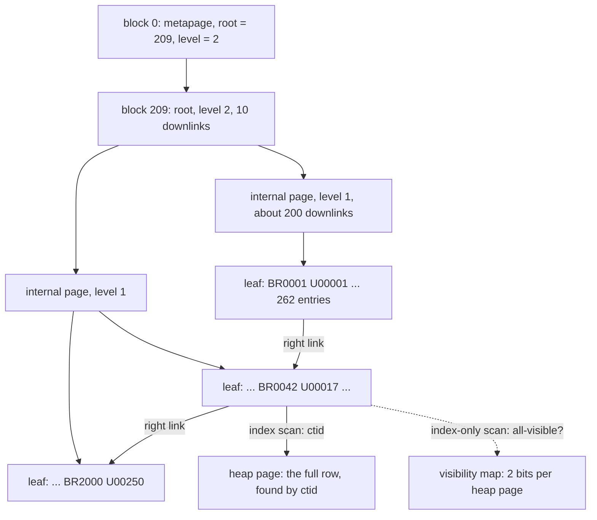

# Module 6.09: B-tree indexes, composite and covering indexes

**Estimated hours:** 5

**What you will learn**

1. How a B-tree index is built from 8 KB pages (metapage, root, internal pages, a linked chain of leaf pages) and why finding one user among 500,000 reads only 3 index pages; you will read those pages yourself with `pageinspect`.
2. How to choose the column order of a composite index (leftmost prefix; equality columns first, range and sort columns last), when `INCLUDE` makes an index covering, and what an index-only scan needs from the visibility map.
3. What every index costs on writes, when partial, unique and expression indexes are the right tool, how to build and retire indexes safely, and how to fix the H7 login bottleneck from execution plans.

**Prerequisites:** [Module 6.08: Isolation levels and locking](module-08-isolation-levels-and-locking.md). This module also uses heap pages and `ctid` from module 6.05 and the visibility map and VACUUM from module 6.07. You will read a few lines of `EXPLAIN` output; module 6.10 teaches plans in full.

---

## 1. One-line intuition

An index is a sorted copy of a few columns, each entry pointing at its row, stored as a shallow tree of pages so the database finds any key by reading 3 or 4 pages instead of the whole table.

## 2. Real-life analogy

A large bank prints a **staff directory** for its security desk.

- The directory is sorted by **branch code, then user code**. That sort order is the **index key**, and the two-part key is a **composite** key.
- The **thumb tabs** on the edge (BR0001-BR0200, BR0201-BR0400, ...) are the **root page**. The bold **guide words** at the top of each page are the **internal pages**. The lines of names are the **leaf pages**.
- Each line ends with "cabinet 6880, drawer 37": where the person's full file is kept. That is the **`ctid`**, the row's address in the table (the **heap**).
- The guard looking up "BR0042, U00017" opens a tab, reads one guide word, reads one page, then walks to the cabinet. Four steps, whether the bank has 5,000 staff or 5 million.
- If the directory line also prints the person's **role and status**, the guard never walks to the cabinet. That is a **covering index**.
- The guard cannot use this directory to find "everyone called U00017 in any branch": the book is sorted by branch first. That is the **leftmost-prefix rule**.
- A thin separate booklet listing only **locked** staff is a **partial index**. A second directory sorted by **upper-case** branch code is an **expression index**.
- Every new hire must be written into **every** directory the bank keeps. That is the **write cost** of indexes.

## 3. Why it exists: the problem it solves

Without an index, the only way to find a row is a **sequential scan** (seq scan): read every page of the table and test every row. In the lab you will see the login query on a 500,000-row `users` table read all 8,197 pages (64 MB) to return one row. One login is tolerable. At 9:30 in the morning, when every branch opens and thousands of staff log in within minutes, each login reading 64 MB saturates CPUs and the buffer pool, and logins queue. That is the bottleneck in resume claim H7.

A B-tree turns "read everything" (cost grows with N, the row count) into "walk down a tree" (cost grows with log N). Each page holds hundreds of keys, so the tree is very flat: 3 levels for half a million entries, 4 levels for billions.

What breaks without indexes: lookups by key, uniqueness checks (a primary key needs an index to check "does this key already exist?" without scanning), foreign-key checks on delete, and any `ORDER BY ... LIMIT` that should stop early. What breaks with too many or the wrong indexes: every insert and update slows down, the disk fills, and the planner still scans because the index does not match the query.

## 4. Three layers of depth

### Layer 1 (beginner): creating and using an index

```sql
CREATE INDEX users_branch_user ON users (branch_code, user_code);   -- composite B-tree
CREATE UNIQUE INDEX customers_pan_uq ON customers (pan);             -- also enforces uniqueness
DROP INDEX users_branch_user;
```

- `PRIMARY KEY` and `UNIQUE` constraints create a unique B-tree index automatically. **Foreign keys do not**: `loan_applications.customer_id REFERENCES customers` creates no index on `customer_id`. You add it yourself if you join or delete by it.
- `\d users` in psql lists a table's indexes. `\di+` lists indexes with sizes.
- `EXPLAIN` shows whether a query uses an index: `Seq Scan on users` means no; `Index Scan using users_pkey`, `Index Only Scan` or `Bitmap Index Scan` mean yes.

A B-tree keeps keys **sorted**, so it can answer anything that "sorted order" helps with:

| Condition on the leading column(s) | Can a B-tree help? | Why |
|---|---|---|
| `=`, `IN (...)` | Yes | Walk to the key |
| `<`, `<=`, `>`, `>=`, `BETWEEN` | Yes | Walk to the start, then read along the leaf chain |
| `ORDER BY` the index columns, `LIMIT` | Yes | Rows come out already sorted; stop after LIMIT |
| `LIKE 'BR00%'` | Only with `text_pattern_ops`/`varchar_pattern_ops` or a `"C"` collation | A prefix is a range, but only in byte order (Layer 2) |
| `LIKE '%17'` | No | A suffix gives no starting point in sorted order |
| `upper(branch_code) = 'BR0042'` | No, unless you build an index on `upper(branch_code)` | The tree is sorted by the column, not by the function's result |
| Second column only, e.g. `user_code = 'U00017'` on index `(branch_code, user_code)` | Not as a search (PostgreSQL 16) | The tree is sorted by branch first |

### Layer 2 (working engineer): column order, covering, partial, expression, cost

**Composite column order: the leftmost-prefix rule.** An index on `(branch_code, user_code)` is sorted like a phone book: by `branch_code`, and inside each branch by `user_code`. It can be searched by `branch_code` alone, or by `branch_code` and `user_code`. It cannot be searched by `user_code` alone: those entries are spread across all 2,000 branches. In the lab, `WHERE user_code = 'U00017'` with only this index is a seq scan reading 8,197 pages. (PostgreSQL 18 added **skip scan**, which can probe each distinct leading value when there are few of them; on PostgreSQL 16 and on most other engines, design for the leftmost prefix.)

Rules for choosing the order:

1. Put the columns tested with **equality** first, then the **one** column tested with a **range** or used in `ORDER BY`. Columns after a range column cannot narrow the search.
2. Among equality columns, order by which **other queries** should share the index, not by "most selective first". For the login query (`branch_code = ? AND user_code = ?`) both orders find the row in the same 3 pages. `(branch_code, user_code)` wins because the branch admin screen ("all users of BR0042") can also use it.
3. Example from module 6.10's data: the branch work queue `WHERE branch_code = ? AND status = 'SUBMITTED' ORDER BY created_at LIMIT 20` wants `(branch_code, status, created_at)`. The plan becomes `Limit -> Index Scan` with no Sort node: the index returns rows already in `created_at` order and stops after 20.

**Covering indexes and index-only scans.** A normal index scan finds the key in the index, then visits the heap page to fetch the other columns. If every column the query needs is inside the index, PostgreSQL can do an **Index Only Scan** and skip the heap. `INCLUDE` adds **payload columns**: stored in the leaf entries, not part of the sort key, not used for searching or uniqueness.

```sql
CREATE INDEX users_login_cover ON users (branch_code, user_code)
       INCLUDE (password_hash, role_id, status);
-- or make the primary key itself covering, so you maintain one index, not two:
-- ALTER TABLE users ADD CONSTRAINT users_pkey
--       PRIMARY KEY (branch_code, user_code) INCLUDE (password_hash, role_id, status);
```

The catch is **MVCC** (module 6.07). The index does not store `xmin`/`xmax`, so it cannot know whether an entry's row version is visible to you. PostgreSQL checks the **visibility map**: 2 bits per heap page, one of them "all-visible" (every row on the page is visible to every transaction). If the page is all-visible, the heap is skipped. If not, the heap tuple is fetched anyway, and `EXPLAIN ANALYZE` counts it as **`Heap Fetches`**. Only VACUUM sets all-visible bits; any insert, update or delete on a page clears its bit. So an index-only scan is only as good as your vacuuming.

**Partial indexes** index only the rows matching a `WHERE`:

```sql
CREATE INDEX users_locked ON users (branch_code) WHERE status = 'L';   -- 136 kB instead of 15 MB
```

The planner uses it only when the query's `WHERE` implies the predicate (`... AND status = 'L'`). Typical uses: "pending" work queues, soft-deleted rows excluded, "active only".

**Unique indexes** enforce that no two rows share the key. By default `NULL`s are all distinct (two `NULL`s do not conflict); PostgreSQL 15 added `UNIQUE NULLS NOT DISTINCT` to change that.

**Expression indexes** index the result of an expression: `CREATE INDEX ON branches (upper(branch_code));`. The query must use the same expression (`WHERE upper(branch_code) = 'BR0042'`), and the function must be `IMMUTABLE` (module 6.11). The better fix is usually to normalise the input in the application so the plain key works.

**`LIKE` and collation.** Under a linguistic collation such as the Docker image's `en_US.utf8`, sort order is not byte order, so a plain B-tree cannot turn `LIKE 'User BR0042-1%'` into a range. An index declared with `text_pattern_ops` (or `varchar_pattern_ops`) compares bytes and can. The lab shows both.

**The write cost.** Every `INSERT` adds one entry to **every** index: a tree descent, maybe a page split, plus WAL for each. An `UPDATE` that cannot be **HOT** (module 6.05: new version on another page, or an indexed column changed) adds an entry to every index again. `INCLUDE` columns count as indexed columns for this rule. On one test machine, loading 500,000 users into a copy of the table took about 7 times longer with 5 indexes than with none; you will measure your own ratio. Indexes are a read-versus-write trade, and on a master table that is read thousands of times per write, the trade is easy.

**Building on a live system.** Plain `CREATE INDEX` blocks writes to the table until it finishes. `CREATE INDEX CONCURRENTLY` allows writes: it scans the table twice and waits for older transactions, so it is slower, cannot run inside a transaction block, and if it fails leaves an `INVALID` index that you must drop (`DROP INDEX CONCURRENTLY`) and retry. `REINDEX INDEX CONCURRENTLY` rebuilds a bloated index the same way.

**Finding unused indexes.** `pg_stat_user_indexes` counts scans per index (`idx_scan`, and from PostgreSQL 16 `last_idx_scan`). An index with `idx_scan = 0` over a full business cycle (include a month-end) is a candidate to drop. Counters are per server: a replica has its own.

**Other index types**, for completeness: `hash` (equality only), `GIN` (contents of `jsonb`, arrays, full text), `GiST` (geometry, ranges), `BRIN` (tiny min/max summaries per block range, good for `created_at` on huge append-only tables). B-tree is the default and the right answer for business codes.

### Layer 3 (internals): pages, the descent, splits, and the visibility check

**Pages.** A B-tree index is a file of 8 KB pages, like the heap (module 6.05), with the same page header and line pointers. Block 0 is the **metapage**: it records which block is the root and the tree height. Every other page is a **leaf** (level 0), an **internal** page (level 1 and up) or the **root** (the single page at the top level). Each page ends with 16 bytes of **special space** holding `btpo_prev` and `btpo_next` (left and right sibling block numbers), the level and flags. So every level is a doubly linked list, and the leaf level is the **leaf chain** that range scans walk.

**Entries.** A leaf entry is an 8-byte header (the 6-byte heap `ctid` plus 2 bytes of size and flags) followed by the key bytes, padded to 8 bytes. In the lab, `users_pkey` entries are 24 bytes: `0f 42 52 30 30 30 31 0f 55 30 30 30 30 31 00 00`. Read it: `0f` is a 1-byte varlena length header (7 bytes including itself), then `42 52 30 30 30 31` is ASCII `BR0001`; `0f` again, then `U00001`; then 2 bytes of padding. An internal entry (a **pivot**) holds a separator key and a **downlink**: the block number of a child page. The first entry on an internal page has no key at all: it means "minus infinity", everything smaller than the next separator. On every page except the rightmost of its level, item 1 is the **high key**: an upper bound for keys on that page, not a real row. Since PostgreSQL 12, pivots are **suffix-truncated**: only as many key columns as needed to separate the two pages are kept, which raises fan-out.

**Fan-out and height.** Your `users_pkey` has 262 entries per leaf page (leaves are filled to 90% on build) and about 200 downlinks per internal page (internal pages are filled to 70% on build). 500,000 entries need 1,916 leaves, 10 internal pages and 1 root: height 3, `level = 2` in the metapage. A fourth level appears somewhere past 10 to 25 million entries of this size, depending on how full the pages are; a fifth only past billions.

**The descent.** To find `('BR0042', 'U00017')`: read the metapage (cached after first use) for the root block; binary-search the root's 10 separators, follow the downlink; binary-search the internal page, follow the downlink; binary-search the leaf, find the entry, read its `ctid`; read the heap page and check visibility. That is exactly the `Buffers: shared hit=1 read=3` in stage 2 of the lab: 3 index pages plus 1 heap page.

**Splits and concurrency.** When an insert finds its leaf full, the leaf **splits**: a new right sibling is allocated, about half the entries move (when inserting at the far right, as with an ascending key, the split leaves the left page nearly full instead), and a new separator is inserted in the parent, which may split too. A root split adds a level. PostgreSQL's B-tree follows the **Lehman and Yao** design: because every page has a right link and a high key, a reader that lands on a page just after it was split notices the key is above the high key and simply moves right. Readers never lock the whole tree, and writers lock only one or two pages at a time.

**Keeping it small.** PostgreSQL 13 added **deduplication**: many equal keys are stored once with a posting list of `ctid`s (not used when the index has `INCLUDE` columns, which is one reason the covering index is 50 MB against the key-only 15 MB). PostgreSQL 14 added **bottom-up deletion**, which removes dead duplicates before a page has to split. VACUUM removes entries that point to dead tuples.

**The visibility check in an index-only scan.** For each matching entry, the executor reads the visibility-map bit for the entry's heap page. One 8 KB visibility-map page covers about 32,000 heap pages (about 250 MB of table), so it stays hot in memory. That is why stage 3 still reports 4 buffers: 3 index pages plus 1 visibility-map page, and 0 heap pages. In the lab, updating one user's `last_login_at` makes the next index-only scan report `Heap Fetches: 2`: the page was full, so the update was not HOT; the new version went to another page and got new index entries; both entries now point at pages whose all-visible bit is clear. After `VACUUM users` it is back to 0.

**On YugabyteDB the trade-off shifts (module 7.07).** YugabyteDB stores a table ordered by its primary key in DocDB (an LSM tree on RocksDB), split into tablets on different nodes; there is no separate heap. A primary-key lookup already reads the whole row from one tablet. A secondary index is a separate distributed table: a non-covering index lookup is one network read to the index tablet, then a second read to the table's tablet. A covering secondary index removes that second network hop, so covering matters more on a multi-node cluster than on one PostgreSQL server.

## 5. Architecture diagram



A lookup goes down one path: root, one internal page, one leaf. A range scan goes down once, then walks right along the leaf chain. An index-only scan consults the visibility map instead of the heap.

## 6. Code

The index lab needs volume, so it builds its own database, `lending_perf`, with the canonical master tables from module 6.03: 4 roles, 2,000 branches, 500,000 users (250 per branch, user codes unique only within a branch) and 12 products. `users` is created **without** its primary key, the way a bulk migration left it. Save as `perf_setup.sql`:

```sql
-- perf_setup.sql  (module 6.09)
-- Builds lending_perf: the canonical master tables from module 6.03 at a
-- realistic volume: 4 roles, 2,000 branches, 500,000 users, 12 products.
-- users is created WITHOUT its primary key, the way a bulk migration
-- left it. You add the right indexes yourself during the lab.
-- Run:  psql -h localhost -U postgres -f perf_setup.sql
\set ON_ERROR_STOP on
DROP DATABASE IF EXISTS lending_perf;
CREATE DATABASE lending_perf;
\c lending_perf
CREATE EXTENSION IF NOT EXISTS pageinspect;

CREATE TABLE branches (
  branch_code  varchar(6) PRIMARY KEY,
  name         text NOT NULL,
  city         text NOT NULL,
  region       text NOT NULL,
  opened_on    date NOT NULL
);
CREATE TABLE roles (
  role_id      smallint PRIMARY KEY,
  role_name    text NOT NULL UNIQUE
);
CREATE TABLE users (
  branch_code   varchar(6) NOT NULL REFERENCES branches,
  user_code     varchar(10) NOT NULL,
  full_name     text NOT NULL,
  password_hash text NOT NULL,
  role_id       smallint NOT NULL REFERENCES roles,
  status        char(1) NOT NULL DEFAULT 'A',
  last_login_at timestamptz
  -- PRIMARY KEY (branch_code, user_code) is deliberately missing (lab Part B)
);
CREATE TABLE products (
  product_code      varchar(8) PRIMARY KEY,
  name              text NOT NULL,
  min_amount_paise  bigint NOT NULL,
  max_amount_paise  bigint NOT NULL,
  max_tenure_months int NOT NULL,
  base_rate_bp      int NOT NULL,
  active            boolean NOT NULL DEFAULT true
);

INSERT INTO roles VALUES
  (1, 'CLERK'), (2, 'CREDIT_OFFICER'), (3, 'BRANCH_MANAGER'), (4, 'AUDITOR');

-- 2,000 branches BR0001..BR2000 in 40 cities; each city sits in one of
-- 5 regions, so city decides region (module 6.10 uses that correlation).
INSERT INTO branches
SELECT 'BR' || lpad(g::text, 4, '0'),
       'Branch ' || g,
       'CITY' || lpad((g % 40)::text, 2, '0'),
       (ARRAY['NORTH','SOUTH','EAST','WEST','CENTRAL'])[(g % 40) / 8 + 1],
       date '1990-01-01' + (g * 5)
FROM generate_series(1, 2000) AS g;

-- 250 users per branch = 500,000 users. user_code is unique only inside
-- its branch (U00001..U00250), so the real key is (branch_code, user_code).
-- ORDER BY random() scatters each branch's users over the whole table,
-- the way years of hiring would.
INSERT INTO users
SELECT b.branch_code,
       'U' || lpad(u::text, 5, '0'),
       'User ' || b.branch_code || '-' || u,
       -- 60-character stand-in shaped like a bcrypt hash (not a real one)
       '$2b$12$' || substr(md5(b.branch_code || u) || md5(u || b.branch_code), 1, 53),
       CASE WHEN u % 10 < 6 THEN 1 WHEN u % 10 < 8 THEN 2
            WHEN u % 10 = 8 THEN 3 ELSE 4 END,
       CASE WHEN u % 50 = 0 THEN 'L' ELSE 'A' END,
       now() - (u % 90) * interval '1 day'
FROM branches b CROSS JOIN generate_series(1, 250) AS u
ORDER BY random();

INSERT INTO products VALUES
  ('HL01', 'Home loan',                  50000000, 5000000000, 360,  850, true),
  ('HL02', 'Home loan top-up',           10000000, 1000000000, 240,  900, true),
  ('PL01', 'Personal loan',               5000000,  250000000,  60, 1250, true),
  ('PL02', 'Personal loan (old scheme)',  5000000,  150000000,  48, 1400, false),
  ('GL01', 'Gold loan',                   1000000,  200000000,  36,  950, true),
  ('VL01', 'Vehicle loan',               10000000,  500000000,  84,  925, true),
  ('EL01', 'Education loan',             10000000,  750000000, 180,  875, true),
  ('BL01', 'Business loan',              50000000, 2000000000, 120, 1100, true),
  ('AL01', 'Agriculture loan',            2500000,  300000000,  60,  700, true),
  ('LAP1', 'Loan against property',      50000000, 3000000000, 180,  975, true),
  ('KCC1', 'Kisan credit card',           1000000,   30000000,  12,  700, true),
  ('MSE1', 'Micro enterprise loan',       2500000,  100000000,  60, 1050, true);

-- Visibility map and statistics, as autovacuum would eventually do.
VACUUM ANALYZE;

SELECT 'branches' AS t, count(*) FROM branches
UNION ALL SELECT 'users', count(*) FROM users
UNION ALL SELECT 'products', count(*) FROM products;
SELECT pg_size_pretty(pg_relation_size('users')) AS users_heap,
       pg_relation_size('users') / 8192          AS users_pages;
```

Now the H7 query through four designs. Save as `login_fix.sql`:

```sql
-- login_fix.sql  (module 6.09, capstone C5 part 2)
-- The H7 login query through four index designs. Run once, after perf_setup.sql:
--   psql -h localhost -U postgres -d lending_perf -f login_fix.sql
\set ON_ERROR_STOP on

\echo '=== stage 0: no index on users (as the migration left it)'
EXPLAIN (ANALYZE, BUFFERS, COSTS OFF, TIMING OFF)
SELECT password_hash, role_id, status FROM users
WHERE branch_code = 'BR0042' AND user_code = 'U00017';

\echo '=== stage 1: an index that holds both columns, but does not lead with them'
CREATE INDEX users_status_branch_user ON users (status, branch_code, user_code);
EXPLAIN (ANALYZE, BUFFERS, COSTS OFF, TIMING OFF)
SELECT password_hash, role_id, status FROM users
WHERE branch_code = 'BR0042' AND user_code = 'U00017';
DROP INDEX users_status_branch_user;

\echo '=== stage 2: composite primary key (branch_code, user_code)'
ALTER TABLE users ADD PRIMARY KEY (branch_code, user_code);
EXPLAIN (ANALYZE, BUFFERS, COSTS OFF, TIMING OFF)
SELECT password_hash, role_id, status FROM users
WHERE branch_code = 'BR0042' AND user_code = 'U00017';

\echo '=== stage 3: covering index, the login never visits the table'
CREATE INDEX users_login_cover ON users (branch_code, user_code)
       INCLUDE (password_hash, role_id, status);
EXPLAIN (ANALYZE, BUFFERS, COSTS OFF, TIMING OFF)
SELECT password_hash, role_id, status FROM users
WHERE branch_code = 'BR0042' AND user_code = 'U00017';

\echo '=== sizes'
SELECT pg_size_pretty(pg_relation_size('users'))             AS heap,
       pg_size_pretty(pg_relation_size('users_pkey'))        AS pkey,
       pg_size_pretty(pg_relation_size('users_login_cover')) AS cover;
```

Run both:

```bash
psql -h localhost -U postgres -f perf_setup.sql          # about 20-60 seconds
psql -h localhost -U postgres -d lending_perf -f login_fix.sql
```

Expected output of `login_fix.sql` (execution times vary by machine and by run; the plan shapes, row counts and buffer counts are what you check; `hit` versus `read` depends on what is already cached):

```text
=== stage 0: no index on users (as the migration left it)
 Gather (actual rows=1 loops=1)
   Workers Planned: 2
   Workers Launched: 2
   Buffers: shared hit=8197
   ->  Parallel Seq Scan on users (actual rows=0 loops=3)
         Filter: (((branch_code)::text = 'BR0042'::text) AND ((user_code)::text = 'U00017'::text))
         Rows Removed by Filter: 166666
         Buffers: shared hit=8197
 Execution Time: 67.529 ms
=== stage 1: an index that holds both columns, but does not lead with them
 Gather (actual rows=1 loops=1)
   ...                                   (identical: the index is ignored)
   ->  Parallel Seq Scan on users (actual rows=0 loops=3)
         Buffers: shared hit=8197
=== stage 2: composite primary key (branch_code, user_code)
 Index Scan using users_pkey on users (actual rows=1 loops=1)
   Index Cond: (((branch_code)::text = 'BR0042'::text) AND ((user_code)::text = 'U00017'::text))
   Buffers: shared hit=1 read=3
 Execution Time: 16.217 ms
=== stage 3: covering index, the login never visits the table
 Index Only Scan using users_login_cover on users (actual rows=1 loops=1)
   Index Cond: ((branch_code = 'BR0042'::text) AND (user_code = 'U00017'::text))
   Heap Fetches: 0
   Buffers: shared hit=1 read=3
 Execution Time: 0.766 ms
=== sizes
 heap  | pkey  | cover
-------+-------+-------
 64 MB | 15 MB | 50 MB
```

Read it: stage 0 reads all 8,197 heap pages, split across a leader and 2 parallel workers (`loops=3`), and throws away 499,999 rows. Stage 1 proves that "an index containing the columns" is not enough: its leading column `status` is not in the `WHERE`, so it cannot be searched. Stage 2 reads 4 pages (3 index levels and 1 heap page). Stage 3 reads 4 pages too, but none is a heap page: 3 index pages and the visibility-map page, and `Heap Fetches: 0`. (The first run of each stage includes reading pages into memory, so ignore single execution times; Part B measures properly.)

Finally, look inside the tree. Save as `tree_walk.sql`:

```sql
-- tree_walk.sql  (module 6.09): look inside users_pkey with pageinspect
--   psql -h localhost -U postgres -d lending_perf -f tree_walk.sql
\echo '--- metapage (block 0): where is the root, how tall is the tree?'
SELECT root, level, fastroot FROM bt_metap('users_pkey');
SELECT root FROM bt_metap('users_pkey') \gset

\echo '--- the root page'
SELECT blkno, type, live_items, avg_item_size, btpo_level
FROM bt_page_stats('users_pkey', :root);
SELECT itemoffset, ctid, itemlen, data
FROM bt_page_items('users_pkey', :root) LIMIT 3;

\echo '--- the first leaf page (block 1) and its neighbours in the leaf chain'
SELECT blkno, type, live_items, avg_item_size, free_size, btpo_prev, btpo_next, btpo_level
FROM bt_page_stats('users_pkey', 1);
SELECT itemoffset, ctid, itemlen, data
FROM bt_page_items('users_pkey', 1) LIMIT 3;

\echo '--- pages per level'
SELECT btpo_level, type, count(*) AS pages
FROM generate_series(1, pg_relation_size('users_pkey') / 8192 - 1) AS blk,
     LATERAL bt_page_stats('users_pkey', blk::int)
GROUP BY 1, 2 ORDER BY 1 DESC;
```

Expected output (block numbers and counts match on any machine because the index was built from sorted keys; the heap `ctid`s on leaf entries differ because the rows were shuffled randomly):

```text
 root | level | fastroot
------+-------+----------
  209 |     2 |      209

 blkno | type | live_items | avg_item_size | btpo_level
-------+------+------------+---------------+------------
   209 | r    |         10 |            22 |          2

 itemoffset |  ctid   | itemlen |                      data
------------+---------+---------+-------------------------------------------------
          1 | (3,0)   |       8 |
          2 | (208,2) |      24 | 0f 42 52 30 32 31 32 0f 55 30 30 32 33 34 00 00
          3 | (413,2) |      24 | 0f 42 52 30 34 32 34 0f 55 30 30 32 31 37 00 00

 blkno | type | live_items | avg_item_size | free_size | btpo_prev | btpo_next | btpo_level
-------+------+------------+---------------+-----------+-----------+-----------+------------
     1 | l    |        262 |            24 |       812 |         0 |         2 |          0

 itemoffset |   ctid    | itemlen |                      data
------------+-----------+---------+-------------------------------------------------
          1 | (3983,2)  |      24 | 0f 42 52 30 30 30 32 0f 55 30 30 30 31 32 00 00
          2 | (4923,27) |      24 | 0f 42 52 30 30 30 31 0f 55 30 30 30 30 31 00 00
          3 | (6289,4)  |      24 | 0f 42 52 30 30 30 31 0f 55 30 30 30 30 32 00 00

 btpo_level | type | pages
------------+------+-------
          2 | r    |     1
          1 | i    |    10
          0 | l    |  1916
```

Read the root: item 1 has no key and points to block 3 (the "minus infinity" downlink); item 2 says "keys from `BR0212`/`U00234` upwards go to block 208" (in a pivot, the `ctid` field holds the child block and the number of key columns kept, here 2). Read leaf block 1: item 1 is the high key (`BR0002`/`U00012`, the upper bound of this page, not a row); item 2 is the first real entry, `BR0001`/`U00001`, pointing at heap page 4923, line pointer 27; `btpo_prev = 0` means "no left sibling", `btpo_next = 2` is the next leaf in the chain. 1 root + 10 internal + 1,916 leaves + the metapage = 1,928 pages = 15 MB.

## 7. Use case: core-banking loan-origination platform

**The incident.** After the lending platform moved to a multi-node distributed SQL cluster, branch staff reported that login took several seconds at opening time and occasionally timed out. Application logs showed the login service was fine; the time was in one query: fetch `password_hash`, `role_id` and `status` for a branch code and user code.

**What the plans showed.** `EXPLAIN ANALYZE` showed a sequential scan over the whole users master table for every login. Two causes, both of which you reproduce in the lab: some master tables had been bulk-loaded without their primary keys (the loader skipped constraints for speed, and adding them back was deferred), and one code path compared `upper(branch_code)` to the typed input, which no plain index can serve. The same pattern showed up on smaller master tables keyed by business codes.

**The decisions it drove.**

1. **Normalise, do not wrap.** The client upper-cases branch and user codes before sending them; the query compares the bare columns. No expression index needed, one less index to maintain.
2. **Composite key in the order `(branch_code, user_code)`.** Equality on both columns serves the login; branch first also serves the branch admin screens ("all users of my branch"), which the opposite order could not.
3. **Covering the login with `INCLUDE (password_hash, role_id, status)`.** The login touches no table row. The cost was accepted knowingly: the index is 3 times the size of the key-only index (50 MB against 15 MB here), a password or status change updates the index, and the visibility map must stay current, so autovacuum was tuned more aggressively on `users` because every login also writes `last_login_at`. On the distributed cluster, the covering secondary index for a login path keyed differently from the primary key saved a second network read per login.
4. **Leave tiny tables alone.** `products` (12 rows, 1 page) is read with a seq scan even though it has a primary key, and that is correct: reading 1 page beats walking an index to reach the same page. The fix list contained only tables where the plan showed thousands of pages per lookup.

The numbers to quote are the ones you produce in Part B: pages read per login, average login latency and logins per second, before and after.

## 8. Lab

Keep one terminal with `psql -h localhost -U postgres -d lending_perf`. Run `perf_setup.sql` and `login_fix.sql` from section 6 first.

### Part A: anatomy of the tree (30 minutes)

1. Run `tree_walk.sql`. Confirm `level = 2` (3 levels), 262 entries on leaf 1 and 1,916 leaves.
2. Decode the first real leaf entry by hand from its `data` bytes, as in Layer 3. Then check it: `SELECT ctid, branch_code, user_code FROM users WHERE ctid = '(4923,27)';` using the `ctid` your output shows. Expected: `BR0001`, `U00001`.
3. Follow the root's item 2 downlink: `SELECT blkno, type, live_items, btpo_level FROM bt_page_stats('users_pkey', 208);` Expected: type `i`, level 1, 204 items.
4. Compute: with 262 entries per leaf and about 200 downlinks per internal page, how many entries fit under a root of 200 downlinks at height 3? At height 4? Write both numbers down.

<details>
<summary>Answer to step 4</summary>

Height 3: 200 x 200 x 262, about 10 million entries. Height 4: about 2 billion. Pages that fill up to 100% through later inserts stretch both numbers further. In practice a B-tree on business codes stays at 3 or 4 levels for any table you will meet in banking.

</details>

### Part B: fix the login and measure it (60 minutes)

You will measure latency with **pgbench**, PostgreSQL's benchmark tool, which runs a script repeatedly from several connections and reports average latency and transactions per second (tps). Save as `login_bench.sql`:

```sql
\set b random(1, 2000)
\set u random(1, 250)
SELECT password_hash, role_id, status FROM users
WHERE branch_code = 'BR' || lpad(:b::text, 4, '0') AND user_code = 'U' || lpad(:u::text, 5, '0');
```

1. Reset to the "migration left it bare" state and copy the script into the container:

```bash
psql -h localhost -U postgres -f perf_setup.sql
docker cp login_bench.sql pg16:/tmp/login_bench.sql
```

2. Stage 0, no index. 4 clients for 15 seconds:

```bash
docker exec pg16 pgbench -U postgres -n -f /tmp/login_bench.sql -c 4 -T 15 lending_perf
```

Record `latency average` and `tps`. Expected: tens to hundreds of milliseconds per login and tps in the tens. On one test machine (4 vCPU WSL2): about 190 ms and about 20 tps.

3. Stage 2: `ALTER TABLE users ADD PRIMARY KEY (branch_code, user_code);` then rerun pgbench. Expected: below 1 ms and thousands of tps (the same test machine: about 0.4 ms and about 9,700 tps). The ratio of several hundred times is the point; your absolute numbers will differ.
4. Stage 3: create `users_login_cover` (section 6), run `VACUUM users;`, rerun pgbench. Expected: about the same as stage 2. Explain why in your journal: the whole table fits in `shared_buffers`, so the heap page that stage 3 avoids was already in memory. The covering index pays off when heap pages are cold (tables much larger than memory) and on distributed SQL, where the avoided read is a network hop.
5. Show where covering does change the work on one PostgreSQL server: the branch user list.

```sql
DROP INDEX users_login_cover;
EXPLAIN (ANALYZE, BUFFERS) SELECT user_code, role_id, status
FROM users WHERE branch_code = 'BR0042' ORDER BY user_code;
CREATE INDEX users_login_cover ON users (branch_code, user_code)
       INCLUDE (password_hash, role_id, status);
EXPLAIN (ANALYZE, BUFFERS) SELECT user_code, role_id, status
FROM users WHERE branch_code = 'BR0042' ORDER BY user_code;
```

Expected: first a `Bitmap Index Scan on users_pkey` feeding a `Bitmap Heap Scan` with `Heap Blocks: exact=246` and a `Sort`, about 250 buffers in total, because the branch's 250 users are scattered over 246 heap pages. Then an `Index Only Scan using users_login_cover`, `Heap Fetches: 0`, no Sort (the index is already in `user_code` order), about 7 buffers.

### Part C: when an index cannot be used (45 minutes)

Run each with `EXPLAIN` and write down the scan type:

```sql
-- 1. second column only (leftmost-prefix rule)
EXPLAIN SELECT branch_code FROM users WHERE user_code = 'U00017';
-- 2. function on the column
EXPLAIN SELECT password_hash FROM users WHERE lower(branch_code) = lower('br0042') AND user_code = 'U00017';
-- 3. suffix LIKE, then prefix LIKE with a plain and a pattern-ops index
EXPLAIN SELECT user_code FROM users WHERE full_name LIKE '%-17';
CREATE INDEX users_full_name ON users (full_name);
EXPLAIN SELECT user_code FROM users WHERE full_name LIKE 'User BR0042-1%';
CREATE INDEX users_full_name_pat ON users (full_name text_pattern_ops);
EXPLAIN SELECT user_code FROM users WHERE full_name LIKE 'User BR0042-1%';
DROP INDEX users_full_name; DROP INDEX users_full_name_pat;
-- 4. master lookups by business code
EXPLAIN (ANALYZE, BUFFERS) SELECT min_amount_paise, max_amount_paise, active FROM products WHERE product_code = 'HL01';
EXPLAIN (ANALYZE, BUFFERS) SELECT name, region FROM branches WHERE branch_code = 'BR0042';
EXPLAIN (ANALYZE, BUFFERS) SELECT name, region FROM branches WHERE upper(branch_code) = upper('br0042');
CREATE INDEX branches_upper_code ON branches (upper(branch_code));
ANALYZE branches;
EXPLAIN (ANALYZE, BUFFERS) SELECT name, region FROM branches WHERE upper(branch_code) = upper('br0042');
-- 5. partial index
CREATE INDEX users_locked ON users (branch_code) WHERE status = 'L';
EXPLAIN SELECT user_code FROM users WHERE branch_code = 'BR0042' AND status = 'L';
SELECT pg_size_pretty(pg_relation_size('users_locked'));
```

Expected: (1) Parallel Seq Scan, 2,000 rows (U00017 exists in every branch). (2) Parallel Seq Scan: `lower()` hides the column. (3) seq scan for the suffix; still a seq scan with the plain index, because the collation is not byte order; a `Bitmap Index Scan on users_full_name_pat` with `Index Cond: ((full_name ~>=~ 'User BR0042-1'::text) AND (full_name ~<~ 'User BR0042-2'::text))` with the pattern-ops index: the prefix became a range. (4) `products`: `Seq Scan`, `Buffers: shared hit=1`, the right plan for a 1-page table; `branches` by code: `Index Scan using branches_pkey`, 3 buffers; with `upper()`: `Seq Scan`, 17 buffers, `Rows Removed by Filter: 1999`; after the expression index: `Index Scan using branches_upper_code`, 3 buffers. (5) `Bitmap Index Scan on users_locked`, and the index is about 136 kB against 15 MB for the full key.

### Part D: what indexes cost (45 minutes)

1. Write amplification. In psql:

```sql
\timing on
CREATE TABLE users_w (LIKE users INCLUDING DEFAULTS);
INSERT INTO users_w SELECT * FROM users;           -- 0 indexes: note the time
TRUNCATE users_w;
ALTER TABLE users_w ADD PRIMARY KEY (branch_code, user_code);
CREATE INDEX ON users_w (branch_code, user_code) INCLUDE (password_hash, role_id, status);
CREATE INDEX ON users_w (full_name);
CREATE INDEX ON users_w (role_id, status);
CREATE INDEX ON users_w (last_login_at);
INSERT INTO users_w SELECT * FROM users;           -- 5 indexes: note the time
SELECT pg_size_pretty(pg_table_size('users_w')) AS heap, pg_size_pretty(pg_indexes_size('users_w')) AS indexes;
DROP TABLE users_w;
```

Expected: the second insert is several times slower (one test machine: about 2.8 s against 19.6 s), and the 5 indexes together are larger than the table (about 108 MB against 64 MB).

2. Heap fetches after a login write:

```sql
UPDATE users SET last_login_at = now() WHERE branch_code = 'BR0042' AND user_code = 'U00017';
EXPLAIN (ANALYZE, BUFFERS) SELECT password_hash, role_id, status FROM users
WHERE branch_code = 'BR0042' AND user_code = 'U00017';
VACUUM users;
-- run the same EXPLAIN again
```

Expected: `Heap Fetches: 2` before the VACUUM, `Heap Fetches: 0` after. Explain the 2 using Layer 3.

3. Build without blocking writes: `CREATE INDEX CONCURRENTLY users_role_status ON users (role_id, status);` Then try it inside `BEGIN; ... ROLLBACK;` and record the error (`CREATE INDEX CONCURRENTLY cannot run inside a transaction block`).
4. Unused indexes:

```sql
SELECT s.indexrelname, s.idx_scan, s.last_idx_scan,
       pg_size_pretty(pg_relation_size(s.indexrelid)) AS size
FROM pg_stat_user_indexes s JOIN pg_index i ON i.indexrelid = s.indexrelid
WHERE s.relname = 'users' AND NOT i.indisprimary
ORDER BY s.idx_scan, pg_relation_size(s.indexrelid) DESC;
```

Expected: `users_role_status` with `idx_scan = 0`. Drop it with `DROP INDEX CONCURRENTLY users_role_status;`.

### Journal

Copy [journal/TEMPLATE.md](../journal/TEMPLATE.md) to `journal/YYYY-MM-DD-btree-indexes.md`. Record: tree height, leaves and entries per leaf from Part A; for each stage in Part B the plan type, buffers per login, pgbench latency average and tps; the branch-list buffers before and after covering; the scan types from Part C; the insert times with 0 and 5 indexes and the heap-fetch counts from Part D. Write one paragraph, in your own words, on why stage 3 did not beat stage 2 in pgbench and when it would.

## 9. Common mistakes and misconceptions

| Mistake | Why it is wrong | Bug it causes later |
|---|---|---|
| "The table has an index on those columns, so the query uses it" | Only a usable leading prefix lets the tree be searched | Seq scans that survive an "index fix" (stage 1) |
| Putting the most selective column first, always | For equality on all columns order barely matters; it decides which other queries can share the index and where the range column goes | Duplicate indexes for every screen |
| Wrapping indexed columns in functions or casts (`upper(code)`, `code::int`) | The index is sorted by the raw column | The H7 seq scan, reappearing after every refactor |
| Expecting `LIKE 'abc%'` to use a plain index under `en_US` collation | Linguistic order is not byte order | Slow search screens; fix with `text_pattern_ops` |
| Assuming foreign keys are indexed | PostgreSQL indexes the referenced key, not the referencing column | Slow joins, and deletes of a parent row that scan the child table |
| "Index-only scan means zero heap access" | Only for pages marked all-visible by VACUUM | `Heap Fetches` climbing on busy tables; covering index gives no gain |
| Adding `INCLUDE` columns freely | Bigger index, no deduplication, updates to those columns are never HOT, entries over about 2.7 kB are rejected | Write slowdowns; insert errors "index row size exceeds btree maximum" |
| `CREATE INDEX` on a live, busy table | It blocks writes until done | An outage at peak time; use `CONCURRENTLY` |
| Never dropping indexes | Every index taxes every write and vacuum | Slow inserts, bigger backups, longer recovery |
| Treating a seq scan as always bad | For a 1-page master table it is the cheapest plan | Wasted effort and pointless indexes |

## 10. Resume link

- **H7, "fixing a login-latency bottleneck by finding full-table scans on master tables keyed by business codes, then designing composite and covering indexes from execution plans".** This module is that line, reproduced. Say it with your numbers: "The login query did a parallel seq scan over 8,197 pages. I added the composite key `(branch_code, user_code)` in that order because branch screens filter by branch, which took it to 4 buffers and, in pgbench, from about [your number] ms to [your number] ms. Then I made it covering with `INCLUDE (password_hash, role_id, status)` so it never touches the table, and tuned autovacuum because `last_login_at` writes clear visibility-map bits."
- **D, "B-tree indexing".** You can describe the structure from pages you have read: metapage, root, internal pages filled to 70%, leaves to 90%, high keys, right links, 3 levels for 500,000 keys.
- **H2, "decoding composite keys into a normalised, indexed schema".** Berkeley DB keys in capstone C3 are composite byte strings sorted the same way; the leftmost-prefix rule is why the target index order had to match the source key order.

Follow-ups to prepare: "Why not just index every column?" (write cost, measured in Part D). "How did you know the index was used in production?" (`pg_stat_user_indexes.idx_scan` and the plan in `auto_explain` or `pg_stat_statements`, module 6.10). "What changes on YugabyteDB?" (table clustered on its primary key; covering secondary indexes save a network hop; module 7.07).

## 11. Interview questions

**Q1 (easy). What is a composite index and what is the leftmost-prefix rule?**

<details>
<summary>Model answer</summary>

A composite index has more than one key column, for example `(branch_code, user_code)`. Entries are sorted by the first column, then by the second within equal first values. So the index can be searched by any leading prefix: `branch_code`, or `branch_code` and `user_code`. It cannot be searched by `user_code` alone, because those entries are scattered across every branch. On PostgreSQL 16 such a query is a seq scan or, at best, a full index scan; PostgreSQL 18 adds skip scan, which helps only when the leading column has few distinct values.

</details>

**Q2 (easy). What is a covering index, and what does `INCLUDE` do?**

<details>
<summary>Model answer</summary>

A covering index contains every column a query needs, so the database can answer from the index alone, an index-only scan. `INCLUDE` adds non-key payload columns to the leaf entries: they are returned by the scan but are not part of the sort order, cannot be searched, and do not participate in uniqueness. Example: the login index `(branch_code, user_code) INCLUDE (password_hash, role_id, status)`. The cost is a larger index, no deduplication, and updates to included columns can no longer be HOT.

</details>

**Q3 (medium). An index-only scan shows `Heap Fetches: 4000`. What is happening and how do you fix it?**

<details>
<summary>Model answer</summary>

PostgreSQL indexes have no visibility information, so for each entry the executor checks the visibility map. If the heap page is not marked all-visible, it must fetch the heap tuple to check `xmin`/`xmax`; that is a heap fetch. 4,000 heap fetches means many of the touched pages were modified since the last VACUUM, so the index-only scan is behaving like a normal index scan. Fixes: make autovacuum run more often on that table (lower `autovacuum_vacuum_scale_factor`, or `autovacuum_vacuum_insert_scale_factor` for insert-heavy tables), or run VACUUM after bulk loads; and reduce churn on the hot pages, for example by not updating a column like `last_login_at` on every request, or moving it to a separate table.

</details>

**Q4 (medium). You need an index for `WHERE branch_code = $1 AND status = 'SUBMITTED' ORDER BY created_at LIMIT 20`. Design it and explain the plan you expect.**

<details>
<summary>Model answer</summary>

`(branch_code, status, created_at)`: equality columns first, then the sort column. The planner descends once to the first entry for that branch and status, then reads leaf entries in `created_at` order and stops after 20, so the plan is `Limit -> Index Scan` (or a nested loop on top of it if joined), with no Sort node and roughly 20 heap visits. If `status = 'SUBMITTED'` is the only status the screen ever uses, a partial index `(branch_code, created_at) WHERE status = 'SUBMITTED'` is smaller and equally good. Putting `created_at` before `status` would be wrong: after a range or sort column, later columns cannot narrow the search.

</details>

**Q5 (hard). Walk through what PostgreSQL does, page by page, for a primary-key lookup on a 500,000-row table, and what changes when a concurrent insert splits the leaf you are heading to.**

<details>
<summary>Model answer</summary>

The metapage (block 0, normally cached) gives the root block. The executor pins the root, binary-searches its pivot keys, and follows the downlink to an internal page; repeats; reaches a leaf; binary-searches for the key; reads the heap `ctid` from the entry; then reads that heap page, follows the line pointer and checks the tuple's visibility against its snapshot. For 500,000 keys of about 24 bytes that is 3 index pages and 1 heap page, matching `Buffers: 4` in EXPLAIN. If an insert splits the target leaf after the reader read the parent but before it locked the leaf, some keys moved to a new right sibling. PostgreSQL's B-tree is a Lehman-Yao tree: each page has a high key and a right link, so the reader compares its search key with the leaf's high key, sees the key is above it, and follows the right link to the new sibling. No tree-wide lock is needed, readers take only short page-level locks, and the split's new separator is inserted into the parent afterwards, possibly splitting it and, at the top, adding a level.

</details>

## 12. Revision

- A B-tree is metapage, root, internal and leaf pages (a doubly linked leaf chain); hundreds of keys per page make it 3 to 4 levels deep, so a lookup reads 3 index pages plus 1 heap page instead of the whole table.
- Composite order follows the leftmost prefix: equality columns first, then one range or sort column; `INCLUDE` makes an index covering, and index-only scans skip the heap only for pages VACUUM marked all-visible.
- Every index taxes every write; use partial, unique and expression indexes deliberately, build with `CONCURRENTLY`, drop what `pg_stat_user_indexes` shows unused, and prove every fix with `EXPLAIN (ANALYZE, BUFFERS)` and a benchmark.

---

Previous: [Module 6.08: Isolation levels and locking](module-08-isolation-levels-and-locking.md) | Next: [Module 6.10: Query planner, EXPLAIN ANALYZE and join algorithms](module-10-planner-explain-analyze-joins.md)
