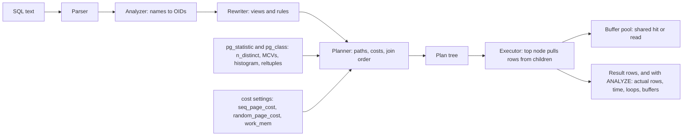
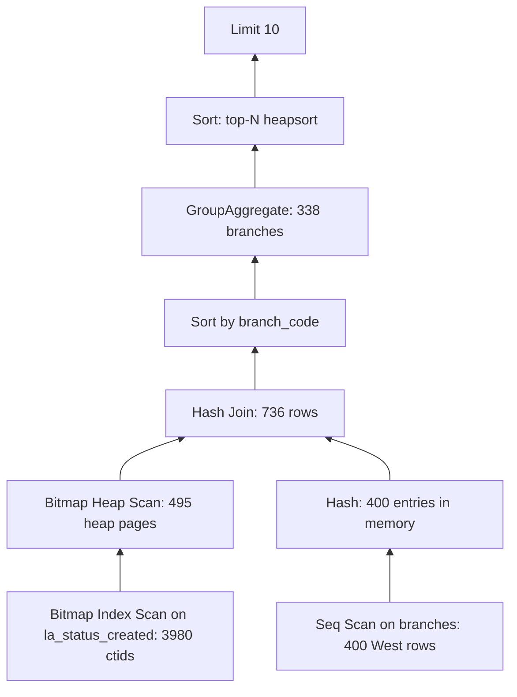

# Module 6.10: Query planner, EXPLAIN ANALYZE and join algorithms

**Estimated hours:** 6

**What you will learn**

1. How PostgreSQL turns SQL into a plan (parse, rewrite, plan, execute) and how to read a plan tree from the bottom up: cost, rows, width, actual time, loops and Buffers.
2. The scan types (sequential, index, index-only, bitmap) and the three join algorithms (nested loop, hash join, merge join): when the planner picks each, what memory they need, and how to force each one to compare them.
3. Where the planner's numbers come from (statistics and the cost model), why estimates go wrong, and a 7-step method for any slow query, applied to the login query and a branch dashboard.

**Prerequisites:** [Module 6.09: B-tree indexes, composite and covering indexes](module-09-btree-indexes-composite-covering.md). You need the `lending_perf` database from module 6.09 and the buffer-pool ideas from module 6.06 (`shared hit` means "found in memory", `read` means "asked the operating system").

---

## 1. One-line intuition

The planner is a route planner: it estimates how many rows each step will produce, prices every route it can think of, and runs the cheapest; `EXPLAIN` shows the route it chose and `EXPLAIN ANALYZE` drives it and reports the real distances.

## 2. Real-life analogy

The head-office operations manager must produce a report: "submitted applications in the West region this month, per branch".

- **Ways to find the applications.** Walk every filing cabinet and check every file (**sequential scan**). Use the card index to go straight to each file (**index scan**). Use the card index to write a list of cabinet numbers first, sort it, then visit each cabinet once (**bitmap scan**). If the card itself carries everything the report needs, never open a cabinet at all (**index-only scan**).
- **Ways to match applications with branches.** For each application, phone the branch desk and ask "are you in the West?" (**nested loop**: great for 20 applications, terrible for a million). Write the 400 West branch codes on one sheet on your desk, then go through the applications once, glancing at the sheet (**hash join**; if the sheet does not fit on the desk, you split the work into batches and use the floor: **spilling to disk**). Sort both piles by branch code and walk them side by side (**merge join**).
- **How the manager chooses.** From last month's census of the office: how many files, how many per status, how many per branch (**statistics**). If the census is stale, or assumes "city" and "region" are unrelated when every city sits in exactly one region, the estimate is wrong and so is the plan.

## 3. Why it exists: the problem it solves

SQL says **what** you want, not **how** to get it. For one query joining three tables there are several join orders, three join algorithms per join and several access paths per table: hundreds of possible plans. The best and worst can differ by a factor of a thousand. In module 6.09 the same login query took one path reading 8,197 pages and another reading 4.

Before cost-based planners, programmers wrote the access path into the code: open this index, walk this cursor, for each row look up that table. That is exactly how Berkeley DB programs work (module 6.13, claims H1 and H2), and it means every change in data size or shape needs a code change. A planner re-decides the path on every query from current statistics.

What breaks without understanding it: you add indexes blindly, the planner ignores them, and you cannot say why. What breaks when the planner is wrong: a nested loop that expected 10 rows gets a million, and a 20 ms report takes 20 minutes. `EXPLAIN ANALYZE` is how you see which of these is happening, and reading it is the core skill behind resume claim H7.

## 4. Three layers of depth

### Layer 1 (beginner): EXPLAIN, EXPLAIN ANALYZE, and reading one node

```sql
EXPLAIN SELECT * FROM branches WHERE region = 'WEST';                  -- plan only, nothing runs
EXPLAIN (ANALYZE, BUFFERS) SELECT * FROM branches WHERE region = 'WEST'; -- runs it, measures it
```

`EXPLAIN ANALYZE` **executes** the statement. For `INSERT`, `UPDATE` or `DELETE`, wrap it: `BEGIN; EXPLAIN ANALYZE UPDATE ...; ROLLBACK;`.

One node, field by field:

```text
Seq Scan on branches b  (cost=0.00..42.00 rows=400 width=18) (actual time=0.018..0.488 rows=400 loops=1)
  Filter: (region = 'WEST'::text)
  Rows Removed by Filter: 1600
  Buffers: shared hit=17
```

| Field | Meaning |
|---|---|
| `cost=0.00..42.00` | Estimated **startup cost** (before the first row) `..` **total cost** (all rows), in abstract units where reading one page sequentially costs 1.0 |
| `rows=400` | Estimated rows this node returns **per loop** |
| `width=18` | Estimated average bytes per output row |
| `actual time=0.018..0.488` | Real milliseconds to first row `..` to last row, **per loop** |
| `rows=400` (actual) | Real rows per loop. Compare with the estimate: this is the most important check |
| `loops=1` | How many times this node ran. Total rows = rows x loops; total time is about time x loops |
| `Filter` / `Rows Removed by Filter` | A condition checked row by row after reading, and how many rows it threw away |
| `Buffers: shared hit=17` | 17 pages found in `shared_buffers`; `read=N` pages came from the OS; `dirtied`/`written` pages changed or flushed; `temp read/written` spill files |

**A plan is a tree; read it bottom-up.** Indentation shows nesting and `->` marks a child. The most indented nodes run first and feed rows upward. The top node's numbers include everything below it. Planning Time and Execution Time at the bottom are the whole statement.

**Scan types you will see:**

| Node | What it does | Typical when |
|---|---|---|
| `Seq Scan` | Reads every page in order | Small tables, or most rows needed |
| `Index Scan` | Walks the index, visits the heap per match, returns rows in index order | Few rows, or order needed for `ORDER BY ... LIMIT` |
| `Index Only Scan` | Answers from the index; heap only for pages not all-visible (`Heap Fetches`) | Covering index, well-vacuumed table |
| `Bitmap Index Scan` + `Bitmap Heap Scan` | Collects all matching `ctid`s into a bitmap of pages, then reads each page once in physical order; `Recheck Cond` re-tests rows; `Heap Blocks: exact/lossy` | Medium selectivity, or combining two indexes (`BitmapAnd`/`BitmapOr`) |
| `Parallel Seq Scan` under `Gather` | The leader plus workers split the pages | Big tables, `max_parallel_workers_per_gather` > 0 |

### Layer 2 (working engineer): joins, statistics, memory, tools

**The three join algorithms.**

| Algorithm | How it works | Cost shape | Best when | Plan clues |
|---|---|---|---|---|
| Nested loop | For each outer row, look up matching inner rows (ideally through an index) | outer rows x cost of one inner lookup | Outer side is small; inner has an index on the join key | `Nested Loop`, inner node with `loops=N`; often `Memoize` (PostgreSQL 14+) caching inner results by key |
| Hash join | Build a hash table from the smaller input (the `Hash` node), then stream the other input and probe it | read both inputs once | Large unsorted inputs, equality join | `Hash Join`, `Hash Cond`, `Buckets`, `Batches`, `Memory Usage` |
| Merge join | Both inputs sorted on the join key (by an index or a `Sort`); walk them together | sort costs + one pass each | Inputs already sorted, or too big to hash | `Merge Join`, `Merge Cond`, `Sort` or `Index Scan` children |

Hash and merge joins need an equality condition; a nested loop can join on anything (`<`, `BETWEEN`, functions). A hash table may use `work_mem x hash_mem_multiplier` (4 MB x 2 by default). If the inner input is bigger, the join splits into `Batches` and spills partitions to temporary files: `Batches: 32` and `temp read/written` in Buffers are the sign.

**Forcing a plan to compare.** `SET enable_hashjoin = off;` (also `enable_mergejoin`, `enable_nestloop`, `enable_seqscan`, `enable_indexscan`, `enable_bitmapscan`, `enable_sort`) makes the planner add a huge penalty to that choice, so it picks the next-best plan. It is a diagnostic tool for your session. Never ship it in production configuration.

**Statistics.** `ANALYZE` (run by autovacuum when about 10% of a table has changed, or by hand) samples 300 x `default_statistics_target` rows (30,000 by default) and stores, per column, in `pg_statistic` (readable through the `pg_stats` view):

| `pg_stats` column | Meaning | Example on `loan_applications` |
|---|---|---|
| `null_frac` | Fraction of NULLs | 0 |
| `n_distinct` | Distinct values; negative means "this fraction of rows", -1 means unique | `status` 5, `branch_code` 2000, `application_id` -1 |
| `most_common_vals` / `most_common_freqs` | Up to 100 most common values and their frequencies | `{APPROVED,DISBURSED,REJECTED,SUBMITTED,DRAFT}` with about `{0.35,0.35,0.15,0.10,0.05}` |
| `histogram_bounds` | Up to 101 boundaries splitting the remaining values into equal-count buckets | used for `amount_paise > x` |
| `correlation` | -1 to 1: how well physical row order matches value order | `created_at` 1 (rows were inserted in time order), `branch_code` about 0 |

Table-level numbers live in `pg_class`: `reltuples` (row estimate) and `relpages`.

**From statistics to estimates.** `status = 'SUBMITTED'` is a most-common value with frequency about 0.10, so the estimate is 0.10 x 1,000,000 = about 100,000 rows. A value not in the list gets the leftover frequency spread evenly over the other distinct values. A range uses the histogram. For `a AND b` the planner **multiplies** the selectivities, assuming the columns are independent. When they are not, the estimate is wrong. On `branches`, `city = 'CITY07'` is 1/40 and `region = 'NORTH'` is 1/5, so the planner expects 2000 x 1/40 x 1/5 = 10 rows; the truth is 50, because CITY07 is always in NORTH. `CREATE STATISTICS ... (dependencies) ON city, region FROM branches` followed by `ANALYZE` teaches the planner the dependency (you will see the estimate become 50). Other kinds are `ndistinct` (for `GROUP BY a, b`) and `mcv` (common combinations).

Raise detail for one skewed column with `ALTER TABLE loan_applications ALTER COLUMN branch_code SET STATISTICS 1000; ANALYZE loan_applications;`.

**Memory: `work_mem`.** Each sort or hash node in each process may use up to `work_mem` (4 MB default) before spilling. A plan with 3 sorts and 2 hashes, run by a leader and 2 parallel workers, can use 15 times `work_mem`. That is why you raise it per session or per role (`ALTER ROLE reporting SET work_mem = '64MB'`), not globally. Plan clues: `Sort Method: quicksort Memory: 63639kB` (fit in memory), `top-N heapsort` (only the first N rows kept, for `LIMIT`), `external merge Disk: 25480kB` (spilled).

**Finding slow queries in a live system.**

- **`pg_stat_statements`** (extension; must be in `shared_preload_libraries`, so it needs a restart). Every statement is normalised (constants become `$1`, `$2`) and counted: `calls`, `total_exec_time`, `mean_exec_time`, `rows`, `shared_blks_hit`, `shared_blks_read`. Sorting by `total_exec_time` gives "what is the database spending its time on". Two logins with different user codes are one entry with `calls = 2`.
- **`auto_explain`** (module). Logs the plan of any statement slower than `auto_explain.log_min_duration`, optionally with `log_analyze` and `log_buffers`. `log_analyze` adds timing overhead to every statement, so in production use a high threshold or `auto_explain.sample_rate`.

### Layer 3 (internals): how the planner chooses, and the cost formula by hand

**The pipeline.** The **parser** turns text into a parse tree. The **analyzer** resolves names to objects (`users` becomes a table OID, `=` becomes a specific operator function). The **rewriter** expands views and rules. The **planner** then:

1. Simplifies: folds constants (`now() - interval '30 days'` is computed once per execution), pulls up subqueries into joins where it can, turns `IN (SELECT ...)` into semi-joins.
2. Builds **paths** for each table: one seq scan path, plus index, index-only and bitmap paths for every index whose leading columns match a condition, each with an estimated cost and output row count.
3. Searches **join orders** by dynamic programming: best way to join every pair of tables, then every triple built from the best pairs, and so on, keeping for each set of tables the cheapest path plus the cheapest path for each useful sort order (a merge join or `ORDER BY` above may want sorted input). With more than `join_collapse_limit` (8) explicit joins it stops reordering, and at `geqo_threshold` (12) tables it switches to a genetic search because the exhaustive search explodes.
4. Turns the winning path into a **plan tree**.

The **executor** runs the tree in the "iterator" (Volcano) style: the top node asks its child for one row, which asks its child, and so on. Rows are pulled up on demand. That is why `Limit` can stop a scan early, and why **startup cost** matters: a `Sort` must consume its whole input before returning its first row (high startup), an `Index Scan` returns its first row almost immediately.

**The cost model.** Costs are made of five constants you can read with `SHOW`:

| Setting | Default | Charged for |
|---|---|---|
| `seq_page_cost` | 1.0 | each page read sequentially |
| `random_page_cost` | 4.0 | each page read randomly (often lowered to 1.1 to 2 on SSDs) |
| `cpu_tuple_cost` | 0.01 | each row processed |
| `cpu_index_tuple_cost` | 0.005 | each index entry processed |
| `cpu_operator_cost` | 0.0025 | each operator or function evaluated |

Check the planner's arithmetic yourself. `branches` has `relpages = 17`, `reltuples = 2000`, one filter operator:

```text
17 x 1.0 + 2000 x (0.01 + 0.0025) = 17 + 25 = 42.00      -> Seq Scan ... (cost=0.00..42.00
```

The stage-0 login scan from module 6.09 (8,197 pages, 500,000 rows, two `=` operators, 2 workers):

```text
CPU part per row: 0.01 + 2 x 0.0025 = 0.015;  500,000 x 0.015 = 7,500
parallel divisor for 2 workers: 2 + (1 - 0.3 x 2) = 2.4   (the leader helps a little)
Parallel Seq Scan: 8,197 + 7,500 / 2.4 = 11,322.00
Gather: + parallel_setup_cost 1,000 + parallel_tuple_cost 0.1 x 1 row = 12,322.10
```

Those are exactly the numbers `EXPLAIN` prints for that query. Index costs use the same constants with more terms: the expected number of index pages and heap pages touched, the latter adjusted by `correlation` (highly correlated data means neighbouring index entries point at the same heap pages) and by `effective_cache_size` (how much of the table is probably cached).

**Rows are not pages.** In the lab, `status = 'DRAFT'` matches 5% of rows, yet its bitmap heap scan visits about 95% of the table's pages (`Heap Blocks: exact=11685` of 12,346), because drafts are spread evenly. The last 30 days of applications are a similar number of rows, but `created_at` has correlation 1, so they sit on about 500 consecutive pages. Selectivity in rows is not selectivity in I/O; `correlation` is how the planner tells the two apart.

**Generic plans.** A prepared statement (and every SQL statement inside PL/pgSQL, module 6.11) is planned with the real parameter values for its first 5 executions (custom plans), then the planner compares them with a **generic plan** built without values and keeps the generic one if it is not more expensive. `plan_cache_mode` overrides that, and `EXPLAIN (GENERIC_PLAN)` (new in PostgreSQL 16) shows the generic plan of a query with `$1` placeholders.

**YugabyteDB caveat (module 7.07).** YSQL reuses PostgreSQL's parser, planner and executor (forked from PostgreSQL 11 in the 2024 releases, PostgreSQL 15 in newer ones), so everything above reads the same. The difference is underneath: a "page read" is a network request to a tablet that may live on another node. A nested loop with 4,000 inner lookups can mean 4,000 remote reads unless the engine batches them (recent releases do, with a batched nested loop join). `EXPLAIN (ANALYZE, DIST)` adds storage read requests and rows scanned per node; on a cluster those counts, not `Buffers`, are what you minimise.

## 5. Architecture diagram



The dashboard plan from section 6, as the executor sees it (rows flow upward):



## 6. Code

The planner needs joins to plan, so add customers and loan applications to `lending_perf` (module 6.09 must have run first; its `users` primary key should be in place). Save as `perf_more.sql`:

```sql
-- perf_more.sql  (module 6.10)
-- Adds customers (200,000) and loan_applications (1,000,000) to lending_perf.
-- Needs perf_setup.sql from module 6.09 to have run first.
-- Run:  psql -h localhost -U postgres -d lending_perf -f perf_more.sql
\set ON_ERROR_STOP on
DROP TABLE IF EXISTS loan_applications, customers CASCADE;

-- Canonical columns from module 6.03. Foreign keys are added AFTER the
-- load: one validating join is far cheaper than a million per-row checks.
CREATE TABLE customers (
  customer_id  bigint PRIMARY KEY,
  branch_code  varchar(6) NOT NULL,
  full_name    text NOT NULL,
  pan          char(10) NOT NULL UNIQUE,
  dob          date NOT NULL,
  kyc_status   text NOT NULL,
  created_at   timestamptz NOT NULL DEFAULT now()
);
CREATE TABLE loan_applications (
  application_id  bigint PRIMARY KEY,
  branch_code     varchar(6) NOT NULL,
  customer_id     bigint NOT NULL,
  product_code    varchar(8) NOT NULL,
  amount_paise    bigint NOT NULL,
  tenure_months   int NOT NULL,
  status          text NOT NULL,
  created_by      varchar(10) NOT NULL,
  created_at      timestamptz NOT NULL DEFAULT now()
);

-- 200,000 customers, 100 per branch. h is a repeatable pseudo-random
-- number per row (hashint4 is PostgreSQL's built-in integer hash).
-- About 85% KYC VERIFIED, 10% PENDING, 5% REJECTED.
INSERT INTO customers
SELECT g,
       'BR' || lpad((1 + g % 2000)::text, 4, '0'),
       'Customer ' || g,
       'P' || lpad(g::text, 8, '0') || 'K',          -- PAN-shaped placeholder
       date '1960-01-01' + (g % 15000),
       CASE WHEN h % 100 < 85 THEN 'VERIFIED'
            WHEN h % 100 < 95 THEN 'PENDING' ELSE 'REJECTED' END,
       now() - interval '5 years' + g * interval '13 minutes'
FROM generate_series(1, 200000) AS g
CROSS JOIN LATERAL (SELECT hashint4(g) & 2147483647 AS h) AS x;

-- 1,000,000 applications over the last two years, oldest first, so
-- created_at rises with application_id and with the physical row order.
INSERT INTO loan_applications
SELECT g,
       c.branch_code,
       c.customer_id,
       p.product_code,
       p.min_amount_paise + (h / 1200 % 1000) * ((p.max_amount_paise - p.min_amount_paise) / 1000),
       least(p.max_tenure_months, 12 * (1 + h / 1200000 % 20)),
       CASE WHEN h % 100 < 5  THEN 'DRAFT'
            WHEN h % 100 < 15 THEN 'SUBMITTED'
            WHEN h % 100 < 50 THEN 'APPROVED'
            WHEN h % 100 < 85 THEN 'DISBURSED'
            ELSE 'REJECTED' END,
       'U' || lpad((1 + h % 250)::text, 5, '0'),
       now() - interval '730 days' + g * interval '63 seconds'
FROM generate_series(1, 1000000) AS g
CROSS JOIN LATERAL (SELECT hashint4(g + 7) & 2147483647 AS h) AS x
JOIN customers c ON c.customer_id = 1 + (g::bigint * 7919) % 200000
JOIN products  p ON p.product_code = (ARRAY['HL01','HL02','PL01','GL01','VL01','EL01',
                                            'BL01','AL01','LAP1','KCC1','MSE1','PL01'])[1 + h / 100 % 12]
ORDER BY g;   -- keep physical order = time order (a hash join may shuffle rows)

ALTER TABLE customers         ADD FOREIGN KEY (branch_code)  REFERENCES branches;
ALTER TABLE loan_applications ADD FOREIGN KEY (branch_code)  REFERENCES branches;
ALTER TABLE loan_applications ADD FOREIGN KEY (customer_id)  REFERENCES customers;
ALTER TABLE loan_applications ADD FOREIGN KEY (product_code) REFERENCES products;

VACUUM ANALYZE customers, loan_applications;
SELECT status, count(*) FROM loan_applications GROUP BY status ORDER BY status;
SELECT pg_size_pretty(pg_relation_size('loan_applications')) AS heap,
       pg_relation_size('loan_applications') / 8192 AS pages;
```

The worked example is the **regional dashboard**: the West region manager's screen, refreshed every minute, showing the 10 branches with the most submitted loan value in the last 30 days. Save as `dashboard.sql`:

```sql
-- dashboard.sql  (module 6.10): the regional dashboard, before and after an index
--   psql -h localhost -U postgres -d lending_perf -f dashboard.sql
\set ON_ERROR_STOP on
DROP INDEX IF EXISTS la_status_created;

\echo '=== before: no index on status or created_at'
EXPLAIN (ANALYZE, BUFFERS)
SELECT b.branch_code, b.name, count(*) AS submitted, sum(a.amount_paise) AS total_paise
FROM branches b
JOIN loan_applications a ON a.branch_code = b.branch_code
WHERE b.region = 'WEST'
  AND a.status = 'SUBMITTED'
  AND a.created_at >= now() - interval '30 days'
GROUP BY b.branch_code, b.name
ORDER BY total_paise DESC
LIMIT 10;

CREATE INDEX la_status_created ON loan_applications (status, created_at);

\echo '=== after: index on (status, created_at)'
EXPLAIN (ANALYZE, BUFFERS)
SELECT b.branch_code, b.name, count(*) AS submitted, sum(a.amount_paise) AS total_paise
FROM branches b
JOIN loan_applications a ON a.branch_code = b.branch_code
WHERE b.region = 'WEST'
  AND a.status = 'SUBMITTED'
  AND a.created_at >= now() - interval '30 days'
GROUP BY b.branch_code, b.name
ORDER BY total_paise DESC
LIMIT 10;
```

Run:

```bash
psql -h localhost -U postgres -d lending_perf -f perf_more.sql     # about 30-90 seconds
psql -h localhost -U postgres -d lending_perf -f dashboard.sql
```

Expected output, trimmed to the lines you read (costs and times vary by machine; row counts within a few percent; the "last 30 days" counts shrink if you run this days after `perf_more.sql`, so rerun it to refresh):

```text
=== before: no index on status or created_at
 Limit  (cost=21940.35..21940.38 rows=10 width=58) (actual time=795.883..815.407 rows=10 loops=1)
   Buffers: shared hit=11492 read=918
   ->  Sort ...  Sort Method: top-N heapsort  Memory: 26kB
         ->  Finalize GroupAggregate ... (actual ... rows=338 loops=1)
               ->  Gather Merge ... Workers Launched: 2
                     ->  Partial GroupAggregate ...
                           ->  Merge Join  (... rows=325 ...) (actual ... rows=245 loops=3)
                                 Merge Cond: ((a.branch_code)::text = (b.branch_code)::text)
                                 ->  Sort ... Sort Key: a.branch_code
                                       ->  Parallel Seq Scan on loan_applications a  (cost=0.00..20679.33 rows=1625 width=15) (actual ... rows=1327 loops=3)
                                             Filter: ((status = 'SUBMITTED'::text) AND (created_at >= (now() - '30 days'::interval)))
                                             Rows Removed by Filter: 332007
                                             Buffers: shared hit=11428 read=918
                                 ->  Sort ... Sort Key: b.branch_code
                                       ->  Seq Scan on branches b  (cost=0.00..42.00 rows=400 width=18) (actual ... rows=400 loops=3)
 Execution Time: 816.486 ms
=== after: index on (status, created_at)
 Limit  (cost=8509.19..8509.22 rows=10 width=58) (actual time=15.451..15.535 rows=10 loops=1)
   Buffers: shared hit=512 read=22
   ->  Sort ... top-N heapsort
         ->  GroupAggregate ... (actual ... rows=338 loops=1)
               ->  Sort ... Sort Key: b.branch_code
                     ->  Hash Join  (cost=167.39..8450.28 rows=780 width=26) (actual ... rows=736 loops=1)
                           Hash Cond: ((a.branch_code)::text = (b.branch_code)::text)
                           ->  Bitmap Heap Scan on loan_applications a  (... rows=3899 ...) (actual ... rows=3980 loops=1)
                                 Heap Blocks: exact=495
                                 ->  Bitmap Index Scan on la_status_created  (... rows=3899 ...) (actual ... rows=3980 loops=1)
                                       Index Cond: ((status = 'SUBMITTED'::text) AND (created_at >= (now() - '30 days'::interval)))
                                       Buffers: shared read=22
                           ->  Hash  (actual ... rows=400 loops=1)
                                 Buckets: 1024  Batches: 1  Memory Usage: 28kB
                                 ->  Seq Scan on branches b  (actual ... rows=400 loops=1)
 Execution Time: 16.067 ms
```

Read the "before" plan bottom-up. Each of 3 processes scans a third of 12,346 pages and keeps about 1,327 rows (`loops=3`: multiply, about 3,980 rows in total, against an estimate of 3 x 1,625 = 4,875: close enough). Each sorts its rows by branch and merge-joins with the 400 West branches, aggregates partially, then the leader merges the partial groups (`Gather Merge`, `Finalize GroupAggregate`): 338 West branches had submissions. Almost all of the work and all 12,410 buffers are in the seq scan. Read the "after" plan: the index returns exactly the 3,980 matching `ctid`s from 22 index pages, the heap scan reads 495 pages (the last 30 days, contiguous because `created_at` has correlation 1), the 400 West branches fit in a 28 kB hash table, and 736 rows survive the join. Buffers fell from 12,410 to 534.

## 7. Use case: core-banking loan-origination platform

The platform's performance reviews followed one written method. It is the method you will use in every interview answer about a slow query.

**The 7-step slow-query method.**

1. **Find it from data, not from complaints.** `pg_stat_statements` ordered by `total_exec_time`, and by `mean_exec_time` for user-facing calls; `auto_explain` for the plan at the moment it was slow.
2. **Reproduce with real parameters** in a session: `EXPLAIN (ANALYZE, BUFFERS)`, inside `BEGIN ... ROLLBACK` for writes. Run twice; the second run shows the warm-cache behaviour.
3. **Find the expensive node.** Read bottom-up; a node's own time is its time minus its children's; multiply by `loops`. Note where the Buffers go.
4. **Compare estimated and actual rows at every node.** Off by 10 times or more means the planner was working from wrong numbers: stale statistics (`ANALYZE`), skew (`SET STATISTICS`), correlated columns (`CREATE STATISTICS`), or a construct it cannot estimate (functions, casts, `OR` across columns).
5. **Check the access path.** A seq scan or a huge `Rows Removed by Filter` on a big table with a selective condition means no usable index: missing, wrong leading column, function on the column, type mismatch, suffix `LIKE` (module 6.09). A sort that spills, or a hash with many batches, points at `work_mem`.
6. **Change one thing and measure again** with the same command: an index, a rewrite, statistics, or memory for that role. Record buffers and time before and after.
7. **Verify in production and keep watching**: `pg_stat_statements` mean time and calls before and after, `pg_stat_user_indexes` shows the new index used, and the change is written up.

**Worked example 1: the login (module 6.09).** Step 1: the login statement led `total_exec_time` at opening hours. Step 3: one `Parallel Seq Scan` node with `Rows Removed by Filter: 166666` per process and 8,197 buffers. Step 4: estimates were right (1 row), so statistics were not the issue. Step 5: no index whose leading columns matched. Step 6: composite key, then covering index: 4 buffers, no heap. Step 7: `idx_scan` on the new index rising; mean login time down by the ratio you measured in module 6.09.

**Worked example 2: the regional dashboard (section 6).** Step 3: the seq scan was 95% of the time and all of the buffers. Step 4: estimates within 25%: fine. Step 5: the selective conditions (`status`, `created_at`) had no index. Step 6: `(status, created_at)`, equality first then range, cut buffers from 12,410 to 534.

**The decisions it drove.** First, the index `(status, created_at)` was chosen over a partial index on `created_at WHERE status = 'SUBMITTED'` because two other dashboards filter on `APPROVED` with the same shape; one index served all three. Second, the month-end portfolio report, which sorted a million rows and spilled to disk, got `ALTER ROLE reporting SET work_mem = '128MB'` instead of a global increase, because the global `work_mem` multiplies by every connection and every sort node. Third, `enable_*` settings were banned from application code: a plan forced in 2023 is wrong in 2025 when the data has grown, and the fix belongs in an index or in statistics.

## 8. Lab

Use `lending_perf` with `perf_more.sql` loaded. Run `SET max_parallel_workers_per_gather = 0;` at the start of Parts A and B so plans are simpler to read (reset it at the end with `RESET ALL;`).

### Part A: read plans and check the arithmetic (45 minutes)

1. `EXPLAIN SELECT * FROM branches WHERE region = 'WEST';` Read `relpages` and `reltuples` from `pg_class` for `branches` and reproduce `cost=0.00..42.00` by hand.
2. Run each with `EXPLAIN (ANALYZE, BUFFERS)` and write down the scan type, rows and buffers:

```sql
SELECT * FROM loan_applications WHERE application_id = 500000;
SELECT count(*) FROM loan_applications WHERE application_id <= 100000;
SELECT sum(amount_paise) FROM loan_applications WHERE application_id <= 100000;
SELECT sum(amount_paise) FROM loan_applications WHERE status = 'DRAFT';
SELECT sum(amount_paise) FROM loan_applications WHERE status = 'APPROVED';
```

Expected (with `la_status_created` from section 6 present): an `Index Scan` on the primary key (about 4 to 7 buffers); an `Index Only Scan` with `Heap Fetches: 0` (about 277 buffers, index pages only); an `Index Scan` (needs `amount_paise`, so heap pages too: thousands of buffers); a `Bitmap Heap Scan` with `Heap Blocks: exact=` about 11,700 of 12,346 pages; a `Seq Scan` (35% of rows: an index would not help).

3. Explain in one sentence each why `DRAFT` (5% of rows) still touches about 95% of pages, and why the `count(*)` query never touches the heap.

### Part B: the three join algorithms (45 minutes)

Use a join where both sides are large:

```sql
EXPLAIN (ANALYZE, BUFFERS, COSTS OFF, TIMING OFF)
SELECT c.kyc_status, count(*)
FROM loan_applications a JOIN customers c ON c.customer_id = a.customer_id
GROUP BY c.kyc_status;
```

1. Run it as is. Expected: `Hash Join`, the `Hash` node on `customers` (200,000 rows) with `Batches: 2` and `Memory Usage` about 7 MB at the default `work_mem`, and `temp read/written` in Buffers.
2. `SET work_mem = '256kB';` and rerun. Expected: `Batches: 32`, more temp traffic. `RESET work_mem;` then `SET work_mem = '64MB';` and rerun: `Batches: 1`, no temp lines.
3. `RESET work_mem; SET enable_hashjoin = off;` Expected: `Merge Join`, with `customers` read through `Index Scan using customers_pkey` (already sorted) and `loan_applications` through a `Sort` with `Sort Method: external merge`.
4. `SET enable_mergejoin = off;` Expected: `Nested Loop` with `Memoize` (`Hits: 0`, a cache too small for 200,000 keys) and an inner `Index Scan using customers_pkey` with `loops=1000000` and about 4,000,000 shared hits: one index descent per application.
5. `\timing on` and time each variant. Record the execution times and buffers in a table. Then switch to a join where nested loop is right: the one-branch work queue below. `RESET ALL;`

```sql
EXPLAIN (ANALYZE, BUFFERS)
SELECT a.application_id, c.full_name, a.amount_paise
FROM loan_applications a JOIN customers c ON c.customer_id = a.customer_id
WHERE a.branch_code = 'BR0042' AND a.status = 'SUBMITTED'
ORDER BY a.created_at LIMIT 20;
```

Expected now: a parallel seq scan over `loan_applications` (about 42 matching rows), a `Nested Loop` into `customers_pkey`, then a `Sort`. Apply step 5 of the method: `CREATE INDEX la_branch_status_created ON loan_applications (branch_code, status, created_at);` and rerun. Expected: `Limit -> Nested Loop -> Index Scan using la_branch_status_created`, no Sort node, about 100 buffers instead of about 13,800.

### Part C: statistics and estimates (40 minutes)

1. Look at what the planner knows:

```sql
SELECT attname, n_distinct, most_common_vals, most_common_freqs, correlation
FROM pg_stats WHERE tablename = 'loan_applications'
  AND attname IN ('status', 'branch_code', 'created_at');
```

Expected: `status` with 5 distinct values and frequencies near 0.35/0.35/0.15/0.10/0.05; `branch_code` with `n_distinct` 2000 and correlation near 0; `created_at` with `n_distinct` -1 and correlation 1.

2. Correlated columns:

```sql
EXPLAIN ANALYZE SELECT * FROM branches WHERE city = 'CITY07' AND region = 'NORTH';
CREATE STATISTICS branches_city_region (dependencies) ON city, region FROM branches;
ANALYZE branches;
EXPLAIN ANALYZE SELECT * FROM branches WHERE city = 'CITY07' AND region = 'NORTH';
SELECT dependencies FROM pg_stats_ext WHERE statistics_name = 'branches_city_region';
```

Expected: `rows=10` estimated against 50 actual before; `rows=50` after; the dependency shows `"3 => 4": 1.000000` (column 3, `city`, fully determines column 4, `region`).

3. Stale statistics, inside a transaction so nothing is kept:

```sql
BEGIN;
UPDATE loan_applications SET status = 'SUBMITTED' WHERE branch_code = 'BR0007';
EXPLAIN ANALYZE SELECT application_id FROM loan_applications
WHERE branch_code = 'BR0007' AND status = 'SUBMITTED';
ROLLBACK;
```

Expected: an estimate of about 50 rows against an actual of 500: the statistics still describe the data before the update. Write down what would fix it in production (autovacuum's analyze, or `ANALYZE` after a bulk change).

### Part D: memory, logs and the method (45 minutes)

1. A sort that spills:

```sql
SET max_parallel_workers_per_gather = 0;
SET work_mem = '1MB';
EXPLAIN (ANALYZE, BUFFERS) SELECT application_id, amount_paise FROM loan_applications ORDER BY amount_paise DESC OFFSET 999990;
SET work_mem = '64MB';
EXPLAIN (ANALYZE, BUFFERS) SELECT application_id, amount_paise FROM loan_applications ORDER BY amount_paise DESC OFFSET 999990;
RESET ALL;
```

Expected: `Sort Method: external merge  Disk:` about 25 MB with `temp read/written`, then `Sort Method: quicksort  Memory:` about 62 MB.

2. Turn on `pg_stat_statements` (one restart). If `SHOW shared_preload_libraries;` is not empty, keep what is there and add ours after a comma.

```bash
psql -h localhost -U postgres -c "ALTER SYSTEM SET shared_preload_libraries = 'pg_stat_statements'"
docker restart pg16
psql -h localhost -U postgres -d lending_perf -c "CREATE EXTENSION IF NOT EXISTS pg_stat_statements"
```

Run the login bench from module 6.09 Part B for 10 seconds, then the dashboard query twice, then:

```sql
SELECT calls, round(mean_exec_time::numeric, 3) AS mean_ms, rows,
       shared_blks_hit + shared_blks_read AS blocks, left(query, 60) AS query
FROM pg_stat_statements
WHERE dbid = (SELECT oid FROM pg_database WHERE datname = current_database())
ORDER BY total_exec_time DESC LIMIT 5;
```

Expected: the login statement once, normalised with `$1` and `$2`, with `calls` in the thousands and a mean well under 1 ms; the dashboard with `calls = 2`.

3. `auto_explain` for your session:

```sql
LOAD 'auto_explain';
SET auto_explain.log_min_duration = '20ms';
SET auto_explain.log_analyze = on;
SET auto_explain.log_buffers = on;
SELECT count(*) FROM loan_applications WHERE status = 'DRAFT';
```

Then `docker logs pg16 2>&1 | tail -20`. Expected: a `LOG:  duration: ... ms  plan:` entry with the full plan, as `EXPLAIN ANALYZE` would print it, if the query took longer than 20 ms.

### Journal

Copy [journal/TEMPLATE.md](../journal/TEMPLATE.md) to `journal/YYYY-MM-DD-planner-explain.md`. Record: your hand calculation of the `branches` cost; the scan type and buffers for each Part A query; the join table from Part B (algorithm, batches, buffers, time) and the work-queue buffers before and after the index; the estimated and actual rows before and after `CREATE STATISTICS`; the spill size; the top entries of `pg_stat_statements`. Then write the 7 steps from memory and apply them, in five lines, to the work-queue query.

## 9. Common mistakes and misconceptions

| Mistake | Why it is wrong | Bug it causes later |
|---|---|---|
| Running `EXPLAIN ANALYZE` on a `DELETE` "just to see" | ANALYZE executes the statement | Deleted production rows; always `BEGIN ... ROLLBACK` |
| Reading a plan top-down and blaming the top node | Top nodes include their children's cost and time | Optimising the wrong step |
| Ignoring `loops` | `actual time` and `rows` are per loop | A "0.01 ms" inner scan that ran a million times |
| Comparing costs across different queries or servers | Costs are relative units for one planning decision | False conclusions; compare actual time and buffers |
| Trusting estimates without checking actual rows | Estimates assume independence and fresh statistics | Nested loops over millions of rows; spills |
| Raising `work_mem` globally to fix one report | It applies per node, per process, per connection | Out-of-memory kills under load |
| Leaving `enable_*` settings or hints in application code | Forced plans do not adapt to data growth | Slow queries a year later that nobody can explain |
| Testing only on a tiny or freshly loaded database | Plans depend on size, distribution and cache state | "It was fast in test" incidents |
| Assuming a seq scan is always the problem | For tiny tables or most-of-table reads it is optimal | Indexes that are never used but slow every write |
| Forgetting that `pg_stat_statements` needs `shared_preload_libraries` | `CREATE EXTENSION` alone does not load it | "relation pg_stat_statements must be loaded via shared_preload_libraries" error |

## 10. Resume link

- **H7, "designing composite and covering indexes from execution plans on a multi-node cluster".** The phrase "from execution plans" is what an interviewer will probe. Answer with the 7 steps and your numbers: "`pg_stat_statements` showed the login statement on top by total time; `EXPLAIN (ANALYZE, BUFFERS)` showed a parallel seq scan with 8,197 buffers and 500,000 rows removed; estimates were right, so the problem was the access path, not statistics; after the composite and covering index the same plan read 4 buffers." Add the distributed nuance: "on the cluster the cost that matters is remote reads per query, which is why the covering index mattered more there."
- **D, "query planning with EXPLAIN".** Be ready to read a plan aloud, bottom-up, explaining `loops`, `Rows Removed by Filter`, `Heap Blocks`, `Batches` and `Sort Method`, and to compute a seq scan cost by hand.
- **H4, the application server's master-table cache.** The regional dashboard and branch lookups are the joins the in-memory cache removed from the hot path; this module lets you say what those joins cost when they ran in the database: a hash join building a 400-row table on every request.

## 11. Interview questions

**Q1 (easy). What is the difference between `EXPLAIN` and `EXPLAIN ANALYZE`, and what does `BUFFERS` add?**

<details>
<summary>Model answer</summary>

`EXPLAIN` shows the plan the planner would use, with estimated costs, rows and widths; nothing runs. `EXPLAIN ANALYZE` runs the statement and adds actual time to first and last row, actual rows and loops per node, plus planning and execution time. Because it executes, data-changing statements must be wrapped in a transaction that is rolled back. `BUFFERS` adds per-node page counts: shared hits (in PostgreSQL's buffer pool), reads (from the OS), dirtied and written pages, and temp-file I/O, which is the best machine-independent measure of how much work a query did.

</details>

**Q2 (easy). Name the three join algorithms and when each is best.**

<details>
<summary>Model answer</summary>

Nested loop: for each outer row, look up the inner side, ideally through an index; best when the outer side is small, and the only algorithm that handles non-equality join conditions. Hash join: build a hash table on the smaller input and probe it with the larger; best for large unsorted equality joins, limited by `work_mem x hash_mem_multiplier` before it splits into batches on disk. Merge join: walk two inputs sorted on the join key; best when both are already sorted (indexes) or too large to hash.

</details>

**Q3 (medium). A plan shows a node with estimated `rows=10` and actual `rows=48000`. What are the likely causes and what do you do?**

<details>
<summary>Model answer</summary>

The planner's selectivity estimate is wrong, and every node above it was planned on that wrong number (often a nested loop that should have been a hash join). Causes: stale statistics after a bulk change (run `ANALYZE`, check autovacuum's analyze thresholds); a skewed column whose value is not in the most-common-values list (raise `SET STATISTICS` for that column); correlated columns where the planner multiplied independent selectivities (`CREATE STATISTICS ... (dependencies)` or `mcv`); or an expression it cannot estimate, like a function on a column or a cast (rewrite the predicate or create an expression index, which also gets statistics). I verify by reading `pg_stats` for the columns and rechecking the estimate after each change, one at a time.

</details>

**Q4 (medium). Your query's `Hash` node shows `Batches: 64`. What does that mean and what are your options?**

<details>
<summary>Model answer</summary>

The inner input did not fit in the hash table's memory budget (`work_mem x hash_mem_multiplier`), so PostgreSQL partitioned both inputs into 64 batches, keeping one in memory and writing the rest to temporary files, then processing them one by one. That costs temp-file I/O, visible as `temp read/written` in Buffers. Options: reduce the inner input (filter earlier, select fewer columns, make sure the smaller table is the hashed side by fixing estimates); raise `work_mem` for that session or role rather than globally; or, if both sides can come sorted from indexes, a merge join may be cheaper. I would not raise memory globally, because it applies per node and per process.

</details>

**Q5 (hard). Explain how PostgreSQL arrives at the cost of a parallel sequential scan, using real numbers, and why the same query might choose a different plan on YugabyteDB.**

<details>
<summary>Model answer</summary>

Cost is `relpages x seq_page_cost` for I/O plus `reltuples x (cpu_tuple_cost + cpu_operator_cost x number of qual operators)` for CPU. For the 500,000-row, 8,197-page users table with two equality conditions, CPU is 500,000 x 0.015 = 7,500. In a parallel scan the CPU part is divided by the parallel divisor, 2 workers plus the leader's partial contribution (1 - 0.3 x 2), so 2.4: 8,197 + 3,125 = 11,322. Gather adds `parallel_setup_cost` 1,000 and `parallel_tuple_cost` 0.1 per row: 12,322.10, which is what `EXPLAIN` prints. The index path cost about 8.4, so once the index existed the planner switched. On YugabyteDB the SQL layer is PostgreSQL's planner, but the data is in tablets reached over the network, so the true cost of each row fetch and especially of many small inner lookups is higher, and YugabyteDB adds its own cost adjustments and batching (batched nested loop joins) and reports storage read requests in `EXPLAIN (ANALYZE, DIST)`. A nested loop that is cheap on a single node can be a thousand remote round trips on a cluster, so the decision between nested loop and hash join, and the value of covering indexes, shift towards fewer remote reads.

</details>

## 12. Revision

- The planner builds scan paths per table and searches join orders by dynamic programming, pricing each with page and CPU cost constants and row estimates from `pg_stats`; the executor pulls rows up the tree on demand.
- Read plans bottom-up: per node compare estimated and actual rows, multiply by `loops`, follow the Buffers; seq, index, index-only and bitmap scans; nested loop for small outer sides, hash for big unsorted equality joins (watch `Batches`), merge for sorted inputs.
- The 7 steps: find it (`pg_stat_statements`, `auto_explain`), reproduce with `EXPLAIN (ANALYZE, BUFFERS)`, find the expensive node, compare estimates, check access paths and memory, change one thing and remeasure, verify in production.

---

Previous: [Module 6.09: B-tree indexes, composite and covering indexes](module-09-btree-indexes-composite-covering.md) | Next: [Module 6.11: PL/pgSQL](module-11-plpgsql.md)
