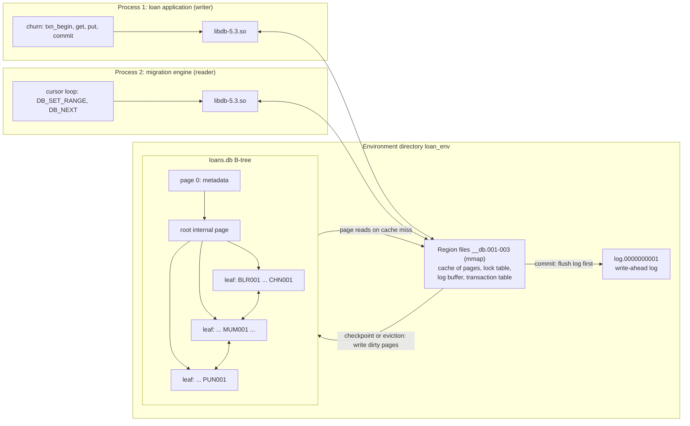

# Module 6.13: Berkeley DB: key-value model and cursors

**Estimated hours:** 6

**What you will learn**

1. What an embedded key-value database is, and how Berkeley DB's environment, database handle, `DBT` and cursor fit together in the C API (version 5.3, as Ubuntu packages it).
2. How to lay out packed records and composite keys so that a B-tree cursor returns them in a useful order, and who owns every byte the library hands back to you.
3. How transactions, locking, deadlock detection, logs, checkpoints and snapshot reads let one process read a live environment while another writes it, and how a batch job restarts from the last key it processed.

**Prerequisites:** [Module 6.12: Connection pooling and client libraries](module-12-connection-pooling-and-libpq.md). You also need the packed-record helpers from module 1.07, the goto-cleanup ownership style from module 1.14, and the WAL, MVCC and B-tree ideas from modules 6.06, 6.07 and 6.09.

---

## 1. One-line intuition

Berkeley DB is a sorted dictionary of byte strings that lives inside your own program and survives crashes: you hand it a key and a value as raw bytes, and it keeps them in a B-tree file with a write-ahead log, with no server and no SQL.

## 2. Real-life analogy

Picture a bank branch's card-index cabinet bolted to the clerk's own desk.

- **The cabinet** is the **database** (`loans.db`). Each card has a **tab** (the **key**) and a **card body** (the **value**). The cabinet does not know what is written on a card. It only compares tabs, character by character, to keep them in order.
- **The desk drawer of carbon copies** is the **log**. Before the clerk changes a card, a carbon of the change goes in the drawer. If the clerk faints halfway, the next clerk replays the carbons and the cabinet is correct again.
- **The office** is the **environment**: one folder holding the cabinet, the carbons, and a shared notice board (the **region files**) where everyone who uses the cabinet writes "I am holding drawer 7" so two clerks never scribble on the same card at once.
- **Your finger walking along the tabs** is a **cursor**. "Start at the first card", "next card", "jump to the first tab at or after MUM001". Because the tabs are sorted, walking them gives you every card in order.
- **The clerk's own hands** matter most: nobody else fetches cards for you. There is no counter and no queue. That is what **embedded** means: the database code runs on your thread, inside your process.

## 3. Why it exists: the problem it solves

Before 1990 a C program that needed to keep records on disk had two choices: write its own file format (and its own crash recovery, which almost nobody got right) or talk to a heavyweight database server over a network. Berkeley DB began in 1991 at the University of California, Berkeley, as the `db` library that shipped with 4.4BSD Unix. Margo Seltzer and Keith Bostic founded Sleepycat Software in 1996 to add transactions, locking and recovery, and Oracle bought Sleepycat in 2006. Version 6.0 (2013) moved to the AGPL licence, so Linux distributions froze on **5.3.28**, the last release under the old licence. That is the version Ubuntu ships today and the version this course uses.

What it solves: **fast, crash-safe storage of records by key, from C, with no server**. A lookup is a function call that walks a B-tree in your own memory: typically a few microseconds when the pages are cached, against hundreds of microseconds for a network round trip to a server.

Where you still meet it: older OpenLDAP back ends, Postfix and Sendmail lookup maps, Subversion's old repository format, older RPM package databases, Bitcoin Core's legacy wallets, and in-house C systems in banks and telecoms written in the 1990s and 2000s. In lending, a typical pattern is a C loan-servicing or branch application that keeps its loan master in a Berkeley DB environment on one server. Those systems work. What they lack is SQL, sharing across many servers, and replication you can operate easily. That gap is exactly why resume claim H1 exists: the data had to move into YugabyteDB while the old system kept running.

What breaks without the environment, log and transactions (the "bare file" mode of module 0.05): a crash halfway through a page split leaves a corrupted B-tree, and two processes writing the same file corrupt it at once. Everything in this module beyond `put` and `get` exists to prevent those two failures.

## 4. Three layers of depth

### Layer 1 (beginner): the five objects and the order you use them

| Object | C type | Created by | What it is |
|---|---|---|---|
| Environment | `DB_ENV *` | `db_env_create` then `env->open` | A directory plus shared memory: the cache, the lock table, the log and the transaction table, shared by every process that opens it |
| Database handle | `DB *` | `db_create` then `db->open` | One open database file (`loans.db`) using one **access method** (B-tree, hash, queue, recno, heap) |
| `DBT` | `DBT` (a struct) | you fill it | "Database Thang": a pointer, a length and some flags. Every key and every value goes in and out through a `DBT` |
| Cursor | `DBC *` | `db->cursor` | A position inside the sorted keys; moves with `cur->get(..., DB_NEXT)` and friends |
| Transaction | `DB_TXN *` | `env->txn_begin` | A group of reads and writes that commits or aborts as a unit |

Every handle is an object with **function pointers as methods**: you call `db->put(db, ...)`, passing the handle again as the first argument. That is how C does objects (module 2.10 showed the same idea as a vtable).

The order of calls never changes:

1. `db_env_create(&env, 0)`, set options (`env->set_cachesize`, `env->set_lk_detect`), then `env->open(env, "loan_env", flags, 0644)`.
2. `db_create(&db, env, 0)`, set options (`db->set_bt_compare` if any), then `db->open(db, txn, "loans.db", NULL, DB_BTREE, flags, 0644)`.
3. Work: `db->put`, `db->get`, `db->del`, or `db->cursor` and a loop of `cur->get`.
4. Close in reverse: cursors, then commit or abort transactions, then `db->close`, then `env->close`.

Every call returns an `int`: `0` for success, a positive `errno` value for a system error, or a negative Berkeley DB code such as `DB_NOTFOUND` (no such key, or end of the cursor walk), `DB_KEYEXIST`, `DB_LOCK_DEADLOCK` or `DB_BUFFER_SMALL`. `db_strerror(rc)` turns any of them into text, and `env->err(env, rc, "fmt", ...)` prints that text with your prefix to the error stream you set with `set_errfile`.

**Key-value versus relational.** In PostgreSQL the engine knows your columns, types, constraints and indexes. In Berkeley DB the engine knows two byte strings and their lengths. Everything else is your code's job:

| Concern | PostgreSQL (modules 6.01-6.12) | Berkeley DB |
|---|---|---|
| Record format | Rows with typed columns | Opaque bytes you encode and decode |
| Finding rows | SQL, any column, planner chooses | By key only, or by walking a cursor |
| Secondary access ("loans of customer X") | `CREATE INDEX` | A second database you maintain yourself (or `DB->associate`) |
| Joins | `JOIN` | Nested cursor loops in C |
| Where it runs | Server process, network protocol | Library in your process |
| Who validates data | Constraints, types | Nobody but you |

### Layer 2 (working engineer): flags, ownership, cursors and transactions

**Opening a transactional environment.** The flags to `env->open` say which subsystems to start:

| Flag | Starts | Why you want it |
|---|---|---|
| `DB_CREATE` | creates the region files if missing | first run |
| `DB_INIT_MPOOL` | the shared page cache ("memory pool") | always |
| `DB_INIT_LOCK` | the lock table | more than one thread or process |
| `DB_INIT_LOG` | the write-ahead log | recoverability |
| `DB_INIT_TXN` | the transaction subsystem | atomic commits, recovery |
| `DB_RECOVER` | runs recovery during open | only when you are sure no other process has the environment open |
| `DB_THREAD` | makes handles safe to share between threads | multithreaded programs |

Options such as `set_cachesize(env, gbytes, bytes, ncache)` and `set_lk_detect` must be set **before** `open`. The default cache is only 256 KB; for caches under 500 MB, Berkeley DB adds about 25% for its own bookkeeping, so asking for 8 MB gives "10MB 8KB" in `db_stat -m`. With `DB_INIT_TXN`, open the database with `DB_AUTO_COMMIT` (or inside a transaction) so its creation is itself logged. The directory must already exist: `DB_CREATE` makes files, not folders.

**The `DBT` ownership contract.** Always `memset` a `DBT` to zero before use, because the `flags` field changes behaviour. For input (`put`, or the key you search for), set `data` and `size`. For output, the flags decide **who owns the returned bytes**:

| `flags` on the output `DBT` | Where Berkeley DB puts the bytes | Who frees | Valid until |
|---|---|---|---|
| `0` | memory owned by the handle (DB or cursor) | nobody; never free it | the next call on that same handle |
| `DB_DBT_MALLOC` | a fresh `malloc` block, every call | **you**, with `free` | you free it |
| `DB_DBT_REALLOC` | `realloc` of your `data` pointer, reused across calls | **you**, once, after the loop | you free it |
| `DB_DBT_USERMEM` | copied into **your** buffer `data` of size `ulen` | you own the buffer | forever; if `ulen` is too small you get `DB_BUFFER_SMALL` and `size` tells you the length needed |
| `DB_DBT_PARTIAL` (with `doff`, `dlen`) | only a slice of the record | as above | read or write part of a big value |

If an environment or handle is opened with `DB_THREAD`, every `DB->get` must use `DB_DBT_MALLOC`, `DB_DBT_REALLOC` or `DB_DBT_USERMEM`, because handle-owned memory would be shared between threads. The migration engine of claim H1 used `DB_DBT_USERMEM` with fixed buffers sized to the record layout: the library never allocates on the hot path, nothing needs freeing, and a wrong-sized record shows up as `DB_BUFFER_SMALL` instead of a silent overrun. That is the "explicit ownership contract" in one sentence.

**Writes and reads.** `db->put(db, txn, &key, &val, 0)` inserts or overwrites; with `DB_NOOVERWRITE` it returns `DB_KEYEXIST` instead of overwriting. `db->get(db, txn, &key, &val, 0)` returns `DB_NOTFOUND` if the key is absent. `db->del(db, txn, &key, 0)` removes it. Pass `NULL` as `txn` for a single auto-committed operation when the database was opened with `DB_AUTO_COMMIT`.

**Cursor operations** (`cur->get(cur, &key, &val, op)`):

| `op` | Moves to | Typical use |
|---|---|---|
| `DB_FIRST` / `DB_LAST` | smallest / largest key | full scan forwards / find the maximum key |
| `DB_NEXT` / `DB_PREV` | next / previous key (on a fresh cursor, `DB_NEXT` acts as `DB_FIRST`) | the scan loop |
| `DB_SET` | exactly this key, else `DB_NOTFOUND` | positioned lookup |
| `DB_SET_RANGE` | the **smallest key greater than or equal to** the one you pass; the found key is written back into your key `DBT` | range scans and resuming a batch |
| `DB_CURRENT` | re-read where you are | after an update through the cursor |

A cursor opened inside a transaction must be closed with `cur->close(cur)` **before** that transaction commits or aborts. A cursor holds locks and a position; leaking one leaks both.

**Access methods.**

| Method | Order | Keys | Pick it for |
|---|---|---|---|
| `DB_BTREE` | sorted by key | any bytes | range scans, ordered traversal, prefix lookups: the default choice and the one used for the loan store |
| `DB_HASH` | none | any bytes | point lookups on very large sets where order never matters |
| `DB_QUEUE` | record number | fixed-length records | high-concurrency append and consume (record-level locking) |
| `DB_RECNO` | record number | variable-length records | data addressed by line or record number, can be backed by a flat text file |
| `DB_HEAP` (5.2 and later) | none | record ids | space-efficient storage when you never look up by your own key |

**Composite keys and byte order.** The default B-tree comparison is a byte-by-byte comparison of the keys, like `memcmp`, with a shorter key sorting first when one is a prefix of the other. To sort by `(branch_code, loan_id)`, put the branch first and encode `loan_id` **big-endian** (most significant byte first). Big-endian unsigned integers compare correctly as bytes; little-endian ones do not: `100256` is `0x000187A0`, and its little-endian first byte `A0` sorts before the `A1` that starts `100001`. Signed integers need one more step (flip the top bit) because a negative number's top bit is 1. If a legacy file already uses a bad byte order, `db->set_bt_compare(db, fn)` installs your own comparison, with this signature in 5.3:

```c
int fn(DB *db, const DBT *a, const DBT *b);   /* <0, 0, >0 like memcmp; later 6.x releases add a size_t* argument */
```

It must be set before `db->open`, it must define a total order, and **every program that ever opens the file must install the same function forever**: a different comparator makes the tree look corrupt. The command-line tools cannot load your function, so `db_verify` needs `-o` to skip order checks on such files. Big-endian keys avoid all of that, which is why the course layout uses them.

**Transactions, isolation and deadlocks.**

```c
DB_TXN *txn;
env->txn_begin(env, NULL, &txn, 0);       /* parent = NULL; flags below */
/* ... db->get / db->put / cursors with txn ... */
txn->commit(txn, 0);                      /* or txn->abort(txn); the handle is gone after either */
```

Inside a transaction, Berkeley DB uses **page-level locks** (record-level for queue) held until commit or abort: strict two-phase locking, which gives serializable behaviour (Berkeley DB calls it degree 3). Weaker options: `DB_READ_COMMITTED` (release read locks as the cursor moves), `DB_READ_UNCOMMITTED` (dirty reads), and **`DB_TXN_SNAPSHOT`**, which reads committed page versions without taking read locks. Snapshot reads need multiversion concurrency control (MVCC, module 6.07's idea at page granularity): open the database with `DB_MULTIVERSION`, and writers then copy a page before changing it, so readers keep seeing the old copy. Snapshot isolation is best for read-only transactions; a snapshot transaction that also writes can fail with `DB_LOCK_DEADLOCK` when it updates a page someone else changed.

Two transactions that each hold a lock the other wants form a **deadlock** (module 4.11). `env->set_lk_detect(env, DB_LOCK_DEFAULT)` runs the detector whenever a lock request has to wait; other policies (`DB_LOCK_YOUNGEST`, `DB_LOCK_MINWRITE`, `DB_LOCK_OLDEST`, ...) choose the victim differently, and the `db_deadlock` utility can run detection from outside instead. The victim's call returns `DB_LOCK_DEADLOCK`. The **only** correct response: close its cursors, `abort` the transaction, and retry the whole transaction from the start. `DB_RMW` on a read takes a write lock at once and avoids the common read-then-upgrade deadlock.

**Durability knobs.** By default `commit` writes and flushes the log to disk. `DB_TXN_WRITE_NOSYNC` writes to the operating system without `fsync` (survives a process crash, not a power cut); `DB_TXN_NOSYNC` does not even write at commit (fast, loses the last transactions on a crash, never loses consistency). A bank ledger keeps the default.

**Log, checkpoint, archive, recover.** Log files are `log.0000000001`, `log.0000000002`, ..., 10 MB each by default. A **checkpoint** (`env->txn_checkpoint(env, 0, 0, 0)` or `db_checkpoint`) writes dirty cache pages to the database files and records that fact in the log, which bounds recovery time and lets old log files be archived (`db_archive`) or removed. **Recovery** (`DB_RECOVER` on open, or `db_recover` with every process stopped) replays the log from the last checkpoint: committed work is redone, uncommitted work undone.

**Command-line tools.** `sudo apt install -y db-util` installs the `db5.3-util` package (`db5.3_dump`, `db5.3_load`, `db5.3_stat`, `db5.3_checkpoint`, `db5.3_archive`, `db5.3_recover`, `db5.3_verify`, `db5.3_deadlock`, `db5.3_hotbackup`, ...) plus unversioned links (`db_dump` and so on). Use `-h loan_env` so the tool joins the environment and respects its locks.

| Tool | Does |
|---|---|
| `db5.3_stat -h ENV -d loans.db` | B-tree statistics: levels, page counts, fill, key count |
| `db5.3_stat -h ENV -m` / `-l` / `-t` / `-c` | cache / log / transaction / lock statistics |
| `db5.3_dump -h ENV loans.db` | portable text dump (hex); `-p` for printable characters |
| `db5.3_load -f dumpfile new.db` | rebuild a database from a dump |
| `db5.3_verify -h ENV loans.db` | structural check of a database file |
| `db5.3_hotbackup` | consistent backup of a live environment (plain `cp` is not) |

### Layer 3 (internals): pages, regions and what a crash leaves behind

**The file.** `loans.db` is an array of pages (4096 bytes on a typical Linux file system; the default follows the file system block size, from 512 bytes to 64 KB). Page 0 is the **metadata page**: magic number, version, page size, root page number, free list. The tree has **internal pages** (keys and child page numbers) and **leaf pages** (key/data pairs, sorted). Every leaf page stores the numbers of its left and right siblings, so `DB_NEXT` at the end of a leaf moves sideways to the next leaf without climbing back to the root. That sibling chain is what makes a cursor scan cheap: one root-to-leaf descent to start, then mostly sequential leaf reads. A key or value too large for a page (about a quarter of the page, 1007 bytes at 4 KB, which `db_stat -d` reports as "Overflow key/data size") goes to separate **overflow pages**. With 1,000 small loan records, the tree in this module has 2 levels: 1 root page and 32 leaf pages.

**The regions.** `env->open` creates files `__db.001`, `__db.002`, ... and maps them into memory with `mmap` (module 3.04). They hold the shared cache of pages, the lock table, the log buffer and the transaction table. Every process that opens the environment maps the same files, so a lock taken by process A is visible to process B. Mutexes inside those regions protect the shared structures. This is how two separate programs coordinate with no server between them.

**What a write does.** `put` inside a transaction: lock the leaf page for writing, write a log record (old and new bytes) into the log buffer, change the page in the cache, and mark it dirty. With `DB_MULTIVERSION`, the change goes to a copy of the page, and the old copy stays readable for snapshot transactions. `commit` writes a commit record and flushes the log up to it; that flush is the durability point, exactly as in PostgreSQL's WAL (module 6.06). The dirty page reaches `loans.db` later, at eviction or checkpoint. The rule "log record on disk before the page it describes" is enforced by comparing log sequence numbers (LSNs) stamped on each page.

**The cost of snapshots.** Old page versions occupy cache space. A snapshot transaction that stays open for minutes forces Berkeley DB to keep every version it might need. Under cache pressure it writes old versions to temporary "freezer" files (`db_stat -m` reports buffers frozen and thawed), which is slow. Keep snapshot transactions short: one per batch, not one per migration.

**What a crashed process leaves behind.** If a process dies (`kill -9`, segfault) while holding locks or a region mutex, nothing releases them. Other processes then wait forever: even `db_stat` can hang. Recovery requires stopping every process and running `db_recover` (or reopening with `DB_RECOVER` from a single process). Production systems add `DB_REGISTER` with `DB_RECOVER` on open, or `DB_ENV->failchk` with an `is_alive` callback, so a restarted process can detect dead peers. You will cause and fix this hang in the lab.

**Bulk reads.** For large migrations, `DB_MULTIPLE_KEY` with one large `DB_DBT_USERMEM` buffer returns many key/data pairs per `cur->get` call, unpacked with the `DB_MULTIPLE_KEY_NEXT` macro. It cuts per-call overhead; the module's code keeps one record per call for clarity.

## 5. Architecture diagram



Both processes call the library directly; the only thing they share is the environment directory and its memory-mapped regions. The arrows between leaf pages are the sibling links a cursor follows.

## 6. Code

One C program, several commands, so you can run a writer and a reader at the same time in Part D of the lab. It creates a transactional environment, stores 1,000 packed loan records under the composite key `(branch_code, loan_id)`, walks them in key order, range-scans one branch with `DB_SET_RANGE`, shows the three `DBT` ownership modes, runs a restartable batch traversal, and can act as a live writer with deadlock retries.

The record layout is defined in the comment at the top and is the contract for capstone C3. It extends module 1.07's idea: little-endian fields at fixed offsets for the value (as a legacy x86 writer produced them), but a **big-endian** key so that Berkeley DB's byte comparison sorts by branch and then by loan number. The fields map one to one onto the `loans` table of module 6.03.

Install the library and tools if module 0.05 did not, then save the file as `~/labs/bdb/bdb_loans.c`:

```bash
sudo apt install -y libdb-dev db-util     # db.h + libdb.so (5.3.28), and the db5.3_* / db_* tools
mkdir -p ~/labs/bdb && cd ~/labs/bdb
```

```c
/* bdb_loans.c - Module 6.13: 1,000 packed loan records in a Berkeley DB 5.3
 * transactional environment, keyed by (branch_code, loan_id).
 *   ./bdb_loans load               store 1,000 loans in 10 transactions
 *   ./bdb_loans get MUM001 100004  point lookup: who owns the returned bytes
 *   ./bdb_loans scan [nosnap]      every record in key order, then DB_LAST
 *   ./bdb_loans range MUM001       one branch, starting with DB_SET_RANGE
 *   ./bdb_loans batch 300 [max]    restartable batches; resume point in resume.key
 *   ./bdb_loans churn 10           live writer for 10 seconds
 * Build: gcc -std=gnu17 -Wall -Wextra -Werror -g -o bdb_loans bdb_loans.c -ldb */
#include <db.h>
#include <errno.h>
#include <inttypes.h>
#include <stdint.h>
#include <stdio.h>
#include <stdlib.h>
#include <string.h>
#include <sys/stat.h>
#include <time.h>
#include <unistd.h>

#define ENV_HOME    "loan_env"       /* directory: region files, log files, loans.db */
#define DB_FILE     "loans.db"
#define RESUME_FILE "resume.key"
#define NLOANS      1000
#define KEY_SIZE    14
#define REC_SIZE    52

/* ---- The on-disk layout. We define it; the compiler never does. ----
 * KEY, 14 bytes. Big-endian, so byte order == (branch, loan_id) order:
 *   [0..5]   branch_code        6 ASCII bytes, space-padded
 *   [6..13]  loan_id            uint64 big-endian
 * RECORD, 52 bytes. Little-endian, as the legacy x86 writer produced it:
 *   [0]      layout version     uint8, always 1
 *   [1]      status             'A' active, 'C' closed, 'N' NPA
 *   [2..3]   tenure_months      uint16 LE
 *   [4..7]   rate_bp            uint32 LE (850 = 8.50%)
 *   [8..15]  application_id     int64 LE
 *   [16..23] customer_id        int64 LE
 *   [24..31] principal_paise    int64 LE
 *   [32..39] outstanding_paise  int64 LE
 *   [40..43] disbursed_on       uint32 LE, yyyymmdd, 0 = not disbursed
 *   [44..51] product_code       8 ASCII bytes, space-padded */
struct loan {
    char     branch_code[7], product_code[9];   /* NUL-terminated, padding trimmed */
    uint64_t loan_id;
    char     status;
    uint16_t tenure_months;
    uint32_t rate_bp, disbursed_on;
    int64_t  application_id, customer_id, principal_paise, outstanding_paise;
};

static const char *BRANCHES[] = { "BLR001", "CHN001", "DEL001", "MUM001", "PUN001" };
static const char *PRODUCTS[] = { "HL01", "PL01", "VL01" };

/* ---- byte helpers in the module 1.07 style: LE for record fields, BE for keys ---- */
static void put_le(unsigned char *p, uint64_t v, int n) { for (int i = 0; i < n; ++i) p[i] = (unsigned char)(v >> (8 * i)); }
static uint64_t get_le(const unsigned char *p, int n) { uint64_t v = 0; for (int i = n - 1; i >= 0; --i) v = (v << 8) | p[i]; return v; }
static void put_be64(unsigned char *p, uint64_t v) { for (int i = 0; i < 8; ++i) p[i] = (unsigned char)(v >> (56 - 8 * i)); }
static uint64_t get_be64(const unsigned char *p) { uint64_t v = 0; for (int i = 0; i < 8; ++i) v = (v << 8) | p[i]; return v; }
static void put_padded(unsigned char *dst, const char *src, size_t n) {   /* space-pad, no NUL */
    size_t len = strlen(src);
    memset(dst, ' ', n);
    memcpy(dst, src, len < n ? len : n);
}
static void get_trimmed(char *dst, const unsigned char *src, size_t n) {  /* dst holds n + 1 */
    memcpy(dst, src, n);
    while (n > 0 && dst[n - 1] == ' ') --n;
    dst[n] = '\0';
}

static void encode_key(const char *branch, uint64_t loan_id, unsigned char k[KEY_SIZE]) {
    put_padded(k, branch, 6);
    put_be64(k + 6, loan_id);
}
static void encode_record(const struct loan *l, unsigned char r[REC_SIZE]) {
    r[0] = 1;
    r[1] = (unsigned char)l->status;
    put_le(r + 2, l->tenure_months, 2);
    put_le(r + 4, l->rate_bp, 4);
    put_le(r + 8, (uint64_t)l->application_id, 8);
    put_le(r + 16, (uint64_t)l->customer_id, 8);
    put_le(r + 24, (uint64_t)l->principal_paise, 8);
    put_le(r + 32, (uint64_t)l->outstanding_paise, 8);
    put_le(r + 40, l->disbursed_on, 4);
    put_padded(r + 44, l->product_code, 8);
}
/* Never trust a blob: check both lengths and the version before decoding. */
static int decode(const DBT *key, const DBT *val, struct loan *l) {
    const unsigned char *k = key->data, *r = val->data;
    if (key->size != KEY_SIZE || val->size != REC_SIZE || r[0] != 1) return -1;
    get_trimmed(l->branch_code, k, 6);
    l->loan_id           = get_be64(k + 6);
    l->status            = (char)r[1];
    l->tenure_months     = (uint16_t)get_le(r + 2, 2);
    l->rate_bp           = (uint32_t)get_le(r + 4, 4);
    l->application_id    = (int64_t)get_le(r + 8, 8);
    l->customer_id       = (int64_t)get_le(r + 16, 8);
    l->principal_paise   = (int64_t)get_le(r + 24, 8);
    l->outstanding_paise = (int64_t)get_le(r + 32, 8);
    l->disbursed_on      = (uint32_t)get_le(r + 40, 4);
    get_trimmed(l->product_code, r + 44, 8);
    return 0;
}
static void print_loan(const char *label, const struct loan *l) {
    printf("%-7s %s %" PRIu64 " %-4s %c principal=%" PRId64 " outstanding=%" PRId64 " rate_bp=%u\n",
           label, l->branch_code, l->loan_id, l->product_code, l->status,
           l->principal_paise, l->outstanding_paise, l->rate_bp);
}

/* Deterministic test data: loan i (0..999) is loan_id 100001 + i in branch i % 5. */
static char status_for(int i) { return (i % 25 == 0) ? 'C' : (i % 50 == 49) ? 'N' : 'A'; }
static void make_loan(int i, struct loan *l) {
    memset(l, 0, sizeof *l);
    strcpy(l->branch_code, BRANCHES[i % 5]);
    strcpy(l->product_code, PRODUCTS[i % 3]);
    l->loan_id           = 100001 + (uint64_t)i;
    l->application_id    = 900001 + i;
    l->customer_id       = 500001 + i / 2;
    l->status            = status_for(i);
    l->tenure_months     = (uint16_t)(12 * (1 + i % 20));
    l->rate_bp           = 850 + (uint32_t)(i % 7) * 25;
    l->principal_paise   = (int64_t)(i % 50 + 1) * 10000000;          /* Rs 1 lakh .. Rs 50 lakh */
    l->outstanding_paise = l->status == 'C' ? 0 : l->principal_paise - (i % 10) * (l->principal_paise / 20);
    l->disbursed_on      = 20240101 + (uint32_t)(i % 28);
}

/* ---- open: options before open; every handle is closed even when open fails ---- */
static int open_all(DB_ENV **envp, DB **dbp) {
    DB_ENV *env = NULL;
    DB *db = NULL;
    int rc;
    if (mkdir(ENV_HOME, 0755) != 0 && errno != EEXIST) { perror("mkdir " ENV_HOME); return errno; }
    if ((rc = db_env_create(&env, 0)) != 0) { fprintf(stderr, "db_env_create: %s\n", db_strerror(rc)); return rc; }
    env->set_errfile(env, stderr);                          /* library error text goes to stderr */
    env->set_errpfx(env, "bdb_loans");
    if ((rc = env->set_cachesize(env, 0, 8 * 1024 * 1024, 1)) != 0 ||   /* 8 MB cache, one region */
        (rc = env->set_lk_detect(env, DB_LOCK_DEFAULT)) != 0 ||       /* detect deadlocks on conflict */
        (rc = env->open(env, ENV_HOME,
                        DB_CREATE | DB_INIT_MPOOL | DB_INIT_LOCK | DB_INIT_LOG | DB_INIT_TXN, 0644)) != 0) {
        env->err(env, rc, "environment open");
        goto fail;
    }
    if ((rc = db_create(&db, env, 0)) != 0) { env->err(env, rc, "db_create"); goto fail; }
    if ((rc = db->open(db, NULL, DB_FILE, NULL, DB_BTREE,
                       DB_CREATE | DB_AUTO_COMMIT | DB_MULTIVERSION, 0644)) != 0) {
        db->err(db, rc, "open %s", DB_FILE);
        goto fail;
    }
    *envp = env;
    *dbp = db;
    return 0;
fail:
    if (db != NULL) db->close(db, 0);
    if (env != NULL) env->close(env, 0);
    return rc;
}

static int cmd_load(DB_ENV *env, DB *db) {
    for (int b = 0; b < NLOANS / 100; ++b) {                   /* 10 transactions of 100 puts */
        DB_TXN *txn = NULL;
        int rc = env->txn_begin(env, NULL, &txn, 0);
        if (rc != 0) { env->err(env, rc, "txn_begin"); return rc; }
        for (int j = 0; j < 100; ++j) {
            int i = (b * 100 + j) * 7919 % NLOANS;             /* scrambled insert order */
            struct loan l;
            unsigned char kb[KEY_SIZE], rb[REC_SIZE];
            DBT key, val;
            make_loan(i, &l);
            encode_key(l.branch_code, l.loan_id, kb);
            encode_record(&l, rb);
            memset(&key, 0, sizeof key); memset(&val, 0, sizeof val); /* flags = 0: plain input DBTs */
            key.data = kb; key.size = KEY_SIZE;
            val.data = rb; val.size = REC_SIZE;
            if ((rc = db->put(db, txn, &key, &val, 0)) != 0) {  /* 0 = overwrite: reruns are idempotent */
                db->err(db, rc, "put loan %" PRIu64, l.loan_id);
                txn->abort(txn);
                return rc;
            }
        }
        if ((rc = txn->commit(txn, 0)) != 0) { env->err(env, rc, "commit"); return rc; }
    }
    printf("loaded %d loans in %d transactions\n", NLOANS, NLOANS / 100);
    return 0;
}

static int cmd_get(DB *db, const char *branch, uint64_t loan_id) {
    unsigned char kb[KEY_SIZE], small[16];
    DBT key, val;
    struct loan l;
    int rc;
    encode_key(branch, loan_id, kb);
    memset(&key, 0, sizeof key); memset(&val, 0, sizeof val);
    key.data = kb; key.size = KEY_SIZE;
    val.flags = DB_DBT_MALLOC;                         /* the library mallocs; WE must free */
    if ((rc = db->get(db, NULL, &key, &val, 0)) != 0) {
        db->err(db, rc, "get %s/%" PRIu64, branch, loan_id);
        return rc;
    }
    if (decode(&key, &val, &l) == 0) print_loan("get", &l);
    printf("DB_DBT_MALLOC : library malloc'd %u bytes for us; we free them\n", val.size);
    free(val.data);

    memset(&val, 0, sizeof val);
    val.data = small; val.ulen = sizeof small;
    val.flags = DB_DBT_USERMEM;                        /* our buffer, our size limit */
    rc = db->get(db, NULL, &key, &val, 0);
    printf("DB_DBT_USERMEM: ulen=%u -> \"%s\", record needs %u bytes\n", val.ulen, db_strerror(rc), val.size);
    return rc == DB_BUFFER_SMALL ? 0 : rc;
}

/* Walk keys in order. branch == NULL: the whole tree from DB_FIRST.
 * branch given: DB_SET_RANGE to (branch, 0) and stop when the prefix changes. */
static int cmd_scan(DB_ENV *env, DB *db, const char *branch, int snapshot) {
    DB_TXN *txn = NULL;
    DBC *cur = NULL;
    unsigned char kb[KEY_SIZE], vb[REC_SIZE], prev[KEY_SIZE], prefix[6];
    DBT key, val;
    struct loan l, last;
    long n = 0, bad = 0;
    int64_t total = 0;
    int in_order = 1, rc;

    memset(&key, 0, sizeof key); memset(&val, 0, sizeof val);
    key.data = kb; key.ulen = sizeof kb; key.flags = DB_DBT_USERMEM;   /* cursor copies INTO our buffers */
    val.data = vb; val.ulen = sizeof vb; val.flags = DB_DBT_USERMEM;
    if (snapshot && (rc = env->txn_begin(env, NULL, &txn, DB_TXN_SNAPSHOT)) != 0) {
        env->err(env, rc, "txn_begin");
        return rc;
    }
    if ((rc = db->cursor(db, txn, &cur, 0)) != 0) { db->err(db, rc, "cursor"); goto done; }
    if (branch != NULL) {
        put_padded(prefix, branch, 6);
        encode_key(branch, 0, kb);                     /* smallest possible key of this branch */
        key.size = KEY_SIZE;
        rc = cur->get(cur, &key, &val, DB_SET_RANGE);  /* first key >= (branch, 0) */
    } else {
        rc = cur->get(cur, &key, &val, DB_FIRST);
    }
    for (; rc == 0; rc = cur->get(cur, &key, &val, DB_NEXT)) {
        if (branch != NULL && memcmp(kb, prefix, 6) != 0) break;       /* left the branch */
        if (decode(&key, &val, &l) != 0) { ++bad; continue; }
        if (n > 0 && memcmp(prev, kb, KEY_SIZE) >= 0) in_order = 0;
        memcpy(prev, kb, KEY_SIZE);
        if (n < 3) print_loan("first", &l);
        last = l;
        total += l.outstanding_paise;
        ++n;
    }
    if (rc != 0 && rc != DB_NOTFOUND) { db->err(db, rc, "cursor stopped after %ld records", n); goto done; }
    if (n > 0) print_loan("last", &last);
    printf("%s: %ld records (%ld undecodable), keys strictly increasing: %s\n",
           branch ? branch : "all", n, bad, in_order ? "yes" : "NO");
    printf("total outstanding_paise = %" PRId64 " (%s)\n", total, txn ? "snapshot" : "no snapshot");
    if (branch == NULL && cur->get(cur, &key, &val, DB_LAST) == 0 && decode(&key, &val, &l) == 0)
        print_loan("DB_LAST", &l);
    rc = 0;
done:
    if (cur != NULL) cur->close(cur);                  /* cursors close BEFORE their transaction ends */
    if (txn != NULL) txn->commit(txn, 0);
    return rc;
}

/* ---- restartable batches: the resume point is the LAST KEY processed ---- */
static int save_resume(const unsigned char k[KEY_SIZE]) {   /* temp file + rename: never half a key */
    FILE *f = fopen(RESUME_FILE ".tmp", "wb");
    if (f == NULL) return -1;
    int ok = fwrite(k, 1, KEY_SIZE, f) == KEY_SIZE && fflush(f) == 0 && fsync(fileno(f)) == 0;
    if (fclose(f) != 0) ok = 0;
    return (ok && rename(RESUME_FILE ".tmp", RESUME_FILE) == 0) ? 0 : -1;
}

static int cmd_batch(DB_ENV *env, DB *db, long batch_size, long max_batches) {
    unsigned char resume[KEY_SIZE], kb[KEY_SIZE], vb[REC_SIZE];
    FILE *f = fopen(RESUME_FILE, "rb");
    int have_resume = f != NULL && fread(resume, 1, KEY_SIZE, f) == KEY_SIZE;
    long done_total = 0;
    if (f != NULL) fclose(f);
    if (have_resume) printf("resuming after %.6s/%" PRIu64 "\n", (const char *)resume, get_be64(resume + 6));
    for (long b = 1; max_batches == 0 || b <= max_batches; ++b) {
        DB_TXN *txn = NULL;
        DBC *cur = NULL;
        DBT key, val;
        long got = 0;
        int rc;
        memset(&key, 0, sizeof key); memset(&val, 0, sizeof val);
        key.data = kb; key.ulen = sizeof kb; key.flags = DB_DBT_USERMEM;
        val.data = vb; val.ulen = sizeof vb; val.flags = DB_DBT_USERMEM;
        /* one short snapshot transaction and one cursor PER BATCH, never one for the whole run */
        if ((rc = env->txn_begin(env, NULL, &txn, DB_TXN_SNAPSHOT)) != 0) { env->err(env, rc, "txn_begin"); return rc; }
        if ((rc = db->cursor(db, txn, &cur, 0)) != 0) { db->err(db, rc, "cursor"); txn->abort(txn); return rc; }
        if (have_resume) {
            memcpy(kb, resume, KEY_SIZE);
            key.size = KEY_SIZE;
            rc = cur->get(cur, &key, &val, DB_SET_RANGE);              /* first key >= resume point */
            if (rc == 0 && memcmp(kb, resume, KEY_SIZE) == 0)
                rc = cur->get(cur, &key, &val, DB_NEXT);               /* already done: step past it */
        } else {
            rc = cur->get(cur, &key, &val, DB_FIRST);
        }
        while (rc == 0) {
            struct loan l;
            if (decode(&key, &val, &l) == 0) { /* capstone C3: append l to the YugabyteDB batch here */ }
            memcpy(resume, kb, KEY_SIZE);
            if (++got == batch_size) break;
            rc = cur->get(cur, &key, &val, DB_NEXT);
        }
        cur->close(cur);
        txn->commit(txn, 0);
        if (rc != 0 && rc != DB_NOTFOUND) { db->err(db, rc, "batch %ld", b); return rc; }
        if (got > 0) {
            if (save_resume(resume) != 0) { perror("save " RESUME_FILE); return -1; }
            have_resume = 1;
            done_total += got;
            printf("batch %ld: %ld records, last key %.6s/%" PRIu64 "\n", b, got, (const char *)resume, get_be64(resume + 6));
        }
        if (got < batch_size) {                                         /* reached the end of the tree */
            remove(RESUME_FILE);
            printf("finished: %ld records this run, resume file removed\n", done_total);
            return 0;
        }
    }
    printf("stopped after %ld batches (%ld records); run again to resume\n", max_batches, done_total);
    return 0;
}

/* ---- live writer: each transaction moves 100 paise between two active loans.
 * A synthetic test invariant, not a banking operation: the total never changes. */
static int move_paise(DB *db, DB_TXN *txn, int from, int to) {
    const int idx[2] = { from, to };
    for (int s = 0; s < 2; ++s) {
        unsigned char kb[KEY_SIZE], vb[REC_SIZE];
        DBT key, val;
        struct loan l;
        int rc;
        encode_key(BRANCHES[idx[s] % 5], 100001 + (uint64_t)idx[s], kb);
        memset(&key, 0, sizeof key); memset(&val, 0, sizeof val);
        key.data = kb; key.size = KEY_SIZE;
        val.data = vb; val.ulen = sizeof vb; val.flags = DB_DBT_USERMEM;
        if ((rc = db->get(db, txn, &key, &val, 0)) != 0) return rc;   /* read lock on the page */
        if (decode(&key, &val, &l) != 0) return EINVAL;
        l.outstanding_paise += (s == 0) ? -100 : 100;
        encode_record(&l, vb);
        if ((rc = db->put(db, txn, &key, &val, 0)) != 0) return rc;   /* upgrade to write lock */
    }
    return 0;
}

static int cmd_churn(DB_ENV *env, DB *db, int seconds) {
    time_t end = time(NULL) + seconds;
    long commits = 0, deadlocks = 0;
    srand((unsigned)getpid());
    while (time(NULL) < end) {
        int from = rand() % NLOANS, to = rand() % NLOANS;
        if (from == to || status_for(from) != 'A' || status_for(to) != 'A') continue;
        for (;;) {                                             /* retry loop for deadlock victims */
            DB_TXN *txn = NULL;
            int rc = env->txn_begin(env, NULL, &txn, 0);
            if (rc != 0) { env->err(env, rc, "txn_begin"); return rc; }
            if ((rc = move_paise(db, txn, from, to)) == 0) {
                if ((rc = txn->commit(txn, 0)) != 0) { env->err(env, rc, "commit"); return rc; }
                ++commits;
                break;
            }
            txn->abort(txn);                                   /* releases every lock it held */
            if (rc != DB_LOCK_DEADLOCK) { db->err(db, rc, "move"); return rc; }
            ++deadlocks;                                       /* we were the victim: start again */
        }
    }
    printf("churn pid %d: %ld commits, %ld deadlock retries\n", (int)getpid(), commits, deadlocks);
    return 0;
}

int main(int argc, char **argv) {
    DB_ENV *env = NULL;
    DB *db = NULL;
    int rc;
    if (argc < 2) {
        fprintf(stderr, "usage: %s load | get B ID | scan [nosnap] | range B | batch N [max] | churn SECS\n", argv[0]);
        return 2;
    }
    if (open_all(&env, &db) != 0) return 1;
    const char *cmd = argv[1];
    if (strcmp(cmd, "load") == 0)                     rc = cmd_load(env, db);
    else if (strcmp(cmd, "get") == 0 && argc == 4)    rc = cmd_get(db, argv[2], strtoull(argv[3], NULL, 10));
    else if (strcmp(cmd, "scan") == 0)                rc = cmd_scan(env, db, NULL, !(argc > 2 && strcmp(argv[2], "nosnap") == 0));
    else if (strcmp(cmd, "range") == 0 && argc == 3)  rc = cmd_scan(env, db, argv[2], 1);
    else if (strcmp(cmd, "batch") == 0 && argc >= 3)  rc = cmd_batch(env, db, atol(argv[2]), argc > 3 ? atol(argv[3]) : 0);
    else if (strcmp(cmd, "churn") == 0 && argc == 3)  rc = cmd_churn(env, db, atoi(argv[2]));
    else { fprintf(stderr, "unknown command\n"); rc = 2; }
    db->close(db, 0);                                          /* database handle first ... */
    env->close(env, 0);                                        /* ... then the environment */
    return rc == 0 ? 0 : 1;
}
```

Build and run (in `~/labs/bdb`):

```bash
gcc -std=gnu17 -Wall -Wextra -Werror -g -o bdb_loans bdb_loans.c -ldb
./bdb_loans load
./bdb_loans get MUM001 100004
./bdb_loans get MUM001 100005
./bdb_loans scan
./bdb_loans range MUM001
./bdb_loans batch 300 2
./bdb_loans batch 300
```

Expected output (the same on every machine; the `100005` line is printed on stderr and the command exits with status 1):

```text
loaded 1000 loans in 10 transactions
get     MUM001 100004 HL01 A principal=40000000 outstanding=34000000 rate_bp=925
DB_DBT_MALLOC : library malloc'd 52 bytes for us; we free them
DB_DBT_USERMEM: ulen=16 -> "BDB0063 DB_BUFFER_SMALL: User memory too small for return value", record needs 52 bytes
bdb_loans: get MUM001/100005: BDB0073 DB_NOTFOUND: No matching key/data pair found
first   BLR001 100001 HL01 C principal=10000000 outstanding=0 rate_bp=850
first   BLR001 100006 VL01 A principal=60000000 outstanding=45000000 rate_bp=975
first   BLR001 100011 PL01 A principal=110000000 outstanding=110000000 rate_bp=925
last    PUN001 101000 HL01 N principal=500000000 outstanding=275000000 rate_bp=975
all: 1000 records (0 undecodable), keys strictly increasing: yes
total outstanding_paise = 189400000000 (snapshot)
DB_LAST PUN001 101000 HL01 N principal=500000000 outstanding=275000000 rate_bp=975
first   MUM001 100004 HL01 A principal=40000000 outstanding=34000000 rate_bp=925
first   MUM001 100009 VL01 A principal=90000000 outstanding=54000000 rate_bp=875
first   MUM001 100014 PL01 A principal=140000000 outstanding=119000000 rate_bp=1000
last    MUM001 100999 VL01 A principal=490000000 outstanding=294000000 rate_bp=950
MUM001: 200 records (0 undecodable), keys strictly increasing: yes
total outstanding_paise = 37800000000 (snapshot)
batch 1: 300 records, last key CHN001/100497
batch 2: 300 records, last key DEL001/100998
stopped after 2 batches (600 records); run again to resume
resuming after DEL001/100998
batch 1: 300 records, last key PUN001/100500
batch 2: 100 records, last key PUN001/101000
finished: 400 records this run, resume file removed
```

Now the Valgrind gate:

```bash
valgrind --leak-check=full --error-exitcode=9 ./bdb_loans scan > /dev/null
valgrind --leak-check=full --error-exitcode=9 ./bdb_loans get MUM001 100004 > /dev/null
```

Expected (process ids and allocation counts vary):

```text
==11662== All heap blocks were freed -- no leaks are possible
==11662== ERROR SUMMARY: 0 errors from 0 contexts (suppressed: 0 from 0)
```

**Reading the output.**

- The loans were inserted in a scrambled order (`i * 7919 % 1000`), yet the scan returns them sorted: all of `BLR001` first, and inside it `100001, 100006, 100011`, every fifth loan id. The B-tree sorted them by key bytes, and the key bytes were designed to sort by branch then number.
- `get MUM001 100005` fails because loan 100005 belongs to `PUN001`. The branch is part of the key, so the wrong branch is simply a different key. Berkeley DB cannot answer "find loan 100005 in any branch" without a scan or a second database. In the relational schema (module 6.03) that becomes a primary key on `loan_id` plus an index on `(branch_code, loan_id)`: this is the record-to-relational step of claim H2.
- `DB_LAST` lands on the same record the scan ended on: the rightmost leaf of the tree, with no sorting.
- `range MUM001` positioned with `DB_SET_RANGE` at the made-up key `(MUM001, 0)` and landed on the first real key, `100004`; it stopped after exactly 200 records when the prefix changed.
- The batch run that "crashed" after two batches left `resume.key` behind; the second run did exactly the remaining 400. 600 + 400 = 1000: nothing twice, nothing missed.
- `ls -l loan_env` shows `__db.001` to `__db.003` (the regions), `log.0000000001` (about 10 MB, the default log file size) and `loans.db`. Exact sizes vary.

**Design points in the code.** `open_all` sets options before `open` and closes handles even when `open` fails (Berkeley DB requires a `close` on a handle whose `open` failed). `load` commits every 100 puts, so the log is flushed 10 times instead of 1,000. Every read uses `DB_DBT_USERMEM` buffers of exactly the layout's size, and `decode` checks both lengths and the version byte before touching a field. `batch` opens one short snapshot transaction per batch and resumes with `DB_SET_RANGE` plus "skip if equal". `churn` retries a transaction from the start whenever it is chosen as a deadlock victim.

## 7. Use case: core-banking loan-origination platform

The setting for claims H1 and H2: a C loan-servicing application keeps the loan master in a Berkeley DB environment on one server. It must keep serving branches during the migration (the zero-downtime requirement of claim H3). The migration engine (capstone C3) reads that live environment and writes rows into YugabyteDB.

The decision this module drove: **read the live environment in place, in short `DB_TXN_SNAPSHOT` batches keyed by `(branch_code, loan_id)`, and make the last key processed the only progress marker.** The alternatives, and why they lost:

| Option | Why rejected |
|---|---|
| Stop the application and copy the files | Hours of downtime for every branch; not acceptable for a lending platform |
| `cp` the environment while it runs | Pages and log copied at different moments: an inconsistent, possibly unrecoverable copy. `db_hotbackup` is the supported way and was used once, for the initial bulk load rehearsal |
| One cursor and one transaction for the whole run | Holds locks or old page versions for hours, and a crash restarts from zero |

How the details followed:

1. **Progress is the last key, committed with the data.** The demo writes `resume.key`. In capstone C3 the engine writes each batch and an update of a `migration_progress` row holding the last key **in the same YugabyteDB transaction**, so "rows written" and "progress saved" cannot disagree; target writes are upserts, so replaying a batch is harmless.
2. **Ownership.** Records come back in `DB_DBT_USERMEM` buffers, are decoded at once and copied into the arena allocator of module 3.06; the arena is reset per batch. Valgrind runs on every build, which is the "leak-free batches" of claim H1.
3. **Work splits along the key.** Because the key sorts by branch, one worker per branch can start with `DB_SET_RANGE`, and the parity suite (capstone C4) compares branch by branch.
4. **What a snapshot does not catch.** A loan changed after its batch was read is stale in the target. That is closed by a catch-up phase and the record-by-record parity check (module 7.10). According to the 5.3 documentation, snapshot reads only avoid read locks when the writer's database handle uses `DB_MULTIVERSION` (or the environment sets it with `set_flags`); otherwise Berkeley DB silently takes read locks, and the "snapshot" reader blocks the application. Confirming the legacy writer's open flags was therefore item one of the migration checklist.

## 8. Lab

Work in `~/labs/bdb` with `bdb_loans.c` from section 6. Total about 2.5 hours.

### Part A: build, load and look inside the file (30 minutes)

1. Build and run the commands from section 6. Your output must match exactly.
2. Run `./bdb_loans load` a second time, then `./bdb_loans scan | grep all:`. Expected: still `1000 records`. A `put` without `DB_NOOVERWRITE` overwrites, so the load is idempotent. Change the `put` flag to `DB_NOOVERWRITE`, rebuild, load again: expected `BDB0067 DB_KEYEXIST: Key/data pair already exists` on the first record. Change it back.
3. `db5.3_stat -h loan_env -d loans.db`. Expected, among other lines: `4096 Underlying database page size`, `2 Number of levels in the tree`, `1000 Number of unique keys in the tree`, `1 Number of tree internal pages`, `32 Number of tree leaf pages`, and about 61% free space in leaf pages. Pages split in half as random inserts arrive, which is why they are only about 40% full.
4. `db5.3_dump -h loan_env loans.db | sed -n '6,7p'`. Expected:

```text
 424c5230303100000000000186a1
 01430c0052030000a1bb0d000000000021a107000000000080969800000000000000000000000000e5d63401484c303120202020
```

Decode both lines by hand using the layout comment. `424c52303031` is `BLR001`; `00000000000186a1` is 100001 big-endian. In the record: version `01`, status `43` (`C`), tenure `0c00` (12), rate `52030000` (850), application `a1bb0d...` (900001), customer `21a107...` (500001), principal `80969800...` (10,000,000 paise), outstanding zero, date `e5d63401` (20240101), product `HL01` plus four spaces.
5. `db5.3_verify -h loan_env loans.db`. Expected: `BDB5105 Verification of loans.db succeeded.`

### Part B: ownership, leaks and restartable batches (35 minutes)

1. Run both Valgrind commands from section 6. Expected: no leaks, 0 errors.
2. Comment out `free(val.data);` in `cmd_get`, rebuild, run `valgrind --leak-check=full ./bdb_loans get MUM001 100004`. Expected: `52 bytes in 1 blocks are definitely lost`, with a stack through `__os_umalloc`, `__db_retcopy` and `cmd_get`. That is the library telling you, through Valgrind, that `DB_DBT_MALLOC` memory is yours. Restore the line.
3. Change `small[16]` to `small[52]` and run `get` again. Expected: `DB_DBT_USERMEM: ulen=52 -> "BDB0062 Successful return: 0", record needs 52 bytes`. Change it back.
4. `./bdb_loans batch 250 3`, then `xxd resume.key`, then `./bdb_loans batch 250`. Expected: three batches ending at `CHN001/100247`, `DEL001/100498`, `MUM001/100749`; the file holds `4d55 4d30 3031 0000 0000 0001 898d` (`MUM001` and 100749); the second run prints `batch 1: 250 records, last key PUN001/101000` and `finished: 250 records this run`.
5. Explain in one sentence why the resume step uses `DB_SET_RANGE` and then skips an equal key instead of `DB_SET`. (Answer: the last processed key might have been deleted by the live application since; `DB_SET` would then fail, while `DB_SET_RANGE` lands on the next key that still exists.)

### Part C: key byte order and `set_bt_compare` (40 minutes)

Write `bt_compare_demo.c`. Reuse the open, put and cursor code from `bdb_loans.c`, with no environment: `db_create(&db, NULL, 0)` and `db->open(db, NULL, NULL, NULL, DB_BTREE, DB_CREATE, 0)` (a `NULL` file name gives a private in-memory database). Insert four keys made of `MUM001` followed by the loan id in **little-endian** (write a `put_u64_le`), for loan ids 100001, 100002, 100256, 100257, with a one-byte value. Walk them with `DB_NEXT` from a new cursor using `DBT`s with `flags = 0` (library-owned memory, valid until the next call) and print each id.

1. Expected: `default memcmp : 100256 100001 100257 100002`. Explain the order from the first byte of each little-endian id (`A0`, `A1`, `A1`, `A2`).
2. Install a comparator before `open` and run again:

```c
static int cmp_branch_then_id(DB *db, const DBT *a, const DBT *b) {
    (void)db;
    int c = memcmp(a->data, b->data, 6);                          /* branch bytes first */
    if (c != 0) return c;
    uint64_t x = get_u64_le((const unsigned char *)a->data + 6);  /* then the id as a NUMBER */
    uint64_t y = get_u64_le((const unsigned char *)b->data + 6);
    return (x > y) - (x < y);
}
/* ... db->set_bt_compare(db, cmp_branch_then_id); before db->open ... */
```

Expected: `set_bt_compare : 100001 100002 100256 100257`. Then write down the two costs: every program that opens such a file must install the same function, and the command-line tools cannot (so `db5.3_verify` needs `-o`). Big-endian keys need neither.

### Part D: a live environment, deadlocks and a crashed writer (45 minutes)

Open two Ubuntu terminals in `~/labs/bdb`.

1. Terminal 1: `./bdb_loans churn 30`. Terminal 2, while it runs: `for i in 1 2 3 4 5; do ./bdb_loans scan | grep total; done`. Expected: every line `189400000000 (snapshot)`. Each churn transaction moves 100 paise between two loans, so a consistent read always sees the same total.
2. Restart the churn and run `for i in $(seq 10); do ./bdb_loans scan nosnap | grep total; done`. Expected: most lines exact, some off by 100 or 200 paise, for example `189400000100 (no snapshot)` or `189399999900 (no snapshot)`. Without a snapshot the cursor saw one loan before a transfer and the other after it. If every line is exact, run the loop again: it depends on timing.
3. Two writers: `./bdb_loans churn 10 & ./bdb_loans churn 10 & wait`. Expected: two `churn pid ...` lines, usually with a few deadlock retries each (one laptop: 9 and 4, with about 1,250 commits each; your counts will differ). Then `./bdb_loans scan | grep total` is still exact: every victim was aborted and retried.
4. A crashed writer: `./bdb_loans churn 30 & sleep 2; kill -9 $!`. Then `timeout 10 ./bdb_loans scan nosnap; echo $?` and `timeout 10 ./bdb_loans churn 2; echo $?`. Expected: both print `124`, meaning they hung until `timeout` killed them, because the dead process still "holds" its locks and possibly a region mutex. Even a snapshot scan may hang. If nothing hangs, the kill landed between transactions: repeat.
5. Recover: make sure no `bdb_loans` process is running (`pgrep bdb_loans` prints nothing), then `db5.3_recover -h loan_env` and `./bdb_loans scan | grep total`. Expected: recovery succeeds, and the total is exactly `189400000000`: the killed transaction was rolled back.
6. `db5.3_stat -h loan_env -t | head -12` and `db5.3_stat -h loan_env -c | head -20`: note the transactions begun, committed, aborted and snapshot transactions, and the maximum number of locks held at once.

### Journal

Copy [journal/TEMPLATE.md](../journal/TEMPLATE.md) to `journal/YYYY-MM-DD-berkeley-db.md`. Record: the tree statistics from Part A (levels, leaf pages, fill), the Valgrind leak line from Part B, the two orders from Part C, the deadlock retry counts and the hang plus recovery from Part D, and one paragraph on the ownership contract in your own words. This entry is the raw material for every claim H1 interview answer.

## 9. Common mistakes and misconceptions

| Mistake | Why it is wrong | Bug it causes |
|---|---|---|
| Not zeroing a `DBT` before use | Garbage in `flags` selects random ownership modes | Crashes, leaks or `EINVAL` that appear only sometimes |
| Keeping the pointer from a `flags = 0` get after the next call | That memory belongs to the handle and is reused | Records silently overwritten by the next record |
| Forgetting to `free` a `DB_DBT_MALLOC` result | You own it | A leak per record: millions in a migration |
| `DB_DBT_USERMEM` without setting `ulen` | `ulen = 0` means "my buffer holds zero bytes" | `DB_BUFFER_SMALL` on every call |
| Little-endian integers in keys | Byte comparison then sorts by the low byte | Range scans that skip records; "missing" loans |
| Changing or forgetting the `set_bt_compare` function | The tree was built with the old order | `DB_NOTFOUND` for keys that exist; tools report corruption |
| Committing a transaction with a cursor still open | The documented rule is cursors first; 5.3 quietly closes them at commit | A later `cur->close` fails with `EINVAL` ("BDB0616 Closing already-closed cursor"), and any use in between reads a dead handle |
| Treating `DB_LOCK_DEADLOCK` as fatal, or retrying only the last call | The whole transaction was chosen as victim | Failed batches, or half-applied transfers |
| Opening with `DB_RECOVER` while another process uses the environment | Recovery rebuilds the regions under the other process | Corruption or `DB_RUNRECOVERY` panics |
| One snapshot transaction for a whole migration | Old page versions pile up in the cache | Slow freezer I/O, cache exhaustion |
| Copying a live environment with `cp` | Pages and log are captured at different moments | A backup that does not recover |
| Treating `DB_NOTFOUND` as an error in a cursor loop | It is the normal end of the walk | Every scan "fails" at the end |

## 10. Resume link

- **Claim H1, "streaming a live Berkeley DB environment ... B-tree cursor traversal ... arena allocator with explicit ownership contracts ... restartable leak-free batches".** Say it with specifics: "The source was a transactional Berkeley DB 5.3 environment that the loan application kept writing. I read it with a B-tree cursor in short snapshot transactions, one per batch, so I never blocked the writers. Records came back in `DB_DBT_USERMEM` buffers sized to the layout, so the library never allocated for me; I decoded them into an arena that was reset per batch. Progress was the last key processed, committed with the batch in YugabyteDB, and a restart resumed with `DB_SET_RANGE`. Valgrind was clean on every run." Then quote your lab numbers: 1,000 records, 2 levels, 32 leaf pages; 600 + 400 records across a simulated crash; zero leaks.
- **Claim H2, "decoding packed key/record layouts and composite keys".** "The key was branch code plus loan id, big-endian, so a byte comparison sorted it correctly and a branch was a contiguous range. The 52-byte record was little-endian at fixed offsets. I validated length and version before decoding, and the composite key became a primary key on `loan_id` plus an index on `(branch_code, loan_id)` in the relational schema."
- **Claim D, "Berkeley DB".** Be ready to compare it with PostgreSQL in two sentences: a library with page-level locking, a write-ahead log and optional MVCC, no SQL, no server.

Likely follow-ups: "What happens if the engine crashes in the middle of a batch?" (the batch's target transaction rolls back; the progress row still holds the previous last key; restart resumes there; upserts make any overlap harmless). "What if a writer process dies holding locks?" (everything blocks; stop all processes, `db_recover`; in production `DB_REGISTER` or `failchk`). "Why not just export with `db_dump`?" (one consistent dump is fine for a rehearsal, but it is a stop-the-world copy of the whole store, and you still need incremental catch-up; the cursor engine streams and resumes).

## 11. Interview questions

**Q1 (easy). What is an embedded database, and how is Berkeley DB different from PostgreSQL?**

<details>
<summary>Model answer</summary>

An embedded database is a library linked into your program: calls are function calls on your own thread, and there is no server process or network protocol. Berkeley DB stores key/value pairs as uninterpreted bytes in B-tree, hash, queue, recno or heap files, with optional locking, logging, transactions and MVCC through an environment shared by processes on one machine. PostgreSQL is a server with SQL, typed columns, constraints, a planner and secondary indexes. In Berkeley DB, record formats, validation, secondary access and joins are all application code.

</details>

**Q2 (easy). What is a `DBT`, and who owns the memory a `get` returns?**

<details>
<summary>Model answer</summary>

A `DBT` describes a byte string: `data`, `size`, `ulen` (the caller's buffer size), and `flags`. For output, the flags decide ownership. With `0`, the bytes live in memory owned by the handle and are valid only until the next call on that handle. With `DB_DBT_MALLOC` the library mallocs each result and the caller frees it. With `DB_DBT_REALLOC` the library reallocs the caller's pointer across calls and the caller frees once. With `DB_DBT_USERMEM` the library copies into the caller's buffer of `ulen` bytes and returns `DB_BUFFER_SMALL`, with the needed `size`, if it does not fit. In a threaded environment, gets must use one of the last three. I used `USERMEM` with fixed buffers so the library never allocated on the hot path.

</details>

**Q3 (medium). How would you store a key made of branch code and loan id so you can scan one branch in loan order?**

<details>
<summary>Model answer</summary>

Fixed-width branch bytes first, then the loan id as a big-endian unsigned integer (flip the sign bit first if it can be negative). The default B-tree comparison is byte-wise, and big-endian integers compare correctly as bytes, so keys sort by branch and then numerically by loan id. To scan a branch, build the key `(branch, 0)`, position the cursor with `DB_SET_RANGE` (first key greater than or equal), loop with `DB_NEXT`, and stop when the first six bytes differ. A custom `set_bt_compare` also works but has to be installed by every program that opens the file, forever, and the command-line tools cannot use it.

</details>

**Q4 (medium). How do you read a Berkeley DB environment while another process keeps writing to it, and what can go wrong?**

<details>
<summary>Model answer</summary>

Both processes open the same environment directory with the same subsystems (`DB_INIT_MPOOL`, `DB_INIT_LOCK`, `DB_INIT_LOG`, `DB_INIT_TXN`) and never with `DB_RECOVER` while the other is running. The reader uses a transaction with `DB_TXN_SNAPSHOT` on databases opened with `DB_MULTIVERSION`, so writers copy pages and the reader sees a consistent version without read locks. Without that, the reader takes page locks, can block or deadlock with writers, and can see a mix of before and after states; in my lab a non-snapshot scan saw totals off by 100 paise. Risks: long snapshot transactions fill the cache with old versions; deadlock victims must abort and retry the whole transaction; and a process that dies holding locks or a region mutex blocks everyone until all processes stop and recovery runs, which is why production uses `DB_REGISTER` or `failchk`.

</details>

**Q5 (hard). Design a restartable, leak-free batch that copies a live Berkeley DB B-tree into YugabyteDB. What exactly is the checkpoint, where is it stored, and what failure cases does it survive?**

<details>
<summary>Model answer</summary>

Each batch opens a short snapshot transaction and a cursor, positions at the saved last key with `DB_SET_RANGE`, skips it if it still exists, reads N records into fixed `DB_DBT_USERMEM` buffers, validates and decodes them into an arena, then closes the cursor and ends the transaction before any network work. It writes the N rows as upserts plus an update of a `migration_progress` row holding the batch's last key in one target transaction, then resets the arena. Failure cases: a crash before the target commit loses nothing, because the restart re-reads from the old key; a crash after it resumes from the new key; a retried commit with an unknown outcome is safe because upserts are idempotent; a deleted resume key is handled by `DB_SET_RANGE`; a deadlock or `DB_LOCK_DEADLOCK` on the source aborts and retries the batch. What it does not cover is a record changed behind the cursor after its batch, so a catch-up pass or CDC plus a record-by-record parity check must run before cutover. Leak freedom is proven by Valgrind on every run and by construction: no library allocation, and one arena reset per batch.

</details>

## 12. Revision

- Berkeley DB is a library: an environment (regions, log, cache, locks) shared by processes, a `DB` handle per file, `DBT` byte strings in and out, and cursors that walk a sorted B-tree with `DB_FIRST`, `DB_NEXT`, `DB_SET_RANGE` and `DB_LAST`.
- `DBT` flags are the ownership contract (`0` handle-owned, `MALLOC` caller frees, `REALLOC` caller frees once, `USERMEM` caller's buffer with `DB_BUFFER_SMALL`); big-endian composite keys make byte order equal business order.
- Transactions use page locks and need deadlock retry; `DB_MULTIVERSION` plus `DB_TXN_SNAPSHOT` lets a migration read a live store without blocking it; a restartable batch saves the last key processed and resumes with `DB_SET_RANGE`.

---

Previous: [Module 6.12: Connection pooling and client libraries](module-12-connection-pooling-and-libpq.md) | Next: [Module 6.14: Redis internals and caching strategies](module-14-redis-internals-and-caching.md)
