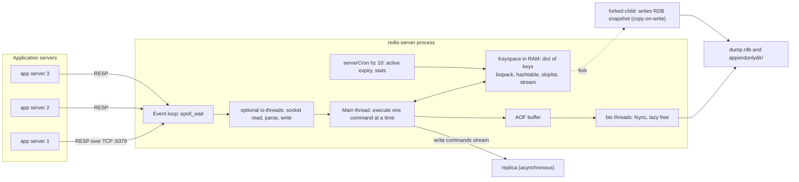

# Module 6.14: Redis internals and caching strategies

**Estimated hours:** 4

**What you will learn**

1. Redis's data types (string, hash, list, set, sorted set, stream), how TTL, eviction and persistence behave, and how to drive them from `redis-cli`.
2. Why one thread running every command makes Redis fast and atomic, and what that single thread costs you (one slow command stalls every client).
3. The caching strategies a backend engineer must be able to defend (cache-aside, write-through, write-behind, TTL versus invalidation, stampede fixes, negative caching), plus a C++17 client that speaks Redis's wire protocol over the `tcpkv::Socket` from module 5.03.

**Prerequisites:** [Module 6.13: Berkeley DB: key-value model and cursors](module-13-berkeley-db.md). You also need `socket.hpp` from module 5.03, the epoll event loop from module 3.11, fork and copy-on-write from modules 3.01 and 3.04, and the in-process `MasterCache` from module 4.13.

---

## 1. One-line intuition

Redis is a server that keeps data structures in RAM and executes every command, one at a time, on a single thread, so each command is atomic and most take microseconds.

## 2. Real-life analogy

Picture the token counter at a busy bank branch, run by one very fast clerk with a whiteboard.

- **The whiteboard** is RAM. Everything Redis knows is written there: token numbers, who is waiting, which OTP was sent to whom. Reading the whiteboard takes a glance, not a trip to the record room.
- **One clerk** serves the queue. Because only one person ever writes on the board, nobody needs to coordinate: no two customers can ever get the same token number. That is Redis's single thread and why `INCR` is atomic without locks.
- **The clerk never waits on a slow customer.** A customer who is still filling in a form steps aside; the clerk serves the next ready one. That is the event loop with epoll (module 3.11): only sockets with data ready are served.
- **But a customer who asks the clerk to count every coin in the vault** blocks the whole queue. One slow command stalls every client.
- **Notes on the board can have an expiry time** written next to them ("OTP valid 5 minutes"). Expired notes are wiped when someone looks at them, and the clerk also wipes a few at random every so often.
- **At closing time the clerk photographs the board** (an RDB snapshot) or keeps a running diary of every change (the AOF), so a power cut does not lose everything.

## 3. Why it exists: the problem it solves

A relational database answers a primary-key lookup in well under a millisecond on the server, but every query also pays for a network round trip, parsing, planning, a buffer-pool lookup, locking and MVCC visibility checks (modules 6.05 to 6.10). For data that is read thousands of times a second and changes rarely, that work is wasted. And some data is not worth putting in the database at all: a one-time password that lives five minutes, a login session, a counter of failed logins.

Memcached (2003) showed that a shared in-memory cache in front of the database works. Redis (Salvatore Sanfilippo, 2009) added **data structures** (hashes, lists, sets, sorted sets, later streams), **TTL per key**, **optional persistence** and **replication**, so it became a place for shared, short-lived application state as well as a cache. Licensing changed in 2024: Redis 7.4 left the BSD licence, the Linux Foundation forked the last BSD version as **Valkey**, and Redis 8 (2025) added an AGPL option. Ubuntu 24.04's package is Redis 7.0.15, still BSD-licensed, and everything in this module works the same on Valkey.

What breaks without it, in a multi-server lending platform: sessions stored in one application server's memory are lost when the load balancer sends the next request to another server; OTPs and lockout counters need a shared, expiring store; and the database takes load it does not need to.

## 4. Three layers of depth

### Layer 1 (beginner): keys, types and redis-cli

Every Redis entry is a **key** (a string, by convention `type:id:field`, such as `otp:MUM001:CL1001`) pointing to one value of one type. Run `redis-cli` and try these (the server from module 0.05 listens on port 6379):

```text
127.0.0.1:6379> SET otp:MUM001:CL1001 482913 EX 300 NX
OK
127.0.0.1:6379> SET otp:MUM001:CL1001 111111 EX 300 NX
(nil)
127.0.0.1:6379> TTL otp:MUM001:CL1001
(integer) 300
127.0.0.1:6379> INCR login_fail:MUM001:CL1001
(integer) 1
127.0.0.1:6379> HSET session:9f2c user_code CL1001 branch_code MUM001 role CLERK
(integer) 3
127.0.0.1:6379> HGET session:9f2c role
"CLERK"
127.0.0.1:6379> LPUSH queue:kyc 7001 7002 7003
(integer) 3
127.0.0.1:6379> RPOP queue:kyc
"7001"
127.0.0.1:6379> SADD branch:MUM001:online CL1001 CL1002 CL1001
(integer) 2
127.0.0.1:6379> ZADD leaderboard:disbursed 250000000 MUM001 410000000 BLR001 90000000 DEL001
(integer) 3
127.0.0.1:6379> ZREVRANGE leaderboard:disbursed 0 1 WITHSCORES
1) "BLR001"
2) "410000000"
3) "MUM001"
4) "250000000"
127.0.0.1:6379> XADD events:loan * type APPROVED application_id 900004 branch MUM001
"1792386193807-0"
```

| Type | What it holds | Key commands | Lending example |
|---|---|---|---|
| String | bytes (text, number, serialized object), up to 512 MB | `SET`, `GET`, `INCR`, `SET ... EX n NX` | OTP with a 5-minute TTL; failed-login counter |
| Hash | field-value pairs under one key | `HSET`, `HGET`, `HGETALL`, `HINCRBY` | a login session: user, branch, role |
| List | ordered sequence, push and pop at both ends | `LPUSH`, `RPOP`, `LRANGE`, `BRPOP` | a simple work queue of KYC checks |
| Set | unique members, no order | `SADD`, `SISMEMBER`, `SCARD` | which clerks are online in a branch |
| Sorted set | unique members ordered by a numeric score | `ZADD`, `ZRANGE`, `ZINCRBY`, `ZRANK` | branches ranked by amount disbursed; time-ordered rate-limit windows |
| Stream | append-only log of entries with time-based ids, consumer groups | `XADD`, `XRANGE`, `XREADGROUP`, `XACK` | loan events for a notification service |

`SET key value EX 300 NX` means "set only if the key does **n**ot e**x**ist, expiring in 300 seconds": the second `SET` returned `(nil)` and did nothing. The `XADD` id is milliseconds since 1970 plus a sequence number, so yours will differ.

### Layer 2 (working engineer): TTL, eviction, persistence, atomicity, scale

**TTL and expiry.** `EXPIRE key seconds`, `SET ... EX/PX`, `TTL`, `PERSIST`. A key with a TTL is removed in two ways. **Lazy expiry**: when any command touches the key, Redis checks its deadline and deletes it if past. **Active expiry**: about 10 times a second (`hz 10`), Redis samples 20 keys that have a TTL, deletes the expired ones, and repeats immediately while a large share of the sample was expired (the documentation says more than 25%). So untouched expired keys still disappear, and memory is reclaimed, without a full scan.

**Memory limit and eviction.** `maxmemory` caps the data size; `0` (the default on 64-bit) means no cap. When the cap is reached, `maxmemory-policy` decides:

| Policy | On a write that needs memory |
|---|---|
| `noeviction` (default) | reject the write: `OOM command not allowed when used memory > 'maxmemory'` |
| `allkeys-lru` / `allkeys-lfu` | evict the least recently / least frequently used key, any key |
| `volatile-lru` / `volatile-lfu` / `volatile-ttl` / `volatile-random` | evict only keys that have a TTL |
| `allkeys-random` | evict any key at random |

LRU and LFU are **approximated**: Redis samples a few keys (`maxmemory-samples`, default 5) and evicts the best candidate, which costs no linked list per key. A pure cache uses `allkeys-lru` or `allkeys-lfu`. A store holding sessions and OTPs must not silently lose them, so it uses `noeviction` or `volatile-*` with a memory alarm.

**Persistence.**

| | RDB snapshot | AOF (append-only file) |
|---|---|---|
| What it writes | the whole dataset, compact binary, at intervals (`save` rules or `BGSAVE`) | every write command, appended |
| How | `fork()`; the child writes the snapshot while copy-on-write keeps its view frozen (module 3.04) | the main thread appends to a buffer; `fsync` per `appendfsync` |
| Loss on power failure | everything since the last snapshot (minutes) | `always`: none in theory, slowest; `everysec` (default): up to about 1 second; `no`: whatever the OS had not flushed |
| Restart speed | fast (load a binary image) | slower (replay), mitigated by rewrite |

Redis 7 stores the AOF as a directory, `appendonlydir/`, with a base file (an RDB image), incremental `.aof` files and a manifest; `BGREWRITEAOF` compacts it. Most production setups enable AOF with `everysec` plus periodic RDB for backups. Even with `always`, Redis is not a system of record for money: replication is asynchronous (below), so a failover can lose acknowledged writes.

**Atomicity.** A single command is atomic. **Pipelining** sends many commands without waiting for each reply, saving round trips but not making them atomic. `MULTI` ... `EXEC` queues commands and runs them back to back with nothing interleaved, but there is **no rollback** if one fails; `WATCH key` before `MULTI` makes `EXEC` abort if the key changed (optimistic locking). For "read, decide, write" across keys, use **Lua**: `EVAL script numkeys key... arg...` runs the whole script atomically on the single thread. Example: consume an OTP only if it matches.

```text
127.0.0.1:6379> EVAL "if redis.call('GET', KEYS[1]) == ARGV[1] then return redis.call('DEL', KEYS[1]) else return 0 end" 1 otp:MUM001:CL1001 482913
(integer) 1
```

Without Lua, `GET` then `DEL` from the client leaves a window in which two requests can both see the OTP and both succeed. Redis 7 also offers **functions** (`FUNCTION LOAD`, `FCALL`), which are named, persisted scripts.

**Replication, Sentinel, Cluster (one paragraph).** A replica (`REPLICAOF host port`) receives an initial RDB and then the primary's stream of write commands, **asynchronously**; `WAIT n timeout` blocks until n replicas acknowledged, which narrows but does not close the loss window. **Sentinel** processes monitor a primary and its replicas, agree by quorum that the primary is down, promote a replica and tell clients the new address. **Redis Cluster** shards keys across primaries by `CRC16(key) mod 16384` hash slots; multi-key commands and scripts must touch keys in one slot, which `{hash tags}` force (for example `{CL1001}:session` and `{CL1001}:otp`), and clients follow `MOVED` redirects. Phase 7 explains replication and sharding in depth.

**Caching strategies.**

| Strategy | Read path | Write path | Use when | Risk |
|---|---|---|---|---|
| Cache-aside (lazy loading) | app reads cache; on miss reads DB and fills cache | app writes DB, then **deletes** the cache key | default choice | stale window between DB write and delete; stampede on hot misses |
| Read-through | a cache library loads from DB on a miss | as cache-aside | same idea, hidden in a library | same |
| Write-through | read from cache | app writes DB and cache together | read-after-write must hit cache | writes slower; cache holds data nobody reads |
| Write-behind (write-back) | read from cache | write cache now, flush to DB later | counters, analytics | data loss on crash; **never for balances or ledger rows** |

**TTL versus explicit invalidation.** A TTL bounds how stale a value can be, with no extra code. Explicit invalidation (`DEL` after the database commit) makes changes visible at once, but has a race: request A misses and reads the old row; request B updates the row and deletes the key; request A then writes the old value into the cache. Defences: always keep a TTL as a safety net, delete rather than update on writes, use versioned keys (`product:HL01:v42`), or drive invalidation from the database's change stream (module 7.10). Use both TTL and invalidation for anything that matters.

**Stampede (thundering herd).** A hot key expires and 500 requests miss at once, all hitting the database. Fixes: **single flight**, where one request takes a short lock (`SET lock:product:HL01 1 NX PX 2000`) and refreshes while the others wait briefly or serve the old value; **TTL jitter** (300 s plus a random 0 to 30 s) so keys loaded together do not expire together; **early refresh** before expiry for very hot keys.

**Negative caching.** Cache "this does not exist" with a short TTL. Otherwise every request for a wrong product code or a probing attacker's random customer id goes to the database.

### Layer 3 (internals): one thread, epoll and compact encodings

**The event loop.** Redis's loop (`ae.c`) calls `epoll_wait` on Linux (`INFO server` shows `multiplexing_api:epoll`; kqueue on BSD and macOS), then for each ready socket reads bytes into a per-client query buffer, parses complete RESP commands, executes them against the in-memory keyspace, and appends replies to a per-client output buffer that is written when the socket is writable. Between iterations it runs timers (`serverCron`, `hz` times a second): active expiry, statistics, replication heartbeats, checking the background save child. This is the reactor pattern of module 5.05.

**Why it is fast.** Data is in RAM, so a `GET` is a hash-table lookup plus a copy: well under a microsecond of CPU. One thread means no locks, no lock contention and no cache-line ping-pong between cores (module 4.08). Small values use compact encodings: a short hash or sorted set is a **listpack** (one contiguous byte array, cache friendly) until it grows past thresholds such as `hash-max-listpack-entries 128`, then becomes a real hash table (or, for sorted sets, a skiplist plus a hash table). Integers are stored as integers (`OBJECT ENCODING` shows `int`). The protocol, RESP, is trivial to parse. The cost per request is dominated by system calls and the network, not by the data structure.

**What else runs in parallel.** Since Redis 6, `io-threads` (default 1, meaning off) lets helper threads read and write sockets and parse commands, but **execution of commands stays on the main thread**. Background threads (`bio`) close files, `fsync` the AOF and free large objects (`UNLINK`, `lazyfree-*`). `BGSAVE` and AOF rewrite use a **forked child**: copy-on-write means the child sees a frozen snapshot while the parent keeps serving; every page the parent modifies during the save gets copied, which `INFO persistence` reports as `rdb_last_cow_size`. On a large, write-heavy instance that copying can double memory use, which is why Redis hosts are not run near full RAM.

**The price of one thread.** A command that does O(N) work on a big key (`KEYS *`, `HGETALL` on a million-field hash, `DEL` of a huge set, a long Lua script) blocks every other client for its whole duration. Use `SCAN`, `HSCAN` and `UNLINK` instead, keep values small, and watch `SLOWLOG GET`. A Lua script that runs longer than `busy-reply-threshold` (5000 ms) makes other clients receive `BUSY` errors until it ends or is killed with `SCRIPT KILL`.

## 5. Architecture diagram



Everything that changes data passes through the single main thread; disk and replicas are fed from it, but never wait on it inside a command.

## 6. Code

A C++17 client that speaks RESP directly, built on `tcpkv::Socket` from module 5.03, then used for cache-aside over the product master.

**RESP in one paragraph.** A client sends each command as an **array of bulk strings**: `*` + number of arguments, then for each argument `$` + byte length, CRLF, the bytes, CRLF. `GET product:HL01` is the 32 bytes `*2\r\n$3\r\nGET\r\n$12\r\nproduct:HL01\r\n`. Replies start with one type byte: `+OK` (simple string), `-ERR ...` (error), `:42` (integer), `$26\r\n...26 bytes...\r\n` (bulk string; `$-1` is nil), `*N` (array of N replies). Bulk strings carry their length, so values may contain any bytes, including newlines. (Redis 6 added RESP3 with more types; a client gets it only by sending `HELLO 3`.)

Copy `socket.hpp` from module 5.03 into `~/labs/redis/`, then save this as `~/labs/redis/resp_client.cpp`:

```cpp
// resp_client.cpp
// Speaks raw RESP2 to Redis over tcpkv::Socket (module 5.03), then uses it for cache-aside.
// Build: g++ -std=c++17 -O2 -Wall -Wextra -Werror -g -pthread -o resp_client resp_client.cpp
// Run:   ./resp_client            (Redis on 127.0.0.1:6379)
#include "socket.hpp"
#include <arpa/inet.h>
#include <chrono>
#include <iostream>
#include <map>
#include <optional>
#include <string>
#include <thread>
#include <vector>

namespace {

// socket.hpp has a Listener but no client side: connect and hand the fd to a Socket.
tcpkv::Socket connect_to(const char* ip, unsigned short port) {
    int fd = ::socket(AF_INET, SOCK_STREAM, 0);
    if (fd < 0) throw std::runtime_error(std::string("socket: ") + std::strerror(errno));
    tcpkv::Socket s(fd);                                  // owns the fd from here on
    sockaddr_in addr{};
    addr.sin_family = AF_INET;
    addr.sin_port = htons(port);
    if (::inet_pton(AF_INET, ip, &addr.sin_addr) != 1) throw std::runtime_error("bad address");
    if (::connect(fd, reinterpret_cast<sockaddr*>(&addr), sizeof addr) < 0)
        throw std::runtime_error(std::string("connect: ") + std::strerror(errno));
    return s;
}

// One RESP2 reply: + simple string, - error, : integer, $ bulk string, * array.
struct Reply {
    char type = 0;
    std::string str;                 // text of + - $ replies
    long long integer = 0;           // value of : replies
    bool nil = false;                // $-1 or *-1
    std::vector<Reply> elems;        // children of * replies
};

class Redis {
public:
    explicit Redis(tcpkv::Socket s) : sock_(std::move(s)) {}

    // Every command is sent as an array of bulk strings: *N CRLF, then $len CRLF bytes CRLF each.
    Reply command(const std::vector<std::string>& args) {
        std::string out = "*" + std::to_string(args.size()) + "\r\n";
        for (const auto& a : args) out += "$" + std::to_string(a.size()) + "\r\n" + a + "\r\n";
        if (!sock_.send_all(out)) throw std::runtime_error("send failed");
        return read_reply();
    }

private:
    std::string line() {                                  // one line, CRLF removed
        std::string l;
        if (!sock_.recv_line(l)) throw std::runtime_error("connection closed");
        if (l.size() < 3 || l[l.size() - 2] != '\r') throw std::runtime_error("bad line: " + l);
        l.resize(l.size() - 2);
        return l;
    }
    Reply read_reply() {
        std::string l = line();
        Reply r;
        r.type = l[0];
        const std::string rest = l.substr(1);
        switch (r.type) {
        case '+': case '-': r.str = rest; break;
        case ':': r.integer = std::stoll(rest); break;
        case '$': {
            long long n = std::stoll(rest);
            if (n < 0) { r.nil = true; break; }
            std::string buf, piece;                       // the payload may itself contain '\n':
            while (static_cast<long long>(buf.size()) < n + 2) {   // read until n bytes + CRLF
                if (!sock_.recv_line(piece)) throw std::runtime_error("connection closed");
                buf += piece;
            }
            r.str = buf.substr(0, static_cast<std::size_t>(n));
            break;
        }
        case '*': {
            long long n = std::stoll(rest);
            if (n < 0) { r.nil = true; break; }
            for (long long i = 0; i < n; ++i) r.elems.push_back(read_reply());
            break;
        }
        default: throw std::runtime_error("unknown reply: " + l);
        }
        return r;
    }
    tcpkv::Socket sock_;
};

std::string show(const Reply& r) {                         // print roughly like redis-cli
    switch (r.type) {
    case '+': return r.str;
    case '-': return "(error) " + r.str;
    case ':': return "(integer) " + std::to_string(r.integer);
    case '$': {
        if (r.nil) return "(nil)";
        std::string s = "\"";
        for (char c : r.str) s += (c == '\n') ? std::string("\\n") : std::string(1, c);
        return s + "\"";
    }
    default: {
        if (r.nil) return "(nil)";
        std::string s = "[";
        for (std::size_t i = 0; i < r.elems.size(); ++i) s += (i ? ", " : "") + show(r.elems[i]);
        return s + "]";
    }
    }
}

// ---- cache-aside over the product master ----
// The "database": two product rows; every load costs a simulated 2 ms round trip.
std::optional<std::string> load_product_from_db(const std::string& code, int& db_loads) {
    static const std::map<std::string, std::string> rows = {
        {"HL01", "Home loan|base_rate_bp=850"}, {"PL01", "Personal loan|base_rate_bp=1150"}};
    ++db_loads;
    std::this_thread::sleep_for(std::chrono::milliseconds(2));
    auto it = rows.find(code);
    if (it == rows.end()) return std::nullopt;
    return it->second;
}

// Read the cache; on a miss read the database and fill the cache with a TTL.
// A code that does not exist is cached too (negative caching), with a shorter TTL.
std::optional<std::string> get_product(Redis& r, const std::string& code, int& db_loads, int& hits) {
    const std::string key = "product:" + code;
    Reply cached = r.command({"GET", key});
    if (!cached.nil) {
        ++hits;
        if (cached.str == "-") return std::nullopt;        // cached "does not exist"
        return cached.str;
    }
    std::optional<std::string> row = load_product_from_db(code, db_loads);
    r.command({"SET", key, row ? *row : "-", "EX", row ? "300" : "30"});
    return row;
}

} // namespace

int main(int argc, char** argv) {
    const unsigned short port = argc > 1 ? static_cast<unsigned short>(std::stoi(argv[1])) : 6379;
    try {
        Redis r(connect_to("127.0.0.1", port));
        r.command({"DEL", "product:HL01", "product:PL01", "product:XX99",       // start clean, so
                   "otp:MUM001:CL1001", "demo:count", "session:9f2c"});       // reruns print the same
        const std::vector<std::vector<std::string>> script = {
            {"PING"},
            {"SET", "demo:text", "line one\nline two"},     // bulk strings are binary-safe
            {"GET", "demo:text"},
            {"GET", "no:such:key"},
            {"INCR", "demo:count"},
            {"SET", "otp:MUM001:CL1001", "482913", "EX", "300", "NX"},
            {"SET", "otp:MUM001:CL1001", "111111", "EX", "300", "NX"},
            {"TTL", "otp:MUM001:CL1001"},
            {"HSET", "session:9f2c", "user_code", "CL1001", "role", "CLERK"},
            {"HGETALL", "session:9f2c"},
            {"GET"},                                          // wrong arity: an error reply
        };
        for (const auto& cmd : script) {
            std::string text;
            for (const auto& a : cmd) text += (text.empty() ? "" : " ") + a;
            for (auto& c : text) if (c == '\n') c = '|';
            std::cout << text << "  ->  " << show(r.command(cmd)) << "\n";
        }
        int db_loads = 0, hits = 0;
        const char* lookups[] = {"HL01", "PL01", "HL01", "XX99", "HL01", "XX99", "PL01"};
        for (const char* code : lookups) {
            auto p = get_product(r, code, db_loads, hits);
            std::cout << "get_product(" << code << ") = " << (p ? *p : "not found") << "\n";
        }
        std::cout << "lookups=7 cache_hits=" << hits << " db_loads=" << db_loads << "\n";
    } catch (const std::exception& e) {
        std::cerr << "error: " << e.what() << "\n";
        return 1;
    }
    return 0;
}
```

```bash
cd ~/labs/redis
g++ -std=c++17 -O2 -Wall -Wextra -Werror -g -pthread -o resp_client resp_client.cpp
./resp_client
```

Expected output (identical on every run, because the program deletes its keys first):

```text
PING  ->  PONG
SET demo:text line one|line two  ->  OK
GET demo:text  ->  "line one\nline two"
GET no:such:key  ->  (nil)
INCR demo:count  ->  (integer) 1
SET otp:MUM001:CL1001 482913 EX 300 NX  ->  OK
SET otp:MUM001:CL1001 111111 EX 300 NX  ->  (nil)
TTL otp:MUM001:CL1001  ->  (integer) 300
HSET session:9f2c user_code CL1001 role CLERK  ->  (integer) 2
HGETALL session:9f2c  ->  ["user_code", "CL1001", "role", "CLERK"]
GET  ->  (error) ERR wrong number of arguments for 'get' command
get_product(HL01) = Home loan|base_rate_bp=850
get_product(PL01) = Personal loan|base_rate_bp=1150
get_product(HL01) = Home loan|base_rate_bp=850
get_product(XX99) = not found
get_product(HL01) = Home loan|base_rate_bp=850
get_product(XX99) = not found
get_product(PL01) = Personal loan|base_rate_bp=1150
lookups=7 cache_hits=4 db_loads=3
```

`valgrind -q --leak-check=full --error-exitcode=9 ./resp_client > /dev/null; echo $?` prints `0`. With Redis stopped, the program prints `error: connect: Connection refused` and exits with 1.

**Reading it.** The value `line one\nline two` survived the round trip because a bulk string carries its length; the reader keeps calling `recv_line` until it has `n + 2` bytes, so an embedded newline cannot cut the value short. The error reply came back as data (`-ERR ...`), not as a dropped connection: the server keeps the connection open. The cache-aside trace is three misses (`HL01`, `PL01`, and `XX99` which does not exist) and four hits, including a hit on the cached "not found" for `XX99`: negative caching saved a database call.

## 7. Use case: core-banking loan-origination platform

The application server (claim H4, capstone C2) runs as several instances behind a load balancer. Two kinds of fast, read-mostly data appeared in its design, and they got different homes.

**Master tables stay in-process (module 4.13).** Branches, roles, products and schemes are small (thousands of rows, a few megabytes), change a few times a day, and are read ten to twenty times per request. The in-process `MasterCache` answers a lookup in about 100 ns from the server's own memory and refreshes every few seconds. Redis would answer the same lookup in a network round trip: on one laptop over loopback, a single client managed about 10,000 `GET`s per second, a median of 47 µs; between machines in a data centre, typically 100 to 500 µs. Twenty of those per request is 2 to 10 ms of waiting that the in-process cache spends as 2 µs.

**Shared, short-lived state goes to Redis.** Sessions (a hash with a sliding `EXPIRE`, readable by whichever instance gets the next request), OTPs (`SET ... EX 300 NX`, consumed with the Lua compare-and-delete), failed-login counters for lockout (`INCR` plus `EXPIRE`), and rate-limit windows. These must be visible to every instance at once and must expire on their own, which is exactly what an in-process map cannot do. Redis runs with AOF `everysec`, `noeviction` and a memory alarm, because evicting a live session logs a clerk out mid-application.

The decision this module drove: **"Redis for shared ephemeral state, in-process for master data, the database for anything financial."** Module 0.05 placed Redis behind the master-table lookups; this module refines that picture: Redis was measured for that job and kept for shared state, while the master tables stay in process.

**How to answer "why not Redis for the master cache?"** "Three reasons. Latency: twenty lookups per request at 100 to 500 µs each is milliseconds, against nanoseconds in process. Availability: Redis would become a hard dependency on every request, so a Redis failover would fail logins; the in-process cache keeps serving its last snapshot even if the database is briefly away. And it would not remove the hard part: staleness. Redis is still a copy, so I would still need TTLs or invalidation. The data fits in every process, so the copy should live there. I would change my mind if the reference data grew past what each process can hold, or if hundreds of instances refreshing from the database became a load problem; then Redis, or Redis pub/sub broadcasting invalidations to the in-process caches, is the next step."

## 8. Lab

Use a throwaway Redis on port 6380 so you never change the system one on 6379. Total about 2.5 hours.

```bash
mkdir -p ~/labs/redis && cd ~/labs/redis
redis-server --port 6380 --dir ~/labs/redis --save "" --appendonly no --daemonize yes --logfile ~/labs/redis/redis.log
redis-cli -p 6380 ping        # PONG
```

### Part A: types, encodings and expiry (35 minutes)

1. Run every command from Layer 1 with `redis-cli -p 6380`. Your output must match except the `XADD` id.
2. `OBJECT ENCODING session:9f2c` (expected `"listpack"`), `OBJECT ENCODING leaderboard:disbursed` (`"listpack"`), `OBJECT ENCODING login_fail:MUM001:CL1001` (`"int"`), `MEMORY USAGE session:9f2c` (about 120 bytes on Redis 7.0). Then `CONFIG GET maxmemory-policy`, `CONFIG GET appendfsync`, `CONFIG GET hz`, `CONFIG GET io-threads`. Expected: `noeviction`, `everysec`, `10`, `1`.
3. Active expiry, measured: `for i in $(seq 1 10000); do echo "SET tmp:$i x EX 2"; done | redis-cli -p 6380 > /dev/null`, then `redis-cli -p 6380 DBSIZE`, `sleep 4`, `DBSIZE` again, then `redis-cli -p 6380 INFO stats | grep expired_keys`. Expected: the count drops by 10,000 although you never touched those keys, and `expired_keys:10000`.
4. Run the OTP Lua script from Layer 2 twice. Expected: `(integer) 1`, then `(integer) 0`: an OTP can be used once.

### Part B: eviction and the single thread (35 minutes)

1. `redis-cli -p 6380 CONFIG SET maxmemory 20mb`, then fill it with 1 KB values under the default policy: `redis-benchmark -p 6380 -t set -n 100000 -r 100000 -d 1000 -q`. Expected: the benchmark stops with `Error from server: OOM command not allowed when used memory > 'maxmemory'.` and `DBSIZE` shows roughly 16,000 keys (16,267 on one laptop).
2. `CONFIG SET maxmemory-policy allkeys-lru` and run the same benchmark. Expected: it completes; `INFO stats | grep evicted_keys` shows tens of thousands (82,735 on one laptop), `DBSIZE` stays near 17,000, and `INFO memory | grep used_memory_human` stays just under 20M.
3. Reset: `CONFIG SET maxmemory 0` and `FLUSHALL`.
4. Block the server. Terminal 1: `redis-cli -p 6380 EVAL "local i = 0 while i < 50000000 do i = i + 1 end return i" 0`. Terminal 2, at once: `time redis-cli -p 6380 PING`. Expected: `PONG` arrives only when the script ends, typically one to a few seconds later; `real` shows the wait. Then `redis-cli -p 6380 SLOWLOG GET 1` lists the `EVAL` with its duration in microseconds (one laptop: 150 million iterations took 5.7 s). Raise the loop to 150,000,000 or more: after 5 seconds (`busy-reply-threshold`) the waiting client gets `BUSY Redis is busy running a script. You can only call SCRIPT KILL or SHUTDOWN NOSAVE.`

### Part C: persistence survives kill -9 (30 minutes)

1. `redis-cli -p 6380 CONFIG SET appendonly yes`, then `SET loan:100004:status APPROVED` and `INCRBY branch:MUM001:disbursed 250000000`.
2. `ls appendonlydir` (expected `appendonly.aof.1.base.rdb`, `appendonly.aof.1.incr.aof`, `appendonly.aof.manifest`) and `cat appendonlydir/appendonly.aof.1.incr.aof`. The incremental AOF is plain RESP: you can read your two commands in it.
3. Crash it: `kill -9 $(redis-cli -p 6380 INFO server | grep process_id | cut -d: -f2 | tr -d '\r')`. Restart with the same command as above but `--appendonly yes`. Then `GET loan:100004:status` and `GET branch:MUM001:disbursed`. Expected: `"APPROVED"` and `"250000000"`; `grep "DB loaded" redis.log` shows the base and incremental files being loaded.
4. `redis-cli -p 6380 BGSAVE`, then `redis-check-rdb dump.rdb` (expected `\o/ RDB looks OK! \o/` and the number of keys read) and `INFO persistence | grep cow_size`: `rdb_last_cow_size` is the number of bytes copied by copy-on-write while the child was saving.
5. Write down, for `appendfsync everysec`, what a power cut can lose (about one second of writes) and why a failover to an asynchronous replica can lose more.

### Part D: RESP by hand, the client and pipelining (40 minutes)

1. Speak RESP yourself: `printf '*1\r\n$4\r\nPING\r\n*2\r\n$3\r\nGET\r\n$7\r\nnothing\r\n' | nc -q1 127.0.0.1 6380 | od -c`. Expected: `+PONG\r\n$-1\r\n`, two replies for two pipelined commands.
2. Build and run `resp_client` from section 6 (`./resp_client 6380`). Compare with the expected output. Then add TTL jitter in `get_product` (`300 + rand() % 31`), rerun, and check `TTL product:HL01` a few times: it varies between 300 and 330.
3. Pipelining: `redis-benchmark -p 6380 -t set,get -n 100000 -q` and then with `-P 16`. One laptop (WSL2): about 105,000 SET and 67,000 GET per second without pipelining, about 560,000 SET and 820,000 GET per second with `-P 16`. Your numbers will differ; the ratio is the lesson: the same single thread does several times more work when it spends less time on round trips and system calls.
4. Stop the throwaway server: `redis-cli -p 6380 shutdown nosave`.

### Journal

Copy [journal/TEMPLATE.md](../journal/TEMPLATE.md) to `journal/YYYY-MM-DD-redis.md`. Record: `expired_keys` from Part A, `evicted_keys` and `DBSIZE` from Part B, how long `PING` waited behind the script, the restart after `kill -9`, and your pipelining numbers. Add three sentences answering "why not Redis for the master cache" in your own words with your own numbers.

## 9. Common mistakes and misconceptions

| Mistake | Why it is wrong | Bug it causes |
|---|---|---|
| "Redis is single-threaded, so it cannot use my cores" | Execution is single-threaded by design; scale by sharding (Cluster) or more instances, and I/O threads help with sockets | Rejecting Redis for the wrong reason, or expecting one instance to scale with cores |
| `KEYS *` or `HGETALL` on huge keys in production | O(N) on the only execution thread | Every client stalls; timeouts across the platform |
| Using Redis as the system of record for money | Async replication and `everysec` fsync can lose acknowledged writes | Lost or duplicated financial state after a failover |
| `GET` then `SET`/`DEL` from the client as one "operation" | Another client can run in between | Double-used OTPs, lost counter updates; use `INCR`, `SET NX` or Lua |
| Expecting `MULTI`/`EXEC` to roll back | Redis transactions do not roll back failed commands | Half-applied changes |
| Updating the cache on writes instead of deleting | Concurrent writers can leave the older value last | Stale cache entries that never fix themselves without a TTL |
| No TTL on cache entries | Any missed invalidation is permanent | Stale prices or rates until someone flushes by hand |
| `allkeys-lru` on an instance holding sessions | Eviction picks sessions too | Clerks logged out at random under memory pressure |
| No negative caching | Misses for non-existent keys always hit the DB | DB load from typos and probing attacks |
| All keys loaded at start with the same TTL | They expire together | A stampede on the database every TTL period |

## 10. Resume link

- **Claim D, "Redis ... caching".** "Redis in our platform held shared, short-lived state: sessions, OTPs, lockout counters and rate limits, with TTLs and `noeviction`. I know why it is fast (in-memory, one execution thread on an epoll loop, compact encodings) and what that costs: one slow command blocks everyone, so we banned `KEYS` and big-key commands and watched `SLOWLOG`." Quote your Part B blocking measurement and Part D pipelining ratio.
- **Claim H4, "in-memory master-table cache".** Use the section 7 answer. The interviewer is testing whether you chose in-process caching on purpose. Have the numbers: about 100 ns in process (module 4.13) versus tens to hundreds of microseconds per Redis round trip (your Part D numbers), times twenty lookups per request.
- **Claim I, tcpkv.** tcpkv is a small Redis. Be ready to contrast: tcpkv uses a thread pool and a `shared_mutex` around one map; Redis uses one execution thread and epoll with no locks. Each is right for its workload, and you can explain both.

## 11. Interview questions

**Q1 (easy). Name Redis's main data types and give a use for each in a banking backend.**

<details>
<summary>Model answer</summary>

String: an OTP with `SET ... EX 300 NX`, or a counter with `INCR`. Hash: a session (user, branch, role). List: a simple work queue (`LPUSH`/`BRPOP`). Set: the clerks currently online in a branch. Sorted set: a ranking by score, or a sliding-window rate limiter keyed by timestamp. Stream: an append-only event log with consumer groups, for example loan events for a notification service. Every key can carry a TTL.

</details>

**Q2 (easy). Redis runs commands on one thread. Why is it still fast, and what is the catch?**

<details>
<summary>Model answer</summary>

The data is in RAM, so most commands are a hash lookup and a copy, well under a microsecond of CPU. One thread means no locks and no contention, and an epoll event loop serves thousands of connections without a thread each. Small values use compact encodings such as listpack. The cost per request is mostly system calls and the network, which pipelining and, since Redis 6, I/O threads reduce; command execution itself stays single-threaded. The catch: any long command (`KEYS`, a big `HGETALL`, a long Lua script) blocks every other client, so you design to avoid O(N) commands on large keys and monitor `SLOWLOG`.

</details>

**Q3 (medium). Compare RDB and AOF persistence. What can you lose with each?**

<details>
<summary>Model answer</summary>

RDB is a periodic binary snapshot written by a forked child using copy-on-write; it is compact and fast to load, but you lose everything since the last snapshot. AOF appends every write; with `appendfsync everysec` (the default) a power failure loses up to about a second, with `always` it fsyncs every write at a large throughput cost, with `no` it depends on the OS. Redis 7 keeps the AOF as a base RDB plus incremental files and a manifest, and rewrites it in the background. Most setups use AOF everysec plus RDB for backups. Independently, replication is asynchronous, so a failover can lose acknowledged writes; that is why Redis does not hold money.

</details>

**Q4 (medium). Explain cache-aside, its race condition, and how you handle stampedes.**

<details>
<summary>Model answer</summary>

Reads check the cache; on a miss they load from the database and populate the cache with a TTL. Writes go to the database and then delete the cache key. The race: a reader misses and reads the old row, a writer updates the row and deletes the key, then the reader writes the old value into the cache, which stays stale until the TTL. Mitigations: always keep a TTL, delete rather than update, versioned keys, or invalidation from the database change stream. A stampede is many simultaneous misses on a hot key; fix it with single-flight loading (one request takes `SET lock NX PX` and refreshes while others wait or serve stale), TTL jitter so keys do not expire together, and early refresh. Cache "not found" briefly too, so non-existent keys do not hammer the database.

</details>

**Q5 (hard). Your resume says the app server has an in-memory master-table cache. Why not Redis? Defend it with numbers, and say when you would change your mind.**

<details>
<summary>Model answer</summary>

A request needs ten to twenty master lookups. In process, a lookup is about 100 ns, under a shared lock or an immutable snapshot, so twenty cost about 2 µs. Through Redis each is a network round trip: tens of microseconds on loopback (I measured about 47 µs median for one client), 100 to 500 µs between machines, so 2 to 10 ms per request, which is the very cost the cache was built to remove. Redis would also add a hard runtime dependency on the hot path, while the in-process cache keeps serving its last good snapshot through a database or network blip. And it would not solve staleness, which is the actual hard part: it is still a copy, so we would still need TTLs or invalidation; we had a 5-second refresh signed off by the business. Redis was the right home for shared, expiring state like sessions and OTPs. I would revisit if the reference data outgrew process memory, if refresh load from many instances became significant, or if we needed instant cluster-wide invalidation; then I would keep the in-process cache and use Redis pub/sub or a change stream to broadcast invalidations.

</details>

## 12. Revision

- Redis keeps typed values (string, hash, list, set, sorted set, stream) in RAM and executes commands one at a time on an epoll loop: fast, atomic per command, and blocked by any slow command.
- TTL expiry is lazy plus active sampling; `maxmemory-policy` decides eviction (`noeviction` by default); RDB snapshots fork with copy-on-write, AOF `everysec` can lose about a second, and replication is asynchronous.
- Cache-aside with delete-on-write plus TTL is the default; fix stampedes with single flight and jitter, cache negatives briefly; master data stays in process, shared ephemeral state goes to Redis, money stays in the database.

---

Previous: [Module 6.13: Berkeley DB: key-value model and cursors](module-13-berkeley-db.md) | Next: [Module 6.15: Oracle and SQL Server differences](module-15-oracle-and-sql-server-differences.md)
