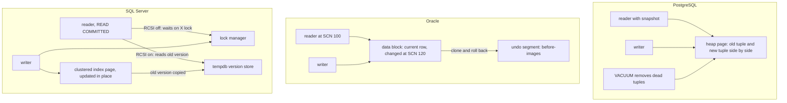

# Module 6.15: Oracle and SQL Server differences

**Estimated hours:** 3

**What you will learn**

1. How Oracle and SQL Server name and do the same things PostgreSQL does: terminology, SQL dialect, procedural language, sequences and identity, and the traps (empty string is NULL in Oracle, `ISNULL` truncation and default blocking reads in SQL Server).
2. How each engine handles concurrency (Oracle's undo-based read consistency, SQL Server's locking reads with optional row versioning, PostgreSQL's tuple versions), locking, deadlocks, clustered versus heap tables, and execution plans.
3. How to practise both for free in Docker, and how to describe your Oracle and SQL Server experience precisely at whatever level is true.

**Prerequisites:** [Module 6.14: Redis internals and caching strategies](module-14-redis-internals-and-caching.md). You need SQL from 6.02, the lending schema from 6.03, MVCC and isolation from 6.07 and 6.08, indexes and plans from 6.09 and 6.10, and PL/pgSQL from 6.11.

---

## 1. One-line intuition

Oracle, SQL Server and PostgreSQL are three dialects of the same relational idea; the SQL mostly transfers, but concurrency, procedural code and a handful of sharp edges differ, and an interviewer will probe exactly those edges.

## 2. Real-life analogy

Think of three banks' loan application forms.

- All three ask for the same things: applicant, amount, tenure, branch. That is SQL: `SELECT`, `JOIN`, `GROUP BY` and transactions work everywhere.
- But one form writes the date as day-month-year, another month-day-year; one treats a blank box as "not answered", another as "answered with nothing". Those are dialect differences: `LIMIT` versus `FETCH FIRST` versus `TOP`, and Oracle treating `''` as `NULL`.
- The back offices also work differently. At one bank a clerk reading a file never stops a colleague who is changing it, because the reader gets a photocopy of the file as it was (Oracle and PostgreSQL). At another, by default, the reader waits until the colleague finishes (SQL Server's default read committed). Same forms, different queues.
- A clerk who has worked at one bank can learn another's forms in a week. A clerk who claims to have worked at all three, and cannot say how a blank box is treated, loses the interviewer's trust in everything else.

## 3. Why it exists: the problem it solves

Banks run all three. Oracle has been the default for core banking and general ledgers since the 1990s; SQL Server is common for vendor products, reporting and Windows-centred departments; PostgreSQL and distributed SQL (YugabyteDB) are where newer platforms, like the lending platform in this course, are built. Data moves between them through integrations, migrations and reports.

The learner's resume lists Oracle and SQL Server. The honest rule, written in the resume source itself: **keep them only if you used them at work**. An interviewer who asks one Oracle question you cannot answer will doubt every other line. This module gives you enough to answer the basic questions correctly, to practise hands-on, and, above all, to say precisely what you have and have not done. Removing a line you cannot defend costs nothing; defending a line you cannot back costs the interview.

## 4. Three layers of depth

### Layer 1 (beginner): terminology and the dialect cheat sheet

| Concept | PostgreSQL | Oracle | SQL Server |
|---|---|---|---|
| Server architecture | one OS process per connection | an **instance** (shared memory **SGA** plus background processes such as DBWn, LGWR, CKPT, SMON, PMON) serving a database; a server process per session | one process (`sqlservr`) with its own thread scheduler (SQLOS) |
| Containers of tables | cluster, databases, schemas | since 12c: container database (CDB) holding pluggable databases (PDBs, `FREEPDB1` in the free edition); a **schema is a user** | instance, databases, schemas (`dbo` by default) |
| Change log | WAL (`pg_wal`) | redo log (online and archived) | transaction log (`.ldf`) |
| Old row versions for MVCC | in the table itself (dead tuples), removed by VACUUM | **undo** segments | version store in `tempdb` (or in the database with Accelerated Database Recovery), only when row versioning is enabled |
| Procedural language | PL/pgSQL | PL/SQL | T-SQL |
| Command-line client | `psql` | SQL\*Plus, SQLcl | `sqlcmd` |
| GUI | pgAdmin, DBeaver | SQL Developer | SSMS (SQL Server Management Studio) |

**Dialect differences you must know cold:**

| Task | PostgreSQL | Oracle | SQL Server |
|---|---|---|---|
| First 10 rows | `LIMIT 10` (also `FETCH FIRST 10 ROWS ONLY`) | `FETCH FIRST 10 ROWS ONLY` (12c+); `WHERE ROWNUM <= 10` in old code | `SELECT TOP (10) ...` |
| Page 3 of 10 | `LIMIT 10 OFFSET 20` | `OFFSET 20 ROWS FETCH NEXT 10 ROWS ONLY` | `ORDER BY ... OFFSET 20 ROWS FETCH NEXT 10 ROWS ONLY` (`ORDER BY` required) |
| Quote an identifier | `"Loan Id"`; unquoted names fold to **lower** case | `"Loan Id"`; unquoted names fold to **UPPER** case | `[Loan Id]` (or `"..."` with `QUOTED_IDENTIFIER ON`); case sensitivity follows the collation |
| Generated ids | `GENERATED ... AS IDENTITY`, sequences, `nextval('s')` | sequences, `s.NEXTVAL`; identity columns since 12c | `IDENTITY(1,1)`; sequences since 2012, `NEXT VALUE FOR s` |
| Get the generated id back | `INSERT ... RETURNING id` | `RETURNING id INTO v_id` (PL/SQL or a bind variable) | `OUTPUT inserted.id` |
| Select without a table | `SELECT 1` | `SELECT 1 FROM DUAL` (23ai and later also allow no `FROM`) | `SELECT 1` |
| Empty string | `''` is a value, not `NULL` | **`''` is `NULL`** in `VARCHAR2` | `''` is a value |
| Concatenate with `NULL` | `'a' \|\| NULL` is `NULL`; `concat()` skips `NULL` | `'a' \|\| NULL` is `'a'` | `'a' + NULL` is `NULL`; `CONCAT()` skips `NULL` |
| Null replacement | `COALESCE` | `NVL`, `COALESCE` | `ISNULL` (result takes the **first argument's type**), `COALESCE` |
| Now | `now()`, `current_timestamp` | `SYSDATE` (a `DATE`, which includes the time), `SYSTIMESTAMP` | `SYSDATETIME()`, `SYSDATETIMEOFFSET()`, `GETDATE()` |
| Boolean column | `boolean` | `NUMBER(1)` or `CHAR(1)` by convention (`BOOLEAN` only from 23ai) | `bit` |
| Text types | `text`, `varchar(n)` | `VARCHAR2(n)` (4000 bytes by default), `CLOB` | `varchar(n)`, `nvarchar(n)` (Unicode), `varchar(max)` |
| Integer money in paise | `bigint` | `NUMBER(19)` | `bigint` |
| Upsert | `INSERT ... ON CONFLICT ... DO UPDATE` (and `MERGE` since 15) | `MERGE` | `MERGE` (add `WITH (HOLDLOCK)`), or update-then-insert in a transaction |
| `NULL`s in `ORDER BY ... DESC` | first (use `NULLS LAST`) | first (use `NULLS LAST`) | last (no `NULLS LAST` syntax; `NULL` sorts lowest) |
| DDL inside a transaction | transactional: `ROLLBACK` undoes `CREATE TABLE` | **every DDL statement commits** the open transaction | transactional for most DDL |
| Client autocommit | `psql`: on | SQL\*Plus: **off**, you must `COMMIT` | SSMS and `sqlcmd`: on |

### Layer 2 (working engineer): procedural code, isolation, locking, indexes, plans

**Procedural languages side by side.**

| | PL/pgSQL | PL/SQL | T-SQL |
|---|---|---|---|
| Unit of code | functions and procedures, grouped by schema | procedures and functions, grouped in **packages** (a spec, the public interface, and a body) | procedures and functions, grouped by schema |
| Variables | `DECLARE v_status loan_applications.status%TYPE;` | same `%TYPE` and `%ROWTYPE` idea | `DECLARE @status varchar(20);` |
| `SELECT INTO` finds no row | variable set to `NULL`; with `INTO STRICT`, raises `no_data_found` | raises `NO_DATA_FOUND` | variable left unchanged, no error |
| Raise an error | `RAISE EXCEPTION 'msg %', v;` | `RAISE_APPLICATION_ERROR(-20001, 'msg');` (codes -20000 to -20999) | `THROW 50001, @msg, 1;` (older code: `RAISERROR`) |
| Catch errors | `BEGIN ... EXCEPTION WHEN ... THEN ... END;` | `BEGIN ... EXCEPTION WHEN ... THEN ... END;` | `BEGIN TRY ... END TRY BEGIN CATCH ... END CATCH` |
| Transactions | caller's transaction; a `PROCEDURE` may `COMMIT` | `COMMIT` allowed anywhere; autonomous transactions exist | explicit `BEGIN TRAN`, `@@TRANCOUNT`, and `SET XACT_ABORT ON` so any error rolls back |
| Script separators | statements end with `;` | blocks end with `/` on its own line in SQL\*Plus | batches end with `GO`, which is a client-tool command, not T-SQL |
| Returning rows | `RETURNS TABLE`, `RETURNS SETOF` | `SYS_REFCURSOR` out parameter | a plain `SELECT` inside the procedure returns a result set |

**Isolation and MVCC: the biggest real difference.**

- **PostgreSQL** (module 6.07): each row version carries `xmin`/`xmax`; a statement in Read Committed reads with a fresh snapshot; readers never block writers. Repeatable Read is snapshot isolation; Serializable is SSI, true serializability.
- **Oracle**: every query sees the database as of the moment it started (its **SCN**, system change number). If a block has changed since, Oracle rebuilds the older version of the block from **undo** ("consistent read"). Readers never block writers and writers never block readers. If a long query needs undo that has already been overwritten, it fails with **`ORA-01555: snapshot too old`**. Oracle's `SERIALIZABLE` is really snapshot isolation (write skew is possible) and raises `ORA-08177` on conflicting updates. There is no read uncommitted.
- **SQL Server**: default `READ COMMITTED` uses **shared locks**: a reader waits for a writer's exclusive lock on the row, and a writer can wait for readers. Turning on the database option **`READ_COMMITTED_SNAPSHOT`** (RCSI) changes `READ COMMITTED` to statement-level row versioning, like Oracle and PostgreSQL, with versions kept in `tempdb`. `ALLOW_SNAPSHOT_ISOLATION` adds a separate `SNAPSHOT` level (transaction-level, update conflicts raise error 3960). `WITH (NOLOCK)` means read uncommitted: dirty reads, and even missed or double-read rows during page splits. Azure SQL Database turns RCSI on by default; a box-product install does not.

**Locking and deadlocks.**

| | PostgreSQL | Oracle | SQL Server |
|---|---|---|---|
| Row lock stored | in the tuple header (`xmax`) | in the data block's interested transaction list | in the in-memory lock manager |
| Lock escalation | none | none | row/page locks escalate to a table lock at about 5,000 locks on one object in one statement |
| Deadlock detection | after `deadlock_timeout` (1 s) of waiting | automatic, within seconds | lock monitor, every 5 s by default and faster while deadlocks are being found |
| What the victim gets | `ERROR 40P01`, whole transaction aborted | `ORA-00060`, **only the current statement** rolled back; the session must decide to roll back | error 1205, whole transaction rolled back |

The Oracle row is a classic trap: code that catches `ORA-00060` and simply continues still holds the locks from earlier statements.

**Indexes and table organisation.**

- **SQL Server** tables usually *are* an index: a **clustered index** stores the rows in the leaf level of a B-tree ordered by the clustering key, and `PRIMARY KEY` creates one by default. Every nonclustered index stores the clustering key as its row locator, so a wide clustering key (a 16-byte GUID, a long composite) widens every index, and a random key (GUID) causes page splits all over the tree. Rule: narrow, unique, ever-increasing clustering key. Covering: `INCLUDE`. Partial: filtered index (`WHERE`).
- **PostgreSQL**: a heap plus secondary B-trees pointing at `ctid`; `CLUSTER` reorders once and is not maintained (module 6.09). Covering with `INCLUDE`, partial indexes with `WHERE`.
- **Oracle**: a heap plus B-trees pointing at `ROWID`; an **index-organized table** (`ORGANIZATION INDEX`) stores the table inside its primary-key B-tree, like a SQL Server clustered index. No `INCLUDE`: append the columns to the index key. A B-tree index does not store entries whose indexed columns are all `NULL`, so `WHERE col IS NULL` cannot use a single-column index. Bitmap indexes exist for analytics, not for OLTP tables, because one bitmap entry locks many rows.

**Execution plans.**

| | Estimated plan | Actual plan with row counts |
|---|---|---|
| PostgreSQL | `EXPLAIN query` | `EXPLAIN (ANALYZE, BUFFERS) query` |
| Oracle | `EXPLAIN PLAN FOR query;` then `SELECT * FROM TABLE(DBMS_XPLAN.DISPLAY);` | run the query with the hint `/*+ GATHER_PLAN_STATISTICS */`, then `SELECT * FROM TABLE(DBMS_XPLAN.DISPLAY_CURSOR(NULL, NULL, 'ALLSTATS LAST'));` and compare `E-Rows` with `A-Rows` |
| SQL Server | `SET SHOWPLAN_XML ON;` (the query is **not** executed; the `SET` must be alone in its batch) | `SET STATISTICS XML ON;` or the SSMS "Include Actual Execution Plan" button; `SET STATISTICS IO, TIME ON;` prints logical reads per table |

The reading skill from module 6.10 transfers directly: estimated rows versus actual rows, scan versus seek, join method, and where the time goes.

**Tooling.**

| Job | PostgreSQL | Oracle | SQL Server |
|---|---|---|---|
| Bulk load and export | `COPY`, `pg_dump` | SQL\*Loader, Data Pump (`expdp`/`impdp`) | `bcp`, `BULK INSERT` |
| Physical backup | `pg_basebackup` plus WAL archive | RMAN | `BACKUP DATABASE`, `BACKUP LOG` |
| What is running now | `pg_stat_activity` | `V$SESSION`, `V$SQL` (AWR and ASH need the extra-cost Diagnostics Pack) | `sys.dm_exec_requests`, `sys.dm_exec_sessions`, Query Store |
| High availability | streaming replication (module 6.16) | Data Guard, RAC | Always On availability groups, log shipping |

### Layer 3 (internals): where each engine keeps the past

All three write a log before changing data pages, and all three can show a reader an older version of a row. The difference is *where the old version lives*, and it explains each engine's characteristic failure.

- **PostgreSQL** writes the new version as a new tuple in the heap and leaves the old one in place. Readers find the right version by checking `xmin`/`xmax` against their snapshot. Old versions accumulate until VACUUM removes them, so PostgreSQL's characteristic problems are **bloat** and **transaction-id wraparound** (module 6.07).
- **Oracle** updates the row **in place** in the data block and copies the before-image into an undo segment. A reader whose SCN is older than the block's last change clones the block in the buffer cache and applies undo records backwards until it reaches its SCN. The table never bloats, but undo is a fixed-size circular space, so the characteristic problem is **`ORA-01555`** for long queries on busy tables. The same undo serves rollback and flashback queries (`AS OF TIMESTAMP`).
- **SQL Server** also updates in place. With row versioning off (the default), nothing old is kept for readers, so they must wait on locks: the characteristic problems are **blocking chains** and **lock escalation**. With RCSI or snapshot on, each modified row gets a 14-byte versioning tag and its old version goes to the version store, so the characteristic problem becomes **`tempdb` growth** under long transactions.

Deadlock handling follows from the lock storage. PostgreSQL and SQL Server abort the victim's whole transaction. Oracle rolls back only the statement that detected the deadlock, because its locks live in data blocks and its unit of statement atomicity is the statement.

## 5. Architecture diagram



Three places for the past: next to the present (PostgreSQL), in a separate circular undo space (Oracle), or nowhere unless you ask for it (SQL Server).

## 6. Code

Three worked examples of the same lending work in all three dialects, plus one stored procedure. The PostgreSQL versions run on `pg16` against the `lending` database from module 6.03 (output below is from PostgreSQL 16). The Oracle and SQL Server versions run in the practice containers of the lab; set-up scripts for a cut-down schema are in Lab Parts A and B.

**Example 1: one page of a branch's active loans, newest disbursement first, undisbursed loans last.**

```sql
-- PostgreSQL
SELECT l.loan_id,
       c.full_name || ' / ' || p.name        AS borrower_product,
       round(l.outstanding_paise / 100.0, 2) AS outstanding_rupees,
       COALESCE(to_char(l.disbursed_at, 'YYYY-MM-DD'), 'not disbursed') AS disbursed_on
FROM loans l
JOIN customers c ON c.customer_id = l.customer_id
JOIN products  p ON p.product_code = l.product_code
WHERE l.branch_code = 'MUM001' AND l.status = 'ACTIVE'
ORDER BY l.disbursed_at DESC NULLS LAST, l.loan_id
LIMIT 2 OFFSET 0;
```

```sql
-- Oracle: no AS before table aliases; NVL or COALESCE; OFFSET/FETCH
SELECT l.loan_id,
       c.full_name || ' / ' || p.name      AS borrower_product,
       ROUND(l.outstanding_paise / 100, 2) AS outstanding_rupees,
       NVL(TO_CHAR(l.disbursed_at, 'YYYY-MM-DD'), 'not disbursed') AS disbursed_on
FROM loans l
JOIN customers c ON c.customer_id = l.customer_id
JOIN products  p ON p.product_code = l.product_code
WHERE l.branch_code = 'MUM001' AND l.status = 'ACTIVE'
ORDER BY l.disbursed_at DESC NULLS LAST, l.loan_id
OFFSET 0 ROWS FETCH NEXT 2 ROWS ONLY;
```

```sql
-- SQL Server: CONCAT, COALESCE (not ISNULL, see Lab Part A), DESC already puts NULLs last
SELECT l.loan_id,
       CONCAT(c.full_name, N' / ', p.name)                AS borrower_product,
       CAST(l.outstanding_paise / 100.0 AS decimal(18,2)) AS outstanding_rupees,
       COALESCE(CONVERT(char(10), l.disbursed_at, 23), 'not disbursed') AS disbursed_on
FROM dbo.loans AS l
JOIN dbo.customers AS c ON c.customer_id = l.customer_id
JOIN dbo.products  AS p ON p.product_code = l.product_code
WHERE l.branch_code = 'MUM001' AND l.status = 'ACTIVE'
ORDER BY l.disbursed_at DESC, l.loan_id
OFFSET 0 ROWS FETCH NEXT 2 ROWS ONLY;
```

Expected result (all three, with the lab's sample rows; PostgreSQL output shown):

```text
 loan_id |      borrower_product       | outstanding_rupees | disbursed_on
---------+-----------------------------+--------------------+--------------
  100003 | Asha Rao / Personal loan    |          190000.00 | 2026-01-12
  100002 | Vikram Shah / Personal loan |          245000.00 | 2026-01-10
(2 rows)
```

Page 2 (`OFFSET 2`) returns loan `100005` with `not disbursed`. Without `NULLS LAST`, PostgreSQL and Oracle put `100005` first, because both treat `NULL` as larger than any value; SQL Server treats it as smaller, so it lands last with plain `DESC`.

**Example 2: create a loan application and return its generated id.**

```sql
-- PostgreSQL
CREATE SEQUENCE application_id_seq START 900006;
INSERT INTO loan_applications (application_id, branch_code, customer_id, product_code,
                               amount_paise, tenure_months, status, created_by)
VALUES (nextval('application_id_seq'), 'MUM001', 1001, 'PL01', 15000000, 24, 'SUBMITTED', 'CL1001')
RETURNING application_id;
```

```sql
-- Oracle (SQL*Plus): RETURNING needs somewhere to put the value, here a bind variable
CREATE SEQUENCE application_id_seq START WITH 900006;
VARIABLE new_id NUMBER
INSERT INTO loan_applications (application_id, branch_code, customer_id, product_code,
                               amount_paise, tenure_months, status, created_by)
VALUES (application_id_seq.NEXTVAL, 'MUM001', 1001, 'PL01', 15000000, 24, 'SUBMITTED', 'CL1001')
RETURNING application_id INTO :new_id;
PRINT new_id
COMMIT;
```

```sql
-- SQL Server
CREATE SEQUENCE dbo.application_id_seq AS bigint START WITH 900006;
GO
INSERT INTO dbo.loan_applications (application_id, branch_code, customer_id, product_code,
                                   amount_paise, tenure_months, status, created_by)
OUTPUT inserted.application_id
VALUES (NEXT VALUE FOR dbo.application_id_seq, 'MUM001', 1001, 'PL01', 15000000, 24, 'SUBMITTED', 'CL1001');
GO
```

Expected: one row, `application_id = 900006`. Note the Oracle `COMMIT`: SQL\*Plus does not autocommit, and an uncommitted insert vanishes when you exit with `ROLLBACK` or when the session dies.

**Example 3: upsert a product's base rate.**

```sql
-- PostgreSQL: the atomic upsert; MERGE (15+) can still fail with a unique violation under concurrency
INSERT INTO products (product_code, name, min_amount_paise, max_amount_paise, max_tenure_months, base_rate_bp)
VALUES ('PL01', 'Personal loan', 5000000, 250000000, 60, 1125)
ON CONFLICT (product_code) DO UPDATE SET base_rate_bp = EXCLUDED.base_rate_bp;
```

```sql
-- Oracle
MERGE INTO products p
USING (SELECT 'PL01' AS product_code, 1125 AS base_rate_bp FROM dual) s
ON (p.product_code = s.product_code)
WHEN MATCHED THEN UPDATE SET p.base_rate_bp = s.base_rate_bp
WHEN NOT MATCHED THEN INSERT (product_code, name, min_amount_paise, max_amount_paise, max_tenure_months, base_rate_bp, active)
     VALUES (s.product_code, 'Personal loan', 5000000, 250000000, 60, s.base_rate_bp, 1);
COMMIT;
```

```sql
-- SQL Server: HOLDLOCK closes the race where two sessions both see "not matched"; MERGE must end with ;
MERGE dbo.products WITH (HOLDLOCK) AS p
USING (VALUES ('PL01', 1125)) AS s (product_code, base_rate_bp)
ON p.product_code = s.product_code
WHEN MATCHED THEN UPDATE SET base_rate_bp = s.base_rate_bp
WHEN NOT MATCHED THEN INSERT (product_code, name, min_amount_paise, max_amount_paise, max_tenure_months, base_rate_bp, active)
     VALUES (s.product_code, N'Personal loan', 5000000, 250000000, 60, s.base_rate_bp, 1);
GO
```

Expected afterwards in all three: `SELECT product_code, base_rate_bp FROM products ORDER BY product_code` shows `HL01 850` and `PL01 1125`.

**The stored procedure: approve an application (validation plus audit in one round trip, claim H6).**

```sql
-- PL/pgSQL
CREATE OR REPLACE PROCEDURE approve_application(p_app_id bigint, p_user varchar)
LANGUAGE plpgsql AS $$
DECLARE
    v_status loan_applications.status%TYPE;
BEGIN
    SELECT status INTO STRICT v_status
      FROM loan_applications WHERE application_id = p_app_id FOR UPDATE;
    IF v_status <> 'SUBMITTED' THEN
        RAISE EXCEPTION 'application % is %, not SUBMITTED', p_app_id, v_status;
    END IF;
    UPDATE loan_applications SET status = 'APPROVED' WHERE application_id = p_app_id;
    INSERT INTO audit_log (user_code, action, entity, entity_id)
    VALUES (p_user, 'APPROVE', 'loan_application', p_app_id);
EXCEPTION
    WHEN no_data_found THEN
        RAISE EXCEPTION 'application % not found', p_app_id;
END;
$$;
CALL approve_application(900001, 'CL1001');
```

```sql
-- PL/SQL: a package spec (the public contract) and a body
CREATE OR REPLACE PACKAGE loan_workflow AS
    PROCEDURE approve_application(p_app_id IN NUMBER, p_user IN VARCHAR2);
END loan_workflow;
/
CREATE OR REPLACE PACKAGE BODY loan_workflow AS
    PROCEDURE approve_application(p_app_id IN NUMBER, p_user IN VARCHAR2) IS
        v_status loan_applications.status%TYPE;
    BEGIN
        SELECT status INTO v_status
          FROM loan_applications WHERE application_id = p_app_id FOR UPDATE;
        IF v_status <> 'SUBMITTED' THEN
            RAISE_APPLICATION_ERROR(-20001, 'application ' || p_app_id || ' is ' || v_status);
        END IF;
        UPDATE loan_applications SET status = 'APPROVED' WHERE application_id = p_app_id;
        INSERT INTO audit_log (user_code, action, entity, entity_id)
        VALUES (p_user, 'APPROVE', 'loan_application', p_app_id);
    EXCEPTION
        WHEN NO_DATA_FOUND THEN
            RAISE_APPLICATION_ERROR(-20002, 'application ' || p_app_id || ' not found');
    END approve_application;
END loan_workflow;
/
EXEC loan_workflow.approve_application(900001, 'CL1001');
COMMIT;
```

```sql
-- T-SQL: explicit transaction, XACT_ABORT, TRY/CATCH, THROW
CREATE OR ALTER PROCEDURE dbo.approve_application @app_id bigint, @user varchar(10)
AS
BEGIN
    SET NOCOUNT ON;
    SET XACT_ABORT ON;                      -- any error rolls back the whole transaction
    DECLARE @status varchar(20), @msg nvarchar(200);
    BEGIN TRY
        BEGIN TRANSACTION;
        SELECT @status = status
          FROM dbo.loan_applications WITH (UPDLOCK, ROWLOCK)
         WHERE application_id = @app_id;
        IF @status IS NULL                  -- no row: @status was never assigned
        BEGIN
            SET @msg = CONCAT(N'application ', @app_id, N' not found');
            THROW 50002, @msg, 1;
        END;
        IF @status <> 'SUBMITTED'
        BEGIN
            SET @msg = CONCAT(N'application ', @app_id, N' is ', @status);
            THROW 50001, @msg, 1;
        END;
        UPDATE dbo.loan_applications SET status = 'APPROVED' WHERE application_id = @app_id;
        INSERT INTO dbo.audit_log (user_code, action, entity, entity_id)
        VALUES (@user, 'APPROVE', 'loan_application', @app_id);
        COMMIT TRANSACTION;
    END TRY
    BEGIN CATCH
        IF @@TRANCOUNT > 0 ROLLBACK TRANSACTION;
        THROW;                              -- re-raise the original error to the caller
    END CATCH
END;
GO
EXEC dbo.approve_application @app_id = 900001, @user = 'CL1001';
GO
```

Expected behaviour in all three: the first call approves 900001 and writes one audit row; a second call fails with "application 900001 is APPROVED" (PostgreSQL prints `ERROR:  application 900001 is APPROVED, not SUBMITTED`); a call for 999999 fails with "not found". Notice the three different answers to "no row found": PL/pgSQL needs `STRICT`, PL/SQL raises `NO_DATA_FOUND` by itself, T-SQL raises nothing and leaves `@status` as `NULL`.

## 7. Use case: core-banking loan-origination platform

A typical shape: the lending platform runs on PostgreSQL and later YugabyteDB, the bank's general ledger runs on Oracle, and a vendor collections product runs on SQL Server. Disbursed loans flow to the ledger every night; overdue repayments flow to collections.

The decision this module drives: **integrate through an explicit, typed interchange contract (staging tables or files), not cross-database links or "the same SQL everywhere".** The contract says: money as integers in paise (`bigint` / `NUMBER(19)` / `bigint`), never floating point; booleans as `0`/`1`; timestamps as UTC with time zone (`timestamptz` / `TIMESTAMP WITH TIME ZONE` / `datetimeoffset`); and **empty strings converted to `NULL` before export**, because Oracle will do it anyway and a `NOT NULL` column that received `''` from PostgreSQL then fails on load. The data-parity checks (capstone C4's idea) treat `''` and `NULL` as equal only on the columns marked for Oracle.

The second decision is about code. Business rules that must run in the database (claim H6) live in one engine's procedural language, PL/pgSQL. A rule that the ledger also needs is re-implemented and tested on the Oracle side with the same test cases, rather than being "ported" line by line, because `NO_DATA_FOUND`, DDL auto-commit and statement-level deadlock rollback make a literal port subtly wrong.

## 8. Lab

You need Docker Desktop running and about 6 GB of free RAM for both containers at once; on a 16 GB laptop, run one at a time and `docker rm -f` it afterwards. Image downloads are large (SQL Server about 1.5 GB, Oracle Free several GB), so start the pulls first. Total about 2.5 hours.

### Part A: SQL Server 2022 Developer (40 minutes)

```bash
docker run -d --name mssql22 -e ACCEPT_EULA=Y -e 'MSSQL_SA_PASSWORD=Lend#Dev2026' \
  -e MSSQL_PID=Developer -p 1433:1433 mcr.microsoft.com/mssql/server:2022-latest
docker logs mssql22 2>&1 | grep -m1 "ready for client connections"     # repeat until it prints
docker exec -it mssql22 /opt/mssql-tools18/bin/sqlcmd -S localhost -U sa -P 'Lend#Dev2026' -C
```

Single quotes keep `bash` from interpreting the `#`; the password must have 8+ characters from three of upper, lower, digit, symbol, or the container exits (check `docker logs mssql22`). Older 2022 images have the tool at `/opt/mssql-tools/bin/sqlcmd` without `-C`. Developer edition is free for non-production use. Inside `sqlcmd`, every batch ends with `GO`.

1. Create the cut-down schema and rows, then run Example 1. Expected: the same two rows as section 6.

<details>
<summary>SQL Server set-up script</summary>

```sql
CREATE DATABASE lending;
GO
USE lending;
GO
CREATE TABLE dbo.products (
  product_code varchar(8) NOT NULL PRIMARY KEY, name nvarchar(100) NOT NULL,
  min_amount_paise bigint NOT NULL, max_amount_paise bigint NOT NULL,
  max_tenure_months int NOT NULL, base_rate_bp int NOT NULL, active bit NOT NULL DEFAULT 1);
CREATE TABLE dbo.customers (
  customer_id bigint NOT NULL PRIMARY KEY, branch_code varchar(6) NOT NULL,
  full_name nvarchar(200) NOT NULL, pan char(10) NOT NULL UNIQUE, dob date NOT NULL,
  kyc_status varchar(20) NOT NULL, created_at datetimeoffset NOT NULL DEFAULT SYSDATETIMEOFFSET());
CREATE TABLE dbo.loan_applications (
  application_id bigint NOT NULL PRIMARY KEY, branch_code varchar(6) NOT NULL,
  customer_id bigint NOT NULL REFERENCES dbo.customers, product_code varchar(8) NOT NULL REFERENCES dbo.products,
  amount_paise bigint NOT NULL, tenure_months int NOT NULL, status varchar(20) NOT NULL,
  created_by varchar(10) NOT NULL, created_at datetimeoffset NOT NULL DEFAULT SYSDATETIMEOFFSET());
CREATE TABLE dbo.loans (
  loan_id bigint NOT NULL PRIMARY KEY, application_id bigint NOT NULL UNIQUE REFERENCES dbo.loan_applications,
  branch_code varchar(6) NOT NULL, customer_id bigint NOT NULL REFERENCES dbo.customers,
  product_code varchar(8) NOT NULL REFERENCES dbo.products, principal_paise bigint NOT NULL,
  outstanding_paise bigint NOT NULL, rate_bp int NOT NULL, tenure_months int NOT NULL,
  disbursed_at datetimeoffset NULL, status varchar(10) NOT NULL);
CREATE TABLE dbo.audit_log (
  audit_id bigint IDENTITY(1,1) NOT NULL PRIMARY KEY, at datetimeoffset NOT NULL DEFAULT SYSDATETIMEOFFSET(),
  branch_code varchar(6) NULL, user_code varchar(10) NULL, action varchar(30) NOT NULL,
  entity varchar(30) NOT NULL, entity_id bigint NULL, detail nvarchar(max) NULL);
GO
INSERT INTO dbo.products VALUES ('HL01', N'Home loan', 50000000, 2000000000, 360, 850, 1),
                                ('PL01', N'Personal loan', 5000000, 250000000, 60, 1150, 1);
INSERT INTO dbo.customers (customer_id, branch_code, full_name, pan, dob, kyc_status) VALUES
  (1001, 'MUM001', N'Asha Rao', 'ABCDE1234F', '1988-02-11', 'VERIFIED'),
  (1002, 'MUM001', N'Vikram Shah', 'BCDEF2345G', '1979-09-30', 'VERIFIED');
INSERT INTO dbo.loan_applications (application_id, branch_code, customer_id, product_code,
  amount_paise, tenure_months, status, created_by) VALUES
  (900001, 'MUM001', 1001, 'HL01', 250000000, 240, 'SUBMITTED', 'CL1001'),
  (900002, 'MUM001', 1002, 'PL01', 30000000, 36, 'DISBURSED', 'CL1001'),
  (900003, 'MUM001', 1001, 'PL01', 20000000, 24, 'DISBURSED', 'CL1002'),
  (900005, 'MUM001', 1002, 'HL01', 150000000, 180, 'APPROVED', 'CL1002');
INSERT INTO dbo.loans VALUES
  (100002, 900002, 'MUM001', 1002, 'PL01', 30000000, 24500000, 1150, 36, '2026-01-10T10:00:00+05:30', 'ACTIVE'),
  (100003, 900003, 'MUM001', 1001, 'PL01', 20000000, 19000000, 1175, 24, '2026-01-12T10:00:00+05:30', 'ACTIVE'),
  (100005, 900005, 'MUM001', 1002, 'HL01', 150000000, 150000000, 875, 180, NULL, 'ACTIVE');
GO
```

</details>

2. The `ISNULL` trap: run Example 1 with `ISNULL(CONVERT(char(10), l.disbursed_at, 23), 'not disbursed')` and `OFFSET 2 ROWS`. Expected: `not disbur`. `ISNULL` returns the type of its first argument, `char(10)`, and truncates; `COALESCE` uses the wider type. Then `SELECT 'a' + NULL, CONCAT('a', NULL, 'b');` (expected `NULL` and `ab`).
3. `SET STATISTICS IO ON;` then rerun Example 1: note the logical reads per table.

### Part B: Oracle Database Free (40 minutes)

```bash
docker run -d --name oracle-free -p 1521:1521 -e ORACLE_PWD=Oracle2026 \
  container-registry.oracle.com/database/free:latest
docker logs -f oracle-free          # wait for: DATABASE IS READY TO USE!   then Ctrl+C
docker exec -it oracle-free sqlplus system/Oracle2026@localhost:1521/FREEPDB1
```

The free edition is limited to 2 CPU threads, 2 GB of RAM and 12 GB of user data, which is plenty here. Oracle relabelled the 23ai line as 26ai in late 2025, so the banner may show either; the commands are the same. (A smaller community image, `gvenzl/oracle-free`, also works and uses `ORACLE_PASSWORD`.) Create a schema user, then reconnect as it:

```sql
CREATE USER lending IDENTIFIED BY Lending2026 QUOTA UNLIMITED ON USERS;
GRANT CREATE SESSION, CREATE TABLE, CREATE SEQUENCE, CREATE PROCEDURE TO lending;
CONNECT lending/Lending2026@localhost:1521/FREEPDB1
```

1. Create the cut-down schema and rows, then run Example 1. Expected: the same two rows.

<details>
<summary>Oracle set-up script</summary>

```sql
CREATE TABLE products (
  product_code VARCHAR2(8) PRIMARY KEY, name VARCHAR2(100) NOT NULL,
  min_amount_paise NUMBER(19) NOT NULL, max_amount_paise NUMBER(19) NOT NULL,
  max_tenure_months NUMBER(10) NOT NULL, base_rate_bp NUMBER(10) NOT NULL,
  active NUMBER(1) DEFAULT 1 NOT NULL CHECK (active IN (0, 1)));
CREATE TABLE customers (
  customer_id NUMBER(19) PRIMARY KEY, branch_code VARCHAR2(6) NOT NULL,
  full_name VARCHAR2(200) NOT NULL, pan CHAR(10) NOT NULL UNIQUE, dob DATE NOT NULL,
  kyc_status VARCHAR2(20) NOT NULL, created_at TIMESTAMP WITH TIME ZONE DEFAULT SYSTIMESTAMP NOT NULL);
CREATE TABLE loan_applications (
  application_id NUMBER(19) PRIMARY KEY, branch_code VARCHAR2(6) NOT NULL,
  customer_id NUMBER(19) NOT NULL REFERENCES customers, product_code VARCHAR2(8) NOT NULL REFERENCES products,
  amount_paise NUMBER(19) NOT NULL, tenure_months NUMBER(10) NOT NULL, status VARCHAR2(20) NOT NULL,
  created_by VARCHAR2(10) NOT NULL, created_at TIMESTAMP WITH TIME ZONE DEFAULT SYSTIMESTAMP NOT NULL);
CREATE TABLE loans (
  loan_id NUMBER(19) PRIMARY KEY, application_id NUMBER(19) NOT NULL UNIQUE REFERENCES loan_applications,
  branch_code VARCHAR2(6) NOT NULL, customer_id NUMBER(19) NOT NULL REFERENCES customers,
  product_code VARCHAR2(8) NOT NULL REFERENCES products, principal_paise NUMBER(19) NOT NULL,
  outstanding_paise NUMBER(19) NOT NULL, rate_bp NUMBER(10) NOT NULL, tenure_months NUMBER(10) NOT NULL,
  disbursed_at TIMESTAMP WITH TIME ZONE, status VARCHAR2(10) NOT NULL);
CREATE TABLE audit_log (
  audit_id NUMBER(19) GENERATED BY DEFAULT AS IDENTITY PRIMARY KEY,
  at TIMESTAMP WITH TIME ZONE DEFAULT SYSTIMESTAMP NOT NULL,
  branch_code VARCHAR2(6), user_code VARCHAR2(10), action VARCHAR2(30) NOT NULL,
  entity VARCHAR2(30) NOT NULL, entity_id NUMBER(19), detail CLOB);
INSERT INTO products VALUES ('HL01', 'Home loan', 50000000, 2000000000, 360, 850, 1);
INSERT INTO products VALUES ('PL01', 'Personal loan', 5000000, 250000000, 60, 1150, 1);
INSERT INTO customers (customer_id, branch_code, full_name, pan, dob, kyc_status)
  VALUES (1001, 'MUM001', 'Asha Rao', 'ABCDE1234F', DATE '1988-02-11', 'VERIFIED');
INSERT INTO customers (customer_id, branch_code, full_name, pan, dob, kyc_status)
  VALUES (1002, 'MUM001', 'Vikram Shah', 'BCDEF2345G', DATE '1979-09-30', 'VERIFIED');
INSERT INTO loan_applications (application_id, branch_code, customer_id, product_code, amount_paise, tenure_months, status, created_by)
  VALUES (900001, 'MUM001', 1001, 'HL01', 250000000, 240, 'SUBMITTED', 'CL1001');
INSERT INTO loan_applications (application_id, branch_code, customer_id, product_code, amount_paise, tenure_months, status, created_by)
  VALUES (900002, 'MUM001', 1002, 'PL01', 30000000, 36, 'DISBURSED', 'CL1001');
INSERT INTO loan_applications (application_id, branch_code, customer_id, product_code, amount_paise, tenure_months, status, created_by)
  VALUES (900003, 'MUM001', 1001, 'PL01', 20000000, 24, 'DISBURSED', 'CL1002');
INSERT INTO loan_applications (application_id, branch_code, customer_id, product_code, amount_paise, tenure_months, status, created_by)
  VALUES (900005, 'MUM001', 1002, 'HL01', 150000000, 180, 'APPROVED', 'CL1002');
INSERT INTO loans VALUES (100002, 900002, 'MUM001', 1002, 'PL01', 30000000, 24500000, 1150, 36,
  TIMESTAMP '2026-01-10 10:00:00 +05:30', 'ACTIVE');
INSERT INTO loans VALUES (100003, 900003, 'MUM001', 1001, 'PL01', 20000000, 19000000, 1175, 24,
  TIMESTAMP '2026-01-12 10:00:00 +05:30', 'ACTIVE');
INSERT INTO loans VALUES (100005, 900005, 'MUM001', 1002, 'HL01', 150000000, 150000000, 875, 180, NULL, 'ACTIVE');
COMMIT;
```

</details>

2. The empty string: `SELECT CASE WHEN '' IS NULL THEN 'empty is NULL' ELSE 'empty is a value' END AS t FROM dual;` and `SELECT 'a' || NULL || 'b' AS c FROM dual;`. Expected: `empty is NULL` and `ab`. Run the same two in `psql` on `pg16` (without `FROM dual`): expected `empty is a value` and an empty (`NULL`) result.
3. DDL commits: `INSERT INTO products VALUES ('TMP1', 'Temp', 1, 2, 3, 4, 1);` then `CREATE TABLE scratch (x NUMBER);` then `ROLLBACK;` then `SELECT product_code FROM products WHERE product_code = 'TMP1';`. Expected: `TMP1` is still there: the `CREATE TABLE` committed your insert. Repeat in PostgreSQL inside `BEGIN; ... ROLLBACK;`: both the row and the table are gone.
4. A plan: `EXPLAIN PLAN FOR SELECT * FROM loans WHERE branch_code = 'MUM001';` then `SELECT * FROM TABLE(DBMS_XPLAN.DISPLAY);`. Expected: `TABLE ACCESS FULL` on `LOANS`, because no index starts with `branch_code`, exactly as PostgreSQL would choose a sequential scan.

### Part C: the examples and the procedure in all three (40 minutes)

1. Run Examples 2 and 3 in each engine. Record the generated id and the final `base_rate_bp` values.
2. Create the procedure in each engine and call it three times: for 900001, again for 900001, and for 999999. Expected in each: success, then "is APPROVED", then "not found", and exactly one row in `audit_log`.
3. In Oracle, call it for 900005 (status `APPROVED`) without `COMMIT`, then exit SQL\*Plus with `EXIT ROLLBACK` and check from a new session that nothing changed. Then answer in your notes: in PL/SQL, why does the `NO_DATA_FOUND` handler exist, and what would the T-SQL version do without its `IF @status IS NULL` check? (Answer: it would compare `NULL <> 'SUBMITTED'`, which is not true, skip the error, and approve nothing while reporting success.)

### Part D: readers and writers (30 minutes)

Open two `sqlcmd` sessions to `mssql22` (two terminals), both `USE lending;`.

1. Session 1: `BEGIN TRAN; UPDATE dbo.products SET base_rate_bp = 900 WHERE product_code = 'HL01';` then `GO` (do not commit). Session 2: `SELECT base_rate_bp FROM dbo.products WHERE product_code = 'HL01';` then `GO`. Expected: session 2 **hangs**. From a third session, `SELECT session_id, blocking_session_id, wait_type FROM sys.dm_exec_requests WHERE blocking_session_id <> 0;` shows a `LCK_M_S` wait. Session 1: `ROLLBACK; GO`. Session 2 now prints `850`.
2. Turn on row versioning: `ALTER DATABASE lending SET READ_COMMITTED_SNAPSHOT ON WITH ROLLBACK IMMEDIATE;` (run it from a third session with nothing else open in `lending`, or it waits). Repeat step 1. Expected: session 2 returns `850` immediately while session 1's update is uncommitted.
3. Repeat step 1 in Oracle (two SQL\*Plus sessions) and in PostgreSQL (two `psql` sessions). Expected: the reader never waits and sees `850` in both.
4. Clean up: `docker rm -f mssql22 oracle-free` when you are done with the module.

### Journal

Copy [journal/TEMPLATE.md](../journal/TEMPLATE.md) to `journal/YYYY-MM-DD-oracle-sqlserver.md`. Record: the `ISNULL` truncation, the empty-string results, the DDL auto-commit result, the blocked `SELECT` and the `LCK_M_S` wait, and the RCSI change. Then write down, honestly, which honesty level in section 10 is true for you for Oracle and for SQL Server, and the exact sentence you will say.

## 9. Common mistakes and misconceptions

| Mistake | Why it is wrong | Bug it causes |
|---|---|---|
| Inserting `''` into an Oracle `NOT NULL` column | Oracle stores `''` as `NULL` | `ORA-01400: cannot insert NULL` during data loads from PostgreSQL |
| `WHERE name = ''` in Oracle | It is `name = NULL`, which is never true | A query that silently returns nothing |
| Forgetting `COMMIT` in SQL\*Plus | Autocommit is off | Changes vanish at disconnect; other sessions block on your locks |
| Running DDL mid-transaction in Oracle | DDL commits first | Half a unit of work committed with no way to roll it back |
| `ISNULL(short_col, 'longer default')` in SQL Server | Result takes the first argument's type | Truncated values such as `not disbur` |
| Assuming SQL Server readers never block | Default read committed takes shared locks | Blocking chains and timeouts under load; "fixed" with `NOLOCK`, which reads dirty and inconsistent data |
| Catching `ORA-00060` and carrying on | Only the statement was rolled back; earlier locks are still held | The deadlock repeats, or partial work commits |
| A GUID as SQL Server clustering key | Random inserts split pages everywhere, and every index carries 16 bytes | Fragmentation and bloated nonclustered indexes |
| Copying PostgreSQL `NULLS LAST` habits into SQL Server | The syntax does not exist; `DESC` already puts `NULL`s last there | Syntax errors, or wrong order after a careless "fix" |
| Listing Oracle and SQL Server on a resume after only this module | Practice is not production experience | Losing credibility on every other resume line |

## 10. Resume link

The resume lists "Oracle, SQL Server" under databases. Decide which level is true for each, and say exactly that.

| Level | What is true | What to put on the resume | What to say |
|---|---|---|---|
| 0 | Never used it at work | Remove it, or nothing more than "exposure to Oracle and SQL Server (lab)" | "I haven't used Oracle in production. My production work was PostgreSQL and YugabyteDB, plus Berkeley DB as a migration source. I've practised Oracle Free in Docker, so I know the main differences: undo-based read consistency and `ORA-01555`, empty strings as `NULL`, DDL committing, PL/SQL packages. I'd expect to be productive quickly, but I wouldn't claim experience." |
| 1 | Read, ran or lightly modified queries or procedures on a system someone else owned | "Working knowledge of Oracle (SQL, PL/SQL reading and maintenance)" | "I worked with an Oracle-backed module: I read and fixed queries and small PL/SQL procedures, and I used `DBMS_XPLAN` to check plans. I didn't administer it or design its schema." Then give one concrete example. |
| 2 | Wrote and tuned SQL and procedures, owned objects in it | "Oracle" or "SQL Server" with no qualifier | Describe one specific piece of work: what you wrote, a plan you fixed (which index, `E-Rows` versus `A-Rows`), a locking or deadlock issue you diagnosed, with numbers. |

If an interviewer goes deeper than your level, say so and then show how you would find out: "That's past what I've done in Oracle. In PostgreSQL I'd check X; in Oracle I believe the equivalent is `DBMS_XPLAN.DISPLAY_CURSOR` with `ALLSTATS LAST`, and I'd confirm in the documentation." Interviewers trust a precise boundary far more than a vague claim.

Supporting claims this module strengthens truthfully at any level: claim D (database concepts: MVCC, locking, plans, compared across engines) and claim H6 (the stored-procedure layer, which you can now explain in PL/pgSQL and contrast with PL/SQL and T-SQL).

## 11. Interview questions

**Q1 (easy). How do you return only the first 10 rows in PostgreSQL, Oracle and SQL Server?**

<details>
<summary>Model answer</summary>

PostgreSQL: `ORDER BY ... LIMIT 10`, or the standard `FETCH FIRST 10 ROWS ONLY`. Oracle 12c and later: `ORDER BY ... FETCH FIRST 10 ROWS ONLY`; older code uses `ROWNUM` in a subquery because `ROWNUM` is assigned before `ORDER BY`. SQL Server: `SELECT TOP (10) ... ORDER BY ...`, or `ORDER BY ... OFFSET 0 ROWS FETCH NEXT 10 ROWS ONLY`. Without `ORDER BY`, "first 10" is not defined in any of them.

</details>

**Q2 (easy). What is special about empty strings in Oracle, and what is `DUAL`?**

<details>
<summary>Model answer</summary>

In Oracle, a zero-length `VARCHAR2` is `NULL`: `'' IS NULL` is true, `WHERE col = ''` matches nothing, and inserting `''` into a `NOT NULL` column fails with `ORA-01400`. Concatenation also treats `NULL` as empty, so `'a' || NULL` is `'a'`, unlike PostgreSQL. `DUAL` is a one-row, one-column table used where the syntax needs a `FROM` clause, for example `SELECT seq.NEXTVAL FROM dual`; version 23ai and later allow `SELECT` without `FROM`.

</details>

**Q3 (medium). Compare how Oracle, SQL Server and PostgreSQL give a reader a consistent view while others write.**

<details>
<summary>Model answer</summary>

Oracle reads as of the query's start SCN; when a block changed later, it rebuilds the older block image from undo, so readers and writers never block each other, and very long queries can fail with `ORA-01555` when the undo they need was overwritten. PostgreSQL keeps old row versions in the table and picks the visible one with `xmin`/`xmax` and a snapshot, so it also never blocks readers, at the cost of dead tuples that VACUUM must remove. SQL Server's default read committed uses shared locks, so a reader waits for an uncommitted writer; enabling `READ_COMMITTED_SNAPSHOT` switches to row versions in `tempdb`, giving Oracle-like behaviour at the cost of `tempdb` space and a small per-row overhead. I demonstrated the blocking and the RCSI change in a lab.

</details>

**Q4 (medium). What is a clustered index in SQL Server, and how would you choose the clustering key for `loan_applications`?**

<details>
<summary>Model answer</summary>

A clustered index stores the table's rows in the leaf pages of a B-tree ordered by the clustering key; there is one per table, and a primary key creates it by default. Nonclustered indexes use the clustering key as their pointer to the row. So the key should be narrow (it is copied into every index), unique, stable (never updated) and ever-increasing (new rows go to the end, avoiding page splits). For `loan_applications`, `application_id` from a sequence fits all four. A GUID would be wide and random. PostgreSQL has no maintained equivalent: tables are heaps and every index is secondary; Oracle's equivalent is an index-organized table.

</details>

**Q5 (hard). "I see Oracle on your resume. Tell me about your Oracle experience, and how you would tune a slow query there."**

<details>
<summary>Model answer</summary>

Answer at your true level, first sentence first. For example, level 0: "I haven't run Oracle in production; my production databases were PostgreSQL and YugabyteDB. Here is how I'd approach it, mapped from what I have done." Then the method: capture the actual plan with `GATHER_PLAN_STATISTICS` and `DBMS_XPLAN.DISPLAY_CURSOR(NULL, NULL, 'ALLSTATS LAST')`; find the step where estimated rows (`E-Rows`) and actual rows (`A-Rows`) diverge; check optimizer statistics with `DBMS_STATS` and whether bind-variable peeking produced a plan that is bad for other values; check for a full scan where an index on the filter column, in the right column order, would serve, remembering that all-`NULL` keys are not indexed; and look at waits in `V$SESSION` (and AWR or ASH only if the Diagnostics Pack is licensed). "In PostgreSQL I did exactly this with `EXPLAIN (ANALYZE, BUFFERS)` on the login query: a sequential scan on a master table keyed by business codes, fixed with a composite covering index." The honest opening plus a precise method earns more trust than a vague claim.

</details>

## 12. Revision

- Same SQL, different edges: `LIMIT` / `FETCH FIRST` / `TOP`, sequences and `RETURNING` / `RETURNING INTO` / `OUTPUT`, Oracle's `''` is `NULL` and DDL commits, SQL Server's `ISNULL` typing and `GO` batches.
- Concurrency is the real difference: Oracle rebuilds old versions from undo (`ORA-01555`), SQL Server blocks readers unless RCSI is on (versions in `tempdb`), PostgreSQL keeps versions in the heap (VACUUM); Oracle's deadlock victim loses only a statement.
- Keep Oracle and SQL Server on the resume only at the level you can defend, and say that level in your first sentence.

---

Previous: [Module 6.14: Redis internals and caching strategies](module-14-redis-internals-and-caching.md) | Next: [Module 6.16: Replication and backup in PostgreSQL](module-16-replication-and-backup.md)
