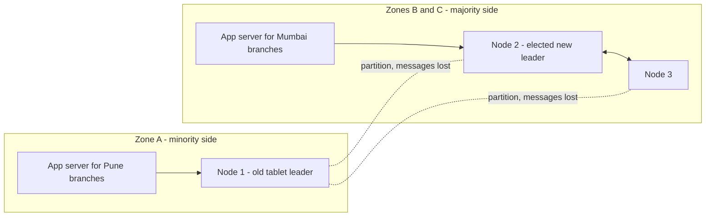

# Module 7.01: Why distribute; failure models; CAP and PACELC

**Estimated hours:** 3

**What you will learn**

1. Why one PostgreSQL server, even with the replica you built in 6.16, is not enough for a bank's loan platform: capacity, single point of failure, regional outage and latency.
2. How distributed systems fail: the eight fallacies, the failure models (crash-stop, crash-recovery, omission, byzantine), real network partitions, and why a timeout cannot tell a slow server from a dead one.
3. What CAP and PACELC actually say, how they are misread, and why a loan ledger must choose consistency (CP) and what that choice costs during a partition.

**Prerequisites:** [Module 6.16: Replication and backup in PostgreSQL](../phase-06-databases-from-zero-to-internals/module-16-replication-and-backup.md). You also need TCP retransmission from 5.02 and 5.04, timeouts from 5.10, idempotency from 5.06 and transactions from 6.04. Docker Desktop must be running.

---

## 1. One-line intuition

Spreading data over several machines buys capacity and survival, but the machines talk over a network that can delay, lose or cut messages; when it cuts them, every system must choose between refusing some requests (and staying correct) or answering them (and risking being wrong).

## 2. Real-life analogy

Before computers, a bank with two branches kept one customer's loan account in two ledgers, one in each branch. The clerks kept them in step by telephone.

- **The telephone line** is the **network**. Calls are usually quick. Sometimes there is a long delay. Sometimes the line is dead.
- **A dead line while both branches stay open** is a **network partition**: both sides are alive and working, but they cannot talk to each other.
- A customer walks into branch A and asks for the next disbursement of her loan. The clerk cannot reach branch B to check whether B already paid it out this morning. The clerk has two honest options:
  - **Refuse**: "Our line to head office is down, please come back later." The ledgers stay correct. The customer is unhappy. This is choosing **consistency**.
  - **Pay out** and sort it out later. The customer is happy. If B already paid, the bank has paid twice and must chase the money back. This is choosing **availability**.
- A clerk who rings and hears nothing cannot tell whether the other clerk is **slow** (busy with a queue), **gone** (fainted, went home) or whether **the line is cut**. All three sound identical: silence. That is the timeout problem.
- Clerks fail in different ways. One faints and never comes back (**crash-stop**). One faints, wakes up an hour later with her notebook intact and carries on (**crash-recovery**). Some letters between branches get lost in the post (**omission**). And one clerk is dishonest and writes false entries that look genuine (**byzantine**).

The rest of this module turns these stories into precise words you can use in an interview.

## 3. Why it exists: the problem it solves

In Phase 6 everything ran on one PostgreSQL server, `pg16`, and in 6.16 you added a streaming replica. For a bank's loan-origination platform that is not enough, for four reasons.

| Limit of one server | What it means for a bank | Typical numbers |
|---|---|---|
| **Capacity** | One machine has one write-ahead log, one set of disks, a fixed number of cores. Month-end disbursement peaks and nightly interest accrual all queue behind it. Bigger machines get expensive fast and still have a ceiling. | A large server today: 64 to 128 cores, a few TB of RAM. After that you cannot buy bigger. |
| **Single point of failure** | A dead motherboard, a full disk or a kernel bug stops every branch. A 6.16 replica helps, but failover is manual or needs an external tool, and an asynchronous replica can lose the last commits. | Even 99.99% availability allows about 52 minutes of downtime a year. |
| **Regional outage** | A power failure, flood or fibre cut takes out a whole data centre. Regulators expect banks to have a disaster-recovery site and to test it. | Recovery time objectives for core systems are often minutes, not hours. |
| **Latency** | Branches are spread across the country. Light in fibre covers about 200 km per millisecond, and real routes are longer than straight lines. | Mumbai to Delhi round trip is typically 20 to 40 ms. |

**Distributing** the system (running it on several machines in several places) fixes these limits. It also creates new problems that did not exist on one machine:

- Messages between machines can be **delayed, lost, duplicated or reordered**.
- Machines **fail independently**. One can be dead while the others are fine.
- There is **no shared clock** (module 7.03) and **no shared memory**. Each machine only knows what messages have told it.

What breaks if you distribute naively: two branches disburse the same loan twice, a repayment is acknowledged and then lost during failover, or two servers both believe they are the primary ("split brain") and accept conflicting writes. The rest of Phase 7 is about avoiding exactly these failures.

## 4. Three layers of depth

### Layer 1 (beginner): the words and the eight fallacies

- **Node**: one machine (or container) running part of the system.
- **Cluster**: the group of nodes that together provide the service.
- **Replica**: a copy of the same data on another node (module 7.04).
- **Network partition**: some nodes are alive but cannot exchange messages with other nodes. Do not confuse it with **table partitioning** (splitting a table, which this course calls sharding, module 7.06). Same word, different idea.
- **Fault**: one part going wrong (a disk, a link). **Failure**: the whole system stops giving the service. **Fault tolerance**: faults happen, failures do not.
- **Timeout**: "if no answer arrives within T, give up and assume something is wrong".

In 1994 L. Peter Deutsch and colleagues at Sun listed seven false assumptions that programmers new to distributed systems make; James Gosling added the eighth. Every one of them has caused a real banking incident somewhere.

| Fallacy | The truth | What it breaks in a loan platform |
|---|---|---|
| 1. The network is reliable | Packets are lost, links flap, switches reboot | A disbursement request vanishes; the client hangs |
| 2. Latency is zero | A cross-country round trip is tens of ms | Twenty sequential queries from a branch take a second |
| 3. Bandwidth is infinite | Links saturate at month-end | Replication lag grows exactly when load is highest |
| 4. The network is secure | Anyone on the path can read or alter packets | Loan amounts tampered in transit without TLS (5.09) |
| 5. Topology does not change | Nodes move, IPs change, routes change | Hard-coded primary IP points at the old server after failover |
| 6. There is one administrator | Many teams and vendors touch the path | A firewall change cuts replication at 2 a.m. |
| 7. Transport cost is zero | Serialization, TLS and cross-zone traffic cost CPU and money | Chatty RPCs dominate the request time |
| 8. The network is homogeneous | Different OSes, NICs, MTUs, vendors | A path with a smaller MTU drops large replication packets |

### Layer 2 (working engineer): failure models, timeouts, CAP, PACELC

**Failure models.** A failure model is the list of misbehaviours an algorithm promises to survive. Choosing it is a design decision.

| Model | What a faulty node or link does | Example | What protects you |
|---|---|---|---|
| Crash-stop | Stops forever; never sends another message | A VM deleted by mistake | Replicas; majority quorums |
| Crash-recovery | Stops, then restarts later with what it had on disk | Power cut, process killed and restarted | Write state to disk with `fsync` before replying (6.06); Raft persists term, vote and log (7.05) |
| Omission | Drops some messages it should send or receive | Overloaded switch, full socket buffer | Retries, acknowledgements, idempotency |
| Timing (performance) | Answers, but far too late | 20-second garbage-collection pause, swapping, a stuck disk | Timeouts, leases, fencing with term numbers |
| Byzantine | Anything at all, including lying | Corrupted firmware, a malicious insider, a bit flip in RAM | Checksums, signatures, TLS; full byzantine fault tolerance needs 3f+1 nodes to survive f liars |

**What banks assume.** Inside one bank's data centres, the nodes are owned and run by the bank. So core-banking databases assume **crash-recovery plus omission and timing faults, but not byzantine nodes**. Raft and Paxos, used by YugabyteDB, Spanner and CockroachDB, are crash-fault tolerant: 2f+1 nodes survive f crashes. The byzantine risks that remain (corrupted disks, bit flips, tampering) are handled separately: data checksums, TLS between nodes, authentication, audit trails and daily reconciliation. Byzantine fault tolerant protocols (as used in some blockchains) cost more nodes and more message rounds, and buy protection against a threat that the bank's trust boundary already handles.

**Timing models.** Theory distinguishes three worlds:

- **Synchronous**: every message arrives within a known bound. Real networks are not like this.
- **Asynchronous**: no bound at all; a message may take any finite time. The famous **FLP result** (Fischer, Lynch and Paterson, 1985) proves that in this world no deterministic algorithm can guarantee that a group of nodes always reaches agreement if even one node may crash.
- **Partially synchronous**: the network is usually well behaved, with unknown bad periods. This is the honest model of a real data centre.

Raft (7.05) is designed for the third world. It uses timeouts only to make progress (liveness). It never relies on timing for correctness (safety). During a long bad period it may stall, but it never returns a wrong answer.

**Timeouts cannot tell slow from dead.** When a request times out, there are at least four possibilities: the request was lost; the server is dead; the server is slow and will still do the work; or the work was done and the reply was lost. The client cannot know which. Two consequences:

1. **The operation may have happened.** Never assume a timed-out debit did not happen. Retries must be safe, which means an **idempotency key**: a unique request ID the server remembers, so a repeat is recognised and not applied twice (5.06). Section 6 shows this with real threads.
2. **Choosing the timeout is a trade-off.** Too short, and a healthy but briefly slow node is declared dead; you get needless failovers, and possibly two nodes both acting as leader. Too long, and real failures take a long time to detect. Production systems usually pick a few seconds for failure detection and protect against the "slow node wakes up" case with **term numbers** (7.05) and **leases** (7.03, 7.07).

**CAP, stated precisely.** Eric Brewer stated it as a conjecture in 2000. Seth Gilbert and Nancy Lynch proved it in 2002. With their definitions:

- **C, consistency**, means **linearizability**: the system behaves as if there were a single copy of the data and every operation takes effect at one instant between its start and its end (module 7.02).
- **A, availability**, means every request received by a non-failing node gets a non-error response. No time limit is set, but "sorry, try later" does not count.
- **P, partition tolerance**, means the system keeps its promises even when the network loses any number of messages between nodes.

**Theorem**: no system can guarantee both C and A when partitions can happen.

The proof fits in four lines. Take two nodes, N1 and N2, holding a loan's outstanding balance of Rs 1,000. The network between them is cut. A client writes Rs 900 to N1. N1 must answer (A), so it accepts. Another client reads from N2. N2 must answer (A), but it cannot have heard about the write, so it returns Rs 1,000. The read started after the write finished and returned the old value, which is not linearizable. So during a partition, a node must either refuse (give up A) or risk a stale answer (give up C).

**Common misreadings of CAP.**

| Misreading | Correction |
|---|---|
| "Pick any two of three." | Partitions are not optional on a real network. The real choice is only made **during** a partition: C or A. |
| "Our database is CA." | Only a single node is "CA", and only because it has no network to partition. Any system with replicas over a network must handle P. |
| "C in CAP is the C in ACID." | ACID consistency means "constraints hold" (6.04). CAP consistency means linearizability, a property of replicas. |
| "CP means the system is down during a partition." | Only the nodes that cannot reach a majority refuse requests. The majority side keeps working. |
| "AP means no consistency at all." | AP systems usually give eventual consistency, often with session guarantees (7.02). |
| "CAP explains why my system is slow." | CAP says nothing about latency or about normal operation. That is what PACELC adds. |
| "99.99% availability means CAP-available." | Operational availability is a percentage of time; CAP availability is a yes/no property during a partition. A CP database can have excellent operational availability. |

**PACELC.** Daniel Abadi (2010, published 2012) pointed out that partitions are rare, but the trade-off between latency and consistency is paid on every request. PACELC reads: **if Partition, choose Availability or Consistency; Else, choose Latency or Consistency.** To keep a write consistent, it must reach other replicas before you answer, and that costs at least one network round trip every time.

| System (default settings) | During a partition (PA or PC) | Normally (EL or EC) | Notes |
|---|---|---|---|
| PostgreSQL primary with a **synchronous** standby (`synchronous_commit = on`, `synchronous_standby_names` set) | **PC**: if the standby is unreachable, commits wait instead of acknowledging | **EC**: every commit waits for the standby to flush the WAL | Reads on the standby can still be stale. Failover is not automatic without an external tool. You prove the "commits wait" behaviour in module 7.04. |
| PostgreSQL primary with an **asynchronous** standby (the 6.16 default) | **PA** in effect: the primary keeps committing while the standby is cut off | **EL**: commits do not wait | Failing over after a partition loses the commits the standby never received. |
| YugabyteDB | **PC**: a tablet leader that cannot reach a majority stops committing writes; the majority side elects a new leader in a few seconds | **EC**: each write waits for a majority of replicas; strong reads go to the tablet leader | Follower reads are an explicit opt-in that trades consistency for latency (EL), module 7.02. |
| Apache Cassandra (driver default consistency `ONE` or `LOCAL_ONE`) | **PA**: any replica accepts writes; differences are repaired later | **EL**: one replica's answer is enough | Per-query `QUORUM` gives overlapping reads and writes; lightweight transactions use Paxos for linearizable compare-and-set at higher latency. |
| Amazon DynamoDB (default reads) | **PA** for default reads | **EL**: eventually consistent reads are the default | A strongly consistent read is an opt-in per request, costs more, and can fail when the partition's leader cannot be reached. |

**The banking decision.** A loan ledger must be **CP and EC**. Money that has been paid out cannot be "merged" afterwards. An over-disbursed loan, a repayment applied twice, or a balance that differs between two copies is a regulatory and legal problem, not a data clean-up job. So the ledger accepts that during a partition some requests fail, and that every write pays a replication round trip. Less critical paths (a product catalogue cache, a branch dashboard) may choose availability and latency, as section 7 shows.

### Layer 3 (internals): what a partition looks like from inside a machine

A partition is not an error message. It is **silence**. Here is what the Linux kernel does when a peer stops answering, using the TCP machinery from 5.02 and 5.04:

- **New connection**: `connect()` sends a SYN and waits. With no answer it retransmits with exponential backoff (1, 2, 4, 8, 16, 32, 64 s with the default `net.ipv4.tcp_syn_retries = 6`). Without an application timeout, `connect()` gives up after about **127 seconds**. If the dead peer is on the same local network, ARP resolution may fail first and you get `EHOSTUNREACH` ("No route to host") after a few seconds instead.
- **Established connection, sending**: unacknowledged data is retransmitted with backoff. With the default `net.ipv4.tcp_retries2 = 15`, the kernel gives up after about **15 minutes**.
- **Established connection, idle**: nothing is sent, so nothing fails. TCP keepalive would notice, but the default first probe is after **2 hours** (`net.ipv4.tcp_keepalive_time = 7200`).

So without application-level timeouts (5.10), a client stuck behind a partition can hang for minutes. Every database client and every node-to-node link in a distributed database sets its own, much shorter timeouts and heartbeats. PostgreSQL's `wal_sender_timeout` and `wal_receiver_timeout` default to 60 seconds; YugabyteDB's Raft heartbeats run every 500 ms by default (7.05).

Real partitions come in shapes that simple diagrams miss:

- **Partial partition**: A cannot reach B, but both can reach C. Each may think the other is dead.
- **Asymmetric partition**: A's packets reach B, but B's replies do not reach A. A firewall rule on one direction does this.
- **Gray failure**: a node answers health checks but drops or delays real traffic, for example because one disk is failing.
- **Process pause**: a stop-the-world garbage collection, a VM migration or heavy swapping freezes a process for seconds. To everyone else it is dead. Then it wakes up and carries on, believing it is still the leader.

The last case is the most dangerous. If the paused node was the primary, and the others elected a new one meanwhile, there are now two nodes accepting writes: **split brain**. Distributed databases prevent this with **fencing**: every leader carries an ever-increasing **term** (or epoch) number; any node that sees a message with an older term rejects it (7.05). For reads, a leader may only answer from its own memory while it holds a time-bounded **lease**, so a paused old leader stops serving reads before a new one starts (7.07). Both mechanisms turn "I cannot tell slow from dead" into "it does not matter, because a slow old leader cannot do harm".

## 5. Architecture diagram



A three-node CP database during a partition. Node 1 cannot reach a majority, so it stops committing writes and, once its lease expires, stops serving reads. Nodes 2 and 3 are a majority (2 of 3), elect a new leader and carry on. The Pune app server sees errors or timeouts until the partition heals or it is routed to the majority side. Nothing is ever acknowledged twice or lost.

## 6. Code

This program shows the timeout problem with real threads. A client asks a ledger server to debit Rs 500 and waits at most 200 ms. One server is healthy, one is slow (as during a garbage-collection pause) and one has crashed. Then the client retries after a timeout, first without and then with an idempotency key. It uses `std::promise` and `std::future` with `wait_for`, which you met in 4.10.

```cpp
// timeout_ambiguity.cpp
// A client asks a ledger server to "debit Rs 500" and waits at most 200 ms.
// Part 1: a healthy server, a slow server (think GC pause or a stuck disk),
//         and a crashed server. Compare what the client sees with the truth.
// Part 2: after a timeout the client retries, without and with an idempotency key.
#include <chrono>
#include <cstdio>
#include <future>
#include <mutex>
#include <set>
#include <string>
#include <thread>
#include <vector>

using namespace std::chrono_literals;

enum class Behaviour { Healthy, Slow, Crashed };

struct Ledger {                              // the server's state: the truth
    std::mutex mu;
    long long debited_paise = 0;
    std::set<std::string> applied_keys;      // idempotency keys already applied

    void debit(long long paise, const std::string& key) {
        std::lock_guard<std::mutex> lock(mu);
        if (!key.empty() && !applied_keys.insert(key).second) return;  // duplicate: ignore
        debited_paise += paise;
    }
    long long rupees() {
        std::lock_guard<std::mutex> lock(mu);
        return debited_paise / 100;
    }
};

struct Server {
    Ledger ledger;
    std::vector<std::thread> workers;
    std::vector<std::promise<void>> lost;    // replies that will never be sent

    // Each request runs on its own thread; the client holds the future.
    std::future<void> call(Behaviour b, long long paise, const std::string& key) {
        std::promise<void> reply;
        std::future<void> result = reply.get_future();
        if (b == Behaviour::Crashed) {       // the request vanishes: no work, no reply
            lost.push_back(std::move(reply));
            return result;
        }
        auto delay = (b == Behaviour::Healthy) ? 20ms : 400ms;
        workers.emplace_back([this, delay, paise, key, r = std::move(reply)]() mutable {
            std::this_thread::sleep_for(delay);
            ledger.debit(paise, key);        // the work happens...
            r.set_value();                   // ...then the reply goes out
        });
        return result;
    }
    void drain() {                           // only a simulation can "wait for the truth"
        for (auto& t : workers) t.join();
        workers.clear();
    }
};

static const char* attempt(Server& s, Behaviour b, const std::string& key) {
    std::future<void> reply = s.call(b, 50'000, key);  // Rs 500.00 in paise
    return reply.wait_for(200ms) == std::future_status::ready ? "OK" : "TIMEOUT";
}

int main() {
    std::printf("Part 1: one request, client timeout 200 ms\n");
    const char* names[] = {"healthy (20 ms)", "slow (400 ms)", "crashed"};
    Behaviour kinds[] = {Behaviour::Healthy, Behaviour::Slow, Behaviour::Crashed};
    for (int i = 0; i < 3; ++i) {
        Server s;
        const char* seen = attempt(s, kinds[i], "");
        s.drain();
        std::printf("  %-16s client saw %-8s ledger debited Rs %lld\n",
                    names[i], seen, s.ledger.rupees());
    }

    std::printf("Part 2: slow first attempt, then one retry that succeeds\n");
    for (bool use_key : {false, true}) {
        Server s;
        std::string key = use_key ? "req-7f3a" : "";
        const char* first = attempt(s, Behaviour::Slow, key);
        const char* retry = attempt(s, Behaviour::Healthy, key);
        s.drain();
        std::printf("  %-24s attempts: %s then %-3s ledger debited Rs %lld\n",
                    use_key ? "with idempotency key" : "without idempotency key",
                    first, retry, s.ledger.rupees());
    }
    return 0;
}
```

Compile and run in WSL:

```bash
g++ -std=c++17 -O2 -Wall -Wextra -Werror -g -pthread timeout_ambiguity.cpp -o timeout_ambiguity
./timeout_ambiguity
```

Expected output (it takes about one second, because the slow server really sleeps):

```text
Part 1: one request, client timeout 200 ms
  healthy (20 ms)  client saw OK       ledger debited Rs 500
  slow (400 ms)    client saw TIMEOUT  ledger debited Rs 500
  crashed          client saw TIMEOUT  ledger debited Rs 0
Part 2: slow first attempt, then one retry that succeeds
  without idempotency key  attempts: TIMEOUT then OK  ledger debited Rs 1000
  with idempotency key     attempts: TIMEOUT then OK  ledger debited Rs 500
```

Read the two `TIMEOUT` lines in Part 1 side by side. The client saw exactly the same thing. The truth differs by Rs 500. Then Part 2: the customer saw one failure and one success, and without a key was charged twice. With the key, the server applied the retry first (it was faster) and quietly ignored the slow original when it finally arrived. That is why every money-moving request in the loan platform carries a client-generated request ID.

## 7. Use case: core-banking loan-origination platform

The platform has to decide, operation by operation, what it does when part of the network is cut off. The decision this module drives is:

**The loan ledger (applications, sanctions, disbursements, repayments) runs on a CP store, YugabyteDB with three replicas in three zones and majority commit. During a partition, the side without a majority refuses ledger writes, and the application shows "temporarily unavailable, retry" instead of guessing. Every money-moving request carries an idempotency key, so retries after a timeout are safe.**

| Operation | Choice | Why |
|---|---|---|
| Disburse a loan (insert into `loans`, update `loan_applications.status` to `DISBURSED`) | CP: refuse on the minority side | Money that has left the bank cannot be merged back |
| Post a repayment (update `repayments`, reduce `loans.outstanding_paise`) | CP | The next decision (closure, penalty, top-up) reads this balance |
| Check sanctioned amount before a disbursement | CP strong read from the leader | A stale read allows over-disbursement |
| Read `products` (rates, limits) | Cached copy, may be minutes old | Changes are rare; the final insert re-validates inside the CP transaction |
| Branch dashboard, MIS reports | Follower reads or a reporting replica (7.02, 7.04) | Stale by seconds is fine; keeps load off the leaders |
| SMS and e-mail notifications | At-least-once delivery with an idempotency key | A duplicate SMS is annoying, a lost one is not fatal |

What the CP choice costs, and how the design reduces the cost:

- **Writes on the minority side fail.** Placing the three replicas in three zones means any single zone can fail and a majority (2 of 3) remains. A branch connects to the data centres over two independent network links.
- **Every write pays a replication round trip**, typically 1 to 2 ms between zones in one region. Section 7.04 measures the PostgreSQL version of this cost.
- **A branch may queue a request locally** while cut off, but only as "pending submission", never as "disbursed". The queued request is sent later with its original idempotency key.

What availability would have cost: two branches each disbursing the last tranche against the same sanction, followed by recovery calls to the customer, a manual reversal and an explanation to auditors. One such incident costs more than years of occasional "try again in a minute" messages.

## 8. Lab

All parts use Docker in WSL (or the Windows terminal; `docker` behaves the same). You will build a real partition between two containers and watch the client's view.

### Part A: build a partition (25 minutes)

1. Create a private network, a database container and a client container. The client uses the `postgres:16` image only because it already contains `psql` and `pg_isready`.

```bash
docker network create partlab
docker run -d --name ledger-db --network partlab -e POSTGRES_PASSWORD=postgres postgres:16
docker run -d --name app-box --network partlab postgres:16 sleep infinity
sleep 5
DBIP=$(docker inspect -f '{{.NetworkSettings.Networks.partlab.IPAddress}}' ledger-db)
echo "ledger-db is at $DBIP"
```

2. Check that everything talks. `busybox` is a tiny image that contains `ping`.

```bash
docker exec app-box pg_isready -h $DBIP -t 3
docker run --rm --network partlab busybox ping -c 3 $DBIP
docker exec -e PGPASSWORD=postgres app-box psql -h $DBIP -U postgres -c "select now()"
```

Expected: `172.x.x.x:5432 - accepting connections`, three ping replies with times well under 1 ms, and one row with the current time.

3. Cut the network. The database container is not stopped; it just loses its link.

```bash
docker network disconnect partlab ledger-db
time docker exec app-box pg_isready -h $DBIP -t 3
docker run --rm --network partlab busybox ping -c 3 -W 1 $DBIP
time docker exec -e PGPASSWORD=postgres app-box psql "host=$DBIP user=postgres connect_timeout=3" -c "select 1"
```

Expected (typical; exact wording and timings vary): `pg_isready` prints `172.x.x.x:5432 - no response` after about 3 seconds; ping reports `3 packets transmitted, 0 packets received, 100% packet loss`; `psql` fails with either `timeout expired` or `No route to host`, whichever the kernel reports first. Both mean "no answer".

4. Now ask the database itself, from inside its own container:

```bash
docker exec ledger-db psql -U postgres -c "select 'alive and well' as status, now()"
```

Expected: it answers at once. The server is perfectly healthy. From the client's side it is indistinguishable from dead. This is a partition.

5. Heal it: `docker network connect partlab ledger-db`, then repeat step 2. Re-read the IP with the `docker inspect` line first, because Docker may give the container a new address.

### Part B: slow, dead and partitioned look the same (20 minutes)

Run the same probe, `time docker exec app-box pg_isready -h $DBIP -t 3`, in three situations and fill in the table.

| Situation | How to create it | How to undo it | `pg_isready` result | Time taken |
|---|---|---|---|---|
| Slow (process frozen) | `docker pause ledger-db` | `docker unpause ledger-db` | | |
| Partitioned | `docker network disconnect partlab ledger-db` | `docker network connect partlab ledger-db` | | |
| Dead | `docker stop ledger-db` | `docker start ledger-db` | | |

Expected: all three rows say `no response` after about 3 seconds. In the "slow" case, the kernel inside the paused container may even complete the TCP handshake, but PostgreSQL never answers the startup message. Write one sentence under the table: "From the client, the three situations are ___." Then clean up: `docker rm -f ledger-db app-box && docker network rm partlab`.

### Part C: play with the timeout program (20 minutes)

1. Compile and run `timeout_ambiguity.cpp` from section 6. Check that your output matches.
2. Change the client timeout from `200ms` to `500ms`. Predict the Part 1 output before you run it. (The slow server now looks healthy.)
3. Change it to `10ms`. Predict again. (Now even the healthy server looks dead. This is a false failure detection; in a database it would trigger a needless failover.)
4. In Part 2, change the retry from `Behaviour::Healthy` to `Behaviour::Slow` and run with the original 200 ms timeout. What does the customer see, and how much was debited with and without the key?

<details>
<summary>Answers</summary>

2. With 500 ms: healthy `OK` Rs 500, slow `OK` Rs 500, crashed `TIMEOUT` Rs 0.
3. With 10 ms: all three time out; the healthy and slow servers still debit Rs 500 each.
4. Both attempts time out. Without a key Rs 1000 is debited, with a key Rs 500. The customer saw two failures and was still charged. Only the server's ledger knows the truth, which is why the client must later query by request ID instead of guessing.

</details>

### Part D: CAP and PACELC on paper (20 minutes)

1. Write the two-node CAP proof from Layer 2 in your own words, using `loans.outstanding_paise` and two branches.
2. For each item, write PA or PC and EL or EC, with one reason: (a) PostgreSQL with one asynchronous standby; (b) PostgreSQL with `synchronous_commit = remote_apply` and one synchronous standby; (c) YugabyteDB RF=3; (d) YugabyteDB with follower reads switched on for a report; (e) a Redis cache in front of `products` (6.14).
3. For the loan platform, list two operations not in the section 7 table and decide CP or AP for each.

<details>
<summary>Answers for question 2</summary>

(a) PA/EL: the primary keeps committing when the standby is cut off, and commits never wait; failover can lose recent commits. (b) PC/EC: commits wait until the standby has applied the WAL, so reads there see the write; if the standby is unreachable, commits block. (c) PC/EC: majority commit; the minority side refuses. (d) That query is EL: it reads a slightly old snapshot from the nearest replica; the cluster's writes are still PC/EC. (e) PA/EL: the cache answers from memory, possibly stale, and does not coordinate with the database on every read.

</details>

### Journal

Copy [journal/TEMPLATE.md](../journal/TEMPLATE.md) to `journal/YYYY-MM-DD-why-distribute-cap.md`. Record: the Part B table with your real timings; the exact error text `psql` printed during the partition; your Part C predictions and whether they were right; and your Part D classifications. Finish with one paragraph: "Why our loan ledger is CP, and what that costs."

## 9. Common mistakes and misconceptions

| Mistake | Why it is wrong | Bug or incident it causes |
|---|---|---|
| Treating a timeout as "the operation failed" | The operation may have completed and only the reply was lost | Double disbursement on retry |
| Retrying without an idempotency key | The server cannot tell a retry from a new request | Customer charged twice |
| No application timeout on database calls | The kernel waits up to 127 s on connect and about 15 minutes on send | Thread pool exhausted; whole app server hangs during a partition (5.10) |
| Very short failure-detection timeouts | A GC pause or a busy disk looks like death | Needless failovers, leader flapping, possible split brain without fencing |
| "We are CA because we have a sync standby" | Any replicated system must handle partitions | Surprise when commits hang because the standby is unreachable |
| Confusing CAP consistency with ACID consistency | One is linearizability of replicas, the other is constraints holding | Wrong answers in design reviews and interviews |
| Assuming nodes fail cleanly | Gray failures, pauses and asymmetric partitions are common | Old leader keeps writing after a new one is elected (split brain) |
| Using byzantine fault tolerance thinking for a private cluster, or ignoring corruption entirely | Banks assume crash-recovery inside the trust boundary, and handle corruption with checksums, TLS and reconciliation | Either an over-engineered design or silent data corruption |

## 10. Resume link

- **Claim E, "distributed SQL ... replication, consensus (Raft), high availability".** This module is the vocabulary an interviewer uses to test that line. Say: "Our ledger was CP by design: YugabyteDB with RF=3 and majority commit across three zones. In a partition, the minority side refuses writes; the majority side elects a new leader in a few seconds. We protected retries with idempotency keys because a timeout does not tell you whether a debit happened."
- **Claim H3 and capstone C4 (zero-downtime cutover to a multi-node cluster).** The reason for moving from a single Berkeley DB environment to a multi-node cluster was exactly section 3: single point of failure and capacity. Be ready to say why multi-node does not automatically mean "more available": it depends on CP versus AP and on where the replicas live.
- **Claim H5 (incident debugging).** "Client sees timeouts, server says it is healthy" is a classic incident. You can now name the candidates: partition, gray failure, process pause, or a slow dependency, and explain how you would tell them apart with server-side logs and request IDs.

Likely follow-ups: "Is YugabyteDB CP or AP?" (CP; follower reads are an opt-in exception). "What happens to a write that was in flight when the leader was partitioned?" (It is either committed by a majority and survives, or never acknowledged; the client must retry with the same key; module 7.05 shows why.)

## 11. Interview questions

**Q1 (easy). What is a network partition, and how is it different from a node crash?**

<details>
<summary>Model answer</summary>

A partition is when nodes are alive but some of them cannot exchange messages with others, for example because a switch or link failed or a firewall rule changed. In a crash, the node itself stops. The difference matters because in a partition both sides keep running and may keep accepting requests, which is how you get split brain. From the outside, the two often look identical: a peer that does not answer. That is why distributed databases rely on majorities and term numbers rather than on detecting exactly what went wrong.

</details>

**Q2 (easy). State the CAP theorem precisely.**

<details>
<summary>Model answer</summary>

In a system where the network can lose messages between nodes, it is impossible to guarantee both linearizable consistency and availability, where availability means every request to a non-failed node gets a non-error response. Proof sketch: cut two replicas apart, write to one, read from the other; the second must either answer with the old value, breaking linearizability, or refuse, breaking availability. The choice only has to be made during a partition. Brewer conjectured it in 2000; Gilbert and Lynch proved it in 2002.

</details>

**Q3 (medium). Why is "CA" not a real option for a distributed database? Where do PostgreSQL with a synchronous standby and YugabyteDB sit in PACELC?**

<details>
<summary>Model answer</summary>

"CA" means "consistent and available as long as there are no partitions", but any system whose replicas talk over a network will see partitions, so it must decide what to do when one happens. Claiming CA usually means the behaviour during a partition was never designed. PostgreSQL with a synchronous standby is PC/EC: commits wait for the standby, and if the standby is unreachable they block rather than acknowledge un-replicated data; reads on the standby can still lag. YugabyteDB is PC/EC by default: writes need a majority of the tablet's Raft group and strong reads go to the leader; follower reads are an explicit EL opt-in for read-only queries that accept bounded staleness.

</details>

**Q4 (medium). A disbursement request from the app server to the database times out after 5 seconds. What do you know, and what do you do?**

<details>
<summary>Model answer</summary>

I know only that no reply arrived in time. The request may have been lost, the database may be down, it may be slow and still processing it, or it may have committed and the reply was lost. So I must not assume it failed, and I must not blindly retry. The request carries an idempotency key stored in the same transaction as the disbursement. I retry with the same key, or query the status by that key; the database either finds the existing disbursement and returns it, or performs it once. Meanwhile the user sees "processing", not "failed". I also log the key and timings so that if this was a partition or a pause, the incident timeline can be rebuilt.

</details>

**Q5 (hard). A three-node YugabyteDB cluster spans three zones. Zone A is cut off from zones B and C. Walk through the next ten seconds for writes and reads from app servers in zone A and in zone B. What could go wrong if the old leader kept serving reads, and what prevents it?**

<details>
<summary>Model answer</summary>

Each tablet is a Raft group with one replica per zone. For tablets whose leader is in zone A: the leader can no longer get acknowledgements from a majority, so new writes cannot commit; clients in zone A see errors or timeouts. Its followers in B and C stop receiving heartbeats; after the election timeout (about three seconds with default settings, six missed 500 ms heartbeats) one of them becomes a candidate with a higher term, gets the other's vote, and becomes leader. Before serving, the new leader waits until the old leader's lease (about two seconds by default) must have expired. Clients in zone B are briefly delayed, then served by the new leader. Tablets whose leaders were already in B or C barely notice. The danger without leases: the old leader in zone A, still believing it leads, answers a read of a loan balance from its memory after the new leader has committed a repayment, which is a stale read and breaks linearizability. Leases stop that, because the old leader stops serving reads when its lease expires, before the new leader starts. Term numbers stop the old leader's writes: any message from it carries an old term and is rejected. When the partition heals, the zone A replica learns the new term, steps down and catches up from the new leader. App servers retry with idempotency keys, so writes that were in flight are applied exactly once.

</details>

## 12. Revision

- Distribution buys capacity, survival and locality, but the network delays, loses and cuts messages; a timeout cannot tell slow from dead from partitioned, so retries need idempotency keys.
- Banks assume crash-recovery with omission and timing faults, not byzantine nodes; Raft-style majorities survive f crashes with 2f+1 nodes, and terms plus leases stop a paused old leader from doing harm.
- CAP: during a partition choose linearizability or availability; PACELC adds latency versus consistency in normal operation; the loan ledger is PC/EC (YugabyteDB RF=3), while caches and reports may choose availability and latency.

---

Previous: [Module 6.16: Replication and backup in PostgreSQL](../phase-06-databases-from-zero-to-internals/module-16-replication-and-backup.md) | Next: [Module 7.02: Consistency models](module-02-consistency-models.md)
