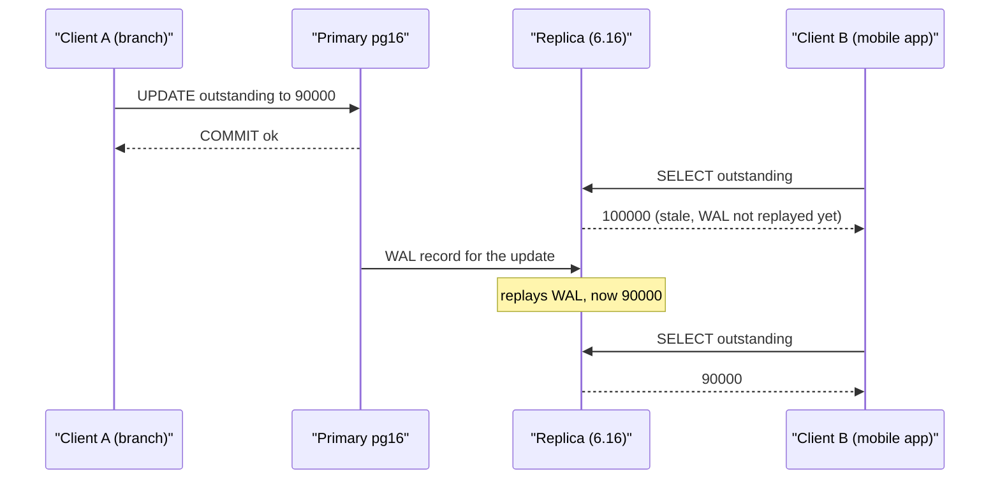

# Module 7.02: Consistency models

**Estimated hours:** 4

**What you will learn**

1. The ladder of consistency models, from linearizable through sequential, causal and the session guarantees down to eventual, each defined with two clients and one loan balance.
2. The anomalies each weaker model allows, drawn as timelines, and how to reproduce a read-your-writes violation on the PostgreSQL replica from 6.16 and fix it on the client side.
3. Exactly what YugabyteDB promises (linearizable single-row operations, snapshot and serializable transactions, follower reads as an explicit weaker opt-in), and what Jepsen tests.

**Prerequisites:** [Module 7.01: Why distribute; failure models; CAP and PACELC](module-01-why-distribute-cap-pacelc.md). You also need isolation levels from 6.08, WAL and LSNs from 6.06, the streaming replica from 6.16, and happens-before from 4.07. Containers `pg16`, your 6.16 replica, and `yb` must start.

---

## 1. One-line intuition

A consistency model is a contract that says which values a read is allowed to return, given the writes that happened; the stronger the contract, the more the system looks like one single copy, and the more coordination (latency, and availability during partitions) it costs.

## 2. Real-life analogy

A bank keeps a loan's outstanding balance on a **noticeboard** at head office and sends **photocopies** of the board to branches.

- **Linearizable**: there is really only one board, and everyone walks up to it. The moment a clerk finishes writing a new balance, anyone who looks after that moment sees it.
- **Sequential**: everyone reads from photocopies, which may arrive late, but every branch receives the copies in the same order, and each clerk's own changes appear in the order she made them. You might see yesterday's board, but never a board that "un-does" itself.
- **Causal**: copies can arrive in different orders at different branches, except that if note B was written because someone read note A, nobody ever sees B without A. A reply never arrives before its question.
- **Read-your-writes**: after a clerk posts a change, her own branch always shows it to her, even if other branches are behind.
- **Monotonic reads**: once you have seen today's board, you never get handed yesterday's again.
- **Eventual**: copies arrive whenever. If people stop writing, all boards eventually match. That is the only promise.

A customer who pays Rs 100 at the counter and then opens the mobile app expects at least read-your-writes. If the app shows the old balance, she pays again.

## 3. Why it exists: the problem it solves

Replication (7.04) puts copies of the same row on several machines. The moment there is more than one copy, "what is the balance?" has several possible answers at the same instant. Programmers naturally assume a single copy: write, then read, and see what you wrote. Without a stated contract, code built on that assumption breaks quietly:

- A repayment is posted on the primary. The customer's balance screen reads from a replica that is 300 ms behind and shows the old amount. She repays again. Read-your-writes was missing.
- A credit officer approves an application; the disbursement service reads the status from a replica, sees `SUBMITTED`, and rejects the disbursement. Causality was missing.
- A dashboard alternates between two replicas and the number of disbursed loans goes up, down, up. Monotonic reads were missing.

Consistency models give these behaviours names, so you can choose deliberately which reads need which guarantee, and test that you got it.

## 4. Three layers of depth

### Layer 1 (beginner): the ladder, with two clients and one balance

All examples use loan 1001, outstanding Rs 1,000 (`outstanding_paise = 100000`). **Client A** is the branch posting a repayment of Rs 100, which writes `90000`. **Client B** is the customer's mobile app reading the balance. Every operation has a **start** (request sent) and an **end** (response received). Two operations are **concurrent** if neither ended before the other started.

| Model | The promise | What B may read after A's write has ended |
|---|---|---|
| **Linearizable** (also "strong" or "atomic") | The system behaves like one copy; each operation takes effect at one instant between its start and end; that order respects real time | Only `90000` |
| **Sequential** | All clients see one single order of operations, consistent with each client's own order; real time may be ignored | `100000` or `90000`, but once B sees `90000` it never again sees `100000` |
| **Causal** | Operations related by cause and effect are seen in that order by everyone; unrelated (concurrent) ones may be seen in different orders by different clients | Depends on what B already saw; never an effect without its cause |
| **Read-your-writes** | A client always sees its own earlier writes | (About A reading: A must see `90000`) |
| **Monotonic reads** | A client never sees an older value after a newer one | Once `90000`, never `100000` again |
| **Eventual** | If writes stop, all copies converge; nothing about meanwhile | Anything that was ever written, in any order, for a while |

The ladder is a simplification. Read-your-writes and monotonic reads are **session guarantees** (named by Terry and colleagues for the Bayou system in 1994); causal consistency implies all of them; sequential consistency implies causal; linearizability implies sequential. Eventual consistency implies none.

Two more words you will hear:

- **Serializable** is about **transactions** (groups of operations on many rows): the result equals some one-at-a-time order of the transactions (6.08). It says nothing about real time.
- **Strict serializable** is serializable plus real-time order: linearizability for whole transactions. It is the strongest common guarantee.

So "consistency" (this module) is about **copies and time**. "Isolation" (6.08) is about **concurrent transactions**. A system can be strong at one and weak at the other.

### Layer 2 (working engineer): anomalies as timelines, replicas, client fixes, YugabyteDB

Each timeline shows real time going right. Brackets are operations from start to end.

**Stale read: allowed by sequential, forbidden by linearizable.**

```text
time (ms)   0         10        20   22
Client A    [write 90000]
Client B                        [read -> 100000]
```

B's read started at 20 ms, after A's write ended at 10 ms, and still returned the old value. In a linearizable system that is impossible. In a sequentially consistent system it is fine: order B's read before A's write; each client's own order is respected. This is exactly what an asynchronous replica produces.

**Read-your-writes violation: forbidden even by sequential.**

```text
Client A    [write 90000 on primary]  [read on replica -> 100000]
```

A's own program order is "write, then read", so any legal order must put the read after the write. The read must return `90000`. A lagging replica returns `100000`.

**Monotonic reads violation: two replicas with different lag.**

```text
Client B    [read replica 1 -> 90000]  [read replica 2 -> 100000]
```

B saw the new balance, then the old one. Behind a load balancer that spreads reads over several replicas, this happens whenever their lags differ.

**Causality violation: effect before cause.**

```text
Officer A   [write status=APPROVED]
Service B                [read APPROVED] [write disbursement D1]
Auditor C                                            [read D1 exists] [read status -> SUBMITTED]
```

B wrote D1 because it saw `APPROVED`. The auditor sees the disbursement but an application that is still `SUBMITTED`: money paid on an unapproved loan, as far as the audit report can tell. Causal consistency forbids this. Eventual consistency allows it.

**What PostgreSQL gives you (6.16 setup).**

- **On the primary**: there is one copy, so a single-row read sees every committed write. At `READ COMMITTED` each statement takes a fresh snapshot (6.07).
- **On one hot standby**: WAL is replayed in commit order, so the standby shows a **consistent prefix** of history: some past state of the primary, never a mix. Reads from that one standby are monotonic. They are **stale**, so there is no read-your-writes across primary and standby.
- **Behind a load balancer over several standbys**: monotonic reads can break, because each standby has its own lag.
- **With a synchronous standby** (`synchronous_commit = on`): the commit waits until the standby has **flushed** the WAL to disk, not **applied** it. A read on the standby right after commit can still be stale. Only `synchronous_commit = remote_apply` waits for replay. You measure this difference in the lab.

**Client-side fixes for read-your-writes.**

| Fix | How | Cost |
|---|---|---|
| Read from the leader | Anything that must reflect a recent write goes to the primary (or the tablet leader) | Load on the primary; no read scaling for these queries |
| Sticky reads after a write | After a write, route that user's reads to the primary for N seconds | N must exceed the worst lag; a guess |
| Wait for the LSN | After commit, note the primary's WAL position (`pg_current_wal_lsn()`); before reading on a replica, wait until `pg_last_wal_replay_lsn()` on the replica has reached it | Extra round trips; the read waits for the lag |
| `synchronous_commit = remote_apply` | Commit returns only after the standby has replayed it | Every commit pays replay time; commits block if the standby is down (PC/EC, 7.01) |

**What YugabyteDB promises.** These guarantees come from the Raft design you study in 7.05 and the transaction layer in 7.08.

- **Single-row operations are linearizable.** Every tablet is a Raft group. Writes go through the tablet leader and commit on a majority. Strong reads are served by the leader while it holds a **leader lease**, so a deposed leader cannot serve a stale value (7.01, 7.07).
- **Multi-row transactions** run at **Serializable** or **Snapshot** isolation (YSQL `REPEATABLE READ` maps to snapshot). **Read Committed** exists but, in 2024 releases, only when the tserver flag `yb_enable_read_committed_isolation=true` is set; otherwise a `READ COMMITTED` request runs as snapshot isolation. Check the docs for your exact version.
- Transactions that span tablets take their snapshot from **hybrid logical clocks** with a bounded uncertainty window based on the maximum clock skew (7.03, 7.08).
- **Follower reads are an explicit, weaker opt-in.** With `SET yb_read_from_followers = true` inside a **read-only** transaction, a read may be served by the nearest replica at a time `yb_follower_read_staleness_ms` in the past (default 30,000 ms). You get a consistent but stale snapshot, with lower latency and less load on leaders.
- **Read replicas and xCluster** replicate asynchronously to other clusters or regions. They are eventually consistent and also opt-in.

So the default is strong. You only get weaker guarantees when you ask for them, query by query. That is the right default for a bank.

### Layer 3 (internals): implementing and checking linearizability

**Implementing a linearizable read.** "Read from the leader" is necessary but not sufficient. A leader that was paused or partitioned may not know that a new leader exists (7.01). Three ways out, all described in the Raft literature:

1. **Read through the log**: append the read as a log entry and answer once it commits. Correct, but every read costs a replication round trip and a disk write.
2. **ReadIndex**: the leader records its current commit index, sends one round of heartbeats, and only if a majority still accepts it as leader does it answer, once its state machine has applied up to that index. One network round trip, no disk write.
3. **Leases**: after a successful heartbeat round, the leader knows nobody else can become leader for a lease period (YugabyteDB's default is 2 seconds), measured with a monotonic clock and assuming clocks drift only slightly. Within the lease it answers reads from memory with no round trip. YugabyteDB uses leases.

**Linearizability is local.** Herlihy and Wing (1990) proved that if every individual object is linearizable, the whole system is. Sequential consistency does not compose like this: two sequentially consistent registers together can show a history that is not sequentially consistent. This is one reason databases build strong single-row guarantees and then put a transaction protocol on top.

**Checking linearizability.** Given a recorded history (who called what, with start and end times, and what came back), deciding whether it is linearizable means searching for an order that respects real time and makes every read legal. In general this is NP-complete (Gibbons and Korach, 1997), so checkers prune cleverly and keep histories small. Section 6 has a brute-force checker for one register: it tries every order allowed by the rules.

**Jepsen, in one paragraph.** Jepsen is Kyle Kingsbury's open-source test harness and the series of public analyses he has published since 2013. It runs a real database cluster, drives it with concurrent clients, and injects faults: network partitions (by changing firewall rules on the nodes), process crashes and pauses, and clock skew. Every client operation is recorded as invoked, then ok, failed, or **info**, which means "timed out, outcome unknown", the exact ambiguity from 7.01. Afterwards a checker decides whether the history is legal for the promised model: Knossos for linearizability, Elle for transactional isolation anomalies. Jepsen has found violations in most databases it has tested, including YugabyteDB in 2019 (versions 1.1.9 and 1.3.1); the vendor fixed the reported issues. When a database claims a consistency model, "has Jepsen tested it, and what was found?" is a fair interview question.

## 5. Architecture diagram



The first read on the replica starts after A's commit has returned, yet returns the old value. That is a linearizability violation, and if A itself had read from the replica, a read-your-writes violation.

## 6. Code

### 6a. A linearizability and sequential-consistency checker

The program checks four tiny histories on one register (loan 1001's balance, starting at `100000`). For each it searches for a legal order twice: once respecting **real time** (linearizable) and once respecting only **each client's own order** (sequential). It prints the order it found, as proof.

```cpp
// lin_check.cpp - brute-force checker for one register (a loan's outstanding
// balance). For each history it asks two questions:
//   linearizable?           some legal order that respects REAL TIME
//   sequentially consistent? some legal order that respects each CLIENT's order
// "Legal" means every read returns the value of the latest write before it.
#include <cstdio>
#include <string>
#include <vector>

struct Op {
    char client;      // 'A' or 'B'
    bool is_write;
    long long value;  // value written, or value the read returned
    int start, end;   // real time in ms: request sent, response received
};

// Depth-first search over all orders allowed by must_precede(a, b).
template <typename Rule>
bool find_order(const std::vector<Op>& ops, std::vector<bool>& used, std::vector<int>& order,
                long long reg, Rule must_precede) {
    if (order.size() == ops.size()) return true;
    for (size_t j = 0; j < ops.size(); ++j) {
        if (used[j]) continue;
        bool ready = true;  // every op that must come before j is already placed
        for (size_t i = 0; i < ops.size(); ++i)
            if (!used[i] && i != j && must_precede(ops[i], ops[j])) ready = false;
        if (!ready || (!ops[j].is_write && ops[j].value != reg)) continue;
        used[j] = true;
        order.push_back(static_cast<int>(j));
        if (find_order(ops, used, order, ops[j].is_write ? ops[j].value : reg, must_precede))
            return true;
        used[j] = false;
        order.pop_back();
    }
    return false;
}

template <typename Rule>
void check(const char* label, const std::vector<Op>& ops, Rule must_precede) {
    std::vector<bool> used(ops.size(), false);
    std::vector<int> order;
    bool ok = find_order(ops, used, order, 100000, must_precede);  // starts at Rs 1,000.00
    std::printf("  %-12s %-4s", label, ok ? "yes" : "NO");
    for (int k : order)
        std::printf(" %c:%s=%lld", ops[k].client, ops[k].is_write ? "write" : "read", ops[k].value);
    std::printf("%s\n", ok ? "" : "(no legal order exists)");
}

int main() {
    auto real_time = [](const Op& a, const Op& b) { return a.end < b.start; };
    auto per_client = [](const Op& a, const Op& b) { return a.client == b.client && a.end < b.start; };

    struct History { const char* name; std::vector<Op> ops; };
    std::vector<History> hs = {
        {"H1 read overlaps the write, then reads again",
         {{'A', true, 90000, 0, 10}, {'B', false, 100000, 5, 8}, {'B', false, 90000, 12, 14}}},
        {"H2 stale read after the write finished (replica lag)",
         {{'A', true, 90000, 0, 10}, {'B', false, 100000, 20, 22}}},
        {"H3 B sees the new value, then the old one",
         {{'A', true, 90000, 0, 10}, {'B', false, 90000, 20, 22}, {'B', false, 100000, 30, 32}}},
        {"H4 A does not see its own write",
         {{'A', true, 90000, 0, 10}, {'A', false, 100000, 20, 22}}},
    };
    for (const auto& h : hs) {
        std::printf("%s\n", h.name);
        check("linearizable", h.ops, real_time);
        check("sequential", h.ops, per_client);
    }
    return 0;
}
```

```bash
g++ -std=c++17 -O2 -Wall -Wextra -Werror -g -pthread lin_check.cpp -o lin_check
./lin_check
```

Expected output:

```text
H1 read overlaps the write, then reads again
  linearizable yes  B:read=100000 A:write=90000 B:read=90000
  sequential   yes  B:read=100000 A:write=90000 B:read=90000
H2 stale read after the write finished (replica lag)
  linearizable NO  (no legal order exists)
  sequential   yes  B:read=100000 A:write=90000
H3 B sees the new value, then the old one
  linearizable NO  (no legal order exists)
  sequential   NO  (no legal order exists)
H4 A does not see its own write
  linearizable NO  (no legal order exists)
  sequential   NO  (no legal order exists)
```

Read the four results as the ladder. H1: a read that overlaps a write may return either value; that is still linearizable. H2: the classic replica-lag stale read; sequential consistency allows it, linearizability does not. H3 breaks monotonic reads and H4 breaks read-your-writes, and neither is even sequentially consistent.

### 6b. Read-your-writes on the 6.16 replica, and the wait-for-LSN fix

This script needs your primary on port 5432 and your 6.16 replica. Set `REPLICA_PORT` to the host port your replica listens on (the script assumes 5434). If your replica is only reachable inside Docker, replace the `REPLICA=` line with `REPLICA="docker exec -i <replica-container> psql -U postgres -X -q -At"`.

```bash
#!/bin/bash
# read_after_write.sh - a read-your-writes violation on a streaming replica,
# then the fix: wait until the replica has replayed the primary's WAL position.
set -euo pipefail
export PGPASSWORD=postgres
PRIMARY="psql -h localhost -p 5432 -U postgres -X -q -At"
REPLICA="psql -h localhost -p ${REPLICA_PORT:-5434} -U postgres -X -q -At"

$PRIMARY -c "CREATE TABLE IF NOT EXISTS ryw_demo (loan_id bigint PRIMARY KEY, outstanding_paise bigint NOT NULL)"
$PRIMARY -c "INSERT INTO ryw_demo VALUES (1001, 100000)
             ON CONFLICT (loan_id) DO UPDATE SET outstanding_paise = 100000"
sleep 6   # longer than the apply delay used in the lab, so the replica starts in step

echo "1. repayment of Rs 100 on the primary"
$PRIMARY -c "UPDATE ryw_demo SET outstanding_paise = 90000 WHERE loan_id = 1001 RETURNING outstanding_paise"
echo "2. read on the replica immediately"
$REPLICA -c "SELECT outstanding_paise FROM ryw_demo WHERE loan_id = 1001"

echo "3. fix: wait until the replica has replayed the primary's WAL position"
LSN=$($PRIMARY -c "SELECT pg_current_wal_lsn()")
start=$(date +%s%N)
until [ "$($REPLICA -c "SELECT pg_last_wal_replay_lsn() >= '$LSN'::pg_lsn")" = "t" ]; do
    sleep 0.1
done
echo "   waited $(( ($(date +%s%N) - start) / 1000000 )) ms for LSN $LSN"
$REPLICA -c "SELECT outstanding_paise FROM ryw_demo WHERE loan_id = 1001"
```

Run it with `bash read_after_write.sh` after setting the 5-second apply delay from Lab Part B. Expected output (the LSN and the wait time vary; the wait is just under 5 seconds):

```text
1. repayment of Rs 100 on the primary
90000
2. read on the replica immediately
100000
3. fix: wait until the replica has replayed the primary's WAL position
   waited 4957 ms for LSN 0/30236C8
90000
```

The primary said `90000`. The replica, asked afterwards, said `100000`. The LSN wait turned the stale read into a correct one, at the price of waiting out the lag.

## 7. Use case: core-banking loan-origination platform

Every read in the loan platform gets an explicit consistency requirement. The decision this module drives:

**Money decisions and anything a user reads right after their own write go to the leader (YugabyteDB's default strong reads). Only read-only reporting is allowed to opt into follower reads, and it is labelled with an "as of" time.**

| Read | Required model | How it is met |
|---|---|---|
| Balance check before disbursement or closure | Linearizable | Default YSQL read inside the disbursement transaction (tablet leader, under lease) |
| Customer balance screen after a repayment | Read-your-writes at least | Default strong read; never a reporting replica |
| Credit officer's queue of `SUBMITTED` applications | Monotonic reads, small staleness acceptable | Strong read; or follower read only if the screen refreshes and shows "as of" |
| Branch MIS dashboard, month-end portfolio report | Consistent snapshot, staleness of seconds acceptable | A separate reporting connection with `SET yb_read_from_followers = true;` and every query inside `BEGIN READ ONLY; ... COMMIT;` |
| Audit extract for regulators | Consistent snapshot as of a stated time | Read-only transaction at a known point in time; never mixed sources |

During the PostgreSQL phase of the project (before the move to YugabyteDB), the same rule applied: the application had a "primary only" connection pool for money paths and a "replica" pool for reports. A code review rule rejected any query on the replica pool that fed a write.

## 8. Lab

Keep two terminals open: one for the primary (`psql -h localhost -U postgres`) and one for the replica. Use the same names and ports you used in 6.16.

### Part A: the checker (25 minutes)

1. Compile and run `lin_check.cpp`. Confirm your output matches section 6a.
2. Add history H5: two writers. A writes `90000` during [0, 10], B writes `95000` during [5, 15], and A reads `95000` during [20, 22]. Predict both answers, then run.
3. Add history H6: same two writes, but A reads `90000` during [20, 22]. Predict, then run.
4. Change H2 so the read starts at 9 ms instead of 20 (it now overlaps the write). Predict, then run.

<details>
<summary>Answers</summary>

H5: linearizable yes (A's write, then B's write, then A's read of 95000) and sequential yes. H6: linearizable yes too: the writes overlap, so B's write may take effect first and A's later; A then reads its own 90000. Sequential yes. H2 with the read at [9, 22]: linearizable yes, because the read overlaps the write and may be ordered before it.

</details>

### Part B: break read-your-writes on your 6.16 replica (30 minutes)

1. On the primary, create the demo table by running the first two `$PRIMARY` lines of `read_after_write.sh` by hand, or just run the whole script once now.
2. Run the script **without** any delay. On one laptop, with primary and replica on the same machine, the replica usually returns `90000`: lag is well under a millisecond, and starting `psql` takes longer than that. In a verification run, 10 out of 10 immediate replica reads returned the new value. Write down: "it works on my laptop" is exactly how this bug reaches production, where replicas are in another data centre and lag rises under load.
3. Make the lag visible. On the **replica**:

```sql
ALTER SYSTEM SET recovery_min_apply_delay = '5s';
SELECT pg_reload_conf();
SHOW recovery_min_apply_delay;
```

`ALTER SYSTEM` works on a standby because it only writes a configuration file. The standby now waits five seconds before applying each commit.

4. Run `bash read_after_write.sh` again. Expected: the primary prints `90000`, the replica prints `100000`, then the LSN wait takes about 5 seconds and the replica prints `90000`.
5. On the primary, look at the lag while it lasts: `SELECT application_name, state, sent_lsn, replay_lsn FROM pg_stat_replication;` immediately after an update. `replay_lsn` is behind `sent_lsn` until the delay passes.

### Part C: synchronous replication is not read-your-writes (25 minutes)

1. On the **primary**, make the replica synchronous: `ALTER SYSTEM SET synchronous_standby_names = '*'; SELECT pg_reload_conf();` Check `SELECT application_name, sync_state FROM pg_stat_replication;` shows `sync`.
2. Keep the 5-second apply delay on the replica. On the primary, with `\timing on`:

```sql
SET synchronous_commit = on;
UPDATE ryw_demo SET outstanding_paise = 80000 WHERE loan_id = 1001;
```

Immediately read on the replica. Expected: the commit returns fast (tens of ms in a verification run), and the replica still shows the old value. `on` waits for the standby to **flush** the WAL, not to **apply** it.

3. Now:

```sql
SET synchronous_commit = remote_apply;
UPDATE ryw_demo SET outstanding_paise = 70000 WHERE loan_id = 1001;
```

Expected: the commit takes about 5 seconds (5.2 s in a verification run), and the replica shows `70000` at once. Read-your-writes on the replica now holds, and every commit pays for it.

4. Clean up. On the replica: `ALTER SYSTEM RESET recovery_min_apply_delay; SELECT pg_reload_conf();`. On the primary: `ALTER SYSTEM RESET synchronous_standby_names; SELECT pg_reload_conf();`. Leaving `synchronous_standby_names` set is dangerous: if the replica stops, every commit on the primary waits forever (you will see this deliberately in 7.04).

### Part D: strong reads and follower reads in YugabyteDB (25 minutes)

Connect with `psql -h localhost -p 5433 -U yugabyte`.

```sql
CREATE TABLE fr_demo (loan_id bigint PRIMARY KEY, outstanding_paise bigint NOT NULL);
INSERT INTO fr_demo VALUES (1001, 100000);
SELECT pg_sleep(35);                      -- make the row older than the 30 s staleness bound
UPDATE fr_demo SET outstanding_paise = 90000 WHERE loan_id = 1001;
SELECT outstanding_paise FROM fr_demo;    -- strong read: 90000

SET yb_read_from_followers = true;        -- this session may now read from followers
BEGIN READ ONLY;                          -- ...but only inside read-only transactions
SELECT outstanding_paise FROM fr_demo;    -- follower read: a snapshot 30 s in the past
COMMIT;
```

Expected: the strong read returns `90000`. The follower read typically returns `100000`, because it reads at a time `yb_follower_read_staleness_ms` (30 s) in the past, even on this single-node container where the "follower" is the leader itself. Then run `SET yb_follower_read_staleness_ms = 5000;`, wait 6 seconds, and repeat the read-only block: now it returns `90000`. If your version behaves differently, record exactly what you saw and check `SHOW yb_read_from_followers;` and the YugabyteDB docs for your release. Finally, with `yb_follower_read_staleness_ms` back at 30000 (`RESET yb_follower_read_staleness_ms;`), run another `UPDATE` and then a plain `SELECT` **outside** a read-only transaction: you get the new value, because follower reads apply only to read-only transactions. Run `RESET yb_read_from_followers;` when you are done.

### Journal

Copy [journal/TEMPLATE.md](../journal/TEMPLATE.md) to `journal/YYYY-MM-DD-consistency-models.md`. Record: your Part A predictions and results; the Part B output with and without the apply delay; the two commit times from Part C (`on` versus `remote_apply`); and what the follower read returned in Part D. End with: "For each read in our loan platform, the model it needs, and how we guarantee it."

## 9. Common mistakes and misconceptions

| Mistake | Why it is wrong | Bug it causes |
|---|---|---|
| "We use synchronous replication, so replica reads are fresh" | `synchronous_commit = on` waits for flush, not replay | Stale balance shown right after a repayment |
| Testing replica reads only on one laptop | Lag on localhost is sub-millisecond; production lag is not | Read-your-writes bugs that only appear under load or across data centres |
| Load-balancing reads over several replicas without stickiness | Each replica has its own lag | Numbers that go up, down and up again (monotonic reads broken) |
| Treating "eventual consistency" as "consistent after a short delay" | Eventual promises nothing about when, or about order meanwhile | Effects seen before their causes; audit reports that contradict themselves |
| Confusing serializable with linearizable | One is about transactions, the other about copies and real time | Wrong guarantees promised in design documents |
| Reading from the leader is enough | A deposed or paused leader may not know it lost leadership | Stale reads after failover unless leases or ReadIndex are used |
| Using follower reads for a balance check before a write | Follower reads are stale by design (30 s by default) | Over-disbursement against a balance that already changed |

## 10. Resume link

- **Claim E, "distributed SQL ... replication".** Say: "In YugabyteDB, single-row operations are linearizable through the tablet's Raft leader and its lease, transactions run at snapshot or serializable isolation, and follower reads are an opt-in for read-only work. We kept every money path on strong reads and moved reports to follower reads with an explicit staleness bound."
- **Claim D, "PostgreSQL ... replication".** Be ready for: "Your app read from a replica; how did you avoid stale reads?" Answer with your Part B and Part C numbers: "Synchronous commit at `on` still gave stale replica reads; `remote_apply` fixed it but added the replay time to every commit, so instead we read money data from the primary and only sent reports to the replica."
- **Capstone C4 (data parity and cutover).** A parity check that reads the target from a lagging replica reports false differences. The parity suite reads from leaders, or from a snapshot at a recorded time, never from a replica of unknown lag.

Likely follow-up: "Is YugabyteDB strictly serializable?" Answer carefully: single-row operations are linearizable; multi-row transactions are serializable or snapshot isolated and rely on hybrid clocks with a bounded clock-skew assumption (7.03, 7.08). Do not claim more than the documentation does.

## 11. Interview questions

**Q1 (easy). What is read-your-writes consistency? Give a banking example of its violation.**

<details>
<summary>Model answer</summary>

Read-your-writes means that after a client writes, its own later reads always reflect that write. Violation: a customer pays a Rs 100 instalment through the branch, the write commits on the primary, and the mobile app, reading from an asynchronous replica that has not replayed the change yet, still shows the old outstanding amount. The customer may pay again. Fixes are reading from the primary for that user's data, waiting for the replica to replay the commit's LSN, or committing with `remote_apply` on a synchronous standby.

</details>

**Q2 (easy). What is the difference between linearizability and serializability?**

<details>
<summary>Model answer</summary>

Linearizability is about single operations on single objects across copies: the system behaves like one copy, and each operation takes effect at one instant between its start and end, respecting real time. Serializability is about transactions over many objects: the outcome equals some one-at-a-time order of the transactions, which need not match real time. Strict serializability is both: transactions appear in an order consistent with real time.

</details>

**Q3 (medium). Why is a history where a read starts after a write has finished, but returns the old value, sequentially consistent but not linearizable?**

<details>
<summary>Model answer</summary>

Sequential consistency requires one total order of operations that respects each client's own program order and makes every read return the latest preceding write. If the reader and writer are different clients, I can order the read before the write; each client's own order is unchanged and the read is legal. Linearizability adds real time: since the write finished before the read started, the write must come first, and then the read must return the new value. Replica lag produces exactly this pattern, which is why reads from asynchronous replicas are not linearizable.

</details>

**Q4 (medium). What exactly does YugabyteDB guarantee by default, and when would you use follower reads?**

<details>
<summary>Model answer</summary>

By default, single-row operations are linearizable: writes are committed through the tablet's Raft leader on a majority, and reads are served by the leader under a leader lease, so a deposed leader cannot answer. Multi-row transactions use snapshot or serializable isolation, with read committed available behind a flag. Follower reads are an explicit opt-in for read-only transactions: they read a consistent snapshot `yb_follower_read_staleness_ms` in the past (30 s by default) from the nearest replica, cutting latency and leader load. I would use them for dashboards, reports and analytics that state their "as of" time, never for a read that feeds a write or a money decision.

</details>

**Q5 (hard). A replica-based reporting screen sometimes shows a loan as disbursed while its application is still SUBMITTED. Explain the anomaly, why it happens, and two fixes.**

<details>
<summary>Model answer</summary>

It is a causality violation: the disbursement was written because the approval was seen, yet a reader sees the effect without its cause. With a single PostgreSQL standby this cannot happen, because WAL replays in commit order and the standby shows a consistent prefix. It happens when the screen's two queries go to different sources: for example the application status from one replica and the disbursements from another with less lag, or from two databases synchronised by an asynchronous pipeline with different delays. It also happens if the two queries run in separate statements under read committed while replay advances between them. Fixes: run both queries in one read-only transaction on one source, so they share one snapshot (on PostgreSQL a `REPEATABLE READ` transaction on a single standby; on YugabyteDB a read-only transaction, with follower reads if staleness is acceptable); or carry a causal token, such as the commit LSN or hybrid timestamp of the disbursement, and make the reader wait until its source has reached that point before answering. The real lesson is that consistency is a property of where and how each read is served, so the design must route related reads together.

</details>

## 12. Revision

- Ladder: linearizable (single copy, real time) > sequential (one order, may lag) > causal (no effect before cause) > session guarantees (read-your-writes, monotonic reads) > eventual (converges, nothing meanwhile).
- A PostgreSQL standby gives a stale but consistent prefix; `synchronous_commit = on` still allows stale replica reads; `remote_apply`, reading the primary, or waiting for the commit LSN restore read-your-writes.
- YugabyteDB defaults to strong: linearizable single-row operations through the Raft leader with leases, snapshot or serializable transactions; follower reads are an opt-in for read-only, stale-tolerant queries; Jepsen checks such claims by recording histories under faults.

---

Previous: [Module 7.01: Why distribute; failure models; CAP and PACELC](module-01-why-distribute-cap-pacelc.md) | Next: [Module 7.03: Time and clocks](module-03-time-and-clocks.md)
