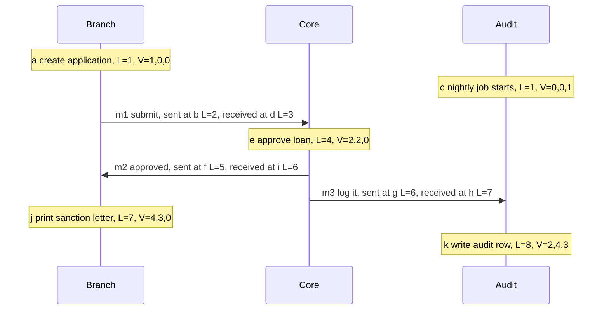

# Module 7.03: Time and clocks

**Estimated hours:** 3

**What you will learn**

1. Why wall clocks cannot order events across machines: skew, drift, NTP corrections that step the clock, and leap seconds, measured on your own PC.
2. How happens-before, Lamport clocks and vector clocks order events without trusting any clock, with a worked message diagram and two small C++ simulators.
3. What a hybrid logical clock is, why YugabyteDB uses one with a maximum clock skew assumption (`--max_clock_skew_usec`, 500 ms by default), what breaks if real skew exceeds it, and how Google's TrueTime differs.

**Prerequisites:** [Module 7.02: Consistency models](module-02-consistency-models.md). You also need happens-before from 4.07 and the latency measurements of 5.11. Containers `pg16` and `yb` must start.

---

## 1. One-line intuition

Every machine's clock is a little wrong, wrong by a different amount, and occasionally jumps, so "which happened first" across machines must come from the messages they exchange and from counters, with physical time used only where its error is bounded and accounted for.

## 2. Real-life analogy

Three bank offices exchange letters about one loan: the branch, the head-office credit department, and the audit office.

- Each office has a **wall clock**. The branch clock runs 3 minutes slow. Audit's gains a few seconds a day. Someone corrects head office's clock every morning by phoning the speaking clock, and sometimes it **jumps** back by a minute.
- If each office writes the wall-clock time on every ledger entry, a later entry at the branch can carry an **earlier** time than the head-office entry that caused it. Sorting by time puts the effect before the cause.
- A better rule: every letter carries a **number**. Each office keeps a counter. Before writing anything, add one. When a letter arrives, set your counter to "the bigger of mine and the letter's, plus one". Now an entry that was caused by a letter always has a bigger number than the letter. That is a **Lamport clock**.
- An even better rule: every letter carries a small **table of counters**, one per office, showing how much of each office's work the sender has heard about. Comparing two tables tells you whether one entry could have influenced the other, or whether they happened independently. That is a **vector clock**.
- The modern compromise: write the wall-clock time, but never let your stamp go backwards, and if a letter arrives stamped later than your clock, adopt its time and add a tie-breaking counter. Stamps stay close to real time and still respect cause and effect. That is a **hybrid logical clock**.

## 3. Why it exists: the problem it solves

Distributed databases need to order events for many reasons:

- **MVCC snapshots** (6.07): a read at time T must see every write committed before T, and none after.
- **Last-writer-wins** conflict resolution (7.04): "the later write wins" needs a trustworthy "later".
- **Leases** (7.01, 7.07): "I am leader until time X" is only safe if clocks advance at nearly the same rate.
- **Audit trails**: a regulator reads the `audit_log` in time order and expects causes before effects.

Wall clocks fail all four. A server whose clock is 2 seconds fast stamps its writes "in the future", and a reader on a correct server does not see them for 2 seconds. A clock that NTP steps backwards makes a later entry look earlier. During the leap second of 30 June 2012, a Linux kernel timer bug sent many Java and MySQL servers into 100% CPU loops; several large websites had outages. In a loan platform, a repayment stamped by a slow branch PC can appear to happen before the disbursement it repays, and an interest calculation that trusts those stamps charges the wrong amount.

## 4. Three layers of depth

### Layer 1 (beginner): physical clocks and their errors

A computer's clock is a **quartz crystal oscillator** plus a counter. The operating system turns the counter into "seconds since 1 January 1970 UTC" (**Unix time**).

- **Drift** is a clock running at the wrong rate. Quartz clocks typically drift by tens of **parts per million (ppm)**, more when hot or cold. 50 ppm is 4.3 seconds a day. Google's Spanner design assumes up to 200 ppm in the worst case.
- **Skew** (or **offset**) is the difference between two clocks at one instant. Drift creates skew over time.
- **NTP**, the Network Time Protocol, corrects a clock by asking time servers. On Ubuntu the client is `systemd-timesyncd` or `chrony`; on Windows it is the Windows Time service (`w32tm`). Typical accuracy: a few milliseconds over the internet, often under a millisecond on a good local network. **PTP** (Precision Time Protocol, IEEE 1588) with hardware timestamps reaches microseconds.
- An NTP client corrects small errors by **slewing** (running the clock slightly fast or slow until it catches up) and large errors by **stepping** (jumping the clock). A step can move time **backwards**.
- A **leap second** is an extra second (23:59:60) that is occasionally inserted into UTC to keep it in line with the Earth's rotation. 27 have been added since 1972, the last on 31 December 2016. Many providers **smear** it, slowing their clocks over 24 hours instead. In 2022 the General Conference on Weights and Measures decided to stop adding leap seconds by 2035.

Programs have two kinds of clock and must use the right one:

| Need | Linux | C++ | Can it jump backwards? |
|---|---|---|---|
| "What time is it?" (timestamps for humans, certificates) | `CLOCK_REALTIME` | `std::chrono::system_clock` | Yes, when stepped |
| "How long did this take?" (timeouts, latency, leases) | `CLOCK_MONOTONIC` | `std::chrono::steady_clock` | No |

Rule: measure durations only with the monotonic clock. A timeout computed from wall-clock time fires early or never if the clock is stepped mid-wait. The load generator in 5.11 used `steady_clock` for exactly this reason.

### Layer 2 (working engineer): NTP maths, happens-before, Lamport and vector clocks

**How NTP estimates the offset.** The client records its own clock when it sends (t0) and receives (t3); the server records its clock when it receives (t1) and replies (t2).

```text
round-trip delay = (t3 - t0) - (t2 - t1)
offset           = ((t1 - t0) + (t2 - t3)) / 2      (how far the client is behind)

Example: t0 = 0 ms, t1 = 120 ms, t2 = 121 ms, t3 = 41 ms
delay  = 41 - 1 = 40 ms
offset = (120 + (121 - 41)) / 2 = 100 ms   -> the client is 100 ms behind
```

The formula assumes the request and the reply took equal time. If the path is asymmetric (a congested uplink, a different route back), the error can be up to half the round trip. This is why NTP over a long, busy path cannot promise better than milliseconds, and why no algorithm can make two clocks agree exactly: the uncertainty never reaches zero.

**Happens-before.** Leslie Lamport's 1978 paper "Time, Clocks, and the Ordering of Events in a Distributed System" defined a relation written a → b ("a happens before b"):

1. a and b are on the same process, and a comes first; or
2. a is the sending of a message and b is the receiving of that same message; or
3. there is some c with a → c and c → b (it is transitive).

If neither a → b nor b → a, then a and b are **concurrent**, written a ∥ b. Concurrent does not mean "at the same instant". It means neither could have influenced the other. You met the same idea in 4.07: inside one machine, the C++ memory model builds happens-before from "sequenced-before" within a thread and "synchronizes-with" between threads. Here messages play the role of release/acquire pairs.

**Lamport clocks.** Each process keeps one integer counter C.

1. Before every event (local, send or receive), C = C + 1. (A receive does the max step below instead.)
2. A sent message carries the sender's C.
3. On receiving a message carrying m: C = max(C, m) + 1.

Guarantee (the **clock condition**): if a → b then L(a) < L(b). The converse is **false**: L(a) < L(b) does not mean a → b. To get a **total order** that everyone agrees on, sort by (L, process id); ties on L are broken by the id. Lamport clocks are tiny (one integer) and are the ancestor of Raft's **terms** (7.05): a logical counter that only moves forward and wins arguments.

Worked example. Three processes, Branch, Core and Audit, run a loan approval. Events in the order they really happened:

| Event | Process | What | Lamport | Vector [Branch, Core, Audit] |
|---|---|---|---|---|
| a | Branch | create application | 1 | [1,0,0] |
| b | Branch | send m1 "submit" to Core | 2 | [2,0,0] |
| c | Audit | nightly job starts | 1 | [0,0,1] |
| d | Core | receive m1 | max(0,2)+1 = 3 | [2,1,0] |
| e | Core | approve loan | 4 | [2,2,0] |
| f | Core | send m2 "approved" to Branch | 5 | [2,3,0] |
| g | Core | send m3 "log it" to Audit | 6 | [2,4,0] |
| h | Audit | receive m3 | max(1,6)+1 = 7 | [2,4,2] |
| i | Branch | receive m2 | max(2,5)+1 = 6 | [3,3,0] |
| j | Branch | print sanction letter | 7 | [4,3,0] |
| k | Audit | write audit row | 8 | [2,4,3] |

Look at c and d: L(c) = 1 < L(d) = 3, yet the nightly job did not influence the receipt of m1. They are concurrent. Lamport clocks cannot tell you that. Look at h and j: both have L = 7. The total order breaks the tie by process id, but they are also concurrent.

**Vector clocks.** Each process keeps a vector V with one counter per process (Fidge and Mattern, 1988).

1. Before every event, increment your own entry.
2. A sent message carries the whole vector.
3. On receive, first take the element-wise maximum of your vector and the message's, then increment your own entry.

Compare two vectors: V(a) ≤ V(b) if every entry of V(a) is ≤ the matching entry of V(b). Then **a → b if and only if V(a) ≤ V(b) and V(a) ≠ V(b)**. If neither is ≤ the other, a ∥ b. In the table, c = [0,0,1] and d = [2,1,0]: neither is ≤, so they are concurrent, which is exactly the fact Lamport clocks lost.

The cost is size: one counter per process, carried on every message. Systems use vector clocks (or their cousin, **version vectors**, one counter per replica) where detecting concurrent updates matters: Amazon's original Dynamo and Riak used them to keep conflicting versions instead of silently dropping one. ThreadSanitizer uses vector clocks to decide whether two memory accesses are ordered by happens-before or form a data race (module 8.05).

### Layer 3 (internals): hybrid logical clocks, YugabyteDB's skew bound, and TrueTime

**Hybrid logical clocks (HLC).** Kulkarni, Demirbas and colleagues (2014) combined a physical clock with a Lamport-style counter. Each node keeps a pair (l, c): l is the largest physical time it has heard of, and c is a counter for events that share the same l. Let pt be the node's physical clock reading.

```text
Local or send event:
    l_old = l
    l = max(l_old, pt)
    c = (l == l_old) ? c + 1 : 0
Receive a message stamped (lm, cm):
    l_old = l
    l = max(l_old, lm, pt)
    if   l == l_old and l == lm : c = max(c, cm) + 1
    elif l == l_old             : c = c + 1
    elif l == lm                : c = cm + 1
    else                        : c = 0
```

Properties: if a → b then HLC(a) < HLC(b), comparing l first and then c, just like Lamport clocks. And l never runs ahead of the true time by more than the clock skew between nodes, so HLC timestamps stay close to real time and can be used for "read as of 10:15:02" snapshots. Lab Part C walks through a run by hand.

**YugabyteDB's hybrid time.** Every YugabyteDB node keeps an HLC called **hybrid time**: a 64-bit number with microseconds of physical time in the upper 52 bits and a 12-bit logical counter in the lower bits. Every RPC between nodes carries the sender's hybrid time, and the receiver updates its HLC from it, exactly like the receive rule above. Every DocDB write is tagged with its hybrid time (7.07), and MVCC reads ask for "the newest version at or before read time T".

HLC alone cannot fix one problem. A reader on node B picks read time T from B's clock. Node A's clock is slightly ahead, so a write that **really** committed before the read began may carry a hybrid time a bit greater than T. Is that write before or after the read? The database cannot know. YugabyteDB handles this with a bound: it assumes no two clocks differ by more than **`--max_clock_skew_usec`, 500,000 µs (500 ms) by default**. A value stamped in the **uncertainty window** (T, T + max skew] might have committed before the read started, so the read is **restarted** at a later time that includes it. Values beyond the window are certainly later and are ignored. Module 7.08 shows read restarts in detail.

**What breaks if real skew exceeds the bound.** Suppose node A's clock is 800 ms fast, more than the 500 ms bound. A repayment commits on A's tablet at hybrid time "real time + 800 ms". 100 ms later, in real time, a balance check runs through node B, whose clock is correct, and picks T = "real time + 100 ms". The repayment's stamp is 700 ms above T, outside the 500 ms window, so the read treats it as "in the future" and ignores it. A read that started after the commit returned the old balance: a stale read, and a broken linearizability promise. Note what the two clock assumptions protect:

- The **skew bound** (clocks agree to within 500 ms) protects the read uncertainty window.
- **Leader leases** depend on clocks advancing at nearly the same **rate** (drift), measured with monotonic clocks, which is a much weaker assumption (7.07).

YugabyteDB watches for skew. When a node receives a hybrid time further ahead of its own physical clock than the bound, current versions report a clock-skew error (for example "Too big clock skew is detected") instead of carrying on silently; exact behaviour depends on the version and flags. Operationally: run `chrony` on every node, alert on offset long before it nears the bound (tens of milliseconds, not hundreds), and never "fix" errors by raising `--max_clock_skew_usec`. A larger bound makes the uncertainty window wider, which means more read restarts.

**TrueTime, for contrast.** Google Spanner (2012) installs GPS receivers and atomic clocks in every data centre. Its TrueTime API does not return a time; it returns an **interval** [earliest, latest] that is guaranteed to contain the true time. In the 2012 paper the interval's half-width ε was typically 1 to 7 ms. Spanner then uses **commit wait**: a transaction picks commit timestamp s = TT.now().latest and does not report success until TT.now().earliest > s, which takes about 2ε. After that, every later transaction anywhere gets a larger timestamp, giving strict serializability (Spanner calls it external consistency). YugabyteDB and CockroachDB run on ordinary servers with ordinary NTP. With a 500 ms bound, a commit wait would cost about a second per write, so instead they accept the uncertainty window and restart reads.

| Approach | Hardware | What it gives | Cost |
|---|---|---|---|
| Wall clock only | Any | Nothing safe across machines | Wrong orders, lost writes under last-writer-wins |
| Lamport clock | Any | Causality-respecting total order | Cannot detect concurrency; unrelated to real time |
| Vector clock | Any | Exact happens-before and concurrency | One counter per process on every message |
| HLC (YugabyteDB, CockroachDB) | NTP | Causality plus closeness to real time | Uncertainty window; read restarts; depends on a skew bound |
| TrueTime (Spanner) | GPS and atomic clocks | Bounded uncertainty of a few ms; strict serializability | Special hardware; commit wait of about 2ε per write |

## 5. Architecture diagram



The message diagram for the worked example. Every arrow carries the sender's clock. Events j and h share L=7 but their vectors, [4,3,0] and [2,4,2], show they are concurrent.

## 6. Code

### 6a. Lamport clock simulator

The script is one real execution, listed in the order events happened. The program applies the three Lamport rules.

```cpp
// lamport_sim.cpp - Lamport logical clocks for three processes.
// The script below is one real execution of a loan approval, in the order the
// events actually happened. Each process keeps one integer counter.
#include <cstdio>
#include <map>
#include <string>
#include <vector>

enum Kind { LOCAL, SEND, RECV };

struct Event {
    char name;    // a, b, c ... used to talk about events
    int proc;     // 0 = Branch, 1 = Core, 2 = Audit
    Kind kind;
    int msg;      // message id for SEND and RECV
    const char* what;
};

int main() {
    const char* procs[] = {"Branch", "Core", "Audit"};
    std::vector<Event> script = {
        {'a', 0, LOCAL, 0, "create application"},
        {'b', 0, SEND, 1, "send m1 submit -> Core"},
        {'c', 2, LOCAL, 0, "nightly job starts"},
        {'d', 1, RECV, 1, "receive m1"},
        {'e', 1, LOCAL, 0, "approve loan"},
        {'f', 1, SEND, 2, "send m2 approved -> Branch"},
        {'g', 1, SEND, 3, "send m3 log it -> Audit"},
        {'h', 2, RECV, 3, "receive m3"},
        {'i', 0, RECV, 2, "receive m2"},
        {'j', 0, LOCAL, 0, "print sanction letter"},
        {'k', 2, LOCAL, 0, "write audit row"},
    };

    int clock[3] = {0, 0, 0};
    std::map<int, int> in_flight;  // message id -> timestamp carried by the message
    std::printf("event  process  L  what\n");
    for (const Event& e : script) {
        int& c = clock[e.proc];
        if (e.kind == RECV) {
            int carried = in_flight.at(e.msg);
            c = (carried > c ? carried : c) + 1;   // rule 3: max(local, received) + 1
        } else {
            c = c + 1;                             // rule 1: tick before every event
        }
        if (e.kind == SEND) in_flight[e.msg] = c;  // rule 2: the message carries the new value
        std::printf("  %c    %-7s %2d  %s\n", e.name, procs[e.proc], c, e.what);
    }
    return 0;
}
```

```bash
g++ -std=c++17 -O2 -Wall -Wextra -Werror -g -pthread lamport_sim.cpp -o lamport_sim
./lamport_sim
```

Expected output:

```text
event  process  L  what
  a    Branch   1  create application
  b    Branch   2  send m1 submit -> Core
  c    Audit    1  nightly job starts
  d    Core     3  receive m1
  e    Core     4  approve loan
  f    Core     5  send m2 approved -> Branch
  g    Core     6  send m3 log it -> Audit
  h    Audit    7  receive m3
  i    Branch   6  receive m2
  j    Branch   7  print sanction letter
  k    Audit    8  write audit row
```

### 6b. Vector clocks and concurrency detection

Same execution, with one counter per process, then a comparison of five pairs of events.

```cpp
// vector_clock_sim.cpp - the same execution as lamport_sim.cpp, with vector
// clocks. Afterwards it compares pairs of events: happened-before or concurrent?
#include <array>
#include <cstdio>
#include <map>
#include <vector>

enum Kind { LOCAL, SEND, RECV };
struct Event { char name; int proc; Kind kind; int msg; };
using VC = std::array<int, 3>;  // one counter per process: [Branch, Core, Audit]

static bool leq(const VC& x, const VC& y) {  // x <= y in every slot
    for (int i = 0; i < 3; ++i) if (x[i] > y[i]) return false;
    return true;
}

static const char* relation(const VC& x, const VC& y) {
    if (x == y) return "same event";
    if (leq(x, y)) return "happened before";
    if (leq(y, x)) return "happened after";
    return "CONCURRENT";
}

int main() {
    std::vector<Event> script = {
        {'a', 0, LOCAL, 0}, {'b', 0, SEND, 1}, {'c', 2, LOCAL, 0}, {'d', 1, RECV, 1},
        {'e', 1, LOCAL, 0}, {'f', 1, SEND, 2}, {'g', 1, SEND, 3}, {'h', 2, RECV, 3},
        {'i', 0, RECV, 2},  {'j', 0, LOCAL, 0}, {'k', 2, LOCAL, 0},
    };
    VC clock[3] = {};
    std::map<int, VC> in_flight;  // message id -> vector carried by the message
    std::map<char, VC> stamp;     // event name -> its vector timestamp

    for (const Event& e : script) {
        VC& c = clock[e.proc];
        if (e.kind == RECV) {
            const VC& m = in_flight.at(e.msg);
            for (int i = 0; i < 3; ++i) c[i] = c[i] > m[i] ? c[i] : m[i];  // element-wise max
        }
        c[e.proc] += 1;                            // tick own slot
        if (e.kind == SEND) in_flight[e.msg] = c;
        stamp[e.name] = c;
        std::printf("  %c  [%d,%d,%d]\n", e.name, c[0], c[1], c[2]);
    }

    const char pairs[][2] = {{'a', 'j'}, {'b', 'h'}, {'c', 'd'}, {'h', 'j'}, {'i', 'k'}};
    std::printf("comparisons:\n");
    for (const auto& p : pairs)
        std::printf("  %c vs %c: %s\n", p[0], p[1], relation(stamp[p[0]], stamp[p[1]]));
    return 0;
}
```

```bash
g++ -std=c++17 -O2 -Wall -Wextra -Werror -g -pthread vector_clock_sim.cpp -o vector_clock_sim
./vector_clock_sim
```

Expected output:

```text
  a  [1,0,0]
  b  [2,0,0]
  c  [0,0,1]
  d  [2,1,0]
  e  [2,2,0]
  f  [2,3,0]
  g  [2,4,0]
  h  [2,4,2]
  i  [3,3,0]
  j  [4,3,0]
  k  [2,4,3]
comparisons:
  a vs j: happened before
  b vs h: happened before
  c vs d: CONCURRENT
  h vs j: CONCURRENT
  i vs k: CONCURRENT
```

Lamport said L(c) = 1 < L(d) = 3 and L(i) = 6 < L(k) = 8. The vectors show that neither pair is causally related.

## 7. Use case: core-banking loan-origination platform

Branch PCs run Windows, are often off the domain's time sync for days, and users change their clocks. An early version of a loan system sent `paid_at` from the branch application, and the nightly penalty job compared it with the due date. A PC whose clock was a day behind made late repayments look on time. The decision this module drives:

**Every ledger timestamp (`loans.disbursed_at`, `repayments.paid_at`, `audit_log.at`, `loan_applications.created_at`) is assigned by the database server, never by a branch PC. The order of entries within a loan is a per-loan sequence number assigned inside the transaction that locks the loan row, not a timestamp. A branch PC's time may be stored only as an informational `client_reported_at` field.**

Precise details an interviewer may probe:

- In PostgreSQL and YSQL, `now()` (and `DEFAULT now()`) is the **transaction start time**, the same for every statement in the transaction. `statement_timestamp()` is the statement start. `clock_timestamp()` is the actual time at the call. None of them is the commit time. If you need the true commit time in PostgreSQL, enable `track_commit_timestamp` and use `pg_xact_commit_timestamp(xmin)`.
- Database-generated IDs are unique but **not in commit order**: a transaction that took ID 6 can commit before one that took ID 5. YugabyteDB also caches sequence values per connection (100 by default, `ysql_sequence_cache_minval`), so IDs from different connections interleave in time. That is why ordering within a loan uses its own counter under a row lock.
- In YugabyteDB, `now()` comes from the clock of the node running the query. Those nodes are NTP-synchronised, monitored, and bounded by the 500 ms skew assumption. A branch PC is none of those things.

## 8. Lab

### Part A: measure your own clock (20 minutes)

1. In a Windows terminal, compare your PC with an internet time server. `/stripchart` does not need administrator rights.

```powershell
w32tm /stripchart /computer:time.windows.com /samples:5 /dataonly
```

Example output (your offsets differ):

```text
Tracking time.windows.com [20.101.57.9:123].
Collecting 5 samples.
The current time is 19-10-2026 15:40:01.
15:40:01, +00.0172431s
15:40:03, +00.0168812s
```

Each line is the measured offset between your PC and the server. Record the five values. A typical well-synchronised PC shows a few to a few tens of milliseconds. `w32tm /query /status` shows the last sync time and source; if it says access is denied, run the terminal as administrator or skip it.

2. In WSL, run `timedatectl`. Note "System clock synchronized" and "NTP service". WSL2 takes its time from Windows, so it may show the NTP service as inactive; after a laptop sleeps, WSL2's clock has been known to lag until it resyncs. Check with `date -u +%T.%N` in WSL and the Windows clock side by side.

3. Optional: on a Linux machine or VM running `chrony` (`sudo apt install chrony`), run `chronyc tracking`. The lines to read are "System time" (current offset), "Frequency" (drift in ppm) and "Leap status". An example from a Linux server, not yours:

```text
Reference ID    : A9FEA97B (169.254.169.123)
Stratum         : 4
System time     : 0.000003418 seconds slow of NTP time
Last offset     : -0.000001231 seconds
Frequency       : 21.403 ppm slow
Leap status     : Normal
```

A frequency of 21.4 ppm means that, without correction, this clock would drift about 1.8 seconds a day.

### Part B: Lamport and vector clocks by hand (25 minutes)

Add two events to the script, in this order, after k: **l**: Audit sends m4 "query" to Branch; **m**: Branch receives m4.

1. Compute L and V for l and m by hand.
2. Decide: is j → m? Is k → m? Is m concurrent with anything that happened before it?
3. Add both events to both programs (`{'l', 2, SEND, 4, "send m4 query -> Branch"}` and `{'m', 0, RECV, 4, "receive m4"}` in `lamport_sim.cpp`; matching entries in `vector_clock_sim.cpp`) and add the pairs `{'j','m'}` and `{'k','m'}` to the comparisons. Run both and check your answers.

<details>
<summary>Answers</summary>

l: L = 9, V = [2,4,4]. m: L = max(7, 9) + 1 = 10, V = max([4,3,0], [2,4,4]) = [4,4,4], then Branch's slot + 1 = [5,4,4]. j → m (same process, j first): [4,3,0] ≤ [5,4,4]. k → m (k → l by process order, l → m by the message): [2,4,3] ≤ [5,4,4]. Every earlier event happens before m now, because m has heard, directly or indirectly, from everyone.

</details>

### Part C: a hybrid logical clock by hand (25 minutes)

Node N2's clock is about 20 ms behind N1's. Fill in (l, c) for each event using the rules in Layer 3. N1 starts at (0, 0); N2's last stamp before event 3 was (85, 0). pt is the node's own physical clock reading in ms.

| # | Node | Event | pt | (l, c) |
|---|---|---|---|---|
| 1 | N1 | local write | 100 | |
| 2 | N1 | send m to N2 | 101 | |
| 3 | N2 | receive m | 90 | |
| 4 | N2 | local write | 92 | |
| 5 | N2 | local write | 103 | |
| 6 | N2 | send m2 to N1 | 104 | |
| 7 | N1 | receive m2 | 103 | |

<details>
<summary>Answers</summary>

1: (100, 0). 2: (101, 0). 3: l = max(85, 101, 90) = 101 = lm, so c = cm + 1 = 1: (101, 1). 4: l = max(101, 92) = 101, unchanged, so c = 2: (101, 2). 5: l = max(101, 103) = 103, changed, so c = 0: (103, 0). 6: (104, 0). 7: l = max(101, 104, 103) = 104 = lm, so c = 0 + 1 = 1: (104, 1).

Notice: with raw physical clocks, event 3 (pt 90) would look **earlier** than event 2 (pt 101), its own cause. HLC gives 3 a stamp just above 2. And l never got more than the 20 ms skew ahead of a node's own clock.

</details>

### Part D: database time and last-writer-wins (25 minutes)

1. In `psql -h localhost -U postgres`, see the three clocks:

```sql
BEGIN;
SELECT now(), statement_timestamp(), clock_timestamp();
SELECT pg_sleep(2);
SELECT now(), statement_timestamp(), clock_timestamp();
COMMIT;
```

Expected: `now()` is identical in both rows (transaction start); the other two moved by about 2 seconds.

2. Simulate two branch PCs with skewed clocks updating one application's status, and resolve with last-writer-wins by client time:

```sql
CREATE TABLE status_updates (
  seq                bigserial PRIMARY KEY,                      -- assigned by the database
  application_id     bigint NOT NULL,
  new_status         text NOT NULL,
  client_reported_at timestamptz NOT NULL,                       -- from the branch PC
  server_at          timestamptz NOT NULL DEFAULT clock_timestamp()
);
-- Branch A's PC is correct. It submits.
INSERT INTO status_updates (application_id, new_status, client_reported_at)
VALUES (5001, 'SUBMITTED', clock_timestamp());
SELECT pg_sleep(1);
-- Branch B's PC is 3 minutes slow. One second later it approves.
INSERT INTO status_updates (application_id, new_status, client_reported_at)
VALUES (5001, 'APPROVED', clock_timestamp() - interval '3 minutes');

SELECT new_status AS lww_by_client_clock FROM status_updates
WHERE application_id = 5001 ORDER BY client_reported_at DESC LIMIT 1;
SELECT new_status AS by_server_sequence FROM status_updates
WHERE application_id = 5001 ORDER BY seq DESC LIMIT 1;
```

Expected: last-writer-wins by client clock says `SUBMITTED`; the approval is silently lost. Ordering by the server's sequence says `APPROVED`. Run the same script on YugabyteDB (`psql -h localhost -p 5433 -U yugabyte`); the result is the same, because the mistake is in the design, not the database.

### Journal

Copy [journal/TEMPLATE.md](../journal/TEMPLATE.md) to `journal/YYYY-MM-DD-time-and-clocks.md`. Record: your five `w32tm` offsets and what `timedatectl` reported; your Part B and Part C answers and any you got wrong; the two Part D query results. End with one sentence you would say to a developer who wants to send `paid_at` from the branch application.

## 9. Common mistakes and misconceptions

| Mistake | Why it is wrong | Bug it causes |
|---|---|---|
| Ordering events from different machines by wall-clock timestamps | Clocks differ by milliseconds to minutes, and can step backwards | Effects sorted before causes; wrong "latest" value |
| Last-writer-wins on money or status fields using client time | A slow or fast clock decides the winner | Approvals and repayments silently lost |
| Measuring timeouts or latency with `system_clock` | It jumps when NTP steps | Timeouts that fire instantly or never; negative latencies |
| Believing `now()` is the commit time | It is the transaction start time | Entries that appear out of commit order |
| Believing database sequence values are in commit order | Transactions commit in a different order than they take IDs; YugabyteDB caches values per connection | Reports that infer order from IDs are wrong |
| "Lamport timestamps show which events are concurrent" | Only vector clocks can show concurrency | Conflicts silently resolved as if ordered |
| Raising `--max_clock_skew_usec` to silence clock-skew errors | The bad clock is the problem; a bigger bound widens the uncertainty window | More read restarts, and a broken guarantee if the real skew grows further |

## 10. Resume link

- **Claim E, "distributed SQL".** Say: "YugabyteDB orders writes with hybrid logical clocks: physical microseconds plus a logical counter, carried on every RPC. Because NTP clocks are only accurate to a bound, assumed 500 ms by default, reads use an uncertainty window and restart if they find a write inside it. We ran chrony on every node and alerted on offsets of tens of milliseconds."
- **Claim H4 (loan-origination server against distributed SQL).** "All ledger timestamps came from the database, never the client; ordering within a loan used a per-loan sequence under a row lock." This is a design decision an interviewer can probe for exactly the details in section 7.
- **Claim F (TSan).** You can now explain that ThreadSanitizer detects races by keeping vector clocks per thread and checking whether two accesses are ordered by happens-before (module 8.05).

Likely follow-up: "How does Spanner avoid read restarts?" Answer: TrueTime keeps uncertainty to a few milliseconds with GPS and atomic clocks, and commit wait makes every later transaction's timestamp larger; YugabyteDB has no such hardware, so it uses an uncertainty window instead.

## 11. Interview questions

**Q1 (easy). Why can't you use the system clock to order events across two servers?**

<details>
<summary>Model answer</summary>

Each server's clock drifts at its own rate, typically tens of parts per million, and NTP only keeps them within milliseconds of each other, sometimes much worse on asymmetric or congested paths. NTP can also step a clock backwards. So an event on server B that was caused by an event on server A can carry an earlier timestamp. Ordering must come from causality, using Lamport, vector or hybrid logical clocks, or from a single authority such as a leader's log, with physical time used only where its error is bounded.

</details>

**Q2 (easy). What is the difference between a monotonic clock and a wall clock, and which do you use for a timeout?**

<details>
<summary>Model answer</summary>

A wall clock (`CLOCK_REALTIME`, `std::chrono::system_clock`) tells the time of day and can jump forwards or backwards when it is corrected. A monotonic clock (`CLOCK_MONOTONIC`, `std::chrono::steady_clock`) only moves forwards at a steady rate from an arbitrary starting point. Timeouts, latency measurements and lease durations must use the monotonic clock; otherwise an NTP step makes a timeout fire immediately or never.

</details>

**Q3 (medium). Explain Lamport clocks. What do they guarantee, and what do they not?**

<details>
<summary>Model answer</summary>

Each process keeps a counter, increments it before every event, attaches it to every message, and on receipt sets it to the maximum of its own value and the message's, plus one. This guarantees that if a happens before b, then L(a) < L(b), and with process IDs as tie-breakers it gives a total order consistent with causality. It does not guarantee the converse: L(a) < L(b) does not imply a happened before b, so Lamport clocks cannot detect concurrent events. Vector clocks, with one counter per process, can: a happened before b exactly when a's vector is less than or equal to b's in every entry and not equal.

</details>

**Q4 (medium). What is a hybrid logical clock and why does YugabyteDB use one?**

<details>
<summary>Model answer</summary>

An HLC timestamp is a pair: the largest physical time the node has seen, and a logical counter for ties. On local events it takes the max of its value and the physical clock; on receives it also takes the message's value, adjusting the counter. It respects causality like a Lamport clock while staying within the clock skew of real time. YugabyteDB needs both: causality so that a write caused by another gets a larger timestamp, and closeness to real time so that MVCC snapshots and follower reads at "now minus 30 seconds" are meaningful. It packs the HLC into 64 bits, physical microseconds plus a 12-bit counter, and propagates it on every RPC between nodes.

</details>

**Q5 (hard). What exactly goes wrong in YugabyteDB if one node's clock drifts 800 ms ahead with the default settings, and what would you do operationally?**

<details>
<summary>Model answer</summary>

YugabyteDB assumes clocks differ by at most `max_clock_skew_usec`, 500 ms by default. A read at hybrid time T restarts if it finds a value stamped within (T, T + 500 ms], because that write might have committed before the read began, and ignores anything later as certainly in the future. If node A is 800 ms fast, a write it commits gets a stamp about 800 ms in the future. A read that starts 100 ms later in real time on a correct node picks T about 700 ms below that stamp, outside the window, so it does not see a write that completed before it started: a stale read that breaks linearizability, for example an old loan balance used for a disbursement decision. Leader leases are less affected, because they depend on clock rate measured with monotonic clocks, not on agreement between clocks. In current versions a node that receives a hybrid time too far ahead of its own clock reports a clock-skew error rather than silently continuing, so in practice you see errors on the affected paths. Operationally: run chrony on every node against reliable sources, alert at offsets of tens of milliseconds, take a node with a broken clock out of the cluster, and do not raise the skew bound to hide the errors, since that widens the uncertainty window and increases read restarts for everyone.

</details>

## 12. Revision

- Clocks drift (tens of ppm), differ (skew), and can be stepped backwards by NTP or confused by leap seconds; use monotonic clocks for durations and never order cross-machine events by wall time.
- Happens-before is causality; Lamport clocks give L(a) < L(b) whenever a → b but cannot detect concurrency; vector clocks detect it exactly at the cost of one counter per process.
- HLC = physical time plus a logical counter; YugabyteDB stamps every write with it and assumes skew ≤ `--max_clock_skew_usec` (500 ms), using an uncertainty window and read restarts; beyond the bound, stale reads become possible. Ledger timestamps come from the database, never a branch PC.

---

Previous: [Module 7.02: Consistency models](module-02-consistency-models.md) | Next: [Module 7.04: Replication](module-04-replication.md)
