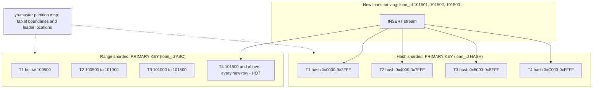

# Module 7.06: Sharding: hash vs range

**Estimated hours:** 3

**What you will learn**

1. What sharding is, how to choose a partition key, and the two ways to cut a table: by hash (even spread) or by range (ordered scans).
2. Why ever-increasing keys such as `loan_id` or timestamps create hot spots on range shards, and how rebalancing and tablet splitting move data as it grows.
3. How YugabyteDB writes all of this in DDL (`HASH`, `ASC`, `SPLIT INTO`, `SPLIT AT VALUES`), why secondary indexes are sharded on their own, and what a branch-first design costs a bank-wide report.

**Prerequisites:** [Module 7.05: Raft consensus](module-05-raft-consensus.md). You also need replication from module 7.04, composite B-tree keys from module 6.09 and `EXPLAIN` from module 6.10. The single-node YugabyteDB container `yb` from module 0.05 must start (`docker start yb`).

---

## 1. One-line intuition

Sharding cuts one big table into many smaller pieces that live on different servers, and the partition key decides which piece every row goes to.

## 2. Real-life analogy

A bank's record room holds loan folders in four filing cabinets, one clerk per cabinet. There are three ways to decide which cabinet a folder goes into.

- **By number range.** Cabinet 1 holds loans 1 to 250,000, cabinet 2 the next 250,000, and so on. "Pull loans 100,000 to 100,500" is easy: one cabinet, one clerk, folders already in order. But every new loan gets the next number, so every new folder lands in the last cabinet. One clerk is buried while three sit idle. That is a **hot spot**.
- **By a scrambled number.** Run the loan number through a fixed scrambling rule (a **hash**) and use the result to pick the cabinet. New folders spread evenly over all four clerks. But "loans 100,000 to 100,500" now means opening all four cabinets.
- **By branch, scrambled.** Scramble the branch code instead. All of Mumbai Fort's folders sit together in one cabinet, so the Mumbai Fort manager's daily work touches one clerk. Head office's monthly audit of every branch still opens all four. And if Mumbai Fort is enormous, its cabinet overflows while others are half empty.

When a cabinet fills, the room manager **splits** it: half the folders move into a new cabinet. When the bank hires a fifth clerk, whole cabinets are wheeled to the new desk. That is **rebalancing**. Nobody re-sorts every folder in the building.

## 3. Why it exists: the problem it solves

One server has hard limits: disk size, write throughput (one write-ahead log, one stream of `fsync` calls), CPU, and RAM for caching. Replication (module 7.04) does not lift those limits for writes: every replica still stores and applies every write. It scales reads and survives failures. It does not let you store or write more than one machine can.

**Sharding** (also called **partitioning**) splits the data so each server owns only part of it. Add servers, move some pieces to them, and storage and write capacity grow. In YugabyteDB each piece is a **tablet**, and each tablet is its own Raft group (module 7.05) with its own leader. Leaders for different tablets sit on different servers, so writes spread across the cluster instead of queuing behind one primary.

What breaks without sharding: you buy ever bigger machines until there is no bigger machine; maintenance (backup, index builds, vacuum) takes longer every year; and one server is one failure domain for everything.

What breaks with **bad** sharding:

- **Hot spots.** If every insert goes to one tablet, the cluster writes at the speed of one node no matter how many nodes you add.
- **Scatter-gather queries.** If a frequent query cannot name one shard, it asks every shard. Its latency becomes the slowest shard's latency, and it costs work on every node.
- **Cross-shard transactions.** A transaction that touches rows on several tablets needs the distributed commit protocol of module 7.08, which costs more than a single-tablet write.

## 4. Three layers of depth

### Layer 1 (beginner): the words and the syntax

**Shard / tablet.** One piece of a table. YugabyteDB calls it a tablet. A table has one or more tablets; each tablet holds a subset of the rows and is replicated (three copies with replication factor 3).

**Partition key (sharding key).** The column or columns whose value decides the tablet. In YugabyteDB it is part of the primary key.

**Hash sharding.** Compute a hash of the partition key (a number that looks random but is always the same for the same input) and give each tablet a slice of the hash space.

**Range sharding.** Keep rows sorted by the key and give each tablet a contiguous range of key values.

YugabyteDB's SQL layer (YSQL) writes the choice inside the primary key:

```sql
-- Hash on loan_id. In YSQL this is also what plain "PRIMARY KEY (loan_id)" means.
CREATE TABLE t1 (loan_id bigint, amount_paise bigint, PRIMARY KEY (loan_id HASH))
  SPLIT INTO 4 TABLETS;

-- Range on loan_id, cut into 4 tablets at chosen boundaries.
CREATE TABLE t2 (loan_id bigint, amount_paise bigint, PRIMARY KEY (loan_id ASC))
  SPLIT AT VALUES ((250000), (500000), (750000));

-- Composite: hash on branch_code, then sorted by loan_id inside each branch.
CREATE TABLE t3 (branch_code varchar(6), loan_id bigint, amount_paise bigint,
  PRIMARY KEY ((branch_code) HASH, loan_id ASC)) SPLIT INTO 4 TABLETS;
```

Defaults you must know, because they surprise people coming from PostgreSQL:

- `PRIMARY KEY (loan_id)` means `loan_id HASH`. The first primary-key column is hashed unless you write `ASC` or `DESC`.
- `PRIMARY KEY (branch_code, user_code)` means `branch_code HASH, user_code ASC`.
- A table with no primary key gets a hidden key (`ybrowid`) and is hash sharded on it.
- A secondary index follows the same rule: its first column is hashed unless you say `ASC`/`DESC`.

| Question | Hash sharding | Range sharding |
|---|---|---|
| Point lookup `WHERE key = ?` | One tablet | One tablet |
| Range scan `WHERE key BETWEEN a AND b` | Every tablet (key order is scrambled) | Only the tablets covering `[a, b]` |
| `ORDER BY key` | Needs a sort | Comes out in order |
| Inserts with an increasing key | Spread evenly | All go to the last tablet (hot spot) |
| Starting tablets | `SPLIT INTO n TABLETS`, or a default per node | One, unless you write `SPLIT AT VALUES` |
| Split point when a tablet grows | Middle of the tablet's data, as a hash value | Middle key of the tablet's data |

### Layer 2 (working engineer): choosing the key and living with it

**Choosing a partition key.** Ask five questions, in this order:

1. **Does the hottest query name it with `=`?** A hash key helps only queries that give its exact value. The branch work-queue screen runs thousands of times a day with `WHERE branch_code = ?`. A key it never mentions turns every call into a scatter-gather.
2. **Is it high cardinality?** **Cardinality** is the number of distinct values. `status` has five values, so at most five tablets could ever hold data. Branch codes number in the thousands at a real bank: good. You want many more distinct values than tablets.
3. **Is it evenly used?** Even a high-cardinality key can be skewed. If head office books 20% of all loans, the tablet holding head office carries 20% of the load whatever the tablet count. Hashing does not fix one hot value: one value always maps to one tablet.
4. **Does it increase over time?** Sequences, `bigserial`, timestamps and order numbers all increase. On a range key they create a hot tail. On a hash key they are fine.
5. **What must live together?** Rows read or written together should share a tablet when possible: one tablet, one RPC, and in module 7.08 a cheaper transaction.

**Hot spots and fixes.** Write hot spots come from increasing keys on range shards: hash the key instead, or put a hashed column in front (`PRIMARY KEY ((branch_code) HASH, loan_id ASC)`), or prefix a small bucket number such as `loan_id % 16` as the hash column (you then query all 16 buckets for a range scan). Read hot spots come from one popular key (one product row read by every request): cache it in the application (module 4.13) rather than fighting it in the database.

**Consistent hashing in one paragraph.** A naive hash scheme, `tablet = hash(key) % N`, moves almost every key when N changes from 4 to 5. **Consistent hashing** (Dynamo, Cassandra) places nodes and keys on a ring, so adding a node moves only the keys between it and its neighbour, about 1/N of the data. YugabyteDB gets the same benefit a simpler way: the hash space is fixed at 16 bits (0 to 65535) and is cut into tablets; when a node joins, whole tablets move to it. No key is ever re-hashed; only tablet ownership changes. Many systems do this: a fixed space of partitions, and partitions (not keys) migrate.

**Rebalancing.** The yb-master process runs a **load balancer**. When a node joins or leaves, it moves tablet replicas so every node holds a fair share, and it moves tablet **leaders** so every node serves a fair share of reads and writes. A replica moves by adding a new Raft member on the new node, copying the tablet's files to it (a **remote bootstrap**), then removing the old member. Clients keep working during the move. You watch this happen in module 7.09.

**Tablet splitting.** Tablets get split three ways:

- **Pre-splitting** at creation: `SPLIT INTO n TABLETS` (hash) or `SPLIT AT VALUES (...)` (range). Use it when you know a table will be big, such as before a bulk migration load.
- **Manual**: `yb-admin split_tablet <tablet_id>`.
- **Automatic**: on by default in current releases (`enable_automatic_tablet_splitting`). A tablet splits when its size passes a threshold, with small thresholds while a node has few tablets and larger ones as the count grows (the documented defaults are 512 MB, then 10 GB, with a hard 100 GB limit; check the docs for your release). A range table starts as one tablet and splits as it grows, so the hot tail just becomes a new hot last tablet.

**Secondary indexes are sharded independently.** In YugabyteDB an index is stored as its own table with its own tablets, sharded on the index's own columns. Consequences:

- A lookup `WHERE customer_id = ?` through an index on `customer_id` costs two hops: the index tablet, then the main table's tablet for each matching primary key. A **covering index** (`INCLUDE` the needed columns, module 6.09) makes it one hop: an index-only scan.
- Every insert into `loans` also writes an index entry that usually lives on a different tablet, so the insert becomes a distributed transaction (module 7.08).
- A `UNIQUE` index enforces uniqueness across the whole cluster because all entries for one value land in one index tablet.
- An index on `disbursed_at ASC` gives fast date-range scans and a hot tail on inserts. Every index is its own sharding decision.

**Cross-shard query cost.** A query that cannot name one tablet is sent to all of them. YugabyteDB sends those requests in parallel and pushes filters and aggregates down so each tablet returns little data, but the work still happens on every node. Latency follows the slowest tablet. Throughput does not grow when you add nodes, because every node does a slice of every such query. Module 7.07 shows how to count these requests with `EXPLAIN (ANALYZE, DIST)`.

### Layer 3 (internals): how a row finds its tablet

**The key bytes.** DocDB, YugabyteDB's storage layer (module 7.07), stores each row under a key built from the primary key:

- **Hash table:** `[16-bit hash of the hash columns] [hash column values] [range column values]`.
- **Range table:** `[range column values]`, encoded so that comparing the bytes gives the same order as comparing the values (`DESC` columns are stored with inverted bytes).

The 16-bit hash means 65,536 possible hash values, `0x0000` to `0xFFFF`. A hash table with 4 tablets cuts that space into four equal slices: `[0x0000, 0x4000)`, `[0x4000, 0x8000)`, `[0x8000, 0xC000)`, `[0xC000, 0xFFFF]`. YSQL exposes the hash function as `yb_hash_code(...)`, so you can predict a row's tablet: `yb_hash_code(loan_id) / 16384` gives 0 to 3 for a 4-tablet table. Pass values of the column's real type, because `yb_hash_code(42)` (an `int`) and `yb_hash_code(42::bigint)` encode different bytes and give different hashes.

Because the hash comes first and the range columns follow, all rows with the same hash value sit next to each other, sorted by the range columns. That is why `PRIMARY KEY ((branch_code) HASH, loan_id ASC)` makes `WHERE branch_code = 'MUM001' ORDER BY loan_id` one ordered scan inside one tablet, with no sort step.

**The partition map.** The yb-master catalog records, per table, the list of tablets with their key or hash boundaries, and where each tablet's replicas and leader live. Every yb-tserver keeps a cached copy (the **meta cache**). Routing a row is: compute the key, binary-search the partition list, look up the tablet's leader, send the RPC. If the cache is stale (the leader moved, the tablet split), the tserver that receives the request answers "not the leader" or "tablet split", and the client refreshes from the master and retries. Applications never see this.

**What a split does.** The tablet leader picks a split point from its data (an approximate middle key; for a hash tablet, expressed as a hash value), writes a split operation through its Raft log so every replica splits at the same point, and creates two child tablets. The children start by sharing the parent's immutable data files (hard links, no copying) and each gradually drops the other half during compaction. Then the master updates the partition map, and the load balancer may move one child to another node. Splitting is cheap because data files are immutable; that is a property of the LSM design you meet in module 7.07.

## 5. Architecture diagram



Each tablet box is a Raft group of three replicas in a real cluster. The same insert stream concentrates on one range tablet and spreads over all hash tablets.

## 6. Code

This script builds the same loan data three ways in a new database on your single-node `yb` container: range on `loan_id`, hash on `loan_id`, and hash on `branch_code` with `loan_id` sorted inside each branch. Save it as `shard_demo.sql`.

```sql
-- shard_demo.sql: one dataset, three sharding designs (module 7.06).
-- Run: psql -h localhost -p 5433 -U yugabyte -f shard_demo.sql
DROP DATABASE IF EXISTS lending_shard;
CREATE DATABASE lending_shard;
\c lending_shard

-- Columns are the canonical loans columns (module 6.03). Foreign keys are left out
-- so this demo needs no other tables; module 7.09 builds the full schema.
CREATE TABLE loans_range (
  loan_id bigint NOT NULL, application_id bigint NOT NULL, branch_code varchar(6) NOT NULL,
  customer_id bigint NOT NULL, product_code varchar(8) NOT NULL,
  principal_paise bigint NOT NULL, outstanding_paise bigint NOT NULL,
  rate_bp int NOT NULL, tenure_months int NOT NULL, disbursed_at timestamptz, status text NOT NULL,
  PRIMARY KEY (loan_id ASC)
) SPLIT AT VALUES ((100500), (101000), (101500));          -- 4 range tablets

CREATE TABLE loans_hash (
  loan_id bigint NOT NULL, application_id bigint NOT NULL, branch_code varchar(6) NOT NULL,
  customer_id bigint NOT NULL, product_code varchar(8) NOT NULL,
  principal_paise bigint NOT NULL, outstanding_paise bigint NOT NULL,
  rate_bp int NOT NULL, tenure_months int NOT NULL, disbursed_at timestamptz, status text NOT NULL,
  PRIMARY KEY (loan_id HASH)
) SPLIT INTO 4 TABLETS;                                     -- 4 hash tablets

CREATE TABLE loans_branch (
  loan_id bigint NOT NULL, application_id bigint NOT NULL, branch_code varchar(6) NOT NULL,
  customer_id bigint NOT NULL, product_code varchar(8) NOT NULL,
  principal_paise bigint NOT NULL, outstanding_paise bigint NOT NULL,
  rate_bp int NOT NULL, tenure_months int NOT NULL, disbursed_at timestamptz, status text NOT NULL,
  PRIMARY KEY ((branch_code) HASH, loan_id ASC)
) SPLIT INTO 4 TABLETS;                                     -- hash on branch, sorted by loan

-- Generates loans 100000+a .. 100000+b, spread over five branches.
CREATE FUNCTION gen_loans(a int, b int) RETURNS SETOF loans_range LANGUAGE sql AS $$
  SELECT (100000 + g)::bigint, (200000 + g)::bigint,
         ((ARRAY['MUM001','DEL001','BLR001','CHN001','KOL001'])[1 + g % 5])::varchar(6),
         (300000 + g)::bigint, (CASE WHEN g % 3 = 0 THEN 'HL01' ELSE 'PL01' END)::varchar(8),
         (5000000 + g * 1000)::bigint, (5000000 + g * 1000)::bigint, 850, 240,
         timestamptz '2025-04-01 10:00+05:30' + g * interval '1 hour', 'ACTIVE'
  FROM generate_series(a, b) AS g
$$;

-- The existing book: loans 100001 .. 101500.
INSERT INTO loans_range  SELECT * FROM gen_loans(1, 1500);
INSERT INTO loans_hash   SELECT * FROM gen_loans(1, 1500);
INSERT INTO loans_branch SELECT * FROM gen_loans(1, 1500);

-- Today's disbursements: 2,000 NEW loans with increasing ids 101501 .. 103500.
INSERT INTO loans_range  SELECT * FROM gen_loans(1501, 3500);
INSERT INTO loans_hash   SELECT * FROM gen_loans(1501, 3500);
INSERT INTO loans_branch SELECT * FROM gen_loans(1501, 3500);

\echo '--- tablets per table'
SELECT 'loans_range' AS t, num_tablets, num_hash_key_columns FROM yb_table_properties('loans_range'::regclass)
UNION ALL
SELECT 'loans_hash', num_tablets, num_hash_key_columns FROM yb_table_properties('loans_hash'::regclass)
UNION ALL
SELECT 'loans_branch', num_tablets, num_hash_key_columns FROM yb_table_properties('loans_branch'::regclass);

\echo '--- where did the 2,000 NEW loans land? range table'
SELECT CASE WHEN loan_id < 100500 THEN 'T1 [min, 100500)'
            WHEN loan_id < 101000 THEN 'T2 [100500, 101000)'
            WHEN loan_id < 101500 THEN 'T3 [101000, 101500)'
            ELSE                       'T4 [101500, max)' END AS tablet,
       count(*) AS new_rows
FROM loans_range WHERE loan_id > 101500 GROUP BY 1 ORDER BY 1;

\echo '--- where did the 2,000 NEW loans land? hash table'
SELECT 'T' || (yb_hash_code(loan_id) / 16384 + 1) AS tablet, count(*) AS new_rows
FROM loans_hash WHERE loan_id > 101500 GROUP BY 1 ORDER BY 1;

\echo '--- which tablet holds each branch? branch-hashed table'
SELECT branch_code, yb_hash_code(branch_code) AS hash,
       'T' || (yb_hash_code(branch_code) / 16384 + 1) AS tablet, count(*) AS loans
FROM loans_branch GROUP BY branch_code ORDER BY tablet, branch_code;
```

Run it:

```bash
psql -h localhost -p 5433 -U yugabyte -f shard_demo.sql
```

Expected output (abbreviated). The tablet counts and the range-table result are exact. The hash-table counts are deterministic but depend on YugabyteDB's hash function, so the numbers below are placeholders: yours will be four values near 500 that add up to 2,000. The branch-to-tablet mapping is also yours to record.

```text
--- tablets per table
      t       | num_tablets | num_hash_key_columns
--------------+-------------+----------------------
 loans_range  |           4 |                    0
 loans_hash   |           4 |                    1
 loans_branch |           4 |                    1

--- where did the 2,000 NEW loans land? range table
      tablet      | new_rows
------------------+----------
 T4 [101500, max) |     2000

--- where did the 2,000 NEW loans land? hash table
 tablet | new_rows
--------+----------
 T1     |   (about 500)
 T2     |   (about 500)
 T3     |   (about 500)
 T4     |   (about 500)

--- which tablet holds each branch? branch-hashed table
 branch_code | hash  | tablet | loans
-------------+-------+--------+-------
 (five rows: 700 loans per branch; some tablets hold two branches, some none)
```

Read the result. The range table put all 2,000 new loans in one tablet: on a real cluster that tablet's leader node did all of today's write work. The hash table spread them. The branch table shows the other lesson: with only five distinct branch codes and four tablets, the spread is lumpy, because a hash key needs far more distinct values than tablets.

Now compare what the same queries cost on each design. Save as `shard_explain.sql`:

```sql
-- shard_explain.sql: the same questions against the three designs.
-- Run: psql -h localhost -p 5433 -U yugabyte -d lending_shard -f shard_explain.sql
\echo '=== A. range of loan ids: range table'
EXPLAIN (ANALYZE, DIST, COSTS OFF)
SELECT loan_id, outstanding_paise FROM loans_range WHERE loan_id BETWEEN 100100 AND 100200;
\echo '=== A. range of loan ids: hash table'
EXPLAIN (ANALYZE, DIST, COSTS OFF)
SELECT loan_id, outstanding_paise FROM loans_hash WHERE loan_id BETWEEN 100100 AND 100200;
\echo '=== B. one branch work queue: branch table'
EXPLAIN (ANALYZE, DIST, COSTS OFF)
SELECT loan_id, outstanding_paise FROM loans_branch
WHERE branch_code = 'MUM001' ORDER BY loan_id LIMIT 10;
\echo '=== B. one branch work queue: hash table'
EXPLAIN (ANALYZE, DIST, COSTS OFF)
SELECT loan_id, outstanding_paise FROM loans_hash
WHERE branch_code = 'MUM001' ORDER BY loan_id LIMIT 10;
\echo '=== C. bank-wide report: branch table'
EXPLAIN (ANALYZE, DIST, COSTS OFF)
SELECT branch_code, count(*), sum(outstanding_paise) FROM loans_branch GROUP BY branch_code;
```

What to look for (exact text varies by release; the plan shapes do not):

- **A, range table:** an `Index Scan using loans_range_pkey` with an `Index Cond` on `loan_id`; about 101 rows read.
- **A, hash table:** a `Seq Scan on loans_hash` with the `BETWEEN` as a filter (shown as `Storage Filter` or `Remote Filter` depending on release). Every row of every tablet is examined to return 101.
- **B, branch table:** an `Index Scan using loans_branch_pkey` with `Index Cond: (branch_code = 'MUM001')` and **no Sort node**: rows come out in `loan_id` order from one tablet.
- **B, hash table:** a `Seq Scan` feeding a `Sort` and a `Limit`: all 3,500 rows are read to find 10.
- **C, branch table:** a scan of all four tablets. The bank-wide report cannot avoid it.

The `DIST` option adds lines such as `Storage Table Read Requests` and `Storage Read Execution Time` (and `Storage Table Rows Scanned` on newer releases). Record them for each query; module 7.07 explains exactly what they count.

## 7. Use case: core-banking loan-origination platform

The loan platform moved its `loans` table to a multi-node YugabyteDB cluster. Three query families dominate:

| Query | Volume | Shape |
|---|---|---|
| Branch work queue: active loans at my branch, newest first | Thousands of calls a day from every branch | `WHERE branch_code = ? ORDER BY loan_id DESC LIMIT 50` |
| Loan screen: one loan by number | Very high | `WHERE loan_id = ?` |
| Bank-wide reports: outstanding by product, region, overdue buckets | A few per day, plus month-end | Scans everything |

Three designs were compared:

| Design | Work queue | Loan screen | New loans | Bank-wide report |
|---|---|---|---|---|
| Range on `loan_id` | Scatter to all tablets | 1 tablet | **Hot tail**: every disbursement on one tablet; month-end peaks made it worse | Scan all |
| Hash on `loan_id` | Scatter to all tablets for every screen refresh | 1 tablet | Even | Scan all |
| Hash on `branch_code`, `loan_id ASC` inside | **1 tablet, already ordered** | Needs a second index on `loan_id` | Even across branches | Scan all |

**The decision:** `loans` uses `PRIMARY KEY ((branch_code) HASH, loan_id ASC)`, so a branch's loans co-locate and the hottest screen is one ordered single-tablet read. Because `repayments` references a loan by `loan_id` alone, the table also gets `UNIQUE (loan_id)`. That unique index is a separate, hash-sharded index: the loan screen and every foreign-key check go index tablet first, then the row's tablet. The team accepted that extra hop on the loan screen in exchange for removing a scatter-gather from the busiest query in the system.

The costs that were written down, because an interviewer will ask:

- **Bank-wide reports still scan every tablet.** They were moved to run against follower reads (slightly stale reads served by any replica, module 7.07) outside branch hours, so they do not compete with the branch screens for tablet leaders.
- **Branch skew.** The main city branch held several times the loans of a rural branch. With thousands of branch codes hashed over many tablets the skew averaged out, but the team monitored per-tablet size in the master UI after migration, ready to split a tablet that grew too big.
- **Master tables are tiny** (branches, products, roles). Sharding them gains nothing; module 7.07 puts them in one colocated tablet.

## 8. Lab

You need the `yb` container running and about 45 minutes. Keep one terminal with `psql -h localhost -p 5433 -U yugabyte -d lending_shard` open after Part A.

### Part A: build the three designs and find their tablets (15 minutes)

1. Run `shard_demo.sql` from section 6. Record the three output tables, including your four hash-table counts and the branch-to-tablet mapping.
2. Open <http://localhost:7000/tables> in your Windows browser. Under user tables, find `loans_range`, `loans_hash` and `loans_branch` in database `lending_shard`. Click each one.
3. On each table page, read the tablet list. For `loans_hash` the partition column shows hash ranges in hex; for `loans_range` it shows key ranges. Record the four boundaries for each.
4. List the same tablets from the command line:

```bash
docker exec yb bash -c 'bin/yb-admin -master_addresses $(hostname):7100 list_tablets ysql.lending_shard loans_range'
```

Expected: four tablets per table. The `loans_hash` boundaries fall at `0x4000`, `0x8000` and `0xC000` (16384, 32768, 49152); the `loans_range` boundaries at 100500, 101000 and 101500. `list_tablets` prints a tablet ID, its range and its leader for each tablet. Keep one `loans_range` tablet ID for Part D.

### Part B: watch the hot spot (10 minutes)

1. Open <http://localhost:9000/tablets>. This is the yb-tserver's own list of tablets with their on-disk sizes. Find the four `loans_range` tablets and record each one's size (the WAL size is the part that grows first).
2. Insert another 20,000 "new" loans, increasing ids, into both tables:

```sql
INSERT INTO loans_range SELECT * FROM gen_loans(3501, 23500);
INSERT INTO loans_hash  SELECT * FROM gen_loans(3501, 23500);
```

3. Refresh the tserver page. Record the sizes again.

Expected: for `loans_range`, only the tablet whose range starts at 101500 grew; the other three did not change. For `loans_hash`, all four grew by similar amounts. Exact sizes vary by version and by when memtables flush; the pattern is the result. You have just measured why range sharding on an increasing key caps write throughput at one tablet leader.

### Part C: measure query cost per design (10 minutes)

1. Run `shard_explain.sql` from section 6.
2. Fill in this table from the output:

| Query | Design | Plan node | Rows scanned or read requests | Execution time |
|---|---|---|---|---|
| A | range | | | |
| A | hash | | | |
| B | branch | | | |
| B | hash | | | |
| C | branch | | | |

3. Add a covering index for "loans of one customer" and compare:

```sql
CREATE INDEX loans_hash_customer ON loans_hash (customer_id) INCLUDE (outstanding_paise);
EXPLAIN (ANALYZE, DIST, COSTS OFF)
SELECT outstanding_paise FROM loans_hash WHERE customer_id = 300042;
EXPLAIN (ANALYZE, DIST, COSTS OFF)
SELECT status FROM loans_hash WHERE customer_id = 300042;
```

Expected: A on range and B on branch read only the rows they return; A and B on the hash table read the whole table. The first customer query is an `Index Only Scan` with only index read requests; the second (asking for `status`, which the index does not include) is an `Index Scan` that also shows table read requests: the second hop.

### Part D: split a tablet by hand (10 minutes)

1. Flush the table so its data is in files the splitter can read, then split the hot tablet (use the tablet ID of the range starting at 101500 from Part A):

```bash
docker exec yb bash -c 'bin/yb-admin -master_addresses $(hostname):7100 flush_table ysql.lending_shard loans_range'
docker exec yb bash -c 'bin/yb-admin -master_addresses $(hostname):7100 split_tablet <tablet_id>'
```

2. Wait ten seconds, then run `list_tablets` for `loans_range` again.

Expected: five tablets. The old hot tablet is replaced by two children whose boundary is somewhere inside its old range (near the middle of its data). If `split_tablet` refuses because the tablet is too small or splitting is disabled, record the exact message, insert another 50,000 rows with `gen_loans`, flush, and try again. Then answer in your notes: after the split, which tablet receives the next new loan? (The new last one. Splitting moves the hot spot; it does not remove it.)

### Journal

Copy [journal/TEMPLATE.md](../journal/TEMPLATE.md) to `journal/YYYY-MM-DD-sharding-hash-vs-range.md`. Record: the hash-table spread of 2,000 new loans; the branch-to-tablet mapping and how lumpy it was; tablet sizes before and after Part B; the Part C table; the split result from Part D. Under "Decisions", write two sentences on which key you would choose for `audit_log` and why.

## 9. Common mistakes and misconceptions

| Mistake | Why it is wrong | Bug or cost it causes |
|---|---|---|
| Assuming `PRIMARY KEY (id)` behaves like PostgreSQL | In YSQL the first key column is hashed by default | `WHERE id BETWEEN ...` and `ORDER BY id` become full scans after migration |
| Range sharding on a sequence or timestamp | Every new row sorts last | One tablet leader takes all inserts; adding nodes does not help |
| Hashing a low-cardinality column (`status`, `product_code`) | Few distinct values means few useful tablets | Two or three tablets hold everything; the rest are empty |
| Believing hashing removes hot keys | One value always maps to one tablet | A "head office" branch or one popular row still saturates a tablet |
| Forgetting that indexes are sharded separately | The index lives on other tablets | Two hops per lookup; every insert becomes a distributed transaction |
| Choosing the key for the report, not the hot path | Reports run a few times a day; screens run all day | Scatter-gather on every branch screen to save one nightly scan |
| Thinking a split fixes an increasing-key hot spot | The newest child is the new tail | The hot spot moves to the new last tablet |
| Calling `yb_hash_code(42)` for a `bigint` column | Different types encode to different bytes | Wrong tablet predictions in analysis scripts |

## 10. Resume link

This module supports **claim E** ("distributed SQL, sharding") and **claim D** ("YugabyteDB"), and it feeds capstone C4, whose cluster uses these key choices.

How to say it: "On the loan platform's YugabyteDB cluster we hashed `loans` on `branch_code` with `loan_id` as an ascending range column inside the key, so the branch work queue, our busiest query, was a single-tablet ordered read. We added a unique index on `loan_id` for foreign keys and the loan screen, which costs one extra hop there. In my lab, range sharding on `loan_id` put all 2,000 new loans on one tablet; hashing spread them over four."

Likely follow-ups and specific answers:

- "Why not hash on `loan_id`?" Because every branch screen would scatter to every tablet; the extra hop on the loan screen was cheaper than fan-out on the busiest screen.
- "What about bank-wide reports?" They scan every tablet whatever we do; we ran them on follower reads off-hours.
- "What if one branch is huge?" Hashing cannot split one key value. We watched tablet sizes; the remedy would be adding a bucket column to that branch's key.

## 11. Interview questions

**Q1 (easy). What is the difference between sharding and replication?**

<details>
<summary>Model answer</summary>

Replication keeps several full copies of the same data on different servers, for availability and read capacity; every replica still stores and applies every write. Sharding splits the data so each server owns only part of it, which scales storage and write capacity. Distributed SQL databases do both: YugabyteDB shards a table into tablets and replicates each tablet with its own Raft group, typically three copies.

</details>

**Q2 (easy). When would you choose range sharding over hash sharding?**

<details>
<summary>Model answer</summary>

When the important queries scan ranges of the key or need results in key order, for example time-series reads over a date range or ordered pagination, and the insert pattern does not concentrate on one end of the key space. Hash sharding is the better default for point lookups and for keys that increase over time, because it spreads writes evenly, but it turns every range scan on the key into a scan of all tablets.

</details>

**Q3 (medium). Why does an auto-increment primary key cause a hot spot, and how do you fix it in YugabyteDB?**

<details>
<summary>Model answer</summary>

With range sharding the key's order decides placement, and each new id is larger than all previous ones, so every insert lands in the tablet that owns the top of the range. That tablet's leader handles all writes and the cluster's insert throughput equals one node's. Splitting the tablet just creates a new last tablet. Fixes: hash shard on the key (YSQL's default for the first primary-key column); put a hashed column with good cardinality in front of it, such as `PRIMARY KEY ((branch_code) HASH, loan_id ASC)`; or add a small bucket prefix like `id % 16` as the hash column and query all buckets for range scans. Note that sequences in YugabyteDB are cached per connection, so ids are not even strictly ordered across sessions, which is one more reason not to depend on their order.

</details>

**Q4 (medium). How are secondary indexes stored in a sharded SQL database like YugabyteDB, and what does that cost?**

<details>
<summary>Model answer</summary>

Each index is stored as its own distributed table with its own tablets, sharded on the index key (first column hashed by default). A lookup through a non-covering index costs two hops: the index tablet to get primary keys, then the main table's tablets to fetch rows. A covering index with `INCLUDE` turns that into one hop. Writes cost more: inserting a row also writes an index entry, which usually lives on another tablet, so a single-row insert becomes a distributed transaction. Unique indexes can enforce global uniqueness because all entries for a value live in one index tablet. So in a distributed database each index is both a performance aid for reads and a sharding decision with a write cost.

</details>

**Q5 (hard). Design the sharding for a loans table that serves branch screens all day and bank-wide reports at night. What breaks as the bank grows?**

<details>
<summary>Model answer</summary>

I would key `loans` as `PRIMARY KEY ((branch_code) HASH, loan_id ASC)`. The branch screen, `WHERE branch_code = ? ORDER BY loan_id DESC LIMIT 50`, becomes one tablet, already ordered, no sort. Point lookups by `loan_id` alone need a unique index on `loan_id`, which also serves foreign keys from `repayments`; that adds one hop to the loan screen. Reports scan all tablets regardless; I would run them on follower reads or a read replica outside branch hours so they do not load the tablet leaders, and push aggregation down so each tablet returns little data. Growth problems: branch skew, because one huge branch's rows can never be split across tablets by the hash, so I would monitor per-tablet size and, if needed, add a bucket column for large branches; tablet count, because automatic splitting creates more tablets as data grows, and each tablet has fixed overhead (memtable, Raft heartbeats), so I would pre-split to a sensible count before the bulk migration load instead of relying on splits during it; and index hot spots, because any range index on `disbursed_at` would have a hot tail during month-end disbursement peaks, so I would hash it on a branch or bucket column first. Adding nodes is easy: the load balancer moves whole tablets and leaders, nothing is re-hashed.

</details>

## 12. Revision

- Sharding splits a table into tablets by a partition key; replication copies each tablet; YSQL hashes the first primary-key column unless you write `ASC`/`DESC`.
- Hash spreads writes but scatters range scans; range keeps order but makes increasing keys (ids, timestamps) a hot tail that splitting only moves.
- Indexes are sharded separately (two hops unless covering, distributed writes); for loans, `((branch_code) HASH, loan_id ASC)` makes the branch screen one tablet and leaves bank-wide reports as full scans.

---

Previous: [Module 7.05: Raft consensus](module-05-raft-consensus.md) | Next: [Module 7.07: YugabyteDB architecture](module-07-yugabytedb-architecture.md)
