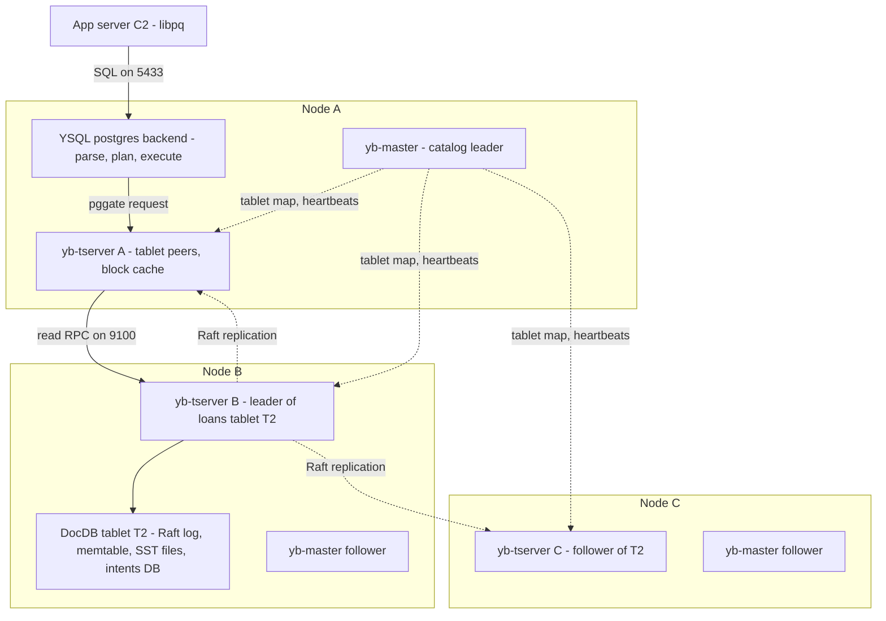
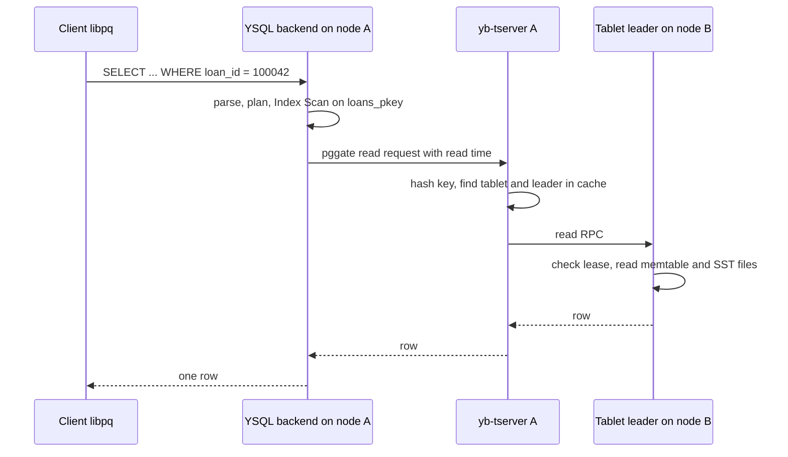

# Module 7.07: YugabyteDB architecture

**Estimated hours:** 6

**What you will learn**

1. The two layers of YugabyteDB: YSQL, which reuses PostgreSQL's own query layer, and DocDB, a distributed document store built on a customised RocksDB, split into Raft-replicated tablets.
2. What yb-master, yb-tserver and the yugabyted wrapper each do, how tablet leaders and leader leases give consistent reads, and the exact path of `SELECT ... WHERE pk = ?` through the cluster.
3. How to read `EXPLAIN (ANALYZE, DIST)`, when to use colocated tables for small master tables, and which PostgreSQL behaviours differ, stated honestly.

**Prerequisites:** [Module 7.06: Sharding: hash vs range](module-06-sharding-hash-vs-range.md). This module also leans on PostgreSQL's planner and `EXPLAIN` (module 6.10), PL/pgSQL (module 6.11), WAL (module 6.06), MVCC (module 6.07), Raft (module 7.05) and hybrid logical clocks (module 7.03). You need the `yb` container from module 0.05.

---

## 1. One-line intuition

YugabyteDB keeps PostgreSQL's brain (parser, planner, executor, PL/pgSQL) and replaces its storage with many small, independently replicated sorted key-value stores spread over the cluster.

## 2. Real-life analogy

Think of a bank that grew from one branch with one vault to a network of vault buildings in three cities.

- **The front desk (YSQL)** works exactly like the old branch: the same forms, the same procedures, the same staff training. A customer cannot tell anything changed. That is PostgreSQL's query layer, reused nearly unchanged.
- **The vault network (DocDB)** is new. Valuables are filed in many small drawers (**tablets**). Every drawer has three identical copies in three cities, and one copy is the **head copy** (the **tablet leader**): all deposits and withdrawals for that drawer go through whoever holds the head copy, who writes them into a shared logbook that the other two copies follow (Raft).
- **The head keeper holds a time-limited permit (the leader lease).** While the permit is valid, the head copy can answer "what is in this drawer?" alone, without phoning the other cities, because nobody else can become head until the permit expires.
- **The registry office (yb-master)** knows which drawers exist, where every copy is, and moves drawers between buildings to keep the work even. It holds no customer valuables. If the registry closes for a minute, deposits keep working, because each desk remembers where the drawers are.
- **The building manager (yugabyted)** opens the building in the morning, starts the registry and the vault staff, and puts a status board in the lobby (the web console).

## 3. Why it exists: the problem it solves

A single PostgreSQL server (Phase 6) gives you SQL, transactions and a mature planner. It has three limits that a growing bank hits:

1. **One writer.** All writes go through one primary. Replicas (module 6.16) help reads only, and their data lags.
2. **Failover is bolted on.** When the primary dies, external tooling must promote a replica. With asynchronous replication, the last committed transactions can be lost (a recovery point objective, RPO, above zero), and promotion often takes tens of seconds to minutes.
3. **No built-in sharding.** Splitting data across servers means application-level sharding or an extension, with cross-shard transactions left to you.

Distributed SQL databases, inspired by Google Spanner, answer all three: data is sharded into tablets (module 7.06), each tablet is replicated with Raft (module 7.05) so a commit is on a majority before it is acknowledged (RPO zero) and a new leader is elected in seconds, and transactions across tablets are built in (module 7.08). YugabyteDB's particular bet is to get the SQL layer by reusing PostgreSQL's code instead of writing a new one, so PostgreSQL clients, drivers, SQL, PL/pgSQL and `EXPLAIN` work. That bet is why the resume can say the stored-procedure layer (H6) and the index work from execution plans (H7) carried over to "a multi-node cluster".

The price is latency and some compatibility gaps: every read and write that PostgreSQL served from local shared buffers becomes an RPC to a tablet leader, which may be on another machine. This module makes that price concrete.

## 4. Three layers of depth

### Layer 1 (beginner): the parts and the ports

A YugabyteDB **cluster** (also called a **universe**) is a set of **nodes** (servers or containers). Each node runs up to three kinds of process:

| Process | What it does | Main ports |
|---|---|---|
| **yb-tserver** (tablet server) | Stores tablets and serves reads and writes on them; hosts the YSQL layer | 9100 RPC, 9000 web UI |
| **postgres** (YSQL) | Started by the tserver; the PostgreSQL-derived SQL front end; one backend process per client connection | 5433 SQL, 13000 YSQL stats |
| **yb-master** | The catalog (which tables, tablets and replicas exist), tablet placement, load balancing, DDL coordination | 7100 RPC, 7000 web UI |
| **yugabyted** | A Python wrapper that starts, configures and stops the other processes; serves the console | 15433 web console |

A cluster with replication factor 3 runs three masters (one Raft group for the catalog) and any number of tservers. In your single-node container, one of each.

**Two layers.** Everything above "which key-value pairs to read or write" is **YSQL**: connections, parsing, planning, executing, PL/pgSQL, triggers, the system catalog as seen by SQL. Everything below is **DocDB**: tablets, Raft, the storage engine, transactions at the key-value level. YugabyteDB also offers a second API, **YCQL** (Cassandra-compatible, port 9042), on the same DocDB. This course uses only YSQL.

**Tablets and their leaders.** Each table is split into tablets (module 7.06). Each tablet has RF copies called **peers**, which form a Raft group. One peer is the **leader**; the others are **followers**. By default the leader serves all reads and writes for its tablet. Leaders of different tablets live on different nodes, so the work spreads.

**PostgreSQL version.** `SELECT version();` shows the PostgreSQL release YSQL is based on, followed by `-YB-` and the YugabyteDB release. The 2024.1 and 2024.2 releases are based on **PostgreSQL 11.2**. The 2.25 preview series and the 2025.1 stable release moved YSQL to **PostgreSQL 15**, and later releases continue on 15. So "PostgreSQL compatible" means "compatible with PostgreSQL 11 or 15, depending on release". Check yours; module 0.05 recorded it.

### Layer 2 (working engineer): what carries over, what does not, and the knobs that matter

**What YSQL reuses from PostgreSQL.** The YSQL process is PostgreSQL's source code with the storage calls replaced. So these work as you learned them in Phase 6: the wire protocol and every libpq-based client (`psql`, your C and C++ programs from module 6.12); SQL syntax, data types, functions, operators; the planner and executor, including joins and `EXPLAIN`; PL/pgSQL functions, procedures and triggers (module 6.11); views, sequences, foreign keys, `CHECK` constraints; many extensions (for example `pgcrypto` and `pg_stat_statements`). Claims H6 and H7 transfer: the procedures and the index-design method are the same; what changes is the cost of each storage access.

**What changes underneath.** PostgreSQL's heap files, 8 KB pages, shared buffers, its WAL and `VACUUM` are not used for table data. A table is a DocDB table; an index is another DocDB table; each row is one or more key-value pairs; each storage access is a request to a tablet leader.

**Known differences from PostgreSQL** (verify each against the docs for your release; several are improving fast):

| Area | PostgreSQL | YugabyteDB YSQL |
|---|---|---|
| Default primary-key layout | B-tree, ordered | First key column **hashed** unless `ASC`/`DESC` (module 7.06) |
| Read Committed | Default and native | In the 2024 releases it must be enabled with the tserver flag `yb_enable_read_committed_isolation=true`; without it, `READ COMMITTED` silently behaves as `REPEATABLE READ` (snapshot). Newer releases offer a PostgreSQL-compatibility mode that turns it on |
| Serializable | SSI, optimistic | Implemented with read locks (intents) in DocDB, so conflicts appear at different moments (module 7.08) |
| Retries | `40001` rare at Read Committed | `40001` serialization errors and read restarts are a normal part of life; the app must retry (module 7.08) |
| `VACUUM` | Required | Accepted but a no-op; old versions are removed by compaction after a retention window |
| Sequences | Gapless order within one server (apart from rollbacks) | Each connection caches a block of values (100 by default), so ids from different sessions interleave and have gaps |
| Connections | Fork per connection, cheap-ish | Fork per connection plus catalog cache warm-up from yb-master; more expensive, so pooling matters more (module 6.12). Newer releases ship a built-in connection manager |
| DDL | Transactional | Historically each DDL ran as its own operation and was not atomic with DML in the same transaction block; recent releases are closing this gap. Concurrent DDL can make running queries fail with a "catalog version mismatch" error that must be retried |
| `CREATE INDEX` | Blocks writes unless `CONCURRENTLY` | Builds online with a backfill by default |
| Some features | Present | Historically missing or limited: `LISTEN/NOTIFY`, `PREPARE TRANSACTION` (XA), some `ALTER TABLE` forms, table inheritance details. Check the "unsupported features" page for your release before promising anything |
| Tablespaces | Directories on disk | Used for geo-placement policies (which regions or zones hold the data) |

**yb-master in more detail.** The masters form their own Raft group (on three nodes for RF 3) and hold:

- The **system catalog**: YSQL's `pg_catalog` tables are stored in the master's catalog tablet, not on each node. A YSQL backend reads catalog entries from the master on first use and caches them; a DDL bumps a **catalog version** that tells every backend to refresh.
- The **tablet map**: for every table, its tablets, their key ranges and the location of every peer.
- **Placement and load balancing**: where new tablets go, moving peers and leaders when nodes join, leave or fail (module 7.09).
- **Health**: every tserver heartbeats to the master leader, typically every second.

The master is **not in the data path**. A query's reads and writes go from the YSQL process to tservers. If the master leader is down for a few seconds, cached tablet locations keep queries running; DDL and new-connection catalog loads wait.

**yb-tserver in more detail.** Each tserver hosts many tablet peers (leaders for some, followers for others), a shared block cache for all of them, the Raft machinery, the transaction participant and coordinator logic of module 7.08, and the local postgres processes.

**yugabyted.** A convenience wrapper, not a database process. `yugabyted start` launches a master and a tserver with sensible flags and the console; `--join=<host>` adds a node to an existing cluster; `yugabyted status` prints a summary; `yugabyted configure data_placement` sets fault tolerance across zones. Production installs often run yb-master and yb-tserver directly with explicit flags; the processes are the same.

**Colocated tables.** By default each table gets its own tablets. A cluster with hundreds of small tables then has hundreds of Raft groups, each with heartbeats, a memtable, files and a leader somewhere, and a join of five small tables can touch five nodes. **Colocation** stores many small tables in **one** shared tablet:

```sql
CREATE DATABASE lending_colo WITH COLOCATION = true;       -- tables colocated by default
-- inside it, opt a big table out so it gets its own hash-sharded tablets:
CREATE TABLE loans (...) WITH (COLOCATION = false) SPLIT INTO 8 TABLETS;
```

Benefits for small master tables (branches, roles, users, products): one tablet instead of many; all their reads go to one leader; a full scan of a small table is one tablet's work instead of a fan-out; a transaction that touches only colocated tables stays on one tablet, so it takes the cheaper single-shard path (module 7.08). The cost: the colocated tablet is one Raft group with one leader, so it must stay small and not become a write hot spot, and colocated tables cannot be pre-split. Rule of thumb: colocate small, read-mostly tables; keep large or write-heavy tables out.

**Follower reads.** For reports that can accept data a few seconds old, a read-only transaction can be served by the nearest replica instead of the leader: `SET yb_read_from_followers = true;` inside a read-only transaction, with staleness set by `yb_follower_read_staleness_ms` (30 seconds by default). This moves report load off the leaders that serve branch screens.

**`EXPLAIN (ANALYZE, DIST)`.** YugabyteDB adds the `DIST` option, which prints, per plan node and in total, how many requests went to DocDB and how long they took. Typical lines:

| Line | Meaning |
|---|---|
| `Storage Table Read Requests` | Read RPCs to the table's tablets for this node |
| `Storage Index Read Requests` | Read RPCs to an index's tablets |
| `Storage Table Rows Scanned` | Rows DocDB examined (newer releases) |
| `Storage Write Requests` / `Storage Flush Requests` | Buffered writes, and the round trips that sent them |
| `Catalog Read Requests` | Catalog reads from yb-master (non-zero on the first query in a new connection) |
| `Storage Read Execution Time` | Time spent waiting on DocDB reads |

You tune YSQL queries by driving these numbers down: fewer requests, fewer rows scanned, no catalog reads on the hot path.

### Layer 3 (internals): DocDB, the read path and leader leases

**DocDB keys.** Module 7.06 showed the first part of the key: hash and primary-key values (the **DocKey**). DocDB appends more:

```text
[hash][hash cols][range cols]   [column id]      [hybrid time]  ->  value
 \_______ DocKey ________/      \ subkey /       \ MVCC version /
```

- A row is a document; columns are its sub-keys. In current releases a newly inserted YSQL row is usually stored as one **packed row** (all columns in one value); later updates to single columns add small per-column entries that compaction folds back in.
- Every entry carries the **hybrid time** (module 7.03) of the write. That is MVCC inside the key: a read at hybrid time T sees, for each key, the newest version at or before T. PostgreSQL keeps `xmin`/`xmax` in tuple headers and needs `VACUUM`; DocDB keeps versions as separate keys and drops old ones during compaction once they are older than a retention window (`timestamp_history_retention_interval_sec`, 900 seconds by default).

**One tablet, inside.** Each tablet peer on disk has:

- A **Raft log**. This is the tablet's write-ahead log. DocDB turns off RocksDB's own WAL because the Raft log already records every write durably and in order. Recovery after a crash replays the Raft log.
- A **regular RocksDB** instance holding committed data.
- An **intents RocksDB** instance holding provisional records of transactions in flight (module 7.08).

**LSM in brief.** RocksDB is a **log-structured merge tree (LSM)**. A write goes to the Raft log, then to an in-memory sorted table (the **memtable**). When the memtable fills, it is written out as an immutable sorted file (an **SST**, sorted string table). Over time many SSTs accumulate; **compaction** merges them in the background, dropping overwritten and expired versions. A read checks the memtable, then SSTs from newest to oldest, skipping files with per-file **bloom filters** (a compact structure that answers "definitely not here" or "maybe here") and serving hot blocks from the **block cache**. DocDB uses a size-tiered compaction style by default.

| | B-tree (PostgreSQL heap and indexes, Berkeley DB) | LSM (DocDB, RocksDB) |
|---|---|---|
| Write | Find the page, modify it in place, WAL record | Append to log and memtable; sequential file writes later |
| Read | One root-to-leaf descent | Memtable plus several files; bloom filters limit the damage |
| Space and I/O cost | Page splits, fragmentation, vacuum | Compaction rewrites data several times (write amplification) |
| Strength | Predictable reads | High write throughput; immutable files make splitting and remote copies cheap |

Module 10.07 builds a small LSM engine and compares the two designs in depth.

**Leader leases.** Raft guarantees that a committed write is on a majority. But a leader that answers reads from its own memory risks serving stale data if a newer leader has been elected elsewhere during a network partition. The safe-but-slow fix is to run every read through Raft. YugabyteDB instead gives the leader a **lease**: followers promise, through Raft heartbeats, not to elect a new leader until a lease interval (2 seconds by default, `leader_lease_duration_ms`) has passed since they last heard from it. While the leader holds a lease that a majority has granted, no other leader can exist, so it serves reads locally, linearizably (module 7.02), with no extra round trip. A newly elected leader must wait out the old leader's lease before serving. That wait is part of the failover gap you measure in module 7.09. Leases depend on clocks advancing at roughly the same **rate**, not on clocks agreeing, which is a much weaker assumption.

**The path of `SELECT outstanding_paise FROM loans WHERE loan_id = 100042`:**

1. **Client to YSQL.** libpq sends the query over TCP to port 5433 on the node it connected to, node A. A postgres backend process owns this connection.
2. **Parse, analyse, plan.** Exactly PostgreSQL's code. With a prepared statement this step is skipped on later executions. The plan is an Index Scan on the primary key.
3. **Executor to pggate.** Where PostgreSQL would read a heap page, YSQL's storage layer (called **pggate**) builds a DocDB read request: the encoded key, the wanted columns, and a read hybrid time.
4. **To the local tserver.** The backend hands the request to node A's yb-tserver.
5. **Find the tablet.** The tserver hashes the key, finds the tablet in its cached tablet map, and finds the tablet leader, say on node B.
6. **Network hop.** An RPC goes from node A to node B (port 9100). If the leader is on node A itself, this hop is local.
7. **Read at the leader.** Node B checks it still holds the leader lease and that its data is complete up to the read time, then reads DocDB: memtable, then SSTs via bloom filters and block cache.
8. **Return.** The row goes back to node A, through the executor, to the client.

Compare PostgreSQL: steps 1 and 2, then a buffer lookup in shared memory, typically a few microseconds when the page is cached. YugabyteDB adds at least one inter-process request (steps 4 to 8), often a network round trip (step 6, about 0.2 to 1 ms between machines in one data centre), RPC serialisation, and an LSM lookup. A single-row read that takes well under a millisecond end to end on PostgreSQL typically takes one to a few milliseconds on a multi-node YugabyteDB cluster. A request that needs ten sequential storage accesses pays that ten times. That is why YSQL tuning is about **counting storage requests**: covering indexes, colocation, batching, and moving loops into the database.

## 5. Architecture diagram



Solid arrows are the data path for one read. Dotted arrows are replication and control traffic. The master never touches the row.

The same read as a sequence:



## 6. Code

Everything runs on the single-node `yb` container. Start it with `docker start yb` and wait about 30 seconds.

**Step 1: look at the processes.**

```bash
docker top yb | grep -E 'yb-master|yb-tserver|postgres|yugabyted' | cut -c1-160
```

Expected (shape; PIDs, flags and extra helper processes vary by release): a `yugabyted` Python process, one `yb-master`, one `yb-tserver`, and several `postgres` processes. One `postgres` is the postmaster started by the tserver; the others are background workers and, once you connect, one backend per connection. Look at the long flag lists on `yb-master` and `yb-tserver`: `--fs_data_dirs` shows where tablets live and `--master_addresses` shows how the tserver finds the master.

**Step 2: the shared master-table script.** Save as `master_tables.sql`. It is the canonical DDL from module 6.03 plus seed data. The psql variable `split` lets the same file create sharded tables in one database and colocated tables in another (a colocated table cannot take a `SPLIT` clause).

```sql
-- master_tables.sql: canonical master tables with seed data (module 7.07).
-- Included from arch_demo.sql with \ir. The caller sets the psql variable "split".
CREATE TABLE branches (
  branch_code  varchar(6) PRIMARY KEY,
  name         text NOT NULL,
  city         text NOT NULL,
  region       text NOT NULL,
  opened_on    date NOT NULL
) :split;
CREATE TABLE roles (
  role_id      smallint PRIMARY KEY,
  role_name    text NOT NULL UNIQUE
) :split;
CREATE TABLE users (
  branch_code   varchar(6) NOT NULL REFERENCES branches,
  user_code     varchar(10) NOT NULL,
  full_name     text NOT NULL,
  password_hash text NOT NULL,
  role_id       smallint NOT NULL REFERENCES roles,
  status        char(1) NOT NULL DEFAULT 'A',
  last_login_at timestamptz,
  PRIMARY KEY (branch_code, user_code)
) :split;
CREATE TABLE products (
  product_code      varchar(8) PRIMARY KEY,
  name              text NOT NULL,
  min_amount_paise  bigint NOT NULL,
  max_amount_paise  bigint NOT NULL,
  max_tenure_months int NOT NULL,
  base_rate_bp      int NOT NULL,
  active            boolean NOT NULL DEFAULT true
) :split;

INSERT INTO branches
SELECT 'BR' || lpad(g::text, 4, '0'), 'Branch ' || g,
       (ARRAY['Mumbai','Delhi','Bengaluru','Chennai','Kolkata'])[1 + g % 5],
       (ARRAY['WEST','NORTH','SOUTH','SOUTH','EAST'])[1 + g % 5],
       date '1995-01-01' + g * 30
FROM generate_series(1, 50) AS g;
INSERT INTO roles VALUES (1, 'CLERK'), (2, 'CREDIT_OFFICER'), (3, 'BRANCH_MANAGER'), (4, 'AUDITOR');
INSERT INTO users (branch_code, user_code, full_name, password_hash, role_id)
SELECT 'BR' || lpad(b::text, 4, '0'), 'U' || lpad(b::text, 4, '0') || '_' || u,
       'User ' || b || '-' || u, md5(b || ':' || u), 1 + u % 4
FROM generate_series(1, 50) AS b, generate_series(1, 40) AS u;          -- 2,000 users
INSERT INTO products VALUES
  ('HL01', 'Home loan',      50000000, 1000000000, 360,  850, true),
  ('PL01', 'Personal loan',   5000000,  250000000,  60, 1150, true);
```

**Step 3: build two databases.** Save as `arch_demo.sql` in the same folder.

```sql
-- arch_demo.sql: the lending schema on YugabyteDB, two ways (module 7.07).
-- Run: psql -h localhost -p 5433 -U yugabyte -f arch_demo.sql
DROP DATABASE IF EXISTS lending_arch;
DROP DATABASE IF EXISTS lending_colo;

-- 1. Default layout: every table and index in its own tablets.
CREATE DATABASE lending_arch;
\c lending_arch
\set split 'SPLIT INTO 4 TABLETS'
\ir master_tables.sql

CREATE TABLE customers (
  customer_id  bigint PRIMARY KEY,
  branch_code  varchar(6) NOT NULL REFERENCES branches,
  full_name    text NOT NULL,
  pan          char(10) NOT NULL UNIQUE,
  dob          date NOT NULL,
  kyc_status   text NOT NULL,
  created_at   timestamptz NOT NULL DEFAULT now()
) SPLIT INTO 4 TABLETS;
CREATE TABLE loan_applications (
  application_id  bigint PRIMARY KEY,
  branch_code     varchar(6) NOT NULL REFERENCES branches,
  customer_id     bigint NOT NULL REFERENCES customers,
  product_code    varchar(8) NOT NULL REFERENCES products,
  amount_paise    bigint NOT NULL,
  tenure_months   int NOT NULL,
  status          text NOT NULL,
  created_by      varchar(10) NOT NULL,
  created_at      timestamptz NOT NULL DEFAULT now()
) SPLIT INTO 4 TABLETS;
CREATE TABLE loans (
  loan_id           bigint PRIMARY KEY,
  application_id    bigint NOT NULL UNIQUE REFERENCES loan_applications,
  branch_code       varchar(6) NOT NULL REFERENCES branches,
  customer_id       bigint NOT NULL REFERENCES customers,
  product_code      varchar(8) NOT NULL REFERENCES products,
  principal_paise   bigint NOT NULL,
  outstanding_paise bigint NOT NULL,
  rate_bp           int NOT NULL,
  tenure_months     int NOT NULL,
  disbursed_at      timestamptz,
  status            text NOT NULL
) SPLIT INTO 4 TABLETS;

INSERT INTO customers (customer_id, branch_code, full_name, pan, dob, kyc_status)
SELECT 300000 + g, 'BR' || lpad((1 + g % 50)::text, 4, '0'), 'Customer ' || g,
       'AB' || lpad(g::text, 7, '0') || 'Z', date '1970-01-01' + g, 'VERIFIED'
FROM generate_series(1, 5000) AS g;
INSERT INTO loan_applications (application_id, branch_code, customer_id, product_code,
                               amount_paise, tenure_months, status, created_by)
SELECT 200000 + g, 'BR' || lpad((1 + g % 50)::text, 4, '0'), 300000 + g,
       CASE WHEN g % 3 = 0 THEN 'HL01' ELSE 'PL01' END, 10000000 + g * 1000, 60, 'DISBURSED', 'U0001_1'
FROM generate_series(1, 5000) AS g;
INSERT INTO loans
SELECT 100000 + g, 200000 + g, 'BR' || lpad((1 + g % 50)::text, 4, '0'), 300000 + g,
       CASE WHEN g % 3 = 0 THEN 'HL01' ELSE 'PL01' END, 10000000 + g * 1000, 10000000 + g * 1000,
       850, 60, now() - g * interval '1 hour', CASE WHEN g % 40 = 0 THEN 'NPA' ELSE 'ACTIVE' END
FROM generate_series(1, 5000) AS g;
CREATE INDEX loans_customer_idx ON loans (customer_id);
ANALYZE;

-- 2. Master tables colocated in ONE shared tablet.
CREATE DATABASE lending_colo WITH COLOCATION = true;
\c lending_colo
\set split ''
\ir master_tables.sql
ANALYZE;

\echo '--- users table in lending_colo'
SELECT num_tablets, is_colocated FROM yb_table_properties('users'::regclass);
\c lending_arch
\echo '--- users table in lending_arch'
SELECT num_tablets, is_colocated FROM yb_table_properties('users'::regclass);
```

Run it:

```bash
psql -h localhost -p 5433 -U yugabyte -f arch_demo.sql
```

Expected at the end (the `INSERT` and `CREATE` lines above it are omitted):

```text
--- users table in lending_colo
 num_tablets | is_colocated
-------------+--------------
           1 | t

--- users table in lending_arch
 num_tablets | is_colocated
-------------+--------------
           4 | f
```

**Step 4: where does a query's time go?** Save as `arch_explain.sql`:

```sql
-- arch_explain.sql: count storage requests per query (module 7.07).
-- Run: psql -h localhost -p 5433 -U yugabyte -d lending_arch -f arch_explain.sql
\echo '=== 1. point lookup by primary key'
EXPLAIN (ANALYZE, DIST, COSTS OFF)
SELECT loan_id, outstanding_paise, status FROM loans WHERE loan_id = 100042;
\echo '=== 2. the same lookup again, catalog now cached'
EXPLAIN (ANALYZE, DIST, COSTS OFF)
SELECT loan_id, outstanding_paise, status FROM loans WHERE loan_id = 100043;
\echo '=== 3. lookup through a secondary index'
EXPLAIN (ANALYZE, DIST, COSTS OFF)
SELECT loan_id, outstanding_paise FROM loans WHERE customer_id = 300042;
\echo '=== 4. filter on a column with no index'
EXPLAIN (ANALYZE, DIST, COSTS OFF)
SELECT loan_id FROM loans WHERE status = 'NPA';
\echo '=== 5. a write (rolled back)'
BEGIN;
EXPLAIN (ANALYZE, DIST, COSTS OFF)
UPDATE loans SET outstanding_paise = outstanding_paise - 10000 WHERE loan_id = 100042;
ROLLBACK;
\echo '=== 6. login by user_code alone: the H7 bottleneck shape'
EXPLAIN (ANALYZE, DIST, COSTS OFF)
SELECT u.full_name, u.password_hash, u.status, r.role_name, b.name
FROM users u JOIN roles r ON r.role_id = u.role_id JOIN branches b ON b.branch_code = u.branch_code
WHERE u.user_code = 'U0007_12';
```

```bash
psql -h localhost -p 5433 -U yugabyte -d lending_arch -f arch_explain.sql
```

Illustrative shape for query 1. This is the 2024-series output format with placeholder numbers, not a captured run: your times and counts will differ, some line names vary by release, and newer releases print extra lines such as rows scanned.

```text
 Index Scan using loans_pkey on loans (actual time=1.2..1.2 rows=1 loops=1)
   Index Cond: (loan_id = 100042)
   Storage Table Read Requests: 1
   Storage Table Read Execution Time: 0.9 ms
 Planning Time: 3.1 ms
 Execution Time: 1.4 ms
 Storage Read Requests: 1
 Storage Read Execution Time: 0.9 ms
 Storage Write Requests: 0
 Catalog Read Requests: 6
 Catalog Write Requests: 0
 Storage Flush Requests: 0
 Storage Execution Time: 0.9 ms
```

What each query should show:

1. One table read request, plus **catalog read requests** because this connection has never seen the `loans` table before. Those are round trips to yb-master.
2. The same plan with `Catalog Read Requests: 0`. A fresh connection pays catalog loading once; this is why short-lived connections hurt more on YugabyteDB than on PostgreSQL.
3. An `Index Scan using loans_customer_idx`: one **index** read request and one **table** read request. Two hops, as module 7.06 predicted.
4. A `Seq Scan` with the filter pushed down to DocDB (`Storage Filter` or `Remote Filter`). Every tablet is read; only matching rows come back.
5. A write request and a flush request. Writes are buffered in YSQL and sent in a batch (the flush).
6. A `Seq Scan on users` filtered on `user_code`, because the primary key starts with `branch_code`, then lookups into `roles` and `branches`.

**Step 5: measure the cost of one storage access.** Save as `lookup_loop.sql`. It runs 1,000 primary-key reads inside the server, so no client network is involved; only the storage path is measured.

```sql
-- lookup_loop.sql: 1,000 primary-key reads inside the server, no network per read.
-- PostgreSQL:  psql -h localhost -U postgres -f lookup_loop.sql
-- YugabyteDB:  psql -h localhost -p 5433 -U yugabyte -f lookup_loop.sql
DROP TABLE IF EXISTS ping_loans;
CREATE TABLE ping_loans (loan_id bigint PRIMARY KEY, outstanding_paise bigint NOT NULL);
INSERT INTO ping_loans SELECT g, g * 100 FROM generate_series(1, 100000) AS g;
\timing on
DO $$
DECLARE v bigint;
BEGIN
  FOR i IN 1..1000 LOOP
    SELECT outstanding_paise INTO v FROM ping_loans WHERE loan_id = 1 + (i * 7919) % 100000;
  END LOOP;
END $$;
DO $$
DECLARE v bigint;
BEGIN
  FOR i IN 1..1000 LOOP
    SELECT outstanding_paise INTO v FROM ping_loans WHERE loan_id = 1 + (i * 7919) % 100000;
  END LOOP;
END $$;
\timing off
DROP TABLE ping_loans;
```

On one laptop, PostgreSQL 16 printed `Time: 26.879 ms` for the first loop and `Time: 13.033 ms` for the second: about 13 to 27 microseconds per read, nearly all from shared buffers. Run it on both ports and divide by 1,000. Expect YugabyteDB to be many times slower per read even on one node, because each read is a request from the postgres process to the tserver and an LSM lookup. On a multi-node cluster, add a network round trip whenever the leader is elsewhere. Record your two numbers; they are the most useful numbers in this module.

**Step 6: tour the three web UIs** (open each in your Windows browser):

| URL | Page | What to look at |
|---|---|---|
| <http://localhost:15433> | yugabyted console | Overview: node count, YugabyteDB version, replication factor, fault tolerance. Databases tab: your `lending_arch` and `lending_colo` tables |
| <http://localhost:7000> | yb-master home | Cluster UUID, replication factor, number of masters and tservers, the master leader |
| <http://localhost:7000/tablet-servers> | tserver list | Each tserver's state (ALIVE), heartbeat delay, tablet peers and leaders per server |
| <http://localhost:7000/tables> | tables | User tables per database; click `loans` to see 4 tablets, their key ranges and each tablet's peers and leader |
| <http://localhost:9000/tablets> | tserver's tablets | Every tablet peer on this server, its table, its Raft role (LEADER or FOLLOWER) and its on-disk size (WAL and SST files) |
| <http://localhost:9000/varz> | tserver flags | Every flag in effect; search for `leader_lease_duration_ms` and `yb_enable_read_committed_isolation` and record their values |

## 7. Use case: core-banking loan-origination platform

When the loan platform moved from a single database server to a three-node YugabyteDB cluster, the first load test showed login taking several times longer than before, even though the SQL and the PL/pgSQL login procedure (claim H6) had not changed.

`EXPLAIN (ANALYZE, DIST)` on the login query explained it. Users typed only their user code, so the query was `WHERE user_code = ?` against `users`, whose primary key is `(branch_code, user_code)`. On the old server that was a sequential scan of a few thousand cached rows: cheap enough that nobody noticed. On the cluster the same scan was a request to every `users` tablet, on every node, followed by more requests for `roles` and `branches`, each to whichever node led that table's tablet. Add catalog reads on fresh connections, because the old application opened a connection per request.

The decisions it drove, in order of effect:

1. **A covering index for the login lookup** (claim H7): `CREATE INDEX users_user_code_idx ON users (user_code) INCLUDE (branch_code, full_name, password_hash, status, role_id)`. The `users` part of login became one index-only read request.
2. **Colocate the master tables.** `branches`, `roles`, `users` and `products` went into a colocated database layout, while `customers`, `loan_applications`, `loans`, `repayments` and `audit_log` were created `WITH (COLOCATION = false)` and hash sharded. The joins to `roles` and `branches` now hit the same tablet leader as the `users` read.
3. **Pool connections and prepare statements** in the application server (module 6.12, capstone C2), so catalog reads happen once per pooled connection, not once per login.
4. **Spread connections over all three nodes** with a multi-host connection string, so no single node's YSQL layer is the bottleneck and the loss of one node does not take down every connection (module 7.09).

The measurement to quote is storage requests per login before and after, read straight from `DIST` output, plus p99 login latency from the load generator (module 5.11). You will create and fix exactly this bottleneck in capstone C5; Part C of the lab below is a preview.

## 8. Lab

You need the `yb` container running and about 90 minutes. Keep the four SQL files from section 6 in one folder, for example `~/phase7/m07/`.

### Part A: processes and pages (20 minutes)

1. Run Step 1 of section 6. Record the process names you see and the value of `--fs_data_dirs`.
2. Run `docker exec yb bin/yugabyted status`. Record the status, replication factor and data directory it prints.
3. Do the UI tour of Step 6. Record: replication factor; number of tservers; the values of `leader_lease_duration_ms`, `raft_heartbeat_interval_ms` and `yb_enable_read_committed_isolation` from `/varz`.
4. Run `psql -h localhost -p 5433 -U yugabyte -c "SELECT version();"`. Record which PostgreSQL major version your YSQL is based on.

Expected: one master, one tserver, several postgres processes; RF 1 on a single node; a lease of 2000 ms and a heartbeat of 500 ms unless your release changed the defaults; Read Committed disabled unless your release or setup enabled it.

### Part B: build the schema two ways (20 minutes)

1. Run `arch_demo.sql`. Confirm the two result tables at the end match section 6.
2. In the master UI tables page, count the tablets of all user tables in `lending_arch`, including indexes (the `UNIQUE` constraints and `loans_customer_idx` are separate DocDB tables). Then do the same for `lending_colo`.
3. Open <http://localhost:9000/tablets> and find which peers are LEADER.

Expected: `lending_arch` holds dozens of tablets (each master table, each big table and each index with 4); `lending_colo` holds one shared tablet for all its tables and indexes. On one node every peer is a LEADER, because there is no one else. In module 7.09 you will see leaders spread over three nodes.

### Part C: count storage requests (30 minutes)

1. Run `arch_explain.sql`. For each of the six queries, record the plan node, the read requests (table, index, catalog), and the execution time.
2. Run query 6 again in `lending_colo`:

```bash
psql -h localhost -p 5433 -U yugabyte -d lending_colo -c "EXPLAIN (ANALYZE, DIST, COSTS OFF)
SELECT u.full_name, u.password_hash, u.status, r.role_name, b.name
FROM users u JOIN roles r ON r.role_id = u.role_id JOIN branches b ON b.branch_code = u.branch_code
WHERE u.user_code = 'U0007_12';"
```

3. Apply the H7 fix in `lending_arch` and measure again:

```sql
CREATE INDEX users_user_code_idx ON users (user_code)
  INCLUDE (branch_code, full_name, password_hash, status, role_id);
EXPLAIN (ANALYZE, DIST, COSTS OFF)
SELECT u.full_name, u.password_hash, u.status, r.role_name, b.name
FROM users u JOIN roles r ON r.role_id = u.role_id JOIN branches b ON b.branch_code = u.branch_code
WHERE u.user_code = 'U0007_12';
```

Expected: queries 1 and 2 differ only in catalog reads. Query 3 shows one index and one table read. Query 6 in `lending_arch` starts with a `Seq Scan on users` that must read all four `users` tablets; in `lending_colo` the same scan reads one tablet (on a single node the time difference is small, because every "remote" tablet is local; the difference grows with real network hops). After the index, the `users` step becomes an `Index Only Scan using users_user_code_idx` with a single index read, and the plan no longer scans 2,000 rows to find one.

### Part D: the price of distribution (20 minutes)

1. Start PostgreSQL too (`docker start pg16`) and run `lookup_loop.sql` against both, as in Step 5. Use the second loop's time (warm cache).
2. Compute microseconds per read for each. Compute the ratio.
3. In plain words, write which steps of the path in Layer 3 account for the difference on a single node, and which extra step a three-node cluster adds.

Expected: PostgreSQL in the tens of microseconds per read (the laptop run above gave about 13); YugabyteDB many times that. The single-node gap is the inter-process request to the tserver and the LSM read path; a cluster adds a network round trip to a remote leader for about two out of three tablets.

### Journal

Copy [journal/TEMPLATE.md](../journal/TEMPLATE.md) to `journal/YYYY-MM-DD-yugabytedb-architecture.md`. Record: your YSQL PostgreSQL version; the flag values from Part A; tablet counts for both databases; the Part C table before and after the index; the two per-read numbers from Part D and their ratio. Under "Decisions", write which of your master tables you would colocate in the C4 cluster and which you would keep out, and why.

## 9. Common mistakes and misconceptions

| Mistake | Why it is wrong | Bug or cost it causes |
|---|---|---|
| "YugabyteDB is PostgreSQL with replication" | Only the query layer is PostgreSQL; storage, MVCC, locking and transactions are DocDB's | Wrong expectations about vacuum, locking, isolation defaults and latency |
| Assuming `READ COMMITTED` behaves as in PostgreSQL | In 2024 releases it maps to snapshot isolation unless a flag enables it | Unexpected `40001` errors in code that never retried |
| Opening a connection per request | Each new YSQL connection forks a backend and loads catalog entries from yb-master | High login latency and master load; fixed with pooling |
| Thinking yb-master is in the read path | Tservers cache tablet locations; master handles catalog and placement | Over-sizing masters; misdiagnosing data-path latency |
| Porting a PostgreSQL query loop unchanged | Each storage access is an RPC, not a buffer hit | N+1 query patterns become N network round trips |
| Colocating a large, write-heavy table | A colocated tablet has one leader and cannot be pre-split | A new hot spot and a giant tablet |
| Reading only `actual time` in plans | The real cost driver is the number of storage requests | Missing the fan-out that explodes at scale |
| Expecting `pg_class` sizes and heap tools to work | There is no heap; `pageinspect`-style tools do not apply | Wasted time; use the tserver UI and `DIST` instead |

## 10. Resume link

This module is the core of **claim D** ("YugabyteDB; storage engines") and **claim E** ("distributed SQL, replication, Raft, high availability"). It also defends **H6** and **H7** on a multi-node cluster.

How to say it: "YugabyteDB reuses PostgreSQL's query layer, so our PL/pgSQL procedures and plans carried over, but storage is DocDB: tablets on a RocksDB-based LSM, each a Raft group whose leader serves reads under a lease. After moving to three nodes, login slowed because a scan on `users` fanned out to every tablet. Using `EXPLAIN (ANALYZE, DIST)` I counted storage requests per login, added a covering index on `user_code` and colocated the master tables, which brought the users lookup down to a single index read. In my lab, a primary-key read cost about X microseconds on PostgreSQL and Y on YugabyteDB, which is why we count requests, not just rows."

Follow-ups to prepare, with your numbers:

- "Why is a point read slower than on PostgreSQL?" Walk the eight-step path; name the hop and the LSM read.
- "How does a leader serve consistent reads without Raft for each read?" Leader leases.
- "Which PostgreSQL features did not carry over?" Name two or three from the table in Layer 2 and say how you checked them for your release.

## 11. Interview questions

**Q1 (easy). What are yb-master and yb-tserver?**

<details>
<summary>Model answer</summary>

yb-master manages metadata: the system catalog, the list of tables and tablets, where each tablet's replicas are, tablet placement and load balancing, and DDL. Masters form their own Raft group, three of them in an RF 3 cluster. yb-tserver stores and serves data: it hosts tablet peers, serves reads and writes for the tablets it leads, replicates through Raft, and hosts the YSQL postgres processes. The master is not in the data path; tservers cache tablet locations, so reads and writes go directly between tservers.

</details>

**Q2 (easy). How is YSQL related to PostgreSQL?**

<details>
<summary>Model answer</summary>

YSQL is PostgreSQL's source code (11.2 in the 2024 releases, 15 from 2025.1 onwards) with the storage layer replaced. Parser, planner, executor, PL/pgSQL, the wire protocol and client compatibility come from PostgreSQL. Table and index data are stored in DocDB tablets instead of heap files and B-tree pages, so behaviour that depends on storage, such as MVCC cleanup, locking, isolation defaults and the cost of each access, differs.

</details>

**Q3 (medium). What is a leader lease and why does YugabyteDB need one?**

<details>
<summary>Model answer</summary>

Raft alone guarantees that writes are committed on a majority, but a leader that answers reads from local state could be stale if a partition has already produced a newer leader. Running every read through Raft fixes that at the cost of a round trip per read. A leader lease is a time interval, 2 seconds by default, during which a majority of followers have promised not to elect another leader. While its lease is valid the leader knows it is the only leader, so it can serve linearizable reads locally. A new leader must wait for the previous lease to expire before serving, which adds to failover time. Leases depend on bounded clock drift rate, not on synchronised clocks.

</details>

**Q4 (medium). Walk through what happens for `SELECT * FROM loans WHERE loan_id = 42` on a three-node cluster, and why it is slower than on PostgreSQL.**

<details>
<summary>Model answer</summary>

The client's postgres backend on node A parses and plans it with PostgreSQL's code, choosing a primary-key lookup. The executor's storage call goes through pggate to node A's tserver, which hashes the key, finds the tablet and its leader in its cached tablet map, and sends a read RPC to the leader, say on node B. Node B checks its lease and that its data is safe up to the read hybrid time, reads DocDB (memtable, then SST files filtered by bloom filters and the block cache) and returns the row to node A, which returns it to the client. Compared with PostgreSQL's shared-buffer hit, it adds an inter-process request, usually a network round trip, RPC serialisation and an LSM read, so a point read moves from tens of microseconds of server time to around a millisecond. That is why we design for fewer storage requests per transaction.

</details>

**Q5 (hard). A team moves a PostgreSQL application to a three-node YugabyteDB cluster. Login latency triples and yb-master CPU rises. Diagnose and fix.**

<details>
<summary>Model answer</summary>

Two separate effects are likely. Rising master CPU with slow logins points to catalog reads: every new YSQL connection loads catalog entries from the master, so an application that connects per request now pays master round trips per login. `EXPLAIN (ANALYZE, DIST)` on a fresh connection shows non-zero `Catalog Read Requests`. The fix is a connection pool with long-lived connections and prepared statements. The tripled latency is storage fan-out: the login query probably filters on a column that is not the leading key, for example `user_code` when the key is `(branch_code, user_code)`, so it does a sequential scan of every `users` tablet and then joins roles and branches on other tablets. On PostgreSQL that scan was a cheap cached scan; here each tablet is an RPC. The fix is a covering index on `user_code` including the columns login needs, which makes the lookup a single index-only read, and colocating the small master tables so the joins hit one tablet. I would verify with `DIST` request counts before and after and p99 login latency under the load generator, and I would also check that connections are spread across all three nodes rather than all hitting one node's YSQL layer.

</details>

## 12. Revision

- YSQL is PostgreSQL's query layer (11.2 in 2024 releases, 15 from 2025.1); DocDB stores rows as versioned key-values in tablets, each a Raft group with a Raft log as WAL and RocksDB (memtable, SSTs, compaction) underneath.
- yb-master owns catalog, placement and load balancing and is off the data path; tablet leaders serve reads and writes and use 2-second leader leases to serve consistent reads without a Raft round trip.
- Every storage access is an RPC: count them with `EXPLAIN (ANALYZE, DIST)`, cut them with covering indexes, colocation for small master tables, pooling and prepared statements; know the honest differences (isolation defaults, retries, sequences, DDL).

---

Previous: [Module 7.06: Sharding: hash vs range](module-06-sharding-hash-vs-range.md) | Next: [Module 7.08: Distributed transactions in YugabyteDB](module-08-distributed-transactions-in-yugabytedb.md)
