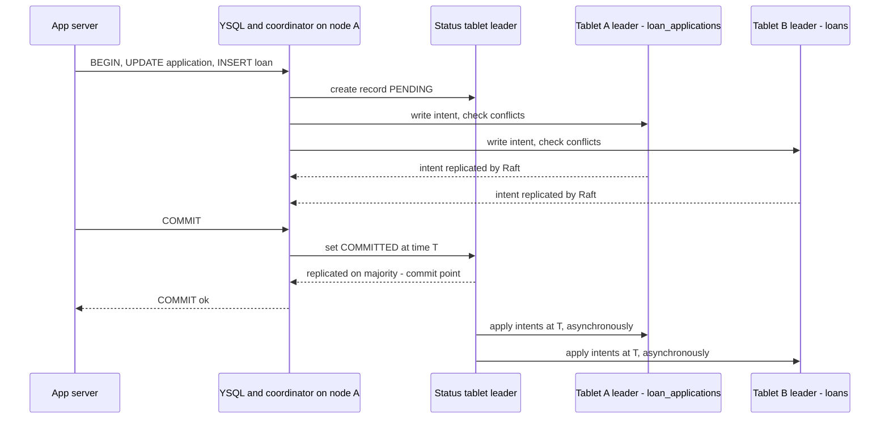

# Module 7.08: Distributed transactions in YugabyteDB

**Estimated hours:** 5

**What you will learn**

1. How a transaction that touches several tablets commits in DocDB: provisional (intent) records, the transaction status tablet, a single commit record, and asynchronous apply.
2. How conflicts are detected, how hybrid time and clock skew cause read restarts, and what YSQL's isolation levels and row locks really do.
3. The retry contract every client must honour (SQLSTATE `40001` and friends), built as a C++ retry loop over libpq with backoff and an idempotency key, and what it changes for the app server (C2) and stored procedures (C5).

**Prerequisites:** [Module 7.07: YugabyteDB architecture](module-07-yugabytedb-architecture.md). You also need transactions and ACID (module 6.04), isolation levels and locking (module 6.08), libpq from C++ (module 6.12) and hybrid logical clocks (module 7.03). The `yb` container must be running.

---

## 1. One-line intuition

A distributed transaction writes pencil marks on every tablet it touches, then flips one switch in one place from PENDING to COMMITTED; that single replicated write is the commit, and the pencil marks are inked in afterwards.

## 2. Real-life analogy

A clerk disburses a loan. Three ledgers in three different rooms must change: the application ledger (status becomes DISBURSED), the loan ledger (a new loan line), the audit ledger (a new audit line).

- The clerk first writes a slip at the **control desk**: "Slip 42: PENDING". That desk is the **transaction status tablet**.
- In each room the clerk adds a **sticky note** on the right line: "change pending, see slip 42". These are **provisional records**, also called **intents**. The ledgers themselves are not yet changed.
- When all three sticky notes are in place, the clerk walks back and stamps slip 42 **COMMITTED at 10:41:07**. At that instant the disbursement has happened, in all three rooms at once, even though no ledger has been inked yet.
- Later a runner goes round the rooms and turns each sticky note into a proper ink entry dated 10:41:07, then throws the notes away. That is **applying** the intents.
- Anyone reading a ledger who finds a sticky note looks up slip 42. COMMITTED before my reading time: count it. PENDING: ignore it, it has not happened yet. ABORTED: ignore it, it never will.
- If a second clerk wants to put a sticky note on a line that already has one from slip 42, that is a **conflict**: the second clerk either waits for slip 42 to finish or gives up and starts the whole job again later (a **retry**).
- Every room has its own wall clock, and they disagree by up to half a second. A reader who finds an ink entry stamped a moment after their own reading time cannot tell whether it really happened before or after they started reading. The safe move is to start the reading again with a later time: a **read restart**.

## 3. Why it exists: the problem it solves

Raft (module 7.05) makes one tablet's writes atomic and durable: a write is on a majority of that tablet's replicas or it did not happen. But a business operation almost never fits in one tablet. A loan disbursement updates a `loan_applications` row, inserts a `loans` row, inserts an `audit_log` row, and writes index entries for each. In a sharded table those keys live on different tablets, usually led by different nodes.

Without a cross-tablet protocol, a crash between the writes leaves half a disbursement: the application says DISBURSED, but no loan row exists, and money has left the bank with no loan on the books. The classic fix, **two-phase commit (2PC)**, has a known weakness: participants that have voted "prepared" must hold their locks until the coordinator tells them the outcome, and if the coordinator crashes they block, possibly for hours.

YugabyteDB's design keeps the idea of 2PC (provisional writes everywhere, then one decision) but removes the blocking: the decision is stored in a **status tablet** that is itself Raft-replicated, and the provisional writes are already durable on each participant's Raft log. If any node dies, another replica of the status tablet or participant takes over in seconds. On top of atomicity it also has to give **isolation** across machines whose clocks disagree, which is where hybrid time and read restarts come in.

## 4. Three layers of depth

### Layer 1 (beginner): the words and the two kinds of transaction

**Single-shard transaction (fast path).** A statement that touches rows in one tablet only, outside a multi-statement transaction block: for example `UPDATE loans SET status = 'CLOSED' WHERE loan_id = 9001` on a table with no secondary indexes. YSQL sends it as one Raft write to one tablet. No status tablet, no intents. This is the cheapest write YugabyteDB can do.

**Distributed transaction.** Anything that touches more than one tablet: a `BEGIN ... COMMIT` block with writes to two tables, a single insert into a table that has a secondary index (the index entry lives on another tablet), a foreign-key check plus a write. Colocated tables (module 7.07) share one tablet, so transactions that touch only them stay on the fast path.

**Provisional record (intent).** A not-yet-committed write, stored in the tablet's separate intents store and tagged with the transaction's ID. Intents double as locks: other transactions see them and detect conflicts.

**Transaction status tablet.** A tablet of the system table `system.transactions` that holds one record per transaction: PENDING, COMMITTED (with a commit time) or ABORTED. The tserver that coordinates the transaction is the **coordinator**; the tablets holding its intents are **participants**.

**Isolation levels in YSQL:**

| Level | What a transaction sees | Typical errors you handle |
|---|---|---|
| `READ COMMITTED` | A fresh snapshot for each statement | Few: YugabyteDB retries conflicts and read restarts per statement internally. In the 2024 releases this level must be enabled with `yb_enable_read_committed_isolation=true`; otherwise it behaves as `REPEATABLE READ` |
| `REPEATABLE READ` (snapshot isolation) | One snapshot for the whole transaction | `40001` when a row you write was changed by someone who committed after your snapshot; read restarts |
| `SERIALIZABLE` | As if transactions ran one at a time | More `40001`s and waits: reads also take locks, which prevents anomalies such as write skew |

**Row locks** work as in PostgreSQL (module 6.08): `SELECT ... FOR UPDATE`, `FOR NO KEY UPDATE`, `FOR SHARE`, `FOR KEY SHARE`. In DocDB they are intents with a lock strength, so they conflict across nodes exactly like writes do.

**The error you must retry.** SQLSTATE `40001` (`serialization_failure`). The message varies: "could not serialize access due to concurrent update", "Restart read required", or a YugabyteDB-specific text about a conflicting transaction. Code against the SQLSTATE, never the message.

### Layer 2 (working engineer): conflicts, retries and cost

**Conflict policies.** When a transaction tries to write (or lock) a key that another live transaction already holds an intent on, one of two policies applies:

- **Wait-on-Conflict.** The requester joins a wait queue on that key until the holder commits or aborts, like PostgreSQL's row locks. A distributed deadlock detector breaks cycles by aborting one transaction (`40P01`). Recent releases use this by default (flag `enable_wait_queues=true`).
- **Fail-on-Conflict.** Each transaction gets a random priority; the lower-priority one is aborted at once with `40001`, and that can be either party, even the one that wrote first. Older releases, and clusters with wait queues turned off, use this.

Check which one your container uses: search `enable_wait_queues` on <http://localhost:9000/varz>.

After the holder commits, a waiting `REPEATABLE READ` transaction that wanted to change the same row still fails with `40001`, exactly as in PostgreSQL, because the row changed after its snapshot. A `READ COMMITTED` transaction instead re-reads the row and carries on.

**The retry contract.** Treat this as part of the API of the database:

1. Retry the **whole transaction** from `BEGIN` on `40001` (serialization failure, conflict, read restart) and `40P01` (deadlock). Never retry only the failed statement.
2. Back off with **jitter** before retrying: sleep a random time up to an exponentially growing ceiling (for example up to 10, 20, 40 ms ... capped at 1 s). Without jitter, the same transactions collide again in lockstep.
3. **Cap attempts** and surface a clean error after the cap. An infinite loop under a hot row turns contention into an outage.
4. **Make the transaction idempotent.** If the connection drops while `COMMIT` is in flight (SQLSTATE class `08`), you cannot know whether it committed. Insert a unique request key in the same transaction; on retry, a unique violation (`23505`) on that key means "already done".
5. **Keep side effects out.** Do not send an SMS or call another service inside the transaction body; it would run again on each retry.
6. **Count retries.** A rising retry rate is the first sign of a hot row or a bad key design. Export it as a metric.

YSQL already retries some failures transparently, typically when the error occurs in the first statement of a transaction and no rows have been sent to the client yet. Your code must still handle everything else.

Errors outside `40001`/`40P01` need judgement. During a leader change you may see transient errors with other codes and messages such as "Try again" or "Leader not ready"; connection loss shows as class `08`. Retry those only through the idempotent path, and log them separately.

**Cost: fast path versus distributed.** A single-shard write is one Raft round on one tablet. A distributed transaction needs, at minimum: intent writes on every participant (in parallel, each a Raft round), a Raft write of the commit record on the status tablet, and later the apply on every participant. On one data centre that typically makes a small distributed transaction cost two to three times the latency of a single-shard write, more under contention. Design consequences:

- Do not add secondary indexes casually on write-hot tables: each one can turn a fast-path write into a distributed transaction.
- Put rows that change together in one tablet when the key design allows it (module 7.06), or colocate small tables.
- Keep transactions short. Every millisecond a transaction stays open is a millisecond its intents block or abort others.

### Layer 3 (internals): one commit, step by step

Take the disbursement: update `loan_applications` row 5003 (tablet A), insert `loans` row 9003 (tablet B), insert an `audit_log` row (tablet C).

1. **Start.** On the first write, the tserver serving this YSQL session picks a status tablet (preferably one led by a nearby node) and creates the transaction record: a transaction ID (a UUID), status PENDING. (The implementation works to keep this step off the critical path, for example by preparing records ahead of time.) The transaction also gets its **read time**, a hybrid time (module 7.03).
2. **Write intents.** Each write goes to the leader of its tablet as an intent, stored in that tablet's **intents RocksDB** (module 7.07): the key, the intent type (strong or weak, read or write), the transaction ID and the hybrid time, plus a reverse index from transaction ID to its keys for cleanup. Weak intents on the key's prefixes (for example on the whole row when one column changes) let operations at different granularities detect conflicts with each other. Each intent batch is replicated through the participant's Raft log, so it survives a node failure.
3. **Check conflicts.** Before accepting the intents, the participant looks for other transactions' intents on the same keys (conflict: wait or abort, per the policy) and, for snapshot and serializable isolation, committed versions of the same keys newer than this transaction's read time (conflict: `40001`).
4. **Stay alive.** While the transaction is open, its coordinator sends heartbeats to the status tablet. If the client process dies and heartbeats stop for a few seconds, the status tablet aborts the transaction, so its intents cannot block others forever.
5. **Commit.** `COMMIT` sends one request to the status tablet leader, which replicates "COMMITTED at hybrid time T" through its Raft group. When that write is on a majority, **the transaction is committed**. The client is told, and from this instant every reader with read time at or after T sees all three changes.
6. **Apply asynchronously.** The status tablet tells each participant to apply. Each participant rewrites its intents as ordinary versioned records at time T in the regular RocksDB (through Raft again) and deletes the intents. Then the status record can be removed.
7. **Readers in between.** A reader that meets an intent asks the status tablet (results are cached). COMMITTED at T and T is at or before the reader's read time: visible. PENDING: not visible; the status tablet also makes sure that, if this transaction commits later, its commit time lands after the reader's read time (hybrid clocks only move forward when they exchange timestamps, module 7.03), so the reader's answer stays correct. ABORTED: ignored and cleaned up.

**Why this does not block like 2PC.** The intents written in step 2 already play the role of 2PC's "prepared" votes, and they are durable on each participant's Raft log. The decision in step 5 is a single replicated write, not a round of votes. If the status tablet's leader dies, another replica of it has the same record within seconds. No participant waits for a coordinator that cannot come back.

**Clock skew and read restarts.** Every node's physical clock is within some maximum skew of the others, assumed to be at most `max_clock_skew_usec` (500,000 microseconds, half a second, by default). Suppose your transaction reads at hybrid time T on a tablet and finds a value committed at T + 200 ms. Was that write really after your read started? Not necessarily: the writer's node clock might simply run ahead. Anything committed in the **uncertainty window** (T, T + max skew] could have happened before your transaction began in real time. Ignoring it risks missing a write you should have seen; including it risks inconsistency with other reads. YugabyteDB picks safety: it **restarts the read** with a read time just after the conflicting value. If the transaction has not yet sent results to the client, YSQL does this invisibly. Otherwise the client gets `40001` ("Restart read required") and retries the transaction. You reduce read restarts by keeping clocks well synchronised (chrony or NTP on every node, so the real skew is far below the bound), avoiding long read-write transactions over hot rows, and using `READ COMMITTED`, which restarts per statement internally.

**Isolation underneath.** Snapshot isolation: reads at one read time; write-write conflicts on the same key abort the later committer (`40001`). Serializable: reads also write read intents, so a concurrent writer to a key you read conflicts with you; this is a lock-based scheme, not PostgreSQL's optimistic SSI, so you see waits and conflicts earlier, at read time. Read Committed: each statement gets a new read time, and conflicts on a statement are retried inside the database with a fresh snapshot.

## 5. Architecture diagram



The only synchronous steps after `COMMIT` are one Raft write on the status tablet. The apply happens after the client already has its answer.

## 6. Code

**Step 1: a small lending database.** Save as `txn_setup.sql`. It uses the canonical DDL from module 6.03 for the tables it needs, plus one new table, `idempotency_keys`.

```sql
-- txn_setup.sql: a small copy of the lending schema for module 7.08.
-- Run once:  psql -h localhost -p 5433 -U yugabyte -f txn_setup.sql
DROP DATABASE IF EXISTS lending_txn;
CREATE DATABASE lending_txn;
\c lending_txn

CREATE TABLE branches (
  branch_code  varchar(6) PRIMARY KEY,
  name         text NOT NULL,
  city         text NOT NULL,
  region       text NOT NULL,
  opened_on    date NOT NULL
);
CREATE TABLE customers (
  customer_id  bigint PRIMARY KEY,
  branch_code  varchar(6) NOT NULL REFERENCES branches,
  full_name    text NOT NULL,
  pan          char(10) NOT NULL UNIQUE,
  dob          date NOT NULL,
  kyc_status   text NOT NULL,
  created_at   timestamptz NOT NULL DEFAULT now()
);
CREATE TABLE products (
  product_code      varchar(8) PRIMARY KEY,
  name              text NOT NULL,
  min_amount_paise  bigint NOT NULL,
  max_amount_paise  bigint NOT NULL,
  max_tenure_months int NOT NULL,
  base_rate_bp      int NOT NULL,
  active            boolean NOT NULL DEFAULT true
);
CREATE TABLE loan_applications (
  application_id  bigint PRIMARY KEY,
  branch_code     varchar(6) NOT NULL REFERENCES branches,
  customer_id     bigint NOT NULL REFERENCES customers,
  product_code    varchar(8) NOT NULL REFERENCES products,
  amount_paise    bigint NOT NULL,
  tenure_months   int NOT NULL,
  status          text NOT NULL,
  created_by      varchar(10) NOT NULL,
  created_at      timestamptz NOT NULL DEFAULT now()
);
CREATE TABLE loans (
  loan_id           bigint PRIMARY KEY,
  application_id    bigint NOT NULL UNIQUE REFERENCES loan_applications,
  branch_code       varchar(6) NOT NULL REFERENCES branches,
  customer_id       bigint NOT NULL REFERENCES customers,
  product_code      varchar(8) NOT NULL REFERENCES products,
  principal_paise   bigint NOT NULL,
  outstanding_paise bigint NOT NULL,
  rate_bp           int NOT NULL,
  tenure_months     int NOT NULL,
  disbursed_at      timestamptz,
  status            text NOT NULL
);
CREATE TABLE repayments (
  repayment_id  bigint PRIMARY KEY,
  loan_id       bigint NOT NULL REFERENCES loans,
  due_date      date NOT NULL,
  amount_paise  bigint NOT NULL,
  paid_at       timestamptz,
  status        text NOT NULL
);
CREATE SEQUENCE repayment_id_seq;
-- New in this module: one row per client request, so a retried request
-- that already committed is recognised instead of applied twice.
CREATE TABLE idempotency_keys (
  request_key  text PRIMARY KEY,
  created_at   timestamptz NOT NULL DEFAULT now()
);

INSERT INTO branches VALUES
  ('MUM001', 'Mumbai Fort',   'Mumbai', 'WEST',  '1998-04-01'),
  ('DEL001', 'Delhi CP',      'Delhi',  'NORTH', '2001-07-15');
INSERT INTO products VALUES
  ('HL01', 'Home loan', 50000000, 1000000000, 360, 850, true);
INSERT INTO customers (customer_id, branch_code, full_name, pan, dob, kyc_status) VALUES
  (1001, 'MUM001', 'Asha Rao',   'ABCDE1234F', '1985-02-11', 'VERIFIED'),
  (1002, 'DEL001', 'Vikram Sen', 'PQRSX6789K', '1979-09-30', 'VERIFIED');
INSERT INTO loan_applications VALUES
  (5001, 'MUM001', 1001, 'HL01', 50000000, 240, 'DISBURSED', 'CLK01', now()),
  (5002, 'DEL001', 1002, 'HL01', 80000000, 240, 'DISBURSED', 'CLK07', now());
INSERT INTO loans VALUES
  (9001, 5001, 'MUM001', 1001, 'HL01', 50000000, 50000000, 850, 240, now(), 'ACTIVE'),
  (9002, 5002, 'DEL001', 1002, 'HL01', 80000000, 80000000, 850, 240, now(), 'ACTIVE');

SELECT loan_id, branch_code, outstanding_paise FROM loans ORDER BY loan_id;
```

```bash
psql -h localhost -p 5433 -U yugabyte -f txn_setup.sql
```

Expected last lines:

```text
 loan_id | branch_code | outstanding_paise
---------+-------------+-------------------
    9001 | MUM001      |          50000000
    9002 | DEL001      |          80000000
(2 rows)
```

**Step 2: watch a cross-tablet transaction and a conflict with two sessions.** Open two WSL terminals, A and B. In both:

```bash
psql -h localhost -p 5433 -U yugabyte -d lending_txn
```

and inside psql run `\set VERBOSITY verbose` so errors show their SQLSTATE.

Atomic visibility across tablets (the `loans` row and the new `repayments` row live in different tables, hence different tablets):

```sql
-- A
BEGIN;
UPDATE loans SET outstanding_paise = outstanding_paise - 500000 WHERE loan_id = 9001;
INSERT INTO repayments VALUES (nextval('repayment_id_seq'), 9001, current_date, 500000, now(), 'PAID');
-- B (autocommit): A's intents are invisible
SELECT outstanding_paise FROM loans WHERE loan_id = 9001;          -- 50000000
SELECT count(*) FROM repayments WHERE loan_id = 9001;              -- 0
-- A
COMMIT;
-- B: both changes appear together
SELECT outstanding_paise FROM loans WHERE loan_id = 9001;          -- 49500000
SELECT count(*) FROM repayments WHERE loan_id = 9001;              -- 1
```

A write-write conflict:

```sql
-- A
BEGIN ISOLATION LEVEL REPEATABLE READ;
UPDATE loans SET outstanding_paise = outstanding_paise - 100000 WHERE loan_id = 9001;
-- B
BEGIN ISOLATION LEVEL REPEATABLE READ;
UPDATE loans SET outstanding_paise = outstanding_paise - 200000 WHERE loan_id = 9001;
-- with Wait-on-Conflict, B now hangs. Switch to A:
-- A
COMMIT;
-- B returns an error. Then, in B:
ROLLBACK;
```

Expected with Wait-on-Conflict: B blocks until A commits, then fails with SQLSTATE `40001`, something like `ERROR:  40001: could not serialize access due to concurrent update`; the balance is 49,400,000. With Fail-on-Conflict: one of the two `UPDATE`s fails immediately with `40001`, and it may be A's. The session that got the error runs `ROLLBACK`, the other runs `COMMIT`, and the balance is 49,400,000 if A won or 49,300,000 if B won. Either way exactly one change is applied and nothing is lost or applied twice.

**Step 3: fast path versus distributed write.** Save as `inserts.sql`:

```sql
-- inserts.sql: 500 single-row INSERTs, each its own transaction (module 7.08).
-- Run: psql -h localhost -p 5433 -U yugabyte -d lending_txn -q -v tbl=t_fast -f inserts.sql
SELECT format('INSERT INTO %I VALUES (%s, %L)', :'tbl', g, 'note ' || g)
FROM generate_series(1, 500) AS g \gexec
```

`\gexec` runs every generated statement separately, so each insert is its own transaction. Create one table without and one with a secondary index, then time both:

```bash
C="-h localhost -p 5433 -U yugabyte -d lending_txn"
psql $C -c "CREATE TABLE t_fast (id bigint PRIMARY KEY, note text)" \
        -c "CREATE TABLE t_dist (id bigint PRIMARY KEY, note text)" \
        -c "CREATE INDEX t_dist_note ON t_dist (note)"
time psql $C -q -v tbl=t_fast -f inserts.sql
time psql $C -q -v tbl=t_dist -f inserts.sql
```

Expected: the `real` time for `t_dist` is clearly larger than for `t_fast`, because every insert into `t_dist` also writes an index entry on another tablet and so runs the full distributed protocol. Divide each by 500 for a per-transaction cost; the ratio is yours to record. (On PostgreSQL both take about the same, since the index is local; one laptop measured 0.9 s versus 1.3 s.)

**Step 4: the retry loop in C++.** This program runs several threads that each post repayments against the same loan. Each repayment is a three-table transaction: idempotency key, loan balance, repayment row. Save as `txn_retry.cpp`.

```cpp
// txn_retry.cpp
// Several threads post repayments against ONE loan at the same time.
// Each repayment is one transaction touching three tables
// (idempotency_keys, loans, repayments). On YugabyteDB those rows live in
// different tablets, so every repayment is a distributed transaction.
// Concurrent updates of the same loan row conflict; the database reports
// SQLSTATE 40001 and this program retries the WHOLE transaction with
// exponential backoff and jitter. An idempotency key makes a retry after an
// unknown COMMIT outcome safe.
//
// Build (one line):
//   g++ -std=c++17 -O2 -Wall -Wextra -Werror -g -pthread -I/usr/include/postgresql txn_retry.cpp -o txn_retry -lpq
// Run:   ./txn_retry "host=localhost port=5433 user=yugabyte dbname=lending_txn" 4 25
#include <libpq-fe.h>

#include <algorithm>
#include <atomic>
#include <chrono>
#include <cstdio>
#include <cstdlib>
#include <memory>
#include <random>
#include <string>
#include <thread>
#include <vector>

namespace {

// RAII owners for libpq handles (the module 2.03 idea applied to libpq).
struct ConnCloser  { void operator()(PGconn* c) const { PQfinish(c); } };
struct ResultFreer { void operator()(PGresult* r) const { PQclear(r); } };
using ConnPtr   = std::unique_ptr<PGconn, ConnCloser>;
using ResultPtr = std::unique_ptr<PGresult, ResultFreer>;

enum class Outcome { Ok, AlreadyApplied, Retryable, ConnectionLost, Fatal };

struct Step {
    Outcome     outcome;
    std::string sqlstate;
    std::string message;
};

// 40001 serialization_failure covers YugabyteDB conflicts and read restarts.
// 40P01 deadlock_detected is also safe to retry from the top.
bool retryable(const std::string& s) { return s == "40001" || s == "40P01"; }

Step exec(PGconn* conn, const char* sql, int n = 0, const char* const* params = nullptr) {
    ResultPtr res(PQexecParams(conn, sql, n, nullptr, params, nullptr, nullptr, 0));
    const ExecStatusType st = PQresultStatus(res.get());
    if (st == PGRES_COMMAND_OK || st == PGRES_TUPLES_OK) return {Outcome::Ok, "", ""};
    if (PQstatus(conn) != CONNECTION_OK) return {Outcome::ConnectionLost, "", PQerrorMessage(conn)};
    const char* f = PQresultErrorField(res.get(), PG_DIAG_SQLSTATE);
    const std::string state = f ? f : "";
    const std::string msg = PQresultErrorMessage(res.get());
    if (retryable(state)) return {Outcome::Retryable, state, msg};
    if (state.rfind("08", 0) == 0) return {Outcome::ConnectionLost, state, msg};  // connection class
    return {Outcome::Fatal, state, msg};
}

// One attempt of the business transaction. Returns Ok only after COMMIT succeeded.
Step post_repayment(PGconn* conn, const std::string& key, const std::string& loan_id,
                    const std::string& amount) {
    Step s = exec(conn, "BEGIN ISOLATION LEVEL REPEATABLE READ");
    if (s.outcome != Outcome::Ok) return s;

    const char* k[1] = {key.c_str()};
    s = exec(conn, "INSERT INTO idempotency_keys (request_key) VALUES ($1)", 1, k);
    if (s.outcome == Outcome::Fatal && s.sqlstate == "23505") {    // unique_violation
        exec(conn, "ROLLBACK");
        return {Outcome::AlreadyApplied, s.sqlstate, ""};           // an earlier attempt committed
    }
    const char* p[2] = {amount.c_str(), loan_id.c_str()};
    if (s.outcome == Outcome::Ok)
        s = exec(conn, "UPDATE loans SET outstanding_paise = outstanding_paise - $1::bigint "
                       "WHERE loan_id = $2::bigint AND outstanding_paise >= $1::bigint", 2, p);
    if (s.outcome == Outcome::Ok)
        s = exec(conn, "INSERT INTO repayments (repayment_id, loan_id, due_date, amount_paise, "
                       "paid_at, status) VALUES (nextval('repayment_id_seq'), $2::bigint, "
                       "current_date, $1::bigint, now(), 'PAID')", 2, p);
    if (s.outcome != Outcome::Ok) {
        if (s.outcome != Outcome::ConnectionLost) exec(conn, "ROLLBACK");
        return s;
    }
    return exec(conn, "COMMIT");   // the commit point; it can fail with 40001 too
}

struct Stats { int ok = 0, failed = 0, attempts = 0, retries = 0, reconnects = 0, already = 0; };

std::atomic<bool> printed_example{false};

void run_with_retry(PGconn* conn, const std::string& key, const std::string& loan_id,
                    const std::string& amount, std::mt19937& rng, Stats& st) {
    constexpr int kMaxAttempts = 20, kBaseMs = 5, kCapMs = 1000;
    for (int attempt = 1; attempt <= kMaxAttempts; ++attempt) {
        ++st.attempts;
        const Step s = post_repayment(conn, key, loan_id, amount);
        switch (s.outcome) {
        case Outcome::Ok:             ++st.ok; return;
        case Outcome::AlreadyApplied: ++st.ok; ++st.already; return;
        case Outcome::Fatal:
            std::fprintf(stderr, "fatal %s: %s", s.sqlstate.c_str(), s.message.c_str());
            ++st.failed;
            return;
        case Outcome::ConnectionLost:
            ++st.reconnects;
            PQreset(conn);            // reconnect; the idempotency key protects the retry
            break;
        case Outcome::Retryable:
            ++st.retries;
            if (!printed_example.exchange(true))
                std::printf("example retryable error: SQLSTATE %s %s", s.sqlstate.c_str(),
                            s.message.c_str());
            break;
        }
        // Exponential backoff with full jitter: random wait in [0, min(cap, base * 2^attempt)].
        const int ceiling = std::min(kCapMs, kBaseMs << std::min(attempt, 10));
        std::uniform_int_distribution<int> wait(0, ceiling);
        std::this_thread::sleep_for(std::chrono::milliseconds(wait(rng)));
    }
    ++st.failed;   // gave up: report it to the caller, never loop forever
}

long long query_number(PGconn* conn, const char* sql) {
    ResultPtr r(PQexec(conn, sql));
    if (PQresultStatus(r.get()) != PGRES_TUPLES_OK) {
        std::fprintf(stderr, "query failed: %s", PQerrorMessage(conn));
        std::exit(1);
    }
    return std::atoll(PQgetvalue(r.get(), 0, 0));
}

}  // namespace

int main(int argc, char** argv) {
    if (argc != 4) {
        std::fprintf(stderr, "usage: %s \"<conninfo>\" <threads> <repayments_per_thread>\n", argv[0]);
        return 2;
    }
    const std::string conninfo = argv[1];
    const int threads = std::atoi(argv[2]);
    const int per_thread = std::atoi(argv[3]);
    const std::string loan_id = "9001", amount = "10000";   // Rs 100.00 in paise

    ConnPtr main_conn(PQconnectdb(conninfo.c_str()));
    if (PQstatus(main_conn.get()) != CONNECTION_OK) {
        std::fprintf(stderr, "connect failed: %s", PQerrorMessage(main_conn.get()));
        return 1;
    }
    // A run id keeps idempotency keys unique across runs of this program.
    const long long run_id = query_number(main_conn.get(),
        "SELECT (extract(epoch FROM clock_timestamp()) * 1000)::bigint");
    const long long before = query_number(main_conn.get(),
        "SELECT outstanding_paise FROM loans WHERE loan_id = 9001");
    std::printf("threads=%d repayments_per_thread=%d amount_paise=%s\n", threads, per_thread,
                amount.c_str());
    std::printf("before: outstanding_paise=%lld\n", before);

    std::vector<Stats> stats(static_cast<size_t>(threads));
    std::vector<std::thread> pool;
    const auto t0 = std::chrono::steady_clock::now();
    for (int t = 0; t < threads; ++t) {
        pool.emplace_back([&, t] {
            Stats& my = stats[static_cast<size_t>(t)];
            ConnPtr conn(PQconnectdb(conninfo.c_str()));
            if (PQstatus(conn.get()) != CONNECTION_OK) { my.failed = per_thread; return; }
            std::mt19937 rng(static_cast<unsigned>(t * 7919 + 17));
            for (int i = 0; i < per_thread; ++i) {
                const std::string key = "run" + std::to_string(run_id) + "-t" +
                                        std::to_string(t) + "-r" + std::to_string(i);
                run_with_retry(conn.get(), key, loan_id, amount, rng, my);
            }
        });
    }
    for (auto& th : pool) th.join();
    const double secs = std::chrono::duration<double>(std::chrono::steady_clock::now() - t0).count();

    Stats total;
    for (int t = 0; t < threads; ++t) {
        const Stats& s = stats[static_cast<size_t>(t)];
        std::printf("thread %d: ok=%d failed=%d attempts=%d retries=%d reconnects=%d\n", t, s.ok,
                    s.failed, s.attempts, s.retries, s.reconnects);
        total.ok += s.ok;
        total.failed += s.failed;
        total.attempts += s.attempts;
        total.retries += s.retries;
    }
    const long long after = query_number(main_conn.get(),
        "SELECT outstanding_paise FROM loans WHERE loan_id = 9001");
    const long long expected = before - static_cast<long long>(total.ok) * std::atoll(amount.c_str());
    std::printf("after:  outstanding_paise=%lld committed=%d failed=%d\n", after, total.ok, total.failed);
    std::printf("total attempts=%d retries=%d elapsed=%.2fs\n", total.attempts, total.retries, secs);
    std::printf("expected outstanding_paise=%lld -> %s\n", expected,
                after == expected ? "CHECK PASSED" : "CHECK FAILED");
    return after == expected ? 0 : 1;
}
```

Build and run against YugabyteDB:

```bash
g++ -std=c++17 -O2 -Wall -Wextra -Werror -g -pthread -I/usr/include/postgresql txn_retry.cpp -o txn_retry -lpq
./txn_retry "host=localhost port=5433 user=yugabyte dbname=lending_txn" 4 25
```

For reference, here is a real run of the same binary against PostgreSQL 16 on one laptop, after running `txn_setup.sql` there (PostgreSQL's `REPEATABLE READ` raises the same `40001` on concurrent updates):

```text
threads=4 repayments_per_thread=25 amount_paise=10000
before: outstanding_paise=50000000
example retryable error: SQLSTATE 40001 ERROR:  could not serialize access due to concurrent update
thread 0: ok=25 failed=0 attempts=26 retries=1 reconnects=0
thread 1: ok=25 failed=0 attempts=32 retries=7 reconnects=0
thread 2: ok=25 failed=0 attempts=36 retries=11 reconnects=0
thread 3: ok=25 failed=0 attempts=33 retries=8 reconnects=0
after:  outstanding_paise=49000000 committed=100 failed=0
total attempts=127 retries=27 elapsed=2.15s
expected outstanding_paise=49000000 -> CHECK PASSED
```

On YugabyteDB expect the same shape: the `before` value is whatever Step 2 left (49,400,000 if you ran it), the example error message may be worded differently, the retry counts and elapsed time will differ (typically more retries and a longer run, since each attempt is a distributed transaction), and the last line must say `CHECK PASSED`. That line is the point: whatever the contention, every committed repayment is applied exactly once, and nothing is lost.

## 7. Use case: core-banking loan-origination platform

Moving the application server (claim H4, capstone C2) from PostgreSQL to YugabyteDB, the team's first load test produced a handful of failed loan requests per thousand with "could not serialize access" errors. On PostgreSQL at `READ COMMITTED` the same code had never seen `40001`, so the server had no retry logic at all, and the errors went straight to branch clerks.

**The decision: one retry contract for every write path.** Concretely:

- Every database transaction in the server runs through one wrapper, the shape of `run_with_retry` above: whole-transaction retry on `40001` and `40P01`, full-jitter exponential backoff, an attempt cap, and a metric for retries per minute with an alert threshold.
- Every write request carries an **idempotency key**: the client ID plus the RPC request ID that the tiny RPC layer of module 5.07 already puts in every frame. The key is inserted in the same transaction, so a retry after a dropped `COMMIT` is detected, not applied twice. Without this, a timed-out disbursement retried by the clerk could pay out twice.
- Nothing with side effects (SMS, calls to the credit bureau) runs inside a transaction. Those go to an outbox table written in the transaction and sent afterwards (module 10.04).
- Hot rows were removed: a per-branch "next application number" counter row, updated by every new application, was the top source of conflicts and was replaced by a sequence.

**What changed for the stored procedures (claim H6, capstone C5).** A `CALL` is one transaction, so a `40001` anywhere inside aborts the whole call, and the retry belongs in the client wrapper, not inside PL/pgSQL (catching the error inside the procedure does not help: the transaction's snapshot is already doomed). The procedure layer became more valuable, not less: each round trip saved is a millisecond-scale RPC on the cluster, and a shorter transaction holds its intents for less time, which means fewer conflicts.

## 8. Lab

You need the `yb` container and about 75 minutes. Work in `~/phase7/m08/` with the files from section 6.

### Part A: atomic visibility across tablets (15 minutes)

1. Run `txn_setup.sql`. Confirm the two loans.
2. Do the first two-session exercise from Step 2. Record what B saw before and after A's `COMMIT`.
3. Open <http://localhost:7000/tables>, find the system table named `transactions` (namespace `system`). Record how many tablets it has. These are the status tablets.
4. Find the `loans` and `repayments` tablets in the same UI and confirm they are different tablets.

Expected: B sees neither change before the commit and both after it. The `transactions` table has several tablets; `loans` and `repayments` each have their own.

### Part B: a conflict by hand, then a retry by hand (15 minutes)

1. Check `enable_wait_queues` on <http://localhost:9000/varz> and record it.
2. Do the conflict exercise from Step 2. Record the exact error line, including the SQLSTATE.
3. In B, after `ROLLBACK`, run the whole transaction again (`BEGIN ... UPDATE ... COMMIT`). That is a retry.
4. Check the balance: `SELECT outstanding_paise FROM loans WHERE loan_id = 9001;`

Expected: SQLSTATE `40001` on the losing side. After your manual retry, both repayments are applied: the balance is 300,000 paise lower than before the exercise.

### Part C: price of a distributed write (15 minutes)

1. Run Step 3. Record both `real` times.
2. Compute milliseconds per insert for each and the ratio.
3. Run `EXPLAIN (ANALYZE, DIST) INSERT INTO t_fast VALUES (100001, 'x');` and the same for `t_dist` with id 100001. Record the write and flush request counts.

Expected: `t_dist` is slower per insert; its `DIST` output shows more write activity (the index write). Write one sentence in your notes on which hot table in the lending schema you would not add an extra index to, and why.

### Part D: the retry loop under contention (30 minutes)

1. Build and run `txn_retry` with 4 threads and 25 repayments each, as in Step 4. Record retries, elapsed time, and the `CHECK` line.
2. Run again with 8 threads, then 16 threads. Record retries and elapsed time each time.
3. Change `kMaxAttempts` to 2, rebuild, and run with 16 threads. Record how many repayments failed, and confirm the `CHECK` line still passes.
4. Point the same binary at PostgreSQL (`"host=localhost port=5432 user=postgres password=postgres dbname=lending_txn"`, after running `txn_setup.sql` there with `psql -h localhost -U postgres -f txn_setup.sql`). Compare retries and elapsed time.

Expected: retries grow faster than the thread count, because every thread fights over one row; elapsed time grows too. With a cap of 2 attempts, some repayments fail cleanly, and the check still passes because only committed repayments changed the balance. Your numbers are the result; write them in a small table.

### Journal

Copy [journal/TEMPLATE.md](../journal/TEMPLATE.md) to `journal/YYYY-MM-DD-distributed-transactions.md`. Record: the conflict policy of your container; the exact `40001` message; the Part C per-insert numbers and ratio; the Part D table (threads, retries, elapsed, failures with cap 2, PostgreSQL comparison). Under "Decisions", explain in three sentences why the idempotency key is inserted in the same transaction as the business change and not before it.

## 9. Common mistakes and misconceptions

| Mistake | Why it is wrong | Bug it causes |
|---|---|---|
| No retry logic because "it never failed on PostgreSQL" | YugabyteDB returns `40001` in normal operation (conflicts, read restarts) | Random failed requests under load |
| Retrying only the failed statement | The transaction is already aborted; its snapshot is gone | Errors such as "current transaction is aborted", or silent partial work |
| Retrying without an idempotency key | A dropped connection during `COMMIT` hides whether it committed | Double repayments or double disbursements |
| Retry loops without jitter or a cap | Retries collide again in lockstep; hot rows never drain | Retry storms that turn contention into an outage |
| Matching on error message text | Messages differ across releases and conflict types | Missed retries after an upgrade |
| Side effects inside the transaction | They repeat on every retry | Duplicate SMS, duplicate bureau calls |
| Adding indexes freely on write-hot tables | Each index can turn a fast-path write into a distributed transaction | Higher write latency, more conflicts |
| Assuming `READ COMMITTED` is in effect | In 2024 releases it maps to snapshot isolation unless enabled | More `40001` than expected; different visibility |
| Long transactions holding intents | Intents block or abort others for as long as they exist | Conflict rates climbing with load |

## 10. Resume link

This module supports **claim E** ("distributed SQL") and **claim D** ("MVCC and transactions"), and directly defends **H4** (the app server against distributed SQL) and **H6** (stored procedures on a cluster).

How to say it: "On YugabyteDB a multi-row transaction writes provisional records on every tablet it touches and commits with one Raft write to a transaction status tablet, so there is no blocking 2PC prepare phase. The flip side is that serialization failures and read restarts are normal, so in the app server I put every transaction behind one retry wrapper: whole-transaction retry on 40001 and 40P01, jittered exponential backoff, an attempt cap, and an idempotency key built from the RPC request ID so a retry after a lost commit is never applied twice. In my lab, 16 threads hammering one loan produced N retries, and the balance check still matched to the paisa."

Likely follow-ups:

- "How is this different from two-phase commit?" Intents are durable on each participant's Raft log; the decision is one replicated write; no participant blocks on a dead coordinator.
- "What is a read restart?" Explain the uncertainty window and the 500 ms default bound.
- "What happens if the app crashes mid-transaction?" Heartbeats stop; the status tablet aborts it after a few seconds; intents are cleaned up.

## 11. Interview questions

**Q1 (easy). What is the difference between a single-shard and a distributed transaction in YugabyteDB?**

<details>
<summary>Model answer</summary>

A single-shard transaction touches keys in one tablet only, for example a single-row update by primary key on a table without secondary indexes. It is executed as one Raft write on that tablet, with no status record and no provisional writes. A distributed transaction touches several tablets, for example two tables, or one table plus its index. It writes provisional records on each participant tablet, records PENDING and then COMMITTED in a transaction status tablet, and applies the provisional records afterwards. It typically costs a few times the latency of a single-shard write.

</details>

**Q2 (easy). Which errors should an application retry when using YugabyteDB, and how?**

<details>
<summary>Model answer</summary>

SQLSTATE `40001` (serialization failure, including conflicts and read restarts) and `40P01` (deadlock). Roll back and rerun the whole transaction from `BEGIN`, with exponential backoff plus random jitter and a maximum number of attempts. Connection-class errors (`08xxx`) during commit are ambiguous, so the transaction must be idempotent, usually by inserting a unique request key in the same transaction, before it is safe to retry. Code on the SQLSTATE, not on message text.

</details>

**Q3 (medium). Walk through how YugabyteDB commits a transaction that updates rows on three tablets.**

<details>
<summary>Model answer</summary>

On the first write, the coordinator tserver creates a transaction record in a status tablet with status PENDING and picks a read hybrid time. Each write goes to its tablet leader as a provisional record in that tablet's intents store, tagged with the transaction ID; the participant checks for conflicting intents and for newer committed versions, then replicates the intents through its Raft log. On `COMMIT`, the coordinator asks the status tablet to change the record to COMMITTED with a commit hybrid time; once that write is replicated to a majority the transaction is committed and the client is answered. The status tablet then tells each participant to apply: provisional records are rewritten as regular versioned records at the commit time and the intents are removed. Readers that meet an intent before the apply consult the status tablet to decide visibility.

</details>

**Q4 (medium). What is a read restart, and how do you reduce them?**

<details>
<summary>Model answer</summary>

Node clocks are only synchronised within a bound, `max_clock_skew_usec`, 500 ms by default. When a read at hybrid time T finds a value committed at a time in (T, T + max skew], the database cannot tell whether that write happened before the read began in real time. To stay correct it restarts the read at a later time. If no results have reached the client yet, YSQL does it transparently; otherwise the client sees `40001` "Restart read required" and retries. To reduce them: keep real clock skew small with chrony or NTP, keep read-write transactions short, avoid long transactions that read hot, frequently updated rows, and use Read Committed where the business logic allows, because it restarts per statement inside the database.

</details>

**Q5 (hard). Why does YugabyteDB's commit protocol not suffer from the blocking problem of classic two-phase commit, and what does it cost instead?**

<details>
<summary>Model answer</summary>

Classic 2PC blocks because a participant that voted "prepared" must hold its locks until it learns the outcome, and the outcome lives only in the coordinator; if the coordinator crashes, participants wait. In YugabyteDB every piece of state is in a Raft group: provisional records are durable on each participant's Raft log, and the decision is a single write to a transaction status tablet that is itself replicated on three nodes. If the status tablet's leader dies, a follower with the same log becomes leader in seconds and the outcome is still known; if the client dies, missed heartbeats let the status tablet abort the transaction. The decision is also one write, not a voting round, because the intent writes already served as the prepare. The costs: every distributed transaction pays at least two Raft rounds on its critical path (intents, then commit) plus an asynchronous apply, intents act as locks so conflicts surface as `40001` or waits that clients must handle, readers sometimes need an extra status lookup, and correctness depends on a bounded clock skew, which shows up as read restarts.

</details>

## 12. Revision

- A distributed transaction writes intents (provisional records that also act as locks) on each tablet, commits with one Raft write of COMMITTED plus a hybrid time to a status tablet, and applies intents asynchronously; single-tablet writes skip all of it.
- Conflicts surface as waits or `40001`; clock skew within the 500 ms bound surfaces as read restarts; Read Committed (enabled by flag in 2024 releases) retries per statement internally.
- The client contract: retry the whole transaction on `40001`/`40P01` with jittered backoff and a cap, make it idempotent with a request key in the same transaction, and keep side effects and hot rows out.

---

Previous: [Module 7.07: YugabyteDB architecture](module-07-yugabytedb-architecture.md) | Next: [Module 7.09: High availability and failover on a 3-node cluster](module-09-ha-failover-3-node-cluster.md)
