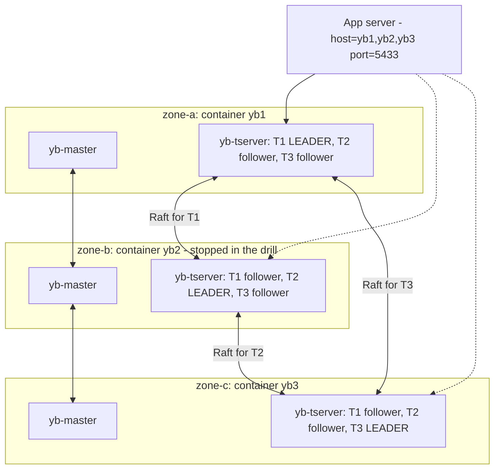
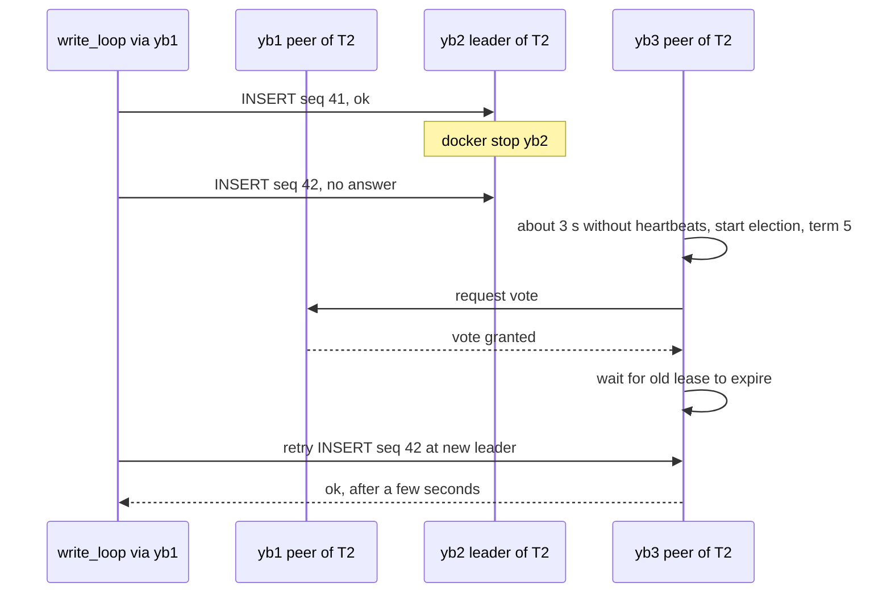

# Module 7.09: High availability and failover on a 3-node cluster

**Estimated hours:** 4

**What you will learn**

1. How to run a three-node YugabyteDB cluster with replication factor 3 in Docker Compose, check that it is healthy, and load the lending schema that capstones C3 and C4 use.
2. What happens when a node dies: per-tablet Raft re-election, leader leases, the failover gap you measure yourself with a one-write-per-second loop, and how the node catches up when it returns.
3. The replication-factor arithmetic (majority quorum, failures tolerated), why losing two of three nodes stops the cluster, and how zones turn this into a banking runbook.

**Prerequisites:** [Module 7.08: Distributed transactions in YugabyteDB](module-08-distributed-transactions-in-yugabytedb.md). You need Raft (module 7.05), quorums (module 7.04), CAP (module 7.01) and the architecture of module 7.07. **Docker must be allowed at least 8 GB of memory** for three nodes; 10 GB is more comfortable. A laptop with 16 GB of RAM is realistic; with 8 GB of RAM this lab will not run reliably.

---

## 1. One-line intuition

With three copies of every tablet and majority voting, any one node can die and the other two elect new leaders within seconds and carry on; lose two nodes and the last one refuses to act alone.

## 2. Real-life analogy

A bank's strong room follows **dual control**: three officers hold keys, and any two together can open the vault and sign the register. One of them, the duty chair, runs the paperwork.

- One officer falls ill. The other two notice that the chair has not checked in, wait a short agreed time, pick a new chair between them, and the vault opens again. Customers waited a few seconds; nothing was lost, because every entry had already been countersigned by two officers.
- The sick officer returns, reads the register entries made while they were away, and is back in the rotation. If they were away so long that the register was archived, they get a full photocopy instead.
- Two officers are ill. The one remaining officer must **not** open the vault alone. If they did, and the other two were in fact working at another door (a network split), the bank would have two different registers. Refusing to act is the safe choice. The vault stays shut until a second officer is back.
- Putting all three officers in the same building is pointless if the building floods. They must sit in three separate buildings.

## 3. Why it exists: the problem it solves

Servers fail. Disks die, kernels panic, power supplies burn, someone reboots the wrong machine during patching. A bank's loan system is expected to keep taking requests through all of that, and to never lose a committed disbursement.

With a single PostgreSQL primary (module 6.16), a server failure means an outage until a replica is promoted, and with asynchronous replication the last few committed transactions can be lost. Two numbers describe this:

- **RPO (recovery point objective):** how much committed data you may lose. A bank wants zero.
- **RTO (recovery time objective):** how long until service is back. A bank wants seconds, not a war room.

Replicating each tablet three ways with Raft gives RPO zero (a write is acknowledged only after a majority has it) and an RTO of a few seconds (followers elect a new leader automatically). It also makes planned work safe: you can patch and restart one node at a time without an outage.

What it does not give you: survival of two simultaneous failures with three copies, protection against bad data written by the application, or protection against a region-wide disaster. Those need RF 5, backups and parity checks, and cross-region replication respectively.

## 4. Three layers of depth

### Layer 1 (beginner): the cluster and how to look at it

**Docker Compose** starts several containers from one file, `docker-compose.yml`, on a private network where each container can reach the others by name. Module 9.05 explains Compose properly; here you need four commands: `docker compose up -d` (create and start), `docker compose ps` (status), `docker compose stop` (stop, keep data), `docker compose down` (delete containers and data).

The cluster has three containers, `yb1`, `yb2` and `yb3`. Each runs `yugabyted`, which starts a yb-master and a yb-tserver. `yb1` starts first; `yb2` and `yb3` start with `--join=yb1`. Each node is labelled with a different **zone** (`zone-a`, `zone-b`, `zone-c`) so that YugabyteDB places one copy of every tablet in each zone. Only `yb1` publishes ports to your laptop: 5433 (YSQL), 7000 (master UI), 9000 (yb1's tserver UI) and 15433 (console). The other two are reached with `docker exec`.

**Replication factor (RF)** is the number of copies of each tablet. With RF 3 and three nodes, every node holds one copy of every tablet, and each tablet has one leader somewhere.

Tools to check health:

| Tool | Command | Tells you |
|---|---|---|
| yugabyted | `docker exec yb1 bin/yugabyted status` | Node status, replication factor, UI addresses |
| SQL | `SELECT host, zone, node_type FROM yb_servers();` | The tservers that YSQL knows, with their zones |
| Master UI | <http://localhost:7000> and `/tablet-servers` | RF, masters, tservers ALIVE or DEAD, leaders per node |
| yb-admin | `list_all_masters`, `list_all_tablet_servers`, `list_tablets` | The same, from the command line |

### Layer 2 (working engineer): quorum arithmetic and the timings of failover

**The arithmetic.** Raft commits a write when a **majority** of the tablet's peers have it. A majority of RF peers is `floor(RF / 2) + 1`. The group survives as long as a majority is alive.

| RF | Majority | Node failures tolerated | Storage cost | A write waits for |
|---|---|---|---|---|
| 1 | 1 | 0 | 1x | the leader |
| 3 | 2 | 1 | 3x | the leader plus the faster of 2 followers |
| 5 | 3 | 2 | 5x | the leader plus the 2 fastest of 4 followers |
| 7 | 4 | 3 | 7x | the leader plus the 3 fastest of 6 followers |

To tolerate `f` failures you need `RF = 2f + 1`. An even RF buys nothing: RF 4 has a majority of 3 and still tolerates only one failure. A useful side effect of majorities: with RF 3, write latency depends on the faster of the two followers, so one slow node does not slow every write.

A worked example of why this matters. Suppose each node is independently down 0.1% of the time (about 9 hours a year). The cluster is unavailable only when two or more of three are down at once, which is about 3 x 0.001 x 0.001 = 0.000003, around 1.6 minutes a year. That assumes failures are independent. Three nodes in one rack on one power feed fail together, and the arithmetic collapses. That is why the copies go into separate **failure domains** (zones).

**What happens in the seconds after a node dies:**

| Time after the crash | What happens |
|---|---|
| 0 s | Tablets whose leader was on the dead node stop accepting writes. Tablets led elsewhere carry on: they have lost one follower but still have a majority |
| about 0.5 s per heartbeat | Followers expect a Raft heartbeat from their leader every 500 ms by default (`raft_heartbeat_interval_ms`) |
| about 3 s | After several missed heartbeats (6 by default, `leader_failure_max_missed_heartbeat_periods`), a follower starts an election, wins the other surviving peer's vote, and becomes leader in a new term |
| up to about 2 s more, overlapping | The new leader waits until the old leader's lease has certainly expired (module 7.07) before serving |
| next request | Tservers that still send requests to the dead node get errors or timeouts, refresh the leader location and retry internally |
| about 60 s | The master marks the dead tserver DEAD in its UI (`tserver_unresponsive_timeout_ms`, 60 s by default). This is reporting, not failover; failover already happened |
| 15 min | If the node is still down (`follower_unavailable_considered_failed_sec`, 900 s by default), the master considers its tablet copies lost and re-creates them on other nodes, if there are any. With exactly three nodes there is nowhere to put them, so tablets stay under-replicated until a node comes back or is added |

So the **failover gap** for the affected tablets is typically a few seconds. Many client statements during that window do not fail at all: YSQL and the tserver retry internally, so the client sees one slow statement. Some see an error or hit their statement timeout. You will measure both.

**Client connections.** A client connected to the node that died loses its connection (SQLSTATE class `08`) and must reconnect elsewhere. Give clients every node: libpq accepts `host=yb1,yb2,yb3 port=5433`, trying hosts in order, and libpq 16 adds `load_balance_hosts=random` to spread connections. YugabyteDB also publishes "smart" drivers for several languages that learn the node list from `yb_servers()` and balance across it. A client connected to a surviving node keeps its connection; its statements simply wait while affected tablets fail over.

**Ambiguous writes.** A write that reached the old leader but not yet a majority was never acknowledged. If it reached a majority, the new leader will commit it; if not, it is gone. The client that got an error cannot tell which. That is exactly the case the idempotency key of module 7.08 handles.

**Coming back.** When the node restarts within the retention window, each of its tablet peers asks its leader for the Raft log entries it missed and replays them. If the leader has already discarded those entries (logs are kept for at least `log_min_seconds_to_retain`, 900 s by default, and longer while a follower lags), the peer is rebuilt by **remote bootstrap**, a full copy of the tablet's files. Then the master's load balancer moves some leaders back so each node leads about a third of the tablets. That rebalancing takes from tens of seconds to minutes.

**Placement and zones in one paragraph.** Every node carries a placement label `cloud.region.zone`. The master places the RF copies of each tablet to spread them over as many distinct zones as possible, so with RF 3 across three zones, each zone holds exactly one copy and a whole zone (a server room, a data-centre hall, a cloud availability zone) can fail. `yugabyted configure data_placement --fault_tolerance=zone` sets this policy; you can also mark **preferred zones** for leaders to keep them near the application servers. Surviving a whole **region** needs either RF 3 across three regions (every write then pays an inter-region round trip) or asynchronous replication to a second cluster (xCluster), which has a non-zero RPO. Banks usually choose zone-level synchronous RF 3 plus asynchronous disaster recovery.

### Layer 3 (internals): one tablet's failover, step by step

Take tablet T2 of `heartbeat`, with peers on yb1, yb2 and yb3, and its leader on yb2 in Raft term 4.

1. **yb2 stops.** In-flight writes on yb2 that reached yb1 or yb3 (a majority with yb2 itself) are durable; those that reached only yb2 are not.
2. **Silence.** The followers on yb1 and yb3 stop receiving heartbeats. Each has an election timer with some randomisation, so they do not both start at once.
3. **Election.** The follower on yb3 times out first, moves to term 5, votes for itself and asks yb1 for a vote. yb1 grants it if yb3's log is at least as up to date as its own (the Raft safety rule from module 7.05). Two votes out of three: yb3 is leader for term 5.
4. **Lease wait.** yb2 may still believe it is leader until its lease runs out; it cannot know it has been replaced. So yb3 must not serve reads until yb2's last lease (up to 2 seconds after yb2 last heard from a majority) has certainly expired. After that wait, no two leaders can serve at once.
5. **No-op and catch-up.** The new leader appends an entry in its own term; committing it also commits any earlier entries that had reached a majority. Uncommitted entries that only yb2 had are lost; their writers never received an acknowledgement.
6. **Routing.** The tserver on yb1 that serves your YSQL connection still has "T2 leader = yb2" in its cache. Its next request to yb2 fails or times out, so it asks the other peers or the master, learns "T2 leader = yb3", and retries. Your `INSERT` returns late but succeeds.
7. **The master.** The masters are a Raft group too. If the master leader was on yb2, the other two elect a new master leader by the same rules. While that happens, DDL and new connections that need catalog reads pause, but reads and writes on existing connections keep working from cached locations.

**Two of three down.** Now stop yb3 as well. Every tablet has one live peer, on yb1. A follower on yb1 cannot win an election (one vote of three). A leader on yb1 cannot renew its lease (it needs a majority to acknowledge heartbeats), so within about 2 seconds it stops serving reads, and it never could commit writes alone. The master group has the same problem. All reads and writes stall until a second node returns. This is the "C" choice of CAP (module 7.01): during this partition the cluster chooses consistency over availability. A system that kept serving would risk two halves accepting conflicting writes.

## 5. Architecture diagram



When zone-b is stopped, T1 and T3 lose a follower and carry on; T2 elects a new leader on yb1 or yb3 within seconds.



## 6. Code

**Step 0: memory.** Docker Desktop with the WSL 2 backend takes its memory limit from WSL. In Windows, edit `C:\Users\<you>\.wslconfig` (module 0.05) so it contains:

```ini
[wsl2]
memory=10GB
```

Then run `wsl --shutdown` in PowerShell, start Docker Desktop again, and check from WSL:

```bash
docker info --format '{{.MemTotal}}'
```

Expected: a number of bytes of at least 8,000,000,000. If it is lower, the three nodes will be killed by the out-of-memory killer under load, and the lab results will be nonsense.

**Step 1: the Compose project.** Stop the single-node container, which uses the same host ports: `docker stop yb`. Create a folder `~/yblab` with two files. First `.env`, which pins the image version so all three nodes match (module 0.05 explained why):

```bash
# .env: copy the exact tag of a stable release from hub.docker.com/r/yugabytedb/yugabyte/tags
# Tags look like <version>-b<build>, for example 2025.1.x.y-bNNN.
YB_TAG=PUT-THE-EXACT-TAG-HERE
```

Then `docker-compose.yml`:

```yaml
# docker-compose.yml: a 3-node YugabyteDB cluster (RF=3) for Phase 7 and capstone C4.
# Needs Docker with at least 8 GB of memory (WSL 2 backend: memory= in .wslconfig).
# Stop the single-node container first (docker stop yb): it uses the same host ports.
# Up: docker compose up -d   Stop: docker compose stop   Delete everything: docker compose down
name: yblab

x-yb-node: &yb-node
  image: yugabytedb/yugabyte:${YB_TAG:?set YB_TAG in the .env file next to this one}
  restart: "no"                 # we stop nodes on purpose; do not let Docker revive them
  healthcheck:                  # healthy = YSQL on this node answers a query
    test: ["CMD-SHELL", "bin/ysqlsh -h $$HOSTNAME -U yugabyte -d yugabyte -c 'SELECT 1' >/dev/null 2>&1"]
    interval: 5s
    timeout: 5s
    retries: 60
    start_period: 30s

services:
  yb1:
    <<: *yb-node
    container_name: yb1
    hostname: yb1
    command: >
      bin/yugabyted start --background=false
      --advertise_address=yb1
      --cloud_location=lab.region1.zone-a
      --fault_tolerance=zone
    ports:
      - "5433:5433"     # YSQL (only yb1 is reachable from Windows/WSL)
      - "7000:7000"     # yb-master web UI
      - "9000:9000"     # yb-tserver web UI of yb1
      - "15433:15433"   # yugabyted web console

  yb2:
    <<: *yb-node
    container_name: yb2
    hostname: yb2
    command: >
      bin/yugabyted start --background=false
      --advertise_address=yb2 --join=yb1
      --cloud_location=lab.region1.zone-b
      --fault_tolerance=zone
    depends_on:
      yb1:
        condition: service_healthy

  yb3:
    <<: *yb-node
    container_name: yb3
    hostname: yb3
    command: >
      bin/yugabyted start --background=false
      --advertise_address=yb3 --join=yb1
      --cloud_location=lab.region1.zone-c
      --fault_tolerance=zone
    depends_on:
      yb2:
        condition: service_healthy
```

Points worth reading slowly: the `x-yb-node` block is a YAML anchor that the three services merge with `<<: *yb-node`, so the image and health check are written once; `$$HOSTNAME` is Compose's escape for a literal `$HOSTNAME`, which the container's shell expands to `yb1`, `yb2` or `yb3`; `--advertise_address` uses the hostname so a restarted container keeps its identity even if Docker gives it a new IP address; `depends_on` with `service_healthy` makes `yb2` wait until `yb1` answers SQL, and `yb3` wait for `yb2`.

**Step 2: bring it up and set the placement policy.**

```bash
cd ~/yblab
docker compose up -d
docker compose ps                     # repeat until all three show "healthy" (1 to 3 minutes)
docker exec yb1 bin/yugabyted configure data_placement --fault_tolerance=zone
docker exec yb1 bin/yugabyted status
```

Expected: `docker compose ps` lists `yb1`, `yb2`, `yb3`, each `Up ... (healthy)`. The `configure` command reports success; the status output shows the cluster running with **Replication Factor 3**. Open <http://localhost:7000>: it should show replication factor 3, three masters and three tservers. If it still shows RF 1, set the placement directly with yb-admin and check again:

```bash
docker exec yb1 bin/yb-admin -master_addresses yb1:7100,yb2:7100,yb3:7100 \
  modify_placement_info lab.region1.zone-a,lab.region1.zone-b,lab.region1.zone-c 3
```

**Step 3: check it from SQL and yb-admin.** Make a shell alias for yb-admin (add it to `~/.bashrc` if you like):

```bash
alias yba='docker exec yb1 bin/yb-admin -master_addresses yb1:7100,yb2:7100,yb3:7100'
yba list_all_masters
yba list_all_tablet_servers
psql -h localhost -p 5433 -U yugabyte -c "SELECT host, port, node_type, cloud, region, zone FROM yb_servers() ORDER BY host;"
```

Expected: three masters, one with role LEADER and two FOLLOWER; three tservers, all ALIVE; and three rows from `yb_servers()`, one per zone. Record which node is the master leader.

**Step 4: the lending schema.** Save as `lending_cluster.sql`. It is the canonical DDL from module 6.03, with the decisions of modules 7.06 and 7.07 applied where they do not change the canonical keys: master tables colocated, transactional tables in their own tablets (3 each, so each node can lead one), and the H7 covering index on `users`. It keeps the canonical primary keys, so capstones C3 and C4 share one target; the branch-first `loans` key of module 7.06 is a variant you can measure in C4.

```sql
-- lending_cluster.sql: the lending schema on the 3-node cluster (module 7.09).
-- This database is the target for capstones C3 and C4. Canonical DDL from module 6.03;
-- small master tables share one colocated tablet, big tables get their own tablets.
-- Run: psql -h localhost -p 5433 -U yugabyte -f lending_cluster.sql
DROP DATABASE IF EXISTS lending;
CREATE DATABASE lending WITH COLOCATION = true;
\c lending

-- Master tables: colocated (the database default).
CREATE TABLE branches (
  branch_code  varchar(6) PRIMARY KEY,
  name         text NOT NULL,
  city         text NOT NULL,
  region       text NOT NULL,
  opened_on    date NOT NULL
);
CREATE TABLE roles (
  role_id      smallint PRIMARY KEY,
  role_name    text NOT NULL UNIQUE
);
CREATE TABLE users (
  branch_code   varchar(6) NOT NULL REFERENCES branches,
  user_code     varchar(10) NOT NULL,
  full_name     text NOT NULL,
  password_hash text NOT NULL,
  role_id       smallint NOT NULL REFERENCES roles,
  status        char(1) NOT NULL DEFAULT 'A',
  last_login_at timestamptz,
  PRIMARY KEY (branch_code, user_code)
);
CREATE INDEX users_user_code_idx ON users (user_code)
  INCLUDE (branch_code, full_name, password_hash, status, role_id);   -- the H7 fix, module 7.07
CREATE TABLE products (
  product_code      varchar(8) PRIMARY KEY,
  name              text NOT NULL,
  min_amount_paise  bigint NOT NULL,
  max_amount_paise  bigint NOT NULL,
  max_tenure_months int NOT NULL,
  base_rate_bp      int NOT NULL,
  active            boolean NOT NULL DEFAULT true
);

-- Transactional tables: not colocated, hash sharded, 3 tablets each (one leader per node).
CREATE TABLE customers (
  customer_id  bigint PRIMARY KEY,
  branch_code  varchar(6) NOT NULL REFERENCES branches,
  full_name    text NOT NULL,
  pan          char(10) NOT NULL UNIQUE,
  dob          date NOT NULL,
  kyc_status   text NOT NULL,
  created_at   timestamptz NOT NULL DEFAULT now()
) WITH (COLOCATION = false) SPLIT INTO 3 TABLETS;
CREATE TABLE loan_applications (
  application_id  bigint PRIMARY KEY,
  branch_code     varchar(6) NOT NULL REFERENCES branches,
  customer_id     bigint NOT NULL REFERENCES customers,
  product_code    varchar(8) NOT NULL REFERENCES products,
  amount_paise    bigint NOT NULL,
  tenure_months   int NOT NULL,
  status          text NOT NULL,
  created_by      varchar(10) NOT NULL,
  created_at      timestamptz NOT NULL DEFAULT now()
) WITH (COLOCATION = false) SPLIT INTO 3 TABLETS;
CREATE TABLE loans (
  loan_id           bigint PRIMARY KEY,
  application_id    bigint NOT NULL UNIQUE REFERENCES loan_applications,
  branch_code       varchar(6) NOT NULL REFERENCES branches,
  customer_id       bigint NOT NULL REFERENCES customers,
  product_code      varchar(8) NOT NULL REFERENCES products,
  principal_paise   bigint NOT NULL,
  outstanding_paise bigint NOT NULL,
  rate_bp           int NOT NULL,
  tenure_months     int NOT NULL,
  disbursed_at      timestamptz,
  status            text NOT NULL
) WITH (COLOCATION = false) SPLIT INTO 3 TABLETS;
CREATE TABLE repayments (
  repayment_id  bigint PRIMARY KEY,
  loan_id       bigint NOT NULL REFERENCES loans,
  due_date      date NOT NULL,
  amount_paise  bigint NOT NULL,
  paid_at       timestamptz,
  status        text NOT NULL
) WITH (COLOCATION = false) SPLIT INTO 3 TABLETS;
CREATE TABLE audit_log (
  audit_id     bigserial PRIMARY KEY,
  at           timestamptz NOT NULL DEFAULT now(),
  branch_code  varchar(6),
  user_code    varchar(10),
  action       text NOT NULL,
  entity       text NOT NULL,
  entity_id    bigint,
  detail       jsonb
) WITH (COLOCATION = false) SPLIT INTO 3 TABLETS;
-- Lab-only table for the failover drill.
CREATE TABLE heartbeat (
  seq          int PRIMARY KEY,
  written_at   timestamptz NOT NULL
) WITH (COLOCATION = false) SPLIT INTO 3 TABLETS;

-- Seed data: 20 branches, 4 roles, 400 users, 2 products, 2,000 customers,
-- 2,000 applications and 2,000 loans (loan_id 100001 .. 102000).
INSERT INTO branches
SELECT 'BR' || lpad(g::text, 4, '0'), 'Branch ' || g,
       (ARRAY['Mumbai','Delhi','Bengaluru','Chennai','Kolkata'])[1 + g % 5],
       (ARRAY['WEST','NORTH','SOUTH','SOUTH','EAST'])[1 + g % 5],
       date '1995-01-01' + g * 30
FROM generate_series(1, 20) AS g;
INSERT INTO roles VALUES (1, 'CLERK'), (2, 'CREDIT_OFFICER'), (3, 'BRANCH_MANAGER'), (4, 'AUDITOR');
INSERT INTO users (branch_code, user_code, full_name, password_hash, role_id)
SELECT 'BR' || lpad(b::text, 4, '0'), 'U' || lpad(b::text, 4, '0') || '_' || u,
       'User ' || b || '-' || u, md5(b || ':' || u), 1 + u % 4
FROM generate_series(1, 20) AS b, generate_series(1, 20) AS u;
INSERT INTO products VALUES
  ('HL01', 'Home loan',      50000000, 1000000000, 360,  850, true),
  ('PL01', 'Personal loan',   5000000,  250000000,  60, 1150, true);
INSERT INTO customers (customer_id, branch_code, full_name, pan, dob, kyc_status)
SELECT 300000 + g, 'BR' || lpad((1 + g % 20)::text, 4, '0'), 'Customer ' || g,
       'AB' || lpad(g::text, 7, '0') || 'Z', date '1970-01-01' + g, 'VERIFIED'
FROM generate_series(1, 2000) AS g;
INSERT INTO loan_applications (application_id, branch_code, customer_id, product_code,
                               amount_paise, tenure_months, status, created_by)
SELECT 200000 + g, 'BR' || lpad((1 + g % 20)::text, 4, '0'), 300000 + g,
       CASE WHEN g % 3 = 0 THEN 'HL01' ELSE 'PL01' END,
       (100000 + (g * 7919) % 900000) * 100, 12 * (1 + g % 20), 'DISBURSED', 'U0001_1'
FROM generate_series(1, 2000) AS g;
INSERT INTO loans
SELECT 100000 + g, 200000 + g, 'BR' || lpad((1 + g % 20)::text, 4, '0'), 300000 + g,
       CASE WHEN g % 3 = 0 THEN 'HL01' ELSE 'PL01' END,
       (100000 + (g * 7919) % 900000) * 100, (100000 + (g * 7919) % 900000) * 100,
       850 + (g % 4) * 25, 12 * (1 + g % 20),
       timestamptz '2025-04-01 10:00:00+05:30' + g * interval '37 minutes',
       CASE WHEN g % 40 = 0 THEN 'NPA' ELSE 'ACTIVE' END
FROM generate_series(1, 2000) AS g;
ANALYZE;

SELECT (SELECT count(*) FROM branches) AS branches, (SELECT count(*) FROM users) AS users,
       (SELECT count(*) FROM customers) AS customers, (SELECT count(*) FROM loans) AS loans,
       (SELECT sum(outstanding_paise) FROM loans) AS book_paise;
```

```bash
psql -h localhost -p 5433 -U yugabyte -f lending_cluster.sql
```

Expected last lines (exact; the seed is deterministic, and PostgreSQL 16 gives the same numbers for the same data):

```text
 branches | users | customers | loans |  book_paise
----------+-------+-----------+-------+--------------
       20 |   400 |      2000 |  2000 | 108791900000
(1 row)
```

Write `108791900000` in your notes. It is the loan book total in paise, and the first parity number you will compare after every failure in this module.

**Step 5: see where the leaders are.**

```bash
yba list_tablets ysql.lending heartbeat
yba list_tablets ysql.lending loans
```

Expected: three tablets for each table, each line with a tablet ID, its hash range and its leader's address. Typically the load balancer has given each node one leader per table, but that is not guaranteed; record the actual leader of each tablet.

**Step 6: the failover probe.** Save as `write_loop.sh` and `chmod +x write_loop.sh`. It inserts one row per second through `yb1`, printing each write's latency and result. A new `psql` per write includes connection setup in the latency, so the baseline is tens to a few hundred milliseconds; what matters is the change during failover.

```bash
#!/usr/bin/env bash
# write_loop.sh: one INSERT per second into the cluster, printing latency and status.
# Usage: ./write_loop.sh | tee write_loop.log      (Ctrl+C to stop)
set -u
export PGHOST=localhost PGPORT=5433 PGUSER=yugabyte PGDATABASE=lending PGCONNECT_TIMEOUT=5

seq_no=$(psql -qtA -c "SELECT coalesce(max(seq), 0) FROM heartbeat" 2>/dev/null)
seq_no=${seq_no:-0}

while true; do
  seq_no=$((seq_no + 1))
  start_ns=$(date +%s%N)
  # stderr is captured into err; normal output is thrown away.
  if err=$(psql -qtA -v ON_ERROR_STOP=1 \
             -c "SET statement_timeout = '20s'" \
             -c "INSERT INTO heartbeat (seq, written_at) VALUES ($seq_no, now())" 2>&1 >/dev/null); then
    status="OK"
  else
    status="FAIL ${err//$'\n'/ }"
  fi
  end_ns=$(date +%s%N)
  printf '%s seq=%-5d %6d ms  %s\n' "$(date +%H:%M:%S)" "$seq_no" \
         $(( (end_ns - start_ns) / 1000000 )) "${status:0:110}"
  sleep 1
done
```

After a drill, two checks turn the log into numbers. The first lists the slow or failed writes (the gap). The second proves that every write reported OK is really in the table, and shows writes that reported FAIL but committed anyway (ambiguous outcomes):

```bash
awk '$3 > 2000 || $5 != "OK"' write_loop.log    # the gap; set 2000 to about 3x your healthy latency
grep ' OK' write_loop.log | sed -E 's/.*seq=([0-9]+).*/\1/' | sort > ok_seqs.txt
psql -h localhost -p 5433 -U yugabyte -d lending -qtA -c "SELECT seq FROM heartbeat" | sort > db_seqs.txt
echo "acknowledged but missing: $(comm -23 ok_seqs.txt db_seqs.txt | wc -l)"   # must be 0
echo "in table but not reported OK: $(comm -13 ok_seqs.txt db_seqs.txt | wc -l)"
```

## 7. Use case: core-banking loan-origination platform

The lending platform's YugabyteDB cluster had to meet two targets written in the operations agreement: no loss of an acknowledged transaction (RPO zero), and no branch-visible outage longer than a short retry window when one server fails.

**The decision: RF 3 across three failure domains, with every client given all three nodes.** Concretely: three nodes in three separate server rooms, each on its own power and network switch, labelled as three zones, with `--fault_tolerance=zone` so each room holds one copy of every tablet; the application server's connection string listing all three nodes; and the 7.08 retry wrapper absorbing the few seconds of leader elections. RF 5 was costed and rejected for the first phase: two more servers and higher write latency, to survive a second simultaneous failure that the bank's change process could prevent by never doing maintenance while the cluster was degraded.

That last condition became the core of the **"one node died" runbook**:

1. **Confirm.** The alert says a tserver stopped heartbeating. Check <http://localhost:7000/tablet-servers> (production: the master UI or monitoring) and `yb-admin list_all_tablet_servers`. Note the time.
2. **Check impact.** Application error rate and p99 latency should show a blip of seconds, then normal. If errors continue, the problem is not this node; escalate.
3. **Confirm failover.** `yb-admin list_tablets` for the main tables shows no leader on the dead node. `list_all_masters` shows a master leader on a live node.
4. **Freeze.** The cluster is now one failure away from an outage. No rolling restarts, no patching, no DDL, no other node work until full redundancy is back. Announce it.
5. **Restore within the window.** Bring the node back within about 15 minutes so its tablets catch up from Raft logs instead of being rebuilt. If it cannot come back, add a replacement node (`--join`), let the load balancer re-replicate onto it, then remove the dead node from the cluster configuration, following the documented node-replacement procedure for your release.
6. **Verify.** All tservers ALIVE, every tablet with three peers, leaders rebalanced (`get_is_load_balancer_idle` reports idle), and the parity numbers (row counts and `sum(outstanding_paise)` of key tables) unchanged.
7. **Record.** Timeline, measured gap, any client errors, and the root cause, in the RCA format of module 8.09.

This cluster, with this schema, is the target of capstone C4: the parity suite and the cutover rehearsal of module 7.10 run against it, and the failover drill below is one of C4's acceptance tests.

## 8. Lab

You need the cluster from section 6 and about 75 minutes. Use two WSL terminals: terminal 1 runs `write_loop.sh`; terminal 2 runs everything else. Keep the master UI open in your browser.

### Part A: bring-up and baseline (20 minutes)

1. Do Steps 0 to 5 of section 6. Record: total Docker memory, YugabyteDB version, RF, master leader, the three zones from `yb_servers()`, and the leader of each `heartbeat` and `loans` tablet.
2. Run `docker stats --no-stream` and record the memory used by each of `yb1`, `yb2`, `yb3`.
3. In terminal 1, start `./write_loop.sh | tee write_loop.log` and let it run for 30 seconds. Record the typical latency of a healthy write.

Expected: all three nodes healthy, RF 3, `book_paise` = 108791900000, each node typically between 1 and 2.5 GB, all writes OK with stable latency.

### Part B: kill one node, measure the gap (20 minutes)

1. Pick the node to kill: `yb2`, unless `yb2` is not the leader of any `heartbeat` tablet; in that case pick a node that is. Never pick `yb1` here, because it carries your client's connection and the published ports.
2. With the loop still running, in terminal 2 run `date +%T; docker stop yb2` and note the time.
3. Watch terminal 1 for a minute. Then run `yba list_tablets ysql.lending heartbeat` and `yba list_all_masters`.
4. Refresh <http://localhost:7000/tablet-servers> every few seconds until yb2 shows as DEAD. Note how long that took.
5. Check the data while one node is down:

```bash
psql -h localhost -p 5433 -U yugabyte -d lending -c "SELECT count(*), sum(outstanding_paise) FROM loans;"
```

6. Stop the loop with Ctrl+C and run the two checks from Step 6 of section 6.
7. Optional, harsher: `docker start yb2`, wait until it is ALIVE and leaders have rebalanced (Part C shows how to check), then repeat steps 2 to 6 with `docker kill yb2`, which sends SIGKILL with no shutdown at all, like a power cut. Compare the two gaps.

Expected: a short run of slow writes (several seconds each) and possibly a few FAIL lines, starting within a second or two of the stop; then normal latency again. The gap is typically a few seconds, and it is your number to record: first slow or failed write, last one, and the longest single write. The tablets that yb2 led now have leaders on yb1 or yb3; the master UI reports yb2 DEAD only after about a minute, long after failover finished. The `loans` query returns 2000 and 108791900000. "Acknowledged but missing" must be 0. "In table but not reported OK" may be 0 or a small number: those are writes that committed even though the client saw an error, the ambiguous case of module 7.08.

### Part C: bring it back and watch it catch up (15 minutes)

1. Restart the loop (`./write_loop.sh | tee -a write_loop.log`), then run `docker start yb2`.
2. Watch the tablet-servers page until yb2 is ALIVE again. Record the time from `docker start` to ALIVE.
3. Every 30 seconds for three minutes, run `yba list_tablets ysql.lending heartbeat` and `yba get_is_load_balancer_idle`.
4. Check the per-node leader counts on the tablet-servers page.

Expected: yb2 rejoins within a minute or so; the loop is not disturbed by the rejoin. Over the following minutes the load balancer hands some leaders back to yb2, until each node again leads about a third of the tablets and the balancer reports idle. Exact timings vary; record yours.

### Part D: lose the majority (20 minutes)

1. With the loop running, stop two nodes: `docker stop yb2 yb3`. Note the time.
2. Watch terminal 1 for 60 seconds. In terminal 2, try a read: `psql -h localhost -p 5433 -U yugabyte -d lending -c "SET statement_timeout = '10s'" -c "SELECT count(*) FROM loans;"`.
3. Restart them: `docker start yb2 yb3`. Record how long until writes are OK again.
4. Stop the loop and run the two checks again.
5. Fill in this table from Layer 2 and your observations, then answer: with RF 5 on five nodes, which of your Part B and Part D experiments would have kept running?

| Nodes down (RF 3) | Majority left? | Reads | Writes | What you saw |
|---|---|---|---|---|
| 0 | yes | | | |
| 1 | yes | | | |
| 2 | no | | | |

Expected: with two nodes down, writes hang until the statement timeout and fail; the read also fails or times out; nothing is served. Once a second node is back, a majority exists again, leaders are elected, and writes resume after a few seconds. "Acknowledged but missing" is still 0: the cluster stopped rather than lose or fork data. With RF 5, both the one-node and the two-node failures would have been survivable.

When you are done for the day, `docker compose stop` (keeps data). `docker compose down` deletes the cluster; you would then repeat Steps 2 to 4 to rebuild it.

### Journal

Copy [journal/TEMPLATE.md](../journal/TEMPLATE.md) to `journal/YYYY-MM-DD-ha-failover-3-node.md`. Record: memory per node; baseline write latency; the Part B gap (first and last affected write, longest write, number of FAILs); "acknowledged but missing" and "in table but not reported OK" counts; time to DEAD in the UI; time to ALIVE and to a balanced, idle load balancer in Part C; what happened in Part D and the time to recover. Under "Decisions", write your own five-line version of the "one node died" runbook. This entry is the evidence for your HA interview answers.

## 9. Common mistakes and misconceptions

| Mistake | Why it is wrong | Consequence |
|---|---|---|
| Running three nodes with less than 8 GB for Docker | Each node needs 1 to 2.5 GB at idle, more under load | Containers killed by the OOM killer; failover "results" that are really memory crashes |
| Thinking RF 3 survives two failures | A majority of 3 is 2 | An outage during maintenance on a degraded cluster |
| Choosing RF 4 "for extra safety" | Majority of 4 is 3; it still tolerates one failure | 33% more storage and slower writes for nothing |
| Three replicas in one rack, room or zone | Failures are correlated | One power or switch failure takes out the majority |
| Waiting for the master UI to say DEAD before acting | DEAD appears after about 60 s; failover took seconds | Misreading timelines in an incident report |
| Giving the application only one node's address | That node's death breaks every connection | A full application outage while the database is fine |
| Doing other maintenance while a node is down | The cluster is one failure from losing quorum | A small incident becomes a total outage |
| Assuming an error means "not committed" | A write may reach a majority before the client times out | Duplicates on retry unless requests are idempotent |
| Letting Docker auto-restart nodes in a failover lab | The node returns before you can observe anything | Confusing results; this Compose file sets `restart: "no"` |

## 10. Resume link

This module is the hands-on proof for **claim E** ("replication, Raft consensus, high availability") and part of **H3** ("gating a zero-downtime cutover to a multi-node cluster"). Capstone C4 runs on this cluster.

How to say it: "Our YugabyteDB cluster ran RF 3 across three failure domains, so any one node could fail with no data loss. I rehearsed it on a three-node Docker cluster: I ran a one-write-per-second probe, stopped a node holding tablet leaders, and measured a gap of N seconds while Raft elected new leaders and the old leases expired. Every acknowledged write was present afterwards, and a couple of writes that reported errors had actually committed, which is why our requests carried idempotency keys. With two of three nodes down the cluster stopped serving, as it should: it chose consistency."

Follow-ups to prepare:

- "Why did failover take that long?" Missed heartbeats (6 x 500 ms) plus the lease wait, plus client-side retry; name the flags.
- "What happens after 15 minutes?" Re-replication if spare nodes exist; with three nodes, it stays under-replicated.
- "Why not RF 5?" Cost and write latency against a second-failure risk managed by process; say when you would choose RF 5.

## 11. Interview questions

**Q1 (easy). How many node failures can a cluster with replication factor 3 tolerate, and why?**

<details>
<summary>Model answer</summary>

One. Raft needs a majority of a tablet's peers, 2 of 3, to elect a leader and commit writes. With one node down every tablet still has two peers, a majority. With two down, every tablet has one peer, which cannot form a majority, so the cluster stops serving rather than risk inconsistency. In general, tolerating f failures needs RF = 2f + 1.

</details>

**Q2 (easy). What do RPO and RTO mean, and what values does a Raft-replicated database give for a single node failure?**

<details>
<summary>Model answer</summary>

RPO, recovery point objective, is the maximum committed data you may lose; RTO, recovery time objective, is how long service may be down. A write in a Raft-replicated database is acknowledged only after a majority has it, so losing one node loses no acknowledged write: RPO zero. Leaders on the failed node are replaced by elections within a few seconds, so RTO for the affected tablets is seconds, and tablets led elsewhere are not interrupted at all.

</details>

**Q3 (medium). Walk through what happens in the first few seconds after the node leading a tablet crashes.**

<details>
<summary>Model answer</summary>

Writes to that tablet stall. The followers miss the leader's heartbeats, which arrive every 500 ms by default; after about six missed heartbeats, roughly 3 seconds, one follower starts an election in a new term and wins the other survivor's vote, since its log is up to date. Before serving, the new leader waits until the old leader's lease, 2 seconds by default, has certainly expired, so two leaders never serve at once. It commits a no-op in its term, which also commits earlier entries that had reached a majority; entries only the dead leader had are lost, and their writers were never acknowledged. Tservers that send requests to the dead node get errors, look up the new leader and retry, so many client statements just take a few seconds longer. The master marks the node DEAD about a minute later, and after 15 minutes it would re-replicate the node's tablets elsewhere if spare nodes existed.

</details>

**Q4 (medium). Why does YugabyteDB refuse all reads when two of three nodes are down? Would it not be better to serve possibly stale data?**

<details>
<summary>Model answer</summary>

The single surviving node cannot know whether the other two are dead or merely cut off by a network partition and still serving clients as a majority. If it kept accepting writes, the two sides could diverge; if it kept serving reads as the leader, it could return data that the majority has already changed, breaking linearizability. Its lease cannot be renewed without a majority, so it stops. That is the consistency choice in CAP terms. For a bank, a short, visible outage is better than two divergent balances. If a use case can accept staleness, it should be designed for it explicitly, for example with follower reads or an asynchronous read replica, not by weakening the primary path during a partition.

</details>

**Q5 (hard). Design the deployment and the operational runbook for a three-node YugabyteDB cluster behind a bank's loan platform, and say what would make you move to RF 5.**

<details>
<summary>Model answer</summary>

Three nodes in three independent failure domains (separate rooms or availability zones with separate power and network), labelled as zones with zone-level fault tolerance so each zone holds one copy of every tablet, and preferred leader zones near the application servers if latency differs. Application servers get all three nodes in their connection strings or use a cluster-aware driver, pool connections, and wrap transactions in a retry layer with idempotency keys so leader elections are absorbed. Monitoring covers tserver and master liveness, under-replicated tablets, leader balance, clock skew, and p99 latency. The runbook for one node down: confirm, check that impact was a blip, verify leaders moved, freeze all maintenance and DDL because the cluster is one failure from losing quorum, restore the node within the log-retention window so it catches up from logs, or add a replacement and remove the dead node, then verify replication, balance and parity numbers, and write an RCA. Rolling upgrades are done one node at a time only when all three are healthy. I would move to RF 5 if the business could not accept an outage from two overlapping failures, for example if maintenance windows routinely overlap with hardware failures, if the deployment spans regions where a whole site can disappear, or if regulatory targets require surviving a site loss while another node is under maintenance; the costs are two more nodes per cluster and somewhat higher write latency, since a write then waits for three of five copies.

</details>

## 12. Revision

- RF 3 means a majority of 2: one node can fail with no data loss (RPO zero) and leaders re-elect in seconds (heartbeats every 500 ms, about 3 s to elect, 2 s lease); two failures stop the cluster by design.
- The failover gap is per tablet and short; clients survive it with multi-host connection strings and the retry-plus-idempotency contract; the master's DEAD mark (about 60 s) and re-replication (15 min) are slower, separate events.
- Put the three copies in three failure domains, never do maintenance on a degraded cluster, and verify recovery with counts and sums; this cluster is capstone C4's target.

---

Previous: [Module 7.08: Distributed transactions in YugabyteDB](module-08-distributed-transactions-in-yugabytedb.md) | Next: [Module 7.10: Migration strategies](module-10-migration-strategies.md)
