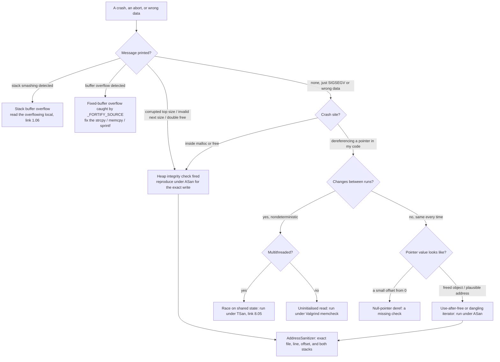

# Module 8.06: Memory corruption patterns

**Estimated hours:** 5

**What you will learn**

1. The main families of memory-corruption bug in C and C++ (heap overflow, stack overflow, use-after-free, double free, uninitialised read, dangling iterator, type confusion, integer-overflow allocation, and a race that corrupts a free list), and the exact banking server mistake that causes each.
2. How each bug looks three ways: with no tools at `-O2` (often "it works" or a crash far from the cause), under AddressSanitizer or Valgrind (the exact line), and inside a core dump in GDB (tcache metadata and corrupted chunk headers).
3. A triage method that goes from a symptom to the right tool in one step, so you never guess; this catalogue is where capstone C6's three incidents come from.

**Prerequisites:** [Module 8.05: How ASan, TSan and UBSan work](module-05-how-asan-tsan-ubsan-work.md). You should also have module 1.08 (malloc/free, double free, use-after-free), 3.05 (malloc internals, chunk headers, tcache), 2.07 (STL container internals), 4.02 (data races) and 8.01-8.02 (GDB and core dumps) in mind. All code is verified on Ubuntu 24.04 in WSL2 with gcc 13.3 and glibc 2.39.

---

## 1. One-line intuition

Memory corruption is a program writing (or reading) a byte that does not belong to the object it thinks it is touching; the write usually succeeds silently, and the crash comes later, somewhere else, which is why you need a tool that catches the moment of the bad access, not the moment of the crash.

## 2. Real-life analogy

A bank's back office has rows of numbered pigeonholes, one per customer file. Corruption is a clerk who writes one line too many on a form and the pen goes through onto the next customer's file underneath. Nothing looks wrong immediately. The clerk finishes, files everything, goes home.

An hour later a different clerk opens that next file, reads the smudged number, and pays the wrong amount. The error is discovered at the second desk, but it was *caused* at the first. If you only investigate the second desk you will never find the real culprit. You need either a camera that recorded the first clerk's pen going over the edge (that is AddressSanitizer or Valgrind: it catches the exact over-write) or a very careful reading of the smudges to work backwards (that is a core dump in GDB).

Every bug in this module is a version of "the pen went over the edge" or "the clerk read a file that had already been shredded and reused".

## 3. Why it exists: the problem it solves

C and C++ give you raw memory with no automatic bounds checks and no automatic lifetime tracking. That is the source of their speed and the source of this entire class of bug. The language will happily let you:

- write past the end of an array or heap block (there is no check),
- use a pointer after the thing it points to was freed (the pointer still holds the old address),
- free the same block twice,
- read memory you never wrote,
- keep an iterator or pointer into a container after the container moved its storage.

None of these are caught by the compiler in general, because proving them absent is impossible at compile time. So the industry built runtime tools (ASan, Valgrind, TSan, UBSan from modules 8.04-8.05) and hardening in the C library (glibc heap integrity checks, stack canaries, `_FORTIFY_SOURCE`). This module is the catalogue that connects a *symptom you see in production* to *which bug it is* and *which tool pins it down*. Without this catalogue you stare at a crash in `free()` or a wrong loan amount and have no idea where to start. With it, you recognise the shape in seconds. That recognition is most of what claim F ("memory corruption and leak investigation") and claim H5 ("crash-dump debugging with formal RCA") are really asking for.

## 4. Three layers of depth

### Layer 1 (beginner): the vocabulary

- **Heap.** Memory from `malloc`/`new`, laid out as *chunks* (module 3.05). Each chunk has an 8- or 16-byte header just before the bytes you use; the next chunk's header sits just after your bytes.
- **Stack.** Memory for local variables and return addresses, one *frame* per function call (module 1.04). A **stack canary** is a secret value the compiler puts just before the saved return address; if an overflow changes it, the program aborts with `*** stack smashing detected ***`.
- **Overflow (out of bounds).** Writing or reading outside the block you were given. A **buffer overflow** on the heap smashes the next chunk's header; on the stack it smashes the canary or the return address.
- **Use-after-free (UAF).** Using memory through a pointer after it was freed. The bytes are now owned by something else (or hold the allocator's own bookkeeping).
- **Double free.** Calling `free` twice on the same pointer. The second free corrupts the allocator's free list.
- **Uninitialised read.** Reading a variable or struct member before anything was written to it. The value is whatever garbage was left there.
- **Dangling pointer / iterator.** A pointer or iterator that used to be valid but now points at freed or moved memory. A special, very common case is an iterator or pointer into a `std::vector` after the vector reallocated.
- **Type confusion.** Treating bytes as a type they are not, usually via `reinterpret_cast` or a bad `union`, so field offsets and sizes are wrong.
- **Redzone, shadow memory, quarantine, poisoned, tcache key.** ASan terms from module 8.05: redzones are poisoned guard bytes around each block; shadow memory records which bytes are valid; quarantine holds freed blocks so a UAF is caught; the tcache key is a value glibc writes into a freed small block to detect double frees.

### Layer 2 (working engineer): the catalogue at a glance

Memorise this table. The left column is what you see; the right columns are what it almost always is and how to confirm it. Section 6 shows each one running.

| Symptom you see | Likely bug | Fastest confirming tool | glibc / OS message if any |
|---|---|---|---|
| Crash or abort inside `malloc` or `free`, far from your code | heap overflow (wrote past a block) or double free | ASan (exact write), else GDB on the core | `malloc(): corrupted top size`, `free(): invalid next size`, `free(): double free detected in tcache 2`, `munmap_chunk(): invalid pointer` |
| `*** stack smashing detected ***` then abort | stack buffer overflow | ASan or `-fstack-protector` already told you; read the frame | `*** stack smashing detected ***` |
| `*** buffer overflow detected ***` then abort | overflow of a fixed-size buffer the compiler could see | already caught by `_FORTIFY_SOURCE`; fix the `strcpy`/`memcpy` | `*** buffer overflow detected ***` |
| Reads old/garbage data; crash dereferencing a plausible-looking pointer | use-after-free | ASan (`heap-use-after-free`), Valgrind (`Invalid read`) | usually none |
| Branch-dependent wrong behaviour that changes between runs | uninitialised read | Valgrind (`uninitialised value`), MSan | usually none |
| Crash iterating a container right after it grew | dangling iterator after reallocation | ASan (`heap-use-after-free` on the old buffer) | usually none |
| Fields read as nonsense after a cast | type confusion | code review; UBSan `-fsanitize=vptr` for polymorphic types | usually none |
| A `malloc` far smaller than intended, then a huge write | integer overflow in a size calculation | UBSan `-fsanitize=unsigned-integer-overflow` finds the wrap; ASan finds the write | often `SIGSEGV` |
| Intermittent crash or lost data under threads | race corrupting a shared structure (e.g. a free list) | TSan | usually none |

Three rules that save hours:

1. **The crash site is not the bug site.** A heap overflow is detected by glibc during a *later* `malloc`/`free`, when it tries to use the header you smashed. The real write could be anywhere earlier. Never trust the backtrace of the abort to point at the cause.
2. **"It works at `-O2`" means nothing.** A one-byte overflow often lands in the chunk's rounding padding and does no visible harm until the layout changes (a new field, a new compiler, more load). Reproduce under ASan to see whether memory is actually being violated.
3. **One tool per question.** "Did I touch memory I should not?" -> ASan or Valgrind memcheck. "Did I read something I never wrote?" -> Valgrind or MSan. "Is this corruption from two threads?" -> TSan. Running the right one first is the whole skill.

### Layer 3 (internals): why each one corrupts what it corrupts

- **Heap overflow.** Chunks are laid out back to back. Your bytes are immediately followed by the next chunk's `size` field (8 bytes) and, if that chunk is free, its forward/backward pointers. Writing past your block's end overwrites that `size` first. glibc stores sizes rounded to a multiple of 16, and uses the low 3 bits of `size` as flags (`PREV_INUSE`, `IS_MMAPPED`, `NON_MAIN_ARENA`). When a later allocation walks the heap and reads your smashed `size`, it computes a garbage address for the following chunk and its integrity check fires: `corrupted top size` if you hit the top (wilderness) chunk, `invalid next size` if you hit a normal one.
- **Use-after-free and double free.** When you `free` a small block, glibc pushes it onto the per-thread **tcache** list. To do that it writes a `next` pointer into the first 8 bytes of your old data, and (since glibc 2.29) a **tcache key** into the next 8 bytes so double frees can be detected. So the first 16 bytes of a just-freed small block no longer hold your data: they hold allocator bookkeeping. That is why a UAF read returns a pointer-looking number where your first field used to be, and why `free`ing twice is caught: the second free sees the key already present and aborts with `double free detected in tcache 2`.
- **Stack overflow (buffer, not recursion).** The compiler lays out a frame as: locals, then the stack canary, then the saved frame pointer, then the saved return address. Overflowing a local array upward overwrites the canary first. On return, the function compares the canary to the secret; mismatch means abort before the (possibly attacker-controlled) return address is used. This is why a stack overflow usually shows as `stack smashing detected` at the `ret`, not at the write.
- **Uninitialised read.** The bytes hold whatever the last owner left. On the stack that is a previous call's locals; on the heap it is a previous allocation's data or freed-chunk pointers. The value is deterministic per run but not across runs, which is why "works on my machine, fails in prod" is the classic signature.
- **Dangling iterator.** `std::vector` stores elements in one contiguous heap buffer. When it grows past capacity it allocates a bigger buffer, moves the elements, and frees the old one. Any pointer or iterator you kept now points into the freed old buffer: a textbook use-after-free that ASan reports on the *old* allocation.
- **Integer overflow allocation.** `count * size` in 32-bit unsigned math wraps modulo 2^32. `0x40000001 * 16` is `0x400000010` which truncates to `0x10` = 16. You ask for 16 bytes, get 16 bytes, then write a billion records into it. The allocation "succeeds"; the write runs off the heap.

## 5. Architecture diagram

A triage flowchart: from the symptom in front of you to the tool that pins the bug.



The whole point: you should reach the correct tool from the first screen of output, not by trial and error.

## 6. Code: the pattern catalogue

Each subsection is a 20-40 line program, the symptom without tools, and the report from the tool that finds it. All outputs below are real runs on Ubuntu 24.04, gcc 13.3, glibc 2.39, in WSL2; addresses and the tcache key vary per run and are marked. Build commands are given once and reused.

Standard builds used below:

```bash
# plain release, the way it ships
gcc -std=gnu17 -O2 -g -o prog prog.c
# AddressSanitizer build (ASan), link 8.05
gcc -std=gnu17 -O1 -g -fsanitize=address -fno-omit-frame-pointer -o prog.asan prog.c
# Valgrind needs no special build; run on the plain -O0/-O2 binary
valgrind -q ./prog
```

### 6.1 Heap overflow: off-by-one on a packed record

Root cause in a server: a loop that fills a packed 19-byte loan record (module 1.07) runs `i <= 19` instead of `i < 19`, writing one byte past the block. Or a `strcpy` into a fixed field that is one char too small.

```c
/* heap_oob.c - off-by-one writing a packed 19-byte loan record.
 * The buffer is 19 bytes; the loop runs i = 0..19 (one too far). */
#include <stdio.h>
#include <stdlib.h>
int main(void) {
    int n = 19;                              /* 19-byte packed loan record */
    unsigned char *rec = malloc(n);
    for (int i = 0; i <= n; ++i)             /* BUG: should be i < n */
        rec[i] = (unsigned char)(i * 7);
    unsigned sum = 0;
    for (int i = 0; i < n; ++i) sum += rec[i];
    printf("checksum=%u\n", sum);            /* forces the writes to happen */
    free(rec);
    return 0;
}
```

Symptom at `-O2`, no tools: it "works".

```text
$ gcc -std=gnu17 -O2 -g -o heap_oob heap_oob.c && ./heap_oob
checksum=1197
$ echo $?
0
```

The 20th byte landed in the chunk's rounding padding (a 19-byte request becomes a 32-byte chunk, module 3.05), so nothing visibly broke. This is exactly why a one-byte bug can live in production for months and then crash the day someone adds a field.

Valgrind catches the write immediately:

```text
$ valgrind -q ./heap_oob
==3009== Invalid write of size 1
==3009==    at 0x1090C0: main (heap_oob.c:9)
==3009==  Address 0x4a7a053 is 0 bytes after a block of size 19 alloc'd
==3009==    at 0x4846828: malloc (vg_replace_malloc.c)
==3009==    by 0x1090AE: main (heap_oob.c:7)
checksum=1197
```

AddressSanitizer is even sharper, giving the offset and both stacks:

```text
$ ./heap_oob.asan
==3018==ERROR: AddressSanitizer: heap-buffer-overflow on address 0x503000000053 ...
WRITE of size 1 at 0x503000000053 thread T0
    #0 ... in main heap_oob.c:9
0x503000000053 is located 0 bytes after 19-byte region [0x503000000040,0x503000000053)
allocated by thread T0 here:
    #0 ... in malloc
    #1 ... in main heap_oob.c:7
SUMMARY: AddressSanitizer: heap-buffer-overflow heap_oob.c:9 in main
```

Read it as: the write at line 9 is "0 bytes after" a 19-byte region allocated at line 7. That is the off-by-one, located exactly.

The `strcpy` variant is the one you will meet most. A fixed field and a name that is too long:

```c
/* heap_overflow.c - copy a branch name into a fixed 8-byte field. */
#include <stdio.h>
#include <stdlib.h>
#include <string.h>
struct branch_rec { char code[8]; long loans_open; };
int main(int argc, char **argv) {
    const char *name = argc > 1 ? argv[1] : "MUM001";
    struct branch_rec *r = malloc(sizeof *r);
    r->loans_open = 42;
    strcpy(r->code, name);                   /* BUG: no length check */
    printf("code=%s loans_open=%ld\n", r->code, r->loans_open);
    free(r);
    return 0;
}
```

At `-O2` on Ubuntu this `strcpy` is caught at run time by `_FORTIFY_SOURCE` (enabled automatically at `-O1` and above when the compiler can see the destination size), which aborts cleanly:

```text
$ ./heap_overflow MUMBAI-ANDHERI-EAST
*** buffer overflow detected ***: terminated
Aborted (core dumped)
```

That message (`buffer overflow detected`) is the fortify check, and it is your friend: it fired at the `strcpy`, at the real site. Contrast it with the raw heap smash in 6.6, which fires later inside `malloc`.

### 6.2 Heap overflow that reaches the top chunk: `corrupted top size`

When the overflowing block is the last one on the heap, the bytes after it are the **top chunk** (the free wilderness). Smashing its `size` field is not caught until the next `malloc` tries to carve from the top.

```c
/* topsize.c - overflow the LAST heap block into the top chunk header. */
#include <stdio.h>
#include <string.h>
#include <stdlib.h>
int main(void) {
    char *a = malloc(64);           /* last block before the top chunk */
    memset(a, 'A', 128);            /* 64 bytes over: smashes top size */
    char *b = malloc(64);           /* glibc walks a corrupted top here */
    printf("%p %p\n", (void*)a, (void*)b);
    free(a);
    return 0;
}
```

What the core dump shows in GDB. The abort happens inside the *second* `malloc`, not at the `memset`:

```text
$ gcc -std=gnu17 -O0 -g -D_FORTIFY_SOURCE=0 -o topsize topsize.c
$ gdb -q -batch -ex run -ex bt ./topsize
malloc(): corrupted top size

Program received signal SIGABRT, Aborted.
#4  __GI_abort ()
#5  __libc_message_impl (fmt=0x... "%s\n")
#6  malloc_printerr (str=0x... "malloc(): corrupted top size")
#7  _int_malloc (av=0x... <main_arena>, bytes=64)
#8  __GI___libc_malloc (bytes=<optimized out>)
#9  0x0000... in main () at topsize.c:8
```

The lesson, said out loud in an interview: "`corrupted top size` is an integrity check firing inside `malloc` at `topsize.c:8`, but the corruption was caused by the `memset` at line 6. The abort location is where it was *detected*, not *caused*. To find the cause I reproduce under ASan, which reports the out-of-bounds write at the exact offending line." (This mirrors module 3.05's treatment of the same abort.)

### 6.3 Stack smashing: overflowing a fixed on-stack buffer

```c
/* stacksmash.c - overflow a fixed stack buffer; the canary catches it. */
#include <stdio.h>
#include <string.h>
static void load_branch(const char *name) {
    char code[8];              /* on-stack buffer; canary sits just after */
    strcpy(code, name);        /* BUG: no bound */
    printf("branch %s\n", code);
}
int main(int argc, char **argv) {
    load_branch(argc > 1 ? argv[1] : "MUM001");
    return 0;
}
```

Built so the stack canary (not fortify) fires, a long argument aborts at the function's return:

```text
$ gcc -std=gnu17 -O2 -g -D_FORTIFY_SOURCE=0 -fstack-protector-strong -o ss stacksmash.c
$ ./ss "MUMBAI-ANDHERI-EAST-0001"
*** stack smashing detected ***: terminated
Aborted (core dumped)
```

In a core dump this shows as `__stack_chk_fail` on the stack just below `__fortify_fail`/`abort`. The fix is always a bounded copy: `snprintf(code, sizeof code, "%s", name)` or `std::string`. Stack canaries are covered in depth in module 11.02.

### 6.4 Use-after-free: the pooled-connection bug

This is the single most important pattern for the app server (claim H4) and for capstone C6. A connection object is freed (the client disconnected, or the request finished) while a worker thread still holds a pointer to it. The classic version: the request pool recycles a slot while a slow worker is still writing to it.

```c
/* gdb_uaf.c - freed connection; inspect the bytes under GDB. */
#include <stdio.h>
#include <stdlib.h>
#include <string.h>
struct conn { long fd; char user[24]; };
int main(void) {
    struct conn *c = malloc(sizeof *c);   /* 32-byte chunk */
    c->fd = 7;
    strcpy(c->user, "clerk01-mumbai");
    printf("before free: fd=%ld user=%s\n", c->fd, c->user);
    free(c);                              /* connection closed; chunk -> tcache */
    printf("after free:  fd=%ld user=%s\n", c->fd, c->user);  /* UAF read */
    return 0;
}
```

Under ASan the read after free is reported precisely, with the free stack and the allocation stack:

```text
$ ./gdb_uaf.asan
==2215==ERROR: AddressSanitizer: heap-use-after-free on address 0x503000000040 ...
READ of size 4 at 0x503000000040 thread T0
    #0 ... in main gdb_uaf.c:... (the read after free)
0x503000000040 is located 0 bytes inside of 20-byte region
freed by thread T0 here:
    #0 ... in free
    #1 ... in main gdb_uaf.c:12
previously allocated by thread T0 here:
    #0 ... in malloc
    #1 ... in main gdb_uaf.c:9
SUMMARY: AddressSanitizer: heap-use-after-free ... in main
```

What the core dump shows in GDB, and why this is worth seeing once with your own eyes. Stop just after the `free` and dump the first four 8-byte words of the freed block:

```text
(gdb) x/4gx c
0x5555555592a0: 0x0000000555555559  0x2c9de72251a23b07
0x5555555592b0: 0x00006961626d756d  0x0000000000000000
(gdb) print c->fd
$1 = 22906492249
```

Before the free, `c->fd` was 7. After the free it reads `22906492249` (that is `0x555555559`, a pointer). The first 8 bytes of the freed chunk now hold the **tcache `next` pointer** (safe-linking mangled), and the second 8 bytes hold the **tcache key** (`0x2c9de72251a23b07`, random per run). Only the third word still reads `0x00006961626d756d` = the ASCII `"mumbai"` tail of your string, because tcache only overwrote the first 16 bytes. So the signature of a UAF in a dump is: *allocator metadata (a pointer and a random key) where your first fields used to be, with the tail of your old data still readable.* When you see `x/4gx` show a pointer-looking value and a high-entropy key at the start of a struct, you are looking at a freed tcache chunk.

The real-server shape, so you can describe it: the pool's `release()` resets a `Request`/`conn` and returns it to the free list; a worker that captured a raw pointer to it before release keeps writing the previous client's response into a slot now owned by a new client. The fix is ownership: hand the worker a `shared_ptr` (module 2.05) or a move-only lease (the `RequestLease` from module 4.13), so the object cannot be recycled while anyone holds it.

### 6.5 Double free: the same loan buffer freed on two paths

```c
/* doublefree.c - the same buffer freed twice (error path + cleanup path). */
#include <stdio.h>
#include <stdlib.h>
#include <string.h>
int main(void) {
    char *p = malloc(32);
    strcpy(p, "loan-1000");
    printf("processing %s\n", p);
    free(p);           /* error path frees it */
    free(p);           /* cleanup also frees it: double free */
    return 0;
}
```

Plain build, glibc catches it with its tcache double-free check:

```text
$ ./doublefree
processing loan-1000
free(): double free detected in tcache 2
Aborted (core dumped)
```

That check exists because of the tcache key from 6.4: the second `free` sees the key already in the block and knows it is already on the list. Under ASan the message is clearer and gives both free stacks:

```text
==2588==ERROR: AddressSanitizer: attempting double-free on 0x503000000040 ...
    #1 ... in main doublefree.c:11        (the second free)
freed by thread T0 here:
    #1 ... in main doublefree.c:10        (the first free)
```

The fix is to set the pointer to `NULL` after freeing (freeing `NULL` is a no-op), or better, to have exactly one owner so there is only one place that frees. This is the whole argument for RAII and `unique_ptr`: the destructor frees once, deterministically.

### 6.6 Uninitialised read: a pooled struct missing a member reset

The pool's `reset()` clears every field before reuse (module 4.13). Forget one, and a request inherits a stale value from the previous request that used the slot.

```c
/* uninit.c - a pooled struct reused without resetting one member. */
#include <stdio.h>
#include <stdlib.h>
struct req { int amount_paise; int approved; };
int main(void) {
    struct req *r = malloc(sizeof *r);
    r->amount_paise = 500000;
    /* BUG: forgot to set r->approved; it holds whatever was there */
    if (r->approved) printf("approved\n"); else printf("rejected\n");
    free(r);
    return 0;
}
```

At `-O2` this prints `approved` or `rejected` depending on heap garbage, and can differ between machines and runs. Neither ASan nor glibc catches a read of uninitialised *heap* (ASan does not track initialisation). Valgrind memcheck does:

```text
$ gcc -std=gnu17 -O0 -g -o uninit uninit.c
$ valgrind -q ./uninit
==2874== Conditional jump or move depends on uninitialised value(s)
==2874==    at 0x1091B6: main (uninit.c:9)
rejected
```

"Conditional jump depends on uninitialised value(s)" is Valgrind's signature for this bug, pointing at the `if`. The other tool is MemorySanitizer (`-fsanitize=memory`, clang), but it requires an instrumented standard library and is harder to set up; Valgrind is the pragmatic choice here. The fix: make `reset()` clear every field, or value-initialise the struct (`struct req r = {0};`, or in C++ `Request r{};`).

### 6.7 Dangling iterator after a vector reallocation

```cpp
// dangling_iter.cpp - hold a pointer into a vector, then grow the vector.
#include <cstdio>
#include <vector>
int main() {
    std::vector<int> amounts{100, 200, 300};
    int* first = &amounts[0];          // points into the current buffer
    for (int i = 0; i < 1000; ++i)
        amounts.push_back(i);          // eventually reallocates; first dangles
    std::printf("first=%d\n", *first); // use-after-free of the old buffer
    return 0;
}
```

When the vector's size exceeds its capacity it allocates a new, larger buffer, moves the elements, and frees the old one. `first` still points into the freed old buffer. ASan reports it as a use-after-free on the old allocation:

```text
$ ./dangling_iter.asan
==3218==ERROR: AddressSanitizer: heap-use-after-free on address 0x502000000010 ...
READ of size 4 at 0x502000000010 thread T0
    #0 ... in main dangling_iter.cpp:9
0x502000000010 is located 0 bytes inside of 12-byte region
freed by thread T0 here:          <- freed by the vector's reallocation
    ... operator new / std::vector growth
```

This is iterator invalidation (module 2.07, 2.14). The rule: any pointer, reference or iterator into a `std::vector` is invalidated by anything that may reallocate (`push_back`, `insert`, `resize`, `reserve` to a larger size). The fix is to re-fetch `&amounts[0]` after growth, store an index instead of a pointer, or `reserve` enough up front.

### 6.8 Type confusion via `reinterpret_cast`

```cpp
// typeconfusion.cpp - read a wire frame as the wrong struct.
#include <cstdint>
#include <cstdio>
#include <cstring>
struct Ping   { uint16_t op; uint16_t seq; };                 // 4 bytes
struct Create { uint16_t op; uint64_t amount_paise; char cur[4]; }; // bigger
int main() {
    unsigned char buf[4] = {0x01, 0x00, 0x05, 0x00};          // a 4-byte PING
    // BUG: a dispatch mistake treats a PING frame as a CREATE frame
    Create* c = reinterpret_cast<Create*>(buf);
    std::printf("op=%u amount=%llu\n", c->op,
                (unsigned long long)c->amount_paise);          // reads past buf
    return 0;
}
```

`buf` is 4 bytes; `Create` is 16. Reading `c->amount_paise` reads 8 bytes starting at offset 8, well past `buf`, and also assumes an alignment `buf` may not have. The out-of-bounds read is caught by ASan (`stack-buffer-overflow READ`); the misaligned access and bad downcast on polymorphic types are caught by UBSan (`-fsanitize=alignment,vptr`). The root cause is a dispatch bug: an opcode was mapped to the wrong struct. In the RPC layer (module 5.07) this is prevented by validating the frame length against the opcode's expected size *before* casting, and by never `reinterpret_cast`-ing a buffer to a struct with larger alignment than the buffer has. Type confusion is both a correctness bug and, in module 11.01, a security bug.

### 6.9 Integer overflow leading to a tiny allocation

```cpp
// intoverflow.cpp - count * size overflows 32-bit math; tiny alloc, big write.
#include <cstdint>
#include <cstdlib>
#include <cstdio>
int main() {
    uint32_t count = 0x40000001u;          // ~1.07 billion records
    uint32_t size  = 16u;                   // each 16 bytes
    uint32_t bytes = count * size;          // 32-bit overflow -> 16
    printf("bytes=%u (wanted %llu)\n", bytes,
           (unsigned long long)count * size);
    unsigned char* buf = (unsigned char*)malloc(bytes);   // allocates 16 bytes
    for (uint32_t i = 0; i < count; ++i)    // writes far past 16 bytes
        buf[i] = (unsigned char)i;
    printf("done\n");
    free(buf);
    return 0;
}
```

`0x40000001 * 16` is `0x400000010`; truncated to 32 bits it is `0x10` = 16. The `malloc(16)` succeeds, then the loop writes a billion bytes. Under ASan the first out-of-bounds write is caught at once:

```text
$ ./intoverflow.asan
bytes=16 (wanted 17179869200)
==3641==ERROR: AddressSanitizer: heap-buffer-overflow on address ...
WRITE of size 1 at ... thread T0
    #0 ... in main intoverflow.cpp:15
0x... is located 0 bytes after 16-byte region
```

The wrap itself is caught by UBSan with `-fsanitize=unsigned-integer-overflow` (unsigned wrap is defined behaviour, so you must ask for the check explicitly). The fix: compute sizes in `size_t` and reject if `count > SIZE_MAX / size` before allocating. This is a real migration-engine hazard (claim H1): a 32-bit record count times a record size overflows, a batch buffer comes out tiny, and the next batch write runs off it.

### 6.10 A race that corrupts a free list

Two threads push onto an intrusive free list with no lock. Both read the old head, both write their node's `next` to it, both store their node as the new head: one push is lost and the list can form a cycle or drop nodes.

```cpp
// race_freelist.cpp - two threads push to an unguarded free list.
#include <thread>
struct Node { Node* next; int id; };
static Node* head = nullptr;                 // shared, NO lock
static void push_many() {
    for (int i = 0; i < 100000; ++i) {
        Node* n = new Node{head, i};         // read head
        head = n;                            // write head: unsynchronised
    }
}
int main() {
    std::thread a(push_many), b(push_many);  // data race on head
    a.join(); b.join();
    int count = 0;
    for (Node* p = head; p; p = p->next) ++count;   // may crash or undercount
    return count == 200000 ? 0 : 1;
}
```

At `-O2` this sometimes exits 0, sometimes 1, occasionally crashes: a classic nondeterministic corruption. TSan names the exact race on `head`:

```text
$ g++ -std=c++17 -O1 -g -fsanitize=thread -fno-omit-frame-pointer -o race race_freelist.cpp
$ ./race        # see note below for WSL2
WARNING: ThreadSanitizer: data race (pid=3377)
  Read of size 8 at 0x... by thread T2:
    #0 push_many race_freelist.cpp:8
  Previous write of size 8 at 0x... by thread T1:
    #0 push_many race_freelist.cpp:9
  Location is global 'head' of size 8 at 0x...
```

The read at line 8 (`Node{head, i}`) races with the write at line 9 (`head = n`). The fix is a mutex around the two lines, or a lock-free push with `compare_exchange` on an `std::atomic<Node*>` (module 4.09). A race that corrupts a shared allocator free list is one of the nastiest production bugs because the crash lands in `malloc`/`free` of an innocent thread, looking exactly like 6.2; TSan is the only tool that points at the real two lines.

> WSL2 note (link 8.05): on this kernel (6.18-microsoft) a TSan binary may fail to start with `FATAL: ThreadSanitizer: unexpected memory mapping`. The cause is the host's high ASLR entropy. Run it with ASLR disabled for that process: `setarch -R ./race`. This was verified to make the report above appear. It is a launch quirk, not a problem with your code.

## 7. Use case: core-banking loan-origination platform

The app server from claim H4 is a pooled, multithreaded RPC server. Three of its real incidents are in this catalogue, and they drove three concrete design decisions. These are the three incidents capstone C6 reproduces and writes RCAs for.

- **Incident 1, the login-burst crash (use-after-free, 6.4).** During a morning login burst the server crashed in `malloc` with `corrupted top size`. The abort stack pointed at innocent code. Reproduced under ASan, it was a `heap-use-after-free`: a connection object was returned to the pool while a worker thread still held a raw pointer and wrote the login response into it after a new client had taken the slot. **Decision it drove:** connection and request objects are owned by a move-only lease (`RequestLease`, module 4.13), never a raw pointer handed to a worker; the object cannot be recycled while a worker holds the lease. Covered as the worked RCA in module 8.09.
- **Incident 2, the one-branch wrong-flag bug (uninitialised read, 6.6).** One branch intermittently saw applications marked approved that should have been pending. It never reproduced in the test environment. Under Valgrind it was a `Conditional jump depends on uninitialised value`: the pool's `reset()` cleared the amount and the status but not the `approved` flag, so a request inherited the previous request's flag. **Decision it drove:** `reset()` is generated from the struct definition (every field cleared) and a unit test value-initialises a `Request`, dirties it, resets it, and asserts every byte is zero.
- **Incident 3, the migration batch overrun (integer overflow, 6.9 / heap overflow, 6.1).** The C migration engine (claim H1) computed a batch buffer size as a 32-bit product of record count and record size; for one large table it wrapped to a tiny number and the batch write overran the heap, corrupting the arena and aborting far away. **Decision it drove:** all size arithmetic moved to `size_t` with an explicit overflow guard (`if (count > SIZE_MAX / size) fail;`) and the arena allocator (module 3.06) got a redzone in debug builds so an overrun is caught at the boundary, not three batches later.

The common thread, and the sentence to say in an interview: "Every one of these had a crash site that was not the bug site. The skill was recognising the shape, reaching for the one tool that catches the moment of the bad access, and then fixing ownership or bounds, not the symptom."

## 8. Lab

Work in a scratch folder. You will reproduce each pattern, see it both ways, and build the recognition that the whole module is about. Keep every report; the three C6 incidents come straight out of this lab.

### Part A: see a bug that "works" (25 minutes)

1. Build and run `heap_oob.c` (6.1) at `-O2` with no tools. Confirm it prints a checksum and exits 0.
2. Run it under `valgrind -q`. Record the exact message and the `is N bytes after a block of size M` line.
3. Build the ASan version and run it. Record the `heap-buffer-overflow ... N bytes after ... region` line and the two stacks.
4. Change `i <= n` to `i < n`, rebuild all three, and confirm silence from every tool. Write one sentence: why did `-O2` with no tools not catch the original bug?

Expected: plain run prints `checksum=1197`, exit 0; Valgrind says `Invalid write of size 1 ... 0 bytes after a block of size 19`; ASan says `heap-buffer-overflow ... 0 bytes after 19-byte region` at line 9 allocated at line 7. After the fix, all silent.

### Part B: the crash site is not the bug site (25 minutes)

1. Build `topsize.c` (6.2) with `-O0 -g -D_FORTIFY_SOURCE=0`. Run it plain; record the glibc message and that it aborts.
2. Run it under `gdb -q -batch -ex run -ex bt`. Note which function the abort is in (`_int_malloc`) and which source line of `main` is on the stack (the `malloc`, line 8), *not* the `memset` on line 6.
3. Build and run the ASan version. Record which line ASan blames.
4. Write two sentences contrasting "where glibc detected it" with "where ASan says it was caused".

Expected: plain run prints `malloc(): corrupted top size` and aborts; GDB backtrace shows `malloc_printerr -> _int_malloc -> malloc -> main at topsize.c:8`; ASan blames the write at line 6.

### Part C: use-after-free in a dump (30 minutes)

1. Build `gdb_uaf.c` (6.4) at `-O0 -g`. Run it plain; note that `after free` prints a changed `fd` and possibly a mangled `user`.
2. Under GDB, break at `main`, run, set a temporary breakpoint on the line after `free`, continue, then `x/4gx c` and `print c->fd`. Record the four words.
3. Identify, in your recorded words: which word is the tcache `next` pointer, which is the tcache key, and which still holds part of your old string. Compare with the ASan report from the `.asan` build.
4. Write the one-sentence rule: what does allocator metadata at the start of a struct tell you?

Expected: before free `fd=7`; after free `c->fd` is a large pointer-like number; `x/4gx` shows a pointer, a high-entropy key, then the ASCII tail of your string. ASan reports `heap-use-after-free READ` with free and allocation stacks.

### Part D: the nondeterministic ones (30 minutes)

1. Build `uninit.c` (6.6) at `-O0`. Run it several times; note whether the answer is stable on your machine. Run under `valgrind -q` and record the `uninitialised value(s)` line. Fix it with `struct req r = {0}`-style initialisation and confirm Valgrind goes quiet.
2. Build `race_freelist.cpp` (6.10) at `-O2`, run it 20 times in a loop (`for i in $(seq 20); do ./race; echo $?; done`), and record how often it exits 0 vs 1 vs crashes. Then build the TSan version and run it (use `setarch -R ./race` on WSL2 if it fails to start). Record the two racing lines TSan names.
3. Add a `std::mutex` around the two lines in `push_many`, rebuild under TSan, and confirm it is silent and always exits 0.

Expected: `uninit` differs or not depending on garbage; Valgrind blames the `if`. The race exits inconsistently; TSan blames the read at line 8 and the write at line 9 on `head`; the mutex fixes both.

### Part E: the C++ lifetime bugs (20 minutes)

1. Build and run `dangling_iter.cpp` (6.7) under ASan. Confirm it reports a use-after-free and that the "freed by" stack is the vector's growth, not an explicit `free`.
2. Fix it by `amounts.reserve(1100)` before the loop (so no reallocation happens) and confirm ASan is silent. Then remove the `reserve` and instead store an index `size_t idx = 0;` and read `amounts[idx]` at the end; confirm that is also clean.
3. Build `intoverflow.cpp` (6.9) under ASan; record the `heap-buffer-overflow WRITE ... 0 bytes after 16-byte region`. Add the guard `if (count > SIZE_MAX / size) { fprintf(stderr,"overflow\n"); return 1; }` and compute `size_t bytes = (size_t)count * size;`. Confirm it now refuses instead of corrupting.

Expected: ASan flags the dangling read on the old buffer and the oversized write; both fixes make it clean.

### Journal

Copy [journal/TEMPLATE.md](../journal/TEMPLATE.md) to `journal/YYYY-MM-DD-memory-corruption-patterns.md`. Record: the plain-vs-Valgrind-vs-ASan results for Part A; the abort location vs cause from Part B in your own words; the four GDB words from Part C with which is which; the run distribution and the two TSan lines from Part D; and the two fixes from Part E. Finish with a three-row table mapping the three C6 incidents (use-after-free, uninitialised read, integer-overflow overrun) to the tool that would find each. You will reuse this table in capstone C6.

## 9. Common mistakes and misconceptions

| Mistake | Why it is wrong | Bug it causes |
|---|---|---|
| "The backtrace of the crash shows the bug" | glibc and the OS detect corruption later, during an unrelated `malloc`/`free` or at a `ret` | Hours wasted reading the wrong function; the real write is elsewhere |
| "It passes at `-O2`, so memory is fine" | A one-byte overflow often lands in chunk padding and does no visible harm until the layout changes | A latent bug that crashes in production after an unrelated change |
| "ASan catches everything" | ASan does not track uninitialised reads; it catches out-of-bounds and lifetime bugs, not reading-what-you-never-wrote | Chasing an uninitialised-read bug with the wrong tool; use Valgrind/MSan |
| "A double free is harmless, the memory is gone anyway" | The second free corrupts the allocator's free list and can be turned into an arbitrary write | Later crashes or, in module 11.01, exploitation |
| "`reinterpret_cast` just reinterprets, it is free" | It assumes size and alignment that the bytes may not have; reading past or misaligned is UB | Type confusion, out-of-bounds reads, misaligned access faults |
| "A pointer into a vector stays valid" | `push_back`/`insert`/`resize` may reallocate and free the old buffer | Dangling-iterator use-after-free |
| "Uninitialised memory is zero" | Only static/global data is zeroed; stack and heap hold old garbage, deterministic per run | "Works on my machine", fails in prod; branch-dependent wrong results |
| "Size math in `int`/`unsigned` is fine" | 32-bit products wrap silently; `count*size` can become tiny | Tiny allocation then a massive overrun |

## 10. Resume link

- **Claim F, "memory corruption and leak investigation".** This module is the core of it. Say: "I keep a mental catalogue that maps a symptom to a tool. An abort inside `free` with `corrupted top size` is a heap overflow detected late, so I reproduce under ASan for the exact write. A nondeterministic wrong result is an uninitialised read, so I reach for Valgrind. A crash that only happens under threads is a race, so I run TSan. The crash site is almost never the bug site." Back it with the lab: the `heap_oob` that passed at `-O2` but Valgrind and ASan both caught 0 bytes past a 19-byte block.
- **Claim H5, "crash-dump debugging with formal RCA".** Describe the use-after-free in the dump: "In GDB I dumped the suspect object with `x/4gx` and saw a pointer and a high-entropy key where the first fields should be, which is the glibc tcache metadata of a freed chunk. That told me the object had been freed and the bug was a use-after-free in the connection pool." That is exactly what you did in Part C.
- **Claim H1 / B, "undefined-behaviour-aware coding".** The integer-overflow-to-tiny-allocation bug and its `size_t` guard are a concrete, memorable example of UB-aware size arithmetic in a migration engine.

Likely interviewer follow-up: "A server aborts with `malloc(): corrupted top size` in production. Walk me through it." Answer with 6.2 and section 7, incident 3: detection vs cause, reproduce under ASan, fix the bounds/size math, add a redzone.

## 11. Interview questions

**Q1 (easy). What is a use-after-free, and why is it dangerous even if the program seems to keep working?**

<details>
<summary>Model answer</summary>

A use-after-free is reading or writing memory through a pointer after the block it points to has been freed. It is dangerous because the freed block is immediately reusable: the allocator may hand it to another allocation, and in glibc it first writes its own tcache `next` pointer and key into the first 16 bytes. So a UAF read returns allocator metadata or another object's data, and a UAF write corrupts whatever now owns those bytes. The program may seem fine because the block has not been reused yet, but the moment it is, you get silent data corruption or a crash far away. ASan catches it precisely because it quarantines freed blocks and poisons them, so any access is flagged with the free and allocation stacks.

</details>

**Q2 (easy). Your program aborts with `*** stack smashing detected ***`. What happened and roughly where?**

<details>
<summary>Model answer</summary>

A local (stack) buffer was overflowed. The compiler places a secret canary value between local arrays and the saved return address. On return, the function checks the canary; if a buffer overflow changed it, `__stack_chk_fail` aborts before the corrupted return address can be used. So the abort happens at the function's return, and the cause is an unbounded write into a fixed on-stack buffer earlier in that function, typically a `strcpy`/`sprintf`/`gets` or a loop with a wrong bound. The fix is a bounded copy (`snprintf`, `std::string`).

</details>

**Q3 (medium). A service aborts inside `malloc` with `corrupted top size`. The backtrace points at code that looks correct. How do you find the real bug?**

<details>
<summary>Model answer</summary>

`corrupted top size` is a glibc integrity check: when `malloc` tried to carve from the top (wilderness) chunk, its size field was garbage. That size was overwritten by an out-of-bounds write of the most recently allocated block that sits just before the top. The abort is where corruption was *detected*, during this `malloc`, not where it was *caused*. So I ignore the abort backtrace as the cause and reproduce under AddressSanitizer, which instruments every heap access and reports the exact file, line and offset of the out-of-bounds write, plus the allocation stack of the block that was overrun. If it only reproduces in production, I analyse the core in GDB: inspect the heap around the top chunk, find which object's allocation lies just below the corrupted header, and read that code for a bounds or size-arithmetic error. The fix is almost always a `memcpy`/`strcpy`/loop writing past a block, or a `count*size` that overflowed.

</details>

**Q4 (medium). You have a bug that gives a different answer on the CI machine than on your laptop, with no threads involved. What is your first hypothesis and tool?**

<details>
<summary>Model answer</summary>

An uninitialised read. A variable or struct member is read before anything was written to it, so its value is whatever garbage the stack or heap held, which differs between machines, builds and runs. ASan does not catch this (it does not track initialisation), so I run under Valgrind memcheck, which reports "Conditional jump or move depends on uninitialised value(s)" at the exact use, or MemorySanitizer if I have an instrumented toolchain. The common server version is a pooled object whose `reset()` forgot one field, so a request inherits a stale value from the previous user of the slot. The fix is to clear every field on reset or value-initialise the object, and to add a test that resets a dirtied object and asserts it is all zero.

</details>

**Q5 (hard). Design the ownership of a request object in a pooled, multithreaded server so that use-after-free of a recycled request is impossible, and explain what you give up.**

<details>
<summary>Model answer</summary>

The failure mode is: the acceptor returns a request to the pool (making the slot reusable) while a worker thread still holds a pointer and writes into it after a new client has taken the slot. To make this impossible, the worker must hold *ownership* for as long as it touches the object, and recycling must be blocked until that ownership ends. Two designs: (1) a move-only RAII lease (`RequestLease`) that the worker owns for the duration of handling; the pool's `release()` only runs when the lease is destroyed at the end of the worker's scope, so the slot cannot be recycled mid-handle. This is cheap (no atomics on the hot path) but requires that exactly one owner exists at a time, which the acceptor enforces by moving the lease to the worker. (2) a `shared_ptr<Request>` with a custom deleter that returns the slot to the pool when the last reference drops; this allows multiple holders and is robust to complex hand-offs, at the cost of an atomic refcount increment/decrement per share and a control-block allocation (or a pooled control block). I would pick the lease for a strict one-owner pipeline and the `shared_ptr` only if the request legitimately outlives one worker (for example, it is queued for an async DB callback). What you give up: the lease forbids sharing, so any design that needs two holders must switch to `shared_ptr` and pay the atomics; the `shared_ptr` costs cache-line contention on the refcount under high load (module 4.08). Either way, no raw pointer to a poolable object is ever handed across a thread boundary, and the pool's free list is guarded so its own metadata cannot be corrupted by a concurrent release (bug 6.10).

</details>

## 12. Revision

- Memory corruption is touching bytes outside the object you mean to; the write usually succeeds silently and the crash comes later and elsewhere, so the crash site is not the bug site.
- Map symptom to tool: abort in `malloc`/`free` or `corrupted top size` -> heap overflow or double free, reproduce under ASan; `stack smashing`/`buffer overflow detected` -> stack/fixed-buffer overflow; nondeterministic single-thread wrong result -> uninitialised read, use Valgrind; nondeterministic multithread -> race, use TSan.
- In a dump, a pointer and a high-entropy key at the start of a struct are glibc tcache metadata, the signature of a freed (use-after-free) chunk; the server fixes are ownership (leases, `shared_ptr`, `unique_ptr`), bounds, `reset()` completeness, and `size_t` size math with an overflow guard.

---

Previous: [Module 8.05: How ASan, TSan and UBSan work](module-05-how-asan-tsan-ubsan-work.md) | Next: [Module 8.07: Profiling with perf and flamegraphs](module-07-profiling-perf-and-flamegraphs.md)
