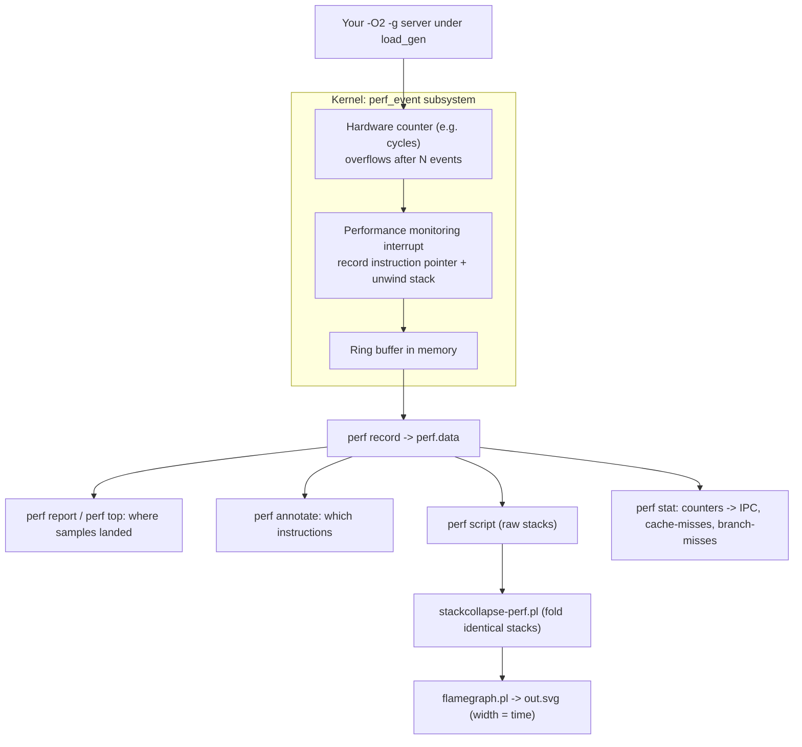

# Module 8.07: Profiling with perf and flamegraphs

**Estimated hours:** 4

**What you will learn**

1. The difference between sampling and instrumentation profilers, and why `perf` (a sampling profiler) is the first tool you reach for on Linux.
2. How to read a program's performance with `perf stat` (cycles, instructions, IPC, cache-misses, branch-misses, context-switches), find the hot path with `perf record -g` and `perf report`, inspect a single function with `perf annotate`, and watch a live process with `perf top`.
3. How to turn a profile into a flamegraph, how to read it (width is time, left-to-right order is meaningless), and how to profile a tcpkv-style server under `load_gen` and interpret where the time goes.

**Prerequisites:** [Module 8.06: Memory corruption patterns](module-06-memory-corruption-patterns.md). You should have module 0.01 (the latency table, caches, IPC), 3.07 (system-call cost), 4.03/4.08 (futex, cache coherence and false sharing), and 5.11 (`load_gen`, percentiles) in mind. Verified on Ubuntu 24.04 in WSL2 with gcc 13.3; see the install section for the `perf`-on-WSL2 details.

---

## 1. One-line intuition

A sampling profiler is a stopwatch that, hundreds or thousands of times a second, writes down where the program currently is; stack up all those snapshots and the function the program was "in" most often is your hot path, no matter how big the program is.

## 2. Real-life analogy

Imagine you want to know where a courier spends their day, but you cannot follow them for eight hours. Instead you phone them at random, 1,000 times, and each time ask only "where are you right now, and how did you get there?" (their current location and the route). You throw away the clock and just tally the answers. If 600 of the 1,000 calls catch them stuck at one traffic junction, that junction is the problem, even though you never watched the whole journey. The random calls are **samples**; the route is the **call stack**; the tally is the **profile**.

This is why sampling is cheap and scales to huge programs: you never record everything, you record a representative sprinkle. The alternative, **instrumentation**, is making the courier write down the time at every single corner, which is accurate but slows them down and changes the journey you are trying to measure.

## 3. Why it exists: the problem it solves

"The server is slow" is not actionable. You need to know *which code* is slow, and guessing is almost always wrong. Experienced engineers routinely find that the hot path is somewhere they would never have suspected: a logging call, a string copy, a `std::map` lookup that should have been a vector, a lock everyone waits on, a system call made once per byte instead of once per buffer.

Two ways to measure:

- **Instrumentation** inserts timing code around functions (gprof's `-pg`, Callgrind's simulation). It is precise and deterministic but slow (Callgrind runs 20-50x slower) and the overhead distorts what you measure, especially for tiny hot functions.
- **Sampling** interrupts the program periodically and records the instruction pointer and call stack. Overhead is a few percent, so the program runs at close to real speed under real load. You lose exact call counts but gain a truthful picture of where wall-clock or CPU time actually goes.

`perf` is the Linux sampling profiler. It is built into the kernel (the `perf_event_open` subsystem) and reads the CPU's hardware performance counters, so it can tell you not just *where* time went but *why*: too many cache misses, too many branch mispredictions, too many context switches. Without a profiler you optimise by folklore and make things slower. With one you change the single thing that matters and prove it with a before/after number. That proof is the performance half of claims B and I.

## 4. Three layers of depth

### Layer 1 (beginner): installing perf and reading `perf stat`

`perf` must roughly match the running kernel. On a normal Ubuntu you install it with `sudo apt install linux-tools-generic` (which pulls in `linux-tools-$(uname -r)`). **On WSL2 this is the one tool with a real install wrinkle,** because WSL2 runs a Microsoft-built kernel (`uname -r` shows something like `6.18.33.2-microsoft-standard-WSL2`) and the Ubuntu `linux-tools` packages are built for the Ubuntu kernel (`6.8.x`). The install path, in order of preference:

1. **Try the generic package first:**
   ```bash
   sudo apt update && sudo apt install linux-tools-generic
   # it installs /usr/lib/linux-tools/<version>/perf and a /usr/bin/perf wrapper
   ```
   The wrapper at `/usr/bin/perf` tries to find a `perf` matching `uname -r`. On WSL2 it will usually print:
   ```text
   WARNING: perf not found for kernel 6.18.33.2-microsoft
   You may need to install ... linux-tools-6.18.33.2-microsoft-standard-WSL2
   ```
   because no such Ubuntu package exists.

2. **Run the installed binary directly instead of via the wrapper.** The actual binary is under `/usr/lib/linux-tools/*/perf`. It works fine for `perf stat` and `perf record` even though its version does not exactly match the WSL2 kernel:
   ```bash
   ls /usr/lib/linux-tools/              # e.g. 6.8.0-146-generic
   /usr/lib/linux-tools/6.8.0-146-generic/perf stat ls
   # make it convenient:
   alias perf='/usr/lib/linux-tools/'"$(ls /usr/lib/linux-tools | head -1)"'/perf'
   ```
   This was verified to work on the course machine: `perf stat`, `perf record -g`, `perf report`, `perf script` and `perf annotate` all run.

3. **If the generic package is unavailable or the binary refuses to run,** build `perf` from the WSL2 kernel source. Microsoft publishes the WSL2 kernel at `https://github.com/microsoft/WSL2-Linux-Kernel`; check out the tag matching your `uname -r`, then:
   ```bash
   sudo apt install build-essential flex bison libelf-dev libdw-dev \
        libunwind-dev libslang2-dev python3-dev
   git clone --depth 1 --branch linux-msft-wsl-6.6.y \
        https://github.com/microsoft/WSL2-Linux-Kernel.git
   cd WSL2-Linux-Kernel/tools/perf
   make                      # produces ./perf matched to the WSL2 kernel
   sudo cp perf /usr/local/bin/
   ```
   (Use the branch that matches your kernel; `uname -r` tells you which.)

**What to do if it still fails.** `perf stat` relies on hardware counters that the hypervisor must expose. If even `perf stat ls` prints `<not supported>` for every counter, the WSL2 kernel was built without perf support and you have two honest fallbacks: enable the counters by rebuilding the WSL2 kernel with `CONFIG_PERF_EVENTS=y` (already on in recent builds), or do your profiling on a native Linux box or VM. For this course, the directly-run binary (option 2) works for everything in the module; `perf record` has one filesystem gotcha covered in Layer 2.

`perf stat` runs a command and prints a summary of hardware counters. This is always your first look, because it tells you *what kind* of slow you are dealing with before you hunt for *where*:

```text
$ perf stat ./hot
 Performance counter stats for './hot':
           1827.57 msec task-clock:u            #    0.599 CPUs utilized
                 0      context-switches:u      #    0.000 /sec
                 0      cpu-migrations:u        #    0.000 /sec
                57      page-faults:u           #   31.189 /sec
        2714112326      cycles:u                #    1.485 GHz
        4120126752      instructions:u          #    1.52  insn per cycle
        1020027364      branches:u              #  558.134 M/sec
           1161518      branch-misses:u         #    0.11% of all branches
       3.049165513 seconds time elapsed
```

(Real run on the course machine; your numbers will differ. The `:u` suffix means user-space only, which is what unprivileged `perf` can see on WSL2.)

How to read it:

- **instructions per cycle (IPC)**, here `1.52`. Modern cores can retire up to ~4 instructions per cycle. IPC near 3-4 means the CPU is busy doing useful work; IPC below ~1 usually means the core is *stalled* waiting for memory (cache misses) or mispredicted branches. Low IPC says "the problem is memory or branches", not "too many instructions".
- **cache-misses** (add `-e cache-misses`): each miss costs ~100 ns to RAM (the module 0.01 table). A high miss rate with low IPC is the fingerprint of a bad data layout (a linked list where a vector belongs, false sharing).
- **branch-misses**: each mispredict wastes ~15-20 cycles re-steering the pipeline. High here points at unpredictable branches (data-dependent `if`s in a hot loop).
- **context-switches**: the kernel took the CPU away. Lots of these under load points at lock contention or oversubscription (more busy threads than cores).

Run it with the specific counters you care about:

```bash
perf stat -e cycles,instructions,cache-misses,branch-misses,context-switches ./prog
```

### Layer 2 (working engineer): record, report, annotate, top

**The golden rule, before any of this: profile a release build with symbols, under realistic load.** Specifically compile with `-O2 -g` (optimisations on, debug info kept so stacks are readable) and, for reliable call stacks, `-fno-omit-frame-pointer`. Profiling a `-O0` debug build measures code nobody ships; profiling with no load measures an idle server. Both lie.

**`perf record`** samples a running program and writes `perf.data`:

```bash
perf record -g ./prog            # -g captures call stacks
perf record -g -- ./server       # -- separates perf's options from the program's
```

- `-g` records the call stack at each sample, so you see not just the hot function but who called it. By default `-g` uses frame pointers, which is why you built with `-fno-omit-frame-pointer`.
- `--call-graph dwarf` reconstructs stacks from DWARF debug info instead of frame pointers. Use it when you cannot rebuild with frame pointers (third-party libraries); it makes `perf.data` much larger and recording slower, but gets correct stacks through optimised code.
- `-F 999` sets the sample frequency (samples per second); 999 (just under 1000) avoids lock-stepping with a 1000 Hz timer.
- `-p <pid>` attaches to an already-running process; `-a` profiles the whole system.

> **WSL2 gotcha, verified on the course machine:** `perf record` fails with `failed to write perf data, error: Bad address` when `perf.data` is written to a Windows-backed mount (`/mnt/c/...`, the DrvFs/9p filesystem). The fix is simple: **run `perf record` from a native Linux (ext4) directory** such as your home (`~`) or `/tmp`, then copy the results out if you need them on the Windows side. `perf stat` has no such problem; only the `perf.data` writer does.

**`perf report`** reads `perf.data` and shows where samples landed, as an interactive tree (press Enter to expand callers, `a` to annotate):

```bash
perf report                      # interactive
perf report --stdio              # plain text, good for notes and scripts
```

On the sample program `hot` (a tight hashing loop, built with `-fno-inline` so the hot function is visible), `perf report --stdio` showed:

```text
    99.99%     0.00%  hot2  hot2  [.] _start
               __libc_start_main
               __libc_start_call_main
               |--99.25%--slow_hash(unsigned long)
                --0.74%--main
```

`slow_hash` is 99.25% of samples: the hot path, found. The percentages are the share of samples, which for a CPU-bound program is the share of CPU time. Two columns matter: **Self** (time in that function's own instructions) and **Children** (time in it plus everything it called). A function with high Children but low Self is just a caller; a function with high Self is where the work actually is.

**`perf annotate`** drops into a single function and shows which *instructions* got the samples, interleaved with source if `-g` debug info is present:

```bash
perf annotate slow_hash          # or press 'a' in perf report
```

This is how you find that, say, 80% of a function's time is one `div` instruction or one load that misses cache. It is the bridge from "this function is hot" to "this line is hot".

**`perf top`** is `perf report` live, like `top` but for functions. Run it (optionally `perf top -p <pid>`) and watch, in real time, which functions are consuming CPU right now. It is the fastest way to answer "what is this server doing *right now* while it is slow".

**Permissions.** `perf` reads kernel counters, gated by `/proc/sys/kernel/perf_event_paranoid`. Values: `3` = almost nothing, `2` = user-space measurements (the WSL2 default; enough for everything here), `1` = also kernel samples, `-1` = everything. Lower it (needs root) only if you need kernel stacks: `sudo sysctl kernel.perf_event_paranoid=1`.

### Layer 3 (internals): how sampling works, and flamegraphs

**What a sample actually is.** `perf record` asks the kernel (via `perf_event_open`) to set up a hardware event, most often the `cycles` counter, to overflow after N events. Each overflow raises a **performance monitoring interrupt (PMI)**. In the interrupt handler the kernel records the current instruction pointer and, if `-g` was given, unwinds the call stack (via frame pointers or DWARF). These records stream through a ring buffer in memory that `perf` drains to `perf.data`. Because the trigger is a hardware counter, sampling can be driven by *any* event, not just time: sample on `cache-misses` to see which code misses cache, on `branch-misses` to see which code mispredicts. That is sampling's superpower over a simple timer.

**On-CPU vs off-CPU.** Default `perf record` samples CPU cycles, so it only sees code that is *running on a CPU*. If your server is slow because threads are *blocked* (waiting on a lock, a disk read, or the network), that time is invisible to a cycles profile, because a blocked thread burns no cycles. To see blocking you need **off-CPU analysis**: sample scheduler events (`perf sched`, or trace `sched:sched_switch` and the wakeup), or use `perf record -e sched:sched_stat_sleep` style tracepoints, and build an off-CPU flamegraph. The one-line rule: a cycles flamegraph that looks "empty" or dominated by a futex-wait stub means your bottleneck is *waiting*, and you should do off-CPU analysis. (For a lock specifically, the on-CPU profile often shows time piling up inside `__lll_lock_wait`/`futex`, which is the symptom of contention from module 4.03.)

**Flamegraphs.** A `perf report` tree is hard to scan. A **flamegraph** (invented by Brendan Gregg) renders the same stacks as a picture: each box is a function; a box sits on top of the box that called it; the **width of a box is the number of samples in it (so, time)**. You read it like this:

- **Width = time.** The widest boxes are where the program spends its time. That is the only thing width means.
- **Height = stack depth.** Tall towers are deep call chains; height is not cost.
- **Left-to-right order is meaningless.** Boxes are sorted alphabetically to merge identical stacks, not by time. Do not read it as a timeline.
- **A wide box at the top (a wide plateau)** is a function doing a lot of work itself: your hot leaf. A wide box low down with narrow children is a dispatcher that calls many cheap things.

You build one from a `perf record` with the FlameGraph scripts from `https://github.com/brendangregg/FlameGraph`:

```bash
git clone https://github.com/brendangregg/FlameGraph
perf record -g -- ./server            # from an ext4 dir on WSL2
perf script | FlameGraph/stackcollapse-perf.pl | FlameGraph/flamegraph.pl > out.svg
# open out.svg in a browser; it is interactive (click to zoom, search with Ctrl-F)
```

`perf script` dumps every sample's stack as text; `stackcollapse-perf.pl` folds identical stacks into one line with a count; `flamegraph.pl` draws the SVG. The output is a single self-contained SVG you can open in any browser and click to zoom.

**gprof, Callgrind, kcachegrind.** The older/slower alternatives, worth knowing:

- **gprof** (`gcc -pg`, run, then `gprof ./prog gmon.out`) is the classic instrumentation profiler. It compiles counting code into every function, so it perturbs timing and cannot see into libraries you did not build with `-pg`. Treat it as "the old way"; prefer `perf`.
- **Callgrind** (`valgrind --tool=callgrind ./prog`) *simulates* the CPU and cache, so it gives exact instruction and cache-miss counts per line, deterministically, at ~20-50x slowdown. Use it when you need exact, repeatable counts (e.g. comparing two algorithms) rather than wall-clock truth under load.
- **kcachegrind** is the GUI that visualises Callgrind output (call graph, per-line costs). `callgrind + kcachegrind` is the "slow but precise" pairing, the opposite trade-off from `perf + flamegraph` (fast and realistic).

### Windows equivalents

| Task | Linux (`perf`) | Windows |
|---|---|---|
| Quick counters (cycles, IPC, cache) | `perf stat` | Visual Studio Profiler (CPU Usage), or `wpr`/WPA counters |
| Sample the hot path | `perf record -g` + `perf report` | Visual Studio "CPU Usage" diagnostic, or ETW via `wpr -start cpu` |
| Flamegraph / call-tree view | `perf script` + FlameGraph | Windows Performance Analyzer (WPA) "Flame" and "Caller/Callee" views |
| Live view | `perf top` | VS live CPU graph; WPA on a live trace |
| Precise, instrumented | Callgrind + kcachegrind | VS "Instrumentation" profiling mode |

ETW (Event Tracing for Windows) is the kernel-level tracing substrate; `wpr` (Windows Performance Recorder) captures a trace and WPA (Windows Performance Analyzer) displays it, including a flame view. The concepts carry over exactly: sampling, call stacks, width-is-time.

## 5. Architecture diagram



## 6. Code

A CPU-bound program with one obvious hot function, so every tool has something clear to point at. Then the commands.

```cpp
// hot.cpp - a program with an obvious hot path for profiling.
//   g++ -std=c++17 -O2 -g -fno-omit-frame-pointer -o hot hot.cpp
//   (add -fno-inline to keep slow_hash visible in the report)
#include <cstdio>
#include <cstdint>

static uint64_t slow_hash(uint64_t x) {       // the hot function
    for (int i = 0; i < 50; ++i)
        x = x * 6364136223846793005ULL + 1442695040888963407ULL;
    return x;
}

int main() {
    uint64_t acc = 0;
    for (uint64_t i = 0; i < 20000000ULL; ++i) acc += slow_hash(i);
    std::printf("%llu\n", (unsigned long long)acc);
    return 0;
}
```

Build and profile (on WSL2, run `perf record` from `~` or `/tmp`, not `/mnt/c`):

```bash
g++ -std=c++17 -O2 -g -fno-omit-frame-pointer -fno-inline -o hot hot.cpp
PERF=/usr/lib/linux-tools/*/perf      # or just 'perf' on native Linux

# 1. What kind of slow?
$PERF stat -e cycles,instructions,cache-misses,branch-misses,context-switches ./hot

# 2. Where is the time? (run from an ext4 dir on WSL2)
cp ./hot /tmp/ && cd /tmp
$PERF record -g ./hot
$PERF report --stdio | head -20

# 3. Which instructions in the hot function?
$PERF annotate slow_hash | head -40

# 4. Flamegraph
git clone https://github.com/brendangregg/FlameGraph
$PERF script | FlameGraph/stackcollapse-perf.pl | FlameGraph/flamegraph.pl > hot.svg
```

Expected shape (real run on the course machine; numbers vary):

```text
# perf stat
        2714112326  cycles:u            #  1.485 GHz
        4120126752  instructions:u      #  1.52  insn per cycle
           1161518  branch-misses:u     #  0.11% of all branches

# perf record / report
[ perf record: Captured and wrote 0.28 MB perf.data (3109 samples) ]
    99.25%  slow_hash(unsigned long)
     0.74%  main
```

IPC of 1.52 with almost no cache or branch misses says this is a compute-bound loop (multiply/add), not a memory problem; `perf report` confirms `slow_hash` is where to look; `perf annotate` would show the samples on the multiply inside the loop. The flamegraph is one wide plateau labelled `slow_hash` sitting on a thin `main` on `_start`: a textbook "hot leaf" shape.

## 7. Use case: core-banking loan-origination platform

The tcpkv server and the app server (claims I, H4, B) were both profiled this way, under `load_gen` (module 5.11) driving realistic mixed traffic, and the profiles drove real decisions.

- **Finding the hot path in tcpkv.** With `load_gen --threads 8` hammering the server, `perf record -g -p <server-pid>` for ten seconds and a flamegraph showed the time split across four plateaus: the `recv`/`send` system calls, the line-protocol parser, the `std::unordered_map` lookup under the `shared_mutex`, and `futex` (the lock itself). The first surprise was that **parsing was wider than the map lookup**: the parser was copying each line into a `std::string` before splitting it. **Decision it drove:** parse in place with `std::string_view` over the receive buffer (as the 4.13 `Request` already does), removing a `std::string` allocation per request. The before/after `perf stat` showed IPC up and allocations (visible as time in `malloc`) down; `load_gen` p99 improved.
- **The futex plateau.** At 32 threads a second profile showed a wide `__lll_lock_wait`/`futex` plateau: workers were contending on the single `shared_mutex` guarding the store on *every* lookup (module 4.08's cache-line bouncing, module 4.13's shared-lock cost). **Decision it drove:** keep the shared_mutex for the real store (writes are rare) but confirm with `perf stat -e context-switches` that the contention was acceptable at the target thread count, and record the thread count at which the futex plateau started growing as the server's capacity knee (the same knee as 5.11).
- **The syscall-per-byte mistake.** An early version of the app server's response writer called `send` once per field. The flamegraph showed a tall, wide stack rooted in `send` -> `entry_SYSCALL`. **Decision it drove:** build the whole response in one buffer and `send` once, cutting system calls per request from a dozen to one (module 3.07's "one 64 KB call beats 64 K one-byte calls").

The honest-sentence version for an interview: "I never guessed at performance. I ran `perf stat` to see whether it was compute, memory or lock-bound, then `perf record` and a flamegraph to find the widest box, changed one thing, and re-ran `load_gen` to prove the p99 moved. The biggest win was the cheapest: parsing in place instead of copying each line."

## 8. Lab

Build `hot` from section 6 and have `load_gen` and a server (`ok_server` from 5.11, or tcpkv if you have it) ready. On WSL2, set `PERF` to your real binary and run `perf record` from `~` or `/tmp`.

### Part A: what kind of slow? (20 minutes)

1. Run `perf stat -e cycles,instructions,cache-misses,branch-misses,context-switches ./hot`. Record IPC (instructions / cycles). Is it near 4 (compute-bound) or below 1 (stalled)?
2. Write a second tiny program that sums a `std::vector<int>` of 50 million elements in index order, and a third that sums them in a random order (shuffle the indices). Run `perf stat -e cycles,instructions,cache-misses` on both. Compare cache-misses and IPC.

Expected: `hot` has high IPC and few cache-misses (compute-bound). The random-order sum has far more cache-misses and lower IPC than the in-order sum, even though both do the same number of adds. This is the module 0.01 latency table made visible: memory layout, not instruction count, dominates.

### Part B: find the hot path (20 minutes)

1. From `/tmp`, run `perf record -g ./hot`, then `perf report --stdio | head -20`. Confirm `slow_hash` dominates the Self column.
2. Run `perf annotate slow_hash | head -40`. Note which instructions carry the samples (the multiply/add in the loop).
3. Rebuild `hot` *without* `-fno-inline` and re-run `perf report`. Observe that `slow_hash` now shows as `main` (it was inlined). Write one sentence on why `-g` and knowing about inlining both matter when reading a report.

Expected: `slow_hash` is ~99% of Self with `-fno-inline`; after inlining the time attributes to `main`. Annotate shows the hot instructions are the `imul`/`add` in the loop.

### Part C: flamegraph (20 minutes)

1. `git clone https://github.com/brendangregg/FlameGraph`.
2. `perf record -g ./hot && perf script | FlameGraph/stackcollapse-perf.pl | FlameGraph/flamegraph.pl > hot.svg`.
3. Open `hot.svg` in a browser. Identify the widest box. Click it to zoom. Use Ctrl-F to search for `slow_hash` and watch matching boxes highlight.
4. Write one sentence each answering: what does the width of the `slow_hash` box mean? What does its left-to-right position mean?

Expected: one wide plateau (`slow_hash`) on a thin `main` on `_start`. Width = share of samples = time. Left-to-right position means nothing (alphabetical merge).

### Part D: profile the server under load (30 minutes)

1. Start your server (`./ok_server 7000` or tcpkv), built `-O2 -g -fno-omit-frame-pointer`. Get its PID.
2. In another terminal from `/tmp`, run `perf record -g -p <pid> -- sleep 10` while `./load_gen --threads 8 --duration 10` drives it.
3. Make a flamegraph of the server. Identify the plateaus: how much is `recv`/`send` (syscalls), how much is parsing, how much is the map lookup, how much is `futex`/lock-wait?
4. Re-run `load_gen` with `--threads 32` and profile again. Does the `futex`/lock-wait plateau grow? Record the thread count where it becomes a large fraction.

Expected: at low thread counts the time is in syscalls, parsing and the lookup; at high thread counts a `futex`/lock-wait plateau grows as workers contend on the store lock. The thread count where it dominates is the capacity knee from 5.11.

### Journal

Copy [journal/TEMPLATE.md](../journal/TEMPLATE.md) to `journal/YYYY-MM-DD-perf-and-flamegraphs.md`. Record: the IPC and cache-miss comparison from Part A (in-order vs random sum); the hot function and the effect of inlining from Part B; one sentence each on width and left-to-right from Part C; and the plateau breakdown of your server under load from Part D, with the thread count where the futex plateau grew. If `perf` needed the WSL2 workaround (direct binary, `/tmp` for record), note exactly what you did so you can reproduce it.

## 9. Common mistakes and misconceptions

| Mistake | Why it is wrong | Consequence |
|---|---|---|
| Profiling a `-O0` debug build | The shipped build is `-O2`; `-O0` has different hot spots (no inlining, extra loads) | You optimise code that does not exist in production |
| Profiling with no load | An idle server's profile is noise | You find nothing, or the wrong thing |
| Reading left-to-right on a flamegraph as time | Boxes are sorted alphabetically to merge stacks, not by time | False "it does A then B" stories |
| Reading height as cost | Height is stack depth; width is cost | Chasing deep-but-cheap call chains |
| Trusting a cycles profile when the server is blocked | Blocked threads burn no cycles, so waiting is invisible on-CPU | Missing the real bottleneck; need off-CPU analysis |
| Building without `-fno-omit-frame-pointer` (or `--call-graph dwarf`) | `-g` stacks break on optimised code; you get truncated stacks | Unreadable or wrong call trees |
| On WSL2, running `perf record` on `/mnt/c` | DrvFs/9p write of `perf.data` fails with `Bad address` | "perf is broken"; it is not, use an ext4 dir |
| Optimising before measuring | The hot path is almost never where you think | Effort wasted; sometimes made slower |

## 10. Resume link

- **Claim B, "performance optimisation".** Say: "I profile a release build under realistic load. `perf stat` first, to see if it is compute-, memory- or lock-bound from IPC and cache-misses; then `perf record` and a flamegraph to find the widest box; then I change one thing and re-measure. In tcpkv the biggest win was parsing in place with `string_view` instead of copying each line into a `std::string`, which I found because the parser plateau was wider than the map lookup."
- **Claim I, tcpkv, and claim H4, app server.** The flamegraph breakdown (syscalls, parsing, lookup, futex) and the capacity-knee thread count are concrete, defensible numbers. Tie the futex plateau to module 4.08 (false sharing / cache-line bouncing) and the syscall plateau to module 3.07 (one big `send` beats many small ones).
- **Honesty under challenge.** If asked "how do you know X was the bottleneck?", the answer is a before/after: "the flamegraph showed Y% in that function; after the change `perf stat` showed IPC up from A to B and `load_gen` p99 down from C to D." Never "it felt faster".

Likely follow-up: "What is sampling and why not just time every function?" Answer with Layer 1 and Layer 3: sampling is cheap and runs at real speed under real load; instrumentation is precise but perturbs timing and is slow (Callgrind 20-50x). You use `perf` for truth-under-load and Callgrind only when you need exact, repeatable counts.

## 11. Interview questions

**Q1 (easy). What is the difference between a sampling profiler and an instrumentation profiler?**

<details>
<summary>Model answer</summary>

A sampling profiler (like `perf`) periodically interrupts the program and records where it is (instruction pointer and call stack). Overhead is a few percent, so the program runs at close to real speed; you get a statistically truthful picture of where time goes but not exact call counts. An instrumentation profiler (like gprof with `-pg`, or Callgrind) inserts counting/timing code into every function or simulates the CPU; it gives exact counts but is slow (Callgrind 20-50x) and the overhead perturbs what you measure, especially for tiny hot functions. Rule of thumb: sample to find where time goes under real load; instrument when you need exact, repeatable counts to compare two implementations.

</details>

**Q2 (easy). You run `perf stat` and see IPC of 0.4 with a high cache-miss count. What does that tell you?**

<details>
<summary>Model answer</summary>

IPC of 0.4 means the core retires less than half an instruction per cycle, so it is mostly *stalled*, not executing. Combined with a high cache-miss count, the stalls are waiting on memory: the data layout or access pattern is causing cache misses, each costing ~100 ns to RAM. The fix is not fewer instructions but better locality: contiguous data (vector not list), struct-of-arrays, blocking to fit in cache, or removing false sharing. This is the classic "the problem is memory, not compute" signature from the latency table.

</details>

**Q3 (medium). How do you read a flamegraph? What do width, height and horizontal position mean?**

<details>
<summary>Model answer</summary>

Each box is a function; a box sits on top of the function that called it. Width is the number of samples in that stack, i.e. the share of time, so the widest boxes are where the program spends its time; that is the only meaning of width. Height is stack depth (how deep the call chain is), not cost, so tall thin towers are deep but cheap. Horizontal position is meaningless: boxes are sorted alphabetically to merge identical stacks, not by time, so a flamegraph is not a timeline. You look for wide plateaus; a wide box at the top is a hot leaf doing work itself, a wide box lower down with narrow children is a dispatcher. You build one with `perf record -g`, then `perf script | stackcollapse-perf.pl | flamegraph.pl > out.svg`.

</details>

**Q4 (medium). Your cycles flamegraph of a slow server is nearly empty or dominated by a futex-wait stub. What is happening and what do you do?**

<details>
<summary>Model answer</summary>

A cycles profile only sees threads running on a CPU. If the flamegraph is nearly empty or is mostly `__lll_lock_wait`/`futex`, the server is spending its time *blocked*, not computing: waiting on a lock, a condition variable, a disk read or the network. Blocked threads burn no cycles, so the real bottleneck is invisible to an on-CPU profile. I switch to off-CPU analysis: sample scheduler events (`perf sched record`, or trace `sched:sched_switch` with the wakeup) and build an off-CPU flamegraph whose width is time spent *off* the CPU. A wide futex plateau specifically points at lock contention, so I would also look at which lock (often a single `shared_mutex` or mutex that every worker hits) and reduce the critical section, shard the lock, or switch to a read-mostly structure, then re-measure.

</details>

**Q5 (hard). Walk through how you would profile and speed up a multithreaded TCP server, from "it is slow" to a proven fix, naming the tools and what each tells you.**

<details>
<summary>Model answer</summary>

First, make the measurement valid: build `-O2 -g -fno-omit-frame-pointer` and reproduce the slowness under realistic load with a load generator, because an idle or debug-built server profiles nothing useful. Then `perf stat -e cycles,instructions,cache-misses,branch-misses,context-switches` on the server under load, to classify it: high IPC with few misses is compute-bound; low IPC with high cache-misses is memory-bound; many context-switches points at lock contention or oversubscription. Next `perf record -g -p <pid>` for ten seconds under load and a flamegraph, to find the widest boxes: typically some mix of `recv`/`send` syscalls, parsing, the data-structure lookup and `futex`/lock-wait. If the flamegraph is dominated by futex-wait, do off-CPU analysis because the time is in blocking, not compute. Form one hypothesis about the widest box (for example, parsing is copying each line into a `std::string`), make exactly one change (parse in place with `string_view`), and re-run `perf stat` and the load generator to prove it: IPC up, time in `malloc` down, p99 down. Repeat on the next widest box. The discipline is: measure before touching anything, change one thing at a time, and prove every change with a before/after number from the same load. Real wins I would expect: removing per-request allocations in the parser, coalescing many small `send`s into one, and reducing a hot lock's critical section or sharding it.

</details>

## 12. Revision

- Sampling (`perf`) interrupts the program thousands of times a second and records where it is; it is cheap, runs at real speed under real load, and finds the hot path no matter how big the program is. Instrumentation (gprof, Callgrind) is exact but slow and perturbing.
- `perf stat` classifies the slowness (IPC, cache-misses, branch-misses, context-switches); `perf record -g` + `perf report`/`perf annotate`/`perf top` finds where and which instructions; a flamegraph (`perf script | stackcollapse-perf.pl | flamegraph.pl`) shows it as a picture where width is time and left-to-right is meaningless.
- Profile a release build with symbols and frame pointers under realistic load; change one thing; prove it with before/after numbers. A cycles profile cannot see blocked time, so a futex-dominated or empty profile means do off-CPU analysis. On WSL2 run the real `perf` binary directly and record to an ext4 directory, not `/mnt/c`.

---

Previous: [Module 8.06: Memory corruption patterns](module-06-memory-corruption-patterns.md) | Next: [Module 8.08: Latency percentiles and benchmarking](module-08-latency-percentiles-and-benchmarking.md)
