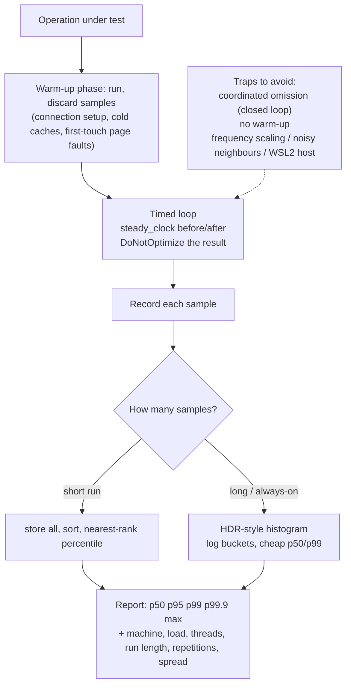

# Module 8.08: Latency percentiles and benchmarking

**Estimated hours:** 3

**What you will learn**

1. Why you report p50/p95/p99 and never the average, why a request that fans out to many sub-calls is dominated by its tail, and how histograms (the HDR idea) beat sorting for keeping percentiles cheaply.
2. The three measurement traps that make benchmark numbers lies: coordinated omission, no warm-up, and uncontrolled variance (CPU frequency scaling, noisy neighbours, WSL2 host activity), and the fixes for each.
3. How to write a fair benchmark by hand and with Google Benchmark, how to run an A/B comparison one change at a time, and exactly what to put on a resume for tcpkv and how to defend it.

**Prerequisites:** [Module 8.07: Profiling with perf and flamegraphs](module-07-profiling-perf-and-flamegraphs.md). This module builds directly on module 5.11 (`load_gen`, nearest-rank percentiles, closed vs open loop); re-read its Layer 1 if percentiles are fuzzy. Verified on Ubuntu 24.04 in WSL2, gcc 13.3, Google Benchmark 1.8.3.

---

## 1. One-line intuition

To describe how fast something is, record every single timing, sort them, and quote the values at the 50th, 95th and 99th positions out of 100 (the percentiles); the average is the one number that hides exactly the slow requests your users complain about.

## 2. Real-life analogy

A bank branch measures how long customers wait. The manager reports "average wait: 4 minutes" and is pleased. But the average is 4 minutes because 95 customers waited 1 minute and 5 customers, stuck behind a complex loan case, waited 45 minutes. Those five wrote the complaints. The average *mathematically erased* them by averaging them with the fast ones.

Now report it as percentiles: "p50 = 1 minute (the median customer), p95 = 3 minutes, p99 = 45 minutes". Suddenly the problem is visible and precise: one in a hundred customers has a terrible experience, and you can go find out why (the complex-case desk). Percentiles keep the tail; the average throws it away. Everything in this module is about measuring and reporting in a way that keeps the customers who matter visible, and about not fooling yourself with a benchmark that quietly deleted them.

## 3. Why it exists: the problem it solves

Two failures recur in every performance conversation:

1. **Quoting the average.** Latency distributions are not bell-shaped; they have a long right tail (a few very slow requests). The mean is pulled around by the tail but never *shows* it: a server with a great mean can have a terrible p99. Your SLA (module 8.10) is almost always written on a percentile, not a mean, because the business cares about the worst-served customers.

2. **Benchmarks that lie.** A number with no method behind it is worthless and, worse, misleading. The three classic ways a benchmark lies: it fooled itself by measuring at the wrong moment (**coordinated omission**), it measured cold code (**no warm-up**), or it measured the machine's mood rather than the code (**variance** from frequency scaling and other processes). An interviewer who knows this will dismantle an undefended number in one question: "closed or open loop?", "was that warmed up?", "what else was running?". This module gives you the answers.

Why it matters for the resume: claims B and I both rest on numbers ("performance optimisation", "clean under a concurrent load generator"). A defensible number is worth ten impressive-but-naked ones. The skill being tested is not "can you make a big number" but "can you measure honestly and say exactly what the number means".

## 4. Three layers of depth

### Layer 1 (beginner): percentiles, and why the tail dominates fan-out

Module 5.11 defined the mechanics: sort the samples, and the value at position `ceil(p/100 * n)` is the p-th percentile (nearest rank). p50 is the median, p99 is the value only 1 in 100 exceeded, p99.9 is 1 in 1000. You need thousands of samples for p99 to be stable and tens of thousands for p99.9.

The deeper idea this module adds: **a request that fans out to many sub-requests is dominated by its slowest sub-request, so its latency is governed by the sub-request tail, not the sub-request median.**

Suppose handling one loan request makes 20 independent calls (master-table lookups, a credit check, a write) and must wait for all 20 to finish. If each call independently has a p99 of 100 ms (1% chance of being slow), what is the chance the *overall* request is slow? The request is fast only if *all 20* calls are fast:

- P(all 20 fast) = 0.99^20 ≈ 0.818.
- So P(at least one slow) ≈ 1 − 0.818 = **0.182**, about 18%.

A per-call p99 of 1-in-100 becomes an 18-in-100 chance that the *user-visible* request is slow. The tail of the parts dominates the whole. This is why, in a fan-out system, you attack the p99 of the components, not their average, and why "our database is fast on average" tells you nothing about the request that touched twenty rows. (This is the same maths that made the app server's in-memory master-table cache worthwhile, module 4.13: removing the fan-out to the database removed its tail from the request.)

A smaller table to feel it:

| Per-call p99 (chance slow) | Fan-out | Chance the whole request is slow |
|---|---|---|
| 1% | 1 | 1% |
| 1% | 10 | 9.6% |
| 1% | 20 | 18.2% |
| 1% | 100 | 63.4% |

### Layer 2 (working engineer): histograms, coordinated omission, warm-up, variance

**Histograms vs sorting (the HDR idea).** `load_gen` stores every sample in a vector and sorts it. That is fine for short runs (3 million doubles is 24 MB) but hopeless for hours-long or always-on measurement: you cannot keep every sample forever. The professional answer is a **histogram**: pre-defined buckets, and you increment a counter per sample. To read p99 you walk the buckets accumulating counts until you pass 99% of the total; the bucket you land in is the percentile, accurate to the bucket width.

The naive histogram uses equal-width buckets, which wastes memory (you need fine buckets at 1 ms *and* at 10 s). **HdrHistogram** (High Dynamic Range, by Gil Tene) uses buckets whose width grows with the value: fine resolution for small latencies, coarse for huge ones, so it covers nanoseconds to hours in a few KB at a guaranteed relative precision (e.g. 1%). The idea to carry: **record into logarithmic-ish buckets, not a growing list.** The nine-bucket histogram `load_gen` prints is the toy version of this.

**Coordinated omission (the trap that deletes your tail).** Covered in 5.11; here is the full picture. A **closed-loop** generator has N client threads, each doing: send, wait for reply, send next. When the server stalls for 100 ms, each thread sends *one* request during that stall (it is blocked waiting), instead of the ~10 it would have sent at the normal pace. So the stall is recorded as *one* slow sample instead of ten. The percentile computation never sees the nine requests that a real, open-arrival user would have been slowed by. Result: your p99 looks far better than what a user experiences during a stall. This is coordinated omission.

The honest fixes, in order:

- **Open-loop generation.** Send requests on a fixed schedule (say every 100 µs) regardless of whether earlier replies came back. When the server stalls, requests pile up and every delayed one is recorded, so the tail is real. The cost: the generator can overload itself, and you must bound the in-flight count.
- **Correction / back-fill.** Keep closed-loop simplicity but, for each measured latency longer than the expected send interval, synthesise the samples that *should* have been sent during the stall (HdrHistogram's `recordValueWithExpectedInterval` does exactly this).
- **Minimum: disclose it.** State "closed-loop generator; p99 does not reflect coordinated omission during stalls". In a stable run with no stalls, closed-loop numbers are honest.

**Warm-up.** The first requests of any run are slow for reasons that are not your steady-state performance: connection setup, cold instruction and data caches, first-touch page faults on freshly allocated buffers (the kernel maps a zero page on first write), the JIT or branch predictor not yet trained, and the OS scheduler not yet having placed threads. Discard the first N seconds (or first N thousand requests). `load_gen --warmup 1` records nothing for the first second. Report warmed-up steady state; if you also care about cold start, measure it separately and label it.

**Run length and repetitions.** One second gives noisy percentiles (few tail samples). Minimum 5 seconds for a glance, 30 seconds for a quotable number, minutes to catch periodic effects (a compaction, a GC, a cron job). Run at least **three times** and report the spread. If p99 is 150, 160 and 410 µs, the 410 run hit something; the honest report is "150-160 µs in two of three runs, one outlier at 410 (another process was active)". A single run is an anecdote, not a measurement.

**Variance you must control.** Benchmark numbers wobble because the machine is not holding still:

- **CPU frequency scaling (turbo / throttling).** Modern CPUs boost a lightly loaded core above base clock and throttle when hot or when many cores are busy. The same code can run 30% faster in the first 10 seconds (turbo) than in minute three (thermal throttle). For stable numbers, either warm up long enough to reach steady thermal state, or pin the governor to `performance` on native Linux (`cpupower frequency-set -g performance`). On WSL2 you cannot control the governor; warm up and report the spread.
- **Noisy neighbours.** Other processes steal CPU and pollute caches. Close everything; check with `perf stat -e context-switches` or `top`.
- **WSL2 host activity.** This is the big one for this course. WSL2 runs inside a lightweight VM on Windows; the Windows host (Defender scan, Search indexer, a browser, Windows Update) can take the physical cores out from under the VM for milliseconds at a time. Expect occasional 1-10 ms outliers in p99.9/max that would not appear on bare metal. The hand-harness lab below shows exactly this: a p50 of 0.1 µs with a max of 19 ms, which is a scheduler/host hiccup, not your code. Report these; do not hide them; do not blame your code for them until you have run on bare Linux.
- **`taskset` (CPU pinning).** `taskset -c 0 ./bench` pins the process to core 0, removing cross-core migration and the cache-cold cost of being rescheduled elsewhere. It reduces variance for single-threaded microbenchmarks. Use it to get repeatable microbench numbers; do *not* use it when measuring a multithreaded server's real throughput (you want it to use all cores).

### Layer 3 (internals): harness design and defeating the compiler

A microbenchmark measures tiny operations, so two things can ruin it: the clock, and the optimiser.

**The clock.** Use `std::chrono::steady_clock`, not `system_clock`. `steady_clock` is monotonic (never jumps backwards; not affected by NTP adjustments or the user changing the wall clock), which is exactly what you want for measuring durations. `system_clock` can jump and give you negative or absurd durations. Its resolution on Linux is typically tens of nanoseconds (backed by the vDSO reading a clock without a full system call), fine for microseconds and above; for sub-100 ns work you must time a *batch* of iterations and divide, because the clock read itself costs tens of nanoseconds and would dominate.

**The optimiser (dead-code elimination).** If the result of the code under test is never used, the compiler at `-O2` deletes the whole thing, and you measure an empty loop (the module 8.06 examples hit exactly this). You must force the compiler to keep the work:

- Accumulate results into a `volatile` sink, or
- Use a "do not optimise" barrier. Google Benchmark provides `benchmark::DoNotOptimize(x)` (tells the compiler x is observable) and `benchmark::ClobberMemory()` (a memory barrier). By hand you can use an inline-asm barrier or write the result to a `volatile`.

A hand harness therefore: warm up (discard), then for each iteration read `steady_clock` before and after the operation, store the duration, and make the result observable so it is not deleted. Verified run of the harness below:

```text
$ taskset -c 0 ./harness
sink=2298519545268050192 p50=0.100 p99=0.101 max=19027.930 us
```

The `sink` printed at the end is how the result is kept observable; p50 and p99 of 0.1 µs are the real per-op cost; the 19 ms max is a WSL2 host hiccup, reported honestly rather than hidden.

**Why time a batch for tiny ops.** If one operation takes 2 ns and a `steady_clock` read takes 20 ns, timing each operation individually measures mostly the clock. Instead run the operation 1000 times inside the timed region and divide by 1000. Google Benchmark does this automatically (its `for (auto _ : state)` loop runs enough iterations to get a stable estimate and reports per-iteration time).

## 5. Architecture diagram



## 6. Code

### 6a. A fair hand harness

```cpp
// harness.cpp - a fair micro-benchmark by hand with steady_clock.
//   g++ -std=c++17 -O2 -g -o harness harness.cpp
//   taskset -c 0 ./harness          # pin for low variance
#include <chrono>
#include <cstdio>
#include <vector>
#include <algorithm>

// stand-in for the operation under test; replace with a map lookup, parse, etc.
static long work(long x) { for (int i = 0; i < 10; ++i) x = x * 1103515245 + 12345; return x; }

int main() {
    const int N = 200000;
    std::vector<double> us;
    us.reserve(N);
    long sink = 0;                                   // keeps results observable

    for (int i = 0; i < 20000; ++i) sink += work(i); // WARM-UP, discarded

    for (int i = 0; i < N; ++i) {
        auto t0 = std::chrono::steady_clock::now();
        sink += work(i);                             // the timed operation
        auto t1 = std::chrono::steady_clock::now();
        us.push_back(std::chrono::duration<double, std::micro>(t1 - t0).count());
    }

    std::sort(us.begin(), us.end());
    auto pct = [&](double p) { return us[(size_t)(p / 100.0 * (N - 1))]; };
    std::printf("sink=%ld p50=%.3f p99=%.3f max=%.3f us\n",
                sink, pct(50), pct(99), pct(100));   // print sink so it is not deleted
    return 0;
}
```

```bash
g++ -std=c++17 -O2 -g -o harness harness.cpp
taskset -c 0 ./harness
```

Expected shape (real run, course machine; your numbers differ):

```text
sink=2298519545268050192 p50=0.100 p99=0.101 max=19027.930 us
```

p50 ≈ p99 (the operation is steady) with one large max: that max is the machine, not the code.

### 6b. Google Benchmark

Install and a 30-line example (verified to build and run):

```bash
sudo apt install libbenchmark-dev
```

```cpp
// bench_demo.cpp - a minimal Google Benchmark example.
//   g++ -std=c++17 -O2 bench_demo.cpp -lbenchmark -lpthread -o bench_demo
#include <benchmark/benchmark.h>
#include <string>
#include <unordered_map>

static std::unordered_map<std::string, int> make_map() {
    std::unordered_map<std::string, int> m;
    for (int i = 0; i < 1000; ++i) m["BR" + std::to_string(i)] = i;
    return m;
}

static void BM_MapLookup(benchmark::State& state) {
    auto m = make_map();
    std::string key = "BR742";
    for (auto _ : state) {                       // Google Benchmark times this loop
        auto it = m.find(key);
        benchmark::DoNotOptimize(it->second);    // defeat dead-code elimination
    }
}
BENCHMARK(BM_MapLookup);
BENCHMARK_MAIN();
```

```bash
g++ -std=c++17 -O2 bench_demo.cpp -lbenchmark -lpthread -o bench_demo
./bench_demo --benchmark_min_time=0.3s
```

Expected shape (real run, course machine):

```text
***WARNING*** Library was built as DEBUG. Timings may be affected.
-------------------------------------------------------
Benchmark             Time             CPU   Iterations
-------------------------------------------------------
BM_MapLookup        110 ns         51.5 ns      9880098
```

Two things to read: the `WARNING` about a DEBUG-built library (the Ubuntu package is built without optimisation; for publishable numbers build Google Benchmark from source in Release, or at least note the warning), and the two columns **Time** (wall clock per iteration) and **CPU** (CPU time per iteration). Google Benchmark picks the iteration count automatically to get a stable estimate, warms up for you, and reports per-iteration time, so it handles the "time a batch and divide" and "run enough" chores. Add `benchmark::DoNotOptimize`/`ClobberMemory` yourself to stop the optimiser deleting the work.

## 7. Use case: core-banking loan-origination platform

- **The fan-out that made the cache worth building.** The app server's "create application" handled one client request by making ~20 master-table lookups. When those lookups went to the database, each had a p99 of a few milliseconds, so (Layer 1 maths) the *request's* p99 was dominated by the chance that at least one of twenty lookups hit a slow one, roughly 15-20%. Moving the master tables into the in-memory cache (module 4.13) removed the database from the fan-out entirely, collapsing the request p99 because 20 RAM lookups at ~100 ns have a negligible tail. **The decision the percentile maths drove:** cache the master tables not to improve the *average* (which was already acceptable) but to kill the *request tail* created by fan-out.
- **The login-latency fix proven on p99, not the mean (claim H7).** Average login time was under a second; dashboards were green. The p99 was five seconds. Splitting samples by branch showed the tail came from branches whose master-table lookups were keyed by business code and hitting a full-table scan on the multi-node cluster. After the composite and covering indexes, the same `load_gen` run showed p50 barely moved and p99 dropped by an order of magnitude. **Decision:** the team rewrote the latency SLO as a p99 target, because the average never showed the problem and would not have shown the fix. You reproduce this in capstone C5.
- **Why the pool sizes came from an open-vs-closed-loop sweep.** The queue cap (128) was chosen because, under a closed-loop sweep, p99 stayed flat until the DB connection pool (16) saturated and then climbed linearly with waiting clients. Knowing closed-loop under-reports stalls, the team cross-checked the knee by confirming the server returned "busy" rather than silently queueing, so real (open-loop) users got a fast rejection instead of a hidden stall. **Decision:** backpressure at the front door (module 5.10) so the measured p99 and the user-experienced p99 stay close.

### What to put on the resume for tcpkv, and how to defend it

Put every one of these on the line, because each is the answer to a follow-up question:

| Field | Example value | Why it must be stated |
|---|---|---|
| Machine | "8-core laptop, WSL2 on Windows 11, loopback" | Numbers are meaningless without the hardware and that it was loopback (no real network) |
| Server config | "fixed thread pool of N, shared_mutex store" | Throughput depends on it |
| Generator | "closed-loop, 8 client threads, 50/50 SET/GET over 10,000 keys" | Closed vs open loop, concurrency, and workload decide the number |
| Duration & reps | "30 s runs, 1 s warm-up, repeated 3x" | Short or un-warmed or single runs are not trustworthy |
| Throughput | "about N ops/sec" | Must be paired with latency and load |
| Latency | "p50 X µs, p99 Y µs (median run)" | Never the average; from the median of the repeats |
| Honesty note | "closed-loop; p99 does not reflect coordinated omission under stalls" | Pre-empts the sharpest follow-up |

The one defensible sentence: "On an 8-core laptop in WSL2 over loopback, a fixed thread pool, driven by my own closed-loop generator with 8 client threads doing 50/50 SET/GET over 10,000 keys, 30-second runs after a 1-second warm-up repeated three times: about N ops/sec, p50 X µs, p99 Y µs (median run); it is closed-loop so p99 does not account for coordinated omission under a stall." Fill N, X, Y from your own tcpkv run in capstone C1. That sentence survives every follow-up. "It did about 100k ops/sec" does not.

## 8. Lab

Build `harness` and `bench_demo` from section 6. Have `load_gen` and a server from 5.11 ready.

### Part A: the tail dominates fan-out (20 minutes)

1. On paper (or with a one-line script), compute the chance a request is slow if it fans out to 1, 10, 20 and 100 independent calls each with a 1% chance of being slow (`1 - 0.99^k`). Confirm the table in Layer 1.
2. Write one sentence explaining, in those terms, why the master-table cache targeted the request *tail* rather than the average.

Expected: 1%, 9.6%, 18.2%, 63.4%. A 1-in-100 per-call tail becomes an 18-in-100 request tail at fan-out 20.

### Part B: a fair hand harness (25 minutes)

1. Build and run `harness` with and without `taskset -c 0`. Compare the max and p99 across 3 runs each. Does pinning reduce variance?
2. Remove the `printf` of `sink` (and stop using `sink`), rebuild at `-O2`, and run under `perf stat`. Observe the instruction count collapse: the optimiser deleted the work. Restore the sink. Write one sentence on why `DoNotOptimize`/a sink is mandatory.
3. Remove the warm-up loop and compare the max and p99.9 of the first run. Does an un-warmed run show a larger early tail?

Expected: pinning tightens p99/max; without the sink the compiler removes the loop (tiny instruction count); without warm-up the early samples are slower.

### Part C: Google Benchmark (20 minutes)

1. Build and run `bench_demo`. Note the DEBUG-library warning and the Time vs CPU columns.
2. Add a second benchmark `BM_MapMiss` that looks up a key not present; compare its time to the hit. Add `--benchmark_repetitions=5` and read the mean/median/stddev rows Google Benchmark prints.
3. Delete the `DoNotOptimize` line, rebuild, and see whether the benchmark time drops to near zero (optimiser deleted the lookup). Restore it.

Expected: a hit and a miss differ; repetitions give you mean/median/stddev; removing `DoNotOptimize` can make the "work" vanish.

### Part D: variance and coordinated omission (25 minutes)

1. Run `./load_gen --threads 4 --duration 1` five times and `--duration 30` once against `ok_server`. Record the p99 spread of the five short runs vs the long run (this reproduces 5.11 Part D). Which is more trustworthy?
2. While a 30-second run is going, open a browser or start a file copy on the Windows side, and watch p99.9/max in the run. Record whether the host activity shows up in the tail.
3. Write two sentences: one defining coordinated omission in your own words, one stating what `load_gen`'s p99 does and does not mean during a server stall.

Expected: short runs' p99 jumps around; the long run is steadier; Windows-side activity inflates p99.9/max (the WSL2 noisy-neighbour effect); coordinated omission means a closed loop records a stall once per client instead of once per missed arrival, so its p99 under a stall is optimistic.

### Journal

Copy [journal/TEMPLATE.md](../journal/TEMPLATE.md) to `journal/YYYY-MM-DD-percentiles-and-benchmarking.md`. Record: the fan-out table and your one-sentence explanation from Part A; the pinning and no-sink and no-warm-up observations from Part B; the Google Benchmark hit/miss/stddev numbers and the DoNotOptimize effect from Part C; the short-vs-long p99 spread and the host-activity tail from Part D. Finish by writing the full defensible resume sentence for your tcpkv numbers using the Part D data and the section-7 table (you will replace it with real capstone C1 numbers later).

## 9. Common mistakes and misconceptions

| Mistake | Why it is wrong | Consequence |
|---|---|---|
| Reporting the average latency | The mean is pulled by the tail but never shows it; distributions are long-tailed | Green dashboards while 1% of users suffer |
| Believing a closed-loop p99 under a stall | Coordinated omission records a stall once per client, not once per missed arrival | Underestimating user-visible latency; the sharpest interview catch |
| No warm-up | Connection setup, cold caches and first-touch page faults land in the samples | Inflated max and p99.9; a cold-start number sold as steady-state |
| One run, or a one-second run | Too few tail samples; the number jumps between runs | A "regression" or "win" that is pure noise |
| Not stating machine, load, threads, loop type | 60k ops/s at p99 150 µs and at p99 2 s are different servers | A number an interviewer dismantles in one question |
| Benchmarking a debug build, or a DEBUG-built Google Benchmark | Measures code nobody ships | Numbers off by a large factor |
| Letting the optimiser delete the work | No observable result means `-O2` removes the loop | You measure an empty loop and call it fast |
| Using `system_clock` for durations | It can jump (NTP, user) and is not monotonic | Negative or absurd durations |

## 10. Resume link

- **Claim I, tcpkv.** The numbers you quote come from `load_gen` (5.11) measured the way this module insists: warmed up, repeated, with the machine and load stated, median run, p50 and p99 (never the mean), and the coordinated-omission caveat. Deliver the section-7 defensible sentence verbatim with your own numbers.
- **Claim B, "performance optimisation".** Pair this with 8.07: "I found the hot path with `perf`, changed one thing, and proved it with a before/after `load_gen` run, reporting p99 not the mean, three repeats, median run." The A/B discipline (one change at a time, same load) is the credibility.
- **Claim H7, "login-latency bottleneck".** The whole story is a percentile story (section 7): the average hid it, the p99 showed it, and the fix was proven by the p99 dropping an order of magnitude with p50 unchanged.

Likely follow-up: "Why p99 and not the average, and what is coordinated omission?" Answer with Layer 1 (the tail dominates fan-out) and Layer 2 (a closed loop deletes stall samples; fix with open loop or back-fill, or at least disclose it).

## 11. Interview questions

**Q1 (easy). Why do you report p99 instead of the average response time?**

<details>
<summary>Model answer</summary>

Latency distributions have a long right tail: a few requests are much slower than the rest. The average is pulled around by that tail but never reveals it, so a server with a fine average can have a terrible p99, and it is the slow 1% who complain and whom the SLA is written about. p99 (and p95, p99.9) keep the tail visible: p99 is the value only 1 in 100 requests exceeded. You report percentiles, with the load and machine, and never quote the mean as the headline number.

</details>

**Q2 (easy). What is warm-up and why discard it?**

<details>
<summary>Model answer</summary>

Warm-up is the initial phase of a benchmark whose timings reflect one-time startup costs rather than steady-state performance: TCP connection setup, cold instruction and data caches, first-touch page faults when the kernel maps freshly allocated memory on first write, and the scheduler not yet having placed threads. Those are real but they are not what the server does in steady state, so you discard the first few seconds (or thousand requests) and measure the warmed state. If cold start matters, you measure and label it separately.

</details>

**Q3 (medium). A request fans out to 20 independent sub-calls and must wait for all of them. Each sub-call has a 1% chance of being slow. How often is the overall request slow, and what does that teach you about where to optimise?**

<details>
<summary>Model answer</summary>

The request is fast only if all 20 sub-calls are fast: 0.99^20 ≈ 0.818, so it is slow about 18% of the time. A per-call 1-in-100 tail becomes an 18-in-100 request tail. The lesson is that in a fan-out system the overall latency is governed by the *tail* of the components, not their average, so you attack the component p99, and you reduce fan-out where you can. This is why the app server cached the master tables: not to improve an already-fine average, but to remove the database from the 20-way fan-out and kill the request tail it created.

</details>

**Q4 (medium). What is coordinated omission, and how do you avoid being fooled by it?**

<details>
<summary>Model answer</summary>

Coordinated omission happens in a closed-loop generator (each client sends, waits for the reply, sends the next). When the server stalls for, say, 100 ms, each client thread sends only one request during the stall instead of the ten it would have sent at the normal pace, so the stall is recorded as one slow sample rather than ten. The percentile computation never sees the nine requests a real open-arrival user would have been delayed on, so p99 looks better than users experience during stalls. You avoid it by using an open-loop generator that sends on a fixed schedule regardless of replies (so pile-ups are recorded), or by back-filling the missing samples (HdrHistogram's `recordValueWithExpectedInterval`), or at minimum by disclosing that the numbers are closed-loop and do not reflect coordinated omission under stalls. In a stable run with no stalls, closed-loop numbers are fine.

</details>

**Q5 (hard). Design a benchmark to prove that change X made your server faster, such that a skeptical reviewer cannot dismiss it.**

<details>
<summary>Model answer</summary>

Control everything that is not X. Build both versions identically in Release with symbols; change only X between them (A/B, one change at a time). Run both on the same machine with nothing else active, warmed up, for the same duration (30 s+), repeated at least three times, under the same load generator with the same threads, workload mix and key space. Report p50, p95, p99, p99.9 and max (never the mean as the headline) from the median run, with the spread across repeats, and state whether the generator is closed or open loop and the coordinated-omission caveat. For microbenchmarks, pin with `taskset`, time a batch of iterations and divide, and defeat dead-code elimination with `DoNotOptimize`/a sink so you are not measuring an empty loop; use Google Benchmark so iteration count and warm-up are handled. Cross-check with `perf stat` that the expected mechanism changed (e.g. fewer allocations, higher IPC, fewer cache-misses), so you are proving *why* it got faster, not just that a number moved. Finally, acknowledge the environment's limits (on WSL2, host activity causes occasional multi-millisecond tail outliers that are not the code). The result is a claim like "p99 dropped from C to D over three median runs, with IPC up from A to B confirming the mechanism", which survives scrutiny; "it felt faster" does not.

</details>

## 12. Revision

- Report p50/p95/p99/p99.9, never the average; the average hides the long tail, and in a fan-out system the request tail is dominated by the component tails (1% per-call slow at fan-out 20 is ~18% request slow), so optimise the component p99.
- Three traps: coordinated omission (closed loop records a stall once per client, not per missed arrival; fix with open loop, back-fill, or disclose), no warm-up (startup costs pollute steady state), and variance (frequency scaling, noisy neighbours, WSL2 host activity; pin with `taskset`, repeat, report the spread).
- Write fair harnesses with `steady_clock` and `DoNotOptimize`/a sink; use Google Benchmark for automatic warm-up and iteration counts; do A/B one change at a time; and state machine, load, threads, loop type, duration and repetitions on every number you put on a resume.

---

Previous: [Module 8.07: Profiling with perf and flamegraphs](module-07-profiling-perf-and-flamegraphs.md) | Next: [Module 8.09: Incident triage and RCA writing](module-09-incident-triage-and-rca-writing.md)
