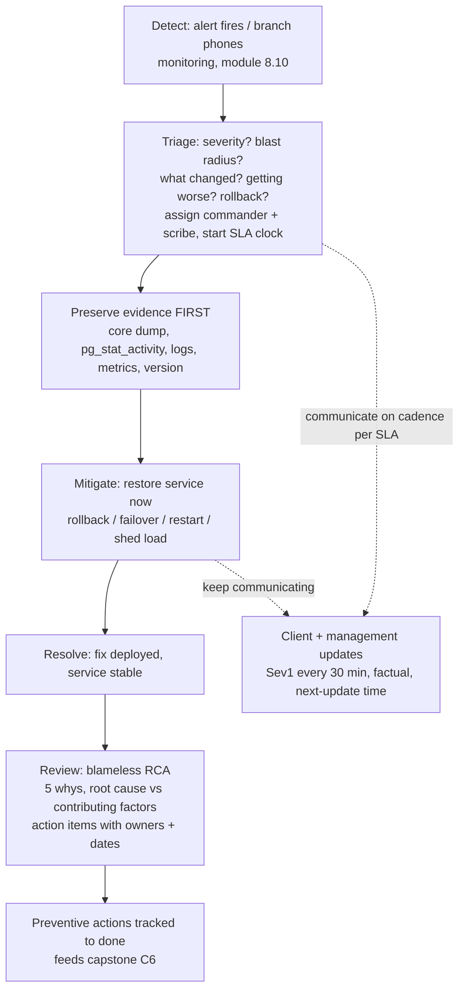

# Module 8.09: Incident triage and RCA writing

**Estimated hours:** 4

**What you will learn**

1. The incident lifecycle (detect, triage, mitigate, resolve, review), severity levels with banking examples, and a triage checklist you run in the first five minutes while the clock is ticking.
2. How to run a blameless root-cause analysis: the 5 whys, the difference between the root cause and contributing factors, action items with owners and dates, and communication cadence under an SLA.
3. A complete, formal RCA template (which capstone C6 copies to `capstones/crash-rca-lab/RCA-TEMPLATE.md`) and a fully worked example RCA for a real incident: an app-server crash from a use-after-free in the connection pool during a login burst.

**Prerequisites:** [Module 8.08: Latency percentiles and benchmarking](module-08-latency-percentiles-and-benchmarking.md). You should have module 8.06 (memory-corruption patterns, especially the use-after-free in the pool), 8.01-8.02 (GDB and core dumps), and 4.13 (the pooled request model) in mind. This module is mostly process and writing; there is no code to compile, but the worked RCA references the tools from 8.01-8.06.

---

## 1. One-line intuition

An incident is a fire: first you get everyone out and put it out (triage and mitigate), *then* you investigate why it started and how to stop it recurring (root-cause analysis), and you write that up in a calm, blameless document that names causes and fixes, not people.

## 2. Real-life analogy

A fire breaks out in a bank branch. The sequence is not negotiable:

1. **Detect.** The smoke alarm goes off (monitoring alerts).
2. **Triage.** The fire marshal decides how bad it is: a wastebasket or the whole floor? (severity). Who needs to know, who needs to act.
3. **Mitigate.** Get people out and contain the fire with an extinguisher. You do *not* first investigate which wire sparked; you stop the harm. (Restore service first.)
4. **Preserve evidence.** Before the cleaners come, the investigators photograph the scene. (Capture dumps and logs before restarting.)
5. **Resolve.** The fire is out, the branch reopens.
6. **Review.** Days later, a calm report: the cause was a frayed cable behind the printer, worsened by a propped-open fire door and an extinguisher that was past its service date. Action items: replace the cable, fix the door closer, set a maintenance schedule. The report blames the *cable and the process*, not the person who plugged in the printer.

A root-cause analysis document is that fire report. Its job is not to assign blame; it is to make sure the next branch does not burn. A good one is so clear that a reader who was not there understands exactly what happened, how long it hurt, why, and what changed so it will not happen again.

## 3. Why it exists: the problem it solves

When a production system fails at a bank, three things are true at once: customers are harmed (branches cannot disburse loans, auditors notice), the clock is running against a contractual SLA (module 8.10), and everyone is stressed and tempted to do the wrong thing (restart blindly, guess, hide the cause, blame a colleague).

Incident process exists to impose order on that chaos:

- **A lifecycle** so nobody skips mitigation to investigate (customers keep suffering) or skips the review (it happens again next week).
- **Severity levels** so the response matches the harm: you do not wake the CTO for a cosmetic bug, and you do not treat "branches cannot disburse" as a ticket for next sprint.
- **A triage checklist** so under stress you still ask the questions that matter: what changed, how big is the blast radius, is it getting worse, can we roll back.
- **Blameless RCA** so engineers report the truth. The moment an RCA punishes a person, people stop reporting the real cause, and you lose the only thing that prevents recurrence: honest information. The cause of almost every incident is a *system* that let a human mistake reach production, so the fix is in the system (a test, a guard, a review), not in the human.
- **A formal written document** because an incident that is "resolved" but not written up teaches nobody, cannot be audited, and cannot be shown to the client whose SLA you owe.

Without this, a bank's support team lurches from fire to fire, the same bug recurs, the SLA penalties mount, and the client loses trust. With it, each incident makes the system a little harder to break. That is the whole of claim H5 ("crash-dump and live-incident debugging with formal RCA documents delivered under support SLAs"): not just finding the bug, but running the incident and writing the document the client reads.

## 4. Three layers of depth

### Layer 1 (beginner): the lifecycle and severity

**The incident lifecycle.** Five phases, in order, no skipping:

1. **Detect.** Something tells you there is a problem: an alert fired, a branch phoned the help desk, a dashboard went red. Time-to-detect is a metric you want small.
2. **Triage.** Assess severity and blast radius; assemble who is needed; start the clock and the communication. This is the first five minutes.
3. **Mitigate.** Reduce or stop the harm *now*, even without understanding the cause: fail over to a replica, roll back the release, restart the stuck process, shed load, disable the broken feature. Mitigation is about the customer, not the bug.
4. **Resolve.** Service is back to normal and stable. (Mitigated and resolved are different: a rolled-back release mitigates; the fix that lets you roll forward resolves.)
5. **Review.** After the dust settles, the RCA: what happened, why, and what will change. This is where learning lives.

**Severity levels.** Every organisation defines its own; the shape is standard. Banking examples (stated as examples; your client's definitions govern):

| Severity | Meaning | Banking example | Typical response |
|---|---|---|---|
| **Sev1 (critical)** | Core business stopped; many customers; money or compliance at risk | Branches nationwide cannot disburse approved loans; the app server is down | All hands, immediate, 24/7, exec informed, SLA clock running hot |
| **Sev2 (major)** | Major function degraded; a region or large subset affected; workaround painful | Logins take 30 s during the morning peak; one region's branches time out | Urgent, on-call engaged, client informed, worked in business hours+ |
| **Sev3 (minor)** | Limited impact; a workaround exists | A report export fails for one product type; one non-critical screen errors | Normal priority, next business day, tracked |
| **Sev4 (cosmetic)** | No functional impact | A label is misspelt; a log is noisy | Backlog |

The severity decides everything downstream: who is paged, how often you communicate, and how fast the SLA clock demands a response. Getting severity right in triage is the single most important early decision; when unsure, start higher and downgrade.

### Layer 2 (working engineer): triage, mitigation, evidence, communication

**The triage checklist (the first five minutes).** Run these questions, in order, out loud, and write the answers in the incident channel:

1. **What is the symptom, precisely?** "Branches in the south region get `connection refused` from the app server since 09:05" beats "it's broken".
2. **What changed?** The highest-value question. A release, a config change, a deployment, a data migration, a cert that expired, a traffic spike (the morning login burst), a dependency's incident. Most incidents correlate with a recent change; find it first.
3. **What is the blast radius?** Who and how much: one branch or all, one product or all, 1% of requests or 100%. This sets severity.
4. **Is it getting worse, stable, or recovering?** A worsening incident (a leak growing, a queue filling) needs mitigation *now*; a stable one buys you a few minutes to think.
5. **Can we roll back or fail over?** The fastest mitigations. If a release 20 minutes ago correlates, rolling it back is usually the right first move even before you understand the bug.
6. **Who must be informed and engaged?** On-call, the incident commander, the client contact, and (for Sev1/2) management. Assign an **incident commander** (coordinates, decides) and a **scribe** (records the timeline) so responders can focus.

**Mitigate before root cause.** The hardest discipline for engineers: you want to understand the bug, but the customer wants service back. Restore first. A use-after-free crash-looping the app server: the mitigation is to restart it (and perhaps reduce the login concurrency that triggers it) to get branches working; the root-cause hunt happens afterward on the captured dump. Resist the urge to debug a down production system live while customers wait.

**Preserve evidence before you restart.** A restart often mitigates *and destroys the evidence*. Before you restart, capture, in this order of volatility (most perishable first):

- **Core dump / crash dump** of the crashed or stuck process (`gcore <pid>` for a live hang, or the auto-captured core for a crash; module 8.02 / 8.03). This is the most perishable and most valuable.
- **In-flight state snapshots:** for a database stall, `SELECT * FROM pg_stat_activity` (what every connection is doing, which queries are blocked and on what), `pg_locks`, and connection-pool metrics. For the app server, the thread states and pool queue depth.
- **Logs** around the incident window (they usually persist, but rotate; copy them aside).
- **Metrics** screenshots or exports (CPU, memory/RSS, request rate, error rate, latency), because retention may be short.
- **The current config and release version**, so the RCA can state exactly what was running.

The rule to say in an interview: "Before I restart to mitigate, I grab a core dump and a `pg_stat_activity` snapshot, because the restart is about to delete the only evidence of why it broke."

**Communication cadence under an SLA.** The client's SLA usually specifies both a response time (acknowledge within X) and an update cadence (status every Y) per severity. State these as *examples*; the contract governs. A typical shape:

| Severity | Acknowledge within | Update cadence | Who receives updates |
|---|---|---|---|
| Sev1 | 15 minutes | Every 30 minutes until mitigated | Client ops lead + management |
| Sev2 | 30 minutes | Every 60 minutes | Client ops lead |
| Sev3 | Next business day | Daily | Ticket |

The updates are short and factual: what is known, what is being done, what the next update time is. "09:20: app server crash-looping during login peak in south region (Sev1). Mitigation: restarting with reduced login concurrency; branches recovering. Next update 09:50." Never speculate about cause to a client mid-incident; report status and the plan. A missed update cadence is itself an SLA breach, so the scribe watches the clock.

### Layer 3 (internals): blameless RCA, 5 whys, root cause vs contributing factors

**Blameless culture, concretely.** Blameless does not mean "nobody is responsible" or "no consequences ever". It means the RCA describes *what the system allowed to happen* without punishing the individual who tripped the wire, because (a) the person acting in good faith with the information they had is almost never the real cause, and (b) punishment makes people hide information, which guarantees recurrence. Write "the deploy process had no staging soak, so the use-after-free reached production" not "Priya deployed a bad build". The second sentence teaches nothing and ensures the next engineer stays quiet.

**The 5 whys.** A technique to push past the symptom to a cause you can actually fix. Ask "why" repeatedly, each answer becoming the next question, until you reach something systemic. Worked on the incident this module uses:

1. **Why did branches get `connection refused`?** Because the app server process was crash-looping.
2. **Why was it crashing?** A SIGSEGV from a use-after-free: a worker wrote a response into a connection object that had already been returned to the pool and reused.
3. **Why was a reused object still being written?** The worker held a raw pointer to the connection; when the client disconnected mid-request, the acceptor returned the object to the pool, and a new client took the slot while the worker was still finishing.
4. **Why did a raw pointer outlive the object?** The pool handed out raw `Request*` pointers with no ownership transfer, so nothing prevented recycling while a worker was using one.
5. **Why did this reach production?** There was no sanitizer run under concurrent load in CI and no staging soak test, so a bug that only appears under a disconnect-during-burst race was never exercised before release.

Notice the "why" chain walks from the customer symptom (why 1) down through the technical cause (why 2-4) to the *systemic* cause (why 5: the process let it through). The **root cause** is usually the deepest "why" you have the power to fix: here, "the pool used unowned raw pointers" (the code cause) and "CI had no concurrent-sanitizer/soak gate" (the process cause). Both get action items.

**Root cause vs contributing factors.** The root cause is the thing that, had it not been true, the incident would not have happened. Contributing factors made it worse or more likely but were not sufficient alone:

- **Root cause:** the connection pool handed workers raw pointers with no ownership, allowing a recycled object to be written (a use-after-free).
- **Contributing factors:** the morning login burst (raised the rate of disconnect-during-request races); no concurrent-load sanitizer gate in CI (the bug was never caught); an aggressive client reconnect that increased mid-request disconnects; stack-smashing hardening was off so the crash signature was a confusing `corrupted top size` rather than a clean ASan report.

Separating these matters because you fix the root cause to *prevent* recurrence and you address contributing factors to *reduce likelihood and blast radius*. A good RCA lists both and does not pretend a single bullet explains everything.

**Action items with owners and dates.** An RCA that ends in insight but no action is a diary entry. Every action item has: a specific action, a named owner, and a due date, and is tracked to completion. Vague items ("improve testing") are useless; specific ones ("add a CI job that runs the test suite under TSan with 16 concurrent load_gen clients; owner: A. Kumar; due: 2026-02-15") get done.

**Client-facing language.** The version the client reads differs from the internal one in tone, not facts:

- State impact in the client's terms and with numbers: "approved loans could not be disbursed from 09:05 to 09:38 in the south region, affecting an estimated 140 branches and ~2,100 applications", not "the app server segfaulted".
- No internal blame, no jargon dumps, no speculation presented as fact. Explain the cause plainly: "a software defect in connection handling, triggered under peak login load, caused the server to restart repeatedly".
- Lead with what you did to restore service and what you are doing to prevent recurrence, with dates. Clients forgive incidents; they do not forgive "it might happen again and we don't know why".
- Be honest about what you do not yet know, and commit to a follow-up by a date.

## 5. Architecture diagram



## 6. Code: the formal RCA template and a worked example

There is no program to compile here. The "code" is the artefact you produce: a reusable RCA template, and a complete filled-in example. Capstone C6 copies this template verbatim to `capstones/crash-rca-lab/RCA-TEMPLATE.md` and writes one RCA per incident using it.

### 6a. The formal RCA template

```markdown
# Root Cause Analysis: <short incident title>

| Field | Value |
|---|---|
| Incident ID | INC-YYYY-NNNN |
| Severity | Sev1 / Sev2 / Sev3 |
| Client / system | <client name> / <system or service> |
| Status | Draft / In review / Final |
| Author | <name, role> |
| Reviewers | <names> |
| Date of incident | YYYY-MM-DD |
| Detected at | YYYY-MM-DD HH:MM TZ |
| Mitigated at | YYYY-MM-DD HH:MM TZ |
| Resolved at | YYYY-MM-DD HH:MM TZ |
| RCA published | YYYY-MM-DD |
| SLA clock | Acknowledged HH:MM (target X); mitigated within Y of detection (target Z) |

## 1. Summary
Two or three sentences a non-engineer can read: what broke, who was affected,
for how long, and the one-line cause. No jargon.

## 2. Impact
What customers experienced, in their terms, with numbers:
- Who: which branches/regions/products/users.
- What: which operations failed or were degraded.
- How much: counts (requests failed, branches affected, applications delayed),
  duration, and any money/compliance consequence.
- SLA: whether the response and update cadence targets were met.

## 3. Timeline
All times in one timezone. Facts only, one row per event.

| Time (TZ) | Event |
|---|---|
| HH:MM | First alert / first report |
| HH:MM | Incident declared Sev<N>, commander assigned |
| HH:MM | Evidence captured (core dump, pg_stat_activity, logs) |
| HH:MM | Mitigation applied (what) |
| HH:MM | Service confirmed recovered |
| HH:MM | Root cause identified |
| HH:MM | Fix deployed / incident closed |

## 4. Detection
How we found out, and how long it took. Was it an alert or a customer report?
If a customer found it before monitoring did, that is itself an action item.

## 5. Root cause
The single thing that, had it not been true, the incident would not have
happened. State it precisely, with the evidence that proves it (dump excerpt,
log line, query plan, sanitizer report). Reference the 5 whys.

## 6. Contributing factors
Conditions that made the incident more likely, worse, or harder to diagnose,
but were not sufficient alone. One bullet each.

## 7. Resolution
What was done to mitigate (restore service) and what was done to resolve
(the actual fix), separately. Include the code/config change and its verification.

## 8. Verification
How we confirmed the fix works and the incident cannot recur by the same path:
the test added, the sanitizer/soak run, the before/after numbers.

## 9. Preventive actions
| Action | Owner | Due | Status |
|---|---|---|---|
| Specific, verifiable action | Name | YYYY-MM-DD | Open/Done |

## 10. Lessons learned
What went well (keep doing), what went badly (stop doing), what we got lucky on.
Blameless: systems and processes, not individuals.

## Appendix: evidence
Dump excerpts, log snippets, query-plan output, sanitizer reports, graphs.
Raw material a future engineer can re-read.
```

### 6b. A fully worked example RCA

This is the login-burst use-after-free incident (module 8.06, section 7, incident 1; the 5 whys above). It is written the way you would deliver it, and capstone C6 produces one like it for each of its three incidents. Times and counts are illustrative.

```markdown
# Root Cause Analysis: App server crash-loop during morning login burst

| Field | Value |
|---|---|
| Incident ID | INC-2026-0042 |
| Severity | Sev1 |
| Client / system | Meridian Bank / loan-origination app server (RPC-over-TCP) |
| Status | Final |
| Author | S. Rahman, Systems Engineer (on-call) |
| Reviewers | Platform lead; Meridian ops liaison |
| Date of incident | 2026-02-03 |
| Detected at | 2026-02-03 09:07 IST |
| Mitigated at | 2026-02-03 09:38 IST |
| Resolved at | 2026-02-05 14:00 IST (fix deployed to production) |
| RCA published | 2026-02-06 |
| SLA clock | Acknowledged 09:12 (target 15 min: met); mitigated 31 min after detection (target 60 min for Sev1: met) |

## 1. Summary
On the morning of 3 February 2026, the loan-origination application server
repeatedly crashed and restarted during the 09:00 login peak, so branches in
the south region could not log in or disburse approved loans for about 31
minutes. The cause was a software defect in connection handling that is
triggered when a client disconnects in the middle of a request under heavy
concurrent load. Service was restored by restarting the server with reduced
login concurrency; a permanent fix was deployed on 5 February.

## 2. Impact
- Who: south-region branches connected to app-server node APP-2. An estimated
  140 branches.
- What: new logins and loan disbursement requests returned "connection refused"
  or timed out while the process was restarting.
- How much: approximately 2,100 login/disbursement attempts failed or were
  delayed between 09:07 and 09:38. No data was lost or corrupted; all affected
  applications were processable on retry after recovery. No incorrect
  disbursements occurred.
- SLA: Sev1 acknowledgement (15 min) and mitigation (60 min) targets were met.
  The 09:30 client update was sent 4 minutes late (action item PA-4).

## 3. Timeline
| Time (IST) | Event |
|---|---|
| 09:07 | Monitoring alert: APP-2 process restart count > 3 in 5 min; error rate spike |
| 09:10 | On-call paged; begins triage |
| 09:12 | Declared Sev1; incident commander and scribe assigned; client notified |
| 09:15 | Confirmed APP-2 crash-looping with SIGSEGV; APP-1 (north) healthy |
| 09:18 | Captured core dump of a crashed APP-2 process and app/server logs before any restart; snapshot of pool metrics taken |
| 09:22 | Correlated crashes with login-burst concurrency on APP-2; no recent release (ruled out change) |
| 09:34 | Mitigation: restarted APP-2 with login concurrency capped (pool admission lowered) to reduce the triggering race |
| 09:38 | Branches confirmed logging in and disbursing; incident mitigated |
| 11:00 | Core dump analysed under GDB; reproduced under ASan; root cause identified (use-after-free in connection pool) |
| 02-05 14:00 | Fix (ownership via move-only lease) deployed to all nodes; concurrency cap removed; incident resolved |

## 4. Detection
Detected by monitoring (process-restart-count and error-rate alerts) at 09:07,
before any branch complaint reached the help desk. Time-to-detect ~2 minutes
from the first crash. Detection worked as intended.

## 5. Root cause
A use-after-free in the application server's connection pool. Workers were
handed a raw `conn*`/`Request*` pointer with no ownership transfer. When a
client disconnected mid-request during the login burst, the acceptor returned
the connection object to the pool, a new client immediately took the recycled
slot, and the original worker then wrote its response into the now-reused
object, corrupting the heap. A later allocation detected the corruption and the
process aborted.

Evidence:
- The production core showed the abort inside `malloc` with
  `malloc(): corrupted top size` (a detection point, not the cause).
- Reproduced in staging under AddressSanitizer with a disconnect-during-burst
  load test; ASan reported `heap-use-after-free WRITE` in the response writer,
  with the free stack in the pool's `release()` and the allocation stack in the
  acceptor. (Full report in the appendix.)
- 5 whys: connection refused -> process crash-looping -> SIGSEGV from
  use-after-free -> worker held a raw pointer to a recycled object -> pool
  handed out unowned raw pointers -> no concurrent-load sanitizer gate caught it.

## 6. Contributing factors
- The 09:00 login burst raised the rate of mid-request client disconnects,
  making the race far more likely than at normal load.
- CI had no run of the test suite under TSan/ASan with concurrent load, so a
  race that only appears under a disconnect-during-burst was never exercised.
- The client app's aggressive reconnect-on-slow-response increased mid-request
  disconnects, feeding the race.
- `_FORTIFY_SOURCE`/clean sanitizer builds were not used in production, so the
  crash presented as a confusing `corrupted top size` abort rather than a clear
  signal, slowing diagnosis.

## 7. Resolution
- Mitigation (09:34): restarted APP-2 with login concurrency capped, reducing
  the race frequency enough to keep the service up.
- Resolution (02-05): the pool now transfers ownership to the worker via a
  move-only `RequestLease` (RAII); a connection object cannot be recycled while
  any worker holds its lease. Raw pointers to poolable objects are no longer
  passed across the worker boundary. The concurrency cap was then removed.

## 8. Verification
- Added a load test that disconnects clients mid-request at high concurrency;
  run under ASan and TSan it is now clean, where it previously reproduced the
  crash within seconds.
- 48-hour soak at 2x peak login concurrency in staging: zero restarts.
- Production monitored for one week post-deploy: process-restart count stayed
  at zero during login peaks.

## 9. Preventive actions
| Action | Owner | Due | Status |
|---|---|---|---|
| PA-1: Replace raw poolable pointers with move-only leases everywhere | S. Rahman | 2026-02-05 | Done |
| PA-2: Add CI job running tests under ASan+TSan with 16 concurrent load_gen clients | A. Kumar | 2026-02-15 | Open |
| PA-3: Add staging soak test at 2x peak before every release | Platform lead | 2026-02-20 | Open |
| PA-4: Automate client status updates so cadence cannot slip | Ops | 2026-02-18 | Open |
| PA-5: Ship production builds with hardening so corruption signals clearly | S. Rahman | 2026-02-28 | Open |

## 10. Lessons learned
- Went well: monitoring detected it before customers; evidence (core dump,
  metrics) was captured before the restart, which made same-day root-causing
  possible.
- Went badly: a known-risky pattern (raw pointers to pooled objects) had no
  automated gate; one client update slipped the cadence.
- Got lucky: the corruption aborted the process rather than silently writing a
  wrong value into a live request; had it not crashed, a wrong response could
  have been returned to a branch.
- Blameless note: the defect reached production because the delivery process had
  no concurrent-load sanitizer gate, not because of any individual's error.

## Appendix: evidence
- GDB backtrace of the production core (abort in `_int_malloc`,
  `malloc(): corrupted top size`).
- ASan `heap-use-after-free` report: WRITE in response writer; freed by
  `Pool::release`; allocated by `Acceptor::accept`.
- Pool metrics snapshot at 09:18: free-list near empty, recycle rate at peak.
- Restart-count and error-rate graphs, 09:00-10:00.
```

## 7. Use case: core-banking loan-origination platform

This module *is* the use case: the worked RCA above is the app server (claim H4) and the incident is the use-after-free from the pooled request model (claim H4's "pooled request model", module 4.13). The decisions it drove are real and concrete:

- **The decision to transfer ownership via a move-only lease** (PA-1) came directly from the RCA's root cause. The RCA is what turned "the server crashed" into "the pool must own, not lend, its objects", which is the design in module 4.13 and capstone C2.
- **The decision to add a concurrent-sanitizer CI gate** (PA-2) is the process fix that makes claim I's "Valgrind/ASan/TSan clean under a concurrent load generator" a *gate*, not a one-time check. The RCA is why that gate exists.
- **The decision to capture evidence before restarting** became a standing runbook step, because this RCA was only possible same-day thanks to the 09:18 core dump. A later incident that restarted first and lost the dump took three days to root-cause; the contrast is the argument.

The sentence to say in an interview, which is exactly claim H5: "I ran production incidents end to end under an SLA: triaged and set severity, captured the core dump and `pg_stat_activity` before mitigating, restored service first, then root-caused from the dump under GDB and reproduced under ASan, and wrote a blameless formal RCA with a timeline, the root cause with dump evidence, contributing factors, and action items with owners and dates. One of those RCAs is why the connection pool now transfers ownership instead of lending raw pointers."

Capstone C6 is built on this module: it gives you programs with a use-after-free, a leak, a deadlock and a data race, has you capture and analyse the dumps with the Phase 8 tools, and write one RCA per incident using the template in 6a. The template you see here is copied verbatim into `capstones/crash-rca-lab/RCA-TEMPLATE.md`.

## 8. Lab

No compilation; this lab is reading evidence and writing. Use a real crash you can produce (the use-after-free from module 8.06, section 6.4, is ideal) so your RCA is grounded in a dump you actually captured.

### Part A: triage a scenario (20 minutes)

You get this page: "09:05 alert: app-server error rate 60%, process restarting; south-region branches reporting login failures."

1. Write down, in order, your answers to the six triage-checklist questions (symptom, what changed, blast radius, getting worse, rollback/failover, who to inform).
2. Assign a severity using the Layer 1 table and justify it in one sentence.
3. State your first mitigation and why you chose it before understanding the cause.

Expected: a Sev1 (core business stopped, many branches, money at risk); first mitigation is restart/failover/roll-back with a concurrency cap; the justification names the customer, not the bug.

### Part B: preserve evidence (20 minutes)

1. Produce a crash: build the use-after-free program from module 8.06 (6.4) and run it so it aborts (or run the pooled-connection crash if you have the app server). Capture the core dump (ensure `ulimit -c unlimited`, or use `gcore` on a hung process).
2. List, in order of volatility, the evidence you would capture for a real app-server incident, and for each say why it is perishable. Include the `pg_stat_activity` snapshot and explain what it tells you.
3. Confirm you can reopen your captured core in GDB and get a backtrace (module 8.02).

Expected: a core file you can load; an ordered evidence list (core dump first, then in-flight DB/pool state, then logs, then metrics, then version); a GDB backtrace of the abort.

### Part C: 5 whys and root cause vs contributing factors (25 minutes)

1. For your captured crash, run the 5 whys from the customer symptom down to a systemic cause. Write all five.
2. State the single root cause and list at least three contributing factors.
3. For each, say whether you fix it to *prevent* recurrence (root cause) or to *reduce likelihood/blast radius* (contributing factor).

Expected: a why-chain that ends at a process/systemic cause; a crisp single root cause; contributing factors that are clearly *not* sufficient alone.

### Part D: write the RCA (35 minutes)

1. Copy the template from 6a into `journal/YYYY-MM-DD-rca-<incident>.md`.
2. Fill every section for your crash: summary (no jargon), impact (invent plausible numbers and label them as such), a timeline table, detection, root cause *with your actual GDB/ASan evidence in the appendix*, contributing factors, resolution (mitigation vs fix), verification, and at least three action items with owners and dates.
3. Write a two-paragraph client-facing version of the summary and impact, applying the Layer 3 language rules (client terms, numbers, no blame, lead with restore + prevent).

Expected: a complete RCA grounded in your own dump, plus a client-facing summary a non-engineer could read without alarm or confusion.

### Journal

The RCA you wrote in Part D *is* your journal entry; save it as above. Additionally, in a short note at the top, record: your triage answers and severity from Part A; your evidence-volatility list from Part B; and your 5-whys chain from Part C. You will reuse this entire exercise in capstone C6, where you write one RCA per incident using the same template.

## 9. Common mistakes and misconceptions

| Mistake | Why it is wrong | Consequence |
|---|---|---|
| Investigating the cause before mitigating | Customers keep suffering while you debug a down system | Longer outage, SLA breach, angrier client |
| Restarting before capturing evidence | The restart deletes the core dump and in-flight state | Days to root-cause, or never; recurrence |
| Blaming a person in the RCA | People stop reporting the truth; the real (systemic) cause is hidden | The same incident recurs; a culture of silence |
| Confusing root cause with a contributing factor | "The login burst caused it" is a trigger, not the root cause | Fixing the trigger (cap load) without fixing the bug; it returns |
| An RCA with insights but no action items | Learning is not captured as change | Nothing improves; the document is a diary |
| Action items with no owner or date | Nobody is accountable; nothing gets done | The preventive work never happens |
| Guessing the cause to the client mid-incident | You will be wrong and it is on record | Lost trust; contradicting yourself in the RCA |
| Treating "mitigated" as "resolved" | A capped/rolled-back system is not fixed | The incident reopens when the workaround is removed |
| Using the average to describe impact | Hides the worst-affected (module 8.08) | Understated impact; the client's own data contradicts you |

## 10. Resume link

- **Claim H5, "crash-dump and live-incident debugging with formal RCA documents delivered under support SLAs".** This module is the direct evidence. Say: "I ran incidents under an SLA: severity and triage in the first minutes, evidence captured before mitigating, service restored first, root cause found from the dump under GDB and confirmed under ASan, then a blameless formal RCA with timeline, root cause with evidence, contributing factors, and dated action items. One RCA drove the connection pool to transfer ownership instead of lending raw pointers." Use the section-6b RCA as your concrete artefact.
- **Claim F, "incident triage, formal RCA writing".** The lifecycle, the triage checklist, the 5 whys, and the template are the substance. Pair with 8.06 (recognising the corruption pattern) and 8.01-8.02 (reading the dump).
- **Soft-skill signal.** RCA writing shows communication and blameless-culture maturity, which banking clients weigh heavily. The client-facing-language rules are the part many engineers lack; demonstrating them sets you apart.

Likely follow-up: "Walk me through an incident you handled." Tell the section-6b story as a narrative: the page, the triage and severity call, capturing the core before the restart, the mitigation, the same-day root-cause under GDB+ASan, the ownership fix, and the CI gate you added so it cannot recur. End with what the RCA changed.

## 11. Interview questions

**Q1 (easy). What is the first thing you do when you are paged for a production incident: find the root cause or restore service? Why?**

<details>
<summary>Model answer</summary>

Restore service first (mitigate), then find the root cause. The customer cares about the service being back, not about the bug; and a down production system is the worst place to debug. So I triage (severity, blast radius, what changed), capture evidence (a core dump and in-flight state) so the later investigation is possible, then mitigate with the fastest safe option (roll back, fail over, restart, shed load). Only once service is stable do I root-cause from the captured evidence. The one subtlety is that mitigation often destroys evidence, so I grab the core dump and a `pg_stat_activity` snapshot *before* the restart.

</details>

**Q2 (easy). What does "blameless" mean in a root-cause analysis, and why does it matter?**

<details>
<summary>Model answer</summary>

Blameless means the RCA describes what the system and process allowed to happen, without punishing the individual who tripped the wire. It matters because the person acting in good faith with the information they had is almost never the real cause, and because punishing people makes them hide information, which is fatal: honest reporting is the only thing that prevents recurrence. So you write "the delivery process had no concurrent-load sanitizer gate, so the race reached production" rather than naming and blaming a deployer. Blameless is not "no accountability"; the action items are tracked and owned, but they fix systems, not people.

</details>

**Q3 (medium). Distinguish the root cause from a contributing factor, using an example.**

<details>
<summary>Model answer</summary>

The root cause is the thing that, had it not been true, the incident would not have happened; contributing factors made it more likely, worse, or harder to diagnose but were not sufficient alone. In the login-burst crash, the root cause was that the connection pool handed workers raw pointers with no ownership, so a recycled object could be written (a use-after-free). Contributing factors were the login burst (raised the race rate), the missing concurrent-sanitizer CI gate (let it through), and the client's aggressive reconnect (more mid-request disconnects). You fix the root cause to prevent recurrence (ownership via leases) and address contributing factors to reduce likelihood and blast radius (CI gate, load cap). Calling the login burst "the cause" would be the classic mistake: it is the trigger, and capping load without fixing the pointer bug just delays the next occurrence.

</details>

**Q4 (medium). The app server is crash-looping in production. You suspect memory corruption. Walk through the incident from page to RCA.**

<details>
<summary>Model answer</summary>

Triage: confirm the symptom (which branches, what error), check what changed (release, config, traffic), assess blast radius and severity (Sev1 if core business is down), assign a commander and scribe, start the SLA clock and client communication. Preserve evidence before touching anything: capture a core dump of a crashed process and a `pg_stat_activity`/pool-metrics snapshot and the logs, because the mitigation is about to destroy them. Mitigate: restore service with the fastest safe option, e.g. restart with reduced concurrency or fail over to a healthy node; confirm branches recover; keep the client updated on cadence. Investigate off the live system: load the core in GDB, read the backtrace (an abort in `malloc` with `corrupted top size` tells me corruption was detected late, not where it was caused), then reproduce under AddressSanitizer to get the exact out-of-bounds or use-after-free with both stacks. Run the 5 whys to the systemic cause. Resolve: deploy the real fix (here, ownership via a move-only lease so a pooled object cannot be recycled while a worker uses it), verify with a sanitizer+soak test that previously reproduced the crash, and monitor. Write the blameless RCA with the timeline, root cause plus the dump/ASan evidence, contributing factors, and dated action items (including a CI gate so it cannot recur), and deliver a client-facing version in plain language with impact numbers.

</details>

**Q5 (hard). Your SLA requires a Sev1 mitigation within 60 minutes and client updates every 30. You are 40 minutes in, service is still down, and you have two possible mitigations: a risky rollback that might fix it or might make it worse, and a safe but slow failover to a secondary that will take 25 minutes. What do you do and how do you communicate?**

<details>
<summary>Model answer</summary>

I optimise for restoring service within the SLA with acceptable risk, and I communicate the plan honestly. The safe failover takes 25 minutes, which lands at minute 65, just over the 60-minute target, so I start it immediately as the guaranteed path rather than gambling. In parallel, if I can do so without jeopardising the failover, I prepare (but do not yet fire) the rollback so that if the failover hits a snag I have a second option. I do not fire a risky rollback blind under time pressure unless I have strong evidence it is the cause (e.g. it correlates with a release 20 minutes before the incident), because making it worse resets the clock and destroys trust. For communication: at the 30-minute mark (already passed or imminent) I send a factual update: current status, that we are failing over to the secondary with an ETA of ~25 minutes, the risk, and the next update time; if I will breach the 60-minute mitigation target, I say so proactively with the new ETA rather than letting the client discover it. After recovery, the RCA records the near-breach and an action item to make this class of incident mitigable faster (e.g. automated failover, or a tested one-click rollback), because a 25-minute manual failover being the safe option is itself a weakness to fix. The judgement being tested is: prefer the guaranteed restore over the gamble, prepare a fallback, and never let the client be surprised by a missed target.

</details>

## 12. Revision

- The incident lifecycle is detect, triage, mitigate, resolve, review; mitigate (restore service) before you root-cause, but capture evidence (core dump, `pg_stat_activity`, logs, metrics, version) *before* the restart, because the restart destroys it.
- Triage in the first five minutes: symptom, what changed, blast radius, getting worse?, can we roll back/fail over?, who to inform; set severity (Sev1 = core business stopped) and communicate on the SLA cadence, factually, with a next-update time.
- A blameless RCA uses the 5 whys to reach a systemic root cause, separates it from contributing factors, and ends in dated, owned action items; the formal template (summary, impact with numbers, timeline, detection, root cause with evidence, contributing factors, resolution, verification, preventive actions, lessons, appendix) is copied to `capstones/crash-rca-lab/RCA-TEMPLATE.md` for capstone C6.

---

Previous: [Module 8.08: Latency percentiles and benchmarking](module-08-latency-percentiles-and-benchmarking.md) | Next: [Module 8.10: SLAs, SLOs and observability](module-10-slas-slos-and-observability.md)
