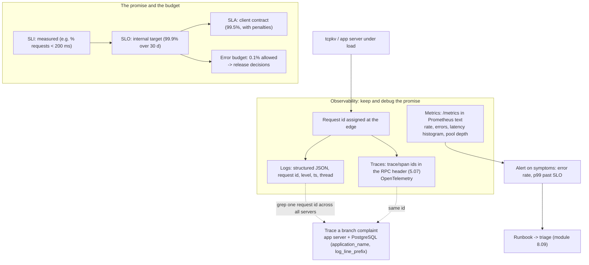

# Module 8.10: SLAs, SLOs and observability

**Estimated hours:** 3

**What you will learn**

1. The difference between an SLI, an SLO and an SLA, how error budgets turn an SLO into a release decision, and the availability-maths table every engineer should know (99.9% = 8.76 h/year down).
2. The three pillars of observability (logs, metrics, traces): structured JSON logging with a request id, metrics as counters/gauges/histograms exposed in Prometheus text format, and trace/span ids carried across services.
3. How to instrument a C++ server for production: a thread-safe structured logger, a `/metrics` endpoint, what to measure in tcpkv and the app server, and why a request id on every log line and RPC frame lets a branch complaint be traced across app server and database.

**Prerequisites:** [Module 8.09: Incident triage and RCA writing](module-09-incident-triage-and-rca-writing.md). You should have module 5.07 (the RPC frame with a request id), 5.08 (the tiny HTTP server), 4.13 (the pooled request model and master-table cache), and 8.08 (percentiles) in mind. Code verified on Ubuntu 24.04 in WSL2, gcc 13.3.

---

## 1. One-line intuition

An SLO is the promise you make about how good the service will be (say, 99.9% of requests succeed under 200 ms), observability is the instrumentation that lets you *tell whether you are keeping it* and *find out why when you are not*, and a request id threaded through every log line and network frame is what lets you follow one branch's complaint across every machine it touched.

## 2. Real-life analogy

A courier company promises customers: "99% of parcels arrive within two days." That promise is the **SLA** (the contract, with penalties if broken). Internally the operations team sets a slightly tighter target to stay safely inside the promise: "we aim for 99.5% within two days" — that internal goal is the **SLO**. To know whether they are meeting it, they measure the actual delivery time of every parcel — each measurement is an **SLI** (a service level indicator).

Now a customer phones: "where is my parcel?" The company can answer because every parcel has a **tracking number** printed on it and scanned at every depot. They type the number and see the whole journey: picked up 09:00, left the hub 11:00, stuck at the sorting centre since 14:00. The tracking number is the **request id**; the scans are **log lines** and **spans**; the depot dashboards showing parcels-per-hour and backlog are **metrics**. Without the tracking number, "where is my parcel?" is unanswerable. With it, one lookup tells the whole story across every depot.

Everything in this module is either the promise (SLI/SLO/SLA/error budget) or the tracking system that lets you keep it and debug it (logs, metrics, traces, request ids).

## 3. Why it exists: the problem it solves

Two problems, one per half of the module.

**You cannot manage what you have not defined or measured.** "The service should be fast and reliable" is not a target; it cannot be met or missed, so it drives no decisions. You need a precise, measured target (an SLO on a percentile) and a way to know your current standing against it. Otherwise every release is a gamble, every "is it slow?" is an argument, and every SLA breach is a surprise. The **error budget** turns the SLO into the single most useful management tool in reliability: if you promise 99.9% and you are currently at 99.95%, you have budget to spend on risky changes; if you are at 99.85%, you have overspent and must stop shipping features and fix reliability. It replaces opinion ("is it safe to deploy?") with arithmetic.

**When something breaks, you must find out why, fast, across many machines.** A loan request touches the branch client, the app server, the master-table cache, the database, maybe a replica. When a branch complains that "application 10042 is stuck", you need to follow that one request through all of them. Without instrumentation you are blind: you restart things and hope. With the three pillars — **logs** (what happened, in detail, per event), **metrics** (aggregate numbers over time: rate, errors, latency), **traces** (one request's path across services) — and a **request id** that ties them together, you type one id and see the whole journey, exactly like the parcel tracking number. This is what makes the incident triage of module 8.09 possible at all, and it is the difference between a three-minute diagnosis and a three-day one.

Why it matters for the resume: claim H5 (incidents under an SLA) and the app server's banking context both require this. The specific banking decision — request ids on every log line and RPC frame, and PostgreSQL's `log_line_prefix`/`application_name` set so a branch complaint can be traced across app server and database — is a concrete, defensible design story.

## 4. Three layers of depth

### Layer 1 (beginner): SLI, SLO, SLA, and availability maths

Three terms, often confused, precisely:

- **SLI (Service Level Indicator):** a *measurement* of some aspect of service quality. Examples: the fraction of requests that returned success; the fraction served faster than 200 ms; the fraction of minutes the service was reachable. An SLI is a number you compute from real data (the percentiles of module 8.08 are SLIs).
- **SLO (Service Level Objective):** an internal *target* for an SLI, over a window. Example: "99.9% of requests succeed, measured over 30 days" or "p99 latency < 200 ms over 7 days". The SLO is what the team commits to and designs for.
- **SLA (Service Level Agreement):** a *contract* with the customer that includes SLO-like targets *and consequences* (penalties, credits) for missing them. The SLA is usually looser than the internal SLO, so the team has a safety margin: you might promise the client 99.5% (SLA) but target 99.9% internally (SLO), so you notice and react before the contractual line is crossed.

The relationship: **SLI is what you measure, SLO is what you aim for, SLA is what you promise (and pay for if you miss).** You set the SLO tighter than the SLA on purpose.

**Availability maths.** Availability SLOs are stated in "nines", and you must know what each costs in real downtime, because "99.9%" sounds the same as "99.99%" to a non-engineer but is ten times the downtime:

| Availability | Downtime per year | Downtime per month (30 d) | Downtime per day |
|---|---|---|---|
| 99% ("two nines") | 3.65 days | 7.2 hours | 14.4 minutes |
| 99.9% ("three nines") | 8.76 hours | 43.8 minutes | 1.44 minutes |
| 99.95% | 4.38 hours | 21.9 minutes | 43 seconds |
| 99.99% ("four nines") | 52.6 minutes | 4.38 minutes | 8.6 seconds |
| 99.999% ("five nines") | 5.26 minutes | 26.3 seconds | 0.86 seconds |

Read it the useful way: 99.9% allows about 8.76 hours of downtime a *year*, which is only about 44 minutes a *month*. A single bad deploy that takes you down for an hour blows a 99.9% monthly budget by itself. Each extra nine is ten times harder and roughly ten times more expensive (redundancy, failover, on-call). You choose the number the business actually needs, not the biggest one.

**Latency SLOs are on percentiles, never the average** (module 8.08). "p99 < 200 ms over 7 days" is a real SLO; "average < 200 ms" is almost meaningless because the average hides the tail the SLO exists to control.

### Layer 2 (working engineer): error budgets, and the three pillars

**Error budget.** If your SLO is 99.9% success over 30 days, then 0.1% failure is *allowed* — that 0.1% is your **error budget**. Over 30 days and, say, 100 million requests, the budget is 100,000 failed requests. The budget reframes reliability as a quantity you spend:

- If you have budget left (you are above the SLO), you can afford risk: ship features, do the risky migration, run an experiment. Spending budget on purpose is fine; a budget you never spend means your SLO is too loose or you are shipping too slowly.
- If you have overspent (you are below the SLO), you *stop shipping features* and spend engineering on reliability until you are back in budget. This is a pre-agreed rule, not a negotiation per incident, which is why it defuses the eternal "features vs reliability" fight.

The error budget is what makes the release decision objective: "we have 40% of this month's budget left, the change is low risk, ship it" vs "we are already over budget, freeze features". It directly connects to module 8.09: every incident spends budget, and the RCA's action items are how you stop over-spending.

**The three pillars of observability.**

1. **Logs** — a timestamped record of discrete events, as much detail as you can afford. "What happened, exactly, for this event." Best as **structured** lines (key-value or JSON) so they are machine-parseable and searchable, not free text. Logs are high-detail but expensive at volume; you sample or lower the level in production.
2. **Metrics** — numeric measurements aggregated over time: request rate, error rate, latency distribution, queue depth, memory. "How is the system doing in aggregate, right now and historically." Cheap (a few numbers per time window), perfect for dashboards and alerts, but they cannot tell you about one specific request.
3. **Traces** — the path of *one* request across services, as a tree of **spans** (one span per operation: the app-server handling, the cache lookup, the DB query), tied together by a **trace id**. "Where did this one request spend its time, across every machine." Traces answer "why was *this* request slow" in a way metrics (aggregate) and logs (per-machine) cannot alone.

The three are complementary: metrics tell you *that* something is wrong and alert you; traces tell you *where* across services; logs tell you *exactly what* at the point of failure. A request id (and trace id) threaded through all three is what lets you pivot between them: see a latency spike on a metric, find the slow trace, read its logs.

**The three questions a metric answers, and the RED/USE shapes.** A useful convention for a request-serving service is **RED**: **R**ate (requests/sec), **E**rrors (failed requests/sec), **D**uration (latency distribution). For a resource it is **USE**: **U**tilisation, **S**aturation, **E**rrors. You will measure RED for tcpkv and the app server.

**Alert on symptoms, not causes.** Alert on what the user feels — error rate up, p99 latency past the SLO, requests failing — not on every internal metric (CPU at 80% is not itself a problem if latency is fine). A page should mean "a user is being hurt or soon will be", or on-call gets alert fatigue and ignores the one that matters. Causes belong on dashboards you consult *after* a symptom alert fires.

**Runbooks.** Each alert links to a short runbook: what the alert means, how to confirm it, the first mitigations, and whom to escalate to. The runbook is what turns a 3 a.m. page into a 5-minute mitigation instead of a panicked improvisation; it is the operational twin of module 8.09's triage checklist.

### Layer 3 (internals): request ids, trace context, and logging trade-offs

**The request id.** A unique id assigned to each incoming request at the edge (the app server's acceptor) and then carried through everything that request touches: put it on every log line, in the RPC frame to the database tier, in the metrics labels where cardinality allows, and return it to the client. When a branch complains "application 10042 failed at 09:12", you grep for its request id and see every log line it produced on every server, in order. The RPC layer from module 5.07 already carries a `req_id` in its frame header *for correlation of replies to requests*; the observability request id is the same idea extended end to end and persisted in logs. (They can be the same value or the request id can be a higher-level logical id; the key is that it is logged everywhere.)

**Trace context and spans.** A trace is a tree: a root span (the whole request) with child spans (each service/operation). Each span has a **trace id** (same for the whole request) and a **span id** (unique per operation), plus the parent span id. Propagating the trace id to the next service is "context propagation": you put it in the request header (an RPC field, or an HTTP `traceparent` header). **OpenTelemetry** is the vendor-neutral standard for this: a set of APIs and a wire format (`traceparent`/`tracestate` headers, the W3C Trace Context standard) so traces work across services written in different languages and viewed in tools like Jaeger or Tempo. For this course you do not need a full OpenTelemetry deployment; you need to understand that a trace id in the RPC header (module 5.07) is the mechanism, and that OpenTelemetry is what standardises it.

**Structured logging trade-offs.** A production logger must be thread-safe and cheap. The two designs:

- **One mutex around the write** (the logger in section 6a): simple, correct, and the serialization point is only the `write` call, not the formatting. Each thread formats its line into a local string, then takes the mutex only to append it. Good enough for most servers; the mutex is held for microseconds.
- **Per-thread buffers** (lock-free on the hot path): each thread writes into its own buffer with no lock; a background thread drains and merges them. Faster under extreme logging rates and avoids any contention, at the cost of complexity, memory, and out-of-order merging (you sort by timestamp). You choose this only when profiling (module 8.07) shows the log mutex is a bottleneck.

The rule: format off-lock, hold the lock only for the append/write, and never do I/O (the actual disk write) while holding a lock that the hot path needs — or better, hand lines to a dedicated writer thread. Logging at the wrong level or too verbosely is itself a performance bug: a `DEBUG` log per request in a hot loop can dominate the profile.

**What you must never log (banking).** Never log PII or cardholder data: no full card numbers (PAN), no CVV, no passwords, no full PAN/Aadhaar in the clear, no raw KYC documents. This is both a security requirement and a PCI-DSS/regulatory one (module 11.05). Log the *request id* and *references* (a customer id, an application id), not the sensitive values themselves. A log line is a copy of data that leaks easily (it is shipped to log aggregators, read by many); treat it as a public surface. Redact at the logging call, not later.

## 5. Architecture diagram



## 6. Code

### 6a. A thread-safe structured JSON logger

About 60 lines of C++17: format off-lock, hold one mutex only for the write, emit JSON lines with request id, level, timestamp and thread id. (Verified to build and run.)

```cpp
// jlog.cpp - a tiny structured JSON-lines logger, thread-safe with one mutex.
//   g++ -std=c++17 -O2 -Wall -Wextra -Werror -pthread jlog.cpp -o jlog
#include <chrono>
#include <cstdio>
#include <mutex>
#include <sstream>
#include <string>
#include <thread>

enum class Level { Info, Warn, Error };
static const char* name(Level l) {
    return l == Level::Info ? "INFO" : l == Level::Warn ? "WARN" : "ERROR";
}

class JsonLogger {
public:
    explicit JsonLogger(std::FILE* out) : out_(out) {}

    void log(Level lvl, const std::string& msg, const std::string& req_id) {
        using namespace std::chrono;
        // --- format OFF the lock ---
        auto now = system_clock::now();
        long long ms = duration_cast<milliseconds>(now.time_since_epoch()).count();
        std::ostringstream tid; tid << std::this_thread::get_id();
        std::ostringstream line;
        line << "{\"ts\":" << ms
             << ",\"level\":\"" << name(lvl) << "\""
             << ",\"thread\":\"" << tid.str() << "\""
             << ",\"req_id\":\"" << req_id << "\""      // the correlation id
             << ",\"msg\":\"" << msg << "\"}\n";          // never log PII here
        std::string s = line.str();
        // --- hold the lock ONLY for the write ---
        std::lock_guard<std::mutex> g(mu_);
        std::fwrite(s.data(), 1, s.size(), out_);
    }

private:
    std::FILE* out_;
    std::mutex mu_;
};

int main() {
    JsonLogger log(stdout);
    log.log(Level::Info,  "loan application created", "req-abc-1");
    log.log(Level::Error, "database timeout",          "req-abc-2");
    return 0;
}
```

```bash
g++ -std=c++17 -O2 -Wall -Wextra -Werror -pthread jlog.cpp -o jlog
./jlog
```

Expected output (real run; `ts` and `thread` vary):

```text
{"ts":1792385066608,"level":"INFO","thread":"129746200393536","req_id":"req-abc-1","msg":"loan application created"}
{"ts":1792385066625,"level":"ERROR","thread":"129746200393536","req_id":"req-abc-2","msg":"database timeout"}
```

Each line is one JSON object, so a log aggregator can index on `req_id`, `level` and `ts`. The `req_id` is the whole point: grep `req-abc-2` across every server's logs and you get that request's full story. (A production logger adds level filtering, log rotation, and a dedicated writer thread; the trade-off between this one-mutex design and per-thread buffers is in Layer 3.)

### 6b. A `/metrics` endpoint in Prometheus text format

The metrics themselves as counters/gauges/histograms, rendered in the Prometheus exposition text format a scraper understands. (Verified to build and run; this `render()` is what the `/health`-style HTTP server from module 5.08 would return for a `GET /metrics`.)

```cpp
// metrics.cpp - render counters/gauges/histograms as Prometheus text.
//   g++ -std=c++17 -O2 -Wall -Wextra -Werror -pthread metrics.cpp -o metrics
#include <atomic>
#include <cstdio>
#include <string>

struct Metrics {
    std::atomic<long> requests{0};        // counter: total requests
    std::atomic<long> errors{0};          // counter: total errors
    std::atomic<long> active_conns{0};    // gauge: connections right now
    // histogram buckets (cumulative handled in render): <=1ms, <=10ms, rest
    std::atomic<long> le_1ms{0}, le_10ms{0}, le_inf{0};

    std::string render() const {
        std::string o;
        o += "# TYPE app_requests_total counter\n";
        o += "app_requests_total " + std::to_string(requests.load()) + "\n";
        o += "# TYPE app_errors_total counter\n";
        o += "app_errors_total " + std::to_string(errors.load()) + "\n";
        o += "# TYPE app_active_connections gauge\n";
        o += "app_active_connections " + std::to_string(active_conns.load()) + "\n";
        o += "# TYPE app_request_latency_ms histogram\n";
        long b1  = le_1ms.load();
        long b10 = b1 + le_10ms.load();            // Prometheus buckets are cumulative
        long inf = b10 + le_inf.load();
        o += "app_request_latency_ms_bucket{le=\"1\"} "    + std::to_string(b1)  + "\n";
        o += "app_request_latency_ms_bucket{le=\"10\"} "   + std::to_string(b10) + "\n";
        o += "app_request_latency_ms_bucket{le=\"+Inf\"} " + std::to_string(inf) + "\n";
        return o;
    }
};

int main() {
    Metrics m;
    m.requests += 1200; m.errors += 3; m.active_conns = 17;
    m.le_1ms = 1000; m.le_10ms = 180; m.le_inf = 20;
    std::fputs(m.render().c_str(), stdout);
    return 0;
}
```

```bash
g++ -std=c++17 -O2 -Wall -Wextra -Werror -pthread metrics.cpp -o metrics
./metrics
```

Expected output (real run):

```text
# TYPE app_requests_total counter
app_requests_total 1200
# TYPE app_errors_total counter
app_errors_total 3
# TYPE app_active_connections gauge
app_active_connections 17
# TYPE app_request_latency_ms histogram
app_request_latency_ms_bucket{le="1"} 1000
app_request_latency_ms_bucket{le="10"} 1180
app_request_latency_ms_bucket{le="+Inf"} 1200
```

A **counter** only goes up (total requests, total errors); a scraper computes rates by differencing over time. A **gauge** goes up and down (connections now, queue depth). A **histogram** has cumulative buckets (`le="10"` includes everything `<= 10 ms`, so it is `b1 + b10`); the scraper computes p50/p99 from the buckets, which is the HDR-style idea from module 8.08. To serve this live, drop `render()` into the module 5.08 server's handler for `GET /metrics` and return it with `Content-Type: text/plain`. Use `std::atomic` so the hot path increments without a lock.

## 7. Use case: core-banking loan-origination platform

**What to measure, in tcpkv and the app server.** The RED metrics plus the ones specific to the pooled architecture (module 4.13):

| Metric | Type | Why it matters |
|---|---|---|
| requests total (by op: GET/SET, CREATE_LOAN, GET_LOAN) | counter | Rate; the R in RED |
| errors total (by kind: busy, bad request, DB error) | counter | The E in RED; feeds the error budget |
| request latency | histogram | The D in RED; the p99 the SLO is written on |
| active connections | gauge | Load; detects connection leaks (ever-rising) |
| pool queue depth / rejects (acquire returned null) | gauge + counter | Backpressure firing (module 5.10); the knee from 5.11 |
| DB connection-pool in-use | gauge | The downstream bottleneck (module 6.12) |
| master-table cache hit ratio | gauge | Whether the cache is doing its job (module 4.13); a drop means joins returned to the hot path |

A sudden drop in cache hit ratio, or a rising pool-reject counter, is exactly the kind of symptom you alert on and that points triage (module 8.09) at the right place in minutes.

**The banking decision: request ids everywhere, traced across app server and database.** The lending platform's single most valuable observability decision was that **every log line and every RPC frame carries a request id, and PostgreSQL is configured to log it too**, so a branch complaint can be followed from the app server into the database:

- The app server assigns a request id at the acceptor, logs it on every line (section 6a), and puts it in the RPC frame to any downstream service (the `req_id` from module 5.07, extended as the logical request id).
- On the database side, the app server sets libpq's `application_name` to include the request id (or a per-session id), and PostgreSQL's `log_line_prefix` is set to include `%a` (application_name), `%p` (pid) and a timestamp, so every slow-query log line and every row in `pg_stat_activity` can be tied back to the originating request. (`log_line_prefix = '%m [%p] %a '` is a typical setting.)
- Result: when a branch says "application 10042 was stuck at 09:12", support greps the request id in the app-server logs, sees it dispatched a query at 09:12, finds that query in the PostgreSQL log by the same `application_name`, and sees it waited on a lock in `pg_stat_activity` — the whole cross-tier story from one id. This is what made the incident in module 8.09 root-causable, and it is the concrete form of claim H5's "live-incident debugging".

**The SLO decision.** The team's latency SLO was written as "p99 of loan-create under 500 ms over 7 days" (a percentile, per module 8.08), with an internal SLO tighter than the client SLA so a breach was caught before the contractual line. The error budget drove the release rule: during the index-tuning work (claim H7) the budget was healthy, so risky plan changes could be trialled; after an incident spent budget, feature work paused for the reliability action items from the RCA. **Decision the whole module drove:** reliability became a measured quantity with a budget and a release rule, not an argument.

## 8. Lab

Build `jlog` and `metrics` from section 6. If you have the module 5.08 HTTP server, wire `render()` into a `GET /metrics` handler; otherwise test `render()` standalone.

### Part A: SLI/SLO/SLA and availability maths (20 minutes)

1. Write one-sentence definitions of SLI, SLO and SLA in your own words, and state which is measured, which is the internal target, and which is the contract.
2. From the availability table, compute: how much monthly downtime does 99.9% allow? How much does 99.99%? If a single deploy takes you down for 30 minutes, which monthly SLOs does it blow by itself?
3. Your SLO is 99.9% success over 30 days and you serve 50 million requests. How many failed requests is your error budget? If you have used 70,000, should you ship a risky change? Justify in one sentence.

Expected: SLI measured, SLO internal target, SLA contract (looser, with penalties); 99.9% ≈ 43.8 min/month, 99.99% ≈ 4.38 min/month; a 30-min outage blows the 99.99% and 99.95% monthly budgets but not 99.9%; budget = 50,000; 70,000 used means you are over budget, so freeze risky changes.

### Part B: the structured logger (20 minutes)

1. Build and run `jlog`. Confirm each line is valid JSON (pipe to `python3 -c 'import sys,json;[json.loads(l) for l in sys.stdin]'` to validate).
2. Add a `req_id` field you pass through two log calls simulating one request's two events, then `grep` that id to show you can isolate one request. 
3. Make four threads each log 1000 lines with distinct req_ids; confirm no line is interleaved/corrupted (every line is complete JSON). Write one sentence on what the mutex protects and what it does *not* (the formatting).

Expected: valid JSON per line; grepping a req_id isolates one request; under four threads every line is intact (the mutex serialises the write), and formatting happens off-lock.

### Part C: the metrics endpoint (25 minutes)

1. Build and run `metrics`. Confirm the Prometheus text format and that the histogram buckets are cumulative (`le="10"` >= `le="1"`).
2. Add an `errors_total` increment path and a second op label (e.g. `GET`/`SET`), and re-render. 
3. If you have the 5.08 server, serve `render()` from `GET /metrics` and `curl localhost:8080/metrics`. Explain in one sentence why counters are rendered as totals (not rates) and how a scraper gets a rate from them.

Expected: cumulative buckets; a scraper differences a counter over time to get a rate; a gauge is a current value.

### Part D: trace a request across tiers (25 minutes)

1. On the `pg16` container, set `log_line_prefix` to include `%a` and connect with libpq (or psql) setting `application_name` to a fake request id: `psql "host=localhost user=postgres application_name=req-abc-2"`. Run a query, then find it in the PostgreSQL log (`docker logs pg16` or the log file) and confirm your request id appears in the prefix.
2. Run `SELECT pid, application_name, state, query FROM pg_stat_activity;` and find your session by `application_name`. 
3. Write the end-to-end story in two sentences: a branch complains about request `req-abc-2`; show how you would grep the app-server log (your `jlog` output) and the PostgreSQL log for that id to reconstruct what happened across both tiers.

Expected: the request id appears in the PostgreSQL log prefix and in `pg_stat_activity.application_name`; grepping the same id in both the app log and the DB log reconstructs the cross-tier path.

### Journal

Copy [journal/TEMPLATE.md](../journal/TEMPLATE.md) to `journal/YYYY-MM-DD-slos-and-observability.md`. Record: your SLI/SLO/SLA definitions and the availability-maths answers from Part A; the JSON-validity and thread-safety observations from Part B; the cumulative-bucket and counter-vs-rate notes from Part C; and the cross-tier trace you reconstructed in Part D, including the `log_line_prefix` and `application_name` you used. Note which banking data you deliberately did *not* log and why (link to module 11.05).

## 9. Common mistakes and misconceptions

| Mistake | Why it is wrong | Consequence |
|---|---|---|
| Using SLI, SLO and SLA interchangeably | They are the measurement, the target and the contract; the SLA is looser than the SLO on purpose | Breaching the client contract because the internal target had no margin |
| An availability SLO with no idea of the downtime it allows | 99.9% is 8.76 h/year; 99.99% is ten times tighter and costlier | Promising a number the system and budget cannot meet |
| A latency SLO on the average | The mean hides the tail (module 8.08) | Green SLO while the p99 users suffer |
| Free-text logs | Not machine-parseable or searchable at scale | You cannot grep by request id or field; slow incidents |
| No request id | Cannot follow one request across machines | "Where is application 10042?" is unanswerable |
| Logging PII / card data | Logs are copied widely and read by many; PCI/regulatory breach | Data leak, compliance failure (module 11.05) |
| Alerting on causes (CPU 80%) not symptoms | Most cause-alerts are not user-visible problems | Alert fatigue; the real page gets ignored |
| Holding the log mutex during the disk I/O | Serialises the hot path on I/O latency | Logging becomes the bottleneck under load |
| Treating metrics as able to explain one request | Metrics are aggregates; they cannot isolate a single request | You see "p99 up" but cannot find which request; need traces/logs |

## 10. Resume link

- **Claim H5, "live-incident debugging under SLAs".** The observability half is what makes it possible. Say: "Every request carried an id on every log line and in the RPC frame, and PostgreSQL's `log_line_prefix` and `application_name` were set to that id, so a branch complaint could be traced from the app server into the database and `pg_stat_activity` in one grep. That is how we root-caused incidents in minutes instead of days." Tie it to the module 8.09 RCA.
- **Claim H4 / H7, the app server.** The RED metrics plus pool-queue-depth, DB-pool-in-use and cache-hit-ratio are the dashboard that showed the backpressure knee (module 5.11) and the login-latency tail (claim H7). Error budgets drove the release decision during index tuning.
- **Claim F / general seniority.** Knowing the SLI/SLO/SLA distinction, the availability maths, error budgets, and alert-on-symptoms is the vocabulary of a reliability-literate engineer; it is often probed in system-design and behavioural rounds.

Likely follow-up: "What is the difference between an SLO and an SLA, and what is an error budget for?" Answer with Layer 1 and Layer 2: SLI measured, SLO internal target (tighter), SLA the client contract with penalties; the error budget is the allowed failure (1 − SLO) that you spend on risk and that triggers a feature freeze when overspent.

## 11. Interview questions

**Q1 (easy). What is the difference between an SLI, an SLO and an SLA?**

<details>
<summary>Model answer</summary>

An SLI is a measured indicator of service quality, like the fraction of requests served under 200 ms or the fraction of minutes the service was up. An SLO is an internal target for an SLI over a window, like "99.9% of requests succeed over 30 days" or "p99 < 200 ms over 7 days". An SLA is a contract with the customer that includes targets like an SLO plus consequences (penalties or credits) for missing them. In short: SLI is what you measure, SLO is what you aim for, SLA is what you promise and pay for. You deliberately set the SLO tighter than the SLA so you have a safety margin and notice problems before the contractual line is crossed.

</details>

**Q2 (easy). How much downtime a year does a 99.9% availability SLO allow, and roughly how much does 99.99%?**

<details>
<summary>Model answer</summary>

99.9% ("three nines") allows about 8.76 hours of downtime per year, which is about 43.8 minutes per month. 99.99% ("four nines") allows about 52.6 minutes per year, about 4.38 minutes per month — roughly ten times tighter. Each extra nine is about ten times harder and more expensive, needing more redundancy, automated failover and tighter operations. So you pick the number the business actually needs, because a single hour-long bad deploy already blows a 99.99% monthly budget many times over and even eats most of a 99.9% monthly budget.

</details>

**Q3 (medium). What is an error budget and how does it change how you decide whether to ship a risky change?**

<details>
<summary>Model answer</summary>

The error budget is the amount of failure your SLO permits: if the SLO is 99.9% success, the budget is 0.1% of requests over the window. It turns reliability into a quantity you spend. If you are above the SLO with budget remaining, you can afford risk — ship the feature, do the migration — because occasional failures are within what you promised. If you have overspent (you are below the SLO), you stop shipping features by a pre-agreed rule and spend engineering on reliability until you are back in budget. This makes the "ship or not" decision objective arithmetic instead of an argument, and it defuses the perpetual features-vs-reliability fight because the rule is agreed in advance. Every incident spends budget, so the RCA action items are how you stop over-spending.

</details>

**Q4 (medium). You have logs, metrics and traces. For each, give one question it answers that the other two cannot answer as well.**

<details>
<summary>Model answer</summary>

Metrics answer "is something wrong right now, in aggregate, and how does it compare to history?" — the request rate, error rate and p99 latency that you alert and dashboard on; they are cheap but cannot tell you about one specific request. Traces answer "where did this one request spend its time across all the services it touched?" — the span tree tied by a trace id shows the app server, cache and DB portions, which aggregate metrics cannot isolate and single-machine logs cannot stitch together. Logs answer "exactly what happened at this point, for this event?" — the detailed record at the moment of failure, with the request id, which metrics (aggregate) and traces (timing structure) do not carry in full. You use them together: a metric alerts you, a trace localises the slow service, and logs tell you precisely what failed there; a shared request id lets you pivot between them.

</details>

**Q5 (hard). Design the observability for the loan app server so that when a branch complains about one stuck request, you can reconstruct its full path across the app server and the database within minutes. What do you instrument and why?**

<details>
<summary>Model answer</summary>

The backbone is a request id assigned at the app server's acceptor for every incoming request, carried on every log line, in the RPC frame to any downstream service, and returned to the client so the branch can quote it. Logs are structured JSON (request id, level, timestamp, thread, op, and references like application_id — never PII or card data), so they are searchable by id across every node. On the database side I set libpq's `application_name` to the request id (or a per-session id derived from it) and PostgreSQL's `log_line_prefix` to include `%a`, `%p` and the timestamp, so every slow-query log line and every `pg_stat_activity` row can be tied back to the originating request; that is what lets me follow one id from the app log into the DB log and the live session state. For aggregate health I expose RED metrics (request rate, error rate by kind, latency histogram for the p99 the SLO is on) plus pool queue depth and rejects, DB-pool in-use, active connections (to catch leaks), and master-table cache hit ratio, served as Prometheus text from a `/metrics` endpoint using atomic counters/gauges/histograms so the hot path stays lock-free. For cross-service timing I propagate a trace id (OpenTelemetry/W3C Trace Context) in the RPC header so a trace shows the app-server, cache and DB spans of one request. Alerts fire on symptoms (error rate, p99 past the SLO), each linking a runbook. Then, when a branch complains about request 10042: metrics show whether there is a broad problem; I grep the request id in the app-server logs to see what it dispatched and when; I find the same id via `application_name` in the PostgreSQL log and `pg_stat_activity` to see the query and what it waited on; and the trace shows where the time went. One id, every tier, minutes not days — and the logger redacts PII at the call so none of this leaks sensitive data.

</details>

## 12. Revision

- SLI is what you measure, SLO is the internal target you design for, SLA is the client contract with penalties (set looser than the SLO); latency SLOs are on percentiles, and 99.9% availability is about 8.76 h/year (44 min/month) while each extra nine is ten times tighter.
- The error budget (1 − SLO) turns reliability into a quantity: spend it on risk when you have it, freeze features when you have overspent; the three pillars are logs (per-event detail), metrics (aggregate rate/errors/latency), and traces (one request across services), and you alert on symptoms not causes.
- Thread the request id through every log line and RPC frame, log structured JSON (format off-lock, hold the mutex only for the write, never log PII), expose counters/gauges/histograms at `/metrics`, and set PostgreSQL's `application_name`/`log_line_prefix` to the request id so a branch complaint is traceable across app server and database in one grep.

---

Previous: [Module 8.09: Incident triage and RCA writing](module-09-incident-triage-and-rca-writing.md) | Next: [Module 9.01: CMake deep dive](../phase-09-build-test-delivery/module-01-cmake-deep-dive.md)
